# 6. 筛选

## 隐式筛选

在现代报表解决方案中，筛选数据是不可避免的。如今，你需要创建一个仅对表中每一行进行计数或执行简单计算的报表，这种情况已经很少见了。

Power BI 等交互式工具的众多优秀特性之一，就是它们能够对底层数据交互式地应用筛选。如果你在报表页面的可视化对象上点击，其他可视化对象会动态地做出反应，向你显示代表刚刚所做选择的新值。

这大多是由于底层数据模型中的规则而自动发生的隐式筛选。从切片器、筛选器或可视化对象中进行选择，不仅会筛选数据来源的表，还会沿关系向下传播到与你刚刚筛选的表定义了关系的其他表，并且不仅限于直接相关的表，还会传播到跨代的表，只要它们位于一对多关系的“多”方即可。

只要关系的交叉筛选属性设置为“双向”，筛选器就可以从“多”方传播到“一”方的表。

对于简单的示例，你可以通过将数据导入数据模型并创建适当的关系来满足需求。你可以在报表中使用隐式度量，这意味着你可以无需编写任何代码就能生成有用的报表。

为了帮助你理解，让我们以 WideWorldImportersDW 为例，聚焦三个表，逐步了解如何使用标准关系进行筛选，然后看看如何使用 DAX 提供的一些筛选函数来获得额外的控制和灵活性。

这三个表是 `Dimension Date`、`Dimension Stock Item` 和 `Fact Sale`，它们之间的关系如图 6-1 所示，已在数据模型中定义。`Dimension Date` 与 `Fact Sale` 具有一对多关系，其中 `Dimension Date` 表在“一”方。`Fact Sale` 表上用于关系的列是 `[Invoice Date Key]`，而 `Dimension Date` 表中使用的列是 `[Date]`。这两个列都使用 `Date` 数据类型。

`Dimension Stock Item` 表与 `Fact Sale` 表也具有一对多关系，每个表都使用 `[Stock Item Key]` 作为关系列。

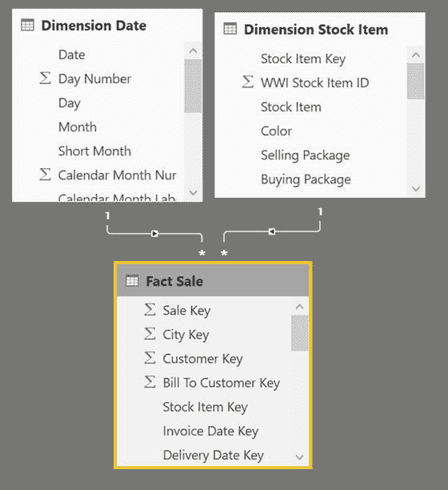

图 6-1

模型中三个表之间的关系

> **提示**：在关系视图中，尝试将一对多关系中“一”方的表放在“多”方表的上方。这有助于在视觉上强化筛选器的级联效应。在“一”方表中选择一列会筛选“多”方表中的行，但反之则不然。

这是用于分析和报表的数据建模中的常见模式。“一”方的表通常是一个项目列表，你可以根据“多”方表中的行对其进行切片和切块。正如表名所示，这些表通常被称为维度表。

维度表通常每个实体有一行，代表可分组的最低细节级别。代表最低粒度的列应该是唯一的，并且包含出现在相关“多”方表中的值。

“多”方表可以在关系列中包含多个具有相同值的行。这些表通常被称为事实表。希望你的 `Fact Sale` 表对于任何给定日期都有许多行。同样，“多”方表可能没有与“一”方列匹配的行，这也是完全正常的。如果周末或假日没有交易，则可能没有这些日期的行，在设计数据模型时请务必记住这一点。

事实表通常表示操作、事件或交易，并且通常包含时间维度。一个帮助判断数据是应构建为事实表还是维度表的好经验法则是：如果你希望随时间对数据进行计数、求和或显示趋势，则应考虑使用事实表。而如果数据是你想要进行切片和切块分析的对象，那么它可能是作为维度表的合适候选。

在 `WideWorldImportersDW` 数据集中，`Dimension Date` 表的最低粒度是具体某一天，不包含代表小时、分钟或秒的列或行。

`Dimension Date` 表中的其他列允许你以有用的方式对日期进行分组，例如按日历月分组。这些附加列不必是唯一的，并且可以根据你组织的报表要求进行自定义。

此数据集中的 `Dimension Date` 表允许将行按日历和财务范围（例如月份和年份）进行分组。其他列提供了替代格式，例如 `[Short Month]`（一月、二月、三月...）和 `[Month]` 列（一月、二月、三月...）。

在报表的任何部分使用了 `Dimension Date` 表中的任何列，都会通过关系中使用的列自动将过滤信息发送到相关的 `Fact Sale` 表。你无需在切片器、筛选器或视觉对象的轴区域中仅使用关系中定义的列。

从一个非常简单的报表需求开始：显示按发票日期统计的销售数量，我们可以将以下计算度量值添加到数据模型中：

```
Count of Sales = COUNTROWS('Fact Sale')
```

当使用表格视觉对象将此度量值放到报表画布上时，它会显示值为 `228,265`。这恰好与 `Fact Sale` 表中的行数相同。在计算此值时未进行任何筛选；`COUNTROWS` 函数只是对 `Fact Sale` 表进行了一次遍历，计算了每一行。

如果将 `Fact Sale` 表中的 `[Invoice Date Key]` 字段添加到同一个视觉对象中——请注意，这是来自 `Fact Sale` 表的字段，而不是 `Dimension Date` 表——你应该会看到如图 6-2 所示的结果。

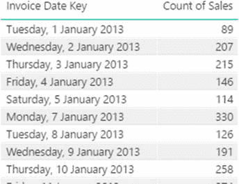

图 6-2

使用 `[Invoice Date Key]` 和隐式度量值的表格视觉对象示例

图 6-2 显示了一个包含 `1,069` 行结果集的前几行。`[Count of Sales]` 列中的每个单元格实际上都执行了计算度量值，但现在应用了一个隐式筛选上下文（也称为查询上下文）。

这意味着 `Count of Sales` 列顶行中的值 `89` 实际上执行了以下计算：

```
Count of Sales = COUNTROWS(
FILTER('Fact Sale',
'Fact Sale'[Invoice Date Key]=DATE(2013,1,1)
)
)
```

`DAX` 引擎已动态地将一个筛选条件应用于原始计算，该条件特定于该单元格。

> **注意**：请记住，报表中显示的每个值都是其自身唯一计算的结果，并不依赖于其他计算的顺序或输出。这包括总计和小计。

`2013 年 1 月 2 日，星期三`的行返回了`Count of Sales`度量值的值`207`。这是`DAX`对原始计算应用了一个略有不同的自动筛选器的结果。在这种情况下，应用的筛选器相当于要求计算引擎统计`Fact Sales`表中满足`[Invoice Date Key]`表的值必须等于`2013 年 1 月 2 日`这一条件的所有行。

第一个示例使用了`Fact Sale`表中的`[Invoice Date Key]`。现在让我们改用相关表中的`[Date]`列，并观察会发生什么（图 6-3）。

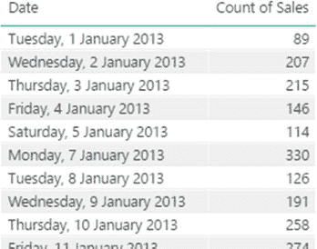

**图 6-3**  
使用`Dimension Date`表中的`[Date]`列的表格视觉对象示例

计算结果相同，只是这次我们使用了不同表中的列。`DAX`引擎自动对`Count of Sales`列中的每个计算应用筛选器（但本例中的最底部总计除外）。区别在于，筛选是在`Dimension Date`表中进行的，然后通过一对多关系向下传递，并应用于`Fact Sale`表中的数据。

为了生成顶行的值`89`，`DAX`引擎知道你希望筛选与`2013 年 1 月 1 日`相关联的数据行。`[Date]`列在`Dimension Date`表中是唯一的，并且也是在`Dimension Date`和`Fact Sale`之间的活动关系中指定的列。

需要使用关系中的信息，是因为你正在使用两个表中的列来生成计算度量值的值。因此，`DAX`引擎会在`Fact Sale`表的`[Invoice Date Key]`列中找到与`Dimension Date`表的`[Date]`列中被筛选值完全匹配的每一行。正是这些行被`[Count of Sales]`计算度量值用来生成相关单元格的值。

此时一个好问题是：既然使用`Dimension Date`表中的列与使用实际`Fact Sales`表中的`[Invoice Date Key]`列产生的结果相同，为什么还要使用前者呢？使用同一表中的列来筛选计算中使用的数据行不是更高效吗？

使用相关表中的筛选器的一些优势包括：

*   **维度表可用于筛选多个事实类型的表**。本示例仅包含一个事实表。如果你的报表视觉对象还使用了来自其他事实表的数据，例如`Fact Purchase`或`Fact Order`，这些表很可能与同一个`Dimension Date`表存在关系。任何基于`Dimension Date`表中的列的切片器或筛选器都会自动通过多个一对多关系向下传播，并应用于使用每个相关事实表中列的计算。
*   **维度表允许你包含以有意义的方式对行进行分组的列**。`Date`表每天包含唯一的一行。`[Calendar Year]`列可以为`Dimension Date`表中值介于`2019 年 1 月 1 日`和`2019 年 12 月 31 日`之间的所有`365`行携带值`"2019"`。同样，`Dimension Date`表中的列可以携带有助于识别和筛选特定月份、季度、工作日、假日、特定事件等行的值。将这些“有用的分组列”存储在一个表中，可以构建更高效且更易于维护的数据模型。
*   **维度表通常保证每个实体对应一行，并且不易出现事实表中可能出现的间隙和重复**。在我使用的简单案例中，没有`2013 年 1 月 6 日（星期日）`的数据。这很可能反映了该组织的运作方式。通过使用`Dimension Date`表中的`[Date]`列，你可以在某些计算中利用所有日期均保证可用的优势——尤其是时间智能`DAX`函数，这些函数旨在假定所使用的列不包含间隙。

在图 6-4 中，两个视觉对象都使用了`Dimension Date`表的`[Date]`列，而不是`Fact Sale`表的`[Invoice Date Key]`列。两者都清楚地显示`1 月 6 日`没有数据行。如果你在行标题或轴中使用`[Invoice Date Key]`列，这个间隙可能会很重要，但也很容易被忽略。

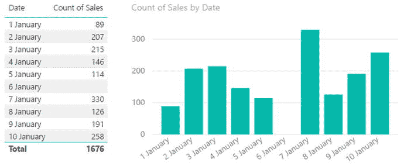

**图 6-4**  
使用`[Date]`列的表格和柱状图视觉对象，显示某天无数据的间隙

好的，作为高级文档工程师和翻译员，我将遵循您的注意事项和示例，将给定的英文文本翻译成中文。

让我们回到最初的例子，再做一次微调。不在可视化对象中使用 `[Date]` 列，而是使用 `Dimension Date` 表中的另一列以及 `[Count of Rows]` 计算度量。请记住，`[Date]` 列保证是唯一的，因为它被用作一对多关系中“一”方的列，因此对于到目前为止示例中的每一行，只有一个值通过该关系传递到 `Fact` 表，作为筛选上下文的一部分。

这一次，我们在可视化对象中使用 `Dimension Dates` 表中的 `[Calendar Year]` 列。这应该会产生如图 6-5 所示的结果。

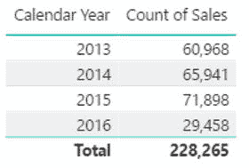

图 6-5

使用 `[Calendar Year]` 字段和隐式度量的表可视化对象

图 6-5 显示了由 `[Count of Sales]` 计算度量生成的五个值。其中四个值被 `[Calendar Year]` 列筛选，而底部的值 228,265 不受任何筛选的影响。顶行的结果 60,968 首先对 `Dimension Date` 表应用一个筛选器，查找 `[Calendar Year]` 列值为 2013 的所有行。这将精确找到 365 行，DAX 引擎随后使用这些行查找每个关联的 `[Date]` 值。这组 `[Date]` 值通过一对多关系向下筛选到 `Fact Sale` 表，以帮助确定计算度量可以使用哪些行。

`[Count of Sales]` 计算度量中使用的 DAX 仅提到了 `Fact Sale` 表，该表被传递给 `COUNTROWS` 函数。计算中没有提到特定的列、如何进行匹配或数据模型中其他表的任何信息。所有这些筛选都是隐式发生的，仅需借助两个表之间预定义的关系。DAX 提供了一个 `FILTER` 函数，但不需要它来满足此要求。

## 显式筛选

前面示例图 6-5 中的所有筛选都用于隐式筛选，这意味着计算本身没有使用 DAX 筛选函数。这允许创建基本报表，但不可避免地，你需要更复杂的筛选逻辑来满足更复杂的报表需求。

DAX 提供了几个筛选函数，本节将介绍使用这些函数的一些常见且有用的示例。DAX 中的筛选函数不仅允许您为计算的隐式筛选提供额外的筛选层，而且还允许您专门覆盖当前的筛选上下文，从而使您的计算能够使用它们原本可能无法访问的行中的数据。

### `FILTER` 函数

我们介绍的第一个筛选函数是 `FILTER` 函数。该函数的语法如下：

```
FILTER ( <Table>, <FilterExpression> )
```

第一个参数是对希望应用筛选的表的引用。第二个参数必须是一个有效的 DAX 表达式，其结果为布尔值 true 或 false，该表达式将逻辑地应用于用作第一个参数的表的每一行。`FILTER` 函数的输出是一个表。当您在嵌套在其他 DAX 函数中使用 `FILTER` 函数时，了解这一点很重要。它可以用作任何接受表作为引用的函数的参数。

沿用 `[Count of Sales]` 度量，让我们添加一个带有简单表达式的 `FILTER` 函数，看看计算会发生什么。

考虑清单 6-1 中的计算度量。

```
Count of Sales (10 or more) =
COUNTROWS(
    FILTER(
        'Fact Sale',
        'Fact Sale'[Quantity] > 10
    )
)
```

清单 6-1
将 `FILTER` 函数与 `COUNTROWS` 一起使用

这与之前计算的区别在于，此版本使用 `FILTER` 函数代替了原始的 `Fact Sale` 表引用。此更改的结果如图 6-6 所示。

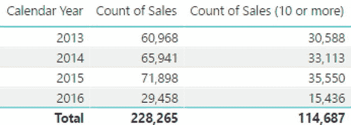

图 6-6

将 `[Count of Sales (10 or more)]` 度量添加到表可视化对象

新的计算度量作为第三列添加到表可视化对象中。要理解顶行的值 30,588 是如何得出的，让我们看看发生了什么。在此示例中，有两层筛选在起作用。第一层是隐式筛选（查询上下文），由 `[Calendar Year]` 列驱动。第二层是清单 6-1 中 `FILTER` 函数对 `'Fact Sale'[Quantity]` 列使用的显式规则。

隐式筛选上下文将 `COUNTROWS` 函数可见的行数限制为 60,968 行。然后，对于这些行中的每一行，都会应用一个布尔测试，以确定 `[Quantity]` 列的值是否大于 10。此测试有效地丢弃了其余 60,968 行中所有值低于 11 的行。结果是从 `FILTER` 函数返回给 `COUNTROWS` 函数的一个 DAX 表，该表恰好有 30,588 行需要计数。

需要记住的关键点是筛选是按顺序、分层应用的，而不是单个操作。这在为更复杂的报表需求创建 DAX 时提供了额外的灵活性。

你可以扩展用作筛选表达式的 DAX，以包含更具体的要求，如清单 6-2 所示。

```
Count of Sales (10 or more) =
COUNTROWS(
    FILTER(
        'Fact Sale',
        'Fact Sale'[Quantity] >= 10
            && RELATED('Dimension Stock Item'[Size]) = "M"
    )
)
```

清单 6-2
使用来自相关表的筛选条件的计算度量

此示例应用了一条额外的规则，进一步限制了`Fact Sale`表中的行数，该规则使用了由于在可视化对象中使用了`[Calendar Year]`列而从`Dimension Date`表传递下来的隐式筛选（查询上下文）。然后，除了仅考虑值为 10 或更高的行的原始显式筛选要求之外，还添加了一条额外的规则，该规则将筛选应用于另一个相关表。由于`Dimension Stock Item`和`Fact Sales`之间存在关系，因此也应用此筛选要求来最终限制来自`Fact Sales`表的行数，这些行最终被传递给`COUNTROWS`函数进行计数。

结果，图 6-7 中第三列的计算度量值现在更小了。

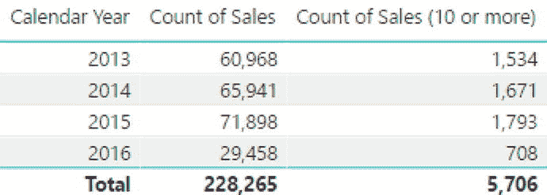

图 6-7

使用清单 6-2 代码的输出

以这种方式使用`FILTER`函数，您可以对任何生效的隐式筛选（查询上下文）应用额外的限制。这意味着您可以创建一些在计算中硬编码了规则的计算，但仍然可以在许多可视化对象中使用这些度量，每个可视化对象都有自己的隐式筛选上下文，这些上下文可以与显式筛选结合，以生成有用的动态结果。

### 覆盖筛选器

到目前为止，筛选过程一直都是累加的，这意味着不同的筛选层只是在计算的不同阶段丢弃某些行。在 DAX 中，有一些筛选函数提供了覆盖隐式筛选层所应用筛选的能力。接下来我们将要查看的就是允许实现此功能的函数：

- `CALCULATE` 和 `CALCULATETABLE`
- `ALL`
- `ALLEXCEPT`
- `ALLSELECTED`

在几种场景下，这些函数会非常有用。例如，它们能够进行期间比较、运行总计和百分比计算等。在这些场景的每一种中，计算都可能需要访问那些已被隐式筛选器忽略的行中存储的值。

### 占总计百分比

从占总计百分比度量值开始，你可以使用按年份统计行数的例子来演示如何覆盖隐式筛选上下文。默认情况下，可视化对象中使用的任何计算的度量值都会受到自动筛选层的影响，该筛选层由同一可视化对象中使用的其他列驱动。

```
Count of Sales = COUNTROWS('Fact Sale')
```

当`[Count of Sales]`度量值与`‘Dimension Date’[Calendar Year]`列被用于同一可视化对象时，它会受到一层隐式筛选的影响，这意味着`COUNTROWS`函数只能考虑`‘Fact Sales’`表中实际行的一部分。

如果需要了解每年占总体的比例，你需要一种方法来指示 DAX 引擎忽略隐式筛选上下文。DAX 提供了`CALCULATE`和`CALCULATETABLE`来帮助管理这一点。

图 6-8 使用以下计算度量值演示了这一点：

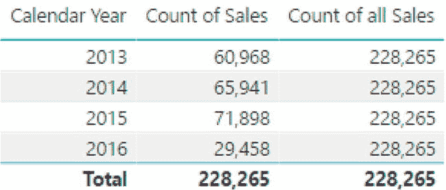

图 6-8

使用`ALL`函数的输出

```
Count of all Sales = CALCULATE(
COUNTROWS('Fact Sale'),
ALL('Fact Sale')
)
```

我们来分解一下，并更详细地解释该计算。

首先，内部的`COUNTROWS`函数与`[Count of Sales]`计算度量值中使用的函数相同。它计算`‘Fact Sale’`表中所有可见行的数量。这通常是查询上下文筛选后的表版本。在此例中，`COUNTROWS`函数被包裹在`CALCULATE`函数内部。

`CALCULATE`函数的语法如下：

```
CALCUALTE ( <表达式>, <筛选器 1>, <筛选器 2> ... )
```

该函数在附加参数提供的筛选器上下文中执行第一个参数提供的表达式。正如`CALCULATE`函数的语法所表明的，可以有任意数量的筛选表达式。在`[Count of all Sales]`示例中，传递给`CALCULATE`函数的参数是`ALL`函数。此处使用`ALL`函数的效果是移除任何可能作用于`‘Fact Sale’`表上的隐式筛选上下文，该表正是`ALL`函数参数所指定的表。

**注意**：以这种方式使用`CALCULATE`和`ALL`会移除所有筛选上下文，包括你可能在别处使用的任何硬编码显式筛选规则，例如报表、页面或可视化对象筛选器。

现在，我们可以编写一个计算，将`[Count of Sales]`与`[Count of all Sales]`结合起来，生成一个显示每行占总计百分比的值。此计算的输出如图 6-9 所示。

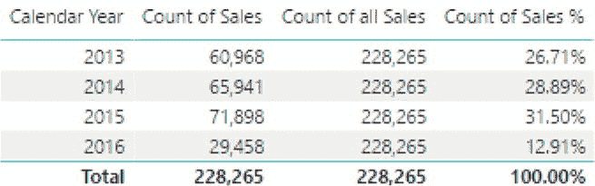

图 6-9

带有额外计算度量值的输出

```
Count of Sales % =
DIVIDE(
[Count of Sales],
[Count of all Sales]
)
```

在图 6-9 的这个例子中，传递给`ALL`函数的表是`‘Fact Sales’`。该函数移除了`‘Fact Sales’`表中的任何隐式筛选上下文，该上下文是由`‘Dimension Date’[Calendar Year]`列生成的查询上下文。如果用`‘Dimension Date’`表代替`‘Fact Sale’`表，则筛选上下文会从`‘Dimension Date’`表中移除。这种细微的变化最终并不会改变此示例中使用的可视化对象的值。

整体筛选的最终效果仍然是向`COUNTROWS`函数传递相同的行。性能上可能有些微差异，但我们将在第 8 章讲解优化 DAX 时探讨这一点。

如果你向表格可视化对象添加一些额外的列，这将演示当你在带有计算度量值的`ALL`函数中指定使用哪个表时所产生的差异。

考虑列表 6-3 和 6-4 中的两个计算度量值。

```
Count of all (Dim Date) Sales =
CALCULATE(
COUNTROWS('Fact Sale'),
ALL('Dimension Date')
)
```

列表 6-3
使用`ALL`函数并指定`'Dimension Date'`表的计算度量值

```
Count of all (Fact Sales) Sales =
CALCULATE(
COUNTROWS('Fact Sale'),
ALL('Fact Sale')
)
```

列表 6-4
使用`ALL`函数并指定`'Fact Sale'`表的计算度量值

这些计算度量值之间的唯一区别在于`ALL`函数中使用的表。当你在仅包含`‘Dimension Date’[Calendar Year]`列的可视化对象中使用它们时，它们会通过两条独立的路径得到相同的结果。但是，如果你引入一个来自`‘Dimension Date’`之外的其他表的筛选器，你就会看到差异。这个例子（如图 6-10 所示）使用了`‘Fact Sale’[Package]`列，该列中所有行都只包含以下四个值之一：Bag、Each、Packet 或 Pair。

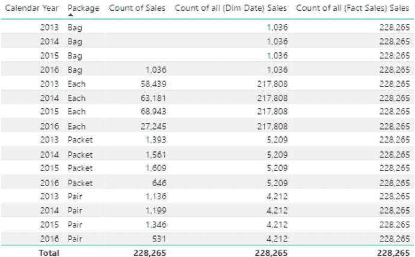

图 6-10

使用列表 6-3 和 6-4 代码的输出

对于图 6-10 中第三、四、五列的每个单元格/计算，计算度量值都始于与当前行相关的自动筛选上下文。`[Count of Sales]`度量值没有移除任何隐式筛选上下文，因此其值反映了`‘Fact Sale’`表中恰好与`[Calendar Year]`和`[Package]`列匹配的行数。

然而，对于`[Count of all (Dim Date) Sales]`计算度量值，唯一被移除的筛选上下文是存在于`‘Dimension Date’`表上的任何上下文，而非应用于`‘Fact Sale’`表的任何筛选上下文。这就解释了为什么你会看到`[Package]`值为 Bag 的行与`[Package]`值为其他值的行之间存在不同的数值。

这里发生的情况是，由`[Calendar Year]`列驱动的隐式筛选器被移除了，而由`[Package]`列驱动的隐式筛选器则未被移除。

对于 `[Count of all (Fact Sales) Sales]` 计算度量值，`ALL` 函数清除了 `'Fact Sales'` 表中的所有隐式筛选器，这包括从相关表传递下来的任何隐式筛选器；因此，`COUNTROWS` 函数现在可以使用 `'Fact Sale'` 表中的每一行来生成一个数值。

隐式筛选上下文不仅由同一可视化对象中使用的其他列驱动，还可以由当前可视化对象外部的筛选器驱动。这些筛选器可以表现为同一报表上切片器的选择，或其他非基于 DAX 的外部筛选器设置。

### 显式筛选器

那些用于移除隐式筛选上下文的功能对显式筛选器无效。这意味着，如果你在计算度量中使用了特定的筛选规则，那么下游计算将无法移除该筛选条件。

请思考清单 6-5 和 6-6 中的两个计算度量。

```
销售量计数（10 及以上） =
COUNTROWS(
FILTER(
'Fact Sale',
'Fact Sale'[数量] >= 10
)
)
清单 6-5
对[数量]列应用筛选器的计算度量
```

```
所有（显式）销售计数 =
CALCULATE(
[销售量计数（10 及以上）],
ALL('Fact Sale')
)
清单 6-6
展示清单 6-5 中计算度量与 ALL 函数结合效果的计算度量
```

当该计算用于表格可视化时，你将得到如图 6-11 所示的输出。

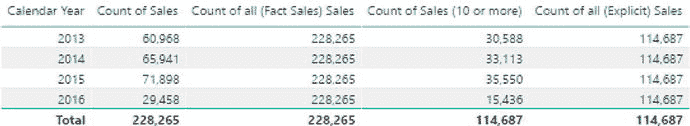

**图 6-11** 使用清单 6-5 和 6-6 中代码的输出

在图 6-11 中，第四列使用了 `[所有（显式）销售计数]` 计算度量。每个单元格中的值是隐式筛选上下文和显式筛选混合作用的结果。值 30,588 表示来自 `'Fact Sales'` 表且属于隐式筛选上下文 `[日历年份]` 2013 的行数，同时额外限制只统计 `'Fact Sale'[数量]` 大于等于 10 的行。最终会得到五个不同的值，包括底部的合计行。

然而，对于最后一列的 `[所有（显式）销售计数]` 计算度量，它使用了 `ALL` 函数来指定应移除 `'Fact Sale'` 表上可能存在的所有隐式筛选上下文。结果是相同的值 114,687，因为对 `[日历年份]` 的隐式筛选被 `ALL` 函数移除了。这表明查询上下文已被 `ALL` 函数移除，而上游的 `'Fact Sale'[数量] >=10` 筛选条件仍然保留。

也许 `ALL` 函数更贴切的名称是 `REMOVEALLIMPLICITFILTERS`（移除所有隐式筛选器），这更能体现该函数的目的。我在本章中一直使用“隐式”这个词。关键在于，尽管它能有效移除所有继承的筛选器，但显式筛选器（像这里用于将结果限制在 `[数量]` 大于等于 10 的行的筛选条件）不会受到影响。

### ALL 函数

上一节介绍了强大的 `ALL` 函数。现在我们更深入地看看这个函数。其语法如下：

```
ALL ( <表> | <列> [, <列> ...] )
```

`<表>` 和第一个 `<列>` 之间的 `|` 符号代表“或”。这意味着第一个参数可以是表，也可以是列。如果第一个参数是表，则不能使用第二个参数。这种情况下，指定表上的所有隐式筛选上下文都会被移除，实际上就是返回表中的所有行。如果使用列作为第一个参数，那么只要所有列都来自同一个表，就可以使用第二、第三个参数。

上一节中 `[所有（显式）销售计数]` 计算度量更高效的使用方式如下：

```
所有（显式）销售计数 =
CALCULATE(
[销售量计数（10 及以上）],
ALL('维度日期'[日历年份])
)
```

此计算度量的改动在于，`ALL` 函数现在使用列而非表作为参数。更重要的是，传递给 `ALL` 函数的列正是驱动隐式筛选的列。此更新版本产生的值与使用 `'Fact Sales'` 表作为参数的版本相同。

在此示例中，如果 `ALL` 函数使用任何其他列，每个单元格将产生不同的值。为这两个版本的计算度量生成的查询计划相同，因此将 `<表>` 替换为 `<列>` 在此处不会影响性能。在其他情况下，将 `<表>` 替换为 `<列>` 可能会带来更快的性能。

#### ALLEXCEPT 函数

另一个能够覆盖隐式筛选器的 DAX 函数是 `ALLEXCEPT` 函数。在清除筛选器的方式上，它与 `ALL` 函数类似，但使用此函数时，参数用于指定哪些筛选器保留隐式筛选。

以下是 `ALLEXCEPT` 函数的语法：

```
ALLEXCEPT ( <表>, <列> [, <列> ...] )
```

使用 `ALLEXCEPT` 时，至少需要同时传递一个表和一个列。还可以使用一个或多个列作为额外参数。当用于列数众多的表时，此函数是 `ALL` 函数的一个便捷替代方案。

如果你有一个包含 30 列的表，并且某个计算需要清除其中 28 列的隐式筛选器，使用 `ALL` 函数需要传递 28 个参数。然而，使用 `ALLEXCEPT` 函数只需传递 3 个列即可。

请思考表 6-1。

**表 6-1** 用作 `Table1` 表的数据集

| ColumnA | ColumnB | ColumnC | ColumnD | ColumnE |
| --- | --- | --- | --- | --- |
| A | 苹果 | 澳大利亚 | 田径 | 10 |
| B | 香蕉 | 巴西 | 田径 | 15 |
| C | 樱桃 | 加拿大 | 板球 | 30 |

清单 6-7 和 6-8 中的计算度量具有相同的净效果。

```
ALL 度量 =
CALCULATE(
SUM('Table1'[ColumnE]),
ALL(
Table1[ColumnA],
Table1[ColumnB],
Table1[ColumnC]
)
)
清单 6-7
使用包含特定列的 ALL 函数的计算度量
```

```
ALLEXEPT 度量 =
CALCULATE(
SUM('Table1'[ColumnE]),
ALLEXCEPT(
Table1,
Table1[ColumnD]
)
)
清单 6-8
使用包含特定列的 ALLEXCEPT 函数的计算度量
```

将两个计算度量添加到表格可视化后的结果如图 6-12 所示。

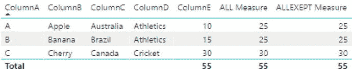

**图 6-12** 使用清单 6-7 和 6-8 中代码的输出

图 6-12 中右侧的两列显示了两个版本计算度量的输出。在每种情况下，由前三列生成的隐式筛选器都被清除，只留下来自 `ColumnD` 的隐式筛选器被 `CALCULATE` 内部的 `SUM` 函数考虑。

这同样表明，你可以对数据中的子类别执行百分比计算。通过这种方式使用 `ALL` 或 `ALLEXCEPT` 函数，你可以生成一个值，显示按 `ColumnD` 分组的 `ColumnE` 值的总和。然后，你就可以在计算中使用该值，以显示在 `ColumnD` 为“田径”的每一行中，“巴西”所占 `ColumnE` 的比例。

清单 6-9 中的计算度量返回一个代表子类别百分比的值。结果如图 6-13 所示。

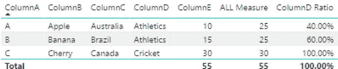

**图 6-13** 清单 6-9 中代码格式化百分比后的输出

```
ColumnD 比率 =
DIVIDE(
SUM('Table1'[ColumnE]),
[ALL 度量],

)
清单 6-9
整合了清单 6-7 中计算度量的计算度量
```

### ALLSELECTED 函数

本节要探讨的最后一个函数是 `ALLSELECTED` 函数。与 `ALL` 和 `ALLEXCEPT` 类似，此函数的目的是移除当前计算中的隐式或继承筛选，从而允许访问那些原本不可用的数据行。`ALLSELECTED` 与前面几个函数的区别在于，`ALLSELECTED` 仅移除在同一查询内部生成的隐式筛选器。

这一点在 Power BI 中尤其有用，因为视觉对象上的每个值都可能受到来自多个位置的筛选器影响。这些值可以通过硬编码的 DAX 进行显式筛选，也可以通过同一视觉对象中的其他字段（如列标题、行标题或轴上使用的字段）进行隐式筛选。最后，筛选器还可以从当前视觉对象外部的选择中继承而来。正是由于能够区分当前视觉对象中字段生成的隐式筛选器与外部筛选器，`ALLSELECTED` 才显得最为有用。

为了更好地掌握如何结合 WideWorldImportersDW 数据使用所有这些函数，请参考代码清单 6-10、6-11 和 6-12。

```
Sum of Quantity = SUM('Fact Sale'[Quantity])
代码清单 6-10
使用 SUM 的计算度量值
```

```
ALL Quantity =
CALCULATE(
SUM('Fact Sale'[Quantity]),
ALL('Fact Sale')
)
代码清单 6-11
使用 ALL 函数管理筛选上下文的计算度量值
```

```
ALLSELECTED Quantity =
CALCULATE(
SUM('Fact Sale'[Quantity]),
ALLSELECTED('Fact Sale')
)
代码清单 6-12
使用 ALLSELECTED 函数管理筛选上下文的计算度量值
```

当这些度量值与 `'Dimension Date'[Calendar Year]` 列一起用于表格视觉对象时，将得到图 6-14 所示的结果。

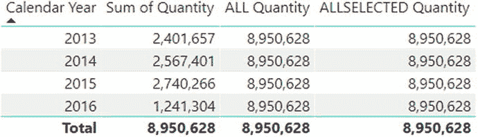

图 6-14
使用代码清单 6-10、6-11 和 6-12 代码的输出结果

`[ALL Quantity]` 列和 `[ALLSELECTED Quantity]` 列中的值并无差异。这里假设没有使用其他视觉对象或外部筛选器来生成此结果。`ALL` 和 `ALLSELECTED` 函数都在移除由 `[Calendar Year]` 列驱动的隐式筛选。

然而，当向报表添加一个外部筛选器（例如，对相关表中的某个字段使用切片器）时，您可以看到这些值会如何变化（图 6-15）。

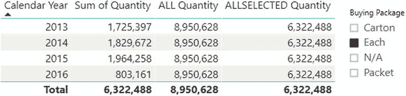

图 6-15
在切片器筛选条件下，使用代码清单 6-10、6-11 和 6-12 代码的输出结果

在此案例中，添加了一个使用 `'Dimension Stock Item'[Buying Package]` 字段且已选择 `Each` 的切片器。三个计算度量值现在对这个外部筛选器产生了不同的响应。

`[Quantity]` 计算度量值现在对 `Quantity` 字段进行求和，并且它继承了两层隐含的筛选上下文。第一行数值 1,725,397 首先受到 `[Calendar Year]` 列筛选 `'Fact Sale'` 表中与 2013 年相关行的影响，而第二层来自切片器的筛选则设置为 `Each`。这两层筛选共同作用，使得 `SUM` 函数仅使用同时满足这两个条件的行。该计算度量值未覆盖任何筛选器。

`[ALL Quantity]` 计算度量值使用 `ALL` 函数移除计算中任何隐含的筛选上下文。这会移除由 `[Calendar Year]` 字段驱动的内部层筛选，以及由切片器驱动的外部隐式筛选层。最终结果是，包括总计行在内的每个单元格都具有相同的值。这一数值恰好也是 `'Fact Sale'[Quantity]` 列的总和。

`[ALLSELECTED Quantity]` 计算度量值现在显示的数值与 `[ALL Quantity]` 列不同。这是因为 `ALLSELECTED` 函数移除了由 `[Calendar Year]` 列驱动的内部筛选层，但并未移除来自切片器的任何筛选。如果现在对切片器进行不同的选择，`[ALLSELECTED Quantity]` 度量值会更新为新的数值，而 `[ALL Quantity]` 度量值则保持不变。

此示例中的三个计算度量值可以作为基础，用于创建其他能够以有趣方式突出显示数据的度量值。它们在你的报表中可能都很有用。希望这些示例能够展示不同筛选函数的意图和使用方法。使用这些函数，可以精确地定位到非常细粒度的行选择，从而提供极大的灵活性。

#### 运行总计

从计算中移除隐式筛选器的能力，在生成运行总计时也非常有用。要创建一个显示 `'Fact Sale'[Quantity]` 列运行总计的度量值，可以从一个核心的 DAX 表达式开始，如下所示：

```
SUM('Fact Sale'[Quantity])
```

挑战在于，当你在可视化对象中使用此表达式时，计算只会考虑 `'Fact Sale'[Quantity]` 列中受其他字段隐式筛选的值。如果查询中还使用了 `'Dimension Date'[Calendar Year]` 字段，则该计算的结果会正确显示每个特定日历年的 `SUM`，但无法访问其他年份的数据以提供运行总计的效果。此时，`ALL`、`ALLEXCEPT` 和 `ALLSELECTED` 函数就能派上用场。

要查看使用 `WideWorldImportersDW` 数据的运行总计演示，请考虑清单 6-13 和 6-14 中的以下度量值。

```
Sum of Quantity = SUM('Fact Sale'[Quantity])
清单 6-13
使用 SUM 的度量值
```

```
Running Total =
CALCULATE(
    SUM('Fact Sale'[Quantity]),
    FILTER(
        ALL('Dimension Date'[Calendar Year]),
        MAX('Dimension Date'[Calendar Year]) >= 'Dimension Date'[Calendar Year])
)
清单 6-14
使用 FILTER 函数生成运行总计的度量值
```

当这些计算度量值添加到同时使用了 `'Dimension Date'[Calendar Year]` 列的可视化对象中时，会产生图 6-16 所示的结果。

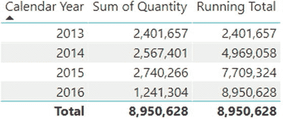

图 6-16

清单 6-13 和 6-14 中代码的输出

`[Sum of Quantity]` 列中的值均显示，在由 `[Calendar Year]` 列驱动相关隐式筛选器的情况下执行计算的结果。该列底部的值 8,950,628 没有隐式筛选上下文，因此它会对 `'Fact Sale'` 表中的每一行进行计算。

对于 `[Running Total]` 计算，`SUM` 函数被包裹在 `CALCULATE` 函数内部，该函数允许定义额外的筛选指令，在此例中，是目标性地移除某些隐式筛选。对于 2014 年的结果 4,969,058，`SUM` 函数需要访问与 2013 年相关的行。

`FILTER` 函数的第一个参数使用 `ALL` 函数移除 `[Calendar Year]` 列上的任何隐式筛选。这将使 `SUM` 函数能够访问 `'Fact Sale'` 表中的每一行。如果只进行到这一步，你会在每个单元格中看到重复的值 8,950,628。

`FILTER` 函数的第二个参数指定了 `MAX('Dimension Date'[Calendar Year]) >= 'Dimension Date'[Calendar Year]`，这定义了一个筛选规则，该规则将 `'Fact Sale'` 表中的行减少到仅满足此布尔条件的行。对于表格可视化对象中的第一行，这意味着仅包含与 2013 年相关的行。对于第二行，则包含所有与 2013 年和 2014 年相关的行。这就是提供运行总计效果的神奇之处。

`[Running Total]` 列中的每个单元格都是一个独立的计算，不依赖或使用可视化对象中任何先前计算的输出。这些计算可以按任意顺序执行，并且只会考虑贯穿了多个筛选层的行。

由于 `xVelocity` 引擎基于内存和列的特性，DAX 可以非常快速地执行这些计算，因此基于单元格的独立计算所提供的额外灵活性通常超过了读取重复的弊端。如果你正在基于大量计算构建运行总计，请牢记这一点。在此示例中，`[Running Total]` 计算执行了五次。

如果在度量值和可视化对象中都使用 `'Dimension Date'[Date]` 列代替 `'Dimension Date'[Calendar Year]`，那么该度量值会执行 1,462 次（`[Date]` 级别每一行执行一次，再加上总计的一次）。与 2013 年 1 月 1 日相关的行中的任何值，都会被这 1,462 次执行中的每一次所使用。

##### ALLSELECTED 在运行总计中的应用

此前在清单 6-14 中展示的 `[Running Total]` 度量值使用了 `ALL` 函数来移除由 `'Dimension Date'[Calendar Year]` 列驱动的任何隐式筛选器。当以这种方式使用时，可视化对象外部使用的、基于除 `'Dimension Date'[Calendar Year]` 之外其他列的其他切片器和筛选器会传递到 `SUM` 计算中。这意味着它们会从 `[Calendar Year]` 列中第一条记录开始提供运行总计，但这些行也应用了一个与切片器选择相关的额外筛选器。

唯一的例外是，如果切片器或外部筛选器是基于 `'Dimension Date'[Calendar Year]` 列的。在这种情况下，如果切片器筛选为 2015 年，产生的值仍然是 7,709,324。`SUM` 仍会考虑所有与 2013 年和 2014 年相关的行。

如果将计算改为使用 `ALLSELECTED` 函数代替 `ALL` 函数，那么任何基于 `'Dimension Date'[Calendar Year]` 的切片器或外部筛选器现在只会考虑与切片器中选择项相关的行。

这可以通过清单 6-15、6-16 和 6-17 中的三个度量值来演示。

```
Sum of Quantity = SUM('Fact Sale'[Quantity])
清单 6-15
使用 SUM 的度量值
```

# 计算列与 `EARLIER` 函数

在编写计算列时，`EARLIER` 函数是一个非常实用的工具。该函数在逻辑上等同于 T-SQL 中的自联接，允许计算访问当前行之外的其他行数据，这包括相关表中的行数据。该函数的名称并未清晰阐明其运作方式；或许换一个名称会更有助于理解。

为了了解该函数的使用方法，请在 `Fact Sale` 表中添加一个计算列。该列的值应显示每位客户每笔交易的上一次交易日期。然后，您可以以此计算为基础，确定自上次购买以来的天数，进而计算平均值并绘制随时间变化的趋势图，从而帮助您了解客户访问频率的变化。

DAX 计算列如代码清单 6-25 所示。

```
Last Purchase Date =
CALCULATE(
LASTDATE('Fact Sale'[Invoice Date Key]),
FILTER(
'Fact Sale',
'Fact Sale'[Customer Key] = EARLIER('Fact Sale'[Customer Key])
&& 'Fact Sale'[Invoice Date Key] < EARLIER('Fact Sale'[Invoice Date Key])
)
)
```

将此计算添加到 `Fact Sale` 表后，新列将为每一行显示该特定客户上一次开具发票的日期。

对应的 T-SQL 代码如代码清单 6-26 所示。

```
SELECT
[Current].[Sale Key],
[Current].[Customer Key],
[Current].[Invoice Date Key],
MAX([EARLIER].[Invoice Date Key]) AS [Last Purchase Date]
FROM Fact.Sale AS [Current]
LEFT JOIN FACT.Sale AS [EARLIER]
ON  [Earlier].[Customer Key] = [Current].[Customer Key]
AND [Earlier].[Invoice Date Key] < [Current].[Invoice Date Key]
WHERE
[Current].[Customer Key] = 10
GROUP BY
[Current].[Sale Key],
[Current].[Customer Key],
[Current].[Invoice Date Key]
```

为了让 `Fact Sale` 表中的每一行都能找到正确的上次购买日期值，它需要访问其所在行本身并未包含的信息。它需要一种方法来查看表中的其他行。`EARLIER` 函数实现了一种逻辑自联接形式，当与 `FILTER` 函数结合使用时，允许计算找到相关行。

在这个例子中，`Fact Sale` 表中的一个单一行首先从自联接表中找出所有 `[Customer Key]` 匹配的行。这包括了那些 `[Invoice Date Key]` 晚于当前行值的行。随后，应用额外的筛选条件，限制外部 `[Invoice Date Key]` 的行，使其值小于当前行的 `[Invoice Date Key]` 值。

这样操作仍可能产生多个值，因此表达式中使用了 `LASTDATE` 函数来选取恰好是剩余日期中最旧的单个日期。在本例中，您也可以使用 `MAX` 函数来替代 `LASTDATE`。

此计算列为表中的每一行生成一个相关值。由于它是一个计算列而非计算度量值，因此无法通过报表切片器或筛选器进行更改。

`EARLIER` 函数的名称暗示它可能提供基于顺序查找前一行记录的功能。但实际情况并非如此，或许像 `OUTERTABLE` 这样的名称会更有意义。

变量提供了 `EARLIER` 函数的另一种表示方式。代码清单 6-27 中的计算列使用 `VAR` 代替 `EARLIER` 完成了相同的任务。

```
Running Total ALL =
CALCULATE(
    SUM('Fact Sale'[Quantity]),
    FILTER(
        ALL('Dimension Date'[Calendar Year]),
        MAX('Dimension Date'[Calendar Year]) >= 'Dimension Date'[Calendar Year])
)
```

清单 6-16
使用 ALL 函数管理筛选上下文的运行总计度量值

```
Running Total ALLSELECTED =
CALCULATE(
    SUM('Fact Sale'[Quantity]),
    FILTER(
        ALLSELECTED('Dimension Date'[Calendar Year]),
        MAX('Dimension Date'[Calendar Year]) >= 'Dimension Date'[Calendar Year])
)
```

清单 6-17
使用 ALLSELECTED 函数管理筛选上下文的运行总计度量值

图 6-17 显示了使用 `'Dimension Date'[Calendar Year]` 列对切片器进行选择后的结果。在此示例中，对切片器进行了 2015 年和 2016 年两项选择。

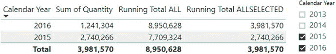

图 6-17
清单 6-15、6-16 和 6-17 中代码的输出，并带有切片器的两项选择筛选

这两个运行总计度量值之间的区别在于它们各自对切片器的反应方式。使用 `ALL` 的版本会移除 `'Dimension Date'[Calendar Year]` 列上的所有筛选，无论筛选来源如何，而使用 `ALLSELECTED` 的版本则保留切片器的筛选上下文。这意味着使用 `ALLSELECTED` 的计算无法访问 `'Fact Sale'` 表中与 2013 年或 2014 年相关的行，因此运行总计从 2015 年而非 2013 年开始。

两种方法都可能满足你的报表需求。有时你需要使用一种方法，其他时候则需要另一种。这个示例希望展示如何利用不同的筛选器函数来实现你的需求。

## 重置累计总计

累计总计度量的一种细微变化，是提供子类别中某个值的累计总计，该总计会在类别之间重置。例如，可以使用 `Dimension Date` 表来演示这一点，其中类别是 `Calendar Year`（日历年），子类别是 `Calendar Month`（日历月）。

首先向 `Dimension Date` 表添加以下计算列：

```
Calendar Month = STARTOFMONTH('Dimension Date'[Date])
```

这会生成一个新列，该列的值显示每个相关月份的第一天。

`[Running Total ALL]` 计算度量（不同之处已高亮显示）的修改版本如列表 6-18 所示。

```
Running Total ALL =
CALCULATE(
SUM('Fact Sale'[Quantity]),
FILTER(
ALL(
'Dimension Date'[Calendar Month],
'Dimension Date'[Calendar Year]
),
MAX('Dimension Date'[Calendar Month]) >= 'Dimension Date'[Calendar Month] &&
MAX('Dimension Date'[Calendar Year]) = 'Dimension Date'[Calendar Year])
)
```

**列表 6-18** 每年重置的累计总计计算度量

当在矩阵视觉对象中与 `'Dimension Date'[Calendar Year]` 列以及新的 `'Dimension Date'[Calendar Month]` 列一起使用时，该计算度量会生成图 6-18 所示的结果。

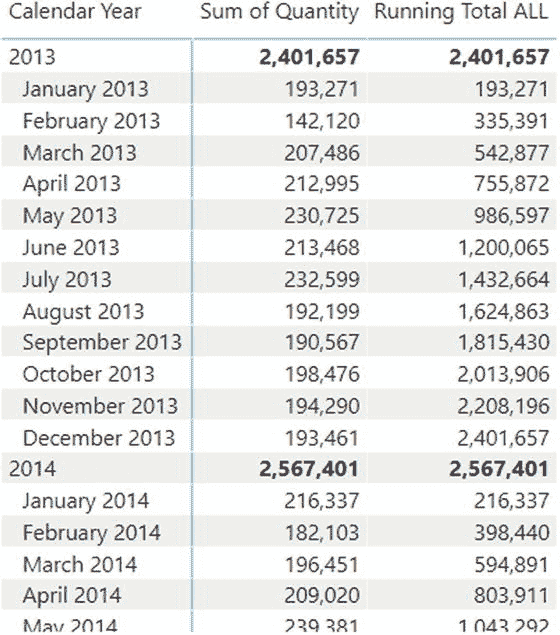

**图 6-18** 使用列表 6-18 中的代码生成的输出。累计总计在 2014 年重置。

在此计算中，`FILTER` 函数使用更复杂的规则来确定应移除或应用哪些筛选器，从而决定 `SUM` 函数可以考虑哪些行。

`ALL` 函数移除来自 `[Calendar Year]` 和 `[Calendar Month]` 列的任何隐含筛选。此时，`SUM` 计算为 `[Running Total ALL]` 列中的每个单元格返回值 `8,950,628`。

然而，`FILTER` 函数中的规则正在应用额外的筛选。根据这些规则，需要满足两个条件。

第一个条件是，`Fact Sale` 表中与每个 `'Dimension Date'[Calendar Month]` 相关的行必须与行标题中的 `Calendar Month` 相同，或更早（更早）。这是产生累计总计效果的条件。

这是一种容易混淆的表示法。看似有两个引用指向同一个 `'Dimension Date'[Calendar Month]` 对象。但它们并非同一个对象。一个引用的是查询上下文中的 `'Dimension Date'` 版本，而另一个引用的是筛选上下文中使用的 `'Dimension Date'` 版本。

`>=` 运算符左侧包裹在 `MAX` 函数中的 `'Dimension Date'[Calendar Month]` 引用的是查询上下文。`MAX` 函数确保比较中只使用一个值。

`>=` 运算符右侧的 `'Dimension Date'[Calendar Month]` 引用的是筛选上下文。正是这些记录，包括 `Fact Sale` 中的下游行，被使用并传递给 `SUM` 函数。

筛选表达式中的另一个条件是，仅指定 `Fact Sale` 中与 `'Dimension Date'[Calendar Year]` 建立关系且匹配 `Calendar Year` 行标题值的行。这部分代码用于重置累计总计。

这个需求也可以使用以下计算度量来实现：

```
Running Total YTD =
TOTALYTD(
[Sum of Quantity],
'Dimension Date'[Date]
)
```

`TOTALYTD` 函数为每个 `Calendar Month` 提供累计总计，并且每年重置一次。虽然这更简单，但它仅设计用于基于日期的列，并且对累计总计的灵活性要求较低。`[Running Total ALL]` 版本使用了一种可以应用于不同类型数据的模式，并且对何时重置累计总计（如果需要重置的话）的规则有更多控制。

## 作为排名的累计总计（计算列）

累计总计模式的另一种用途是为数据集提供排名，输出的是列而非度量。此计算列提供了一个版本，根据总销售额为客户建立从 `1` 到 `403` 的排名（列表 6-19）。该计算依赖于 `Dimension Customer` 表和 `Fact Sale` 表之间存在的**一对多**关系。

```
Customer Rank Column =
RANKX(
'Dimension Customer',
CALCULATE(
SUM('Fact Sale'[Total Excluding Tax])
)
)
```

**列表 6-19** 在关系上使用 `RANKX` 的计算列

关于此 DAX 语句值得指出一个有趣特性，即 `CALCULATE` 的使用。这是必需的，用于将当前行上下文转换为筛选上下文，以便 `SUM` 函数能够利用关系正确为每一行生成正确的值。如果移除 `CALCULATE` 语句，`SUM` 函数只会重复返回相同的值。返回的值是 `Fact Sale` 表中所有行的总和。

此计算仅在数据刷新到模型时进行计算，因为它是一个计算列。筛选器和切片器对返回的数字没有影响。

为了帮助理解 DAX 公式的方法，请查看等价的 T-SQL 代码（列表 6-20）。

```
WITH Ranking (
[Customer Key],
[Total Excluding Tax]
)
AS
(
SELECT
D.[Customer Key],
SUM(F.[Total Excluding Tax]) AS [Total Excluding Tax]
FROM Dimension.Customer AS D
INNER JOIN Fact.Sale AS F
ON F.[Customer Key] = D.[Customer Key]
GROUP BY
D.[Customer Key]
)
SELECT
L.[Customer Key],
COUNT(*) AS [Final Ranking]
FROM Ranking AS L
INNER JOIN Ranking AS R
ON L.[Total Excluding Tax] <= R.[Total Excluding Tax]
GROUP BY
L.[Customer Key]
ORDER BY
COUNT(*)
```

**列表 6-20** 列表 6-19 中 DAX 代码的 T-SQL 等价物

最终的 SELECT 语句对 `INNER JOIN` 操作中的谓词执行自联接，过滤掉 `[Total Excluding Tax]` 值更高的行。您可以通过计算 `INNER JOIN` 之后的行数来获得排名。使用 T-SQL 可以通过其他方式实现这一点，但这个版本有助于您理解 DAX 公式所采用的方法。

`FILTER` 函数采用了类似于 T-SQL 自联接的方法，您可以通过使用不同的筛选规则来定制它，以满足不同的需求。

## 时段比较

一个常见需求是将某一时段的值与前一时段进行比较。这便于进一步计算变化百分比等指标。例如，在特定月份显示某个度量值的同时，旁边展示上个月（或去年同月）该度量值的数值。

在查看清单 6-21 至 6-24 中的四个计算度量时，我们可以考虑与上个月进行比较的示例。

```
Using Filter =
CALCULATE(
[Sum of Quantity],
FILTER(
ALL('Dimension Date'[Calendar Month]),
MAX('Dimension Date'[Calendar Month]) = EDATE('Dimension Date'[Calendar Month],1)
)
)
```

清单 6-21
使用 ALL 函数管理筛选上下文的时段比较计算度量

```
Using Parallel Period =
CALCULATE(
[Sum of Quantity],
PARALLELPERIOD('Dimension Date'[Date],-1,MONTH)
)
```

清单 6-22
使用 PARALLELPERIOD 的时段比较计算度量

```
Using Date Add =
CALCULATE(
[Sum of Quantity],
DATEADD('Dimension Date'[Date],-1,MONTH)
)
```

清单 6-23
使用 DATEADD 的时段比较计算度量

```
Using Previous Month =
CALCULATE(
[Sum of Quantity],
PREVIOUSMONTH('Dimension Date'[Date])
)
```

清单 6-24
使用 PREVIOUSMONTH 的时段比较计算度量

这四个计算度量都产生相同的结果，您可以在图 6-19 的右侧列中看到。

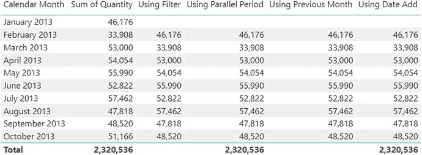

图 6-19
清单 6-21 至 6-24 中代码的输出结果

对于 2013 年 2 月这一行，四个计算度量均返回 46,176 这个值，这恰好是 2013 年 1 月 `[Sum of Quantity]` 的值。除了其中两个度量在 `[Total]` 列中也提供数值外，它们都会对外部切片器和筛选器做出响应。

`[Using Filter]` 度量编写最为复杂，但它为自定义筛选规则提供了最大的灵活性。在此实例中，可以轻松添加和应用额外的显式筛选层级。您还可以配置 `[Using Filter]` 度量，使其始终查看特定月份，而非相对月份。

`[Using Parallel Period]` 和 `[Using Date Add]` 版本利用了无需 `ALL` 或 `ALLSELECTED` 函数即可访问上下文之外数据的函数。这些函数还提供了根据其他时间段进行定制的灵活性。例如，需求可能是始终将当前月份与始终早两个月或十二个月的月份进行比较。`PARALLELPERIOD` 和 `DATEADD` 函数都支持将 `QUARTER` 和 `YEAR` 作为返回选项。您还可以对间隔使用正数和负数。

最后，`[Using Previous Month]` 度量在这四个度量中格式最为简单，但灵活性也最低。

在本例中，四个计算度量均在 `Fact Sale` 表的某一列上计算表达式，但使用 `Dimension Date` 表中的列来确定日期时段。它们遵循这两个表之间活动关系确定的规则，在此例中基于 `Fact Sale[Invoice Date key]`。如果计算应使用 `Fact Sale` 中的不同列进行分组，则可以将 `USERELATIONSHIP` 作为附加参数添加到 `CALCULATE` 函数中。这使得可视化图表能够按照您的需求，显示按交付日期表示的度量值。

`Dimension Date[Date]` 列在每个计算度量中也都出现。该列存在于一个确保日期连续的表中。某些基于时间智能的度量依赖于此才能正常工作。如果使用了 `Fact Sale` 中的日期列，可能会产生最初不易察觉的意外结果。

我将在第 8 章中分析这些度量的个别性能明细。

