# 7. 日期

大多数数据模型都包含日期或时间元素。我不记得上次处理不涉及任何日期值的数据模型是什么时候了。

业务数据总是包含记录时间点的交易表。有时一行数据可能包含多个`DateTime`字段，用于表示与该交易相关的不同操作。以客户订单为例，可能有值来显示原始订单的时间点、取货日期、交货日期和开票日期。下游的报表需求可能需要根据这些`DateTime`值对数据进行分组，以提供与不同业务部门相关的视角。

传感器日志数据可能包含标识传感器的字段、显示读数时间点的字段（可能精确到微秒），以及读数本身的值。

其他类型的数据通常至少有一个组件会记录一个`DateTime`值，该值代表与该行或批次中其他数据相关的时间点。

为了进行报表和分析，数据模型通常需要通过以下三类问题来组织原始数据：
-   已发生的事件：例如，“我们从哪里来？”
-   当前状态：例如，“我们现在在哪里？”
-   未来趋势：例如，“我们要向何处去？”

要回答每个问题，都需要能够按日期或时间组织数据。第一个问题有助于展示历史上已发生的事实和事件的值。这可以揭示某个指标在历史上起伏的模式。例如，近期数据可能呈上升或下降趋势。或者，在按时间对数据进行分组、排序和绘制图表时，可能会出现循环或季节性趋势，这非常有用。能够将历史数据按时间桶进行分组和排序，能大大简化对已发生事件的理解过程。

在短期规划中，展示数据的当前状态可能非常有用。了解账户当前可用资金、当前库存商品数量、或车辆/物品的当前位置，可以为您制定短期计划提供有价值的见解。

最后，能够预测未来时间点的可能值，可以满足另一类报表需求。利用预测数据来帮助精确调整和优化未来的员工及库存水平，可以为组织节省宝贵的时间和资源。这些信息可以带来整体效率的提升。

这三个需求都以某种形式依赖于日期和时间数据。将数据按时间顺序组织到桶和组中，可以使创建有用报表的任务变得容易得多。

## 日期

在 DAX 中，术语 `Date` 通常指单个日期或日期分组，不包含小时、分钟或秒的详细信息。即使底层数据包含表示小时、分钟或秒的值，`Date` 也可能表示不包含时、分、秒的值。然后可以将日期组织成多种分组类型。明显的分组有日历年或月、财政年或月。其他有用的分组可以包括周、星期几、月或年的第几天。有许多分组日期的方法。有些方法常见于不同类型的数据，而另一些方法则可能高度特定于您的组织。

使用最低粒度为`Date`的数据可以生成大量有意义的报表。即使原始数据恰好包含交易发生时间点精确到秒的信息，剥离时、分、秒来显示每日、每月或每年的销售数量，通常也比表示更精细细节的报表更有用。

## 时间

在数据建模中，`Time` 通常指包含小时、分钟和秒（有时是毫秒）值的时间点。这个值可能包含也可能不包含年、月、日的值。有时，一个像`10:37 am`这样的`Time`值可以完全有意义，而不管它属于哪一天。这个值可以细分为`10 am`或上午（或上午晚些时候）等分组，数据可以聚合起来用于展示或比较。

# 日期/日历表

对于大多数数据模型而言，一个有用的数据结构是包含一个覆盖了连续日期范围的数据行集。这种表通常被称为日期表或日历表。有时这些表涵盖的时间范围非常广。在其他变体中，该表的最早日期可能仅对应数据模型中最早出现的日期。这些表也可能包含表示未来较远日期的行。

日期表的一个关键特征是每一天都由单独一行表示。任何一天都不应有重复行，更重要的是，数据中不应存在缺口。因此，对于表中最早和最晚日期之间的每一天，都应由表中单独一行来表示。

时间表具有与日期表相似的特征。首先，它们有一行来表示最低的粒度级别，从最低值开始到最高值结束。对于时间表而言，决定其最低粒度取决于你的报表需求。时间表的最低粒度可以是小时、分钟（或更小）。如果以分钟为单位，则表应有 1440 行，分别表示午夜 12:00 到晚上 11:59 之间的每一分钟。如果最低粒度恰巧是小时，则只需要 24 行。

在数据模型中创建日期表（或时间表）与其他表之间的关系时，应将日期表放在关系的一端。关系中涉及的列必须具有唯一性，且可以是任何数据类型。理想情况下，相关表中的对应列应具有相同的数据类型，并且其值必须能在日期表的列中找到精确匹配项。日期表中存在相关表中没有匹配行的记录是完全可以的，但如果反过来（相关表中的数据在日期表中找不到匹配），就会出现问题。

> **注意**  
> 如果日期表中用于关系的列不包含小时、分钟或秒，而相关表中的对应列却包含这些信息，则许多行可能无法匹配。在这种情况下，使用日期表中字段作为轴的视觉对象将报告低于预期的值。由于不会生成错误，因此这可能导致容易被忽略的问题。

对于日期表，我通常更喜欢使用日期数据类型的列，但像 `20190101` 这样的整数值同样适用。关键在于确保关系中所涉及的每一列的值使用相同的数据格式。

日期表可以同时与多个表建立关系。这使得使用日期表创建切片器（或筛选器）进行选择后，该选择会传播到所有相关表。

在一个模型中，日期表与另一个表之间可以创建多个关系。如前所述，销售表可能包含表示订单各个阶段的列。同一行中的订单日期、交货日期和发票日期可能具有不同的值。图 7-1 显示了 `'Dimension Date'` 和 `'Fact Sale'` 之间的两个关系。两个表之间的实线表示活动关系。使用表中数据的计算默认会使用此关系。如果某个计算需要使用非活动关系中的规则，则可以在计算中使用 `USERELATIONSHIP` 函数。

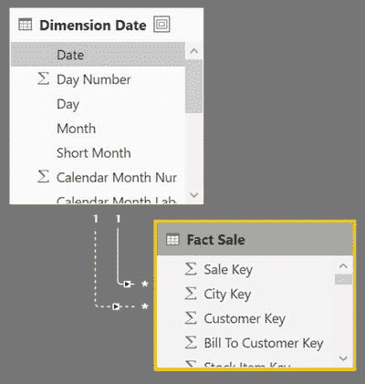

*图 7-1 — `'Dimension Date'` 与 `'Fact Sale'` 之间的关系*

在该图中，`'Dimension Date'` 和 `'Fact Sale'` 之间的活动关系基于 `[Invoice Date Key]`，而非活动关系则使用 `[Delivery Date Key]`。

清单 7-1 和 7-2 中显示的计算展示了如何使用这些关系。`[Count of Invoice Rows]` 计算度量只包含关于 `'Fact Sale'` 数据的表达式。当此度量用于包含 `'Dimension Date'` 字段的视觉对象时，查询上下文将根据 `[Invoice Date Key]` 自动筛选 `'Fact Sale'` 中的行组。

`[Count of Delivery Rows]` 度量使用 `USERELATIONSHIP` 来覆盖默认行为，以生成一个可用于绘制在给定 `'Dimension Date'` 值组中进行交付的行数的值。

```
Count of Invoice Rows =
COUNTROWS('Fact Sale')
```

*清单 7-1 — 使用 `COUNTROWS` 的计算度量*

```
Count of Delivery Rows =
CALCULATE(
    COUNTROWS('Fact Sale'),
    USERELATIONSHIP(
        'Dimension Date'[Date],
        'Fact Sale'[Delivery Date Key]
    )
)
```

*清单 7-2 — 在非活动关系上使用 `USERELATIONSHIP` 的计算度量*

图 7-2 显示了 WideWorldImportersDW 数据集前六个月中这两个计算度量的结果。

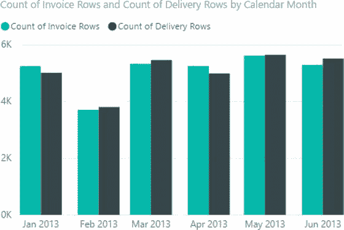

*图 7-2 — 使用清单 7-1 和 7-2 代码的簇状柱形图视觉对象*

数据模型中有多个日期表是完全正常的，这允许你在报表中使用多个日期范围。某些计算可以使用基于一个日期表的切片器所做的选择，而其他计算可以生成考虑基于另一个日期表的切片器所做选择的值。这些情况不常见，但你可以用它们来解决更棘手的报表场景。

日期表的最低要求是拥有一个表示日期的单列。通常，日期表中的附加列允许对日期进行分组和排序。常见的分组包括年、季度和月。一些日期表有数十个附加列以适应各种日期分组。

在本章后面，我将向你展示如何使用 `DAX` 函数生成日期表而无需使用外部数据。通常情况下，组织会有外部数据集，你可以将其导入数据模型，这些数据集已包含有用的行和列。查询编辑器也为你提供了为日期表生成数据的能力，你可以根据需要对其进行自定义。

## 自动日期表

Power BI Desktop 中有一个功能，可以自动为你的模型创建隐藏的 `Date` 表。如果启用此功能，Power BI 会为每个表中使用 `Date`/`DateTime` 数据类型（且尚未参与关系的一端）的每一列创建一个隐藏的 `Date` 表。如果你的模型有五个 `Date`/`DateTime` 列，Power BI Desktop 就会向模型添加五个隐藏的 `Date` 表。这些隐藏表的目的是帮助为你的模型提供自动化的时间智能层。

如果你向模型导入一个数据表，且该表中有一列使用了 `Date` 数据类型，Power BI 会添加一个包含七列（表 7-1）的表，该表填充了足够的日期以覆盖导入表中的数据，并四舍五入到每年的开始和结束日期。

**表 7-1**
Power BI 自动创建的日期表的结构和示例数据

| Date | Year | MonthNo | Month | QuarterNo | Quarter | Day |
| --- | --- | --- | --- | --- | --- | --- |
| 2019-01-01 | 2019 | 1 | January | 1 | Qtr 1 | 1 |
| 2019-01-03 | 2019 | 1 | January | 1 | Qtr 1 | 2 |
| 2019-01-03 | 2019 | 1 | January | 1 | Qtr 1 | 3 |
| … | … | … | … | … | … | … |

这个表的结构可以作为你设计任何 `Date` 表的一个良好起始模板。第一列是唯一的，并用于关系。其他列仅提供分组值。在 Power BI 中，默认情况下，如果将表中的 `Date` 字段拖放到可视化对象上，你可以选择使用基于此自动表的层次结构，或者仅使用实际表中的值。

此表能让你快速按年、季度、月或月的第几天进行切片和切块。

如果你能熟练使用 `Date` 表，并且有自己的高质量数据集可供使用，你可以在选项和设置中关闭此功能。

### 快速度量

2017 年，Power BI 引入了一项名为快速度量的功能。此功能允许报表作者通过对话框快速创建计算度量，而无需手动编写 `DAX`。这些度量涵盖各种常见场景，例如年初至今的总额和滚动平均值。然而，在撰写本文时，快速度量仅使用自动提供的 `Date` 表中的数据，而不能用于你自己 `Date` 表中的列。一旦创建了快速度量并获得了计算模式，如果你需要，可以修改并调整它以使用其他 `Date` 表。

如果你检查由快速度量功能创建的计算度量的 `DAX` 代码，可能会注意到用于引用自动 `Date` 表中列的语法略有不同。作为快速度量创建的年初至今计算度量中的核心表达式可能如下所示：

```
TOTALYTD(
    SUM('Table1'[Quantity]),
    'Table1'[My Date Col].[Date]
)
```

上述代码中突出显示的部分展示了一种特殊语法，该语法仅适用于 Power BI 提供的自动 `Date` 表。此语法包含三部分。第一部分是 `'Table1'`，它是对正在使用的表的引用。第二部分是 `[My Date Col]`，它是对要从 `Table1` 使用的列的引用。第三部分是 `[Date]` 列引用。这是自动 `Date` 表中列的名称。此列中的值将供 `SUM` 表达式使用，而不是 `[My Date Col]` 列中的值，后者可能存在间隙或其他基于日期的错误。

### 按列排序

自动 `Date` 表的结构凸显了在处理 `Date` 表时你可能遇到的另一个常见问题。这涉及基于文本的列的默认排序顺序。默认情况下，Power BI 按字母顺序对基于文本的列进行排序。自动表有两列基于文本的列：`[Month]` 和 `[Quarter]`。如果在可视化对象中使用这两列中的任何一列，其值都会按字母顺序排序。对于 `[Month]` 列，像 April、August 和 December 这样的值会排在开头，而 November、October 和 September 则排在末尾。

以下是使用默认排序顺序的日历月份列表：

```
April
August
December
February
January
July
June
March
May
November
October
September
```

然而，你极有可能需要特意以这种方式组织数据。要覆盖此行为，请使用 **按列排序** 功能，该功能允许使用另一列来对某一列进行排序。通常，指定的列是数值型的，但并非必须如此。在 `Date` 表中，一种常见模式是，对于表中的每个基于文本的列，都存在一个数值等效列，完全用于对该文本列进行排序。用于排序的数值列可以被多个列使用。例如，你可以使用 `[MonthNo]` 来排序 `[Long Month Description]` 以及 `[Sort Month Description]`。你还可以隐藏 `[MonthNo]` 列以帮助整理模型。

**按列排序** 功能并不仅限于对日期进行排序；你还可以使用它来按照对可视化对象有意义的方式排列诸如 Low、Medium 和 High 等值。它不仅对可视化对象中使用的值的顺序进行排序，还控制这些值在图例和筛选器/切片器中出现的顺序。你还可以使用它来控制类别在堆积柱形图的柱形中出现的顺序。

这是一个有用的功能，但它要求 `[Sort By]` 列中的值与正在排序的列中的值具有多对一的匹配关系。对于 `[Month]` 列中值为 `[January]` 的每一行，在 `[Sort By]` 列中使用的任何值中只能出现一个不同的值。在这种情况下，每个“January”的值都将是 1。

### 在使用月份时包含年份

在规划 `Date` 表时，请考虑在任何月份标签或标识符中包含年份信息，尤其是当数据集涵盖超过一年的时间时。与其将日期 2019 年 1 月 1 日转换为值 `[January]`，不如使用 `[January 2019]`。否则，计算可能会将此日期关联的数据与其他年份的一月数据合并在一起。

对于月份的数值版本，一个好的格式是使用 `YYYYMM`。这可以将相同月份但不同年份的数据分隔开，同时也提供了一个良好的排序列。使用两个大写字母 `M` 会为一月到九月的月份添加前导零。

## 时间智能

在 `DAX` 中构建数据模型时，常会使用到一个术语：时间智能。它本质上指的是将计算/度量与时间元素相结合的概念。它不仅能让你将数据按时间段进行分组和组织，还能让你理解每个时间段在时间顺序上与其他分组之间的关系。在设计与报表和分析相关的数据模型时，诸如显示相关时间段之间的比较或构建截至当前日期的度量等报表需求十分常见。

按年、月、日等类别分组的数据，与按非时间维度分组的数据具有相似的特征。计数、求和、平均值等计算对基于时间的分组与对非基于时间的分组同样有意义。然而，基于时间的分组与基于非时间维度（如尺寸、颜色、重量等）的分组之间的一个关键区别在于，基于时间的计算通常需要反映并展示模型中数据相对于其他数据在时间上的关系。

进一步来看，按产品颜色（红、绿、黄、蓝）进行切片后的计数、求和及其他计算，彼此之间通常没有强关联。你可以按任意顺序在图表上展示它们，并且可以像比较绿色和黄色一样，毫无障碍地比较红色和蓝色的值。

然而，对于日期来说，你更可能需要将 2019 年 1 月、2019 年 2 月、2019 年 3 月和 2019 年 4 月这些类别按顺序排列以便比较。生成 2019 年 2 月数据的计算，更有可能与基于前一个月的数据计算进行比较。虽然也可以像处理基于颜色的类别那样，按任意顺序组织 `DateTime` 类别，但这通常不是普遍需求。

基于时间的报告的另一个额外元素是：展示没有数据的时间段可能与展示有数据的时间段同样重要。当你使用没有红色值的数据按颜色分组时，在图表轴上省略红色占位符是很常见的。然而，如果某一天或某个日期段没有数据，你可能仍然需要通过确保该时间段在轴上有一个占位符来表示这一事实。

`DAX` 提供了一系列时间智能函数，这些函数能够识别时间顺序关系以及它们之间的关联。你可以将这些函数添加到你的计算中，通过最少的 `DAX` 代码来处理常见的时间相关任务。

## 年初至今

如果你需要显示从每个日历年开始到当前时间的度量累积值，有几种方法可以编写此类计算。一种方法是创建一个使用`CALCULATE`和`ALL`或`ALLSELECTED`来清除隐式筛选器的计算度量；这使得`SUM`能够访问当前查询上下文之外的数据，从而生成自年初以来的值。

另一种选择是使用满足此需求的计算，你可以通过时间智能函数来构建。使用`TOTALYTD`函数，你可以向数据模型添加一个计算度量（列表7-3），该度量表示你的表达式在一个日历年的累积值。图7-3展示了此计算的输出。

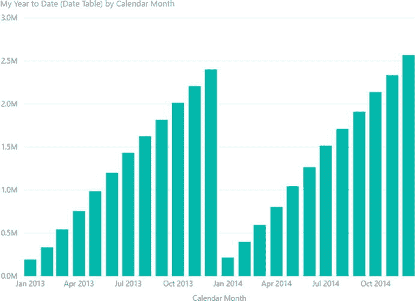

图 7-3 列表7-3中代码在每个日历年重置的输出

```
My Year to Date (Date Table) =
TOTALYTD (
SUM('Fact Sale'[Quantity]),
'Dimension Date'[Date]
)
```

列表7-3 使用`TOTALYTD`的年初至今计算度量

图7-3中的图表显示了在两年期间内每个日历月的柱状图。每个计算值都包含当前月份以及自该日历年起始月份以来所有月份的总和。累积值每年重置。

该函数仅需要两个参数。第一个参数是用于计算的表达式。此计算中的`SUM`函数使用了`'Fact Sale'[Quantity]`列中的数据。你也可以使用另一个计算度量来代替DAX表达式。

第二个参数需要引用一个日期列。

此示例并未使用与传递给`SUM`函数的列来自同一表的日期列；而是使用了来自符合经典日期表规则（每天一行，无间隙或重叠）的表格中的值。在这种情况下，数据会自动按`[Invoice Date Key]`分组，因为这是用于活动关系的列。要覆盖默认关系，可以传递一个额外的筛选条件。这可能采用使用`USERELATIONSHIP`或另一个你希望在DAX表达式之上应用的显式筛选器的形式，以提供额外的灵活性。

这里不需要`CALCULATE`函数，也未使用任何清除隐式筛选器的函数。`TOTALYTD`函数会自动覆盖筛选上下文，从而允许`SUM`函数查看生成累积值所需的所有数据。

当此计算度量用于使用`'Dimension Date'`表中其他字段的视觉对象时，该度量不仅会显示每个时间点适当的累积值，还会在每年重置为零。计算代码中没有任何指示函数如何对数据进行排序的指令。这是自动处理的，因为这是一个时间智能函数。

**注意**
始终注意视觉对象轴上使用的任何日期字段来自哪个表。使用来自不同表的日期列会影响传递给你的计算度量的隐式筛选器，因此可以帮助你获得正确（或错误）的结果。

如果你想使用此函数，但需要从一月以外的月份开始累积数据，你可以添加一个可选参数。这使得该函数对于非每年1月1日开始的财年期间非常有用。如果你的组织有一个在每年6月最后一天结束的财年，将值`"6/30"`作为第三个参数添加。这告诉函数使用第6个月的第30天来重置累积度量。

```
My Year to Date (Date Table) =
TOTALYTD (
SUM('Fact Sale'[Quantity]),
'Dimension Date'[Date],
"6/30"
)
```

一些与`TOTALYTD`类似的函数包括`TOTALMTD`和`TOTALQTD`。这些函数允许你添加计算，以帮助你为数据模型提供月初至今和季度初至今的总计。

# 周期比较

你可以使用其他时间智能函数来简化周期比较的计算。在报表中，显示紧邻上个月同一指标的值，或者将去年同月的数据与当月数据并排展示，通常非常有用。这些比较还可以进一步扩展为显示差值——例如，本月相比上月增长2%，或相比去年同期下降5%。

与`TOTALYTD`示例类似，可以构建一个使用`CALCULATE`函数配合显式筛选规则的周期比较计算，但使用时间智能函数能让这个任务更简单。

清单7-4中的计算度量值生成了一个显示上个月表达式结果的值。

```
上月数量 =
CALCULATE(
[数量合计],
PREVIOUSMONTH('日期维度'[日期])
)
```

清单7-4 使用PREVIOUSMONTH计算上月度量值

该计算度量值将`PREVIOUSMONTH`函数作为筛选器传递给`CALCULATE`函数，以控制`[数量合计]`度量值所使用的数据。`PREVIOUSMONTH`函数返回一个日期表，该表包含上个月每一天的日期值列表。该函数能自动处理连续月份天数不同所带来的特殊问题。

现在，你可以添加一个简单的计算度量值（清单7-5）来显示当前月与上个月之间的百分比差异。

```
数量与上月差异百分比 =
DIVIDE(
[数量合计] - [上月数量],
[上月数量]
)
```

清单7-5 结合清单7-4代码的百分比差异计算度量值

图7-4展示了将这些度量值添加到Power BI表格视觉对象后的效果，该表格使用了`'日期维度'`表中的`日历月`字段。

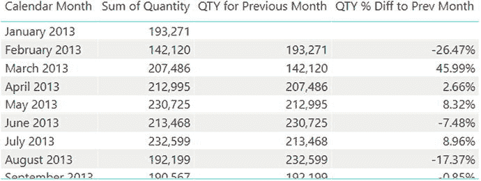

**图 7-4** 清单7-4和7-5中代码的输出结果

`[数量合计]`列显示的是该行对应日历月的值。`[上月数量]`列是使用`PREVIOUSMONTH`函数计算得到的值，而`[数量与上月差异百分比]`列则以百分比形式显示了变化情况。

`[数量与上月差异百分比]`计算可以使用变量将两个步骤的逻辑合并为一个，如清单7-6所示。

```
VAR 上月 =
CALCULATE(
[数量合计],
PREVIOUSMONTH('日期维度'[日期])
)
RETURN
DIVIDE(
[数量合计] - 上月,
上月
)
```

清单7-6 使用变量简化后的清单7-4和7-5

此版本将使用`PREVIOUSMONTH`作为筛选器的`CALCULATE`函数的结果存储在`上月`变量中，然后在最终的`RETURN`语句中多次使用该变量。多次使用同一变量的输出有助于提升性能。

以下是其他一些可以与`CALCULATE`结合作为筛选器使用的时间智能函数：

*   `PREVIOUSDAY` / `NEXTDAY`
*   `PREVIOUSQUARTER` / `NEXTQUARTER`
*   `PREVIOUSYEAR` / `NEXTYEAR`
*   `SAMEPERIODLASTYEAR`

上述每个函数都会返回一个日期表，可用作`CALCULATE`函数的筛选器参数。将`PREVIOUSMONTH`替换为`SAMEPERIODLASTYEAR`，可以得到被筛选为去年同月表达式的结果。

`DATEADD`和`PARALLELPERIOD`函数也返回一个日期表，可用作`CALCULATE`函数中的筛选器。与`PREVIOUSMONTH`等函数相比，它们提供了更大的灵活性，可以配置为向前或向后跳跃多个步骤，以满足其他报表需求。

清单7-7和7-8中的计算使用`DATEADD`和`PARALLELPERIOD`函数，基于三个月前的数据生成结果。这两个函数具有相同的参数签名。

```
数量 (前 3 个月) =
CALCULATE(
SUM('事实销售'[数量]),
PARALLELPERIOD(
'日期维度'[日期],
-3,
月)
)
```

清单7-7 使用PARALLELPERIOD回溯三个月的计算度量值

```
数量 (前 3 个月) =
CALCULATE(
SUM('事实销售'[数量]),
DATEADD(
'日期维度'[日期],
-3,
月)
)
```

清单7-8 使用DATEADD回溯三个月的计算度量值

# 移动平均值

另一个常见需求是展示使用当前值相关时间段内数据的计算，例如过去n天、周或月的滚动总和/平均值。这些度量有助于更平滑地查看趋势，并可以消除由更细粒度时间段产生的一些波动干扰。

要使这些类型的度量有效，计算需要将默认的筛选上下文替换为一个新的筛选器，该筛选器最终由核心DAX表达式使用。目标是创建一个包含计算所需时间段内所有日期的表。

在DAX中有多种方法可以实现这一点。以下是创建计算度量的一些建议，该度量显示`Fact Sale`[Quantity]每日总和的滚动平均值。

第一个版本是清单7-9，它回溯了七天。

```
最近 7 天平均数量（日期表）=
VAR DateFilter =
DATESINPERIOD(
'Dimension Date'[Date],
MAX('Dimension Date'[Date]),
-7,
DAY
)
VAR RollingSUM =
CALCULATE(
[数量总和],
DateFilter
)
RETURN
DIVIDE( RollingSUM, COUNTROWS( DateFilter) )
```

清单7-9 回溯七天的滚动平均计算度量

`DateFilter`变量使用`DATESINPERIOD`函数创建一个包含当前日期及前七天的表。`MAX`函数有助于从可能包含多天的日期中（取决于计算执行时的上下文）选取单个日期。

如果该计算被用于一个在轴、行或列标题上使用`'Dimension Date'[Date]`的视觉对象，`MAX`函数只需从单个日期中选取。然而，如果该计算被用于一个在轴、行或列标题上使用`'Dimension Date'[Calendar Month]`的视觉对象，那么每个月将包含多天。`MAX`函数简单地选取其中一个日期，在本例中，是每个日历月的最后一天。您可以在此处使用其他函数，例如`MIN`、`LASTDATE`和`FIRSTDATE`来代替`MAX`。

此计算中`DATESINPERIOD`返回的表应始终包含不超过七行。

下一步是对`Fact Sale`表中经过`DateFilter`变量中日期筛选的数据进行求和。最后，`RETURN`语句使用`DIVIDE`函数输出最终值。`COUNTROWS`函数使用`DateFilter`变量中的行数，以确保开始的前六天返回适当的平均值，而不是简单地除以七。然而，`COUNTROWS`函数不考虑没有值的日期。前面的版本只是将七天时间段内看到的所有数据求和，然后除以七。在这个数据集中，星期日没有生成发票，因此更理想的方法可能是将时间段内的数量总和除以有数据的天数。

上一个示例的最终`RETURN`语句可以通过添加一个步骤来筛选没有数据的日期，从而得到增强（清单 7-10）。

```
RETURN
DIVIDE(
RollingSUM,
COUNTROWS(
FILTER(DateFilter,
[数量总和]>0)
)
)
清单 7-10
对清单 7-9 中的代码使用 FILTER 函数更新后的 RETURN 语句
```

或者您可以使用`AVERAGEX`函数来实现相同的效果（清单 7-11）。

```
最近 7 天平均数量（日期表）=
VAR DateFilter =
DATESINPERIOD(
'Dimension Date'[Date],
MAX('Dimension Date'[Date]),
-7,
DAY
)
RETURN
AVERAGEX(
DateFilter,
[数量总和]
)
清单 7-11
使用 AVERAGEX 函数的清单 7-9 替代版本
```

在这种情况下，`AVERAGEX`函数是一个迭代器，因此`DateFilter`变量作为第一个参数传递。请记住，此变量仅包含一个只有七行的单列日期表。`AVERAGEX`函数会考虑某些天没有数据的情况，并且仅将总和除以适合底层数据的除数。

此方法的另一种变体使用`DATESBETWEEN`函数来生成一个日期列表，用于覆盖计算（清单 7-12）。

```
最近 7 天平均数量（日期表）=
VAR DateFilter =
DATESBETWEEN(
'Dimension Date'[Date],
LASTDATE('Dimension Date'[Date])-6,
LASTDATE('Dimension Date'[Date])
)
RETURN
AVERAGEX(
DateFilter,
[数量总和]
)
清单 7-12
使用 DATESBETWEEN 函数的清单 7-11 替代版本
```

`DATESBETWEEN`函数与`DATESINPERIOD`的不同之处在于，它使用两个固定日期来确定日期范围，而不是使用一个日期和相对偏移量。`DATESINPERIOD`函数的优势在于可以指定诸如年、季度、月以及日等偏移周期。

## 创建你自己的表

在数据模型中拥有一个专用的、集中式的日期表，不仅有助于跨多个表统一进行数据筛选和分组，还能帮助提供一组稳定的日期供时间智能函数使用。

有多种方法可以向数据模型添加日期表。您可以从现有数据源导入日期数据，该数据源应包含覆盖模型中所有数据日期范围内的、每天一行的数据；或者您可以使用查询编辑器或DAX生成自己的日期表。

本节将向您展示如何使用DAX函数从头开始构建日期表，而无需依赖外部数据源。您不需要拥有支持计算表的DAX版本。

起点是一个能够生成具有适当行数的表的DAX函数。有助于此的两个函数是`CALENDAR`和`CALENDARAUTO`。两者都生成一个单列表，其中包含连续的日期序列。

### CALENDAR

当您知道模型所需的日期范围的开始和结束日期时，可以使用`CALENDAR`函数。

此函数的语法是：

```
CALENDAR ( <StartDate>, <EndDate> )
```

以下是使用此函数的一些建议变体：

```
日期 = CALENDAR("2016-01-01", "2019-12-31" )
日期 = CALENDAR(DATE(2016,1,1), TODAY())
日期 = CALENDAR(
FIRSTDATE('Fact Sale'[Invoice Date Key]),
LASTDATE('Fact Sale'[Invoice Date Key])
)
日期 = CALENDAR(
STARTOFYEAR( 'Fact Sale'[Invoice Date Key] ),
ENDOFYEAR( 'Fact Sale'[Invoice Date Key] )
)
```

每个语句的输出都是一个名为`[Date]`的单列表，您可以将其作为使用额外DAX表达式添加列的基础。

### CALENDARAUTO

`CALENDAR`函数的一个便捷替代是`CALENDARAUTO`。`CALENDARAUTO`函数不需要参数。为了生成其自己的开始和结束日期，它会查找数据模型中现有表中使用Date或DateTime数据类型的列。如果找到，它会找出最新和最旧的值，然后将其舍入到每个日历年的开始和结束。

任何使用`CALENDARAUTO`的计算都会在每次数据刷新时重新执行，因此，如果新数据到达您的数据模型并超出了现有日期边界，则使用此函数的表中的行将自动添加。

### 扩展日期表

我通常向日期表添加的首批列提供了按日历月进行筛选和细分的能力。你可以使用`ADDCOLUMNS`函数来添加这些列，该函数会向基表添加列，每列以一对参数的形式指定，包括新列的名称以及用于生成该列每行值的DAX表达式（列表 7-13）。

```
Dates =
VAR BaseTable = CALENDAR("2016-01-01",TODAY())
RETURN
ADDCOLUMNS(
BaseTable,
"MonthID", FORMAT([Date],"YYYYMM"),
"Calendar Month", FORMAT([Date],"MMMM YY")
)
列表 7-13
使用 ADDCOLUMNS 在 CALENDAR 基础上构建的计算表
```

我们将这个计算表命名为`Dates`。`CALENDAR`函数用于生成一个单列表，该表包含从2016年1月1日开始到当前日期的连续日期序列，并赋值给`BaseTable`变量。这张表每天会增加一行。

使用`ADDCOLUMNS`函数添加了名为`MonthID`和`Calendar Month`的两列。添加`MonthID`列是为了使基于文本的`Calendar Month`列能够按时间顺序排序。这两列都使用了`FORMAT`函数，将存储在`[Date]`列中的内部日期值转换为每列所需的格式。

`FORMAT`函数可将数字或日期转换为文本值。字符、符号和其他文本可以作为转换的一部分添加进去。`FORMAT`函数可与格式字符串规则配合使用，以帮助强制指定要显示的小数位数。

`FORMAT`还可以使用预定义或自定义的格式规则将日期值转换为文本。在此例中，添加到`Dates`表的两列都选择了自定义字符串。大写字母`M`表示对应的月份。两个`M`字符返回一个带有前导零的两位数。一月份的日期返回`"01"`，而十二月份的日期返回`"12"`。大写字母`Y`表示年份部分。四个`Y`字符表示应生成包含世纪的完整年份文本。两个`Y`字符返回年份中最低的两位有效数字，因此1918年和2018年都返回`"18"`。

用于`MonthID`列的`FORMAT`函数使用了格式字符串`"YYYYMM"`。当将此格式字符串应用于诸如2019年1月5日这样的日期时，输出为`"201901"`。2019年7月4日的输出为`"201907"`。该列中的文本数据现在按日期进行了时间排序。这意味着`"202008"`总是出现在`"199910"`之后，因此你可以使用此列来控制`Calendar Month`列的排序顺序。

用于`Calendar Month`列的`FORMAT`函数使用的格式字符串是`"MMMM YY"`。四个大写字母`M`字符表示应使用完整的月份名称。格式字符串中使用的空格字符也会传递到最终输出中。此处也可以使用连字符、其他破折号或分隔符。最后，使用两个大写字母`Y`字符来确保不同年份的数据不会混在一起。此函数对于2019年1月5日的输出将是`"January 19"`，而对于2019年7月4日的输出将是`"July 19"`。

**注意**
当使用文本来表示日历月份时，最好添加额外的文本来唯一地标识年份。否则，你可能会在同一个计算中有将2019年1月数据与2020年1月数据合并的风险。

# 计算表列设计

一旦计算表被添加到模型中，就可以将 `Calendar Month` 列设置为使用 `MonthID` 作为其排序列。你可以隐藏 `MonthID` 列，并在此表与模型中的其他表之间创建关系。

`MonthID` 列的另一种版本是使用 `DateTime` 值，而不是使用整数数据类型（列表 7-14）。当 `DateTime` 字段用于 Power BI 中许多视觉对象的轴时，标签会动态缩放，因此无需滚动。这也允许该列在其他计算中使用基于日期的函数。列表 7-14 中所示的代码确保 "Calendar Month" 列的每个值对于 `MonthID` 列仍然只有唯一的行值。"Month" 列的 `[Date]` 值通过使用 `DATE`、`YEAR` 和 `MONTH` 函数转换为每个月的第一天。

```
RETURN
ADDCOLUMNS(
BaseTable,
"Month", DATE(YEAR([Date]),MONTH([Date]),1),
"Calendar Month", FORMAT([Date],"MMMM YY")
)
列表 7-14
在列表 7-13 的代码中使用 [Date] 值代替文本
```

### 添加年份

要添加一个表示日历年的列，请使用 `ADDCOLUMNS` 函数的参数（列表 7-15）。

```
RETURN
ADDCOLUMNS(
BaseTable,
"Month", DATE(YEAR([Date]),MONTH([Date]),1),
"Calendar Month", FORMAT([Date],"MMMM YY"),
"Year", FORMAT( [Date], "YYYY" )
)
列表 7-15
向计算表添加年份列
```

这将添加一个名为 "Year" 的文本列，该列已按时间顺序排序，因此不需要再生成其他列来解决排序问题。我曾遇到一个有趣的需求，即强制对年份进行反向排序。这是为了控制当该列的值用作矩阵的列标题时它们的显示顺序。需求是让较晚的年份显示在左侧，而较早的年份显示在右侧。为了解决这个问题，你可以向模型添加以下辅助列：

```
"YearSortID-", 0 - YEAR( [Date] )
```

这会生成年份的负值版本，这意味着当 `Year` 列按此列排序时，顺序会被翻转，因此 2019 年出现在 2020 年之后。

### 会计年度

要添加一个承载会计年度值的列，一种方法是将列表 7-16 中的表达式添加到 `ADDCOLUMNS` 语句中。

```
"Fiscal Year",
VAR FY_Month_Starts = 6
RETURN YEAR([Date]) - IF(
MONTH([Date]) < FY_Month_Starts,
-- 然后给年份加 1 --
1,
-- 否则保持不变 --
0  )
列表 7-16
向 ADDCOLUMNS 函数添加名为“Fiscal Year”的列的名称和表达式
```

该语句创建了一个名为 "Fiscal Year" 的列。该表达式声明了一个名为 `FY_Month_Starts` 的变量，其被赋值为介于 2 到 12 之间的整数。从六月开始的会计年度将使用 6。`RETURN` 语句从当前日历年的值开始，然后根据 `IF` 语句中的逻辑减去一年。

对于 6 月 1 日之后的日期，此计算输出的会计年度值与日历年度值相同。1 月 1 日至 5 月底之间的日期将自动保留上一年的值。

要创建一个基于会计日历显示月份编号的列，你可以添加列表 7-17 中的计算。

```
"Fiscal Month No",
VAR FY_Month_Starts = 6
RETURN MOD(
MONTH([Date]) - FY_Month_Starts,

)+1
列表 7-17
向 ADDCOLUMNS 函数添加名为“Fiscal Month No”的列的名称和表达式
```

赋值给 `FY_Month_Starts` 变量的值代表用作起点的日历月编号。此计算得出，6 月为 1，7 月为 2，8 月为 3，依此类推，直到 5 月为 12。

### 距今天数

在任何日期表中，一个实用的列是包含一个正数或负数的列，用以显示每一行距离当前日期的天数。该列可用于提供相对且动态的基于日期的筛选器。推荐的计算公式如下：

```
"距今天数", INT( [日期] - TODAY() )
```

对于 `[日期]` 列中值与当天匹配的行，此列的值为 0。未来日期的行具有正值，而过去日期的行则具有负值。

要使用此列强制显示最近 14 天的数据动态视图，请将此字段添加到报表、页面或视觉对象筛选器中，并设置一条高级规则，规定其仅显示 –14 到 0 之间的值。设置完成后，可保留筛选器设置，而报表将始终显示最近的 14 天数据。

### 每周存储桶

周数可能是操作起来比较棘手的列，而且它们通常与月份和年份等其他基于日期的分组配合不佳。周数常常跨越月或年存储桶的边界，因此通常需要与其他类型的日期分组隔离使用。

尽管如此，周数仍然是在模型中组织日期的一种有用方式。一个有效的方法是使用代表每周第一天或最后一天的值来对每七天进行分组。`WEEKDAY` 函数有助于实现这一点，因为它会根据每个 `[日期]` 是星期几，为其分配一个介于 1 和 7 之间的值。用于周起始列的计算公式可能如下所示：

```
"周日起始周", [日期] -  ( WEEKDAY( [日期] ) -1 )
```

默认情况下，`WEEKDAY` 函数假定一周从星期日开始，因此它会为恰好是星期日的任何日期分配值 1，星期一为 2，星期二为 3，依此类推，直到星期六被分配 7。然后，计算将每个值减 1，使其变为基于零的索引。接着，从 `[日期]` 中减去这个新值，从而将所有日期对齐到它们之后的最近一个星期日。

以下是以星期一而非星期日为基准的周起始列的计算公式：

```
"周一起始周", [日期] -  WEEKDAY( [日期], 3 )
```

`WEEKDAY` 函数现在有了第二个参数，指示该函数返回一个介于 0 和 6 之间的值，其中星期一是 0，星期二是 1，星期三是 2，依此类推，直到星期日是 6。此输出已经是基于零的，因此您不再需要从结果中减 1。

稍微复杂一点的情况是，周需要以星期日或星期一以外的某一天作为起始或结束。在这种情况下，您可以添加代码清单 7-18 中的代码。

```
"周三起始周",
VAR 我的工作日 = WEEKDAY( [日期], 3 )
VAR 偏移量 = 2 – 0=周一, 1=周二, 2=周三, 3=周四, 4=周五 5=周六, 6=周日
RETURN [日期] – MOD( 我的工作日 – 偏移量, 7 )
代码清单 7-18
向 ADDCOLUMNS 函数添加名为“周三起始周”的列的名称和表达式
```

您可以配置此表达式，使任何一天都可以成为一周的起始日。赋给 `偏移量` 变量的值控制使用哪一天。在此例中，它被设置为 2，这意味着周三是每周的起始日。对于星期六，您需要将 `偏移量` 变量设置为 5。

一旦这些日期时间列到位，您就可以添加额外的列来计算距离某个里程碑的周数。当前日期再次成为很好的计算里程碑，因此显示“距今天数”的列可能如下所示：

```
"距今天数",
DIVIDE(
INT(
([日期] -  WEEKDAY([日期],3)) - TODAY()
),
7)
```

此计算包含了“周一起始周”列中使用的相同逻辑，但它进一步计算了该周起始日期与当前日期（`TODAY`）之间的实际天数。然后，计算将结果除以七，以提供一个基于零的索引，其中过去日期显示负数，未来日期显示正数。

### 是否为工作日

有两个有助于表示工作日的列：一个简单的列，仅显示 1 或 0 值，反映特定行是否为工作日；另一个列则显示距离某个时间点（例如当前日期）的工作日数。

第一个示例（代码清单 7-19）假设星期一至星期五应标记为 1 以表示工作日，而星期六和星期日则应标记为 0 以表示周末日期。如果您打算将周末显示为 1，工作日显示为 0，则可以反转此设置。

```
"是否为工作日",
IF(  -- 基于零的索引，周一为 0，小于 5
WEEKDAY( [日期], 3 ) < 5,
-- 则 --
1,
-- 否则 --

)
代码清单 7-19
向 ADDCOLUMNS 函数添加名为“是否为工作日”的列的名称和表达式
```

当使用可选的第二个参数 3 时，`WEEKDAY` 函数会为每个 `[日期]` 返回一个介于 0 和 6 之间的值。星期一 = 0，星期二 = 1，依此类推，直到星期日 = 6。`IF` 语句简单地测试 `WEEKDAY` 函数的输出并分配相应的值。

第二个有用的列（代码清单 7-20）是显示自某个特定时间点以来的工作日数的列。此示例使用当前日期作为计算起点，并每天动态更新。

```
自今天起的工作日数 =
VAR 列日期 = '日期表'[日期]
RETURN
IF( 列日期 = 列日期 &&  '日期表'[日期]  TODAY()
)
)+0
代码清单 7-20
显示距当前日期工作日数的计算列。

此计算只能添加到现有的物理日期表中。它不能作为创建表语句中 `ADDCOLUMN` 函数的一部分添加，因为 `ALL` 函数依赖于一个必须已经存在的表。

该计算还依赖于表上已经存在一个名为 `[是否为工作日]` 的列。我在前面的“是否为工作日”部分提供了一个建议版本。计算将 `'日期表'` 列的值存储在一个名为 `列日期` 的变量中。该变量一次只能是一个值。然后 `IF` 语句决定应使用两个 `CALCULATE` 语句中的哪一个。第一个用于处理所有早于当前日期的行，而第二个 `CALCULATE` 应用略微不同的逻辑来计算晚于当前日期的行的值。每行只运行两个 `CALCULATE` 函数中的一个。

你可以将此压缩为一个单独的 `CALCULATE` 语句，但我以这种方式呈现是为了向你展示一般方法。两个 `CALCULATE` 语句都使用 `ALL` 函数来解锁正在计算的特定行之外的其他行。然后，`SUM` 函数可以利用更广泛的行中的数据来产生结果。

这些计算未考虑公共假日，因为假日可能因地区甚至年份而异。处理公共假日的一种建议方法是维护一个单独的表，该表为每个假日实例包含一行。这可以手动维护，也可以从各种本地数据集获取。然后，您可以在计算中使用此表的数据，以帮助确定实际日期表中的某行是否落在公共假日。

### 星期几名称

您可以使用 `FORMAT` 函数来显示一个仅包含星期几名称的列。使用 `ADDCOLUMNS` 添加此列的 DAX 代码如下：

```
"星期几名称", FORMAT([日期],"DDDD")
```

这里在格式字符串中使用了四个大写字母 D，以指定应显示完整的星期几名称，例如“Monday”或“Tuesday”。使用三个大写字母 D 会返回缩写版本，例如“Mon”或“Tue”。

### 自行构建日期表——总结

仅需使用 `DAX`，就能轻松为你的模型生成一张 `Date` 日期表。你可以结合使用以下建议，为你的数据模型构建一张合适的日期表。这些示例的目的是让你了解如何着手创建列，然后根据你所在组织的需求进行微调。

### 优化日期

来自源系统的原始数据通常会携带代表特定日期和时间点的数值。在处理传感器、物联网或事务性数据集时，这种情况相当常见。这些数据可能包含一个显示年、月、日、时、分、秒的字段。使用此类数据时，一个很好的实践是将该值拆分为两个或多个列。

其中一列应仅为 `Date`，因此需要将其截断，仅显示年、月、日。第二列（如果你确实需要的话）可以携带一个时间版本。时间可以截断为 0 到 23 之间的一个数字以代表一天中的小时，或者可以是一个 0 到 1,440 之间的数字，代表事件发生当天的具体分钟数。

这么做的原因是为了优化数据模型的速度。当 `DAX` 引擎导入数据时，它会将数据表拆分成单独的列。然后，每列中的数据会被压缩为唯一值。如果你的原始数据中有一个字段携带精确到秒（或微秒）的 `DateTime` 字段，那么该列的唯一性会非常高，因此压缩效果不佳。

如果你的原始数据来自一个每秒产生五次读数的物联网传感器，并且你将这些数据“原样”导入模型，那么每年可能会产生 1.5768 亿个无法压缩的唯一值（每秒 5 次读数 * 60 秒 * 60 分钟 * 24 小时 * 365 天 = 157,680,000）。

如果相同的传感器数据被拆分成两列，一列用于 `Date` 组件，另一列用于显示一天中的分钟值，那么 `Date` 列将只有 365 个唯一值，而代表分钟的列则只有 1,440 个唯一值。这种方法意味着原始数据在导入时可以高度压缩，同时仍然可以使用这个更小、更快的数据模型执行相同的计算。

# 调试与优化

## DAX 中的调试

在任何编程语言中，一个很好的问题是：“我该如何调试代码？” 有些语言拥有成熟的工具，允许程序员在应用程序运行时逐步执行代码。这些调试工具通常允许你在不同点暂停，以检查各种有用的属性和值，从而使你对逻辑的实际执行过程有更清晰的了解。这并不总是你预期的路径，但至少能够调试可以帮助你识别需要改进的代码段。

不幸的是，`DAX` 并没有如此成熟的调试工具，但幸运的是，它也没有像简单应用程序中可能出现的那种程度的逻辑路径。`DAX` 中的计算通常是单行语句，简单到就像只向函数传递一个参数。

对以下计算度量进行单步调试可能不会提供太多有用信息，但输出结果可以快速生成，足以帮助你理解结果背后的原因。

```dax
Count of Table = COUNTROWS( 'Table' )
```

鉴于计算度量可能在报告页面内被执行多次，因此很难隔离特定实例的执行，以了解在该情况下哪些筛选上下文可能起作用或不起作用。

话虽如此，虽然你不能开始调试或逐步运行代码，但在构建计算时，你可以对代码应用几种手动技术。这就是我所说的老派调试法。

基本原则是将计算分解成独立的、更小的版本，并利用每个较小计算的输出来帮助理解生成的值。通过将逻辑简化为更小、更基础的步骤，你可以检查每个值，看看哪些符合你的预期，哪些可能不同。将这些基础步骤追溯到第一次产生意外结果的地方，应该是找出代码中哪个方面需要注意的最快方法。

如果你的计算产生了意外结果，请复制一份并将核心表达式更改为更简单的形式，例如 `COUNTROWS` 函数。这样做通常可以帮助你计算出有多少行被纳入该计算的考虑范围。

对于一个由多个嵌套函数组成的棘手计算列，请创建一些作为每个函数子集的临时列。

为了举例说明，请看代码清单 8-1 中的计算列；该计算显示了每天每个产品的百分比比率。

```dax
Product Ratio of Daily Sales =
DIVIDE (
    CALCULATE (
        SUM('Fact Sale'[Total Amount]),
        ALL('Fact Sale'),
        'Fact Sale'[Invoice Date Key]=EARLIER('Fact Sale'[Invoice Date Key]),
        'Fact Sale'[Stock Item Key]=EARLIER('Fact Sale'[Stock Item Key])
    )
    ,
    CALCULATE (
        SUM('Fact Sale'[Total Amount]),
        ALL('Fact Sale'),
        'Fact Sale'[Invoice Date Key]=EARLIER('Fact Sale'[Invoice Date Key])
    )
)
```

此语句中的第一个 `CALCULATE` 试图确定每天特定产品的总价值。由于同一天同一产品可能存在其他交易，因此计算需要检查同一表中是否还有其他行具有相同的 `[Stock Item Key]` 和 `[Invoice Date Key]`。如果找不到，并且该产品每天只有一笔交易，则该值应与 `[Total Amount]` 列中的值完全匹配。如果找到了其他具有相同 `[Stock Item Key]` 和 `[Invoice Date Key]` 的行，则 `SUM` 函数应为所有合并交易生成正确的值，然后将该值分配给该产品的每个实例。

我们只能看到作为整个计算列最终输出返回的数字。诸如由第一个 `CALCULATE` 函数生成的中间值则会丢失。

第二个 `CALCULATE` 试图得出每天的销售总额。这个每日总额与第一个值一起使用，以得出每个产品/天组合的百分比。同样，按照编写的计算方式，你看不到这些中间值。我们如何才能确保 `DIVIDE` 计算中使用的值就是你认为应该的值呢？

分解这个计算最容易的方法是为每个 `CALCULATE` 函数创建一个独立的可观察实体。这可以采取几个新计算列的形式，或者你也可以使用变量，并通过 `RETURN` 语句控制返回哪个变量。

### 使用列进行调试

采用计算列方法，你可以在清单 8-2、8-3 和 8-4 中添加三个计算列。

```dax
Product Sub Total =
CALCULATE (
    SUM('Fact Sale'[Total Amount]),
    ALL('Fact Sale'),
    'Fact Sale'[Invoice Date Key]=EARLIER('Fact Sale'[Invoice Date Key]),
    'Fact Sale'[Stock Item Key]=EARLIER('Fact Sale'[Stock Item Key])
)
```
*清单 8-2 显示子类别合计的计算列*

```dax
Daily Sub Total =
CALCULATE (
    SUM('Fact Sale'[Total Amount]),
    ALL('Fact Sale'),
    'Fact Sale'[Invoice Date Key]=EARLIER('Fact Sale'[Invoice Date Key])
)
```
*清单 8-3 显示整体合计的计算列*

```dax
Divide Test =
DIVIDE(
    'Fact Sale'[Product Sub Total],
    'Fact Sale'[Daily Sub Total]
)
```
*清单 8-4 结合清单 8-2 和 8-3 的计算列*

在这些清单中，清单 8-1 中的两个 `CALCULATE` 函数已被分离到各自的计算列中，而第三个计算列则使用了结合其他计算列的 `DIVIDE` 函数。你可以在“数据”视图中通过可视化检查来进行这种形式的调试。除了原始版本的计算列之外，你还可以使用这三个新的计算列。

图 8-1 展示了包含这三个新“调试”列的表的一个样本。该表已过滤为仅显示 2016 年 1 月 1 日的数据，并按 `[Stock Item Key]` 列排序。

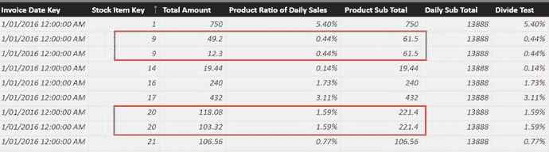

*图 8-1 清单 8-2、8-3 和 8-4 中代码的输出*

第一行的 `[Product Sub Total]` 值为 750，似乎与 `[Total Amount]` 列相匹配。`[Stock Item Key]` = 1 只有一行，因此看起来没问题。接下来的两行已用框突出显示。这表明当天 `[Stock Item Key]` = 9 发生了两笔交易。单独的 49.2 和 12.3 合计为 61.5。这就是 `[Product Sub Total]` 列中两行重复的值，这正是期望的结果。仍需测试的数字是 13,888，该值在 `[Daily Sub Total]` 列的每一行中重复。

测试此值的一种方法是，首先创建一个使用 `[Total Amount]` 列的 `SUM` 的计算度量，然后在设置了与测试数据相同日期的筛选器的视觉对象中使用该计算。如果源系统是 SQL 数据库，另一种选择是编写查询来帮助核对此值。理想情况下，`T-SQL` 查询应保持简单，否则测试可能会因 `T-SQL` 语句中的错误而受到影响，因此应避免联接，并在任何 `WHERE` 子句中仅使用最简单的 `SUM` 和 `COUNT` 函数及最少的代码。

### 使用变量进行调试

上述方法的一种替代方案是利用变量。目标是在实际可行的情况下，将计算分解为更小的代码块。将相同的代码拆分到变量中，可能看起来像清单 8-5 所示。

```dax
Product Ratio of Daily Sales =
VAR InvoiceDateKeyCol = 'Fact Sale'[Invoice Date Key]
VAR StockItemKeyCol = 'Fact Sale'[Stock Item Key]
VAR ProductSubTotal =
    CALCULATE (
        SUM('Fact Sale'[Total Amount]),
        ALL('Fact Sale'),
        'Fact Sale'[Invoice Date Key]=InvoiceDateKeyCol,
        'Fact Sale'[Stock Item Key]=StockItemKeyCol
    )
VAR DailySubTotal =
    CALCULATE (
        SUM('Fact Sale'[Total Amount]),
        ALL('Fact Sale'),
        'Fact Sale'[Invoice Date Key]=InvoiceDateKeyCol
    )
VAR ReturnValue =
    DIVIDE (
        ProductSubTotal,
        DailySubTotal
    )
RETURN  ProductSubTotal
```
*清单 8-5 使用 `RETURN` 控制最终输出变量的计算度量*

在图 8-5 中，我修改了原始的计算度量，使其使用变量来存储代码的各个部分。除了代码现在更具可读性之外，最终的 `RETURN` 语句不必返回最后声明的变量。

此处的 `RETURN` 语句返回的是 `ProductSubTotal`，而非 `ReturnValue` 变量。这意味着，当执行此计算列后，在“数据”视图中此列显示的数字代表第一个 `CALCULATE` 函数的输出，而不是最终 `DIVIDE` 语句的输出。

当这些值被检查并确认符合预期后，你可以更新最终的 `RETURN` 语句，使其返回 `DailySubTotal` 变量。当确认该值正确后，你可以将 `RETURN` 语句设置为使用 `ReturnValue` 列。

这种方法的一个缺点是，在任何时候只能返回一个变量。然而，如果前面使用的某个计算列产生的值可能对其他几个计算有用，你可以采取混合方法。你可以使用 `[Daily Sub Total]` 列来创建类似的“百分比”类计算，这些计算可能涉及表中的其他列。

### 调试计算度量

就计算度量而言，其原理是相同的。清单 8-6 中的计算度量通过单一计算满足了每日销售中相同产品占比的需求。

```dax
Product Ratio of Daily Sales as Measure =
DIVIDE (
    CALCULATE (
        SUM('Fact Sale'[Total Amount]),
        FILTER(
            ALLSELECTED('Fact Sale'),
            'Fact Sale'[Invoice Date Key]=MAX('Fact Sale'[Invoice Date Key]) &&
            'Fact Sale'[Stock Item Key]=MAX('Fact Sale'[Stock Item Key])
        )
    )
    ,
    CALCULATE (
        SUM('Fact Sale'[Total Amount]),
        FILTER(
            ALLSELECTED('Fact Sale'),
            'Fact Sale'[Invoice Date Key]=MAX('Fact Sale'[Invoice Date Key])
        )
    )
)
```
*清单 8-6 待调试的计算度量*

清单 8-7、8-8 和 8-9 展示了如何通过将此 `DAX` 拆分为三个独立的计算度量来进行调试。

```dax
Product Sub Total as Measure =
CALCULATE (
    SUM('Fact Sale'[Total Amount]),
    FILTER(
        ALLSELECTED('Fact Sale'),
        'Fact Sale'[Invoice Date Key]=MAX('Fact Sale'[Invoice Date Key]) &&
        'Fact Sale'[Stock Item Key]=MAX('Fact Sale'[Stock Item Key])
    )
)
```
*清单 8-7 显示子类别总计的计算度量*

```dax
Daily Sub Total as Measure =
CALCULATE (
    SUM('Fact Sale'[Total Amount]),
    FILTER(
        ALLSELECTED('Fact Sale'),
        'Fact Sale'[Invoice Date Key]=MAX('Fact Sale'[Invoice Date Key])
    )
)
```
*清单 8-8 显示总体总计的计算度量*

```dax
Product Ratio as Measure =
DIVIDE(
    [Product Sub Total as Measure],
    [Daily Sub Total as Measure]
)
```
*清单 8-9 合并清单 8-7 和 8-8 的计算列*

由于这些是计算度量，您需要将它们添加到某个视觉对象中，例如图 8-2 中的表格视觉对象，以便检查这些值。在该图中，`[Invoice Date Key]`、`[Stock Item Key]` 和 `[Total Amount]` 列被添加到了同一个视觉对象中，以便为计算度量提供一些查询上下文。

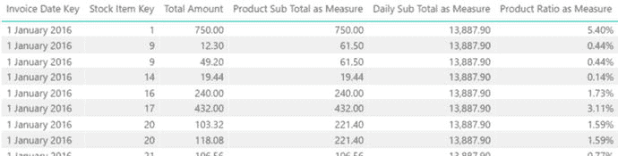

*图 8-2 清单 8-7、8-8 和 8-9 中代码的输出*

图 8-2 中的最后三列显示了每个计算度量的结果。您可以使用此格式来帮助核对 `[Total Amount]` 的值。其中 `[Stock Item Key]` = 9 的行，其 `[Product Sub Total as Measure]` 值加起来是正确的。

将计算保留为单个语句，但使用 `RETURN` 语句控制返回哪个变量，同样有效。拆分成独立的计算度量的好处是，您可以在其他计算中使用每个度量。然而，当您试图跟踪使用了多个计算度量的代码时，这会导致一定程度的代码碎片化。

计算度量产生意外结果的一个常见原因是筛选不正确。随着计算度量复杂性的增加，特别是那些混合了清除或应用数据筛选层的度量，这意味着核心表达式使用的数据与您预期的不符。

有时，当像本章前面的清单 8-6 那样将每个组件分解成更小的块时，问题就会变得显而易见。如果这仍然无法解释某个值为何与您的预期不同，那么在核心表达式中使用替代函数可能有助于阐明问题。

复制您的计算度量，并将 `SUM ('Fact Sale'[Total Amount])` 替换为 `COUNTROWS ('Fact Sale')`，有时足以帮助识别与筛选相关的问题。否则，将其替换为其他表达式以显示某列的最小值或最大值，例如 `MAX ('Fact Sale'[Invoice Date Key])`，可能足以帮助澄清任何与筛选相关的问题。

手动调试时，一些可能有用的附加函数如下：

- `HASONEFILTER`：当指定列有且只有一个直接筛选值时，返回真。
- `HASONEVALUE`：当指定列在交叉筛选后只有一个值时，返回真。
- `ISCROSSFILTERED`：当指定的表或列被交叉筛选时，返回真。
- `ISFILTERED`：当指定列上有直接筛选器时，返回真。

这些函数产生真/假输出，当您将它们添加到新的计算度量并添加到您正在用于调试的同一个表格视觉对象时，它们会很有用。这些函数提供了关于引擎正在应用的筛选级别的有用信息。当您确信代码按预期运行时，可以移除这些临时的计算度量。

最后一个技巧是使用空白报表页进行调试，并从仅包括您需要的数据开始。如果您试图在一个包含其他视觉对象和筛选器的繁忙报表页上调试度量，则可能很难隔离问题。一旦计算按预期工作，您可以删除或隐藏用于调试的报表页。

### 外部工具

无论您是在 `Power BI`、`Excel` 还是 `SSAS` 中编写 `DAX` 计算，都有几个有用的工具可以帮助您生成更好的计算。本章我们将介绍以下三个工具：

- `DAX Studio`
- `SSMS`（SQL Server Management Studio）
- `SQL Server Profiler`

这些工具都是免费的，如果您已经在使用 Microsoft SQL Server 数据库，您可能已经安装了 `SSMS` 和 `SSMS Profiler`。本节将向您介绍如何上手，并重点说明每个工具的有用之处。

### DAX Studio

第一个值得关注的是备受推荐的`DAX Studio`，它自称是处理`DAX`查询的终极工具。你可以在`daxstudio.org`找到`DAX Studio`的文档，包括下载链接。

下载并安装`DAX Studio`后，你可以连接到由以下引擎托管的数据模型：
- Excel 中的 PowerPivot
- Power BI Desktop
- Azure Analysis Services
- Azure Analysis Services 表格模型

这意味着，如果你打开了一个已加载数据模型的`Power BI Desktop`副本，就可以打开`DAX Studio`并创建与该模型的连接，然后开始发出查询。

打开`DAX Studio`时遇到的第一个对话框会询问你要连接到哪个数据模型（图 8-3）。如果你打开了多个`Power BI Desktop`副本，可以从下拉列表中选择要连接的那个。

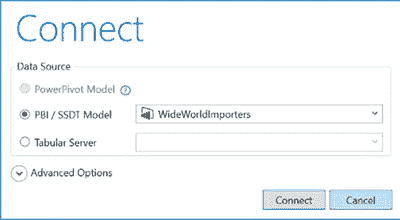

图 8-3 `DAX Studio`中的连接对话框

连接到模型后，应用程序的外观应如图 8-4 所示。
1. 顶部的功能区包含许多可用于编辑和优化`DAX`的功能；你可以隐藏它以获得更多编写`DAX`的空间。
2. 元数据面板允许你浏览模型的结构。你可以将表和列拖拽到查询编辑器中，从而避免输入较长的对象名称。此面板列出了所有`DAX`函数以及一些有趣的 DMV（动态管理视图）查询。
3. 查询编辑器是你编写和编辑`DAX`查询的地方。它具有完整的 IntelliSense 功能，可以在你输入时建议函数、表、列和度量值。
4. 输出栏由多个选项卡组成，其中包含有关已运行查询的信息。“结果”选项卡显示查询的输出。你可以启用其他选项卡来查看查询计划和内部服务器计时信息。
5. 底部的状态栏显示有关当前连接的信息。

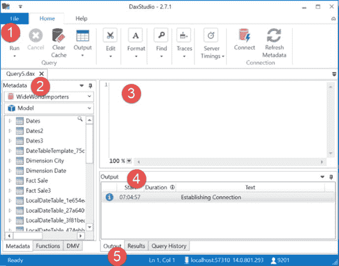

图 8-4 `DAX Studio`的主屏幕

连接到数据模型后，你就可以开始在查询编辑器中编写`DAX`。准备好运行查询时，单击功能区上的运行按钮或按`F5`。只要查询没有错误，你就可以在输出面板的“结果”选项卡中看到输出结果。功能区上有一个选项可以将结果输出到文件，这是手动从数据模型中提取数据的一种便捷方式。

> **注意**：在`DAX Studio`中运行的每个`DAX`查询都必须以关键字`EVALUATE`开头，并且必须输出一个表。

从计算度量值中提取代码并在`DAX Studio`中运行会产生错误。以下两条语句都无法运行：

```
My Measure = COUNTROWS('Fact Sale')
COUNTROWS('Fact Sale')
```

即使在两条语句前面加上`EVALUATE`关键字也会产生错误，因为`COUNTROWS`函数的输出不是一个表。

```
EVALUATE
COUNTROWS('Fact Sale')
```

要使使用`COUNTROWS`函数的此类查询正常工作，需要将其包装在一个可以输出为表的函数中，比如`ROW`。

```
EVALUATE
ROW(
"My Value",
COUNTROWS('Fact Sale')
)
```

该语句在输出面板的“结果”选项卡中产生以下结果（图 8-5）。

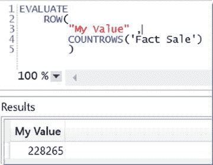

图 8-5 `DAX Studio`中的简单查询及其结果

在`DAX Studio`中最简单的查询之一是使用`EVALUATE`加上模型中的表名。

```
EVALUATE
'Dimension Date'
```

这相当于`SELECT * FROM [Dimension Date]`，并显示`Dimension Date`表中的每一行和每一列。要减少输出中的行数，你可以对表使用筛选函数。

```
EVALUATE
FILTER(
'Dimension Date',
'Dimension Date'[Calendar Year]=2016
)
```

好的，作为一名高级文档工程师和翻译员，我将遵循您提供的注意事项和示例，将给定的英文文本翻译成中文。

前面的计算返回了`‘Dimension Date’`表中的所有列，但仅返回属于`[Calendar Year] = 2016`的行。

下面的计算等同于 `SELECT TOP 10 * FROM [Dimension Date] ORDER BY [Date] Desc`：

```
EVALUATE
TOPN(
10,
'Dimension Date',
'Dimension Date'[Date],
DESC
)
```

如果你想开发和测试计算列的外观，可以使用如下语法：

```
EVALUATE
SELECTCOLUMNS(
'Fact Sale',
"My Test Column",
'Fact Sale'[Unit Price] * 'Fact Sale'[Quantity]
)
```

此示例中使用的 `SELECTCOLUMNS` 函数意味着输出只包含一列；但是，它会生成与`‘Fact Sale’`表行数相同的行。你可以根据需要添加其他列，或者，如果查看基表中的所有列（包括你的附加计算）更有用，那么使用 `ADDCOLUMNS` 函数可能更好（列表 8-10）。

```
EVALUATE
VAR DoubleMe = 2
RETURN
SELECTCOLUMNS(
'Fact Sale',
"My Test Column",
'Fact Sale'[Unit Price] * 'Fact Sale'[Quantity],
"My Test Column 2",
VAR X = COUNTROWS('Fact Sale') * DoubleMe
RETURN X
)
```
列表 8-10 使用嵌套变量添加额外列的 DAX 查询

扩展逻辑以包含更多列的方法如列表 8-10 所示。这也演示了如何在查询之前和查询内部使用变量。图 8-6 显示了列表 8-10 的结果。

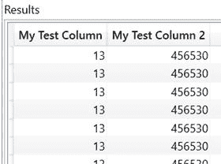

图 8-6 列表 8-10 中代码的输出

一个有助于测试计算度量值的选项是使用 `DEFINE MEASURE` 语句，将度量的 DAX 逻辑与 `EVALUATE` 查询分开。

列表 8-11 创建了一个新的计算度量值，该度量值仅存在于该查询范围内，并且数据模型的其他使用者不可见。

```
DEFINE MEASURE
'FACT Sale'[My test measure] = COUNTROWS('Fact Sale')
EVALUATE
SUMMARIZECOLUMNS(
'Dimension Date'[Calendar Year],
"Column Name here",
[My test measure]
)
ORDER BY
'Dimension Date'[Calendar Year] DESC
```
列表 8-11 使用 DEFINE MEASURE 创建查询范围计算度量值的 DAX 查询

`DEFINE MEASURE` 语句创建了一个可以添加多个度量值的区域。每个度量值必须在 DAX 表达式前加上完整的 `‘tablename’[measure name] =` 表示法。表达式中使用的代码与直接在数据模型中创建计算度量值时使用的代码相同。度量值名称必须包含表名。

然后可以在 `EVALUATE` 查询中使用该度量值，运行后结果将显示在“结果”选项卡中（图 8-7）。如果代码中有错误，语法错误消息会出现在“结果”面板的“输出”选项卡中。

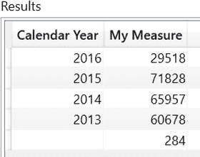

图 8-7 使用 `DEFINE MEASURE` 的列表 8-11 的输出

在 DAX Studio 这类客户端工具中运行查询的另一个要素是，你可以向查询添加 `ORDER BY` 语句；列表 8-11 中也展示了这一点。

这些是在 DAX Studio 中运行查询的基础知识。其他功能对于优化查询非常有用，我们将在本章稍后部分更详细地介绍这些功能。

除了拥有更大的查询编辑器区域和一系列在编辑较长的 DAX 查询时非常有用的工具之外，你还可以将查询保存并存储为单独的文件。这样做可以帮助你备份并为单个查询提供源代码管理。

格式化查询（`F6`）功能允许你通过在关键位置添加制表符和回车符来整理查询，从而帮助提高查询的可读性。

你可以同时运行多个查询，如下所示：

```
DEFINE MEASURE 'Fact Sale'[Right Now] = FORMAT(NOW(),"hh:mm:ss.ms")
EVALUATE
ROW("Q1",[Right Now])
EVALUATE
ROW("Q3",[Right Now])
EVALUATE
SAMPLE(10000,'Fact Sale','Fact Sale'[Invoice Date Key])
```

当你运行此查询时，它会向“结果”面板返回三个数据集。

你可以通过单击编号的垂直选项卡来查看每个 `EVALUATE` 语句的结果。该批次中第三个也是最后一个 `EVALUATE` 查询的结果如图 8-8 所示。请注意，其中两个查询使用了 `DEFINE MEASURE` 部分中的计算度量值。最后一个查询使用 `SAMPLE` 函数对`‘Fact Sale’`表中的 1,000 行执行随机筛选。

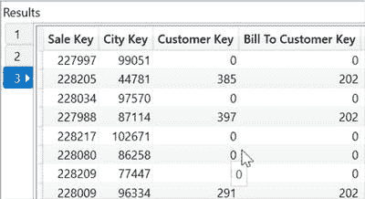

图 8-8 同时运行三个查询的最后一个结果集

### SSMS（SQL Server Management Studio）

另一个有助于开发和调试 DAX 计算的工具是 Microsoft SSMS。如果你正在使用 Microsoft SQL 数据库，你可能已经拥有此工具。如果没有，快速搜索互联网会引导你找到 Microsoft 网站上的正确下载位置。这是一个较大的下载文件，因为它包含了用于处理整个 Microsoft SQL 产品套件（而不仅仅是 DAX 模型）的功能。

与 DAX Studio 一样，你可以使用 SSMS 连接到 DAX 数据模型，例如 Power BI Desktop 和 SSAS 表格模型。但是，要连接到 Power BI Desktop，你需要知道你本地机器上要连接的实例所使用的端口号。每次打开 Power BI Desktop 时，此端口号都会更改。连接后，DAX Studio 会在状态栏上以 `localhost:nnnn` 格式显示端口号，其中 `nnnn` 是端口号。因此，如果你有 DAX Studio，并且还想使用 SSMS 连接到你的模型，你可以将其作为快速识别所需端口号的方法。

> **注意**：你可以通过导航到桌面可执行文件所在的文件夹并从控制台运行以下命令，在特定端口上启动 Power BI Desktop：

```
PBIDesktop /diagnosticsport:XXXX
```

另一种查找当前端口号的方法是通过操作系统的资源监视器（图 8-9）（或类似工具）；查找使用 `msmdsrv.exe` 可执行文件正在侦听的网络端口。如果你只打开了一个 Power BI Desktop 实例，这会更简单。

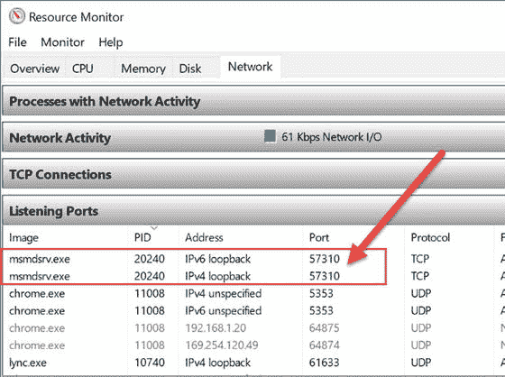

图 8-9 使用 Windows 10 资源监视器查找 Power BI Desktop 的侦听端口

在这种情况下，资源监视器显示端口号 `57310` 是 `msmdsrv.exe` 正在侦听的端口，因此在使用图 8-10 中的属性从 SSMS 进行连接时，你可以使用它。

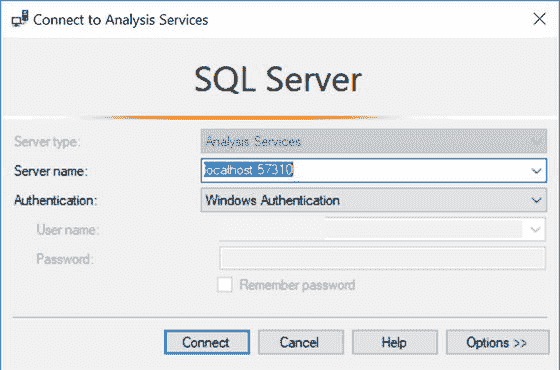

图 8-10 用于连接到 Power BI Desktop 的 SSMS 连接对话框示例

服务器类型需要设置为 `Analysis Services`。这可能不是此属性的默认值。

连接后，DAX 查询必须符合与你在 DAX Studio 中使用的相同要求。这些要求包括每个查询都需要使用 `EVALUATE` 关键字，并且所有结果都应为 DAX 表。

除此之外，SSMS 还提供了 IntelliSense 和许多其他功能来帮助你构建 DAX 计算。本章中用于演示 DAX Studio 的所有查询示例，除了在同一批次中使用多个 `EVALUATE` 语句外，都可以在 SSMS 中工作。

### 其他客户端工具

一旦知道了要查询的 DAX 引擎的服务器和端口号，就可以使用任何能够连接到 SSAS 表格模型实例的工具。你甚至可以将 Power BI Desktop 连接到另一个 Power BI Desktop 实例。这对于开发 DAX 查询可能并非特别有用，但这样做可以通过发出 DMV 查询，并利用 Power BI 中出色的可视化图表阵列来绘制结果，从而帮助优化你的数据模型。

## 优化

优化是一个广泛且可能涉及高级知识的主题——事实上，它足以独立成书。在本节中，我将尝试介绍一些可用于提升模型性能的实用技巧。我将建议分为两部分。第一部分是关于优化数据模型，第二部分则重点介绍优化 DAX 查询，并涵盖如何利用 DAX Studio 和 SSMS 等工具来提升性能。

### 优化数据模型

让我们从移除未使用的数据开始。

#### 移除未使用的数据

第一个建议是确保只在模型中包含所需的数据。模型越大，需要执行的计算工作就越多，而多余的数据，即使未用于任何计算，仍可能对模型的压缩和性能产生不利影响。

尽管在数据探索阶段，从源系统的各个表中导入所有行和列可能最初很有用，但请确保在将报表发布到生产环境之前，留出时间审查并从数据模型中移除未使用的列和行。

位于未使用列中的高度唯一的数据可能会对 DAX 引擎用于存储数据的压缩产生负面影响。针对此类未使用数据的目标列通常是 `IDENTITY` 或自动编号列，这些列在 OLTP 源系统中很有用，但在 OLAP 数据模型中通常价值不大。除非你需要在报表中显示这些列的值，否则移除它们可以显著减小数据模型的大小。

你可以使用名为 `Power BI Helper` 的免费工具来帮助识别模型中未被使用的列。你应该从数据模型中移除它标记出的任何列，并且仅在报表需要时才将它们添加回来。你可以从 `http://radacad.com/power-bi-helper` 下载 `Power BI Helper`。

如果你熟悉使用 DMV，那么使用 `DAX Studio` 或 `SSMS` 对你的数据模型执行以下 DMV 查询（排序后），可以让你深入了解模型中哪些对象（列）占用了最多内存。

```
Select * from $System.discover_object_memory_usage
```

这些列是值得检查是否能移除掉的。

移除未使用的列是一种技巧，但同时也要考虑导入到模型中的行数。如果数据模型只需要支持特定的时间范围，那么请考虑只导入覆盖所需时段的数据。

同时，考虑在导入过程中压缩数据。如果来自源系统的数据集每天有很多行，例如在一些物联网传感器数据中可能看到的情况，那么在导入之前或期间对数据进行分组。也许可以通过使用已预汇总至每天一行的数据来满足报表需求，该行同时还包含已压缩行的 `COUNT`、`MIN`、`MAX` 和 `AVERAGE` 值。

这些建议有助于减小数据模型的整体大小。如果你使用 Power BI Desktop 模型尝试这些建议，请记下更改前后保存的 PBIX 文件大小。我曾见过实例，文件大小从超过 800 MB 减少到不到 40 MB，且没有破坏报表中的任何视觉对象。这主要是结合了对数据模型执行建议的 DMV 查询、识别占用内存最多的列对象并将其从模型中移除的结果。在这个案例中，被移除的大部分列是位于拥有数亿行数据的表中的 `IDENTITY` 列。

> `注意`
> 在模型中隐藏列不会影响性能。请从数据导入逻辑中移除未使用的列。

#### 创建汇总表

另一种旨在不增加模型整体大小的方法是，在模型内部创建额外的汇总表。你可以在 DAX 中生成这些表，也可以将其作为查询编辑器中导入过程的一部分。

如果你有一个包含许多行的大表，并且需要保留其原始形式以满足某些报表需求，请考虑创建可用于无需下钻到原始表最细粒度细节的视觉对象和计算中的汇总表。

以 WideWorldImportersDW 数据集中的 `'Fact Sale'` 表为例。该表包含 228,265 行数据，记录了每笔销售的详细信息。

按日历月和客户对此数据集中的该表创建汇总版本，可将行数减少到 5,239 行。这样的汇总表可以支持任何需要此粒度级别的视觉对象或计算，而其大小仅为原始表的 1/50。当你使用拥有数亿行数据的表创建报表时，使用此方法带来的性能提升会更加显著。

你可以从一个大型表创建数十个汇总表，以实现高度定制化的性能调优。在这种情况下，我建议采用良好的命名约定来帮助跟踪。

##### 预计算数据

对于不需要动态计算的度量值，请考虑使用计算列而不是计算度量值。一个例子可能是根据大型表中的数据确定最佳客户或销售人员的排名度量值。这类计算可以以计算度量值或计算列的形式执行。但是，如果你不需要动态地重新计算该度量值以响应切片器或筛选器选择的变化，那么根据数据大小，使用计算列可能会提升模型的性能。

##### 拆分唯一列

如果数据集中有一列包含高度唯一的值，例如包含从年到毫秒详细信息的 `DateTime` 列，或者 `IDENTITY` 或自动编号列，那么请考虑将其拆分为多个列。

`DateTime` 的例子很简单，可以将其整齐地拆分为一个承载日期值的列，以及其他承载小时、分钟或秒值的列。如果你不需要报告比“天”更细的粒度级别，那么请将这些信息从数据模型中完全移除。

寻找其他可以拆分列的机会，特别是当数据可能具有多重含义时。这些可能包括代表汽车品牌和型号的值，或者包含对报表无用的详细级别（例如郊区或街道）的地址数据。

##### 简化表结构

DAX 数据模型可以使用与源系统表结构镜像的表结构来提供精确的计算。这包括跨越表关系集多个层级的计算。但是，如果你扁平化数据表结构以减少每次计算需要使用的表关系数量，模型性能可能会快得多。

一个好的遵循模式是将数据组织成事实表和维度表。这通常被称为星型模式，并且已被证明在报表和分析工作负载中表现良好。

# 事实表

首先，确定数据中你想要计数、求和以及随时间进行可视化分析的实体。这些实体应构成模型中事实表的基础。事实表中的每一行都应该是该表所代表的实例、活动、事件或事务。如果你有 100 笔销售，那么理想情况下，一张“销售事实表”就应该包含 100 行数据。

不要试图将多个事实混合在一张表中。如果你需要报告和分析销售额与付款额，避免受诱惑将这两组数据合并到同一张事实表中。请为销售额单独创建一张事实表，为付款额创建另一张事实表。

避免在事实表之间创建关系。许多有用的计算可以在共享同一张维度表的不相关事实表之间进行。

一旦确定了需要的事实表，就要从其他源系统表中引入尽可能多的数据列到事实表中，以满足已知的报告需求，但同时要注意保留“1 行 = 1 个事实”的规则。如果你能让事实表 100%自给自足，你将获得最佳性能。只有对那些可能用在维度表中、且该维度表与其他事实表相连接的列才做例外处理——例如，与其在每个事实表中都复制一份月份、季度和年份表，不如将这些列移到一张维度表中。

尽量避免构建涉及跨越三个或更多层级关系进行计算的数据模型。

# 维度表

可以将维度表视为筛选器/切片器表，它们仅用于对事实表进行切片和切块分析。维度表通常不包含你要计数、求和或用于计算的数据。如果它包含了这样的数据，请考虑这些数据是否应该放在事实表中。维度表最有用的地方在于，它为筛选选择提供一个单一位置，以应用于与多个事实表的关系中。

添加到任何模型中的第一个维度表很可能是一张日期表。如果你有多个事实表，那么这张日期表很可能与每个事实表都建立了一个表示单个日期的值的关系。对该表中任何列进行的任何筛选器/切片器选择，都会向下传播，以筛选任何关联的事实表。

如果你有一张只与一个表相关的维度表，请考虑将这两个表合并为一个表。

# 优化 DAX 查询

编写查询并得到相同结果的方式有很多种。五个人可能会产生五种不同的方法，每种方法都有独特的性能特征。在本节中，我将介绍一些使 DAX 计算更高效的有用技巧和技术。其中一些足以帮助你解决可能遇到的性能问题。其他解决方案则是对 DAX 计算的改进和对底层数据结构的增强。

在本节中，我还将向你展示如何使用诸如 `DAX Studio` 和 `SQL Server Profiler` 等工具来帮助你优化 DAX 查询。

## 存储引擎 vs. 公式引擎

`DAX` 查询在运行计算时会使用两个引擎：`存储引擎`（SE）和`公式引擎`（FE）。

`存储引擎`是两者中较快的，其主要目标是从内存数据存储中检索计算查询所需的所有数据。`存储引擎`是多线程的，因此它可以并行完成多个操作。`存储引擎`在检索数据时可以执行简单的计算，但这些计算不能依赖于作为同一查询一部分可能并行发生的任何其他`存储引擎`任务。

`存储引擎`活动的结果可以存储在缓存中，以帮助加速后续查询。当同一个视觉对象多次执行度量值以为每个数据点生成一个值时，这种缓存可以在帮助加速视觉对象中使用的所有计算方面发挥作用。

`公式引擎`是单线程的，能够处理更复杂的逻辑，包括计算步骤的顺序对结果有影响的计算。`公式引擎`活动的结果不会被缓存，因此每次都必须重新计算。

当查询被传递给 `DAX` 引擎时，`存储引擎`首先开始检索相关数据，然后`公式引擎`完成后续工作。

优化慢速 `DAX` 查询的一个好方法是尝试了解查询的哪些组件由`存储引擎`完成，哪些由`公式引擎`完成；然后看看是否可以将`公式引擎`处理的某些工作转移到`存储引擎`。

快速了解你的查询有多少使用了`存储引擎`而不是`公式引擎`的方法是通过使用 `DAX Studio`。功能区上有一个选项（图 8-11）可以启用服务器计时信息以及查询计划。


图 8-11 `DAX Studio` 功能区上用于打开额外调试选项的选项

启用这些选项后，在 `DAX Studio` 中运行的任何单个查询现在都会生成额外的信息，显示引擎完成查询所花费的时间。这也显示了整体时间中有多少是由`存储引擎`而不是`公式引擎`使用的细分情况（图 8-12）。


图 8-12 在 `DAX Studio` 中运行的查询的服务器计时输出示例

图 8-12 显示了一个查询示例，该查询总共耗时 15 毫秒完成。前 3 毫秒由`存储引擎`花费，它运行了两个并行进程来收集所需的所有数据。当`存储引擎`完成后，`公式引擎`接管，并需要 12 毫秒来完成查询。`公式引擎`在此查询中活跃了 80%，而`存储引擎`并未从`存储引擎`缓存中受益。

此信息并未解释你的 `DAX` 查询的哪些部分由`存储引擎`处理，哪些由`公式引擎`处理，但它确实为你提供了一个基准，用于了解同一查询的其他版本的行为。

进行优化时，每次运行查询的更新版本时清除缓存非常重要。如果不这样做，你可能会认为你的新版本更好，因为总时间更快，而实际上它可能是在利用先前查询的缓存数据。在 `DAX Studio` 中，可以通过设置`运行`按钮上的一个选项来每次清除缓存，从而轻松做到这一点。

要了解查询的哪些组件由`存储引擎`或`公式引擎`处理，你需要深入分析通过对服务器进行跟踪而生成的查询计划。就像你可以在 Microsoft SQL 服务器上运行跟踪来分析 T-SQL 查询一样，`SSAS引擎`也能提供同样的能力来捕获显示各个查询不同子组件的事件。因为 `Power BI Desktop` 使用 `SSAS引擎`，你可以使用诸如 `SQL Server Profiler` 之类的工具，在运行查询时捕获有趣的事件，以精确显示 `DAX` 引擎是如何完成该查询任务的。某些事件显示为由`存储引擎`完成的活动，而其他事件则显示为属于`公式引擎`的活动。

这是一个相当高级的话题，因此除了在本章后面向你展示如何在 `DAX` 查询上运行跟踪，并告诉你正是这些底层的跟踪数据被 `DAX Studio` 用来获取服务器计时信息之外，我不会深入探讨。`DAX Studio` 会在一个`查询计划`选项卡中显示查询所使用的物理和逻辑查询计划，以及由底层跟踪生成的伪 T-SQL 代码，以显示每个`存储引擎`子查询的工作。

# 尽早且恰当地应用筛选

如果你要手写一本词典中所有以字母 X 开头的单词列表，一种方法是先列出词典中从 A 到 Z 的所有单词，然后划掉所有不以 X 开头的单词。或者，你和五个朋友每人拿一本相同的词典，从不同页面开始抄写以字母 X 开头的单词。第二种方法要快得多，因为所需的工作量更少，而且由大家分担。

你可以将同样的方法应用于 DAX 计算。在不影响结果的前提下，筛选应用得越早，对计算总耗时的影响就越大。

清单 8-12 和 8-13 中的两个 DAX 计算很好地证明了这一点。两种计算返回的结果相同。第一个查询显示了一个数量列的总和以及一个年初至今的计算值。数据被筛选为特定的销售区域和一年中的月份。

```
EVALUATE
FILTER(
SUMMARIZE(
'Fact Sale',
'Dimension Date'[Date],
'Dimension Date'[Calendar Month Number],
'Dimension City'[Sales Territory],
"SUM Qty", SUM('Fact Sale'[Quantity]),
"YTD Qty", TOTALYTD(SUM('Fact Sale'[Quantity]),'Dimension Date'[Date])
)
,
'Dimension City' [Sales Territory] = "Southeast"
&& 'Dimension Date'[Calendar Month Number] =11
)
ORDER BY
'Dimension Date'[Date]
清单 8-12
在 SUMMARIZE 之后使用 FILTER 的 DAX 查询
```

此查询生成 77 行，并在 DAX Studio 的“服务器计时”窗口中输出图 8-13 所示的结果。

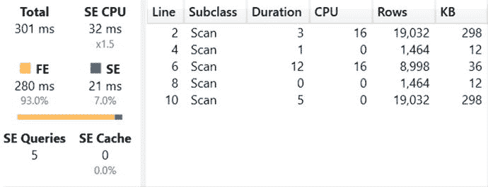

图 8-13
使用 DAX Studio 对清单 8-12 中代码的服务器计时输出

该查询总共耗时 301 毫秒，其中相当一部分时间花费在公式引擎上。此查询在冷缓存上执行了多次，此时间具有代表性。

清单 8-13 展示了另一个生成相同输出的查询。

```
EVALUATE
VAR PreFilteredTable =
CALCULATETABLE(
SUMMARIZE(
'Fact Sale',
'Dimension Date'[Date],
'Dimension Date'[Calendar Month Number],
'Dimension City'[Sales Territory]
),
'Dimension City'[Sales Territory] = "Southeast",
'Dimension Date'[Calendar Month Number] =11
)
RETURN
ADDCOLUMNS(
PreFilteredTable,
"SUM Qty", CALCULATE(SUM('Fact Sale'[Quantity])),
"YTD Qty", TOTALYTD(SUM('Fact Sale'[Quantity]),'Dimension Date'[Date])
)
ORDER BY
'Dimension Date'[Date]
清单 8-13
清单 8-12 的替代版本，在逻辑处理中更早应用筛选
```

此版本也生成 77 行，其“服务器计时”窗口的输出如图 8-14 所示。

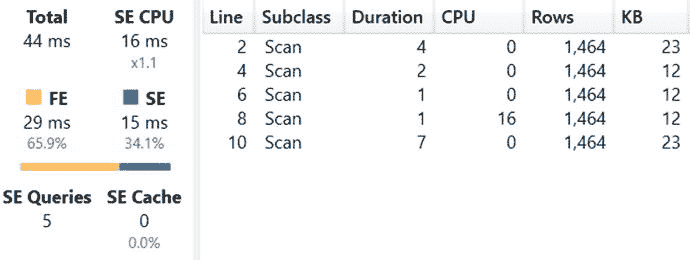

图 8-14
使用 DAX Studio 对清单 8-13 中更快速代码的服务器计时输出

更新后的版本总共耗时 44 毫秒。两个版本都使用了五个存储引擎查询来检索数据，但在更新后的查询中，筛选是在结果传递给`SUM`和`TOTALYTD`函数之前进行的。存储引擎向公式引擎返回了更小的数据块。所有存储引擎查询返回的行数均未超过 1,464 行，而之前的查询中，存储引擎向公式引擎传递了超过 19,000 行的结果以供额外处理。

希望这个例子能向你展示如何利用 DAX Studio 中一些非常有用的信息。你无需对每个查询都执行此过程，但将较慢的计算分离出来，在 DAX Studio 中进行调优和优化，是高效利用时间的方法。

关于 DAX 中筛选器（尤其是筛选函数的使用）的另一个有用提示是，这些函数（例如`ALL`函数）通常可以对表或列进行操作。如果你能通过使用特定列而不是整个表来实现相同的结果，你可能会获得一些性能提升。传递整个表可能导致不必要的工作，特别是在仅传递表的一列就能实现相同结果的情况下。

## SQL Server Profiler

要使用 Profiler 运行跟踪，请直接启动 Profiler 或通过 SSMS 启动。使用你的 DAX 引擎正在侦听的服务器名称连接到 Analysis Services 实例。如果你要连接到 Power BI Desktop 实例，你需要知道该实例正在使用的端口号。这个端口号在你每次停止并启动 Power BI Desktop 时都会发生变化。DAX Studio 会在状态栏显示正在使用的端口号，否则，你可以使用进程监控工具（如资源监视器或 Windows Sysinternals 版本的 Process Explorer）获取此信息。

以下是一些可以为每次跟踪启用的有用事件：

- `Query Begin`
- `DAX Query Plan`
- `Query Subcube`
- `VertiPaq SE Query End`

启动跟踪，然后运行你的 DAX 查询，然后在你可以查看结果的位置停止或暂停跟踪。

图 8-15 中的图表显示了当 Profiler 用于跟踪先前查询的第二个版本时捕获的事件。单击跟踪窗口中的各个行可以获得更多详细信息。

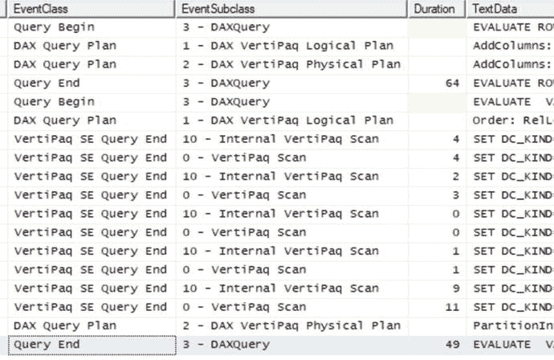

图 8-15
使用 Profiler 对清单 8-12 中代码的输出示例

也可以在 Power BI Desktop 中通过打开诊断设置下的“启用跟踪”选项来启用跟踪（图 8-16）。这将创建`*.trc`文件，你可以使用 Profiler 打开并分析这些文件。`*.trc`文件存储在同一设置窗口中显示的文件夹内。

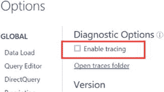

图 8-16
Power BI Desktop 设置中允许生成跟踪文件的选项

通常有很多选项可以帮助你的查询运行得更快。有些涉及你修改数据模型本身，而其他一些则可以通过更改 DAX 计算来实现。总的来说，如果你记住使用存储引擎进行计算是好的，并且数据模型最好是小型且简单，那么你最终很可能会得到一个经过良好优化的模型（并让最终用户满意）。

请记住也要有效利用在线资料。DAX 自 2009 年以来就已存在，并且有一个庞大的用户社区，他们分享处理常见问题的有趣方法。

# 9. 实用 DAX

本章重点介绍如何使用 DAX 构建模型，且不使用外部数据源。在本章中，你将构建自己的数据集。所有数据均通过逐步示例生成，这些示例展示了你可能会发现有用的各种技巧和技术。

最终模型的结构与你可能为小型组织使用的结构类似，包含销售、日期和产品表。由于每个表的行数是自动生成的，你可以使用最终模型来优化大型数据集上的 DAX 计算。通过在这里或那里更改几个数字，你可以生成一个包含 500 万、5000 万或 5 亿行数据的销售表，用于测试不同的计算优化方法。

这些逐步练习要求你使用能够创建计算表的 DAX 版本。这包括 Power BI Desktop 和 SSAS 表格模型，但不包括 Excel 2016（或更早版本）的 PowerPivot。

# 创建数字表

第一步是创建一个数字表，本例中是一个单列表，包含从 0 到 1000 的连续数字序列。你将能够使用此实用表，通过基于范围的条件（例如当此表中的值小于 5 时）连接到其他表。在本练习中，数字表用于将表中的单一行扩展为多行。

创建数字表有几种方法。在 `GENERATESERIES` 函数可用之前，创建此类表的唯一方法是利用 `CALENDAR` 函数。并非所有版本的 DAX 都有 `GENERATESERIES` 函数。DAX 中的日期存储为整数值，因此你可以使用 `CALENDAR` 函数生成日期行，然后再将其转换回整数值。在 Power BI Desktop 中，1899 年 12 月 30 日存储为 0。值 1 对应 1899 年 12 月 31 日，值 2 对应 1900 年 1 月 1 日。有趣的是，值-1 对应 1899 年 12 月 29 日，因此如果你需要用 DAX 表示 17 世纪的数据，也可以做到，但需要使用接近-100,000 的数字。

以下是使用 `CALENDAR` 函数创建数字计算表的方法（见图 9-1）：

```
Numbers =
SELECTCOLUMNS(
CALENDAR(0,1000),
"N", INT ( [Date] )
)
```

若要使用 `GENERATESERIES` 函数达到相同的结果，创建计算表的代码如下：

```
Numbers =
SELECTCOLUMNS(
GENERATESERIES( 0,1000 ),
"N", [Value]
)
```

两个示例都生成了一个包含 1001 行、名为 `Numbers` 的表，其中包含一个名为 `N` 的列。两个示例中都使用了 `SELECTCOLUMNS` 函数将列重命名为 `N`。在使用了 `CALENDAR` 函数的示例中，`INT` 函数用于将日期输出转换为其底层数字。

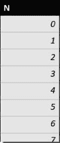

图 9-1

`Numbers` 表的一个示例

## 添加日期表

下一步是向数据模型中添加一个日期表。你可以使用列表 9-1 中的 DAX 代码来生成此表。

```
Dates =
VAR BaseTable =
CALENDAR (  DATE(2016, 1, 1), TODAY () )
VAR AddYears =
ADDCOLUMNS (
BaseTable,
"Year", YEAR ( [Date] )
)
VAR AddMonths =
ADDCOLUMNS (
AddYears,
"Month", DATE(YEAR([Date]),MONTH([Date]),1),
"Month label", FORMAT ( [Date], "MMM YY" )
)
VAR AddDay =
ADDCOLUMNS (
AddMonths,
"Day Label", FORMAT ( [Date], "DDD d MMM YY" )
)
RETURN
AddDay
列表 9-1
用于创建简单日期表的计算表
```

此语句以 `CALENDAR` 函数的单列输出开始，并将其分配给 `BaseTable` 变量。虚拟表每天一行，从 2016 年 1 月 1 日开始，一直持续到当前日期。

你可以使用额外的变量在整个计算过程中逐步添加列。在这段代码中，`AddYears` 变量获取由 `BaseTable` 变量表示的表，并使用 `YEAR` 函数从 `[Date]` 列中提取值，从而追加一个名为“Year”的列。

`AddMonths` 变量使用 `ADDCOLUMNS` 追加两个额外的列。这些列允许将行分组到日历月份中。“Month”列使用 `DateTime` 数据类型，并将每个日期值转换回其对应月份的第一天。“Month label”列使用 `FORMAT` 函数将日期转换为文本。格式字符串 `"MMM YY"` 表示诸如 2018 年 7 月 4 日等日期会被转换为“Jul 18”这样的文本值。你需要将“Month label”列的 `Sort by Column` 属性设置为使用“Month”列，否则在可视化项中使用时，该列中的值将按字母顺序显示。

最后的 `AddDay` 变量使用 `ADDCOLUMNS` 函数添加一个名为“Day Label”的列。该列使用 `FORMAT` 函数，通过格式字符串 `"DDD d MMM YY"` 将每行中的日期转换为文本值。此格式字符串将 2018 年 7 月 4 日转换为“Wed 4 Jul 18”。此基于文本的列需要将其 `Sort by Column` 属性设置为 `"Date"` 列，以确保在可视化项中使用时能进行合理的排序。图 9-2 显示了日期表生成的前几行。

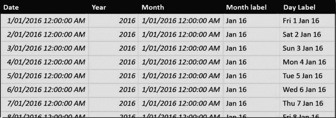

图 9-2

列表 9-1 创建的日期表的示例输出

# 创建销售表

接下来需要创建的表是销售表。目标是生成一个展示一段时间内销售情况的表格，可用于构建销售报告。本节将介绍所需的每个步骤，展示 DAX 代码并解释其含义。

首要任务是每天生成随机数量的销售记录。相关 DAX 代码如代码清单 9-2 所示。

```
Sales =
VAR FirstTable =
SELECTCOLUMNS(
FILTER (
GENERATE (
Dates,
Numbers
),
[N] < RANDBETWEEN ( 2, 7 )
),
"Date",[Date])
代码清单 9-2
用于创建销售表的计算表代码片段
```

此语句的输出是一个包含单列日期的表。每个日期会出现 2 到 6 次，这实际上创建了可用于添加其他列的占位行。`CROSSJOIN` 和 `FILTER` 函数用于合并之前创建的日期表和数字表。如果不使用 `FILTER` 函数，`CROSSJOIN` 会将日期表中的每一行与数字表中的所有 1001 行进行匹配。真实的销售表不太可能每天恰好有 1001 笔销售，因此 `FILTER` 函数使用 `RANDBETWEEN` 函数来生成每天更随机的销售数量。在此例中，每天会有 2 到 7 笔销售交易。

你可以将下限设置为零，这样某些天就没有销售记录；也可以通过增加上限的方式生成更大的销售数据集。

你可以使用 `SELECTCOLUMNS` 函数，确保只从日期表和数字表中提取所需的列传递到输出结果中，该结果在代码清单 9-2 中被赋值为 `FirstTable` 这个虚拟表。

下一个任务是添加一个名为“产品”（Product）的列（代码清单 9-3），该列包含表示所售产品对应的值。

```
VAR AddProduct =
ADDCOLUMNS (
FirstTable,
"Product",
VAR myMake =
RANDBETWEEN ( 65, 90 )
VAR myModel =
FORMAT ( RANDBETWEEN ( 1, 5 ), "-#" )
RETURN
REPT ( UNICHAR ( myMake ), 3 ) & myModel
)
代码清单 9-3
为代码清单 9-2 添加产品列
```

这段代码首先将 `FirstTable` 变量作为 `ADDCOLUMNS` 函数的输入。一个名为 `Make` 的嵌套变量开始了一个新的变量作用域级别。这个作用域与 `FirstTable` 和 `AddProduct` 变量所使用的层级是分开的，`RETURN` 函数用于将一个单一值作为 `ADDCOLUMNS` 函数的第三个参数返回。不使用嵌套变量也能达到相同效果，但可读性会变差。

`myMake` 变量使用 `RANDBETWEEN` 函数生成一个介于 65 到 90 之间的随机数。之所以使用这些数字，是因为它们对应 ASCII 表中大写字母的范围。65 代表字母“A”，66 代表“B”，依次类推到 90，代表大写字母“Z”。这个随机数被存储在 `myMake` 变量中。

`myModel` 变量使用 `RANDBETWEEN` 函数生成一个介于 1 到 5 之间的随机数。然后使用 `FORMAT` 函数并配合格式字符串 `"-#"` 将其转换为文本。格式字符串中的连字符被保留，而井号占位符告诉 `FORMAT` 函数数字应该放在哪里。这样就会生成类似 `"-1"` 或 `"-5"` 的字符串。

最终的 `RETURN` 语句将 `myMake` 和 `myModel` 变量连接起来，生成一个看起来像产品代码的文本值。首先使用 `UNICHAR` 函数将存储在 `myMake` 中的数字转换为介于 `A` 和 `Z` 之间的大写字母。然后使用 `REPT` 函数将 `UNICHAR` 函数的输出重复三次。这样就将值 `"A"` 变成了 `"AAA"`，再与 `myMake` 变量中的文本结合，就会产生诸如 `"AAA-4"` 或 `"DDD-1"` 这样的结果。

此时，计算表的输出结果如图 9-3 所示。

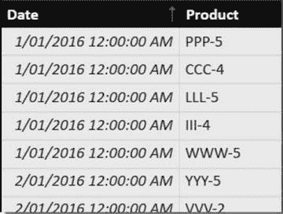

**图 9-3**
包含代码清单 9-3 的销售表输出示例

`UNICHAR` 是一个很棒的函数，你可以用它向报告中添加 KPI 指示器（例如趋势箭头或表情符号图片）来强调某个要点。

接下来添加的列代表销售数量（代码清单 9-4）。它通过将 `AddProduct` 变量作为 `ADDCOLUMNS` 函数的第一个参数，在现有代码基础上进行扩展。

```
VAR AddQuantity =
ADDCOLUMNS (
AddProduct,
"Qty",
VAR Q = RANDBETWEEN ( 1, 1000 )
RETURN 5 - INT ( LOG ( Q, 4 ) )
)
代码清单 9-4
为销售表添加数量列
```

`ADDCOLUMNS` 函数附加了一个名为“Qty”的单列。一个嵌套变量作用域从此处第三个参数开始。其目的不仅是生成一个介于 1 到 5 之间的随机数，还要确保随机值的分布不均匀。在真实的销售表中，大多数交易的数量很可能是 1。其次是数量为 2 的交易，并且随着数量的增加，购买次数会减少。

这里使用的 `LOG` 函数为 1 到 5 的数量应用了对数分布。当将此代码添加到计算表语句中，并使用 `Qty` 列中每个值的计数在可视化图表上绘制时（图 9-4），可以看出大多数交易都是单数量交易。数量为 2 的交易数量几乎是数量为 1 的一半，而数量为 3 的交易数量则锐减超过一半。

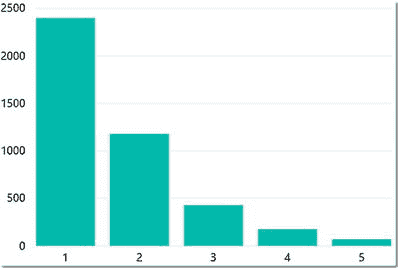

**图 9-4**
显示数量值分布的图表

这就是计算所期望达到的效果，你可以根据需要进一步调整。

到目前为止，使用上述代码生成的销售计算表输出类似于图 9-5。

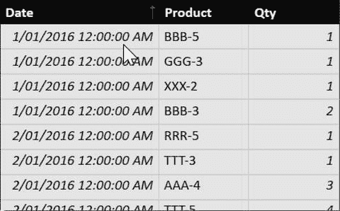

**图 9-5**
包含数量列的销售表示例

接下来添加的列是价格列。该列的代码如代码清单 9-5 所示。

```
VAR AddPrice =
ADDCOLUMNS (
AddQuantity,
"Price", DIVIDE (
RANDBETWEEN ( 1, 1e5 ),
100 )
)
代码清单 9-5
为销售表添加价格列
```

`ADDCOLUMNS` 函数在存储在 `AddQuantity` 变量中的表里附加了一列。新列名为“Price”，该公式使用 `RANDBETWEEN` 函数生成一个介于 1 到 100,000 之间的数字。`1e5` 这种表示法表明可以使用科学计数法。`1e5` 是 `1 × 10⁵`（即 `1 × 10` 的 5 次方）的简写，等于 100,000。

生成这个随机数后，使用 `DIVIDE` 函数将其转换为一个小于等于 1000 且保留两位小数的值。`DIVIDE` 函数的一个特点是它能比 `/` 运算符更好地处理“除以零”错误；然而，`/` 运算符性能更好，在不存在“除以零”错误风险的情况下应优先使用。示例如下：

```
RANDBETWEEN( 1, 1e5) / 100
```

在代码清单 9-5 中，并没有尝试让不同产品代码的价格保持一致。如果在测试中，产品之间价格一致很重要，你可以将此处生成随机价格的逻辑移到一个产品计算表中，并通过关系将其添加到销售表中。

最后需要添加的列是结合了 `[Price]` 和 `[Qty]` 的 `[Total]` 列。这表明新列可以使用源自同一代码先前部分的值。

代码清单 9-6 是创建销售计算表的完整代码。

```dax
Sales =
VAR FirstTable =
    SELECTCOLUMNS(
        FILTER (
            GENERATE (
                Dates,
                Numbers
            ),
            [N] < RANDBETWEEN ( 2, 7 )
        ),
        "Date",[Date])
VAR AddPRoduct =
    ADDCOLUMNS (
        FirstTable,
        "Product",
        VAR Make =
            RANDBETWEEN ( 65, 90 )
        VAR myModel =
            FORMAT ( RANDBETWEEN ( 1, 5 ), "-#" )
        RETURN
            REPT ( UNICHAR ( MAke ), 3 ) & myModel
    )
VAR AddQuantity =
    ADDCOLUMNS (
        AddPRoduct,
        "Qty",
        VAR Q = RANDBETWEEN ( 1, 1000 )
        RETURN 5 - INT ( LOG ( Q, 4 ) )
    )
VAR AddPrice =
    ADDCOLUMNS (
        AddQuantity,
        "Price", DIVIDE (
            RANDBETWEEN ( 1, 1e5 ),
            100 )
    )
VAR AddTotal =
    ADDCOLUMNS ( AddPrice, "Total", [Price] * [Qty] )
RETURN
    AddTotal
```

**图 9-6** 展示了使用此代码生成的表示例。

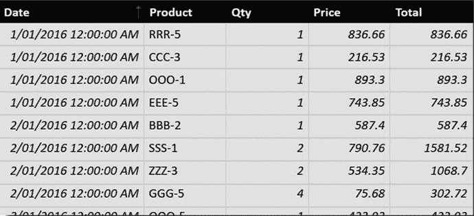

**图 9-6** —— 销售表（包含 `Total` 列）的示例输出

该表现在有五列，并且可能包含数亿行。你可以通过用于生成数字表的计算以及在 `FirstTable` 变量中使用的 `FILTER` 条件来控制行数。请记住，你对任意计算表中的任何部分所做的每次更改，都会导致模型中的每个表重新计算数据。这每次都会生成新值，但如果将其配置为生成极其庞大的数据集，则可能需要很长时间来计算。

现在可以使用每张表中的 `[Date]` 列将销售表与日期表关联起来。

## 优化销售表

数据模型现在包含一张详细的销售表，其中的行代表单个交易。该表可能会变得非常庞大。销售表中同一天可能会出现多行包含相同产品的情况。如果生成销售表的代码被特意设置为生成一个非常大的表，这种情况就更有可能发生。当使用数据集中的表来构建报表时，并非所有报表视觉对象都需要使用较大表中最精细的详细信息级别。

例如，如果你的视觉对象只需要按天显示 `Qty` 列的总和，并且从不按产品区分，那么使用销售表可能是一种效率很低的做法。

另一种方法是生成一个按天分组的销售表汇总版本，但无法按产品进行深入分析和细分。

用于生成此类计算表的代码如**清单 9-7** 所示。

```dax
Daily Summary =
SUMMARIZECOLUMNS(
    'Sales'[Date],
    "Sum of Items Sold", SUM('Sales'[Qty]),
    "Sum of Revenue", SUM('Sales'[Total])
)
```

这将创建一个三列表，将每个 `'Sales'[Date]` 的多行数据汇总为一行，同时使用 `SUM` 函数为每一行生成一个值，以提供 `Qty` 和 `Total` 列的聚合总计。

使用此表的视觉对象将比使用销售表的视觉对象更快，尤其是当销售表最终包含大量行时。

创建此类汇总表的一个缺点是，它们会增加整个数据模型的内存占用，并使数据刷新过程耗时更长。另一个明显的缺点是，任何使用汇总表的视觉对象都只能按该表的粒度进行细分，在本例中，粒度是 `[Date]` 而非 `[Product]`。

如果你的报表交互响应慢，并且没有使用汇总表，那么此策略非常值得考虑。

## 计算列与计算度量值

刚接触 DAX 数据建模的人（以及一些并非新手的人）经常问的一个问题是：“什么时候该用计算度量值，什么时候该用计算列？” 这是一个合理的问题。由于它们的使用场景可能有重叠，因此可能会造成混淆。在报表中，通过计算列和计算度量值可以显示相同的值。

计算列和计算度量值的主要区别在于计算的执行时间点以及计算结果的存储方式。

### 计算列

对于计算列，计算所用的 DAX 表达式仅在表的数据刷新时执行。该表达式会对表中的每一行计算一次，计算生成的单个值会作为该行在该列中的值存储起来，并且无法更改。这就好像计算列生成的值本来就存在于用于导入数据的源数据中一样。

将计算列视为数据加载过程的一部分。这些计算在数据加载过程的最后步骤之一中执行，并且不涉及任何用户交互。

在大型数据集上使用复杂的计算列会使数据刷新耗时更长。但是，如果数据模型配置为在凌晨每天刷新一次，那么这对报表用户的影响应该很小。

计算列生成的值会物理存储在数据模型中，这意味着向非常大的表中添加列可能会对数据模型的内存大小产生显著影响。

计算列是基于行的，这意味着如果所有所需信息都包含在同一行中，它们可以快速执行计算。尽管如此，计算仍然可以使用当前行之外的其他行中的数据。

### 计算度量值

使用计算度量值时，每次页面加载或用户更改筛选器或切片器选择时，DAX 表达式都可能被执行。计算度量值中包含的 DAX 表达式会为报告中每个使用它的值执行一次。如果计算度量值用于表或矩阵视觉对象，则它会为网格中所有使用该度量值来显示值的单元格执行相应次数。当度量值用于一个系列中具有 100 个点的折线图视觉对象时，它会为每个点执行 100 次，每次执行都有略微不同的筛选上下文。

计算度量值是动态的，并能对用户交互做出响应。它们会频繁且快速地重新计算，但不会在数据模型中存储输出，因此对数据模型的物理大小没有影响。增加数据模型中计算度量值的数量，不会影响模型在静止状态下的速度或大小。

计算度量值能够快速处理跨多行单列的计算，但你也可以通过使用迭代器，以支持基于行数据处理的方式来编写它们。

为了更好地理解计算列和计算度量值之间的区别，我们来看一下如何使用这两种选项来处理一个报告需求。在清单 9-8 中，需求是在刚刚创建的、来自清单 9-7 的计算表上，展示`'每日汇总'[收入总和]`列的累计总和。

```
计算收入列 =
CALCULATE(
    SUM('每日汇总'[收入总和]),
    FILTER(
        ALL('每日汇总'),
        '每日汇总'[日期]<=EARLIER('每日汇总'[日期])
    )
)
清单 9-8
将作为计算列的累计总和添加到清单 9-7 的计算表中
```

该计算会依据`'每日汇总'`表中的行数执行相应次数。`FILTER`函数使得每次执行`SUM`函数时，可以使用不同的值集。针对最早日期（2016 年 1 月 1 日）所在行的执行，只会向`SUM`函数提供一个值。针对 2012 年 1 月 2 日所在行的`SUM`表达式的执行，则使用两个值。这两次执行可以按任意顺序进行，并且仍然产生相同的结果。

一旦添加了计算列，数据模型就会变大。在这种情况下，新列中的所有值都是唯一的，因此数据压缩率非常低。

现在考虑相同的计算，但作为计算度量值（清单 9-9）。

```
计算收入度量值 =
CALCULATE(
    SUM('每日汇总'[收入总和]),
    FILTER(
        ALLSELECTED('每日汇总'[日期]),
        '每日汇总'[日期]<=MAX('每日汇总'[日期])
    )
)
清单 9-9
将作为计算度量值的累计总和添加到清单 9-7 的计算表中
```

在这种情况下，将计算度量值添加到模型并不会执行代码。计算度量值会保持休眠状态，直到它在视觉对象中被使用。一旦计算度量值在视觉对象中被使用，它就会为视觉对象需要生成的每个值执行一次。通常，这对应于轴、行或列标题中的项目数。

计算度量值和计算列的语法非常相似。两者都使用`CALCULATE`函数以及针对`[收入总和]`列的相同核心`SUM`表达式。两者都应用指令来告知 DAX 引擎`SUM`函数可以使用哪些数据。

最后，当两者与`'每日汇总'[日期]`字段一起添加到表视觉对象时，结果如图 9-7 所示。

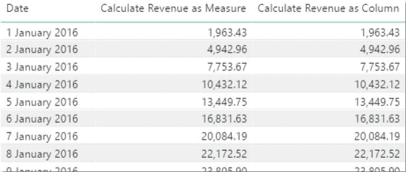
图 9-7

来自清单 9-8 和 9-9 的代码输出

这两个列为表中的每一行产生了相同的结果。`[计算收入列]`直接从内存中的列检索数据，无需进行 DAX 计算。而 `[计算收入度量值]` 列的每个单元格都会运行度量值中的代码，每次执行度量值时，查询上下文都略有不同。在这种情况下，查询上下文来自对每个`[日期]`进行筛选的行标题。

如果你使用 DAX Studio 分析这两种方法，就会开始看到它们在整体性能上的差异。

第一个测试使用计算列，以查看模型为生成视觉对象值所需的工作量。每次运行时清除缓存的选项已启用，查看服务器计时和查询计划的选项也已启用（清单 9-10）。

```
EVALUATE
SELECTCOLUMNS(
    '每日汇总'
    , "日期", '每日汇总'[日期]
    , "计算收入列", '每日汇总'[计算收入列]
) ORDER BY [日期]
清单 9-10
使用 DAX Studio 测试清单 9-8 性能的 DAX 查询
```

在冷缓存上运行此计算十次，平均总执行时间约为 12 毫秒。如图 9-8 所示，大部分输出时间（通常为 90%）消耗在公式引擎中，只有极小部分消耗在存储引擎中。

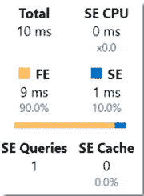
图 9-8

来自清单 9-10 的代码的服务器计时输出

清单 9-11 展示了使用计算度量值而非计算列的相同测试。再次使用 DAX Studio 来捕获在冷缓存上执行查询的服务器计时。

```
EVALUATE
SELECTCOLUMNS(
    '每日汇总'
    , "日期", '每日汇总'[日期]
    , "计算收入度量值", [计算收入度量值]
) ORDER BY [日期]
清单 9-11
使用 DAX Studio 测试清单 9-9 性能的 DAX 查询
```

此代码产生相同的输出，只是使用了计算度量值而非计算列。多次运行此查询后，平均查询时间约为 1.4 秒（1400 毫秒），其中通常有 99% 的时间消耗在公式引擎中（图 9-9）。

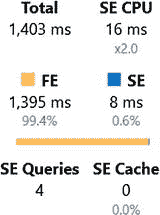
图 9-9

来自清单 9-11 的代码的服务器计时输出

虽然这比较慢，但也在意料之中。计算列的优势在于它是预先计算好的。计算列最初生成列数据所花费的时间，与我们在此处看到的计算度量值所花的时间大致相同。

让我们来看看这两个计算，并从灵活性方面进行比较。在`'日期'`表和`'每日汇总'`表之间添加关系后，在同一个报告页面中添加一个使用`'日期'[年份]`列的切片器。当此切片器设置为 2017 年时，可以通过两个视觉对象观察到图 9-10 中的结果。

首先，表视觉对象显示，计算度量值现在显示的值与计算列不同。原因是计算度量值每次新执行所生成的值，其筛选上下文与之前不同。计算度量值内的`SUM`表达式不再考虑属于 2016 年和 2018 年的行。这种额外筛选的效果意味着值已被重置，现在仅从 2017 年初开始累计。

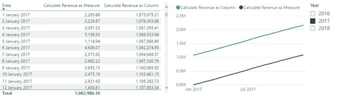
图 9-10

表和折线图视觉对象显示了将切片器设置为 2017 年时，来自清单 9-8 和 9-9 的结果

该列只是输出与之前相同的预计算值。除了切片器阻止可视化图表绘制 2017 年以外的日期值外，没有任何变化。

那么，让我们重新审视本节开头提出的问题：“何时应使用计算列与计算度量值？”

如果你希望获得最快的计算结果，并且很少需要以不同方式对数据进行切片和切块，那么计算列是一个不错的选择。如果你希望值能够对用户交互做出响应和反应，那么计算度量值是一个不错的选择。

如果你遇到交互式报告的速度和性能问题，最佳着手点通常是检查计算度量值中使用的代码，而不是计算列中的代码。

### 显示销量前十产品的所有销售额

为了扩展已构建的数据，让我们看几个示例，了解如何使用不同技术构建一些额外的汇总表。第一个示例创建一个包含所有销售记录、但仅显示收入前十产品的表格。第一步是确定哪些产品应被视为前十产品。然后，使用此列表创建一个新表，该表包含针对这些产品筛选的所有销售数据。

计算表的 DAX 代码如列表 9-12 所示。

```
All Sales for Top 10 Products =
VAR InnerGroup =
SUMMARIZECOLUMNS(
-- 按...分组 --
'Sales'[Product],
-- 聚合列 --
"Sum of Revenue", SUM('Sales'[Total])
)
VAR Top10PRoducts =
TOPN(
10,
InnerGroup,
[Sum of Revenue],
DESC
)
RETURN
NATURALINNERJOIN (
'Sales',
Top10PRoducts
)
列表 9-12
显示前十产品销售额的计算表
```

此计算中的第一个变量使用`SUMMARIZECOLUMNS`函数创建一个按`Sales`[Product] 列聚合的表表达式。这会生成一个未排序的工作表，每个产品一行。每个产品在 `"Sum of Revenue"` 列中都有一个值，显示历史总销售额的聚合值。这可能是一个优化过滤条件的机会，使其仅考虑相对于当前期间而言较近的日期范围——例如，你可以修改它，使其仅考虑过去三个月的销售额。

第二步使用 `TOPN` 函数，当按 `[Sum of Revenue]` 降序排序时，从 `InnerGroup` 表表达式中识别并返回前十行。`TOPN` 函数是一个过滤器函数，因此它返回一个表，该表具有与 `InnerGroup` 变量相同数量的列，并赋值给 `Top10Products` 变量，但在此例中仅包含十行。

你可以调整此函数，利用排序后的表来查找顶部或底部的不同数量产品。要查找销量最少的产品，只需将排序参数从 `DESC` 改为 `ASC`。

使用 `TOPN` 函数的替代方法是向 `InnerGroup` 变量添加一个排名列，然后利用排名列中的值来过滤该表。你可以使用列表 9-13 中的 DAX 示例作为替代方案。图 9-11 显示了此列表的输出。

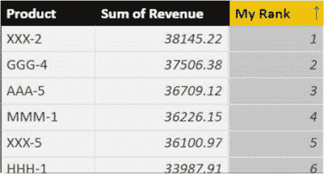

图 9-11

使用列表 9-13 中添加的排名列，列表 9-12 中代码的示例输出

```
VAR AddRankColumn =
ADDCOLUMNS(
InnerGroup,
"My Rank",RANKX( InnerGroup, [Sum of Revenue] )
)
VAR Top10PRoducts =
FILTER(
AddRankColumn,
[My Rank]<=10
)
列表 9-13
可在列表 9-12 中替换 TOPN 函数的替代 DAX 代码
```

添加像图 9-11 中这样的排名列，而非使用 `TOPN` 函数，其优势在于你可以将数据用于其他计算，例如比较不同时期的排名。例如，你可以创建两个工作表，分别显示连续时期内产品的聚合销售额及其排名。然后，你可以生成一个过滤后的表，来显示在两个时期之间排名提升（或下降）的产品。

此变体在 `AddRankColumn` 表表达式上使用 `FILTER` 函数。如果要识别排名最低的项目，`RANKX` 函数接受一个可选参数来对数据进行降序（`DESC`）或升序（`ASC`）排序。这使得 `FILTER` 函数能够使用 `<=10` 谓词来查找销售额最低的产品。

至此，两个版本都生成了一个仅包含十行的表表达式，这些行应代表销量最好的产品。

最后一步是返回原始销售数据的副本，该副本仅针对 `Top10Products` 变量中包含的产品进行过滤。`NATURALINNERJOIN` 函数非常适合于此目的，最终的 `RETURN` 语句执行了相当于 T-SQL 中 `INNER JOIN` 的操作，连接了 `'Sales'` 表和 `Top10Products` 变量中包含的表表达式。

`NATURALINNERJOIN` 函数会自动使用两个表中存在的、具有相同名称、数据类型和沿袭的列来创建联接条件。联接可以使用多个列，但在此例中，只有 `[Product]` 列满足所有三个要求。因为 `Top10Products` 变量中的 `[Product]` 列可以追溯到其来源（`Sales` 表），所以它满足沿袭要求。

`CALCULATETABLE` 函数可以替代 `NATURALINNERJOIN` 使用。这两个函数的参数签名相同。`NATURALINNERJOIN` 在公式引擎中执行，而 `CALCULATETABLE('Sales', Top10Products)` 则将过滤操作推送到存储引擎。

联接中使用的两个表中除 `[Product]` 之外的列都会被保留。可以使用 `SELECTCOLUMNS` 函数，通过删除或重命名不需要的列来控制返回哪些列。

最终表的示例应类似于图 9-12。

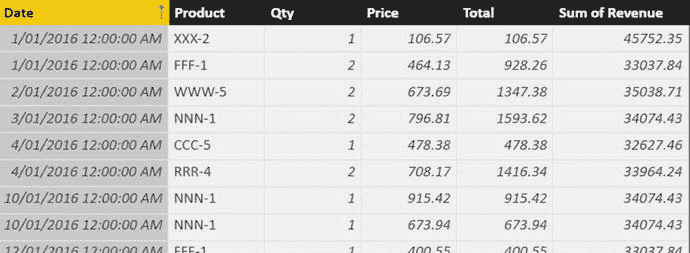

图 9-12

列表 9-12 中计算表的示例输出

这些列中的值均基于随机数，因此重要的是表结构应与你的版本匹配，而非具体的数值。

每次刷新数据模型时，都会重建此计算表。构建完成后，它会为你提供一个更小、更快的表，供只需要处理最畅销产品的可视化图表使用。当 `Sales` 表中的行数变得非常大时，这尤其有用。

### 双重分组

更复杂的场景可能需要使用多个工作表对数据执行两层或更多层的汇总，以生成新的汇总表。

假设有一个需求，要求显示一个汇总表，该表的每一行对应销售表中的每个产品，并包含每个产品最佳十天的平均值。这里的挑战在于，每个产品的最佳十天所对应的日期是不同的。一旦确定了每个产品的最佳十天，就可以计算出平均值。

以下技术将用于实现这一需求：

-   `SUMMARIZECOLUMNS`
-   `GENERATE`
-   `GROUPBY` 和 `CURRENTGROUP`
-   `MAXX` 迭代函数
-   一种推导 `RANK` 的有趣技术

第一步是创建一个工作表（清单 9-14），用作每个产品每日销售的汇总。原始数据可能包含同一产品在同一天的多笔交易。这将是执行的第一层汇总。

```
VAR InnerGroup =
SUMMARIZECOLUMNS(
-- 分组依据 --
'Sales'[Product],
'Sales'[Date],
-- 聚合列 --
"Daily Revenue", SUM('Sales'[Total])
)
清单 9-14
清单 9-6 中销售表的汇总计算表
```

`InnerGroup` 变量存储了一个三列表，显示了每个产品在其有销售记录的每一天的日销售额。下一步是识别哪些日期恰好是每个产品的最佳十天。这通常需要为 `[Daily Revenue]` 列应用一个特定于产品的排名值。`RANKX` 迭代器提供了一种方法，可以在此时向表中添加一列，该列对表中的每一行相对于其他行进行排名。但这里需要的是能够获得一列来对每个产品的每日销售进行排名。

一种方法是对计算应用清单 9-15 中的三个步骤。

```
VAR CopyOfSummaryTable =
SELECTCOLUMNS(
InnerGroup,
"ProductA",[Product],
"DateA",[Date],
"Daily RevenueA",[Daily Revenue],
"RowCounter", 1
)
VAR CrossJoinTables =
FILTER(
GENERATE( CopyOfSummaryTable, InnerGroup ),
[Product] = [ProductA] &&
[Daily Revenue]<=[Daily RevenueA]
)
VAR ProductByDateRanking =
GROUPBY(
CrossJoinTables,
[Product],
[Date],
"Daily Revenue", MAXX(
CURRENTGROUP(),
[Daily Revenue]
),
"Rank",      SUMX(
CURRENTGROUP(),
[RowCounter]
)
)
清单 9-15
清单 9-14 中代码的附加 DAX
```

在这段代码中，`CopyOfSummaryTable` 变量用于存储 `InnerGroup` 变量的副本。使用 `SELECTCOLUMNS` 重命名了 `[Product]`、`[Date]` 和 `[Daily Revenue]` 列，以避免在下一步将此表版本与 `InnerGroup` 表连接时发生列名冲突。这些列被简单地重命名，并在末尾附加了字符“A”。

在此步骤中还添加了一个名为 `[RowCounter]` 的新列，其硬编码值为 `1`。该列将为排名计算提供基础。对于同一产品具有更高 `[Daily Revenue]` 值的每一行，该行都会被复制。复制完成后，对 `[RowCounter]` 执行 `SUM` 操作会生成一个表示排名的值。

下一步是在 `InnerGroup` 和 `CrossJoinTables` 表变量之间执行笛卡尔连接。`FILTER` 函数确保只有 `InnerGroup` 中与 `CopyOfSummaryTable` 中 `[Product]` 值相同的行才被匹配。`[Daily Revenue] <= [Daily RevenueA]` 逻辑允许匹配 `CopyOfSummaryTable` 变量中与 `InnerGroup` 变量中 `[Daily Revenue]` 值相同或更高的行。

对于 `InnerGroup` 表变量中的任何给定产品，恰好具有该产品最高 `[Daily Revenue]` 值的行在 `CopyOfSummaryTable` 中只能找到一个匹配行（即它自身）。同一产品中具有次高值的 `InnerGroup` 行会找到两个匹配行，依此类推，直到来自 `InnerGroup` 的、同一产品中具有最低值的行是唯一不匹配的行。然后，该行会与 `CopyOfSummaryTable` 中同一产品的所有其他行匹配，这意味着对 `[RowCounter]` 列执行 `SUM` 会返回一个具有最高数值（最低排名）的结果。

本节的最后一步是将上一步的笛卡尔输出重新分组成每个产品和日期对应一行的形式。`SUMMARIZE` 和 `SUMMARIZECOLUMNS` 函数都不能用于存储在变量中的表表达式。这两个函数都只能作用于物理表。幸运的是，可以使用 `GROUPBY` 函数，但聚合表达式必须使用迭代函数。这会根据 `[Product]` 和 `[Date]` 对 `CrossJoinTables` 变量进行分组，创建一个汇总表。

DAX 中不存在 `COUNTROWSX` 迭代函数；如果存在，它可以用来计算每个 `[Product]` 和 `[Date]` 所属的行数，以便在汇总时提供排名值。在这种情况下，第一步引入的 `[RowCounter]` 列允许通过对此列中硬编码的值执行 `SUMX` 来采用等效方法。

如果该列中没有 `BLANK` 值，另一种方法是直接使用 `COUNTAX(CURRENTGROUP(), [Column])`，从而避免引入每行值都为 `1` 的列。

在 `MAXX` 和 `SUMX` 函数中使用的 `CURRENTGROUP()` 函数是对 `GROUPBY` 函数中用作第一个参数的表的引用。

这里使用 `MAXX` 函数是为了将每天的日销售总额存储在 `[Daily Revenue]` 列中。这有助于将相同值的重复实例缩减为每个产品/日期的一个实例。此值并不反映单笔交易的最大值，而是代表该产品每天的总销售额。这一步不执行聚合；相反，它有助于将日销售数据保留到下一步。

`ProductByDateRanking` 变量的输出类似于图 9-13。

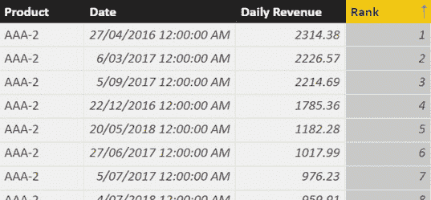

图 9-13

清单 9-14 和 9-15 中代码的样本输出（按排名排序）

按产品和排名排序后，每日收入数据如预期显示。注意每行的日期是跳跃的。每个产品构成不同排名位置的日期都不同。

此表包含产品有销售记录的每一天对应的排名值。下一步是过滤这些数据，只保留每个产品排名前十的行。清单 9-16 展示了 `FILTER` 函数的这种直接用法。

```
VAR TopTenDaysPerPRoduct =
FILTER(
ProductByDateRanking,
[Rank]<=10
)
清单 9-16
清单 9-15 中代码的附加步骤
```

现在你拥有了一组仅涵盖每个产品最佳十天的数据。满足初始要求的最后一步是计算每个产品 `[Daily Sales]` 的平均值。再次提醒，这里不能使用 `SUMMARIZE` 和 `SUMMARIZECOLUMNS`，因为它们不能处理存储在变量中的表表达式。因此，最后一步（清单 9-17）使用 `GROUPBY` 函数来计算平均值。

```
RETURN OuterGroup =
GROUPBY(
TopTenDaysPerProduct,
-- 分组依据 --
[Product],
-- 聚合列 --
"Average of Top 10 Best Days",
AVERAGEX(
CURRENTGROUP(), [Daily Revenue]
)
)
清单 9-17
添加到清单 9-16 中代码的最终 RETURN 语句
```

现在，该步骤使用 `TopTenDaysPerProduct` 变量将上一步骤中的工作数据聚合为每个产品仅保留一行。所有产品都将在此表中对应一行。接着，`AVERAGEX` 迭代函数与 `CURRENTGROUP()` 函数结合使用，对每个产品的 `[Daily Revenue]` 数据求平均值。

最终输出是一个两列的表（图 9-14），满足了这一特殊报告需求。我选择这个场景并非因为它是一个你常遇到的常见问题，而是因为它展示了你在 DAX 中可用于处理额外复杂程度场景的各种技巧。

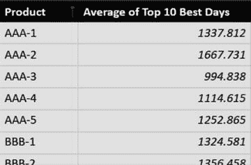

图 9-14

# 列表 9-14–9-17 内的累积代码示例 索引

## A
- `ADDCOLUMNS` 函数
- 算术运算符

## B
- 括号游戏

## C
- 计算列
- 计算度量
- 事实销售表
- 完整限定 `SUM` 函数
- 计算表
- `CALCULATE` 函数
- `CALENDARAUTO` 函数
- 比较运算符
- 串联运算符
- 容器
- 上下文
- 已定义筛选
- 参见筛选上下文
- `COUNTROWS` 函数
- `CROSSJOIN` 函数
- `CURRENTGROUP()` 函数

## D
- 数据分析表达式 (DAX)
  - 计算列
  - 计算度量
  - 计算表
  - 注释
  - 已定义函数
  - 关系
    - 参见关系
  - 数据模型
- `ADDCOLUMNS` 函数
- 添加年份
- 自动日期表
  - `CALENDAR` 函数
  - 组件
  - 列
  - 数据层次结构
  - 度量
  - 关系
  - 表
  - 已定义
- 日期/日历表
  - DateTime 字段
  - 距离今天的天数
  - 会计年度
  - `FORMAT` 函数
  - MonthID 列
  - 优化日期
  - 期间比较计算
  - 时间点值
  - 快速度量
  - 滚动平均
  - 按列排序
  - 时间
  - 时间智能
  - 工作日名称
  - 每周桶
  - 工作日
  - 年初至今
- 数据类型
  - 对实数进行计算
  - 类别
  - 基于日期
  - 在 DAX 中
  - 十进制和定点十进制数
  - 时间
  - 整数
- 日期表
- DAX Studio
  - 应用程序
  - 计算列
  - 计算度量
  - 最佳十个产品
  - 将收入计算为列
  - `CALCULATETABLE` 函数
  - ‘Dates’ 和 ‘Daily Summary’ 表
  - DAX 查询测试
  - `FILTER` 函数
  - InnerGroup 表表达式
  - 迭代器
  - `NATURALINNERJOIN` 函数
  - `SELECTCOLUMNS` 函数
  - 服务器计时输出
  - `SUMMARIZECOLUMNS` 函数
  - 表和折线图
  - 表/矩阵可视化
  - `TOPN` 函数
- 客户端工具
- 列索引
- 连接对话框
- `COUNTROWS` 函数
- 数据模型
- 日期表
- `DEFINE MEASURE` 语句
- 双重分组
  - `AVERAGEX` 迭代函数
  - `CopyOfSummaryTable` 变量
  - `COUNTROWSX` 迭代函数
  - `CURRENTGROUP()` 函数
  - `InnerGroup` 变量
  - `MAXX` 函数
  - `ProductByDateRanking` 变量
  - `RANKX` 迭代器
  - `RETURN` 语句
  - `SUMMARIZECOLUMNS` 函数
  - 摘要计算表
  - `TopTenDaysPerProduct` 变量
- `EVALUATE` 关键字
- 格式化查询 (F6)
- 嵌套变量
- 数字表
- 优化
  - 销售
- Power BI Desktop
- 销售表
- `SELECTCOLUMNS` 函数
- 存储数据
- 美国人口普查局
- 调试计算度量
- 客户端工具
- 列方法
- DAX 变量
- 十进制数
- 数据类型
- `Dimension.Date` 层次结构
- 关系，事实销售表和

## E
- 显式筛选
  - `ALLEXCEPT` 函数
  - `ALL` 函数
  - `ALLSELECTED` 函数
  - 列和
- `EARLIER` 函数
- ‘Fact Sale’ 表
- 筛选函数
- 筛选器和计算表
- 测量
- 覆盖筛选
- 百分比总计
- 期间比较
- 运行总计
- `ALLSELECTED` 计算度量
- 排名
- 重置
- 表可视化
- 显式度量

## F
- 筛选上下文
  - 计算列
  - 计算度量
  - 列筛选器
  - 容器
  - 已定义
  - 效果
  - 显式
  - 硬编码
  - 迭代器
  - 覆盖
  - 输出
  - 行上下文
  - 更简单的数据集
  - 过渡
  - T-SQL
- 基本 DAX 查询的计算度量
- `FILTER` 函数
- 公式引擎 (FE)

## G
- `GENERATE` 函数
  - 筛选行为
  - 数字表
    - `ADDCOLUMNS` 函数
    - 数据集
    - `GENERATESERIES` 输出
  - 入住率，酒店客房
    - 参见酒店客房入住率
  - 查询
  - 移除，不需要的列
  - 销售表
    - 数据集
    - 查找最后购买
    - `NATURALLEFTOUTERJOIN` 输出
    - `RETURN` 语句
    - `SelfJoin` 变量
    - T-SQL 等价物
    - `SELECTCOLUMNS` 函数
    - 语法
    - T-SQL 等价物
  - `GROUPBY` 函数
    - `CALCULATETABLE`
    - `CURRENTGROUP()` 函数
    - 双重聚合
    - 筛选
    - `SUMX` 函数
    - 语法

## H
- 层次结构
- 酒店客房入住率
  - `CALENDAR` 函数
  - 数据集
  - `FILTER` 函数
  - 入住率表
  - 输出
  - 带状图
  - T-SQL 等价物

## I
- 隐式筛选
  - 优点
  - 销售计数
  - 交叉筛选属性
- DAX 引擎
  - ‘Dimension Date’ 表
  - ‘Dimension Stock Item’ 表
  - 维度表
  - ‘Fact Sale’ 表
  - 跨代表
- Power BI
  - 查询上下文
  - WideWorldImportersDW 数据集
  - 隐式度量
  - IntelliSense
- `ISSUBTOTAL` 函数
- 迭代器

## J, K
- 连接表
- `CROSSJOIN`
- `GENERATE`
  - 参见 GENERATE 函数
- `LOOKUPVALUE`
- `NATURALINNERJOIN` 函数
- `NATURALLEFTOUTERJOIN` 函数
- `UNION` 函数

## L, M
- 逻辑运算符
- `LOOKUPVALUE` 函数

## N
- `NATURALINNERJOIN` 函数
- `NATURALLEFTOUTERJOIN` 函数
- 嵌套变量
  - 计算度量
  - 复杂
  - 已定义
  - 多层级
- 数字表
  - `ADDCOLUMNS` 函数
  - 数据集
  - `GENERATESERIES` 输出

## O
- 运算符
  - 算术
  - 比较
  - 串联
  - 逻辑
  - 优先级
- 优化
  - 维度表
  - 事实表
  - 筛选
  - 预计算数据
  - 移除未使用数据
  - SE vs. FE
  - 简化表结构
  - 拆分唯一列
- SSMS 事件探查器
- 摘要表

## P
- Pigs-Ear
  - 关系
- Power BI Desktop
  - 数据视图
  - 关系
  - 关系视图
  - 报表视图
- 快速度量

## Q
- 快速度量

## R
- `RANDBETWEEN` 函数
- 实数
- 关系
  - 活动
  - 已定义
  - 用于筛选的筛选器表
  - 连接表而不使用
  - 每表一列
  - 一对多关系
  - = 运算符
  - Pigs-Ear
  - 规则
  - 表在一侧
  - 类型
- `RETURN` 关键字
- `ROLLUP` 函数
- 行上下文

## S
- 销售表
  - 数据集
  - `NATURALLEFTOUTERJOIN` 输出
  - 购买
  - `RETURN` 语句
  - `SelfJoin` 变量
  - T-SQL 等价物
  - `SELECTCOLUMNS` 函数
- SQL Server Management Studio (SSMS)
- 存储引擎 (SE)
- `SUMMARIZE` 函数
  - 摘要表
  - 创建
  - `GROUPBY` 函数
    - `CALCULATETABLE`
    - `CURRENTGROUP()` 函数
    - 双重聚合
    - 筛选
    - `SUMX` 函数
    - 语法
  - 时间（毫秒）
- `SUMMARIZECOLUMNS` 函数
- `SUMMARIZE` 函数
  - 替代方案
  - 关系
  - 计算表
  - 筛选
  - `ISSUBTOTAL` 函数
  - 输出
  - 关系
  - `ROLLUP` 函数
  - 示例输出
  - 子类别列
  - 语法
- T-SQL 等价语句
- `SUMX` 函数的用途

## T
- 时间数据类型

## U
- `UNION` 函数

## V
- 变量
  - 基本结构
  - 计算列
  - 计算度量
  - 计算表
  - 调试
  - 已定义
  - 等价 T-SQL 以匹配 DAX
  - 错误代码
  - 多个 DAX 变量
  - 嵌套
    - 参见嵌套变量
  - 其他类型的计算
  - `RETURN` 关键字
  - 结构
  - `VAR` 关键字
  - 与文本一起使用

## W
- 整数数据类型
- WideWorldImportersDW 数据集

## X, Y, Z
- X 函数 (参见迭代器)