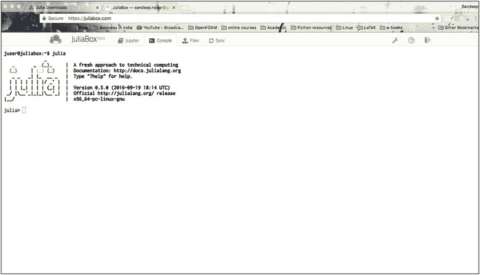
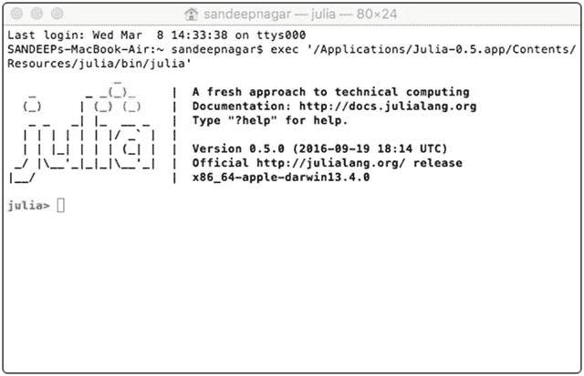

# 1. 引言

## 1.1 欢迎来到朱利亚世界

当你面对浩瀚的编程语言之海时，学习一门新语言可能感觉是一项艰巨的任务。学习新的编程模式和结构需要时间、耐心和专注的努力，因此投入如此耗时的工作必须有非常充分的理由。Julia 就是一门能提供这些理由的编程语言。由于已有众多成熟的编程语言，包括 Python、C、C++、Java、R 和 MATLAB，你需要真正有动力才能投入时间学习 Julia 这门新语言。在本章结束时，我希望你会发现，有足够多的理由让你深入探索朱利亚世界。

Julia 被誉为能满足所有需求的单一编程语言，因为它消除了掌握多种语言的必要性。大多数编程语言的设计都是为了满足其诞生时代的需求。例如，C 语言被设计为一种高效的**过程式**编程语言。C++ 的开发则是在业已高效且流行的 C 语言基础上增加了**面向对象**编程特性。Java 也为面向对象领域增添了新功能。MATLAB 的发明是为了减轻定义数学问题所需的编码负担。Python 的发展理念与此类似，但拓展到了 MATLAB 效率低下的领域。由于这两种语言在结构上相似，许多 MATLAB 程序员轻松转向了 Python。它同时也是开源且模块化的，这增加了使用他人代码的便捷性。然而，计算机科学领域这种发展方式的一个主要问题是，每种编程语言都只在特定领域表现优秀。因此，用户需要为不同任务使用多种编程语言，然后根据需要调整它们以构建所需的软件。一些编程语言，如 C 和 C++，是为速度而创造的，而另一些则旨在其领域内进行高效计算。数据科学任务的出现，要求一种语言不仅要快速，而且要有消除为完成一项计算任务而使用多种语言之需求的特性。

Julia 几乎完美地契合了这些新需求。其官网 `http://julialang.org` 声明如下：

- Julia 提供了 R、Python、MATLAB、SAS 或 Stata 的功能性、易用性和直观语法，并结合了 C、C++ 或 Java 的速度、容量与性能 [1]。

由于本质上是开源的，Julia 吸引了大量开发者编写模块，这些模块如今已用于大多数工作。Julia 是用于数据科学、机器学习和科学计算的最快的现代开源语言之一。

凭借 Julia 令人印象深刻的功能集，你现在应该有足够的理由去探索这门语言了。它是当前——并且希望在将来——能用于几乎所有类型计算任务的最新一代编程语言之一。此外，许多高科技公司正在招聘朱利亚程序员。

如果你有使用 Python 编程语言的经验，就会知道它因多种原因而流行。它的学习曲线极其平缓。凭借其开源架构，数百万开发者贡献了数千个包来执行各种任务。这些包易于使用，你只需一个简单的命令就能导入它们。Python 还可以在各种平台上运行。它是面向对象的，这使其总体上成为最适合模拟和计算的高级语言之一。它还能运行用其他编程语言编写的部分代码。由于这些特性，在撰写本书时，它已成为程序员中最流行的语言。但它有一个大问题：速度慢。因此，当开发者需要编写时间高效的代码时，他们常常陷入困境。许多时候，他们选择用更快的语言（如 C 或 C++）来编写时间低效的部分。这个过程使得整体体验非常丰富但也非常繁琐。创造 Julia 的主要动机正是源于这个问题。

Julia 的创造者们自己 [2] 也评论了这些问题：

- 我们需要一种开源且具有宽松许可证的语言。我们需要 C 的速度，同时兼具 Ruby 的动态性。我们需要一种同像性语言，像 Lisp 那样拥有真正的宏，但又像 MATLAB 那样拥有直观、熟悉的数学符号。我们需要一种像 Python 一样适用于通用编程、像 R 一样易于进行统计、像 Perl 一样自然地处理字符串、像 MATLAB 一样擅长线性代数、像 shell 一样善于黏合程序的语言。一种学起来极其简单，却能让最严肃的黑客感到满意的东西。我们需要它具备交互性，同时又能被编译。（我们提过它应该像 C 一样快吗？）

LLVM（低级虚拟机）的引入 [3] 使得这种理念成为现实。从设计之初就能打造一门满足大多数需求的语言，从而消除“两语言”方法成为可能。基于 LLVM 的 JIT（即时）编译器使得 Julia 能够接近并通常能匹敌 `C/C++` 的性能。（详细解释这个概念超出了本书的范围，对初学者来说也不相关。）

## 1.2 JIT 编译器

所有编程指令最终都会变成在硬件上运行的机器码（因此，机器码是特定于硬件的）。因此，更快的代码意味着更高效的机器码。机器码可以手工编写，但这是一项繁琐的工作。汇编语言（低级语言）是机器码的符号表示，可以手工输入硬件设备，但它有两个主要障碍：

1.  读写不易。
2.  它特定于硬件。

这两个问题被更高级的语言所克服。目前存在多种高级语言。FORTRAN、C、C++ 等是基于编译器的语言，其代码读写比汇编语言更容易；它们能高效地转换为机器码。然而，用户被迫提供大量关于代码应如何执行以及使用何种数据类型的信息。有了提供给编译器的充分信息，编译器会提前（AOT）构建机器码。另一方面，像 Python 这样的解释型语言则会即时生成机器码，即在程序执行期间生成。这些语言不使用编译器，而是使用解释器来解释每一行代码，最终将其转换为机器码。这营造了一个灵活且交互的环境，深受所有人喜爱。程序员甚至可以将定义数据类型和内存分配的任务委托给解释器。但这些便利是有代价的，因为解释型语言需要时间来生成合适的机器码。

JIT 编译融合了 AOT 编译和解释执行两方面的优点。主要区别在于，特定任务的函数是按需编译的。在某些情况下，程序员将所有信息提供给编译器，以便高效地转换为机器码。当某些信息缺失时，编译器会尝试根据其使用情况来推断缺失的信息。

然而，在某些情况下，JIT 并非最优方法，并且会表现糟糕。当类型推断失败，或者编译器没有足够信息进行有效优化时，就会发生这种情况。

基于这些理念，Julia 的创造者们踏上了一段有趣的旅程，为世界带来了最有前途的编程语言之一。了解其发展历史可能会非常鼓舞人心。下一节将描述来自不同背景的人们如何聚集在一起协作，共同创造了 Julia。

## 1.3 发展简史

Julia 社区中流行一句口号：“像 Python 一样易用，像 C 一样快。”速度和易用性一直是开发 Julia 的首要标准。由四位开发者（杰夫·贝赞森、斯特凡·卡尔平斯基、维拉尔·B·沙阿和艾伦·埃德尔曼）组成的团队在麻省理工学院创建了这门实用语言。

《连线》杂志的一篇文章阐述了 Julia 的发展历程[4]。开发这门语言的主要动机源于卡尔平斯基在设计网络模拟器时遇到的问题。为了完成项目的各个部分，他不得不拼接多种最适合特定任务的编程语言。他向沙阿请教，沙阿将他介绍给了贝赞森。贝赞森得出结论：在不同编程语言之间进行取舍是可以避免的。这一结论解决了卡尔平斯基的问题。三位开发者又邀请了数学家埃德尔曼，共同开始了这个项目。不久，一门面向技术计算的高级、高性能、动态编程语言开始初具雏形，其语法对其他技术计算环境的用户来说非常熟悉。该语言的运算速度可与 C 语言媲美，同时还提供了亟需的复杂编译器，支持分布式并行执行，并实现了更高的数值精度和丰富的数学函数库。凭借这些强大的特性，该团队发布了一系列研究论文[5, 6, 7, 8]，让人们得以一窥精彩的 Julia 世界。

## 1.4 安装

让我们深入 Julia 世界，开始学习这门强大程序的使用方法。如前所述，Julia 开发者的主要资源是其官方网站[9]。在撰写本文时，当前版本 (v0.5.0) 可从网站的“下载”选项卡下载。首先，根据您的操作系统选择下载相应的版本[10]。该网站介绍了针对 macOS、Windows 和基于 Linux 操作系统的安装方法。探索 Julia 的一个有趣方式是使用 JuliaBox，您无需安装任何软件，只需访问一个运行着包含 Julia 内核的笔记本实例的服务器即可（见图 1-1）。用户可以选择其中任何一种方法来练习代码。



图 1-1 JuliaBox 控制台

### 1.4.1 JuliaBox

如果您有稳定的网络连接，您可能希望在不于本地机器上下载和安装软件的情况下使用 Julia。JuliaBox 的网址在参考文献列表中给出[11]。使用其中一个账户登录，然后通过选项卡选项打开 Julia 控制台。

每个单元格可用于编写代码或使用标记语言编写文本信息。初学者只需选择在单元格中编写代码，然后按`Shift+Enter`执行即可。结果将显示在执行单元格的下方，并准备一个新单元格以接收下一组 Julia 命令。

### 1.4.2 MacOS

Julia 可在 macOS 10.7 及更高版本上运行。在 Mac 上安装 Julia 非常简单，只需从其网站下载`Julia-<version>.dmg`文件即可。该文件包含`Julia.app`。可以通过将`Julia-<version>.app`复制到硬盘（任何位置）或直接从磁盘映像运行来完成安装。双击快捷方式图标即可启动 Julia 控制台（图 1-2），其启动方式与 JuliaBox（图 1-1）中的 Julia 控制台类似。多个`Julia.app`二进制文件可以共存而互不干扰。因此，可以安装并使用多个版本的 Julia，它们之间不会相互影响。



图 1-2 macOS 下的 Julia 控制台

要卸载 Julia，请删除`Julia.app`以及`~/.julia`目录下的包目录。如果您还想删除个人偏好设置文件，请删除`~/.juliarc.jl`。

### 1.4.3 Windows 操作系统

Julia 适用于 Windows 7 及更高版本。32 位和 64 位操作系统版本均与 Julia 安装兼容。第一步是下载`julia.exe`文件（适用于您平台的安装程序）。值得注意的是，Julia 的 32 位版本可在`x86`和`x86_64`上运行，而 64 位版本仅能在 64 位 Windows (`x86_64`) 操作系统上运行。因此，检查已安装的 Windows 操作系统的版本信息非常重要。默认情况下，它会安装到您的`AppData`文件夹。您可以保留默认路径或选择自己的目录（例如，`C:\Julia`）。接下来，运行已下载的`julia.exe`文件，这将启动安装程序。安装完成后，桌面上会出现一个 Julia 程序的快捷方式。双击解压文件夹中的这个 Julia 快捷方式，即可启动类似于 JuliaBox（图 1-1）中所示的 Julia 环境。如果出现问题，可能是因为缺少某些依赖项。Windows 的 README 文件中包含依赖项的相关信息。您需要安装这些依赖项才能完成安装。

如果因为出现问题而被迫卸载 Julia，请删除解压目录和`%HOME%/.julia`目录下的包目录。如果您还想删除个人偏好设置文件，请删除`%HOME%/.juliarc.jl`和`%HOME%/.julia_history`。

### 1.4.4 Linux 操作系统

#### 通过 PPA 为 Ubuntu 及其衍生版安装

对于基于 Ubuntu 的 Linux 发行版，通过命令行终端添加仓库并安装 Julia，输入以下命令：

```
$ sudo add-apt-repository ppa:staticfloat/juliareleases
$ sudo add-apt-repository ppa:staticfloat/julia-deps
$ sudo apt-get update
$ sudo apt-get install julia
```

使用此方法的主要优点是 Julia 将随已安装机器上的其他软件一起更新。

要卸载 Julia，输入以下命令：

```
$ sudo apt-get purge julia
```

要移除 Julia 仓库，使其在更新时不再尝试更新 Julia（请确保在移除仓库之前先卸载软件包），请使用以下代码片段：

```
$ sudo add-apt-repository --remove ppa:staticfloat/juliareleases
```

#### 在 Fedora/RHEL/CentOS/SL/OEL 上安装

在这种情况下，可以使用 copr (Cool Other Package Repo) [12] 仓库。该仓库为 Fedora 和 EPEL (RHEL/CentOS/SLES/OEL) 提供了 Julia 的 RPM 包。如果您使用的是 RHEL、CentOS、Scientific Linux 或 Oracle Enterprise Linux（版本 5 或更高），请首先通过运行命令提示符为您的发行版版本启用 EPEL：

```
$ sudo dnf copr enable nalimilan/julia
```

另一种方法是将可用的`.repo`文件复制到`/etc/yum.repos.d/`。最后，只需在终端中执行以下命令：

```
$ sudo yum install julia
```

新版本每晚都会构建。如果您已经安装了 Julia 并希望升级到最新版本，请向终端发出以下命令：

```
$ sudo yum upgrade julia
```

#### 从源码编译构建

经验丰富的程序员通常更倾向于从源码编译构建，因为这需要具备在 Linux 中处理文件和更改权限的知识。Julia 的源代码托管在 GitHub 上[13]。因此，您的系统上需要安装`Git`[14]。完成此操作后，您必须首先满足依赖项[15]。以下说明也在`README`文件[16]中给出。

## 1.5 包安装

除了 Julia 内置的函数外，用户还可以添加具有特定功能的包，甚至可以制作自己的包（随后发布给 Julia 社区）。主网站上提供了一个包列表。这显然是一个极其丰富的计算设施生态系统。目前已经存在用于各种计算任务的包，并且 Julia 社区会定期扩充这个列表。

为了以干净的方式向 Julia 安装中添加和删除包，Julia 有一个内置的包管理器，但这需要有效的互联网连接。由于包管理器在内部使用 Git 来管理包仓库，用户在运行 `Pkg.add()`（安装包）时可能会遇到协议问题（例如，在防火墙后面）。可以通过命令行运行以下命令，告诉 Git 在克隆仓库时使用 HTTPS 协议而非 Git 协议：
```
$ git config --global url."https://".insteadOf git://
```

### 1.5.1 包管理器初始化

包管理器的初始化可以通过以下方式使用 `Pkg.init()` 来完成。首先，通过单击其图标打开 Julia 应用程序。此时会打开一个 Julia 终端，其命令提示符为 `julia>`。我们在此处输入 Julia 命令。尝试以下操作：
```
julia> Pkg.init()
```
该命令将输出有关包目录初始化的信息。

### 1.5.2 更新包仓库

假设我们要使用名为 `AlgebraicDiffEq` 的包。其源代码可以在其 Git 地址找到。建议更新包仓库的元数据，以将包的版本更新到最新版本。因此，我们可以发出以下命令：
```
julia> Pkg.update()
```
根据您机器的状态，它将更新已安装包的版本。这可能需要相当长的时间，具体取决于您机器的速度和互联网连接。定期执行此命令是一个好的实践，以保持包处于最新状态。

### 1.5.3 安装新包

Julia 包管理器是声明式的，而非命令式的。这意味着用户只需发出他们想要什么的命令。包管理器会找出要安装（或删除）的版本，以便最优且最小地满足这些需求。因此，用户只需将包名称添加到需求列表中。然后，包管理器会解决与其安装相关的问题。这意味着，如果某个包是因为之前版本的某个依赖而被安装，但新版本不再需要该依赖，那么更新时实际上会删除该包。

包的安装遵循以下模式：
*   包需求位于文件 `~/.julia/v0.4/REQUIRE` 中。
*   将要安装的包名称添加到此文件中。
*   然后调用 `Pkg.resolve()` 来解决依赖关系，以便最终安装。

这些任务可以通过执行单个命令来完成：
```
julia> Pkg.add("AlgebraicDiffEq")
```
内置安装程序的一大优点是它会处理新安装的依赖树。依赖项列表可以在包的 `REQUIRE` 文件中找到。

### 1.5.4 移除包

就像安装包非常容易一样，只需发出以下命令即可移除包：
```
julia> Pkg.rm("AlgebraicDiffEq")
```
移除包的过程类似于其安装：
*   包需求位于文件 `~/.julia/v0.4/REQUIRE` 中。
*   将要移除的包名称从此文件中移除。
*   然后调用 `Pkg.resolve()` 来解决依赖关系，以便最终安装。

`Pkg.add()` 和 `Pkg.rm()` 都是添加和移除单个包需求的便捷方式。然而，在处理多个包的情况下，我们建议使用 `Pkg.edit()`。发出此命令可以让用户手动编辑 `~/.julia/v0.4/REQUIRE` 的内容，更改内容，然后相应地更新他们的包。此过程只应由经验丰富的用户执行，因此我们在此不进行讨论。

### 1.5.5 已安装包的状态

`Pkg.status()` 命令会输出您已安装包的状态摘要。例如，当在我的机器上运行此命令时，会生成以下输出：
```
julia> Pkg.status()
1 required packages:
- IJulia                            1.6.0
9 additional packages:
- BinDeps                           0.7.0
- Compat                            0.30.0
- Conda                             0.7.0
- Homebrew                          0.5.8
- JSON                              0.13.0
- MbedTLS                           0.4.5
- SHA                               0.5.1
- URIParser                         0.2.0
- ZMQ                               0.4.3
```
可以清楚地看到，所有已安装包的缓存正在更新以供后续使用。让我们看看更新包的过程：
*   更新包的第一步是拉取位于 `~/.julia/v0.4/METADATA` 文件的新更改，并查看是否有新的已注册包版本发布。
*   接下来，`Pkg.update()` 尝试通过从包的上游仓库拉取更改来更新已检出到分支且未“脏”（即 Git 跟踪的文件未被修改）的包。
*   只有不需要合并或变基时（换句话说，如果分支可以快进），才会应用上游更改。
*   如果分支无法快进，则假定用户正在处理该分支，并将自行更新仓库。
*   作为最后一步，更新过程会重新计算一组最优的包版本进行安装，以满足用户的顶级需求以及“固定”包的需求。

### 1.5.6 离线安装包

如果无法连接互联网，可以通过将包根目录 `Pkg.dir()` 从具有相同操作系统和环境的机器上复制过来进行安装。发出 `Pkg.add()` 命令会在包根目录内执行以下操作：
*   将包名称添加到 `REQUIRE`
*   将包下载到 `.cache`，然后将包复制到包根目录
*   对包 `REQUIRE` 文件中列出的所有包递归执行第 2 步。运行 `Pkg.build()`

## 1.6 使用本书中的代码

本书中的代码可以直接在 Julia 提示符下编写，然后按 Enter 键执行。如果您使用 JuliaBox 或笔记本格式，可以同时按 Shift 和 Enter 键来执行 Julia 单元格。注释以 `#` 符号开头。它们是可选的，仅有助于概念清晰。代码使用不同的字体呈现，以便于视觉区分。

Julia 文件以 `.jl` 格式存储。如果编译器路径已正确定义，则可以通过运行以下命令来执行 Julia 文件：
```
$julia 
```
使用本书的最佳方式是将其视为工作手册。阅读每个概念并运行随附的示例代码。尝试运行书中的代码，并推理出可能出现的错误和警告。最后，尝试编写自己的代码，以便更深入地理解该概念。

## 1.7 小结

本章我们介绍了 Julia 编程语言的世界，并提供了在 Windows、Linux 和 MacOSX 操作系统上正确安装该语言的说明。随着计算资源和配置可用性的变化，这些说明可能会随时更新。因此，我们建议用户持续关注 Julia 语言官方网站 [9] 以获取最新版本的 Julia。在后续章节中，我们将探索 Julia 的结构，以便有效地使用它。