# 3. Julia 基础数学

## 3.1 引言

在本章中，我们将探讨如何使用 Julia 执行构成大多数计算任务基础的简单数学计算。理解本章内容需要具备高中水平的数学基础知识。本章将包含代表各种数学数字及其代数运算的图示，以及其他用于定义数学计算的运算。事实上，由于其简单的学习曲线，Julia 在教授基础数学时被证明是一个不错的选择。

需要指出的是，除了执行基本的数学计算外，Julia 也是高性能计算的一个好选择。高性能计算意味着使用超级计算机的普遍观念正在慢慢被取代，因为廉价而强大的计算能力已经很容易获得。一组树莓派计算机集群就是穷人的（经济上贫穷，学术上富有！）超级计算机。基于 GPU（图形处理单元）的迷你超级计算机现在已进入普通人的可及范围，但更快的编程语言的作用在此不容忽视。

配备几 GHz 多核处理器和 2 到 8GB 内存的笔记本电脑和台式机已成为全球标准。如果您能使用这些机器执行高性能计算，那么对昂贵计算系统的需求就过时了。这消除了经济困难社会结构中的研究人员和学生的根本障碍。如果解决方案能够在开源框架内呈现，则为其易访问性增加了价值。

Julia 编程语言满足了这些条件中的大部分。它是开源的，支持多并行处理，学习曲线平缓，并且其速度可与 C/C++ 媲美。因此，Julia 正迅速流行起来，尤其是在处理需要快速处理的海量数据的数据分析任务中。由于这类工作的基础是数学，让我们开始学习 Julia 如何在其基本框架内（不使用额外的包）处理基础数学。

## 3.2 REPL

Julia 在可执行文件中内置了一个功能齐全、交互式的命令行 REPL（读取-求值-打印-循环）。Julia 编程语言的交互式 shell 通常被称为 REPL，因为

- 它读取用户输入的内容，
- 编译器求值它读取的内容，
- 它在求值后打印出返回值，
- 然后循环回到起点，再次执行。

只要我们点击 Julia 快捷方式，就会得到 REPL 环境，如图 1-2 所示。提示符显示为 `julia>`，光标在此提示符处闪烁。它正在等待输入被读取和求值，然后它会打印求值的输出，并等待下一个输入。在计算世界中存在许多类似的环境。Linux 的 shell、Python 的交互环境、MATLAB 的交互环境等等，都遵循相同的理念。

除了允许快速简便地求值 Julia 语句外，它还具有：

- 可搜索的历史记录，
- 制表符补全，
- 许多有用的快捷键绑定，以及
- 专用的帮助和 shell 模式。

### 3.2.1 Hello World！

让我们输出字符串 `"Hello World,"`，这是计算世界的第一个程序：

```
julia> println("Hello  World")
Hello World
```

当你在命令提示符 `julia>` 处输入 Julia 命令 `println("Hello World")` 时，Julia 会读取这个语句，即它会搜索内置函数 `println` 并向其传递一个字符串（由一对引号括起来的字符定义）。Julia 编译器会根据 `println` 函数的定义来求值这个语句。该函数仅仅在命令提示符上显示传递给它的是什么字符串。因此，求值 `println` 的结果会在控制台打印出单词 `Hello World`。一旦完成，环境就会返回到 Julia 提示符 `julia>`，等待下一个输入。

### 3.2.2 REPL 中的输入与输出

让我们在 REPL 中尝试输入一些内容并观察输出：

- 当我们在提示符后输入数字 `2` 时，它会被求值为值 `2`，从数学角度看，这像一个正整数。需要记住的是，在某些情况下，计算机中的值不一定完全等同于精确的数学量。
- 类似地，当我们在提示符后输入数字 `-2` 时，它会被求值为值 `-2`，从数学角度看，这像一个负整数。
- 当我们在提示符后输入数字 `2.` 时，它会被求值为值 `2.0`，从数学角度看，这像一个正实数。因此，在 Julia 中，小数点前后的数字是可选的。
- 当值 `2` 被传给内置函数 `println` 时，它会被求值为值 `2`。看起来什么都没发生，但事实并非如此。
- 当数学表达式 `2 - 2.0` 被传给内置函数 `println` 时，它会计算该表达式并将输出打印为值 `0.0`。
- 当数学表达式 `2 - 2.0` 以字符串形式传给内置函数 `println` 时，它会像之前打印字符串 `Hello World` 一样打印该字符串。

```
julia> 2

julia> -2

julia> 2.
2.0
julia> println(2-2.0)
0.0
julia> println("2-2.0")
2-2.0
```

可以看出，Julia 函数 `println` 会考虑到自身可能接收到不同类型的数据，并做出相应的处理。当接收到一个数学表达式时，它会按照数学规则对该表达式进行求值。当接收到相同的字符串时，它只是在终端提示符下方的屏幕上将其显示出来。让我们看看如果 `println` 接收到多个值（以逗号分隔）会发生什么：

```
julia> println("2-2.0","@#%^&! ",2+2)
2-2.0@#%^&! 4
```

字符串 `"2-2.0","@#%^&!"` 被原样打印，而数学表达式 `2 + 2` 则被求值。结果 `4` 被打印在字符串之后，因为其作为函数输入的顺序如此。请注意，空格也是字符串中的字符之一，它也会被打印为一个空格。空格并非意味着打印一个白色的空白区域，而是指它不打印任何可见内容，即打印一个与终端背景颜色相同的空白区域。

### 3.2.3 制表符补全

与 Linux 的 shell 以及 MATLAB 和 Python 的交互环境一样，Julia 的 REPL 也支持制表符补全。你可以输入函数或类型的前几个字符，然后按下 Tab 键，即可获得所有匹配项的列表：

```
julia> pri
primitive type    print_shortest    println
print             print_with_color
```

请注意，在输入 `pri` 后，你需要按下 Tab 键才能获取选项并获得如下所示的输出。如果找到一个唯一匹配项，它会自动补全；否则，它会打印所有可能的选项供你选择。这有助于减少语法错误，在编码时非常有用。

### 3.2.4 向 Julia 寻求帮助

学习 Julia 的最好方法就是向这门语言本身寻求帮助！我们看到了函数 `println()` 的多种用法。假设我们想了解更多关于它的信息。你可以在 Julia 提示符后输入 `? println`。它会输出其用法的简要描述。一旦遇到 `?`，REPL 就会进入帮助模式（提示符从 `julia>` 变为 `?help>`），在该模式下，输入的任何内容都会在帮助文件中进行搜索：

```
help?> println
search: println print_with_color print
print_shortest sprint @printf isprint
println(io::IO, xs...)
打印（使用 print）xs 后跟一个换行符。
如果未提供 io，则打印
到 STDOUT。
```

如果 REPL 找不到查询的匹配项，它会建议相似的词，假设用户输入时出现了错误：

```
help?> clear
search: clear! ClusterManager
无法找到 clear
您是不是想找 clear!，close，
clamp，cld，ceil，Cchar，cat，cor 或 Char
未找到文档。
绑定 clear 不存在。
```

Tab 键的另一个用途是输入 LaTeX 数学符号，例如 `π`、`α`、`μ` 等。除了使用 ASCII [1] 字符（共 128 个）之外，Julia 还支持打印 Unicode [2] 字符（超过 128,000 个）。

### 3.2.5 Shell 模式

Linux shell 命令对于执行进程非常有用。Julia REPL 为此提供了一个 Shell 模式。分号 (`;`) 可激活 Shell 模式。可以通过在一行开头按 Backspace 键退出该模式：

```
julia>;
shell> ls
Applications
Desktop
Documents
Downloads
```

### 3.2.6 搜索模式

所有执行过的行都会保存到一个历史记录文件中，可以对其进行搜索。为此，需要启用搜索模式。该模式通过同时按下 Control 键和 R 键来激活。命令提示符变为 `(reverse-i-search)'':`。现在，当输入查询内容时，搜索查询将显示在引号内。正如 `Ctrl+R` 激活反向搜索一样，`Ctrl+S` 则激活正向搜索。

### 3.2.7 快捷键绑定

Julia 将快捷键绑定作为 REPL 操作的主要特性。表 3-1 列出了一些有用的快捷键绑定。

表 3-1 一些重要的快捷键绑定

| 快捷键 | 功能 |
| :--- | :--- |
| `^D` | 退出（当缓冲区为空时） |
| `^C` | 退出（中断或取消） |
| `^L` | 清空控制台屏幕 |
| 回车/换行 | 新行，如果语句完整则执行 |
| `?,;` | 进入帮助或 Shell 模式（当位于行首时） |
| `^R,^S` | 增量历史搜索 |

有关快捷键绑定的完整列表，建议用户参考参考文献 [3]。

### 3.2.8 版本信息

`versioninfo()` 会打印特定机器上安装的 Julia 版本信息，如下例所示：

```
julia> versioninfo()
Julia Version 0.6.0
Commit 903644385b (2017-06-19 13:05  UTC)
Platform Info:
OS: macOS (x86_64-apple-darwin13.4.0)
CPU: Intel(R) Core(TM) i5-5250U CPU @ 1.60GHz
WORD_SIZE: 64
BLAS: libopenblas (USE64BITINT DYNAMIC_ARCH NO_AFFINITY Haswell)
LAPACK: libopenblas64_
LIBM: libopenlibm
LLVM: libLLVM-3.9.1 (ORCJIT, broadwell)
```

## 3.3 与数字相关的一些实验

Julia 因其在处理复杂数学计算时能完美处理数字的精细系统，而成为数值计算的绝佳工具。在尝试使用 Julia 创建复杂的数学结构之前，理解数字在 Julia 世界中是如何定义的，对用户来说至关重要。

### 3.3.1 数字系统

数学中常用的数字系统有多种。例如：

- 整数：I = {…− 3, −2, −1, −, 1, 2, 3…}
- 有理数：`{ p/q : p,q ∈ I, q ≠ 0 }`
- 实数：`R = { x : -∞ < x < ∞ }`
- 复数：`{ a + bi : a,b ∈ R, i² = -1 }`

在这些定义之上还定义了特殊的子集，例如自然数 {0, 1, 2...}、偶数、奇数、正数、非负数等等。从数学上讲，这些数字系统是自然嵌套的，因为整数是有理数，有理数是实数，而实数可以看作是复数的一部分。

Julia 将每个数字系统定义为一个数据类型。换句话说，Julia 创建了一类数字类型，并围绕其定义了相应的代数规则。用户必须理解 Julia 如何为特定数字定义类型，以便正确使用。除了本书之外，参考文献 [4] 也是一个极好的资源。

### 3.3.2 Julia 作为计算器

我们已经看到，Julia REPL 的行为就像计算器一样。你可以在终端中输入包含数字的特定计算式，它就会输出计算结果。

对于数字计算机来说，整数和实数的处理方式不同。因此，`5` 和 `5.0` 是两个不同的实体。相应地，当两个整数（如 `2` 和 `3`）相加时，结果是一个整数：

```
julia> 2+3
```

需要注意的是，当 `2`（一个整数）和 `3.0`（一个实数）相加时，结果是一个整数（`5`）。

```
julia> 2.+3
```

然而，当两个实数（`2.0` 和 `3.0`）相加时，结果是一个实数（`5.0`）。

```
julia> 2.+3.
5.0
```

复数 `A + iB` 在 Julia 中表示为 `A + B im`。其他语言使用字母 `i` 或 `j` 来表示复数的虚部，但 Julia 特意用字母组 `im` 来实现这一目的，因为在循环中定义计数器时通常使用 `i` 和 `j`。

当一个整数（或者实数）与一个复数相加时，结果是一个复数，但其分量（实部和虚部）会相应地发生变化：

```
julia> 2 + (2+3im)
4 + 3im
julia> 2. + (2+3im) #实数是一个浮点数
4 + 3im
julia> 2. + (2.0+3im) #复数的实部是浮点数
4.0 + 3.0im
julia> 2 + (2.0+3im)
4.0 + 3.0im
```

有理数包含分子和分母。Julia 使用命令 `Rational(A, B)` 来表示数学上的有理数 。让我们检查一下有理数与其他类型数字相加时的行为：

```
julia> Rational(2,3)
2//3
julia> Rational(2,3)+2
8//3
```

因此，我们得到以下结果：

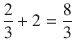

让我们看看如果使用实数代替整数会发生什么：

```
julia> Rational(2,3)+2.0
2.6666666666666665
```

值得注意的是，输出结果不再表示为有理数，而是表示为一个实数：

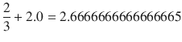

让我们检查一下有理数与复数相加时会发生什么：

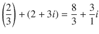

```
julia> Rational(2,3)+ (2+3im)
8//3 + 3//1*im
```

正如数学上所预期的，结果被打印为一个复数，且其实部和虚部都用有理数表示。

以下示例演示了将有理数、复数和实数相加时会发生什么：

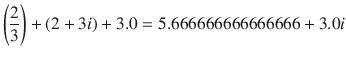

```
julia> Rational(2,3)+ (2+3im) + 3.0
5.666666666666666 + 3.0im
```

输出是一个复数，其中实部和虚部都用实数表示。

让我们来看看无理数，比如 π 和 e，它们在 Julia 中预定义为 `pi` 和 `e`：

```
julia> pi
π = 3.1415926535897...
julia> e
e = 2.7182818284590...
```

以下示例展示了它们与整数、有理数、复数和其他无理数相加时的行为：

```
julia> e+pi
5.859874482048838
julia> e+2
4.718281828459045
julia> e+2.0
4.718281828459045
julia> e+Rational(2,3)
3.3849484951257116
julia> e+(2+3im)
4.718281828459045 + 3.0im
```

尝试用两个无理数 π 和 e 分别作为分子和分母来定义有理数将会失败：

```
Rational(pi,e)
ERROR: MethodError: no method matching Rational(::Irrational{:pi}, ::Irrational{:e})
```

这两个错误消息都表明在匹配输入错误类型时出现语法错误，并且发现这样做是不兼容的。

Julia 中的布尔数用 `true` 和 `false` 表示：

```
julia> true
true
julia> false
false
```

将布尔数与任何类型的自然数相加通常是没有意义的，因为通常你会收到不兼容的错误消息。然而，在 Julia 中情况并非如此：

```
julia> true + 1
julia> true + 0
julia> true + 0.1
1.1
julia> true + Rational(2,3)
5//3
julia> true + pi
4.141592653589793
julia> true + (2 + 3im)
3 + 3im
```

布尔数 `true` 和 `false` 具有数值 `1` 和 `0`。应当考虑到这一事实，以避免混淆和错误。

从这些简单的实验性计算中可以得出一个明显的结论：Julia 不仅起计算器的作用，它还能动态识别计算所用的数据类型并据此执行。换句话说，你不必像在用 C 和 C++ 编写代码时那样预先声明数据类型。Julia 会根据其值来识别数据类型。同样重要的是，Julia 会匹配数字的数据类型来执行特定操作。某些匹配是不兼容的。这表明了一种定义数据类型的层次结构。现在我们来更详细地探讨这些概念。

## 3.4 整数和实数的数据类型

数字是数值数学的基本构件。为了将数字表示为计算机可计算的数量，需要将它们作为数据存储在计算机内存中。由于内存本质上是有限的，因此为各种数字类型（如整数、实数、复数等）分配了固定的内存空间。第 3.3.2 节已简要讨论了这些数字类型的表示。下一节将详细讨论此主题。

## 3.5 类型分配

我们已经清楚，整数和其他数字在算术计算中的存储和处理方式是不同的。整数在分配的内存空间中是作为一个整体存储的，而实数是存储小数点前后的数字信息，有理数存储分子和分母的信息，复数存储其实部和虚部的信息。在这方面，Julia 不同于 C 和 C++，因为它是一种动态类型语言。也就是说，数据类型不需要显式声明。Julia 会根据值来判断数据类型。如果在计算中混合了两种或多种数据类型，Julia 还会在数据类型之间维护一个层次结构，以便为输出分配数据类型。

如果我们有一台 64 位架构的机器，那么它可以为每个实体分配 64 位。但是，使用 64 位来存储很小的值（比如 `0`）是否明智？自动分配面临着这种低效的计算方式。因此，是严格声明数据类型，还是让 Julia 自行处理，这仍由开发者决定。如果运用得当，这可以加快计算速度并减少内存空间的需求。

### 3.5.1 数字类型的层级树

当你遇到多种数学数字的数据类型时，需要一个层级树来将一种数据类型转换为另一种。Julia 的数字类型系统层级树如图 3-1 所示。其中一些数据类型已在本章前面介绍过，另一些可能看起来非常陌生。

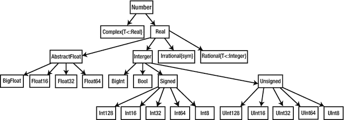

图 3-1 数字类型的层级树 [5]

层级树的最顶层是 `Number` 类型。它有两个子类型：`Complex` 和 `Real`。前者没有子类型，而后者有进一步的子类型。这些子类型如下图所示：

- `AbstractFloat` 浮点数、`Integer`（整数）、`Irrational`（无理数）、`Rational`（有理数）。
    - `AbstractFloat` 有四个子类型：
        - `BigFloat`：任意精度的十进制数
        - `Float16`：16 位精度的十进制数
        - `Float32`：32 位精度的十进制数
        - `Float64`：64 位精度的十进制数
    - `Integer` 类型有三个子类型：
        - `BigInt`：任意精度的整数
        - `Bool`：布尔数
        - `Signed`：有符号整数
            - `Int8`：8 位精度有符号整数
            - `Int16`：16 位精度有符号整数
            - `Int32`：32 位精度有符号整数
            - `Int64`：64 位精度有符号整数
            - `Int128`：128 位精度有符号整数
        - `Unsigned`：无符号整数
            - `UInt8`：8 位精度无符号整数
            - `UInt16`：16 位精度无符号整数
            - `UInt32`：32 位精度无符号整数
            - `UInt64`：64 位精度无符号整数
            - `UInt128`：128 位精度无符号整数
    - `Irrational`：无理数
    - `Rational`：有理数

#### 数字类型

Julia 中有四种基本数字类型：

- `Int`
- `Float`
- `Rational`
- `Complex`

数字类型决定了它如何被存储，以及存储值与其所表示的数学值的精确程度。为了区分这些数字类型，Julia 的解析器使用了以下易于理解的语法规则 [4]：

- 整数没有小数点。
- 浮点数有小数点（或采用科学计数法）。
- 有理数通过双除法运算符 `//` 从整数构造而成。
- 复数通过包含虚数单位 `im` 的项来构成。

Julia 中的抽象数据类型在定义层级结构时扮演着至关重要的角色，即使它们在定义计算时不直接起作用。抽象类型允许为不同的具体类型（如 `Int64`、`Float64`、`Complex`、`Rational` 等）编写通用代码。

#### 精度

多种数据类型的多样性使我们能够针对特定的数学计算选择合适的数字精度。要检查数据类型的精度，内置函数 `precision()` 会非常有用。它输出尾数（在 3.5.2 节中解释）中的有效位数：

```julia
julia> precision(BigFloat)

julia> precision(Float16)

julia> precision(Float32)

julia> precision(Float64)
```

在不同数据类型之间进行转换可以节省计算机内存并加快计算速度，但代价是损失精度。开发人员必须利用本章提供的信息，提前做出这些决策。你并不总是需要更高的精度。例如，如果你在处理桥梁的尺寸，并且数字以米为单位表示，那么通常使用 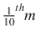 的精度就足够了。但如果你进行的计算涉及到埃（Å = 10^(−9) 米）级别的精度，那么显然你需要更高的准确性和精确度。

### 3.5.2 浮点运算

实数在计算机中表示为浮点数。实数到计算机存储系统的映射是一种公式化的表示（称为浮点表示）[6]。在这里，实数被表示为三个部分：有效数、基数和指数。

例如，π 的值为 3.1415926535897…。假设对于一个特定的计算，我们只有四位有效数字，那么该值可以重写为 3.1415。现在这个数表示为 31415 × 10^(−4)，其中 31415 称为有效数，10 称为基数，-4 称为指数。

在将数字赋值给有效数部分时，会用到有效数字位数的信息。一个数字的有效数字是那些对其测量分辨率有贡献、具有意义的数字。在前面的例子中，我们根据计算/测量的需求，仅假设了四位有效数字。术语“浮点”指的是一个数字的基数点（小数点）可以“浮动”；也就是说，它可以相对于该数字的有效数字放置在任何位置。这个位置由指数部分指示，因此浮点表示可以看作是一种科学计数法。

#### 如何存储浮点数

计算机可以将数字存储为浮点数对象。一个浮点数对象按照以下方式存储数字：

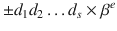

其中 `d[i] = 0, 1, 2…β − 1` 但 `d[1] ≠ 0`，且 `m ≤ e ≤ M`，这里 `m ∈ I⁻` 且 `M ∈ I⁺`。

以下是浮点数的三个组成部分：

- 符号（`±`）
- 有效数字（尾数）（`d[1] d[2] … d[s]`）
- 指数（`β`）

浮点数的每个部分都存储在不同的内存位置，并占用特定的位数。每个部分分配多少位？这些问题已由名为 IEEE754 的 IEEE 标准[[6]](#A458482_1_En_3_Chapter.html#Par249) 给出了答案。首先，让我们理解数字表示精度的概念。

1. 单精度：
   - 占用 4 字节 = 32 位。（见图 3-2。）
2. 双精度：
   - 占用 8 字节 = 64 位。（见图 3-3。）
3. 扩展双精度：
   - 占用 80 位。（见图 3-4。）
4. 四精度：
   - 占用 16 字节 = 128 位。（见图 3-5。）

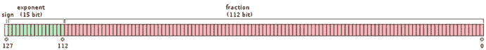

图 3-5 — IEEE 754 标准的四精度浮点数格式[[10]](#A458482_1_En_3_Chapter.html#Par253)

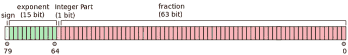

图 3-4 — IEEE 754 标准的扩展精度浮点数格式[[9]](#A458482_1_En_3_Chapter.html#Par252)

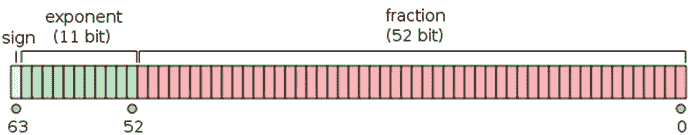

图 3-3 — IEEE 754 标准的双精度浮点数格式[[8]](#A458482_1_En_3_Chapter.html#Par251)

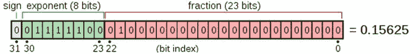

图 3-2 — IEEE 754 标准的单精度浮点数格式[[7]](#A458482_1_En_3_Chapter.html#Par250)

每个版本都有一位用于表示数字的符号。其余位分配给有效数字和指数。由于计算机中的所有数字都以二进制形式存储，因此基数始终为 2。根据可用于存储的位数，可以定义数据类型的最大数值。

例如，如果有效数字有 `n` 位可用，那么最大值为 `2ⁿ`。对于整个数据类型，如果存储可用 `m` 位，且其中一位必须用于分配符号位，那么 `2ⁿ - 1` 是该数据类型可以存储的最大数值。每种数据类型的极限都趋向两个极端（正数和负数）。因此，超出极限会定义溢出和下溢错误。

Julia 遵循 IEEE745 系统定义的数据类型声明。表 3-2 讨论了该系统。

**表 3-2 — Julia 的数字数据类型及其属性**

| 类型 | 有符号？ | 位数 | 最小值 | 最大值 |
| --- | --- | --- | --- | --- |
| `Int8` | 是 | 8 | `-2⁷` | `2⁷` |
| `UInt8` | 否 | 8 | 0 | `2⁸ - 1` |
| `Int16` | 是 | 16 | `-2¹⁵` | `2¹⁵` |
| `UInt16` | 否 | 16 | 0 | `2¹⁶ - 1` |
| `Int32` | 是 | 32 | `-2³¹` | `2³¹` |
| `UInt32` | 否 | 32 | 0 | `2³² - 1` |
| `Int64` | 是 | 64 | `-2⁶³` | `2⁶³` |
| `UInt64` | 否 | 64 | 0 | `2⁶⁴ - 1` |
| `Int128` | 是 | 128 | `-2¹²⁷` | `2¹²⁷` |
| `UInt128` | 否 | 128 | 0 | `2¹²⁸ - 1` |
| `Float16` | 是 | 16 | `-2¹⁰ × 2⁵` | `-2¹⁰ × 2⁵` |
| `Float32` | 是 | 32 | `-2²³ × 2⁸` | `2²³ × 2⁸` |
| `Float64` | 是 | 64 | `-2⁵² × 2¹¹` | `-2²⁰ × 2¹¹` |

针对特定问题执行粗略计算非常重要，以便了解程序运行期间预期的最大值和最小值。据此，你可以分配数据类型。如果你不这样做，Julia 将根据其自身规则进行分配，这可能会导致精度错误、下溢错误和溢出错误。

Julia 提供了以二进制、八进制、十六进制或十进制数字输入数值的功能。可以使用 `typeof()` 函数来探知数据类型。让我们从整数开始。我的计算机安装的是 64 位操作系统和 64 位版本的 Julia 编译器。因此，我的系统默认字长为 64 位。基于这些定义，让我们从小到大扫描整数：

```julia
julia> typeof(1234567890)
Int64
julia> typeof(-1234567890)
Int64
julia> typeof(1234567890000000000000)
Int128
julia> typeof(-1234567890000000000000
0000000000000000)
Int128
julia> typeof(12345678900000000000000
00000000000000000000000000)
BigInt
```

Julia 默认不会为所有正数分配 `UInt64` 数据类型。必须使用 `UInt64()` 函数进行声明。无符号整数使用 `0x` 前缀和十六进制（基数为 16）数字 `0-9a-f` 进行输入和输出。（大写字母 `A-F` 也可用于输入。）无符号值的大小由所使用的十六进制位数决定：

```julia
julia> typeof(0x1)
UInt8
julia> typeof(0x111)
UInt16
julia> typeof(0x11111111)
UInt32
julia> typeof(0x11111111abcdef)
UInt64
```

也支持二进制和八进制表示，如下所示：

```julia
julia> typeof(0b1)
UInt8
julia> typeof(0b110111111)
UInt16
julia> typeof(0b110111111000000
111000101001)
UInt32
julia> typeof(0b110111111000000
1110001010010101101010101010101)
UInt64
julia> typeof(0o11111)
UInt16
```

内置函数 `typemin()` 和 `typemax()` 可用于查找数据类型可以存储的最小值和最大值：

```julia
julia> typemin(Int8)

julia> typemin(UInt8)
0x00
julia> typemin(UInt64)
0x0000000000000000
julia> typemin(Int64)

julia> typemax(Int64)

julia> typemax(Int128)

julia> typemin(Int128)
```

### 3.5.3 溢出和除法错误

当一个比数据类型能存储的最大数字还大的数字被存储时，我们会遇到溢出错误消息。假设我们将最大可存储数字赋给一个名为 `a` 的变量，然后将其增加 1，并将新值存储到一个名为 `b` 的新变量中：

```julia
julia> a = typemax(Int64)

julia> b = a + 1

julia> typemin(Int64)

julia> c = a + 2

julia> typeof(a)
Int64
julia> typeof(b)
Int64
julia>  typeof(c)
Int64
```

在整数的默认数据类型（即 `Int64`）内工作时，我们看到一种回绕行为，其中将最大值加 1 会使其变为最小值。在数学中，模运算是整数的一种运算系统，其中数字在达到某个值后会“回绕”。Julia 整数的算术运算也遵循相同的概念。如果输入的数字大于特定数据类型定义的数字，则会显示错误消息：

```julia
julia> Float64(2e900)
错误：数值常量 "2e900" 溢出
```

### 3.5.4 浮点数与实数

你应该记住，浮点数是实数的抽象。有时这种抽象无法精确表示实数。

用户必须判断，如果这种抽象的失败影响不大，他们仍然可以放心地使用浮点数进行计算，但需留意误差。几个例子可以阐明这一点：

1.  如果 `a,b,n ∈ ℜ ∃ c = (a + b)/n` 使得 `c ∈ ℜ`（ℜ 表示实数集合）
    *   这本质上说明，任意两个实数之间，都存在另一个实数。
    *   然而，这对浮点数并不成立，因为浮点数是以有限精度定义的。（参见第 3.5.1 节）
2.  基于上述原因，浮点数是实数的近似值。
    *   `√7 × √7 − 7 = 0`，但 Julia 对该计算显示了一个很小的非零数，这是由于用于定义 `√7` 的浮点数的有限精度特性所致：

        ```julia
        julia> (sqrt(7)*sqrt(7))
        7.000000000000001
        julia> (sqrt(7)*sqrt(7))-7
        8.881784197001252e-16
        ```

    *   当定义为浮点数时，`(1/2 + 1/6) − 5/6 = 0` 的计算会出错。若将其转换为有理数类型，则计算正确：

        ```julia
        julia> 1//2 + 1//3 == 5//6
        true
        julia> (1//2+1//3)-(5//6)
        0//1
        julia> 1/2 + 1/3 == 5/6
        false
        julia> (1/2+1/3)-(5/6)
        -1.1102230246251565e-16
        ```

3.  结合律属性在使用浮点数定义时可能不成立，但使用有理数数据类型时则成立：

    ```julia
    julia> a = 1//10
    1//10
    julia> b = 2//10
    1//5
    julia> c = 3//10
    3//10
    julia> a1 = 1/10
    0.1
    julia> b1 = 2/10
    0.2
    julia> c1 = 3/10
    0.3
    julia> (a+b)+c == a+(b+c)
    true
    julia> (a1+b1)+c1 == a1+(b1+c1)
    false
    ```

### 3.5.5 机器精度

这里需要解释机器精度的概念。机器精度是特定数据类型所能表示的最小数值。Julia 提供了一个函数来查询这个值，即 `eps()`。尝试在 `help` 模式下搜索 `eps()`。相关文档相当具有说明性。如果数据类型记为 `T`，那么 `eps(T)` 给出 1.0 与下一个更大的可表示的 `T` 类型浮点值之间的距离。

```julia
julia> eps(Float16)
Float16(0.000977)
julia> eps(Float32)
1.1920929f-7
julia> eps(Float64)
2.220446049250313e-16
julia> eps(BigFloat)
1.727233711018888925077270360632485e-77
```

## 3.6 任意精度算术

除了浮点精度，Julia 还通过封装 GNU 多精度算术库(GMP)和 GNU MPFR 库，提供了任意精度的算术功能。此处不详细讨论，因为一般用户不常需要这些信息。

对于整数，提供了 `BigInt` 数据类型；对于浮点数，提供了 `BigFloat` 数据类型，可以通过以下方式使用：

```
julia> a = BigInt(typemax(Int64))

julia> typeof(a)
BigInt
julia> a = BigFloat(1.0)
1.00000000000000000000

julia> a = BigFloat(1.5)
1.50000000000000000000
```

当用户尝试将十进制字面量转换为浮点数时会遇到问题。例如：

```
julia> BigFloat(2.1)
2.100000000000000088817
```

为克服此问题，建议使用 `big`。`big` 将数字转换为最大精度的表示形式（通常是 `BigInt` 或 `BigFloat`）：

```
julia> a = big"2.1"
2.0999999999999999999999

julia> typeof(a)
BigFloat
```

默认精度（通常为 256 位）和 `BigFloat` 的舍入模式可以通过 `with_bigfloat_precision()` 和 `with_rounding()` 函数进行修改。

## 3.7 数值转换

当你想将一种数据类型转换为另一种时，必须意识到转换可能会导致误差。例如，浮点数转换为整数时必须进行舍入，从而产生舍入误差。舍入也有多种规则。此外，当较大的数字转换为较小容量的计算机内存格式时，会引入不精确性，这通过不精确错误来表示。

Julia 支持三种数值转换形式，它们在处理不精确转换时有所不同：

| 名称 | 行为 | 返回类型 |
| --- | --- | --- |
| `round(x)` | 将 `x` 舍入到最接近的整数 | `typeof(x)` |
| `round(T,x)` | 将 `x` 舍入到最接近的整数 | `T` |
| `floor(x)` | 向 `-Inf` 方向舍入 `x` | `typeof(x)` |
| `floor(T,x)` | 向 `-Inf` 方向舍入 `x` | `T` |
| `ceil(x)` | 向 `Inf` 方向舍入 `x` | `typeof(x)` |
| `ceil(T,x)` | 向 `Inf` 方向舍入 `x` | `T` |
| `trunc(x)` | 向 0 方向舍入 `x` | `typeof(x)` |
| `trunc(T,x)` | 向 0 方向舍入 `x` | `T` |

- `T(x)` 或 `convert(T,x)` 将 `x` 转换为 `T` 类型的值。
    - 假设我们希望将整数 3 转换为 `Float64`：

        ```
        julia> a = Int64(3)

        julia> a1 = Float64(a)
        3.0
        julia> a2 = Int64(a1)

        julia> a3 = Int8(a2)

        julia> a4 = convert(Float64,a3)
        3.0
        julia> a5 = convert(Int8,a4)
        ```

    - 如果 `T` 是浮点类型，结果是最近的可表示值，可能是正无穷或负无穷。
    - 如果 `T` 是整数类型，且 `x` 不能被 `T` 表示，则会引发 `InexactError`。

        ```
        julia> a = 2.1
        2.1
        julia> typeof(a)
        Float64
        julia> a1 = BigInt(a)
        julia> a1=BigInt(a)
        ERROR: InexactError()
        Stacktrace:
        [1] convert(::Type{BigInt}, ::Float64) at ./gmp.jl:162
        [2] BigInt(::Float64) at ./sysimg.jl:24
        julia> a1 = Int64(a)
        ERROR: InexactError()
        Stacktrace:
        [1] convert(::Type{Int64}, ::Float64) at ./float.jl:679
        [2] Int64(::Float64) at ./sysimg.jl:24
        ```

- `x % T` 将整数 `x` 转换为整数类型 `T` 的一个值，该值与 `x` 模 `2^n` 同余，其中 `n` 是 `T` 的位数。换句话说，二进制表示被截断以适应。
    - 由于 127 是 `Int8` 类型（2⁷ − 1 = 127）能存储的最大数，当数字 128 需要转换为 `Int8` 数据类型时，其位数将被截断以适应。

    ```
    julia> a = 128 % Int8

    julia> a1 = 127 % Int8
    ```

- 舍入函数 `Rounding off` 接受一个可选参数 `T`。例如，`round(Int,x)` 是 `Int(round(x))` 的简写：

    ```
    julia> round(Int8,127.2)

    julia> round(Int8,125.9)

    julia> round(127.2)
    127.0
    julia> round(125.9)
    126.0
    julia> Int8(round(127.2))

    julia> Int8(round(125.9))
    ```

- 其他舍入函数包括 `floor()`、`ceil()` 和 `trunc()`。以下是示例代码：

```
julia> round(2.6)
3.0
julia> round(Int8,2.6)

julia> floor(2.6)
2.0
julia> floor(Int8,2.6)

julia> ceil(2.6)
3.0
julia> ceil(Int8,2.6)

julia> trunc(2.6)
2.0
julia> trunc(Int8,2.6)
```

## 3.8 算术运算符

除了定义数学数字外，用户还必须定义诸如`+,-,*, and /`之类的算术运算符，以便根据数据类型的代数规则执行算术计算。

下面通过一些例子来说明这一点：

| 运算符符号 | 名称 | 行为 |
| --- | --- | --- |
| `+a` | 一元正号 | 恒等运算 |
| `-a` | 一元负号 | 将值映射为`a`的加法逆元 |
| `a+b` | 二元加法 | 执行 `a` 加 `b` |
| `a-b` | 二元减法 | 执行 `a` 减 `b` |
| `a*b` | 乘法 | 执行 `a` 乘以 `b` |
| `a/b` | 除法 | 返回 `a` 除以 `b` 所得的商 |
| `a\b` | 反除法 | 返回 `b` 除以 `a` 所得的商 |
| `a%b` | 取余 | 返回 `a` 除以 `b` 所得的余数 |
| `a^b` | 幂运算 | 计算 `a ^ b` |

```
julia> a = 1.0
1.0
```

```
julia> b = 1.5
1.5
julia> +a # 恒等运算不改变值
1.0
julia> -a # 返回 1.0 的加法逆元 -1.0
-1.0
julia> a+b # 1.0+1.5 = 2.5
2.5
julia> a-b # 1.0-1.5 = -0.5
-0.5
julia> a*b # 1.0 乘以 1.5 等于 1.5
1.5
julia> a/b # 1.0/1.5 的商是 0.66 ...
0.6666666666666666
julia> a\b # 1.5/1.0 的商是 1.5
1.5
julia> a%b # 1.0/1.5 的余数是 1.0
1.0
julia> a^b # 1.0 的 1.5 次幂是 1.0
1.0
```

## 3.9 布尔数值

布尔数值与布尔代数共同构成了现代计算的基石。乔治·布尔（George Bool）发明了布尔代数，用于处理布尔数值（`true` 和 `false`）以及诸如 `AND`、`OR`、`NOT` 和 `XOR` 之类的布尔运算符。它们可用于量值的比较，以及构建逻辑语句并判断其真值。

### 3.9.1 数学量值的比较

Julia 中存在两个逻辑数值，即 `true` 和 `false`，可用于执行布尔算术运算。在最简单的形式中，它们可用于检查量值之间的不等关系和相等关系。

```
julia> a = 1.0
1.0
julia> b = 1

julia> a == b # 1.0 和 1 的值都是 1
true
julia> a!=-b # 从数学上看，1.0 不等于 -1
true
julia> a   a  a  >  b  #  因为数学上 1.0=1
false
julia> a>= b # 因为至少相等关系成立
true
```

下面列出了已经探索过的运算符：

| 运算符符号 | 含义 |
| --- | --- |
| `==` | 等于 |
| `!=` | 不等于 |
| `<` | 小于 |
| `<=` | 小于或等于 |
| `>` | 大于 |
| `>=` | 大于或等于 |

对于计算机来说，整数的比较很简单，因为它只需比较位值。在这方面，浮点数略有不同。它们是根据 IEEE754 标准进行比较的：[6]

- 正零等于但不大于负零。
- `Inf` 等于自身，并且大于除 `NaN` 之外的任何值。
- `-Inf` 等于自身，并且小于除 `NaN` 之外的任何值。
- `NaN` 不等于、不小于、也不大于任何值，包括其自身。

可以轻松验证这些陈述，如下所示：

```
julia> +0.0 == 0.0 # 正零与零相同
true
julia> +0.0 == -0.0 # 正零与负零相同
true
julia> +0.0  +0.0 > -0.0
false
julia> Inf == -Inf # 正无穷不等于负无穷
false
julia> Inf > Inf # 正无穷不大于自身
false
julia> Inf > -Inf # 正无穷大于负无穷
true
julia> NaN  ==  Inf # Inf 和 NaN 不能按值进行比较
false
julia> Inf >  NaN
false
julia> -Inf > NaN
false
julia>  -NaN
NaN
julia> NaN  >  Inf
false
julia> NaN > -Inf
false
julia> NaN == NaN # 两个 NaN 值不相同
false
julia> NaN != NaN
true
julia> NaN  NaN >= NaN
false
julia> NaN > NaN
false
julia> NaN > NaN
false
```

为了避免不同数据类型下运算符行为的不一致，Julia 提供了一些内置函数。

| 函数 | 行为 |
| --- | --- |
| `isequal(x,y)` | `x` 和 `y` 完全相同 |
| `isfinite(x)` | `x` 不是 `Inf` 或 `-Inf` |
| `isinf(x)` | `x` 等于 `Inf` 或 `-Inf` |
| `isnan(x)` | `x` 等于 `NaN` |

```
julia> isequal(1.0, 1)
true
julia> isfinite(Inf)
false
julia> isfinite(-Inf)
false
julia> isfinite(1.0)
true
julia> isinf(Inf)
true
julia> isinf(-Inf)
true
julia> isinf(1.0)
false
julia> isnan(NaN)
true
julia> isnan(Inf)
false
julia> isnan(-Inf)
false
julia> isnan(1.0)
false
```

### 3.9.2 比较链

在 Julia 中，比较可以任意链接：

```
julia> 1 < 2 > 3
false
```

`1<2>3`可以这样理解：首先将`1<2`赋值给`a`，其值为`true`，然后计算`a>3`，结果为`false`：

```
julia> a=1<2
true

julia> a > 3
false
```

除非使用括号，否则链式比较中的求值顺序是未定义的。该语句从右侧开始读取，并将连续的比较结果串联起来。

括号内的表达式会优先计算。括号内的表达式也是从右侧开始读取，并将连续的比较结果串联起来。示例如下：

```
julia> (1<2)<(3==3)
false
julia> 1<2<3==3
true
julia> true>true
false
julia> (1<2)>(3>3)
true
julia> 3>3
false
julia> true>false
true
```

### 3.9.3 布尔运算符

`AND` (`&`)、`NOT` (`!` 或 `~`)、`XOR` (`$`) 和 `OR` (`|`) 运算符可用于构建复杂的逻辑语句。值得注意的是，布尔运算符多数是按位运算符。也就是说，在执行比较操作时，它们按位进行运算。

| 表达式 | 行为 |
| --- | --- |
| `~a` | 按位 `NOT`（`NOT` a） |
| `a & b` | 按位 `AND`（a `AND` b） |
| `a \| b` | 按位 `OR`（a `OR` b） |
| `a $ b` | 按位 `XOR`（a `XOR` b） |
| `a >>> b` | 逻辑右移 |
| `a >> b` | 算术右移 |
| `a << b` | 逻辑/算术左移 |

逻辑移位是一种对操作数的所有位进行移位的按位运算。另一方面，算术移位也是一种移位运算符，有时称为有符号移位（尽管它不限于有符号操作数）。这两个运算符都可以定义为向左或向右移位。

对于二进制数来说，它是一种按位运算。（换句话说，它将操作数的所有位按给定的位数进行移位。）空出的位会被填充。与逻辑移位中全部填充 0 不同，在向右移位时，最左边的位（通常是有符号整数表示中的符号位）会被复制以填充所有空出的位置（这是一种符号扩展）。

我们先扫描一下基本的布尔运算符，然后理解按位移位运算符。首先定义名为 `a` 和 `b` 的变量来保存布尔值 `true` 和 `false`。使用布尔运算符，可以构建简单以及复杂的逻辑语句来获得结果：

```
julia> a = Bool(true)
true
julia> b = Bool(false)
false
julia> !a # NOT 运算符
false
julia> ∼a # 按位非
false
julia> a & b # AND 运算符
false
julia> a | b # OR 运算符
true
julia> a $ b # XOR 运算符
true
julia> a & (a | b) & a # 一个复杂的逻辑语句
true
```

## 3.10 更新运算符

每个二元算术运算符和位运算符也都有一个更新版本。这些运算符会将运算结果重新赋值给其左操作数。

它们的定义相当简单。二元运算符的更新版本是通过在运算符后立即加上一个 `=` 形成的。

| 表达式 | 行为 |
| --- | --- |
| `a+=1` | `a = a+1` |
| `a-=1` | `a = a-1` |
| `a*=2` | `a = a*2` |
| `a/=2` | `a = a/2` |
| `a\=2` | `a = 2/a` |
| `a%=2` | `a = a%2` |
| `a^=2` | `a = a²` |
| `a!=a` | `a = !a` |
| `a&=2` | `a = a&a` |
| `a&#124;=a` | `a = a &#124; a` |

```julia
julia> a = 1.5
1.5
julia> a+=1 # a 现在的值为 1.5+1 = 2.5
2.5
julia> a-=1 # a 现在的值为 2.5-1=1.5
1.5
julia> a*=2 # a 现在的值为 1.5*2=3.0
3.0
julia> a/=2 # a 现在的值为 3.0/2 = 1.5
1.5
julia> a\=2 # a 现在的值为 2/1.5 = 1.33 ...
1.3333333333333333
julia> 2/1.5 # 验证
1.3333333333333333
julia> a=10 # 将 a 重新定义为 10
julia> a%=2 # a 现在的值为 10%2 = 0
julia> 10%2  #  验证
julia> a=10 # 将 a 重新定义为 10
julia> a^=2 # a 现在的值为 10² = 100
julia> a = Bool(true) # a 被定义为布尔值 true
true
julia> a!=a # a 被更新为 (NOT a)，因此得到值 false
false
julia> a # 验证 a 的值为 false
false
julia> a&=a # a 被更新为值 (a&a)
### 即 false&false
false
julia> a|=a # a 被更新为值
### (a|a) 即 false|false
false
julia> a$=a # a 被更新为值
$(a$a) 即 false$false
false
```

值得注意的是，更新运算符会重新绑定左侧的变量。因此，变量的类型可能会改变。

```julia
julia> a = UInt8(12)
0x0c
julia> typeof(a)
UInt8
julia> a ^= 200.5
2.375963871483476e216
julia> typeof(a)
Float64
```

## 3.11 运算符优先级

为了使用数学数字进行数学计算，编程语言定义运算符优先级非常重要。例如，如果我们要计算

`2+3*5/2³.5`

我们必须理解结果取决于数学函数运算的顺序。让我们在 Julia 控制台上尝试计算：

```julia
julia> 2+3*5/2³.5
3.3258252147247767
```

现在让我们理解为了得到这个值，运算符的应用顺序。根据 Julia 文档 [13]，以下是定义的运算符优先级：

| 符号 | 含义 |
| --- | --- |
| `^` | 乘方 |
| `//` 和 `\\` | 分数 |
| `* / % & \` | 代数运算 |
| `+ - \| $` | 加法 |
| `> < >= <= == === != !== <:` | 比较 |

```julia
julia> 2+3*5/2³.5
3.3258252147247767
julia> 2³.5 # 首先应用乘方
11.31370849898476
julia> ans # ans 存储了上一个计算值
11.31370849898476
julia> 5/ans # 除法运算符
0.4419417382415922
julia> ans*3 # 乘法运算符
1.3258252147247767
julia> ans+2 # 加法
3.3258252147247767
```

运算符优先级逻辑遵循著名的数学运算法则 BEDMAS（括号—乘方—除法—乘法—加法—减法）。建议对需要单独计算的数字使用括号。例如：

`(2+3)*(5/2)³.5`

将首先计算每个括号内的计算，然后应用运算符优先级。因此结果会不同：

```julia
julia> (2+3)*(5/2)³.5
123.52647110032733
julia> 5/2 # 首先计算括号内的 5/2 和 2+3
2.5
julia> ans³.5 # 接下来执行乘方
24.705294220065465
julia> ans*(5) # 结果乘以 (2+3) = 5
123.52647110032733
```

## 3.12 小结

本章讨论了 Julia 执行数学任务的方式。它为各种数字类型提供了多种对象。每个对象都有特定的方法来处理数学运算符。了解运算符与特定数据的用法，可以让您有意义地决定如何使用它们。数字系统的层次结构也必须全面理解，因为转换规则决定了数字在计算任务中如何处理。决定使用特定的数据类型进行计算需要在精度和内存使用之间进行有效的权衡。运算符优先级是本章讨论的另一个重要任务，因为它决定了最终结果。此外，Julia REPL 及其各种模式在执行数学计算时也很有用。