# 4. 复数

## 4.1 引言

在初步了解基本的数学结构之后，您现在需要理解如何处理复数。涉及复数的计算几乎出现在科学和数学的所有分支中。所有基于 Julia 的数值计算开发人员都必须理解定义复数及其数学运算的各种方法，以便高效计算。

复数世界涵盖了重要的科学领域。当用于描述现实时，它们比实数更能丰富地描绘物理现象。每一种声称能稳健执行数学计算的编程语言都必须能轻松处理复数。Julia 确实是这样一种语言。复数可以用简单的术语定义，并且提供了大部分处理它们的函数。此外，它们与其他数据类型在计算中的使用非常灵活且完美无瑕。这些品质使其成为执行复杂分析任务的最佳选择之一。


## 4.2 定义复数

定义复数的首要任务是定义复数的符号 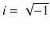。一个由 `im` 表示的全局常量被用来代表 `i`。这表示主值 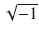。数学家通常使用字母 `i` 和 `j` 来表示 `i`，但这些字母在计算机科学学院中也广泛用于表示索引变量。为了避免混淆，选择了符号 `im` 而不是 `i` 或 `j`。

因此，复数 `1 + 4i` 可以写成如下形式：

```
julia> a = 1+4im
1 + 4im
julia> real(a)

julia> imag(a)

```

该复数的实部是 `1`，虚部是 `4i`。在 Julia 中，复数存储为两个数：`re`（实部）和 `im`（虚部）。两者都是某种类型的实数。可以通过函数 `real()` 和 `imag()` 获取它们。

创建复数对象的另一种方法是使用 `complex()`、`complex32()`、`complex64()` 和 `complex128()` 函数：

```
julia> a = 3.5 # 定义 "a"
3.5
julia> b = -4.9 # 定义 "b"
-4.9
julia> z = complex(a,b) # 创建复数
### a 作为实部，b 作为虚部
3.5 - 4.9im
julia> typeof(z)
Complex{Float64}
julia> typeof(real(z)) # 实部存储为
### Float64 对象
Float64
julia> typeof(imag(z)) # 虚部存储为
### Float64 对象
Float64
julia> z1 = Complex32(a,b) # 复数的
### 32 位存储
Float16(3.5) - Float16(4.9)im
julia> typeof(real(z1)) # z1 将实部存储为
### Float16 对象
Float16
julia> typeof(imag(z1)) # z1 将虚部存储为
### Float16 对象
Float16
julia> z2 = Complex64(a,b) # 复数的
### 64 位存储
3.5f0 - 4.9f0im
julia> typeof(real(z2)) # z2 将实部存储为
### Float32 对象
Float32
julia> typeof(imag(z2)) # z2 将虚部存储为
### Float32 对象
Float32
julia> z3 = Complex128(a,b) # 复数的
### 128 位存储
3.5 - 4.9im
julia> typeof(real(z2)) # z3 将实部存储为
### Float64 对象
Float64
julia> typeof(imag(z2))# z3 将虚部存储为
### Float64 对象
Float64
```

值得注意的是，实部和虚部的数据类型会根据定义函数的定义而保留，其转换规则与用于整数和实数的规则类似。

## 4.3 复数的性质

复数以图形方式定义，如图 4-1 所示。在基于实-虚轴的复平面上，一个特定的点由复数 `a + ib` 定义，其中 `a` 是该点在实轴上的投影大小，`b` 是该点在虚轴上的投影大小。

图 4-1 展示了一个表示复数 `z = x + iy` 的点，并演示了 `r = |z|`（绝对值）和 `ϕ`（幅角）的值是如何给出的。

(4.1) `r = sqrt(x² + y²)`

(4.2) `ϕ = tan^{-1}(y/x)`

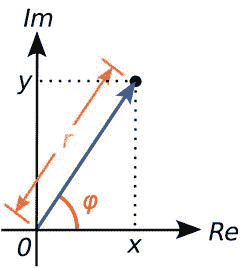

**图 4-1** 在复平面上描绘的复数 [1]

一个复数的绝对值就是它到原点的距离。一个复数的幅角就是它与水平轴沿逆时针方向所成的角度。

对于一个复数，例如 `z = -4 + 3i`，其主值和幅角（以弧度为单位）可以使用 Julia 计算：

```
julia> z = -4 + 3im
-4 + 3im
julia> r = abs(z)
5.0
julia> r_squared = abs2(z)

julia> phi = angle(z)
2.498091544796509
julia> z = -4 + 3im
-4 + 3im
julia> z_conjugate = conj(z)
-4 - 3im
julia> abs2(z) == z*z_conjugate
true
```

一个复数的共轭是其沿水平轴的镜像。换句话说，它的虚部是原数的相反数。当与其共轭相乘时，结果为 `r²`，这由上述代码的最后一行验证。

`Inf` 和 `NaN` 会通过复数的实部和虚部进行传播。我们来处理三个复数：`z1 = complex(NaN,Inf)`、`z2 = complex(Inf,NaN)` 以及一个简单的复数 `z3 = complex(1,2)`。然后，让我们计算 `z1+z2`、`z2+z3` 和 `z1+z3`，以测试如何处理包含 `NaN` 和 `Inf` 的复数：

```
julia> z1 = complex(NaN,Inf)
NaN + Inf*im
julia> z2 = complex(Inf,NaN)
Inf + NaN*im
julia> z3 = complex(1,2)
1 + 2im
julia> z1+z3
NaN + Inf*im
julia> z2+z3
Inf + NaN*im
julia> z1+z2
NaN + NaN*im
```


### 复数运算

复数运算涉及与之前第 4 章讨论的实数运算类似的操作。这些运算包括加法、减法、乘法、除法、乘方等。然而，这些运算的规则对于复数来说略有不同。

两个复数相加涉及将它们的实部和虚部分别相加。减法也是如此。假设我们按如下方式定义两个复数：

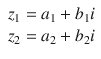

现在我们可以如下定义它们的加法和减法：

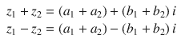

复数的乘法和除法运算并非如此直接：

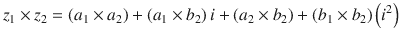

通过合并实部和虚部项，这个式子可以简化，因为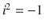：

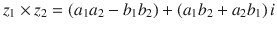

复数与实数的乘法和除法可以通过分别对实部和虚部执行乘法或除法来更简单地进行。

复数 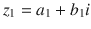 的共轭复数定义为 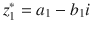。从几何角度看，z[1]^* 是 z[1] 关于实轴的“反射”。因此，如果计算两次共轭，我们就会得到原数：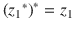。

复数的除法可以如下使用其共轭数进行：

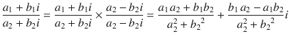

因此，将分母的共轭复数与分子和分母相乘，会得到一个新的复数，该复数就是两个复数相除的结果。

Julian 运算符，如 `+`、`-`、`*`、`^` 和 `/`，对实数和复数都同样适用，无需额外处理。例如：

```
julia> a = 3.2
3.2
julia> b = -4.4
-4.4
julia> z1 = complex(a,b)
3.2 - 4.4im
julia> z2 = -z1
-3.2  +  4.4im
julia> z3 = z1 + z2 # 两个复数相加
0.0 + 0.0im
julia> z3 = z1 - z2 # 两个复数相减
6.4 - 8.8im
julia> z3 = z1 * z2 # 两个复数相乘
9.120000000000001 + 28.160000000000004im
julia> z3 = z1 / z2 # 两个复数相除
-1.0 - 0.0im
julia> z3 = z1^z2 # 复数作为另一个复数的指数
### 进行幂运算
-0.1407063188343073 - 0.24121298541124633im
julia> z3 = z1² # 复数作为实数的指数进行幂运算
### 实数的幂
-9.120000000000001 - 28.160000000000004im
julia> z3 = 2*z1 # 一个实数乘以一个复数
### 一个复数
6.4 - 8.8im
julia> z3  =  z1*(z2³.2  - z2/z1)
1211.337685375584 - 232.35311358949485im
```

当涉及的数字是混合数据类型时，遵循层级规则：

```
julia> a = Int8(9)

julia> b = Float64(287.876567)
287.876567
julia> z = complex(a,b)
9.0 + 287.876567im
julia> typeof(real(z))
Float64
julia> typeof(imag(z))
Float64
julia> c = Int64(3456)

julia> z1 = c*(z)
31104.0 + 994901.415552im
julia> typeof(imag(z1))
Float64
julia> typeof(real(z))
Float64
```

## 总结

处理复数及其运算的能力使得 Julia 能够以逼真的方式进入现实世界模拟。复分析是物理和工程科学中数学研究的基石之一。实部和虚部的物理重要性对于科学解释至关重要，尤其是在处理随时间变化的现象（通常是动态问题）时。定义复数的便捷性，以及提取实部和虚部的简便性，再加上执行复分析的运算符，使得 Julia 成为模拟现实问题最先进的选择之一。

