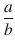
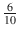
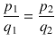
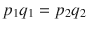
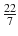

# 有理数与无理数

## 数与比率

有理数是可以写成两个数之比的数。这个比也称为分数表示。分数表示包括两部分：分子（上面的数）和分母（下面的数）。以下是一个有理数的分数表示：



其中 a, b ∈ I 且 b ≠ 0。

例如，0.50 也可以写成 。类似地，0.60 可以写成 ，然后可以化简为 。有理数可以形式化地定义为满足 q ≠ 0 的整数对 (p, q) 的等价类，其等价关系定义为：若 p[1]q[2] = p[2]q[1]，则 (p[1], q[1]) ~ (p[2], q[2])。这很容易理解，因为



(5.1) 意味着



(5.2)

有理数的小数展开要么在有限位数后终止，要么开始重复相同的有限数字序列。需要注意的是，这个讨论不仅适用于基数为 10 的数（十进制数），也适用于任何其他基数，如 2（二进制）、6（十六进制）、8（八进制）等等。

所有不能表示为比值的数称为无理数，换句话说，不是有理数的实数称为无理数，例如数 `π = 3.1415926535897...` 和数 `e = 2.7182818284590...`。有人可能会争辩说，可以用比值  来表示 π，但这个比值是对实际数的不精确表示。无理数的小数展开是无限且不循环的：

```
julia> a = pi
a = 3.1415926535897...
julia> e
e = 2.7182818284590...
julia> inexactness = 22/7 - pi
inexactness = 0.0012644892673496777
```

## 有理数

有理数表示数的精确比值。例如， 可以取值为 0.66... 。所使用的数字必须限制为有限位数，这会因为整数比率的分数表示不精确而导致计算误差。另一方面，如果这个比值本身可以用于计算，那么计算的精确性就可以得到保持。


### 5.2.1 有理数的表示

运算符`//`用于定义有理数。例如，有理数 2/3 可以定义如下：

```
julia> a = 2//3
2//3
julia> typeof(a)
Rational{Int64}
```

可以使用`num()`和`den()`函数提取有理数的分子和分母：

```
julia> a = 2

julia> b = -4

julia> a1 = a//b
-1//2
julia> num(a1)

julia> den(a1)

```

这个例子也揭示了一个重要事实。`//`通过约分来求解有理数——即，对分子和分母进行因式分解，然后消去公因子：

### 5.2.2 复数作为分子和分母

有理数也可以使用复数来构造，如下所示：

```
julia> a = complex(2,3)
2 + 3im
julia> b = complex(-3,2)
-3 + 2im
julia> 1//a
2//13 - 3//13*im
julia> -3//b
9//13 + 6//13*im
julia> a//b
0//1 - 1//1*im
julia> (-3//b)^a
0.09624621106941285 + 0.06935501144252361im
```

当`a = complex(2,3)`且`b = complex(-3,2)`时，`1//a`（公式 [5.3]）和`a//b`（公式 [5.4]）在数学上可以如下计算：

(5.3)

同样地，对于表达式`a//b`，可以将由两个复数构成的有理数构造为 2+3i/-3+2i，其求解过程如下：

(5.4)

### 5.2.3 有理数的数学运算

Julia 中的有理数可以像数学中的有理数一样进行运算：

```
julia> a = 1//2
1//2
julia> a+a
1//1
julia> a-a
0//1
julia> a/a
1//1
julia> a*a
1//4
```

当分子和/或分母为负数时，该数会转换为带有相应符号的形式：

```
julia> a = -3

julia> b = 4

julia> c = -2

julia> a1 = a//b
-3//4
julia> a2 = a//c
3//2
```

比较运算符也可以用于有理数数据类型：

```
julia> a = -2

julia> b = 3

julia> a1 = a//b
-2//3
julia> a2 = (2*a)//(2*b)
-2//3
julia> a1 == a2
true
julia> a3 = (2*a)//(3*b)
-4//9
julia> a1  ((a1 + a2)  a1+a2
-4//3
julia> (a1+a2) a2 == a3
false
julia> true & false
false
```

### 5.2.4 将有理数转换为浮点数

有理数可以通过分子除以分母并写出商来转换为小数表示形式。例如，2/5=0.4。有时这种表示形式会产生无限循环的数字序列。例如，1/3=0.333... Julia 支持这些数学计算，如下所示：

```
julia> float(2//5)
0.4
julia> float(1//3)
0.3333333333333333
```

### 5.2.5 分母为零的有理数

有理数定义要求分母非零，但 Julia 允许分母为零，甚至允许进行常规计算。换句话说，在 Julia 中构造无穷大的有理数值是可以接受的。但是，不允许构造 0/0 这样的分数：

```
julia> a = -1

julia> b = 0

julia> c = 3

julia> a1 = a//b
-1//0
julia> 0//0
ERROR: ArgumentError: invalid
rational: zero(Int64)//zero(Int64)
Stacktrace:
[1] Rational{Int64}(::Int64, ::Int64)
at ./rational.jl:13
[2] //(::Int64, ::Int64)
at ./rational.jl:40
```

### 5.2.6 与其他数据类型的有理数

有理数数据类型根据数据类型的提升规则与其他数据类型进行交互。在以下示例中，`a1`存储了一个分子和分母均为`Int64`类型的有理数，而`a2`存储了一个复数。当计算`a1+a2`时，得到复数`c`，其实部和虚部均为`Rational`类型。除法运算也是如此。

```
julia> a1 = 2//3
2//3
julia> a1+1
5//3
julia> a1 + 2.3
2.9666666666666663
julia> a2 = complex(-2,4)
-2 + 4im
julia> a1+a2
-4//3 + 4//1*im
julia> a1/a2
-1//15 - 2//15*im
```

现在让我们测试如何使用布尔运算比较精确和不精确的有理数，例如 1/2=0.5，1/3≠0.333。这种不精确性可以通过计算`(1//3)-0.33`来得到。但当与`float(1//3)`比较时（即，将有理数表示为浮点数，然后与`1//3`相减），我们得到零。这表明在执行有理数与整数或浮点数之间的计算之前，有理数会被转换为`Float64`数据类型。

```
julia> 0.5 == 1//2
true
julia> 0.3 == 1//3
false
julia> 0.333 == 1//3
false
julia> a = float(1//3)
0.3333333333333333
julia> a == 1//3
false
julia> (1//3) - a
0.0
julia> (1//3)-0.333
0.0003333333333332966
julia> (1//3)-a # a = float(1//3)
0.0
```

## 5.3 无理数

无理数简而言之就是那些非有理数的数；它们不能表示为两个整数的比值。有很多例子，例如 π 和 e。Julia 定义了一个恰如其名的数据类型`Irrational`。例如，π 和 e 在 Julia 中已被预定义为无理数常量：

```
julia> pi
pi = 3.1415926535897...
julia>  e
e = 2.7182818284590...
julia> typeof(pi)
Irrational{:pi}
julia> typeof(e)
Irrational{:e}
```

请注意，无理数的数值表示以三个点结尾，强调了数字表示并非止于此，实际上还在继续。

## 5.4 总结

定义和处理分数的能力是希腊数学的基石之一。大多数孩子在很小的时候就学会了如何处理有理数及其算术，并且将精确解表示为分数的便利性是众所周知的。在编程语言中定义有理数的能力使其非常适合在进行数值计算时对解的精确性要求极高的场景。定义无理数同样重要，因为当无理数被引入计算时，会导致不精确性，从而产生误差。不精确的程度取决于无理数表示的精度。Julia 能够定义无理数的设定精度，这使我们能够预先确定数值计算中的不精确程度，正如本章所展示的那样。

