# 6. 数学函数

## 6.1 简介

数学函数是一组输入与一组允许输出之间的关系，其性质是每个输入恰好对应一个输出。大多数用户已经熟悉许多此类函数，包括三角函数`sin(x)`、`cos(x)`和`tan(x)`；以某个数（例如 10）为底的对数`log10`；指数运算`e^x`等等。一个宣称能够高效执行复杂数学计算的编程语言，必须提供简单直观的方式来使用这些数学函数，并且还必须提供构造用户自定义函数的方法。本章将阐述 Julia 中一些内置的数学函数。

## 6.2 除法函数

除法是四种基本算术运算之一；另外三种是加法、减法和乘法。两个自然数的除法是计算一个数包含在另一个数中的次数的过程。这本质上是在计算我们能在第二个数中分出多少组。例如，当用`10`（除数）除以`3`（被除数）时，我们可以得到`3`（商）组，并剩余`1`（余数）。除法也可以被描述为一个数在另一个数上循环，直到我们找到终点。这种循环可以是线性的、极性的等等。循环由模函数描述，其中`a modulo b`意味着`a`被循环`b`次，以找出循环的次数（商）和剩下的部分（余数）。

Julia 定义了一组函数，用于以指定方式执行一个或多个数的除法。表 6-1 概述了它们的语法和行为。现在，让我们通过示例来了解它们的用法。

**表 6-1** 除法函数

| 语法 | 行为 |
| --- | --- |
| `div(x,y)` | 截断除法；商向零舍入 |
| `fld(x,y)` | 向下取整除；商向 `-Inf` 舍入 |
| `cld(x,y)` | 向上取整除法；商向 `+Inf` 舍入 |
| `rem(x,y)` | 余数；满足 `x == div(x,y) *y + rem(x,y)`；符号与 `x` 相同 |
| `mod(x,y)` | 模数；满足 `x == fld(x,y) *y + rem(x,y)`；符号与 `x` 相同 |
| `mod1(x,y)` | 带偏移量 `1` 的 `mod()` |
| `mod2pi(x,y)` | 关于 `2π` 的模运算 |
| `divrem(x,y)` | 返回 `(div(x,y),rem(x,y))` |
| `fldmod(x,y)` | 返回 `(fld(x,y),mod(x,y))` |
| `gcd(x,y, ...)` | `x, y,...` 的最大正公约数 |
| `lcm(x,y, ...)` | `x, y,...` 的最小公倍数 |

### 6.2.1 `div(x,y)`, `fld(x,y)` 和 `cld(x,y)`

假设我们想计算。内置函数 `div(x,y)`、`fld(x,y)` 和 `cld(x,y)` 会产生以下结果：

```
julia> div(3,5) # 简单除法

julia> fld(3,5) # 向下取整除法

julia> cld(3,5) # 向上取整除法

julia> 3/5
0.6
```

我们知道 得到商 `0.6` 和余数 `0`。因此，对于这三个函数，可以观察到以下行为：

* 对于 `div()`，结果向 `0` 截断，因此 `0.6` 变为 `0`。
* 对于 `fld()`，结果向 `-Inf` 截断，因此 `0.6` 变为 `0`。
* 对于 `cld()`，结果向 `+Inf` 截断，因此 `0.6` 变为 `1`。

这些函数可以使用不同类型的数据类型。使用 `Float64` 会得到以下结果：

```
julia> 2.24/3.45
0.6492753623188406
julia> div(2.24,3.45)
0.0
julia> cld(2.24,3.45)
1.0
julia> fld(2.24,3.45)
0.0
```

当使用混合数据类型时，会应用转换和提升规则。你可以使用 `methods(f)` 来扫描函数 `f` 所支持的所有数据类型组合。因此，查看 `methods(div)`、`methods(fld)` 和 `methods(cld)` 是很有用的。你可以检查复数不能作为这些函数的输入：

```
julia> a = Float64(2.24)
2.24
julia> b = Int64(3)

julia> r1 = div(a,b)
0.0
julia> typeof(r1)
Float64
julia> r2 = fld(a,b)
0.0
julia> r3 = cld(a,b)
1.0
```

### 6.2.2 `rem()`, `mod()` 和 `mod1()`

除了使用函数 `div()`、`fld()` 和 `cld()` 获取商之外，你还可以使用 `rem()` 函数获取余数。假设我们想检查。我们知道商是 `1`，余数是 `1`：

```
julia> a = 3

julia> b = -2

julia> div(a,b) # 商

julia> rem(a,b) # 余数，符号与 a 相同

julia> mod(a,b) # 模数，符号与 b 相同

julia> mod1(a,b) # 带偏移量 1 的模运算
```

在计算中，模运算用于求一个数除以另一个数后的余数（有时称为“模数”）。函数 `mod(2,3)` 执行此任务并返回 `1` 作为结果。

### 6.2.3 `mod2pi()`

就像模函数在实数上循环一样，`mod2pi()` 通过在 `2π` 上循环来求余数。因此，其值始终在 `[0, 2π]` 范围内：

```
julia> pi
pi= 3.1415926535897...
julia> mod2pi(1*pi)
3.141592653589793
julia> typeof(mod2pi(1*pi))
Float64
julia> typeof(1*pi)
Float64
julia> mod2pi(-1*pi)
3.1415926535897936
julia> mod2pi(2*pi)
6.283185307179586
julia> mod2pi(2*pi+1)
0.9999999999999998
julia> mod2pi(2*pi-1)
5.283185307179586
julia> mod2pi(1*pi-1)
2.141592653589793
```

值得注意的是，`mod2pi()` 函数没有将 `Irrational` 数据类型作为其方法之一，因此 `mod2pi(pi)` 会报错。另一方面，当对无理数 `pi` 进行运算时，它会变成另一种数据类型，然后可以在 `mod2pi()` 函数中使用。

### 6.2.4 `divrem()` 和 `fldmod()`

我们可以使用 `divrem()` 函数在单个语句中计算商和余数，而不是分别使用 `div()` 和 `rem()` 函数：

```
julia> quotient,remainder = divrem(10,3)
(3,1)
julia> quotient,remainder = divrem(10,3.3)
(3.0,0.10000000000000053)
julia> quotient,remainder = fldmod(10,3)
(3,1)
julia> quotient,remainder = fldmod(10,3.3)
(3.0,0.10000000000000053)
```

### 6.2.5 `gcd()`

最大公约数是能同时整除一个数字集合中所有元素的最大数字。`gcd(x,y)` 给出最大的正公约数（如果 `x` 和 `y` 都为零，则返回零）：

```
julia> gcd(3,6)

julia> gcd(319,666)

julia> gcd(-319,666)

julia> gcd(-319,-666)
```

### 6.2.6 `lcm()`

最小公倍数是出现在一个数字集合的倍数列表中的最小正数。Julia 函数 `lcm` 给出最小的非负公倍数：

```
julia> lcm(40,55)

julia> lcm(33,11)

julia> lcm(33,-11)

julia> lcm(-33,-11)
```

## 6.3 符号和绝对值函数

一个数的符号看似一个微小、不重要的属性，但却被证明是一个有价值的工具。仅仅改变符号就会改变数所在的象限。符号相反的数是在不同象限中原始数的镜像。Julia 提供了一组函数来获取有关数字符号的信息（表 6-2）。

**表 6-2** 用于数字符号的 Julia 函数

| 语法 | 行为 |
| --- | --- |
| `abs(x)` | 返回 x 的绝对值（正数） |
| `abs2(x)` | 返回 x 的模的平方 |
| `sign(x)` | 指示 x 的符号，返回 −1、0 或 +1 |
| `signbit(x)` | 指示符号位是开（`true`）还是关（`false`） |
| `copysign(x,y)` | 返回一个具有 x 的模和 y 的符号的值 |
| `flipsign(x,y)` | 返回一个具有 x 的模和 `x*y` 的符号的值 |

### 6.3.1 `abs()` 和 `abs2()`

一个数的绝对值是该数的正值。用计算机获取正值有两种方法。第一种是简单地翻转定义有符号整数时使用的符号位。第二种是计算该数的平方，然后求该数的平方根。第二种方法的问题在于，在某些情况下执行这些操作时可能会产生近似误差：

```
julia> a = -900707.7097680866 # 浮点数
-900707.7097680866
julia> sq = a*a
8.112743784356716e11
julia> sqroot = sqrt(sq)
900707.7097680866
julia> -sqroot == a
true
julia> a = -pi # 无理数
-3.141592653589793
julia> sq = a*a
9.869604401089358
julia> sqroot = sqrt(sq)
3.141592653589793
julia> -sqroot == a
true
julia> a = -(2//3) # 有理数
-2//3
julia> sq = a*a
4//9
julia> sqroot = sqrt(sq)
0.6666666666666666
julia> -sqroot == float(a)
true
```

Julia 提供了 `abs(x)` 函数来获取一个数的绝对值。`methods(abs)` 给出了可以与 `abs()` 函数一起使用的各种数据类型的选项：

```
julia> abs(-190)

julia> abs(190)

julia> abs(-190.08967)
190.08967
julia> abs(190.08967)
190.08967
```

### 6.3.2 复数的绝对值

如第 4 章所述，复数 `a + ib` 的绝对值是

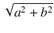

从原点出发的向量长度（由复数定义）。

```
julia> a = complex(2,-3)
2 - 3im
julia> abs(a)
3.6055512754639896
julia> abs2(a)
```

平方后的绝对值给出

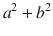

使用 `abs2()` 函数。

#### `abs()` 函数的问题

当 `abs` 应用于有符号整数时，可能会发生溢出，导致返回一个负值。这种溢出只会在 `abs` 应用于有符号整数的最小可表示值时发生。

```
julia> a = typemin(Int8)
julia> abs(a)
julia> a = typemin(Int32)
julia> abs(a)
```

### 6.3.3 `sign()`、`signbit()`、`copysign()` 和 `flipsign()`

如第 3.​5.​2 节所述，当存储有符号数时，会保留一个符号位用于为数值分配符号。该位可以通过 `signbit()` 函数扫描，如果 `x` 的符号值为负，则返回 `true`，否则返回 `false`：

```
julia> a = -123 # 负整数
julia> signbit(a)
true
julia> b = 123 # 正整数
julia> signbit(b)
false
julia> c = 0 # 零
julia> signbit(c)
false
julia> a1 = -123.123 # 负浮点数
-123.123
julia> signbit(a1)
true
julia> b1 = 123.123 # 正浮点数
123.123
julia> signbit(b1)
false
julia> c1 = 0.0 # 零浮点数
0.0
julia> signbit(c1)
false
julia> a2 = -2//3 # 负有理数
-2//3
julia> signbit(a2)
true
julia> a3 = 2//3 # 正有理数
2//3
julia> signbit(a3)
false
julia> a4 = -2//-3 # 正有理数
2//3
julia> signbit(a4)
false
julia> a5 = 0//1 # 零有理数
0//1
julia> signbit(a5)
false
```

要了解一个数的符号，可以使用 `sign()` 函数。如果输入数为零，则返回 `0`；如果输入数为正，则返回 `1`；如果输入数为负，则返回 `-1`。

```
julia> a = -123
julia> sign(a)
julia> b = 123
julia> sign(b)
julia> c = 0
julia> sign(c)
```

#### 操作符号

有时，你需要给一个数分配一个选定的符号。可能需要扫描特定数字，并将选定的数字符号分配给一个新数字。这由函数 `copysign(x, y)` 完成。它返回一个与 `y` 具有相同符号的 `x`。`methods(copysign)` 给出了可以传递给此函数的数据类型列表：

```
julia> copysign(123,-231)
julia> copysign(-123,231)
julia> copysign(-123,-231)
julia> copysign(123,231)
julia> copysign(123,0)
julia> copysign(-123,0)
```

`flipsign(x, y)` 函数返回一个 `x`，如果 `y` 为负，则其符号翻转。

```
julia> flipsign(123,-231) # 符号翻转
julia> flipsign(-123,231) # 符号不变
julia> flipsign(-123,-231) # 符号翻转
julia> flipsign(123,231) # 符号不变
julia> flipsign(123,0) # 符号不变
julia> flipsign(-123,0) # 符号不变
```

## 6.4 幂、对数与根

将一个数进行幂运算，本质上表示该幂与其自身相乘的次数。（例如，`a^n` 表示 `a` 被乘了 `n` 次。）值得注意的是，`n` 可以是任意实数。以下等式定义了计算规则：

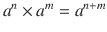

(6.1)

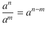

(6.2)

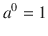

(6.3)

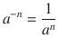

(6.4)

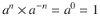

(6.5)

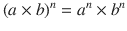

(6.6)

当 `n` 是形如  的有理数时，则 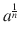 被称为 `a` 的 `n` 次方根。

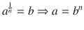

(6.7)

![$$ {a}^{\frac{n}{m}}=\sqrt[m]{a^n} $$](A458482_1_En_6_Chapter_Equ8.gif)

(6.8)

最有趣的是复数 `i`：

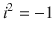

(6.9)

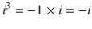

(6.10)

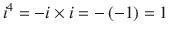

(6.11)

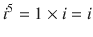

(6.12)

这些被称为单位复数根。

### 6.4.1 数的乘方

当一个数被提升到另一个数的幂时，会用到一系列数学函数。用户必须参考公式 6.13 来定义数的幂，6.14 定义数的根，以及 6.15 定义基于选定底数的数的对数：

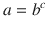

(6.13)

![$$ b=\sqrt[c]{a} $$](A458482_1_En_6_Chapter_Equ14.gif)

(6.14)

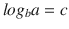

(6.15)

让我们通过一个简单的例子来理解这些公式：

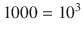

![$$ 10=\sqrt[3]{1000} $$](A458482_1_En_6_Chapter_Equd.gif)

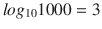

Julia 提供了一系列函数来定义基于选定底数的幂、根和对数，如表 6-3 所示。

**表 6-3** 用于幂、根和对数计算的 Julia 函数

| 语法 | 行为 |
| --- | --- |
| `sqrt(x)` | 计算  |
| `cbrt(x)` | 计算 ![$$ \sqrt[3]{x} $$](A458482_1_En_6_Chapter_IEq7.gif) |
| `hypot(x, y)` | 计算 （即以 `x` 和 `y` 为直角边的直角三角形的斜边） |
| `exp(x)` | 计算 `e^x` |
| `expm1(x)` | 计算 `e^x − 1`，当 `x` 接近 `0` 时结果精确 |
| `ldexp(x, n)` | 计算 `x * 2^n`，针对整数值 `n` 高效计算 |
| `log(x)` | 计算 `log_e(x)` |
| `log(b, x)` | 计算 `log_b(x)` |
| `log2(x)` | 计算 `log_2(x)` |
| `log10(x)` | 计算 `log_10(x)` |
| `log1p(x)` | 计算 `log(1 + x)`，当 `x` 接近零时结果精确 |
| `exponent(x)` | `x` 的二进制指数 |
| `significand(x)` | 浮点数 `x` 的二进制有效数（也称为尾数） |

以下章节将逐一介绍它们，以便理解其正确用法。每个函数描述后都附有示例 Julia 代码，你可以测试该函数的用法。

### 6.4.2 `sqrt()`、`cbrt()` 和 `hypot()`

一个数 `x` 的平方根是指将该数提升至  次幂，符号表示为 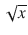。类似地，一个数的立方根是指将该数提升至  次幂，符号表示为 ![$$ \sqrt[3]{x} $$](A458482_1_En_6_Chapter_IEq12.gif)。

```julia
julia> sqrt(2)
1.4142135623730951
julia> cbrt(2)
1.2599210498948732
```

`methods(sqrt)` 和 `methods(cbrt)` 列出了可与这些函数配合使用的各种数据类型。特别令人兴奋的是数字 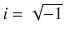。命令 `sqrt(-1)` 会报错，提示需要复数参数。因此，应执行以下代码：

```julia
julia> a = complex(0,1)# 复数 "i"
0 + 1im
julia> sq = a²
-1 + 0im
julia> sqrt(sq)
0.0 + 1.0im
```

函数 `cbrt()` 不支持复数数据类型，但支持负数：

```julia
julia> cbrt(pi) # 无理数
1.4645918875615231
julia> cbrt(-3.54) # 负数
-1.5240565695688593
julia> cbrt(3.54) # 正数
1.5240565695688593
julia> cbrt(2//3) # 有理数
0.8735804647362988
julia> cbrt(float(2//3))
0.8735804647362988
```

第三个函数 `hypot(x,y)` 用于计算直角三角形的斜边。这也是由复数 `a + ib` 定义的二维向量的长度：


```julia
julia> hypot(2,3) # x=2,y=3
3.6055512754639896
julia> sqrt(2² + 3²) # 与 hypot() 相同的计算
3.605551275463989
julia> hypot(2//3,3//4) # 有理数
1.0034662148993578
julia> hypot(complex(2,3),complex(3,4)) # 复数
6.164414002968977
```

### 6.4.3 `hypot()` 计算的问题

John D. Cook 在一篇有趣的文章 [2] 中指出了 `hypot()` 的一个问题。如果 `x` 非常大，导致 `x*x` 溢出，代码将产生无穷大的结果。为了避免这个问题，Cook 建议采用另一种路径来计算斜边。

在不冒溢出风险的情况下，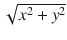 可以按如下方式计算：

1.  `max = maximum(|x|, |y|)`
2.  `min = minimum(|x|, |y|)`
3.  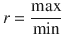
4.  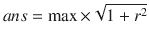

由于第四步包含了平方根参数，该参数输入了 `max` 和 `min` 值，因此可以避免溢出错误。`Float64` 数据类型的最大数值为 `10³⁰⁸`（即 `1e308`）。

```julia
julia> 1e308
1.0e308
julia> 1e308*10 # 乘以 10
Inf
```

现在假设 `x` 和 `y` 在计算斜边时都为 `0.5` 乘以 `10³⁰⁸`：

```julia
julia> x = 1e308
1.0e308
julia> y = 1e308
1.0e308
julia> h =  hypot(x,y)
1.4142135623730951e308
julia> x² # 溢出
Inf
julia> y² # 溢出
Inf
julia> h1 = sqrt(x² + y²) # 错误结果
Inf
```

### 6.4.4 `exp()`、`expm1()`、`ldexp()` 和 `exponent()`

指数运算是将一个数提升至 `e` 的幂次。`e` 是欧拉数（无理数），其值定义为 `2.7182818284590…`。

```julia
julia> e
e   =   2.7182818284590...
```

#### `exp()`

函数 `exp(x)` 输出 `e^x`。需要注意的是，如果不加小心地使用指数函数，可能会导致溢出（`e^x`）和/或下溢（`e^(-x)`）问题，结果变为 `+Inf` 和 `-Inf`：

```julia
julia> exp(1)
2.718281828459045
julia> exp(2)
7.38905609893065
julia> exp(-1)
0.36787944117144233
julia> exp(-2)
0.1353352832366127
julia> exp(1//2)
1.6487212707001282
```

值得注意的是，在使用 `exp()` 及类似函数时，使用的是数字 `e` 的近似值。换句话说，`e` 是一个永不终止的无理数，但 `e¹` 是以有限精度的浮点数形式计算的，因此其本质上是有限的。所以，`exp(1) == e` 的结果是 `false`。

```julia
julia> e
e = 2.7182818284590...
julia> exp(1)
2.718281828459045
julia> exp(1) == e
false
```

#### `expm1()`

`exp(x)` 函数的问题在于当我们想计算 `exp(1+x)` [3]，且 `x` 的值与机器精度相当（即非常小时）。在这种情况下，`1+x` 会被近似为 `x`。为了解决这个问题，可以使用 `exp1(x)` 来计算 `x` 非常小的 `exp(1+x)` 情况：

```julia
julia> exp(1)
2.718281828459045
julia> exp(1+1e-100)
2.718281828459045
julia> expm1(1+1e-100)
1.718281828459045
```

#### `ldexp()`

`ldexp(x,n)` 使用以 2 为底的指数运算，计算 `x × 2^n`：

```julia
julia> ldexp(3.5,2)
14.0
julia> 3.5*(2²)
14.0
```

#### `exponent(x)`

`exponent(x)` 返回 `x` 对应的 `2^y` 中，最接近 `x` 且向零取整的 `y`：

```julia
julia> exponent(100.0)

julia> exponent(1000.0)

julia> 2⁶

julia> 2⁹

julia> exponent(128.0)

julia> 2⁷
```

### 6.4.5 `log()`、`log2()`、`log10()` 和 `log1p()`

一个数的对数定义如下：

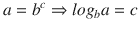

(6.16)

本示例使用了方程 6.16：

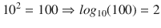

本示例也使用了方程 6.16，但底数不同，为 2：

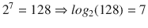

对数是数学中的一个基本函数，特别适用于那些增长或下降非常快的量。在这种情况下，用对数尺度而非线性尺度来分析它们会更有用。

#### `log()`

自然对数（例如，以 `e` 为底的对数）使用函数 `log()` 计算：

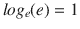

这可以被验证：

```julia
julia> e # 无理数
e = 2.7182818284590...
julia> float(e) # e 的浮点数表示
2.718281828459045
julia> e¹ # e¹=e
2.718281828459045
julia> e¹ == float(e)
true
julia> log(e) # 以 e 为底 log(e) 的值是 1
```

一些物理性质表现出指数增长。这些数据点的数值会很快变得非常大。当对这些函数应用 `log` 函数时，会得到较小的数值。这对于避免上溢和下溢错误尤为重要。

#### `log2()`

`log2()` 简单地计算一个数的以 2 为底的对数。这里的底数是 2 而不是 `e`。因此 `log2(2) = 1` 且 `log2(4) = 2`，因为 2¹ = 2 且 2² = 4。Julia 代码可以轻松验证这一点：

```julia
julia> log2(2)
1.0
julia> log2(4)
2.0
julia> 2¹

julia> 2²
```

需要注意的是，当使用负实数指数时，会遇到 `DomainError`。为避免此问题，请使用浮点数表示指数。

```julia
julia> 2^-1.0
0.5
julia> log2(0.5)
-1.0
```

有理数也可以以相同方式使用：

```julia
julia> 2^(2//3)
1.5874010519681994
julia> log2(1.5874010519681994)
0.6666666666666665
julia> float(2//3)
0.6666666666666666
```

#### `log10()`

`log10()` 计算 `log10(x)`（例如，以 10 为底的对数）。由于 10¹ = 10 且 10² = 100，
- `log10(10) = 1`
以及
- `log10(100) = 2`

这可以通过 Julia 代码轻松验证：

```julia
julia> log10(10)
1.0
julia> log10(100)
2.0
julia> log10(105.4) # 浮点数
2.022840610876528
julia> log10(2//3) # 有理数
-0.17609125905568127
julia> log10(pi) # 无理数 pi
0.49714987269413385
julia> log10(e) # 无理数 e
0.4342944819032518
julia> log10(complex(2,3)) # 复数
0.5569716761534184 + 0.42682189085546657im
```

#### `log1p()`

正如我们之前在 6.4.4 节中讨论的计算 `e^(1+x)` 且 `x` 是一个很小的数时的情况，在计算 `log_e(1 + x)` 时也会遇到类似的问题 [3]。为了克服这个问题，提出了函数 `log1p()`：

```julia
julia> log(1e10)
23.025850929940457
julia> log(1e10+1e-10) # 输出无差异
23.025850929940457
julia> log1p(1e10+1e-10) # 输出有差异
23.025850930040455
```

## 6.5 三角函数和双曲函数

## 6.5 三角函数与双曲函数

### 6.5.1 三角函数

三角函数将直角三角形的角度与其边长联系起来。在表 6-4 中，`P`、`H` 和 `B` 分别代表对边、斜边和邻边，并定义了各种三角函数。这些函数的输入参数是以弧度为单位的角度。弧度 (`r`) 可以通过公式转换为度数 (`d`)。
$$ d=\frac{r\times 180}{\pi } $$
(6.17)

**表 6-4.** 三角函数

| 函数 | 缩写 | Julia 函数 | 公式 | 恒等式 |
| --- | --- | --- | --- | --- |
| 正弦 | sin | `sin` | $$ \frac{P}{H} $$ | $$ \mathit{\sin}\left(\theta \right)=\mathit{\cos}\left(\frac{\pi }{2}-\theta \right)=\frac{1}{\mathit{\csc}\left(\theta \right)} $$ |
| 余割 | csc | `csc` | $$ \frac{H}{P} $$ | $$ \mathit{\csc}\left(\theta \right)=\mathit{\sec}\left(\frac{\pi }{2}-\theta \right)=\frac{1}{\mathit{\sin}\left(\theta \right)} $$ |
| 余弦 | cos | `cos` | $$ \frac{B}{H} $$ | $$ \mathit{\cos}\left(\theta \right)=\mathit{\sin}\left(\frac{\pi }{2}-\theta \right)=\frac{1}{\mathit{\sec}\left(\theta \right)} $$ |
| 正割 | sec | `sec` | $$ \frac{H}{B} $$ | $$ \mathit{\sec}\left(\theta \right)=\mathit{\csc}\left(\frac{\pi }{2}-\theta \right)=\frac{1}{\mathit{\cos}\left(\theta \right)} $$ |
| 正切 | tan | `tan` | $$ \frac{P}{B} $$ | $$ \mathit{\tan}\left(\theta \right)=\mathit{\cot}\left(\frac{\pi }{2}-\theta \right)=\frac{1}{\mathit{\cot}\left(\theta \right)}=\frac{\mathit{\sin}\left(\theta \right)}{\mathit{\cos}\left(\theta \right)} $$ |
| 余切 | cot | `cot` | $$ \frac{B}{P} $$ | $$ \mathit{\cot}\left(\theta \right)=\mathit{\tan}\left(\frac{\pi }{2}-\theta \right)=\frac{1}{\mathit{\tan}\left(\theta \right)}=\frac{\mathit{\cos}\left(\theta \right)}{\mathit{\sin}\left(\theta \right)} $$ |

从方程 6.17 可以轻松推导出 1 弧度 ≈ 57.3°。
```
julia> 180/pi
57.29577951308232
```
由于 `sin(90°) = 1`，在使用弧度计算时，首先将 90° 转换为弧度，然后将其输入到 `sin` 函数：
```
julia> r =(90*pi)/180 # 将 90 度转换为弧度
1.5707963267948966
julia> sin(r) # sin(90)=1
1.0
```
下面的一些 Julia 代码示例将说明它们的用法。让我们从输入 `sin` 和 `cos` 函数的已知值开始。

| 函数 | 0° | 30° | 45° | 60° | 90° |
| --- | --- | --- | --- | --- | --- |
| sin | 0 | $$ \frac{1}{2} $$ | $$ \frac{1}{\sqrt{2}} $$ | $$ \frac{\sqrt{3}}{2} $$ | 1 |
| cos | 1 | $$ \frac{\sqrt{3}}{2} $$ | $$ \frac{1}{\sqrt{2}} $$ | $$ \frac{1}{2} $$ | 0 |
| tan | 0 | $$ \frac{1}{\sqrt{3}} $$ | 1 | $$ \sqrt{3} $$ | 未定义 |

```
julia> r45d =(45*pi)/180 # 45 度转弧度
0.7853981633974483
julia> r30d =(30*pi)/180 # 30 度转弧度
0.5235987755982988
julia> r90d =(90*pi)/180 # 90 度转弧度
1.5707963267948966
julia> sin(r45d) # sin(45) = 1/sqrt(2)
0.7071067811865475
julia> 1/sqrt(2) # 确认
0.7071067811865475
julia> tan(r45d) # tan(45) = 1
0.9999999999999999
julia> sin(r30d) # sin(30) = 1/2
0.49999999999999994
```

#### 计算中的差异

需要注意的是，这些函数值本质上并非绝对精确，而是近似值。因此，如下例所示，必然会存在差异：
$$ \mathit{\sin}\left({45}^{{}^{\circ}}\right)=\mathit{\cos}\left({45}^{{}^{\circ}}\right)=\frac{1}{\sqrt{2}} $$
但 Julia 代码输出的近似值却不同：
```
julia> sin(r45d) == cos(r45d)
false
julia>   sin(r45d)
0.7071067811865475
julia>  cos(r45d)
0.7071067811865476
julia> sin(r45d) - cos(r45d)
-1.1102230246251565e-16
julia> a = 1/sqrt(2)
0.7071067811865475
julia> sin(r45d)-a
0.0
julia> cos(r45d)-a
1.1102230246251565e-16
```
另一个差异出现在计算 `tan(90°)` 时。根据数学定义，该值不存在，因为下式成立：
$$ \mathit{\tan}\left({90}^{{}^{\circ}}\right)=\frac{\mathit{\sin}\left({90}^{{}^{\circ}}\right)}{\mathit{\cos}\left({90}^{{}^{\circ}}\right)}=\frac{1}{0} $$
但 Julia 代码却给出了一个值（非常小）。这是因为 `cos(90°)` 的近似值并非真正的零，而是一个非常小的数。由于结果不是零，`tan(90°)` 便有了一个有限值。这表明，你不应该将弧度转换为角度后再使用 Julia 的三角函数。相反，Julia 提供了一套独立的函数，用于处理以角度值作为输入的情况。（这些函数将在下一节中概述。）
```
julia> tan(r90d)
1.633123935319537e16
julia> sin(r90d)/cos(r90d)
1.633123935319537e16
julia> sin(r90d)
1.0
julia> cos(r90d)
6.123233995736766e-17
```

#### 其他功能

通过上述基本函数，还可以衍生出一些其他函数：
- 反函数包括 `asin`、`acos`、`atan`、`acsc`、`asec` 和 `acot`。反函数的定义是 `asin(x) = y ⇒ sin(y) = x`
```
julia> a = sin(r45d)
0.7071067811865475
julia> asin(a)
0.7853981633974482
julia> r45d # 之前计算的值
0.7853981633974483
```
- 以角度值作为输入的同等功能函数有 `sind`、`asind`、`cosd`、`acosd`、`tand`、`atand`、`cscd`、`acscd`、`secd`、`asecd`、`cotd` 和 `acotd`。
```
julia> tand(90)
Inf
julia> sind(0)
0.0
julia> sind(90)
1.0
julia> sind(45)
0.7071067811865476
julia> 1/sqrt(2)
0.7071067811865475
```
- 提供 `sinpi(x)` 和 `cospi(x)` 用于更精确地计算 $$ \sin \left(\pi \times x\right) $$ 和 $$ \cos \left(\pi \times x\right) $$，尤其是在处理较大的 `x` 值时。
```
julia> sinpi(1)
0.0
julia> sinpi(0.5)
1.0
julia> sinpi(0.25)
0.7071067811865476
julia> sinpi(0.44)
0.9822872507286887
julia> sin(10e20)
-0.6671201770718048
```

### 6.5.2 双曲函数

正如点 `cos(x)` 和 `sin(x)` 构成一个单位圆，点 `cosh(x)` 和 `sinh(x)` 构成等轴双曲线的右半支。它们接受一个实数作为参数，该参数称为双曲角。Julia 提供了一系列用于求值的双曲函数，包括 `sinh(x)`、`cosh(x)`、`tanh(x)`、`csch(x)`、`sech(x)` 和 `coth(x)`。它们的反函数对应为 `asinh(x)`、`acosh(x)`、`atanh(x)`、`acsch(x)`、`asech(x)` 和 `acoth(x)`。
```
julia> a = sinh(1)
1.1752011936438014
julia> asinh(a)
1.0
julia> a = sinh(0.5)
0.5210953054937474
julia> b = cosh(0.5)
1.1276259652063807
julia> c = tanh(0.5)
0.46211715726000974
julia> c1 = a/b
0.4621171572600098
julia> c == c1
false
julia> c-c1
-5.551115123125783e-17
```
上述代码概述了计算 $$ \tanh (x)=\frac{\sinh (x)}{\cosh (x)} $$ 时存在的类似问题，正如我们在计算 `tan` 时观察到的那样。通过 `tanh(x)` 计算的结果与通过 `sinh(x)` 和 `cosh(x)` 比值计算的结果并不相同，因为它们都受限于机器精度的近似值。

## 6.6 计算数学函数的迭代算法

理解计算机是如何使用算法来计算数学函数值是很有价值的。计算机使用基于函数级数展开的算法，以数值方式逼近函数值。

### 6.6.1 数值近似

在科学探究过程中，有时可能无法找到精确答案。与其花费大量精力通过解析方法求解以获得精确答案，另一种选择是开发能够数值化地产生近似答案的方法。数值近似所确定的有效数字位数决定了答案的精度。结果所需的精度程度始终取决于目标应用。例如，测量建筑物的长度不需要精确到原子级别（Å）。而在测量人体体温时，对于大多数应用，精度也无需超过两位小数。在如今更快、更高效的计算机时代，必要时可以通过投入更多时间和存储空间来计算更高精度的结果。但这一便利必须谨慎使用。

### 6.6.2 容差

当用户拥有一个或多个近似答案时，需要根据应用需求为特定问题选择其中一个。做出此决定的一种方法是定义一个容差极限。容差可以定义为一个单一数值或一个数值范围（具有最大值和最小值）。定义容差极限的规则完全与应用相关。例如，测量人的身高时，你可以将容差定义为 1 厘米。然而，在测量人类头发直径时，你可能希望将精度提高到 1 微米或更小。在测量红细胞大小时，则需要进一步将精度提高到 1 纳米。虽然定义测量尺寸的容差相对简单（即容差比物体尺寸小一到两个数量级），但在其他应用中，这可能不是一项直接的任务。例如，测量用于建造建筑物的土地时，容差需要达到几分之一米，而将螺钉放入孔中时，则需要达到零点几厘米的精度。
用数学术语表示，如果 `∈` 是容差极限，`x` 是真实值，`x^*` 是近似值，则下式成立：
$$ \mid x-{x}^{\ast}\mid \le \in $$
(6.18)
在这种情况下，测量中的绝对误差（`e[a]`）和相对误差（`e[r]`）由下式给出：
$$ {e}_a=\mid x-{x}^{\ast}\mid $$
(6.19)
$$ {e}_r=\frac{\mid x-{x}^{\ast}\mid }{x} $$
(6.20)
因此，如果绝对误差小于或等于容差极限，那么该近似解或解集就是可接受的。然而，如果已知 `x`，为何还需要计算 `x^*`（即近似解）呢？
在物理系统的解未知的情况下，可以计算 `x^*`，然后与物理测量值进行比较。在这种情况下，物理测量值构成了 `x` 的值，因此可以使用公式 6.20 计算误差。随后，可以基于以下事实确定容差：即 `x^*` 与 `x` 的差异通常可以忽略不计，这些误差影响不大。

### 6.6.3 泰勒级数

大多数数学函数除了简单的运算符（`+`、`-`、`×` 和 `÷`）之外，还需要非常多的复杂运算符才能进行计算。然而，多项式只需要基本运算符即可计算。因此，如果其他数学函数可以用多项式表示，那么它们就可以相对容易地被近似。数学函数的泰勒级数展开就完成了这项任务。
多项式的定义如下：
$$ p(x)={a}_0+{a}_1x+{a}_2{x}^2+\dots +{a}_n{x}^n $$
(6.21)
其中 `a[n]` ∈ R（这些 `a` 被称为系数）。对于对应 `a[n]` ≠ 0 的最大 `n`，多项式的次数定义为 `n`。

## 6.6.4 泰勒多项式

泰勒定理展示了一种定义大量数学函数的方法，这些函数可以被定义为多项式，称为泰勒多项式。泰勒多项式所示最终答案的精度取决于其次数，即多项式中定义的项数。这提供了一种方便的方法，可以根据所需的容差来定制多项式。

假设一个数学函数 `f(x)` 需要在 `x = a` 附近进行近似。一个以 `x = a` 为中心、`n` 次的泰勒多项式 `pn` 是指该多项式（次数最多为 `n`）在 `x = a` 处的值与函数的第 `n` 阶导数值相同。

在推导泰勒多项式公式时，以下几点成立：

-   零阶多项式 `p0` 的次数最多为零。
    -   `p0` 必须是一个常数函数（在图形上表现为一条水平线函数）。
    -   在 `x = a` 附近近似：`p0 = f(a)`。
-   一阶多项式 `p1` 的次数最多为 1。
    -   `p1` 必须满足两个条件：

        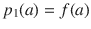

        和

        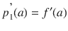

    -   `p1` 必须是 `p1 = mx + c` 的形式（一条斜率为 `m`、截距为 `c` 的直线）。
    -   由于 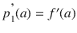 所以 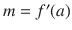
    -   因此可以写成 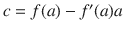
    -   将 `m` 和 `c` 的值代回，我们得到

        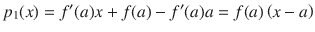

以类似的方式继续推导相同的论点，可以写出 `n` 阶泰勒多项式的一般形式如下：

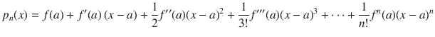

这可以用西格玛记法重写为：

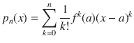(6.22)

上述定义要求该多项式在 `x = a` 处必须具有 `n` 阶导数。

麦克劳林级数就是定义在 `a = 0` 时的泰勒级数。此外，通过使用代数运算处理 `sin(x)`、`cos(x)`、`e^x` 等基本函数的泰勒/麦克劳林级数，其他复杂函数也可以以其级数形式定义出来。这些运算可以通过简单地使用代数运算符，以及代入、求导和积分来完成。这种数学上的便利性在为由复杂函数描述的物理系统制定近似解时非常有用。让我们研究两个最常用和最广泛使用的三角函数 `sin(x)` 和 `cos(x)` 的麦克劳林级数展开。

## 6.6.5 麦克劳林级数：sin(x) 和 cos(x)

`sin(x)` 和 `cos(x)` 在任意实数集给出的区间内都是连续且可微的。因此，它们的微分在同一区间内存在。因此，它们可以展开成麦克劳林级数的形式。

假设需要在 `a = 0` 处近似 `f(x) = sin(x)`。

使用表 6-5 和公式 6.22 得到以下结果：

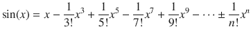(6.23)

**表 6-5.** 计算 `x = 0` 处 `sin(x)` 的麦克劳林级数系数

| n | f(x) | f(a) |
|---|---|---|
| 0 | `sin(x)` | 0 |
| 1 | `cos(x)` | 1 |
| 2 | `-sin(x)` | 0 |
| 3 | `-cos(x)` | -1 |
| 4 | `sin(x)` | 0 |

类似地，需要在 `a = 0` 处近似 `f(x) = cos(x)`。

使用表 6-6 和公式 6.22 得到以下结果：

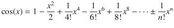(6.24)

**表 6-6.** 计算 `x = 0` 处 `cos(x)` 的麦克劳林级数系数

| n | f(x) | f(a) |
|---|---|---|
| 0 | `cos(x)` | 1 |
| 1 | `-sin(x)` | 0 |
| 2 | `-cos(x)` | -1 |
| 3 | `sin(x)` | 0 |
| 4 | `cos(x)` | 1 |

## 6.6.6 从级数展开到算法

级数展开会产生一系列项，只需将这些项相加即可得到函数的近似值。在算法上，只需定义一个通用的计算公式，然后循环进行计算，每次将计算出的值加到总和上。这个过程必须持续进行，直到满足容差水平为止。用户可以将容差设置为特定值。

Julia 内置的数学函数就是这样编写的。除了这些简单的想法，用户还必须编写更智能的算法以提供更广泛的操作范围，并避免上溢和下溢错误。将函数限定在特定的数据类型上取决于需要计算的数学函数。

## 6.6.7 需要多少项！

通过增加级数展开的项数，可以将误差降低几个数量级。但这是否意味着，为了获得真实值，必须包含无限（∞）个项？毕竟，每次添加一个新项，我们都要为计算投入时间和能量资源。一般来说，当使用 `n` 项时，麦克劳林级数的精度为 `a^(n+1)`：

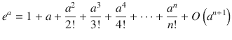(6.25)

理论上，可以选择任意大的 `n`，但这在计算机上无法实现。所选数字由选择接近 `eps` 值的容差决定。

## 6.7 本章小结

在本章中，我们总结了 Julia 中如何处理数学函数。一系列内置函数可以对一系列数据类型执行数学运算。使用 `methods()` 函数，可以检查哪些数据类型可以与哪些函数一起使用。使用预定义的函数，执行数学计算变得更加容易和有条理，但用户可以根据需要自由编写自己的函数（用户自定义函数），尤其是在内置函数无法满足需求时。为此，用户需要具备编写循环结构和定义 Julia 函数的知识。我们将在后续章节中讨论这些概念。