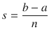

# 7. 数组

## 7.1 数组简介

正如整数、浮点数、复数、有理数数据类型以及无理数数据类型定义了不同类型的单个值一样，也存在许多可以同时容纳多个值的数据类型。这些数据类型包括`Array`（数组）、`Tuple`（元组）、`Dict`（字典）和`Set`（集合）。

数组尤其引人关注，因为它们常用于定义科学计算中的向量、表格和矩阵：
*   一维（1D）数组可充当向量或列表。
*   二维（2D）数组可用作表格或矩阵。
*   三维及更高维（3D 和 more-D）数组可以表示多维矩阵。

数组是元素的有序集合。数组是一个对象，其中包含多个由索引标识的数据项。与许多编程语言不同，Julia 的`array`索引从 1 开始，而不是 0。数组是对象的集合，这些被收集的对象存储在多维网格中。数组的维度是一个抽象概念，我们将在本章后面讨论。

在最一般的情况下，数组可能包含类型为`Any`的对象，这实质上意味着它可以存储任何类型的数值数据。然而，保持数据结构的统一性有助于管理计算资源并避免数值计算错误。因此，对于大多数计算目的而言，数组应该包含更具体类型的对象，例如`Float64`或`Int32`。因此，`Array`数据类型对象可以保存不同数据类型的值，也可以被限制为保存特定数据类型的值。

## 7.2 构造

数组通常用方括号和逗号分隔的项来表示。以下代码展示了手工创建数组的最简单方法：

```
julia> a = [1,2,3,4]
4-element Array{Int64,1}:

julia> b = [1 2 3 4]
1x4 Array{Int64,2}:
1  2  3  4
julia> size(a)
(4,)
julia> size(b)
(1, 4)
julia> ndims(a)

julia> ndims(b)
```

在 REPL 环境中执行命令`a = [1,2,3,4]`会创建一个具有 4 个元素的数组，其中每个元素都存储为`Int64`类型（因为数组的输入值是整数，且整数的默认数据类型是`Int64`），并且该数组被定义为包含四个条目的集合。对数组对象的引用由变量名`a`表示。另一方面，当执行命令`b = [1 2 3 4]`（每个元素由一个空格分隔）时，我们得到一个 1 × 4 的数组。两者之间的区别可以通过执行`size()`和`ndims()`命令来探查，这些命令会以行数和列数的形式给出数组大小。此外，当你创建数组`a`时，你会看到信息`4-element Array{Int64,1}:`，表明它是一个一维数组，存储了四个`Int64`数据类型的元素；而`b`则显示`1x4 Array{Int64,2}:`。换句话说，它是一个形状为 1 × 2（1 行 2 列）、存储`Int64`数据类型元素的二维数组。

或者，也可以使用命令结构`Array{data_type}(Number)`来定义一个包含随机数的数组，其中数据类型在大括号`{}`内定义，元素个数在圆括号`()`内定义。请注意，元素是随机分配的，因此每次执行命令时结果都会不同。例如，当执行命令`a = Array{Int64}(3)`两次时，你会得到一个包含三个`Int64`类型随机数的数组：

```
julia> a = Array{Int64}(3)
3-element Array{Int64,1}:

julia> a = Array{Int64}(3)
3-element Array{Int64,1}:
```

类似地，可以使用以下方法创建一个包含三个随机数的数组：

```
julia> a = Array{Complex64}(3)
3-element Array{Complex{Float32},1}:
4.38586f-31+1.4013f-45im
2.76974f-31+1.4013f-45im
2.64668f-31+1.4013f-45im
```

### 7.2.1 多维数组

正如你定义一维数组那样，你可以通过输入每个维度的元素个数来定义多维数组。例如，`a = Array{Int64}(2,3,4)`将创建一个大小为 2 × 3 × 4 的数组。第一个维度有两个值，第二个维度有三个值，第三个维度有四个值：

```
julia> a = Array{Int64}(2,3,4)
2x3x4 Array{Int64,3}:
[:, :, 1] =
4730481968  4730482096  4730597712
4730482032  4730597232  4730481168
[:, :, 2] =
4730481200  4730481264  4730481328
4730481232  4730481296  4730481360
[:, :, 3] =
4730481392  4730481456  4730481520
4730481424  4730481488  4730481552
[:, :, 4] =
4730481584  4730481648  4730481712
4730481616  4730481680  4730481744
```

符号`[:,:,1]`的含义将在后续章节中明确。

### 7.2.2 浮点数数组

如果一个对象中即使只有一个元素被定义为浮点数，那么所有数字元素的数据类型都将变为`Float64`：

```
julia> a = [1,2.0,3,4]
4-element Array{Float64,1}:
1.0
2.0
3.0
4.0
julia> whos() # 检查内存使用情况
Base  34453 KB     Module
Core  12510 KB     Module
Main  41151 KB     Module
a     32 bytes  4-element Array{Float64,1}
ans     32 bytes  4-element Array{Float64,1}
```

值得注意的是，数组`a`的存储使用了 32 字节，因为每个元素都是`Float64`类型，占用 8 字节 ⇒ 8 × 4 = 32 字节。因此，当数组包含大量元素时，估算其所需的存储大小非常重要。这对于内存并不充裕的设备和应用（例如单板计算机，如树莓派）尤其重要。

可以按照类似于整数的方式创建随机数数组：

```
julia> a = Array{Float64}(7)
7-element Array{Float64,1}:
2.32224e-314
2.32224e-314
2.32224e-314
2.32224e-314
2.32433e-314
2.32472e-314
2.32472e-314
julia> a = Array{Float64}(2,3,4)
2x3x4 Array{Float64,3}:
[:, :, 1] =
2.31516e-314  2.31516e-314  2.31516e-314
2.31516e-314  2.31516e-314  2.31531e-314
[:, :, 2] =
2.31531e-314  2.31538e-314  2.31538e-314
2.31531e-314  2.31538e-314  2.31563e-314
[:, :, 3] =
2.31563e-314  2.31538e-314  2.31538e-314
2.31561e-314  2.31538e-314  2.31554e-314
[:, :, 4] =
2.31538e-314  2.31553e-314  2.31553e-314
2.31553e-314  2.31553e-314  2.31538e-314
```

### 7.2.3 函数数组

由于数组的元素可以是任何数据类型，因此数学函数本身也可以成为数组的一个元素。第 6 章中定义的数学函数属于`Function`数据类型。可以如下定义一个数学函数数组：

```
julia> a = [sin,cos,tan,log]
4-element Array{Function,1}:
sin
cos
tan
log
```

### 7.2.4 混合数据类型数组

也可以创建包含混合数据类型的数组。例如，`a = [sin,1,1.5,2+5im,2//3]`创建了一个数组，其中的元素分别属于`Function`、`Int64`、`Float64`、`Complex{Int64}`和`Rational{Int64}`数据类型：

```
julia> a = [sin,1,1.5,2+5im,2//3]
5-element Array{Any,1}:
sin

1.5
2+5im
2//3
```

### 7.2.5 创建数组

到目前为止，我们只学习了如何创建元素数量较少的小型数组。如果需要创建包含大量整数或浮点数、且数值间隔固定的数组，例如从 1 到 1000 的奇数，该怎么办呢？你不会想手动输入这些数组元素的。这时，`:` 操作符就派上用场了。

操作符`n:m`定义了一个从`n`到`m`的范围，因此可以用来创建包含一系列数字的数组。使用`collect()`函数，可以为预定义的数字范围构建一个数组。起始值和终止值也可以是浮点数：

```
julia> collect(1:5)
5-element Array{Int64,1}:

julia> collect(1.1:5.6)
5-element Array{Float64,1}:
1.1
2.1
3.1
4.1
5.1
julia> collect(1:2:1000) # 1 到 1000 的奇数
500-element Array{Int64,1}:

.
.
.
```

值得注意的是，元素之间的增量（差值）默认设置为 1。可以根据需要按以下方式更改：

```
julia> collect(1:2:9)
5-element Array{Int64,1}:

julia> collect(1.5:2.2:9.9)
4-element Array{Float64,1}:
1.5
3.7
5.9
8.1
```

参数形式为`start:increment:stop`。其中`stop`表示数组能包含的最大数字。数组的元素必须小于或等于`stop`这个数字。

增量也可以是负数。例如：

```
julia> collect(10.5:-1.2:3.3)
7-element Array{Float64,1}:
10.5
9.3
8.1
6.9
5.7
4.5
3.3
julia> collect(10:-3.2:1)
3-element Array{Float64,1}:
10.0
6.8
3.6
julia> collect(10:-3:1)
4-element Array{Int64,1}:

julia> collect(1:-3:10)
0-element Array{Int64,1}
```

命令`collect(1:-3:10)`生成了一个空数组（包含零个元素的数组），因为无法以从 1 到 10 的方式实现负增量。

### 7.2.6 使用省略号操作符创建数组

省略号操作符`…`可用于创建包含一定范围对象的数组，而无需使用`collect()`函数：

```
julia> a = [1:5...]
5-element Array{Int64,1}:

julia> a = [1:2:9...]
5-element Array{Int64,1}:

julia> a = [1.2:2.2:9.9...]
4-element Array{Float64,1}:
1.2
3.4
5.6
7.8
```

### 7.2.7 使用 linspace 创建数组

另一个范围对象，即`linspace()`，可用于创建数组。`linspace`代表线性等分点。它接受三个参数，形式为`start:stop:number`，其中`number`定义了所需的元素数量（整数）。例如：

```
julia> a = linspace(1,100,5)
5-element LinSpace{Float64}:
1.0,25.75,50.5,75.25,100.0
julia> a = linspace(1,100,3)
3-element LinSpace{Float64}:
1.0,50.5,100.0
julia> step(a) # 查找步长
49.5
```

函数`step()`输出一个范围对象的步长。步长很容易计算。如果定义了`linspace(a,b,n)`，那么步长`s`的计算公式如下：



(7.1)

现在，可以将这个`linspace`对象传递给`collect()`函数来构建一个数组：

```
julia> a = linspace(1,100,3)
3-element LinSpace{Float64}:
1.0,50.5,100.0
julia> collect(a)
3-element Array{Float64,1}:
1.0
50.5
100.0
```

### 7.2.8 使用 logspace 创建数组

就像`linspace`生成线性等分点一样，`logspace`生成对数等分点。`logspace(1,100,2)`意味着两步从`10¹`到`10¹⁰⁰`。类似地，`logspace(2,5,5)`意味着五步从`10²`到`10⁵`：

```
julia> a = logspace(1,100,2)
2-element Array{Float64,1}:
10.0
1.0e100
julia> a = logspace(2,5,5)
5-element Array{Float64,1}:
100.0
562.341
3162.28
17782.8
100000.0
```

### 7.2.9 相似数组

内置函数`similar()`创建一个与给定数组相似的数组，但其元素的数据类型可以不同。例如，假设创建了一个数据类型为`Float64`的 2 × 3 数组，并保存在变量`A`中。那么，可以创建一个形状相同但数据类型为`Int8`的新数组，并保存在变量`A1`中：

```
julia> A = Array{Float64}(2,3)
2x3 Array{Float64,2}:
2.25514e-314  2.25514e-314  2.25515e-314
2.25514e-314  2.25518e-314  2.25514e-314
julia> similar(A,Int8)
2x3 Array{Int8,2}:
64  -30  1
57   13  0
```

类似地，可以从一个布尔类型数组创建数据类型为`Float64`的数组：

```
julia> A = Array{Bool}(2,3)
2x3 Array{Bool,2}:
false   true  true
true  false false
julia> similar(A,Float64)
2x3 Array{Float64,2}:
2.26024e-314  2.26024e-314  2.26024e-314
2.26024e-314  2.26024e-314  2.26024e-314
```

## 7.3 数组的属性

有多种内置函数可用于探查数组对象的各种属性。我们在 7.2 节中介绍了其中两个：`size()` 和 `ndims()`。现在来看更多函数：

*   `eltype`：元素类型

```
julia> A = [1,2,3,4]
4-element Array{Int64,1}:

julia> eltype(A)
Int64
```

*   `length`：元素数量

```
julia> A = [1.1,-2.9,3.7,4.9]
4-element Array{Float64,1}:
1.1
-2.9
3.7
4.9
julia> length(A)
```

*   `ndims`：维度数量

```
julia> A = Array{Int64}(2,3,5)
2x3x5 Array{Int64,3}:
[:, :, 1] =
4694973424  4694973552  4694972656
4694973488  4694973616  4694972688
[:, :, 2] =
4694972720  4694972784  4694972848
4694972752  4694972816  4694972880
[:, :, 3] =
4694972912  4694972976  4694973040
4694972944  4694973008  4694973072
[:, :, 4] =
4694973104  4694993040  4694973232
4694992976  4694973200  4694973264
[:, :, 5] =
4694973296  4719342608  4719342704
4694973328  4719342640           0
julia> ndims(A)

julia> A = Array{Float64}(6)
6-element Array{Float64,1}:
2.30585e-314
2.33172e-314
2.33172e-314
2.33172e-314
2.33172e-314
2.33172e-314
julia> ndims(A)
```

*   `size()`：数组的大小（每个维度中存在多少元素）

```
julia> A = Array{Int64}(2,4,3)
2x4x3 Array{Int64,3}:
[:, :, 1] =
4694973424  4694973552  4694972656  4694972720
4694973488  4694973616  4694972688  4694972752
[:, :, 2] =
4694972784  4694972848  4694972912  4694972976
4694972816  4694972880  4694972944  4694973008
[:, :, 3] =
4694973040  4694973104  4694993040  4694973232
4694973072  4694992976  4694973200  4694973264
julia> size(A) # 每个维度的元素数量
(2,4,3)
julia> size(A,3) # 第三个维度的元素数量

julia> size(A,2) # 第二个维度的元素数量

julia> size(A,1) # 第一个维度的元素数量
```

*   `indices`：数组的索引

```
julia> A = [1,2,3,4,5]
5-element Array{Int64,1}:

julia> indices(A)
(Base.OneTo(5),)
julia> B = [1 2 3 4 5]
1x5 Array{Int64,2}:
1  2  3  4  5
julia> indices(B)
(Base.OneTo(1), Base.OneTo(5))
```

对于数组 `B`，第一个维度的索引范围从 1 到 1，第二个维度的索引范围从 1 到 5。

## 7.4 索引

元素的索引是该元素在数组中的地址。Julia 中的索引从 1 开始。例如，在一维数组中，元素的索引就是该元素从左起的位置编号。Julia 不支持负索引。换句话说，只能从左侧访问元素。

```
julia> a = [12,4,6,3,6]
5-element Array{Int64,1}:

julia> a[3]

julia> a[1]
```

### 7.4.1 使用 `:` 运算符创建子数组

通过索引和 `:` 运算符，可以创建子数组。这有时被称为数组切片。例如，如果一个数组存储在变量 `a` 中，那么 `a[n:m]` 会返回一个新的数组，其元素从索引 `n` 开始，到 `m` 结束。由于 `:` 定义了一个元素范围，它也被称为范围运算符。下面的例子会让这个概念更清晰：

```
julia> a = [12,4,6,3,6]
5-element Array{Int64,1}:

julia> a[2:4]
3-element Array{Int64,1}:

julia> a[range(2,4)]
4-element  Array{Int64,1}:
```

`range()` 函数也可以用来替代 `:` 运算符。如果 `n` 或 `m` 超出了已定义数组的边界，你会遇到一个 `BoundsError`（边界错误）。

### 7.4.2 `end`

使用关键字 `end`，可以像下面这样访问数组的最后一个元素：

```
julia> A = [1,2,3,4,5]
5-element Array{Int64,1}:

julia> A[1]

julia> A[end]

julia> A[end-2]
```

这也可以用于生成给定数组的子集：

```
julia> a = collect(1:7)
7-element Array{Int64,1}:

julia> a[2:2:end]
3-element Array{Int64,1}:
```

`a = collect(1:7)` 创建了一个包含数字 1 到 7 的数组。现在，`a[2:2:end]` 创建了一个新数组，该数组从 2 开始，直到原始数组 `a` 的 `end` 为止，步长为 2（元素 2、4、6）。

### 7.4.3 多维数组的切片

多维数组的切片是真实世界数据分析中的关键技能之一。找出需要处理的数组部分，并将其作为独立实体从主数组中切片出来，需要掌握在多维框架中访问数组元素的知识：

```
julia> a = [[1,2,3] [4,5,6] [7,8,9]]
3x3 Array{Int64,2}:
1  4  7
2  5  8
3  6  9
julia> a[2,3] # 第 2 行，第 3 列元素

julia> a[3,2] # 第 3 行，第 2 列元素

julia> a[3,end] # 第 3 行，最后一列元素

julia> a[end,3] # 最后一行，第 3 列元素

julia> a[end,end] # 最后一行，最后一列元素
```

现在，`:` 运算符可以在切片操作中使用，以选择整行或整列，或者特定的部分：

```
julia> a = [[1,2,3] [4,5,6] [7,8,9]]
3x3 Array{Int64,2}:
1  4  7
2  5  8
3  6  9
julia> a[:,3] # 第 3 列的所有元素
3-element Array{Int64,1}:

julia> a[3,:] # 第 3 行的所有元素
3-element Array{Int64,1}:

julia> a[3,1:2] # 第 3 行，第 1 到第 2 列的元素
2-element Array{Int64,1}:

julia> a[2:3,2] # 第 2 到第 3 行，第 2 列元素
2-element Array{Int64,1}:

julia> a[2:3,2:3] # 第 2 到第 3 行，第 2 到第 3 列
2x2 Array{Int64,2}:
5  8
6  9
julia> a[2:end,1:end] # 第 2 到最后一行，第 1 到最后一列
2x3 Array{Int64,2}:
2  5  8
3  6  9
```

## 7.5 用值填充数组

可以使用一系列函数来自动填充数组数据。

### 7.5.1 `zeros()`

可以使用 `zeros()` 函数构造所有元素都为 0 的数组，如下所示：

| 语法 | 行为 |
| --- | --- |
| `zeros(A)` | 返回一个与 `A` 具有相同元素类型和形状的全零数组 |
| `ones(A)` | 返回一个与 `A` 具有相同元素类型和形状的全一数组 |
| `trues(A)` | 返回一个与 `A` 形状相同，所有值均为 `true` 的 `Bool` 数组 |
| `falses(A)` | 返回一个与 `A` 形状相同，所有值均为 `false` 的 `Bool` 数组 |
| `rand(n)` | 返回一个包含 `n` 个在区间 [0, 1) 上均匀分布随机数的数组 |
| `randn(n)` | 返回一个包含 `n` 个正态分布随机数的数组 |
| `eye(n)` | 返回一个 n × n 的单位矩阵 |
| `eye(n,m)` | 返回一个 n × m 的单位矩阵 |
| `fill(x,n)` | 返回一个维度为 n，并用值 `x` 填充的数组 |

```
julia> a = zeros(7)
7-element Array{Float64,1}:
0.0
0.0
0.0
0.0
0.0
0.0
0.0
julia> eltype(a)
Float64
julia> a = zeros(2,3)
2x3 Array{Float64,2}:
0.0  0.0  0.0
0.0  0.0  0.0
julia> a[2,2]
0.0
julia> a[2,2] == a[2,3] == a[1,1]
true
```

### 7.5.2 `ones()`

可以使用 `ones()` 函数构造所有元素都为 1 的数组，如下所示：

```
julia> a = ones(7)
7-element Array{Float64,1}:
1.0
1.0
1.0
1.0
1.0
1.0
1.0
julia> eltype(a)
Float64
julia> a = ones(3,4)
3x4 Array{Float64,2}:
1.0  1.0  1.0  1.0
1.0  1.0  1.0  1.0
1.0  1.0  1.0  1.0
julia> a = ones(3,4,2)
3x4x2 Array{Float64,3}:
[:, :, 1] =
1.0  1.0  1.0  1.0
1.0  1.0  1.0  1.0
1.0  1.0  1.0  1.0
[:, :, 2] =
1.0  1.0  1.0  1.0
1.0  1.0  1.0  1.0
1.0  1.0  1.0  1.0
```

### 7.5.3 `trues()`

就像数组中可以用数值 0 和 1 填充一样，可以使用函数 `trues()` 将布尔值 `true` 填充到数组中，如下所示：

```
julia> a = trues(2,3)
2x3 BitArray{2}:
true  true  true
true  true  true
julia> a = trues(3,4,2)
3x4x2 BitArray{3}:
[:, :, 1] =
true  true  true  true
true  true  true  true
true  true  true  true
[:, :, 2] =
true  true  true  true
true  true  true  true
true  true  true  true
```

### 7.5.4 `falses()`

类似地，可以使用函数 `falses()` 将布尔值 `false` 填充到数组中：

```
julia> a = falses(2,3)
2x3 BitArray{2}:
false  false  false
false  false  false
julia> a = falses(3,4,2)
3x4x2 BitArray{3}:
[:, :, 1] =
false  false  false  false
false  false  false  false
false  false  false  false
[:, :, 2] =
false  false  false  false
false  false  false  false
false  false  false  false
```

### 7.5.5 填充随机数的数组

有两个函数提供填充随机数的数组。`rand()` 提供在区间 [0, 1) 内均匀分布的随机数。另一方面，`randn()` 提供一个填充正态分布随机数的数组：

```
julia> a = rand(8)
8-element Array{Float64,1}:
0.72864
0.203516
0.512295
0.449959
0.211407
0.348952
0.677256
0.585907
julia> a = rand(8)
8-element Array{Float64,1}:
0.591333
0.140416
0.127931
0.291892
0.0306536
0.0559765
0.959664
0.263331
```

值得注意的是，就像我们两次运行 `rand(8)` 命令得到不同的随机数集一样，再次运行此命令时，我们也应该预期得到不同的随机数集：

```
julia> a = rand(8)
8-element Array{Float64,1}:
0.123916
0.577333
0.786042
0.19784
0.757978
0.481438
0.375539
0.949668
julia> a = randn(8)
8-element Array{Float64,1}:
-0.365407
-1.31341
-0.331167
-0.180398
-0.860501
0.831122
-0.223168
0.226383
```

该命令对更高维度的数组以类似的方式工作：

```
julia> a = rand(2,3,5)
2x3x5 Array{Float64,3}:
[:, :, 1] =
0.0306414  0.767554  0.696444
0.0924386  0.334853  0.627763
[:, :, 2] =
0.505539  0.00991551  0.277056
0.553033  0.272472    0.381655
[:, :, 3] =
0.033432  0.826044   0.689259
0.927387  0.18994    0.517047
[:, :, 4] =
0.725888  0.261185   0.155774
0.623608  0.211425   0.237139
[:, :, 5] =
0.669267  0.659699   0.859842
0.691922  0.51326    0.156616
julia> a = randn(2,3,5)
2x3x5 Array{Float64,3}:
[:, :, 1] =
-1.45105    0.506138    0.607333
0.269298  -0.172373   -0.7592
[:, :, 2] =
-0.463605   0.459976   1.75424
-0.753155   0.043333   0.0107971
[:, :, 3] =
-0.470125   -0.426953   -1.02621
-0.0536346   1.10199     0.122024
[:, :, 4] =
1.00947     0.83089  0.395584
-0.0139497  -0.5233   0.405085
[:, :, 5] =
1.37339  -0.519548  0.556255
1.28814  -1.52136   0.0380677
```

### 7.5.6 `eye()`

单位矩阵是一种对角线元素为 1，其他元素为 0 的矩阵。在 Julia 中，可以使用 `eye()` 命令创建它，如下所示：

```
julia> a = eye(3)
3x3 Array{Float64,2}:
1.0  0.0  0.0
0.0  1.0  0.0
0.0  0.0  1.0
julia> a = eye(5)
5x5 Array{Float64,2}:
1.0  0.0  0.0  0.0  0.0
0.0  1.0  0.0  0.0  0.0
0.0  0.0  1.0  0.0  0.0
0.0  0.0  0.0  1.0  0.0
0.0  0.0  0.0  0.0  1.0
julia> a = eye(5,3)
5x3 Array{Float64,2}:
1.0  0.0  0.0
0.0  1.0  0.0
0.0  0.0  1.0
0.0  0.0  0.0
0.0  0.0  0.0
```

值得注意的是，使用单个参数 `eye(n)` 会创建一个 n × n 的方阵单位矩阵，而 `eye(n,m)` 则创建一个维度为 n × m 的矩阵。

### 7.5.7 `fill()`

就像可以使用 `zeros` 和 `ones` 用 0 和 1 填充矩阵一样，`fill` 命令会生成一个数组，其所有元素都填充为所需的数值：

```
julia> fill(5,3)
3-element Array{Int64,1}:

julia> fill(5,(2,3))
2x3 Array{Int64,2}:
5  5  5
5  5  5
julia> fill(5,(2,3,5))
2x3x5 Array{Int64,3}:
[:, :, 1] =
5  5  5
5  5  5
[:, :, 2] =
5  5  5
5  5  5
[:, :, 3] =
5  5  5
5  5  5
[:, :, 4] =
5  5  5
5  5  5
[:, :, 5] =
5  5  5
5  5  5
```

## 7.6 重塑数组

重塑数组意味着改变其维度。例如，一个形状为 `1 × 20` 的一维数组可以通过多种方式重塑：`4 × 5`、`5 × 4`、`2 × 2 × 5` 等。这可以通过 `reshape()` 函数来实现，如下所示：

```
julia> A = Array{Int8}(4,5)
4x5 Array{Int8,2}:
-32  1  48  1  -16
-101  0  83  0  -101
-46  0  -7  0   -46
15  0   9  0    15
julia> A1 = reshape(A,(5,4))
5x4 Array{Int8,2}:
-32   0  -7     0
-101   0   9   -16
-46   0   1  -101
15  48   0   -46
1  83   0    15
julia> A1 = reshape(A,(20))
20-element Array{Int8,1}:

julia> A1 = reshape(A,(2,2,5))
2x2x5 Array{Int8,3}:
[:, :, 1] =
-32  -46
-101   15
[:, :, 2] =
1  0
0  0
[:, :, 3] =
48  -7
83   9
[:, :, 4] =
1  0
0  0
[:, :, 5] =
-16  -46
-101   15
```

### 7.6.1 翻转

可以使用 `flipdim(A,n)` 来翻转矩阵 `A` 的特定维度 `n`：

```
julia> A = [[1,2,3] [4,5,6]]
3x2 Array{Int64,2}:
1  4
2  5
3  6
julia> flipdim(A,1) # 翻转行 (dim=1)
3x2 Array{Int64,2}:
3  6
2  5
1  4
julia> flipdim(A,2) # 翻转列 (dim=2)
3x2 Array{Int64,2}:
4  1
5  2
6  3
```

### 7.6.2 压缩与数组

另一个名为 `squeez()` 的内置函数看起来类似于重塑，但行为却完全不同。`squeeze(A, dims)` 从数组 `A` 中移除由 `dims` 指定的维度：

```
julia> a = reshape(collect(1:9),(1,3,1,3))
#### 创建维度为 1x3x1x3 的数组
1x3x1x3 Array{Int64,4}:
[:, :, 1, 1] =
1  2  3
[:, :, 1, 2] =
4  5  6
[:, :, 1, 3] =
7  8  9
julia> squeeze(a,3)
# 移除第 3 维，从
# 维度为 1x3x1x3 的数组创建
# 一个维度为 1x3x3 的新数组
1x3x3 Array{Int64,3}:
[:, :, 1] =
1  2  3
[:, :, 2] =
4  5  6
[:, :, 3] =
7  8  9
julia> squeeze(a,1)
# 移除第 1 维，从
# 维度为 1x3x1x3 的数组创建
# 一个维度为 3x1x3 的新数组
3x1x3 Array{Int64,3}:
[:, :, 1] =

[:, :, 2] =

[:, :, 3] =

```

## 7.7 排序

按照特定规则对元素进行排序是矩阵操作的一个重要方面。内置函数 `sort(A),n` 沿维度 `n` 对矩阵 `A` 进行排序。默认情况下，Julia 会选择合理的算法并按标准升序排序：

```
julia> sort([2,4,1,5,2,7,3])
7-element Array{Int64,1}:

```

如果你需要按降序排序，可以选择参数 `rev=true`（默认为 `false`）：

```
julia> sort([2,3,1,4,6,3,7], rev=true)
7-element Array{Int64,1}:

```

### 7.7.1 `sortperm()`

内置函数 `sortperm()` 返回 `v` 的索引排列向量，该向量将 `v` 按排序顺序排列：

```
julia> A = [2,3,1,4,6,3,7]
7-element Array{Int64,1}:

julia> v = sortperm(A) # 按递增值的数组索引
7-element Array{Int64,1}:

julia> A[v] # 使用新索引向量创建数组
7-element Array{Int64,1}:

```

### 7.7.2 通过变换排序

在 `sort()` 函数中，你可以使用特定的变换来按特定方式排序元素。例如，定义了一个包含正负数的数组，但你希望忽略其符号进行排序。在这种情况下，你可以在 `sort()` 函数中使用 `by=abs` 选项来指示排序时只考虑绝对值，如下面的 Julia 代码示例所示：

```
julia> A = [-2,3,-4,-1,0,-5]
6-element Array{Int64,1}:

julia> sort(A,by=abs)
6-element Array{Int64,1}:

```

### 7.7.3 排序算法

目前，有四种排序算法可供选择：

*   `InsertionSort`（插入排序）
    *   它由 `QuickSort` 内部使用。
    *   它对较小的数组效率较高。
    *   其复杂度为 `O(n²)`，并且是稳定的。
*   `QuickSort`（快速排序）
    *   它是数值型数据的默认选项。
    *   其复杂度为 `O(n log(n))`，因此速度非常快。
    *   它是不稳定的。
        *   被视为相等的元素不会保持它们最初出现的顺序。
*   `PartialQuickSort(k)`（部分快速排序）
    *   它与 `QuickSort` 类似，但输出数组只会排序到索引 `k`，其中 `k` 必须是整数。
*   `MergeSort`（归并排序）
    *   它是非数值型数据的默认算法。
    *   其复杂度为 `O(n log n)`，并且是稳定的。
    *   它通常不如 `QuickSort` 快。

让我们在 Julia 文档网页上做一个小实验来验证这些关于各种算法的说法。你可以测试 `sort()` 函数中 `alg` 选项的用法，并使用 `tic()` 和 `toc()` 函数来计算每种算法的事件耗时，这两个函数分别在出现时开始和停止记录时间。

必须注意，这种记录执行时间的特定方式并不是评估算法性能的最佳选择，因为它没有针对不同的处理器、操作系统和其他参数进行标准化。此外，处理器在不同时间点可能会以不同的时间间隔来运行被观察的进程（这里是我们感兴趣的 Julia 命令）。因此，即使是在同一台计算机上，不同时间点运行的代码，其执行时间也不会相同。但我们目的只是快速检查使用不同算法运行相同排序问题所需的时间。此外，每次编写命令 `rand()` 时，生成的随机数都会不同。因此，我们目前的研究不足以对排序算法做出判断，而只是为了粗略比较测试它们的执行时间。

为此目的，展示了以下 Julia 代码。使用 `rand(1:10000,100000)` 创建一个 Julia 数组，其中包含 100,000 个介于 1 到 10,000 之间的随机数。`k` 设置为 50,000，以便可以排序一半的数字。然后，将 `sort()` 放在 `tic()` 和 `toc()` 命令之间，以获取执行代码所耗费的时间。结果汇总在表 7-1 中。

**表 7-1** 各种排序算法耗时研究

| 算法 | 耗时（秒） | 按速度排名 |
| --- | --- | --- |
| `InsertionSort` | 1.844173231 | 4 |
| `QuickSort` | 0.035997547 | 2 |
| `PartialQuickSort(500)` | 0.022802908 | 1 |
| `MergeSort` | 0.037192645 | 3 |

```
julia> A = rand(1:10000,100000);
julia> k = 50000;
julia> tic();qs=sort(A;alg=InsertionSort);toc()
elapsed time: 1.844173231 seconds
1.844173231
julia> tic();qs=sort(A;alg=QuickSort);toc()
elapsed time: 0.035997547 seconds
0.035997547
julia> tic();ps=sort(A;alg=PartialQuickSort(k));toc()
elapsed time: 0.022802908 seconds
0.022802908
julia> tic();qs=sort(A;alg=MergeSort);toc()
elapsed time: 0.037192645 seconds
0.037192645
```

由于 `PartialQuickSort(500)` 只排序了一半的值，因此速度最快；但是，与 `QuickSort` 相比，按元素数量归一化后，它并不更快。因此，对于当前这个粗略的实验，`QuickSort` 实际上是最快的算法。

### 7.7.4 字典序

内置函数 `sortrows()` 和 `sortcolumns()` 按字典序排序。字典序有时被称为词典顺序，因为语言词典遵循相同的顺序。让我们在一个字符数组上测试相同的概念：

```
julia> A1 = [['b','a','c'] ['d','f','e']]
3x2 Array{Char,2}:
'b'  'd'
'a'  'f'
'c'  'e'
julia> sort(A1,1)
3x2 Array{Char,2}:
'a'  'd'
'b'  'e'
'c'  'f'
julia> sort(A1,2)
3x2 Array{Char,2}:
'b'  'd'
'a'  'f'
'c'  'e'
julia> sortrows(A1)
3x2 Array{Char,2}:
'a'  'f'
'b'  'd'
'c'  'e'
julia> sortcols(A1)
3x2 Array{Char,2}:
'b'  'd'
'a'  'f'
'c'  'e'
```

## 7.8 在数组中查找元素

使用 `in()` 函数，你可以检查一个元素是否为数组的成员，即该元素是否与数组中某个元素的值相等。这个看似不起眼的功能在编写列表推导和循环结构时却非常强大，这也是 Julia 成为数值计算绝佳选择的原因之一。以下是其两种用法：

```
julia> A = [2,4,1,5,6]
5-element Array{Int64,1}:

julia> 2 in A
true
julia> in(2,A)
true
julia> B = [A,A]
2-element Array{Array{Int64,1},1}:
[2,4,1,5,6]
[2,4,1,5,6]
julia> 2 in B
false
julia> A in B
true
```

从前面的例子可以清晰地看出，`in()` 成员函数比较的是元素的值。当数组 `B` 由数组 `A` 作为其两个元素构成时，数值 `2` 就不再是 `B` 的成员了。

### 7.8.1 `find()`、`findfirst()` 和 `findnext()`

除了简单地判断某个值是否存在外，有时你还需要找到该值在数组中的确切位置。位置由索引来指定。内置函数 `find()` 会直接给出这些索引。另一组内置函数 `findfirst()` 和 `findnext()` 则分别用于查找某个值第一次出现的位置，以及给定索引之后下一次出现的位置：

```
julia> A = collect(1:20); # 包含 1 到 20 的数组
julia> find(isodd,A) # 查找奇数
10-element Array{Int64,1}:

julia> findfirst(isodd,A)

julia> findnext(isodd,A,findfirst(A))

julia> findnext(isodd,A,findfirst(A)+1)

julia> findnext(isodd,A,findfirst(A)+10)

```

## 7.9 复制数组

复制数组内容看似一项简单的任务，但它有两种方式：`copy`（浅拷贝）和 `deepcopy`。我们先看一个例子，然后探讨两者之间的区别：

```
julia> a = eye(3)
3x3 Array{Float64,2}:
1.0  0.0  0.0
0.0  1.0  0.0
0.0  0.0  1.0
julia> b = [1,2,a] # b 的第三个元素是数组 'a'
3-element Array{Any,1}:

[1.0 0.0 0.0; 0.0 1.0 0.0; 0.0 0.0 1.0]
julia> c = copy(b); d = deepcopy(b);
julia> b[3][1]=10 # 将第三个元素的第一个元素改为 10

julia> b
3-element Array{Any,1}:

[10.0 0.0 0.0; 0.0 1.0 0.0; 0.0 0.0 1.0]
julia> c # 'c' 是 'b' 的浅拷贝，因此也发生了变化
3-element Array{Any,1}:

[10.0 0.0 0.0; 0.0 1.0 0.0; 0.0 0.0 1.0]
julia> d # # d 维护了 'a' 的深拷贝，所以保持不变
3-element Array{Any,1}:

[1.0 0.0 0.0; 0.0 1.0 0.0; 0.0 0.0 1.0]
```

### 7.9.1 深拷贝（Deepcopy）

从前面的例子可以清楚地看到，`copy` 只是创建了一个指向原始对象同一内存位置的新引用（参见第 2 章，第 2.6 节），而 `deepcopy` 则创建了一个全新的副本（因此是一个新的内存位置）。这就是当原始对象发生改变时，`copy` 会反映这些改变，而 `deepcopy` 不会的原因。这也意味着，使用 `copy` 不会显著增加内存占用，而 `deepcopy` 则会，特别是在数组占据了可用内存很大比例的情况下。因此，应根据具体需求和可用资源，明智地选择这两种方式。

值得注意的是，`similar()` 命令（如第 7.2.9 节所述）仅复制数组的尺寸，而 `copy()` 和 `deepcopy()` 则同时复制尺寸和内容。

## 7.10 列表推导

列表推导是指通过预定义的规则来创建数组。它提供了一种通用且强大的构建数组的方法。其语法类似于数学中的集合构造表示法：

```
A = [ F(x,y,...) for x=rx, y=ry, ... ]
```

换句话说，它由变量 `x` 和 `y` 的一组取值组成。对于每一个取值，都会计算 `F(x, y)` 并生成数组的一个元素。一个示例将使这个概念更清晰：

```
julia> A = rand(1:100,7)
7-element  Array{Int64,1}:

julia> [A[i]² for i=1:length(A)]
### 对 A 的所有元素求平方
7-element Array{Int64,1}:

julia> [n² for n in A]
### 执行相同操作的更简单方式
7-element Array{Int64,1}:

julia> [sqrt(A[i]) for i=1:length(A)]
### 对 A 的所有元素求平方根
7-element Array{Float64,1}:
4.89898
1.73205
9.48683
8.94427
4.47214
8.83176
7.54983
julia> [1//2*A[i]+1//3*A[i+1] for i=2:length(A)-1]
# 将 A 中一个元素的一半与下一个元素的三分之一相加
# 来创建新元素
5-element Array{Rational{Int64},1}:
63//2
215//3
140//3
36//1
58//1
julia> [complex(A[i],A[i+1]) for i=1:length(A)-1]
# 创建一个复数，实部为当前元素，
# 虚部为 A 的下一个元素
6-element Array{Complex{Int64},1}:
24+3im
3+90im
90+80im
80+20im
20+78im
78+57im
```

结果数组的类型取决于计算所得元素的类型。如前面的例子所示，输出数组的 `eletype()` 会根据定义的操作变为 `rational`（有理数）或 `complex numbers`（复数）类型。若要显式地定义类型，你可以指定输出数组的类型。例如，如果你希望命令 `[1//2*A[i]+1//3*A[i+1] for i=2:length(A)-1]` 返回浮点数而非有理数，可以在开头显式地指定输出数组类型为 `Float64`：

```
julia> Float64[1//2*A[i]+1//3*A[i+1] for i=2:length(A)-1]
5-element Array{Float64,1}:
31.5
71.6667
46.6667
36.0
58.0
```

二维及更高维度的数组也可以简单地通过列表推导来创建。只需写出生成元素的公式，然后指定各个维度的范围（用 `,` 运算符分隔）：

```
julia> [r^c for r in 1:5, c in 1:5]
5x5 Array{Int64,2}:
1   1    1    1      1
2   4    8   16     32
3   9   27   81    243
4  16   64  256   1024
5  25  125  625   3125
julia> [r^c+d for r in 1:3, c in 1:3, d in 3:5]
3x3x3 Array{Int64,3}:
[:, :, 1] =
4   4   4
5   7  11
6  12  30
[:, :, 2] =
5   5   5
6   8  12
7  13  31
[:, :, 3] =
6   6   6
7   9  13
8  14  32
```

## 7.11 生成器表达式

以列表推导风格定义数组时，生成元素的公式需要写在方括号内。当它写在方括号之外时，会生成一个名为 `Generator` 的对象。之后，这个对象可以用于定义推导式。`Generator` 可以被迭代，按需生成值，而无需预先分配数组并存储它们。例如：

```
julia> collect(x^y for x in 1:3,y in 1:3)
# 生成一个数组，其元素为 x^y，
# 其中 x 从 1 到 3
# y 从 1 到 3
3x3 Array{Int64,2}:
1  1   1
2  4   8
3  9  27
julia> collect(sin(x)*min(y) for x in pi:4*pi, y in [-2,4,5])
# 生成一个数组，其元素由公式
# sin(x)* min(y) 给出
10x3 Array{Float64,2}:
-2.44929e-16   4.89859e-16   6.12323e-16
1.68294      -3.36588      -4.20735
1.81859      -3.63719      -4.54649
0.28224      -0.56448      -0.7056
-1.5136        3.02721       3.78401
-1.91785       3.8357        4.79462
-0.558831      1.11766       1.39708
1.31397      -2.62795      -3.28493
1.97872      -3.95743      -4.94679
0.824237     -1.64847      -2.06059
```

## 7.12 赋值运算符与数组

赋值运算符 `=` 通常将左侧的值赋给右侧的参数。它也可用于修改数组的值。例如：

```
julia> A = [1,2,3]
3-element Array{Int64,1}:

julia> A  =  [3,4,5] #  将值更改为相同尺寸
3-element    Array{Int64,1}:

julia> A = [3,4] # 将值更改为不同尺寸
2-element Array{Int64,1}:
```

这种行为可以通过变量的概念来理解，变量仅仅是对内存位置的引用。名为 `A` 的变量指向一个包含 `3-element Array{Int64,1}` 对象的内存位置。当 `A` 被赋值为不同的对象时，它只是根据新的赋值指向一个新对象。新对象可能与原对象截然不同。

赋值运算符也可用于有选择地赋新元素值：

```
julia> A = rand(3,3)
3x3 Array{Float64,2}:
0.952371  0.0541676  0.957925
0.104845  0.168398   0.913292
0.571905  0.991414   0.0173661
julia> A[2:3, 3] = 0
# 将值零赋给
# 第 2 至 3 行和
# 第 3 列的元素

julia> A
3x3 Array{Float64,2}:
0.952371  0.0541676  0.957925
0.104845  0.168398   0.0
0.571905  0.991414   0.0
```

#### 7.12.1 其他数学运算符

第 8 章专门讲解如何在数组及其元素上操作数学函数。本章对于数值实验至关重要，因为大多数数据都会转换为矩阵（存储在计算机内存中），并使用数学函数来定义变换方程。此变换方程对输入矩阵进行操作，并生成一个新矩阵（称为变换后的矩阵）。模拟真实系统涉及定义变换方程。这些变换后的矩阵会被转换回数据的原始形式，以便进行可视化和解释。因此，必须详细了解 Julia 灵活快速进行矩阵变换的能力，以便用户能够正确判断选择哪种方式，并以恰当的方式定义特定的数学函数。

## 7.13 集合论与数组

`Array` 数据类型也可以被视为等同于数学中的集合。可以计算如下集合运算：由内置函数 `union()` 给出的并集 ∪ (Union)，由内置函数 `intersect()` 给出的交集 ∩ (Intersection)，以及集合差集 (`setdiff(A-B)`)。并集运算收集两个集合中元素的唯一出现。交集收集两个集合中的共同元素。集合差集收集存在于 `A` 中但不存在于 `B` 中的元素。

```
julia> A = [1,2,3,4,-1,-3]
6-element Array{Int64,1}:

julia> B = [2,4,1,3,1,10]
6-element Array{Int64,1}:

julia> union(A,B)
7-element Array{Int64,1}:

julia> intersect(A,B)
4-element Array{Int64,1}:

julia> setdiff(A,B)
2-element Array{Int64,1}:
```

## 7.14 字典

一本英文字典将有用的信息以说明性段落和/或音频视频文件的形式映射出来，这些信息可以通过一个键（key）找到。这种关联集合也用于计算机科学中，其中键值对（key-value pair）被存储起来，作为未来的查找表使用。通过提供一个键，可以检索到对应的值。显而易见，这种键值对的集合被称为字典。

### 7.14.1 创建字典

创建字典非常简单，键值对使用 `=>` 运算符（称为 `Pair()` 函数）关联，并用逗号分隔。例如：

```
julia> dict = Dict("red"=>1,"blue"=>2,"green"=>3)
Dict{String,Int64} with 3 entries:
"blue"  => 2
"green" => 3
"red"   => 1
julia> dict = Dict("red"=>"Red","blue"=>"Red","green"=>"Green")
Dict{String,String} with 3 entries:
"blue"  => "Red"
"green" => "Green"
"red"   => "Red"
julia> dict = Dict(1=>"Red",2=>"Red",3=>"Green")
Dict{Int64,String} with 3 entries:
2 => "Red"
3 => "Green"
1 => "Red"
```

键和值的数据类型可以相同也可以不同，但键必须是唯一的。

如果预先知道键和值的数据类型，也可以像下面这样定义替代方案：

```
julia> dict1 = Dict{Integer,String}(1=>"A",2=>"b")
Dict{Integer,String} with 2 entries:
2 => "b"
1 => "A"
#### 具有已知类型的空字典
julia> dict1 = Dict{Integer,String}()
Dict{Integer,String} with 0 entries
#### 具有未知类型的空字典
julia> dict1 = Dict()
Dict{Any,Any} with 0 entries
```

### 7.14.2 查找字典

我们使用元素的索引来查找数组中的元素。类似地，我们使用键（key）来查找字典中的值。在方括号内，如果提供一个键，则会返回其值。或者，我们可以使用 `get()` 函数，该函数输入字典名称和键，输出对应的值：

```
julia> dict = Dict(1=>"Red",2=>"Red",3=>"Green")
Dict{Int64,String} with 3 entries:
2 => "Red"
3 => "Green"
1 => "Red"
julia> dict[1]
"Red"
julia> dict[2]
"Red"
julia> dict[3]
"Green"
julia> get(dict,1,0)
"Red"
julia> get(dict,2,0)
"Red"
julia> get(dict,3,0)
"Green"
julia> get(dict,4,0)

julia> get(dict,4,"missing value")
"missing value"
```

在前面的代码中，`get()` 函数使用了第三个参数（以 `0` 传入），该参数是在键值对缺失时输出的默认值。最后两行突出了这一点。

### 7.14.3 查找键与值

可以使用 `keys()` 函数查找字典的键。以下 Julia 代码给出了一个这样的例子：

```
julia> dict = Dict(1=>"Red",2=>"Red",3=>"Green")
Dict{Int64,String} with 3 entries:
2 => "Red"
3 => "Green"
1 => "Red"
julia> keys(dict)
Base.KeyIterator for a Dict{Int64,String} with 3 entries. Keys:

julia> values(dict)
Base.ValueIterator for a Dict{Int64,String} with 3 entries. Values:
"Red"
"Green"
"Red"
```

`keys()` 函数返回一个 `KeyIterator` 对象作为输出，而 `values()` 函数输出 `ValueIterator` 对象。它们可用于使用循环结构遍历键，这将在第 11 章中讨论。

### 7.14.4 修改值

可以使用 `=` 运算符为一个键关联不同的值，如下所示：

```
julia> dict = Dict(1=>"Red",2=>"Red",3=>"Green")
Dict{Int64,String} with 3 entries:
2 => "Red"
3 => "Green"
1 => "Red"
julia> dict[2]="Blue"
"Blue"
julia> dict
Dict{Int64,String} with 3 entries:
2 => "Blue"
3 => "Green"
1 => "Red"
```

这里，与键 `2` 关联的值被更改为 `String` 值 `"Blue"`，并且在下一次探查字典时，此更改会真实地反映出来。

### 7.14.5 haskey()

由于键必须是真正唯一的，`haskey()` 函数非常方便，因为它可以检查某个键是否存在于字典中：

```
julia> dict = Dict(1=>"Red",2=>"Blue",3=>"Green")
Dict{Int64,String} with 3 entries:
2 => "Blue"
3 => "Green"
1 => "Red"
julia> haskey(dict,4)
false
julia> haskey(dict,3)
true
```

### 7.14.6 检查键值对

要检查特定的键值对是否为字典的一部分，可以使用 `in` 运算符，如下所示：

```
julia> dict = Dict(1=>"Red",2=>"Blue",3=>"Green")
Dict{Int64,String} with 3 entries:
2 => "Blue"
3 => "Green"
1 => "Red"
julia> in((2=>"Red"),dict)
false
julia>  in((2=>"Blue"),dict)
true
```

### 7.14.7 添加与删除键

添加键的操作十分简单。在以下 Julia 代码中，将键 `4` 与值 `"Orange"` 关联并添加到字典中。这将在下次打印字典时体现出来：

```
julia> dict = Dict(1=>"Red",2=>"Blue",3=>"Green")
Dict{Int64,String} with 3 entries:
2 => "Blue"
3 => "Green"
1 => "Red"
julia> dict[4]="Orange"
"Orange"
julia> dict
Dict{Int64,String} with 4 entries:
4 => "Orange"
2 => "Blue"
3 => "Green"
1 => "Red"
julia> delete!(dict,4)
Dict{Int64,String} with 3 entries:
2 => "Blue"
3 => "Green"
1 => "Red"
julia> dict
Dict{Int64,String} with 3 entries:
2 => "Blue"
3 => "Green"
1 => "Red"
```

使用 `delete!()` 函数可以从字典中删除键。感叹号表示该函数版本会在操作过程中更改输入对象的值。

## 7.15 总结

数组是矩阵计算的支柱，这使得计算机在数学领域的应用成为可能。将问题向量化可以让计算机处理复杂的任务，从而让我们比求解精确解析解更快地逼近解决方案。在多种数据类型中动态定义和操作数组，使 Julia 成为数值计算的良好选择。快速运算是 Julia 在此领域受到青睐的关键。轻松定义运算的向量化，让 Julia 能够以灵活的方式将数组作为矩阵来处理。高效地通过推导式来管理、复制、排序和生成数组，使 Julia 成为基于矩阵的数学方法解决物理问题的理想选择。