# 8. 用于矩阵运算的数组

## 8.1 定义数组

Julia 数组相当于数学矩阵，因为与 Julia 数组一样，矩阵是数字的有序集合。矩阵最简单的形式是存储三维向量分量的矩阵。例如，向量 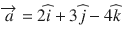 既可以表示为行矩阵：

![$$ \left[2\kern0.5em 3\kern0.5em -4\right] $$](A458482_1_En_8_Chapter_Equa.gif)

也可以表示为列矩阵：

![$$ \left[\begin{array}{c}\kern0.50em \ \ 2\\ {}\kern0.50em \ \ 3\\ {}-4\end{array}\right] $$](A458482_1_En_8_Chapter_Equb.gif)

在这两种情况下，数字 2、3 和 -4 都是按某种顺序排列的。现在，这个矩阵可以在 Julia 中用数组表示如下：

- `A` 创建一个一维数组对象（只有一个索引）。
  - 这不等同于数学矩阵，因为矩阵元素必须至少有两个索引。
  - 出于实际目的，它可以当作向量使用。
  - 此对象主要用于表示一个序列或数字系列。
- `A'` 创建一个 1 × 3 的二维数组对象。
  - 这相当于一个行矩阵。
  - 每个元素有两个索引，一个表示行，另一个表示列。
- `(A')'` 创建一个 3 × 1 的二维数组对象。
  - 这相当于一个列矩阵。
  - 每个元素有两个索引，一个表示行，另一个表示列。

```
julia> A = [2,3,-4]
3-element Array{Int64,1}:

julia> size(A)
(3,)
julia> A'
1x3 Array{Int64,2}:
2  3  -4
julia> size(A')
(1,3)
julia> (A')'
3x1 Array{Int64,2}:

julia> size((A')')
(3,1)
```

需要注意的是，Julia 数组是列优先的——它们按列读取，这与 `BLAS` 和 `LAPACK` 库相同。

Julia 数组不一定只包含数字。事实上，它可以包含其他数组作为其元素。让我们定义一个以两个数组为元素的数组。名为 `a` 的数组有两个元素；一个是 `[1, 2, 3]`，另一个是 `[3, 4, 5]`。接下来，我们创建一个以两个 `a` 为元素的数组。使用 `eltype()` 探查 `a` 和 `b` 的元素类型，可知 `a` 的元素是一个 `Int64` 的一维数组。另一方面，`b` 的元素是一个由一维 `Int64` 数组组成的一维数组。

```
julia> a = [[1,2,3],[3,4,5]]
2-element Array{Array{Int64,1},1}:
[1,2,3]
[3,4,5]
julia> b = [a,a]
2-element Array{Array{Array{Int64,1},1},1}:
Array{Int64,1}[[1,2,3],[3,4,5]]
Array{Int64,1}[[1,2,3],[3,4,5]]
julia> eltype(a)
Array{Int64,1}
julia> eltype(b)
Array{Array{Int64,1},1}
```

逗号操作符 `,` 的重要性可以通过以下示例突出显示。逗号分隔数组的两个元素。当逗号被省略而使用空格字符（按空格键打印一个空格字符）时，这些元素属于不同的列。我们在第 7 章（第 7.2 节）中已经使用过这个特性。

```
julia> a = [[1,2,3],[4,5,6]]
2-element Array{Array{Int64,1},1}:
[1,2,3]
[4,5,6]
julia> b = [[1,2,3] [4,5,6]]
3x2 Array{Int64,2}:
1  4
2  5
3  6
julia> a = [[1,2,3], [4,5,6],[7,8,9]]
3-element Array{Array{Int64,1},1}:
[1,2,3]
[4,5,6]
[7,8,9]
julia> b = [[1,2,3] [4,5,6] [7,8,9]]
3x3 Array{Int64,2}:
1  3  6
2  4  8
3  5  9
julia> eltype(a) # 元素是数组
Array{Int64,1}
julia> eltype(b) # 元素是数字
Int64
```

## 8.2 矩阵的性质

数学矩阵具有一些相关性质。它们可以通过 Julia 内置函数求值：

| 语法 | 行为 |
| --- | --- |
| `det(A)` | 方阵 `A` 的行列式 |
| `inv(A)` | 方阵 `A` 的逆矩阵 |
| `pinv(A)` | 矩阵 `A` 的伪逆 |
| `rank(A)` | 矩阵 `A` 的秩 |

### 8.2.1 行列式

2 × 2 方阵的行列式：

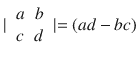

(8.1)

类似地，3 × 3 方阵的行列式：


(8.2)

类似地，更大的矩阵也可以求解其行列式。可以使用命令 `det(A)` 来计算由变量名 `A` 引用的数组所对应的方阵的行列式。

```
julia> a = rand(3,3)
3x3 Array{Float64,2}:
0.00507492  0.305511  0.0548617
0.196032    0.444446  0.374534
0.461296    0.664772  0.260325
julia> det(a)
0.03241777361378804
julia> b = zeros(3,3)
3x3 Array{Float64,2}:
0.0  0.0  0.0
0.0  0.0  0.0
0.0  0.0  0.0
julia> det(b)
0.0
julia> c = ones(3,3)
3x3 Array{Float64,2}:
1.0  1.0  1.0
1.0  1.0  1.0
1.0  1.0  1.0
julia> det(c)
0.0
```

### 8.2.2 秩

矩阵的秩与行/列元素的线性独立性相关。矩阵 `A` 中线性无关行的最大数量称为 `A` 的行秩（R [r]），而 `A` 中线性无关列的最大数量称为 `A` 的列秩（R [c]）。因此，对于 `a`，m × n，R [r] ≤ m。类似地，R [c] ≤ n。由于没有实际理由区分行和列，所以 R [r] = R [c] = R（矩阵的秩）。

此矩阵的第 1 行和第 2 行以及第 1 列和第 2 列是线性相关的（可从下方矩阵内容推断），这使得秩为 2：

![$$ A=\left[\begin{array}{ccc}1& 2& 3\\ {}2& 4& 4\\ {}3& 6& 7\end{array}\right] $$](A458482_1_En_8_Chapter_Equ3.gif)

(8.3)

```
julia> A = [[1,2,3] [2,4,6] [3,4,7]]
3x3 Array{Int64,2}:
1  2  3
2  4  4
3  6  7
julia> rank(A)
```


### 8.2.3 迹

矩阵的迹是方阵对角线上元素之和。例如，对于矩阵 `A`：

![$$ A=\left[\begin{array}{ccc}1& 2& 3\\ {}2& 4& 4\\ {}3& 6& 7\end{array}\right] $$](A458482_1_En_8_Chapter_Equ4.gif)

(8.4)

对角线元素为 1、4 和 7，因此它们的和为 12。

```
julia> A = [[1,2,3] [2,4,6] [3,4,7]]
3x3 Array{Int64,2}:
1  2  3
2  4  4
3  6  7
julia> trace(A)
```

### 8.2.4 上三角矩阵和下三角矩阵

`tril(A)` 和 `triu(A)` 用于从矩阵 `A` 中创建下三角矩阵和上三角矩阵。

```
julia> A = [[1,2,3] [2,4,6] [3,4,7]]
3x3 Array{Int64,2}:
1  2  3
2  4  4
3  6  7
julia> triu(A)
3x3 Array{Int64,2}:
1  2  3
0  4  4
0  0  7
julia> tril(A)
3x3 Array{Int64,2}:
1  0  0
2  4  0
3  6  7
```

对于非方矩阵，其工作方式类似：

```
julia> A = rand(3,4)
3x4 Array{Float64,2}:
0.384402  0.322611  0.894988  0.839034
0.336801  0.949834  0.648842  0.0314278
0.717028  0.185107  0.684199  0.582574
julia> tril(A)
3x4 Array{Float64,2}:
0.384402  0.0       0.0       0.0
0.336801  0.949834  0.0       0.0
0.717028  0.185107  0.684199  0.0
julia> triu(A)
3x4 Array{Float64,2}:
0.384402  0.322611  0.894988  0.839034
0.0       0.949834  0.648842  0.0314278
0.0       0.0       0.684199  0.582574
```

要测试给定矩阵是否为上三角矩阵或下三角矩阵，可以使用内置函数 `istriu()` 和 `istril()`：

```
julia> A = rand(3,3)
3x3 Array{Float64,2}:
0.912325  0.940698  0.768983
0.396439  0.555518  0.695407
0.961875  0.427829  0.987956
julia> triu_A = triu(A)
3x3 Array{Float64,2}:
0.912325  0.940698  0.768983
0.0       0.555518  0.695407
0.0       0.0       0.987956
julia> tril_A = tril(A)
3x3 Array{Float64,2}:
0.912325  0.0       0.0
0.396439  0.555518  0.0
0.961875  0.427829  0.987956
julia> istriu(triu_A)
true
julia> istril(tril_A)
true
```

### 8.2.5 对角线元素

内置函数 `diag(A,k)` 用于列出对角线元素，其中 `k` 为对角线的偏移量，正值表示向右偏移，负值表示向左偏移：

```
julia> A = randn(3,4)
3x4 Array{Float64,2}:
0.171985   0.323654      -0.929096   0.237231
0.396988   0.000290637   -0.852227  -0.242657
1.52518   -0.721912      -1.40742    0.0488358
julia> diag(A)
3-element Array{Float64,1}:
0.171985
0.000290637
-1.40742
julia> diag(A,1)
3-element Array{Float64,1}:
0.323654
-0.852227
0.0488358
julia> diag(A,-1)
2-element Array{Float64,1}:
0.396988
-0.721912
julia> diag(A,-2)
1-element Array{Float64,1}:
1.52518
```

### 8.2.6 范数

以下是欧几里得范数，其中 `a[n] ∈ A`：

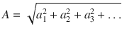

内置函数 `norm()` 用于计算矩阵的范数。如果给定一个复方阵或实方阵 `A`，那么矩阵范数 `||A||` 是一个与 `A` 相关的非负数，具有以下性质：

1.  当 `||A ≠ 0||` 时，`||A|| > 0`；如果 `A = 0`，则 `||A|| = 0`
2.  对于任意标量 `k`，`||kA|| = ||k|| * ||A||`
3.  `||A + B|| ≤ ||A|| + ||B||`
4.  `||AB|| ≤ ||A|| * ||B||`

```
julia> A = [[1,2,3] [4,5,6] [7,8,9]]
3x3 Array{Int64,2}:
1  4  7
2  5  8
3  6  9
julia> norm(A)
16.84810335261421
julia> A = [[1//2,2//3,3//4] [4//5,5//6,6//7]]
3x2 Array{Rational{Int64},2}:
1//2  4//5
2//3  5//6
3//4  6//7
julia> norm(A)
1.8199543952941895
julia> a = complex(2,3)
2 + 3im
julia> b = complex(3,-2)
3 - 2im
julia> A = [[a,b] [-b,-a]]
2x2 Array{Complex{Int64},2}:
2+3im  -3+2im
3-2im  -2-3im
julia> norm(A)
5.099019513592785
```

对于向量 `x` 和 `y`，欧几里得距离为：

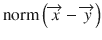

它们之间的夹角为：

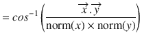

```
julia> x = [1,2,3]
3-element Array{Int64,1}:

julia> y = [2,4,6]
3-element Array{Int64,1}:

julia> dot_xy = dot(x,y)

julia> norm_x = norm(x)
3.7416573867739413
julia> norm_y = norm(y)
7.483314773547883
julia> angle = dot_xy/(norm_x * norm_y)
1.0
julia> (angle*180)/pi # 转换为角度
57.29577951308232
```

## 8.3 矩阵运算

矩阵代数中的每种运算都有两种形式。第一种是对每个元素进行操作（操作数是数组的元素）。第二种是整个矩阵之间的操作（操作数是矩阵）。例如：

![$$ \left[\begin{array}{cc}1& 2\\ {}3& 4\end{array}\right]+\left[\begin{array}{cc}-1& -2\\ {}-3& -4\end{array}\right]=\left[\begin{array}{cc}0& 0\\ {}0& 0\end{array}\right] $$](A458482_1_En_8_Chapter_Equ5.gif)

(8.5)

```
julia> a= [[1,2] [3,4]]
2x2 Array{Int64,2}:
1  3
2  4
julia> b= [[-1,-2] [-3,-4]]
2x2 Array{Int64,2}:
-1  -3
-2  -4
julia> a+b
2x2 Array{Int64,2}:
0  0
0  0
```

### 8.3.1 乘法

加法和减法以逐元素方式工作，但乘法有多种形式：

*   标量乘法
    *   `a × A`，其中 `a` 是标量，`A` 是向量。
*   逐元素乘法
    *   `A` 的每个元素与 `B` 的对应元素相乘。
    *   `A` 和 `B` 的形状必须相同。
*   向量乘法
    *   点积（例如 `A.B`）
        *   `A` 和 `B` 的形状必须相同。
    *   叉积（例如 `A × B`）
        *   `A` 和 `B` 的内维度必须相同。
    *   三重积（点积形式，例如 `A.(B × C)`）
        *   `A` 的形状必须与 `B × C` 的结果形状相同。
        *   `B` 和 `C` 的内维度必须相同。
    *   三重积（叉积形式，例如 `A × (B × C)`）
        *   `B` 和 `C` 的内维度必须相同。
        *   `A` 与 `B × C` 的内维度必须相同。


#### 标量乘法

标量乘法是指将标量与矩阵中的每个元素相乘：

![$$ \left[\begin{array}{cc}1& 2\\ {}3& 4\end{array}\right]\times 2=\left[\begin{array}{cc}2\times 1& 2\times 2\\ {}2\times 3& 2\times 4\end{array}\right]=\left[\begin{array}{cc}2& 4\\ {}6& 8\end{array}\right] $$](A458482_1_En_8_Chapter_Equ6.gif)

(8.6)

实现相同功能的 Julia 代码如下所示：

```
julia> a= [[1,2] [3,4]]
2x2 Array{Int64,2}:
1  3
2  4
julia> 2*a
2x2 Array{Int64,2}:
2  6
4  8
```

这通常按以下步骤完成：

-   将一个标量`2`转换为一个填充了该标量值、且形状与待乘矩阵相同的向量，在本例中为 2 × 2：

    ![$$ \left[\begin{array}{cc}2& 2\\ {}2& 2\end{array}\right]\times \left[\begin{array}{cc}1& 2\\ {}3& 4\end{array}\right]=\left[\begin{array}{cc}2& 2\\ {}2& 2\end{array}\right] $$](A458482_1_En_8_Chapter_Equf.gif)

-   每个元素与其对应的元素逐元素相乘：

    ![$$ \left[\begin{array}{cc}2\times 1\kern0.125em & 2\times 2\\ {}2\times 3& 2\times 4\end{array}\right]=\left[\begin{array}{cc}2& 4\\ {}6& 8\end{array}\right] $$](A458482_1_En_8_Chapter_Equg.gif)

#### 逐元素乘法

两个大小相同的矩阵之间的逐元素乘法可如下执行：

![$$ \left[\begin{array}{cc}1& 2\\ {}3& 4\end{array}\right]\times \left[\begin{array}{cc}2& 3\\ {}4& 5\end{array}\right]=\left[\begin{array}{cc}1\times 2& 2\times 3\\ {}3\times 4& 4\times 5\end{array}\right]=\left[\begin{array}{cc}2& 6\\ {}12& 20\end{array}\right] $$](A458482_1_En_8_Chapter_Equ7.gif)

(8.7)

这可以在 Julia 代码中使用逐元素乘法运算符（`.*`）实现，如下所示：

```
julia> a = [[1,3] [2,4]]
2x2 Array{Int64,2}:
1  2
3  4
julia> b = [[2,4] [3,5]]
2x2 Array{Int64,2}:
2  3
4  5
julia> a.*b
2x2 Array{Int64,2}:
2   6
12  20
```

当数组形状不匹配时，会遇到`DimensionMismatch`错误。因此，建议用户在执行此计算之前检查数组的维度（特别是在计算过程中数组较大和/或动态修改的情况下）。

#### 点积

矩阵的点积是将一个矩阵的行元素与第二个矩阵的列元素相乘，然后对所有数值求和。因此，矩阵的内部维度必须相同。例如，m × n 矩阵可以与 n × p 矩阵相乘。结果是一个标量，即一个数值：

![$$ \left[\begin{array}{ccc}1& 1& 1\\ {}1& 1& 1\end{array}\right].\left[\begin{array}{cc}1& 1\\ {}1& 1\\ {}1& 1\end{array}\right]=\left(1\times 1\right)+\left(1\times 1\right)+\left(1\times 1\right)+\left(1\times 1\right)+\left(1\times 1\right)+\left(1\times 1\right)=6 $$](A458482_1_En_8_Chapter_Equ8.gif)

(8.8)

这可以通过以下 Julia 代码实现：

```
julia> a = ones(2,3)
2x3 Array{Float64,2}:
1.0  1.0  1.0
1.0  1.0  1.0
julia> b = a'
3x2 Array{Float64,2}:
1.0  1.0
1.0  1.0
1.0  1.0
julia> vecdot(a,b)
6.0
```

有理数也可以在此框架内处理。结果是一个有理数。以下示例展示了处理有理数的过程：

```
julia> A = [[2//3,3//4] [4//5,3//2]]
2x2 Array{Rational{Int64},2}:
2//3  4//5
3//4  3//2
julia> B = A'
2x2 Array{Rational{Int64},2}:
2//3  3//4
4//5  3//2
julia> vecdot(A,B)
701//180
julia> vecdot(B,A)
701//180
```

类似地，复数也可以用作矩阵元素。结果是一个复数。以下示例展示了处理复数的过程：

```
julia> a = complex(2,3)
2 + 3im
julia> b = complex(2,-2)
2 - 2im
julia> c = complex(-2,-2)
-2 - 2im
julia> d = complex(2,2)
2 + 2im
julia> A = [[a,b] [c,d]]
2x2 Array{Complex{Int64},2}:
2+3im  -2-2im
2-2im   2+2im
julia> B = A'
2x2 Array{Complex{Int64},2}:
2-3im  2+2im
-2+2im  2-2im
julia> vecdot(A,B)
-21 - 20im
```

#### 叉积

两个矩阵的叉积，例如一个名为`A`的`2 x 3`矩阵与一个名为`B`的`3 x 2`矩阵相乘，结果是一个维度为`2 x 2`的新矩阵：

```
julia> A = [[1,2,3] [4,5,6]]
3x2 Array{Int64,2}:
1  4
2  5
3  6
julia> B = A'
2x3 Array{Int64,2}:
1  2  3
4  5  6
julia> A*B
3x3 Array{Int64,2}:
17  22  27
22  29  36
27  36  45
```

叉积也可以对`Rational`数据类型执行。在这种情况下，结果矩阵由`Rational`数据类型组成：

```
julia> A = [[1//2,2//3,3//4] [4//5,5//6,6//7]]
3x2 Array{Rational{Int64},2}:
1//2  4//5
2//3  5//6
3//4  6//7
julia> B = A'
2x3 Array{Rational{Int64},2}:
1//2  2//3  3//4
4//5  5//6  6//7
julia> A*B
3x3 Array{Rational{Int64},2}:
89//100   1//1    297//280
1//1    41//36    17//14
297//280  17//14  1017//784
julia> eltype(A*B)
Rational{Int64}
```

类似地，叉积也可以对`Complex`数据类型执行。在这种情况下，结果矩阵由`Complex`数据类型组成：

```
julia> a = complex(2,3)
2 + 3im
julia> b = complex(-1,2)
-1 + 2im
julia> c = complex(-2,-4)
-2 - 4im
julia> d = complex(2,4)
2 + 4im
julia> A = [[a,b,c] [b,a,c]]
3x2 Array{Complex{Int64},2}:
2+3im  -1+2im
-1+2im   2+3im
-2-4im  -2-4im
julia> B = A'
2x3 Array{Complex{Int64},2}:
2-3im  -1-2im  -2+4im
-1-2im   2-3im  -2+4im
julia> A*B
3x3 Array{Complex{Int64},2}:
18+0im    8+0im  -22-6im
8+0im   18+0im  -22-6im
-22+6im  -22+6im   40+0im
julia> eltype(A*B)
Complex{Int64}
```

另一种用于乘法的语法是`*(A,B)`，适用于存储在`A`和`B`中的数组。它等价于`A*B`：

```
julia> A = [[1,2,3] [4,5,6]]
3x2 Array{Int64,2}:
1  4
2  5
3  6
julia> *(A,A')
3x3 Array{Int64,2}:
17  22  27
22  29  36
27  36  45
```

### 8.4 除法

两个矩阵的除法是一种特殊的运算。让我们先了解它在数学上是如何完成的。给定矩阵`A`和`B`时，有

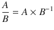

因此，理解矩阵的逆对于执行除法运算至关重要。


#### 8.4.1 矩阵的逆

方阵 `A` 的逆是一个矩阵（表示为 `A ^(-1)`），满足

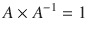

其中 `I` 是单位矩阵。要从给定的数组计算逆矩阵，Julia 使用内置函数 `inv(A)`，其中 `A` 是数组对象的变量名。其用法在以下代码中说明：

```
julia> A = rand(3,3) # 一个 3x3 的随机数矩阵
3x3 Array{Float64,2}:
0.0371386  0.382131  0.575963
0.920995   0.696674  0.897717
0.485728   0.705719  0.867646
julia> inv(A) # 矩阵的逆
3x3 Array{Float64,2}:
-0.733357   1.88985   -1.46853
-9.1587    -6.24467   12.5409
7.85998    4.02126   -8.22573
julia> A*inv(A) # A*inv(A) = I
3x3 Array{Float64,2}:
1.0          0.0  0.0
-8.88178e-16  1.0  0.0
-1.77636e-15  0.0  1.0
```

值得注意的是，输入的数组必须表示一个方阵，即一个维度为 `n × n` 的数组。在以下情况下，Julia 会报错：

- `A` 不是方阵。
    - 对于一个 `n × m` 矩阵 `A`，`pinv(A)` 给出伪逆：

    ```
    julia> A = rand(2,3)
    2x3 Array{Float64,2}:
    0.844851  0.288378  0.568634
    0.551517  0.83383   0.960742
    julia> pinv(A)
    3x2 Array{Float64,2}:
    1.59703   -0.753778
    -0.838736   0.980266
    -0.18884    0.622796
    julia> A*pinv(A)
    2x2 Array{Float64,2}:
    1.0          -1.33206e-17
    1.86956e-16   1.0
    ```

- `A` 不可逆。
    - 一个不可逆的方阵被称为奇异矩阵或退化矩阵。
    - 如果 `|A|` = 0，则方阵 `a` 是奇异的。

    ```
    julia> A = [[1,1] [1,1]]
    2x2 Array{Int64,2}:
    1  1
    1  1
    julia> det(A)
    0.0
    julia> inv(A)
    ERROR: Base.LinAlg.SingularException(2)
    Stacktrace:
    [1] inv! at ./linalg/lu.jl:308 [inlined]
    [2] inv(::Base.LinAlg.LU{Float64,
    Array{Float64,2}}) at
    ./linalg/lu.jl:310
    [3] inv(::Array{Int64,2}) at
    ./linalg/dense.jl:659
    ```

    - 如果 Julia 遇到奇异矩阵，则会抛出异常 `Base.LinAlg.SingularException`。

##### 由有理数组成的矩阵的逆

命令 `inv()` 和 `pinv()` 同样适用于由有理数组成的方阵和非方阵：

```
julia> A = [[1//2,2//3] [3//4,4//5]]
2x2 Array{Rational{Int64},2}:
1//2  3//4
2//3  4//5
julia> inv(A)
2x2 Array{Rational{Int64},2}:
-8//1  15//2
20//3  -5//1
julia> A*inv(A)
2x2 Array{Rational{Int64},2}:
1//1  0//1
0//1  1//1
julia> A = [[1//2,2//3] [3//4,4//5] [5//6,6//7]]
2x3 Array{Rational{Int64},2}:
1//2  3//4  5//6
2//3  4//5  6//7
julia> pinv(A)
3x2 Array{Float32,2}:
-7.07495   6.77436
1.73306  -1.12989
3.88522  -3.04772
julia> A*pinv(A)
2x2 Array{Float32,2}:
1.0         -7.15256f-7
4.76837f-7   0.999999
```

##### 由复数组成的矩阵的逆

命令 `inv()` 和 `pinv()` 同样适用于由复数组成的方阵和非方阵。在大多数情况下，非对角线位置上得到的不是完美的零，而是可以近似为 0 的极小的数：

```
julia> a = complex(2,3)
2 + 3im
julia> b = complex(3,4)
3 + 4im
julia> A = [[a,b] [-b,a]]
2x2 Array{Complex{Int64},2}:
2+3im  -3-4im
3+4im   2+3im
julia> inv(A)
2x2 Array{Complex{Float64},2}:
0.0583333-0.075im        0.075-0.108333im
-0.075+0.108333im         0.0583333-0.075im
julia> A*inv(A)
2x2 Array{Complex{Float64},2}:
1.0+5.55112e-17im  1.66533e-16-2.77556e-17im
-5.55112e-17+2.77556e-17im                   1.0+0.0im
julia> A = [[a,b] [b,a] [-a,-b]]
2x3 Array{Complex{Int64},2}:
2+3im  3+4im  -2-3im
3+4im  2+3im  -3-4im
julia> pinv(A)
3x2 Array{Complex{Float64},2}:
-0.108108+0.101351im   0.141892-0.148649im
0.283784-0.297297im  -0.216216+0.202703im
0.108108-0.101351im  -0.141892+0.148649im
julia> A*pinv(A)
2x2 Array{Complex{Float64},2}:
1.0+1.38778e-16im   6.66134e-16+0.0im
0.0+1.11022e-16im   1.0-2.22045e-16im
```

#### 8.4.2 标量除法

矩阵的标量除法是指矩阵与标量的逐元素除法。例如：

```
julia> A = ones(3,2)
3x2 Array{Float64,2}:
1.0  1.0
1.0  1.0
1.0  1.0
julia> A/2
3x2 Array{Float64,2}:
0.5  0.5
0.5  0.5
0.5  0.5
```

这对于有理数和复数数组也是类似的：

```
julia> a = [[1//2,2//3] [3//4,4//5]]
2x2 Array{Rational{Int64},2}:
1//2  3//4
2//3  4//5
julia> a/2
2x2 Array{Rational{Int64},2}:
1//4  3//8
1//3  2//5
julia> a = complex(2,3)
2 + 3im
julia> b = complex(-2,4)
-2 + 4im
julia> A = [[b,a] [-a,b]]
2x2 Array{Complex{Int64},2}:
-2+4im   -2-3im
2+3im    -2+4im
julia> A/2
2x2 Array{Complex{Float64},2}:
-1.0+2.0im    -1.0-1.5im
1.0+1.5im    -1.0+2.0im
```

我们甚至可以使用 `\\` 运算符将元素转换为有理数：

```
julia> A = rand(1:9, 2, 2)
2x2 Array{Int64,2}:
8  6
4  8
julia> A//2
2x2 Array{Rational{Int64},2}:
4//1  3//1
2//1  4//1
```

#### 8.4.3 左除或右除

对于矩阵来说，`A × B ≠ B × A`。在求除法时，我们有两种情况：

- 左除

    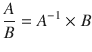

    - 通过 Julia 语法 `A\B` 执行。

- 右除

    

    - 通过 Julia 语法 `A/B` 执行：

```
julia> A = rand(2,2)
2x2 Array{Float64,2}:
0.0871932  0.403085
0.199973   0.611003
julia> B = rand(2,2)
2x2 Array{Float64,2}:
0.288173  0.691764
0.400971  0.457488
julia> A\B
2x2 Array{Float64,2}:
-0.528666  -8.71778
0.829277   3.60196
julia> A/B
2x2 Array{Float64,2}:
0.836428  -0.383675
1.05474   -0.259307
```


#### 8.4.4 矩阵的幂

与数字类似，矩阵也可以进行幂运算，并且与其他运算符一样，既可以对元素逐个操作，也可以对整个矩阵进行操作。对元素逐个求幂就是对其应用运算后，用新数值替换原有元素：

```
julia> A = [[2,3] [4,5]]
2x2 Array{Int64,2}:
2  4
3  5
julia> A.² # 元素平方
2x2 Array{Int64,2}:
4  16
9  25
julia> A.⁰.5 # 元素开平方
2x2 Array{Float64,2}:
1.41421  2.0
1.73205  2.23607
julia> A.¹//3 # 元素求 1/3 次幂
2x2 Array{Rational{Int64},2}:
2//3  4//3
1//1  5//3
julia> A.^complex(2,3) # 元素求复数次幂
##### 指数为复数 2+3i
2x2 Array{Complex{Float64},2}:
-1.94798+3.49362im  -8.41077-13.611im
-8.89315-1.3827im    2.89163-24.8322im
```

另一方面，矩阵运算也可以基于幂来定义。如果 `A` 是一个矩阵，

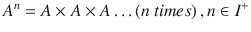

(8.9)

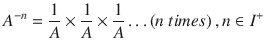

(8.10)

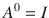

(8.11)

```
julia> A = [[2,3] [4,5]]
2x2 Array{Int64,2}:
2  4
3  5
julia> A² # 正整指数幂
2x2 Array{Int64,2}:
16  28
21  37
julia> A^(-2) # 负整数指数幂
2x2 Array{Float64,2}:
9.25  -7.0
-5.25   4.0
julia> A^(-2.5) # 分数指数幂
2x2 Array{Complex{Float64},2}:
0.00211085-17.6309im  0.00371153+13.3696im
0.00278364+10.0272im   0.0048945-7.60367im
julia> A⁰ # 零指数幂
2x2 Array{Int64,2}:
1  0
0  1
julia> A^(complex(2,3)) # 复数指数幂
##### 复数幂指数
2x2 Array{Complex{Float64},2}:
15.0873-5.16588im  26.5281-9.08321im
19.8961-6.81241im  34.9834-11.9783im
julia> A^(1//5) # 正有理数指数幂
2x2 Array{Complex{Float64},2}:
0.884712+0.317203im  0.45686-0.240537im
0.342645-0.180403im  1.22736+0.1368im
julia> A^(-2//5) # 负有理数指数幂
2x2 Array{Complex{Float64},2}:
0.49813-1.11379im   -0.034878+0.844594im
-0.0261585+0.633446im   0.471972-0.480345im
```

##### 矩阵的平方根

`sqrtm(A)` 是一个专门用于计算矩阵平方根的内置函数。与幂运算一样，它要求 `A` 是一个方阵：

```
julia> A = [[1,2] [3,4]]
2x2 Array{Int64,2}:
1  3
2  4
julia> A^(1//2) # 使用幂运算
2x2 Array{Complex{Float64},2}:
0.553689+0.464394im  1.21044-0.31864im
0.806961-0.212426im  1.76413+0.145754im
julia> sqrtm(A) # 使用 sqrtm 函数
2x2 Array{Complex{Float64},2}:
0.553689+0.464394im  1.21044-0.31864im
0.806961-0.212426im  1.76413+0.145754im
```

#### 8.4.5 矩阵的指数

内置函数 `expm(A)` 用于计算矩阵 `A` 的矩阵指数，其定义如下：

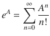

(8.12)

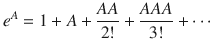

(8.13)

```
julia> a = [[1,2,3] [4,5,6] [7,8,9]]
3x3 Array{Int64,2}:
1  4  7
2  5  8
3  6  9
julia> expm(a)
3x3 Array{Float64,2}:
1.11891e6  2.53388e6  3.94886e6
1.37482e6  3.11342e6  4.85201e6
1.63072e6  3.69295e6  5.75517e6
```

以下事实：

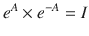

可以使用 Julia 代码验证：

```
julia> a = rand(3,3)
3x3 Array{Float64,2}:
0.833095  0.295597  0.861936
0.748249  0.24969   0.63176
0.152565  0.227104  0.557303
julia> expm(a)*expm(-a)
3x3 Array{Float64,2}:
1.0          -5.55112e-17   0.0
6.93889e-17  1.0           -2.22045e-16
-2.77556e-17  5.55112e-17    1.0
```

另一个事实，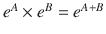，同样可以使用 Julia 代码验证：

```
julia> a = rand(3,3)
3x3 Array{Float64,2}:
0.0487381  0.866547   0.00377073
0.391296   0.0638764  0.533699
0.425764   0.281759   0.626053
julia> tr_a = a'
3x3 Array{Float64,2}:
0.0487381   0.391296   0.425764
0.866547    0.0638764  0.281759
0.00377073  0.533699   0.626053
julia> sum1=(a+tr_a)
3x3 Array{Float64,2}:
0.0974763  1.25784   0.429535
1.25784    0.127753  0.815458
0.429535   0.815458  1.25211
julia> product = expm(a)*expm(tr_a)
3x3 Array{Float64,2}:
2.75234  2.44734  2.27168
2.44734  3.00784  3.09183
2.27168  3.09183  5.17031
julia> expm(sum1)
3x3 Array{Float64,2}:
2.65748  2.57752  2.3178
2.57752  3.20806  2.96962
2.3178   2.96962  5.08507
```

值得注意的是，由于数值近似，可能无法得到精确的矩阵。例如，单位矩阵的非对角元素可能不是零，而是非常小的数。同样地，对于之前的代码，`product == expm(sum1)` 会返回 `false`，因为元素并不完全相等，但它们很接近。

```
julia> product - expm(sum1)
3x3 Array{Float64,2}:
0.0948575  -0.130178   -0.046114
-0.130178   -0.200223    0.122203
-0.046114    0.122203    0.0852462
```

鼓励用户自行验证更多与矩阵指数相关的恒等式，但需注意，数值近似会导致本应相等的结果出现不相等的情况。

#### 8.4.6 矩阵的对数

内置函数 `logm(A)` 用于计算矩阵的对数。根据公式 8.12 给出的矩阵指数定义，矩阵的对数可以定义如下：

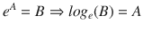

(8.14)

矩阵的对数像复数的对数一样，并非唯一。此外，一个矩阵有对数当且仅当它是可逆的。

函数 `logm()` 的使用方法在以下代码中进行了解释：

```
julia> a = rand(3,3)
3x3 Array{Float64,2}:
0.202601  0.368547  0.304107
0.984077  0.77166   0.554232
0.526979  0.248144  0.534636
julia> logm(a)
3x3 Array{Complex{Float64},2}:
-1.07606+2.37668im   0.410897-0.794355im   0.382366-0.381245im
1.15272-1.76414im  -0.52341+0.590431im    0.838622+0.281392im
0.595192-1.09302im  0.411622+0.365746im  -0.926971+0.174484im
```

## 8.5 广播

当需要对不同大小的数组执行逐元素操作时，Julia 提供了 `broadcast()` 函数，它会自动扩展数组参数中的单例维度以匹配另一个数组的对应维度（且不额外占用内存），并对每个元素应用给定的函数。以下 Julia 代码将使这一点变得清晰：其中数组 `a`（大小为 2 × 1）和数组 `b`（大小为 2 × 4）使用 `broadcast` 函数进行乘法运算：

```
julia> a = rand(2,1)
2x1 Array{Float64,2}:
0.340869
0.864133
julia> b = rand(2,4)
2x4 Array{Float64,2}:
0.764798  0.716987  0.184377  0.483765
0.743202  0.808572  0.513173  0.839672
julia> broadcast(*,a,b)
2x4 Array{Float64,2}:
0.260696  0.244399  0.0628484  0.1649
0.642226  0.698714  0.44345    0.725588
```

## 8.6 布尔运算

与算术运算符类似，布尔运算符也可以应用于矩阵。其中最简单的是对每个元素的比较。

### 8.6.1 元素比较

每个元素与一个固定值或大小相同的矩阵的对应值进行比较。结果存储为一个由布尔值组成的矩阵：

```
julia> # 逐元素操作
julia> a = [[1,2,3] [4,5,6]]
3x2 Array{Int64,2}:
1  4
2  5
3  6
julia> b = 2*a
3x2 Array{Int64,2}:
2   8
4  10
6  12
julia> a.== 3 # 检查 'a' 的元素
#### 是否等于 3
3x2 BitArray{2}:
false  false
false  false
true  false
julia> a.< 3 # 检查逻辑语句
3x2 BitArray{2}:
false  false
false  false
false  false
julia> # 矩阵运算
julia> b == (2*a) # 检查 'b' 是否等于 'a' 的两倍
true
```

对于矩阵比较，运算符 `<,>` 不起作用，因为它们的方法不包括对数组的处理。因此，会生成一个 `MethodError`。


## 8.7 拼接

除了算术和布尔类型的数学运算外，为了灵活地处理矩阵，还必须定义元素的追加和截断操作。这是通过下表中提到的一系列运算符来实现的：

| 语法 | 行为 |
| --- | --- |
| `cat(k,A ...)` | 沿着维度 `k` 拼接输入的 `n` 维数组 |
| `vcat(A)` | `cat(1,A)` |
| `hcat(A)` | `cat(2,A)` |

```
julia> A = reshape(1:15,5,3)
5x3 Base.ReshapedArray{Int64,2,
UnitRange{Int64},Tuple{}}:
1   6  11
2   7  12
3   8  13
4   9  14
5  10  15
julia> B = reshape(15:29,5,3)
5x3 Base.ReshapedArray{Int64,2,
UnitRange{Int64},Tuple{}}:
15  20  25
16  21  26
17  22  27
18  23  28
19  24  29
julia> cat(A,B) #拼接 A 和 B
### 沿着所有维度
5x3x1x1x1x1x1x1x1x1x1x1x1x1x1 Array{Int64,15}:
[:, :, 1, 1, 1, 1, 1, 1, 1, 1, 1, 1, 1, 1, 1] =
15  20  25
16  21  26
17  22  27
18  23  28
19  24  29
julia> cat(1,A,B) # 按行拼接 A 和 B
10x3 Array{Int64,2}:
1   6  11
2   7  12
3   8  13
4   9  14
5  10  15
15  20  25
16  21  26
17  22  27
18  23  28
19  24  29
julia> cat(2,A,B) # 按列拼接 A 和 B
5x6 Array{Int64,2}:
1   6  11  15  20  25
2   7  12  16  21  26
3   8  13  17  22  27
4   9  14  18  23  28
5  10  15  19  24  29
julia> cat(3,A,B) # 将 B 的内容添加到新维度
5x3x2 Array{Int64,3}:
[:, :, 1] =
1   6  11
2   7  12
3   8  13
4   9  14
5  10  15
[:, :, 2] =
15  20  25
16  21  26
17  22  27
18  23  28
19  24  29
```

`vcat(A,B)` 和 `hcat(A,B)` 有一组快捷方式如下：

| 语法 | 替代语法 |
| --- | --- |
| `vcat(A,B)` | `[A;B]` |
| `hcat(A,B)` | `[A B]` |
| `hvcat(A,B,C,D)` | `A B;C D` |

```
julia> A = reshape(1:15,5,3)
5x3 Base.ReshapedArray{Int64,2,UnitRange{Int64},Tuple{}}:
1   6  11
2   7  12
3   8  13
4   9  14
5  10  15
julia> [A A]
5x6 Array{Int64,2}:
1   6  11  1   6  11
2   7  12  2   7  12
3   8  13  3   8  13
4   9  14  4   9  14
5  10  15  5  10  15
julia> [A;A]
10x3 Array{Int64,2}:
1   6  11
2   7  12
3   8  13
4   9  14
5  10  15
1   6  11
2   7  12
3   8  13
4   9  14
5  10  15
julia> [A A;A A]
10x6 Array{Int64,2}:
1   6  11   1   6  11
2   7  12   2   7  12
3   8  13   3   8  13
4   9  14   4   9  14
5  10  15   5  10  15
1   6  11   1   6  11
2   7  12   2   7  12
3   8  13   3   8  13
4   9  14   4   9  14
5  10  15   5  10  15
```

命令 `vec()` 将所有矩阵转换为一个一维矩阵：

```
julia> A = rand(2,3,2)
2x3x2 Array{Float64,3}:
[:, :, 1] =
0.293696  0.336827  0.252549
0.999608  0.17789   0.718892
[:, :, 2] =
0.958808  0.408669  0.950778
0.996035  0.533242  0.310243
julia> vec(A)
12-element Array{Float64,1}:
0.293696
0.999608
0.336827
0.17789
0.252549
0.718892
0.958808
0.996035
0.408669
0.533242
0.950778
0.310243
```

#### 8.7.1 repmat()

给定一个矩阵，如果我们希望通过重复原矩阵的元素来构造另一个矩阵，`repmat()` 就派上了用场。`repmat(A, n, m)` 的语法通过在第 1 维（行）重复 `A` `n` 次，在第 2 维（列）重复 `m` 次来构造一个矩阵：

```
julia> A = [[1,2,3] [4,5,6]]
3x2 Array{Int64,2}:
1  4
2  5
3  6
julia> repmat(A,2,2)
6x4 Array{Int64,2}:
1  4  1  4
2  5  2  5
3  6  3  6
1  4  1  4
2  5  2  5
3  6  3  6
julia> repmat(A,2,3)
6x6 Array{Int64,2}:
1  4  1  4  1  4
2  5  2  5  2  5
3  6  3  6  3  6
1  4  1  4  1  4
2  5  2  5  2  5
```

#### 8.7.2 repeat()

`repeat(A,inner,outer)` 通过重复 `A` 的条目来构造一个数组。`inner` 的第 `i` 个元素指定了 `A` 的第 `i` 维的各个条目的重复次数。类似地，`outer` 的第 `i` 个元素指定了沿着 `A` 的第 `i` 维的切片需要重复的次数。当未提供 `inner` 或 `outer` 时，不执行重复操作：

```
julia> a = collect(2:4)
3-element Array{Int64,1}:

julia> repeat(a,inner=2)
6-element  Array{Int64,1}:

julia> repeat(a,outer=2)
6-element Array{Int64,1}:

julia> repeat(a,inner=2,outer=2)
12-element Array{Int64,1}:

julia> a = [[1,2,3] [4,5,6]]
3x2 Array{Int64,2}:
1  4
2  5
3  6
julia> repeat(a,inner=(1,3),outer=(3,1))
9x6 Array{Int64,2}:
1  1  1  4  4  4
2  2  2  5  5  5
3  3  3  6  6  6
1  1  1  4  4  4
2  2  2  5  5  5
3  3  3  6  6  6
1  1  1  4  4  4
2  2  2  5  5  5
3  3  3  6  6  6
julia> repeat(a,inner=(2,3),outer=(3,2))
18x12 Array{Int64,2}:
1  1  1  4  4  4  1  1  1  4  4  4
1  1  1  4  4  4  1  1  1  4  4  4
2  2  2  5  5  5  2  2  2  5  5  5
2  2  2  5  5  5  2  2  2  5  5  5
3  3  3  6  6  6  3  3  3  6  6  6
3  3  3  6  6  6  3  3  3  6  6  6
1  1  1  4  4  4  1  1  1  4  4  4
1  1  1  4  4  4  1  1  1  4  4  4
2  2  2  5  5  5  2  2  2  5  5  5
2  2  2  5  5  5  2  2  2  5  5  5
3  3  3  6  6  6  3  3  3  6  6  6
3  3  3  6  6  6  3  3  3  6  6  6
1  1  1  4  4  4  1  1  1  4  4  4
1  1  1  4  4  4  1  1  1  4  4  4
2  2  2  5  5  5  2  2  2  5  5  5
2  2  2  5  5  5  2  2  2  5  5  5
3  3  3  6  6  6  3  3  3  6  6  6
3  3  3  6  6  6  3  3  3  6  6  6
```

## 8.8 旋转矩阵

将矩阵 `A` 旋转 180 度可以通过内置函数 `rot180(A,n)` 执行，其中 `n` 是需要进行旋转的整数次数。如果 `n` 是偶数，则该操作等同于 `copy()`：

```
julia> a = [1 2 3 4 5 6 7 8]
1x8 Array{Int64,2}:
1  2  3  4  5  6  7  8
julia> a1 = reshape(a,(2,4))
2x4 Array{Int64,2}:
1  3  5  7
2  4  6  8
julia> rot180(a1) # 默认 n=1
2x4 Array{Int64,2}:
8  6  4  2
7  5  3  1
julia> rot180(a1,1) # 顺时针旋转 1 次
2x4 Array{Int64,2}:
8  6  4  2
7  5  3  1
julia> rot180(a1,-1) # 逆时针旋转 1 次
2x4 Array{Int64,2}:
8  6  4  2
7  5  3  1
julia> rot180(a1,2) # 顺时针旋转 2 次
2x4 Array{Int64,2}:
1  3  5  7
2  4  6  8
```

## 8.9 特殊矩阵

### 8.9.1 对称矩阵

对称矩阵是等于其转置的方阵。例如：

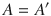

Julia 函数 `issymmetric(A)` 测试数组 `A` 是否表示一个对称矩阵，并给出布尔输出 `true` 或 `false`。对称矩阵的条目关于主对角线对称。因此，如果条目写成 `A = (a [ij])`，则对于所有索引 `i` 和 `j`，有 `a [ij] = a [ji]`。出于这个原因，每个方形的对角矩阵都是对称的，因为所有非对角线元素都为零：

```
julia> A = rand(3,3)
3x3 Array{Float64,2}:
0.494451  0.65293   0.801365
0.775357  0.963112  0.535383
0.138436  0.206775  0.845183
julia> issymmetric(A)
false
julia> A = [[1,0] [0,1]]
2x2 Array{Int64,2}:
1  0
0  1
julia> issymmetric(A)
true
julia> A = [[1,7,3] [7,4,-5] [3,-5,6]]
3x3 Array{Int64,2}:
1   7   3
7   4  -5
3  -5   6
julia> issymmetric(A)
true
```

### 8.9.2 正定矩阵

一个对称的实矩阵 `A` 被称为正定的，如果对于 `n` 个实数的每个非零列向量 `z`，存在 `∃z`（一个标量）使得

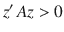

是正的。例如：

![$$ \left[a\kern0.5em b\right]\times \left[\begin{array}{cc}1& 0\\ {}0& 1\end{array}\right]\times \left[\begin{array}{c}a\\ {}b\end{array}\right]={a}²+{b}²\textgreater0 $$](A458482_1_En_8_Chapter_Equ15.gif)

(8.15)

```
julia> A = [[2,-1,0] [-1,2,-1] [0,-1,2]]
3x3 Array{Int64,2}:
2  -1   0
-1   2  -1
0  -1   2
julia> b = [1,2,3]
3-element Array{Int64,1}:

julia> b'*A*b
1-element Array{Int64,1}:

julia> isposdef(A)
true
```

但这对于另一个矩阵不成立：

```
julia> A = [[1,7,3] [7,4,-5] [3,-5,6]]
3x3 Array{Int64,2}:
1   7   3
7   4  -5
3  -5   6
julia> b = [1,2,3]
3-element Array{Int64,1}:

julia> b'*A*b
1-element Array{Int64,1}:

julia> isposdef(A)
false
```


### 8.9.3 埃尔米特矩阵

埃尔米特矩阵是一种复数的方阵，它等于自身的共轭转置。换句话说，对于所有索引 `i` 和 `j`，第 `i` 行第 `j` 列的元素等于第 `j` 行第 `i` 列元素的复共轭：

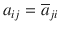

(8.16)

```
julia> A = [[2,2+im,4] [2-im,3,im] [4,-im,1]]
3x3 Array{Complex{Int64},2}:
2+0im  2-1im  4+0im
2+1im  3+0im  0-1im
4+0im  0+1im  1+0im
julia> ishermitian(A)
true
```

### 8.9.4 稀疏矩阵

当一个矩阵的绝大多数元素都是 `0` 时，存储这些零元素会浪费宝贵的计算机内存，并且在时间和计算资源方面效率低下。这种矩阵被称为稀疏矩阵。为了实现高效的计算框架，稀疏矩阵以压缩稀疏列（CSC）格式存储。

内置函数 `speye()` 创建一个指定维度的稀疏矩阵。其输入是用于表示行和列索引的向量，以及表示非零数值的第三个向量：

```
julia> a = [1,4,3,5,8,3];
julia> b = [4,7,18,9,7,3];
julia> c = [1,2,-5,3,-100,0.5];
julia> s = sparse(a,b,c)
8x18 sparse matrix with 6 Float64 nonzero entries:
[3 ,  3]  =     0.5
[1 ,  4]  =     1.0
[4 ,  7]  =     2.0
[8 ,  7]  =  -100.0
[5 ,  9]  =     3.0
[3 , 18]  =    -5.0
julia> findn(s)
([3,1,4,8,5,3],[3,4,7,7,9,18])
julia> findnz(s)
([3,1,4,8,5,3],[3,4,7,7,9,18],[0.5,1.0,2.0,-100.0,3.0,-5.0])
```

向量 `a` 和 `b` 用于生成非零元素的索引，而这些非零元素的值由第三个向量 `c` 给出。稀疏矩阵的维度显然就是 `a` 和 `b` 的最大值。函数 `findn()` 以两个独立的数组形式查找稀疏矩阵的行和列索引。另一个函数 `findnz()` 则除了找到这些索引外，还会将非零值作为第三个数组返回。

## 8.10 总结

现在可以明确，数组可以用来定义矩阵。矩阵代数以一种可操作数组的方式被编码。向量化的操作版本和相应的非向量化矩阵操作可以高效执行。数据处理涉及一种灵活的方式，即可以将数组定义为矩阵，并快速完成数学运算。Julia 在此领域具有优势，并正迅速成为数据分析领域的首选工具。

