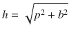
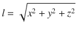
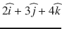
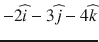
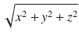
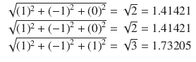
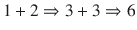

# 函数

## 10.1 Julia 函数简介

一种过程式编程语言涉及将较大的程序分解为较小的功能块，然后根据需要将它们拼接在一起以完成既定任务。当主程序调用时，一个代码块会执行特定任务。这个代码块被定义为函数。函数根据函数体中的一条（或多条）语句所定义的规则，将输入映射到输出。这个定义与数学函数的定义非常相似。

函数对象通过一个名称来引用，该名称指向存储函数 `object` 的内存位置。当需要调用函数时，在程序执行期间会调用该名称以及一组输入（放在圆括号内）。

或者，函数也可以被定义为一种一等对象，它接收一个参数列表（`arglist`），根据函数 `body` 的定义处理参数列表，并返回零个、一个或多个值作为输出。多个参数构成一个元组。如果输出由多个实体组成，那么输出也是如此。因此，它们用逗号分隔。可以设置参数的类型，或者根据函数 `body` 中的操作类型来确定参数的类型。建议设置类型以优化计算资源的利用。然而，在本章中，为了便于理解，我们将忽略这个建议。

函数的语法如下：

```
julia> function fname(arglist)
#函数体...
return values
end
```

函数体的缩进是可选的，但它使外观更整洁、更清晰。因此，强烈建议使用缩进。按照惯例，函数名通常使用小写字符定义。它们也可以包含 Unicode 字符。`return` 关键字是可选的。通常，最后一个表达式的值会被返回。在调用函数时，函数名与放在圆括号内的 `arglist` 一起书写。如果使用了赋值运算符（`a = fname(arglist)`），则返回值会赋给 `a`。当使用 `return` 而不带值时，函数不返回任何内容；它只进行计算，但不返回任何值。

## 10.2 定义一个简单的 Julia 函数

让我们通过一些示例来学习 Julia 函数。考虑一个用于计算直角三角形斜边值的函数，该三角形的两条直角边（例如，`p` 代表垂直边，`b` 代表底边）尺寸已知。让我们将这个函数命名为 `f`。输出（斜边）由变量 `h` 引用。定义如下：



(10.1)

以下 Julia 代码执行此任务，该函数被调用为 `f(p,b)`，其中 `p` 和 `b` 的值作为输入给出：

```
julia> function f(p,b)
h = sqrt(p² + b²)
return h
end
f (generic function with 1 method)
julia> f(3,4)
5.0
julia> f(3.0,4.0)
5.0
```

当在 Julia 提示符下输入 `f(3,4)` 时，会调用 `f`，其中 `p=3` 且 `b=4`。因此，计算出 `h` 为 5.0 并返回。所以，`f(3,4)` 的输出是 5.0。

请注意，当我们定义一个函数并用关键字 `end` 结束其定义并按下 Enter 键时，REPL 会输出信息，表明已创建一个带有一个方法的泛型函数。这与所用运算符允许的数据类型有关。运算符 `+` 和 `^` 仅对数值数据类型进行运算。Julia 允许多重分派，即针对不同数据类型定义不同的函数。这将在后面的第 10.3 节中讨论。

给函数起一个有意义的名称总是很有用的，所以与其将前面的函数命名为 `f`，不如将其命名为 `hypotenues`。调用时，我们写 `hypotenues(p,b)`：

```
julia> function hypotenues(p,b)
h = sqrt(p² + b²)
return h
end
hypotenues (generic function with 1 method)
julia> hypotenues(3,4)
5.0
```

当我们通过发出 `whos()` 命令来检查此时计算机内存的状态时（至少在执行 Julia 函数一次之后），我们可以观察到在主命名空间中显示了两个新对象，`f` 和 `hypotenues`。因此，我们可以在输入函数名称的几个字符后按 Tab 键，Tab 补全功能将对函数名生效：

```
julia> whos()
Base  33853 KB    Module
Core  12333 KB    Module
Main  40714 KB    Module
...
f      0 bytes  #f
hypotenues      0 bytes  #hypotenues
```

值得注意的是，变量 `h` 的作用域是函数 `hypotenues` 的局部作用域。换句话说，它仅在函数体内有效。这类变量被称为局部变量。变量的局部性质可以如下验证：

```
julia> hypotenues(3,4) # 函数被调用
5.0
julia> h = 5.5 # h 被设置为 5.5
5.5
julia> hypotenues(3,4) # h 的计算不受
# 先前设置 h 值的影响
5.0
julia> h # 调用函数后，h 仍然保持设置的值
5.5
```

### 10.2.1 简写符号

函数也可以用简写符号书写：

```
fname(x,y,...) = a_function(x,y,...)
```

例如，在我们的计算斜边的例子中，我们可以按如下方式使用简写符号来编写一个函数：

```
julia> hypotenues(p,b)=sqrt(p² + b²)
hypotenues (generic function with 1 method)
julia> hypotenues(3,4)
5.0
```

这种语法与书写数学函数的分析方式相匹配。因此，它更加直观。此外，不仅 ASCII 字符，Unicode 字符也可以用于命名函数。这在将数学表达式翻译成 Julia 代码以进行科学计算时变得特别容易。但这种表示法有一个严重的限制。你只能在此格式中定义单个表达式。换句话说，在函数体中只能定义一条数学规则。

### 10.2.2 多输入

正如前面名为 `hypotenues` 的函数的例子一样，我们可以定义一个具有多个输入的 Julia 函数。让我们考虑另一个例子。例如，假设我们需要使用一个向量在 x、y 和 z 轴上的三个分量来求其从原点出发的长度：



(10.2)

以下 Julia 代码定义了一个名为 `length_vec` 的函数，该函数接收三个输入（x、y 和 z 值），并输出 `length`，该输出根据公式 10.2 进行计算。

```
julia> function length_vec(x,y,z)
length = sqrt(x² + y² +z²)
return length
end
length_vec (generic function with 1 method)
julia> length_vec(2,3,4)
5.385164807134504
julia> length_vec(-2,-3,-4)
5.385164807134504
```

从前面的代码中可以注意到，向量



和



从原点 (0, 0, 0) 出发的长度相同，约为 5.4 个单位。

然而，有时我们在多输入场景中需要一个可变长度的参数列表。在这种情况下，我们在调用函数时需要对输入数量有一定的灵活性。下一节将讨论作为函数输入的可变参数列表。

#### 可变参数列表

在定义函数时，可以定义可选参数，这样当未提供特定值时，函数可以使用合理的默认值。例如，我们将修改之前定义的函数 `length_vec`（第 10.2.2 节），并对其进行修改：

```
julia> function length_vec1(x,y,z=0)
length = sqrt(x² + y² +z²)
return length
end
length_vec1 (generic function with 2 methods)
julia> length_vec1(-2,-3) # z=0
3.605551275463989
julia> length_vec1(-2,-3,-4) #z=-4
5.385164807134504
```

定义了一个名为 `length_vec1` 的新函数，其输入为 `x`、`y`、`z = 0`。`x`、`y` 的值由用户提供，如果用户未提供 `z` 的值，则默认等于 `0`（默认值）。

以这种方式定义的函数能确保：即使用户没有提供正确数量的参数，我们也不会遇到错误；同时，它也定义了 Julia 函数的默认行为。在数值计算和软件开发过程中，这两点特性都非常有用，可以避免恼人的错误消息。

#### 位置参数

到目前为止，当我们定义多个输入时，这些输入是按照它们被定义的顺序使用的。如果输入的顺序是计算中的关键因素，那该怎么办？例如：

```
julia> function sumprod(a,b,c)
answer = (a+b)*c
return answer
end
sumprod (generic function with 1 method)
#(1+2)*3=0
julia> sumprod(1,2,3)

#(3+2)*1=5
julia> sumprod(3,2,1)
```

如果输入顺序是 `(1, 2, 3)`，我们得到 `9`。当输入顺序是 `(3, 2, 1)` 时，结果是 `5`。这是因为在第一种情况下，变量的值是 `a=1`、`b=2` 和 `c=3`；而在第二种情况下，变量的值是 `a=3`、`b=2` 和 `c=1`。在这种情况下，用户可能会犯错，从而导致错误的计算结果，我们需要找到一种方法来避免这个问题。

此外，当有大量输入时，很难记住它们的顺序。如果我们使用位置参数方法，就可以避免这个问题。可以用 `keyword=value` 对的形式为参数添加标签关键字：

```
julia> function data_type(a,b;c="Int64",d="Complex64")
println(typeof(a))
println(typeof(b))
return "Type of c is $c and Type of d is $d"
end
data_type (generic function with 1 method)
julia> data_type(2,3)
Int64
Int64
"Type of c is Int64 and Type of d is Complex64"
julia> data_type(2.5,3)
Float64
Int64
julia> data_type("Hi",3)
String
Int64
"Type of c is Int64 and Type of d is Complex64"
julia> data_type("Hi",3,c=typeof('a'),d=typeof(1//2))
String
Int64
"Type of c is Char and Type of d is Rational{Int64}"
julia> data_type(c=typeof('a'),"Hi",d=typeof(1//2),3)
String
Int64
"Type of c is Char and Type of d is Rational{Int64}"
```

在当前上下文中，可以将三类输入定义如下：

*   **普通参数** – 必须指定，并且必须按特定顺序排列的参数
*   **可选参数** – 可以省略的参数，但如果指定，则必须按顺序排列
*   **关键字参数** – 可以省略且无需按顺序指定的参数

让我们通过以下 Julia 代码来理解这三类输入。我们定义一个名为 `function1` 的函数，它有三个输入（属于前面讨论过的三种类型：普通参数、可选参数和关键字参数）。然后，依次使用这些参数调用该函数，以说明它们的用法：

```
julia> function function1(normal,optional=1;keyword=0.001)
println("normal argument is $normal")
println("optional argument is $optional")
println("keyword argument is $keyword")
end
function1 (generic function with 2 methods)
#仅指定了普通参数
julia> function1("Hi")
normal argument is Hi
optional argument is 1
keyword argument is 0.001
#普通参数和可选参数均被指定，
#且可选参数的值从 1 改为 2
julia> function1("Hi",2)
normal argument is Hi
optional argument is 2
keyword argument is 0.001
#显式指定了关键字参数
#且赋予不同的值
julia> function1("Hi",2,keyword=0.1)
normal argument is Hi
optional argument is 2
keyword argument is 0.1
#关键字参数不遵循顺序
julia> function1(keyword=0.1,1,2)
normal argument is 1
optional argument is 2
keyword argument is 0.1
```

#### 可变参数列表

在某些情况下，用户可能需要提供可变参数列表的终极灵活性。为此，可以提供一个参数列表，从中根据需要选取值。这可以通过使用`展开`操作符（`...`）来实现。使用帮助模式可以找到关于如何使用`展开`操作符的信息。以下 Julia 代码将说明可变参数列表的用法：

```
julia> function variable_arguments(args...)
answer = length(args)
println("number of arguments is $answer")
end
variable_arguments (generic function with 1 method)
julia> variable_arguments(1)
number of arguments is 1
julia> variable_arguments(1,2)
number of arguments is 2
julia> variable_arguments(1,2,"Hi")
number of arguments is 3
julia> variable_arguments(1,2,'a')
number of arguments is 3
```

另一个例子展示了如何使用此功能来打印参数中的第二个值：

```
julia> function second_value(args...)
return args[2]
end
julia> second_value([1,2],3,4) 3
julia> second_value([1,2],[2,1])
2-element Array{Int64,1}:
```

### 10.2.3 多个输出

函数返回的对象称为其输出。一个 Julia 对象只输出一个对象。那么，我们如何获得多个输出值呢？我们必须理解，在输出中获取多个值和获取多个输出对象之间存在区别。

多个输出是以值元组的形式返回的，而不是单个值。这样一来，函数仍然返回一个单一对象。请务必记住，元组可以在没有括号的情况下创建和解构，这给人一种返回多个值的错觉。让我们通过一个简单的例子来探索多输出函数：一个名为 `power` 的 Julia 函数，它接受两个输入 `a`、`b`，计算 `a^b` 和 `b^a`，并输出它们。当用输入 `2` 和 `3` 调用时，它会输出 `2³ = 8` 和 `3² = 9` 作为一个元组：

```
julia> function power(a,b)
a^b,b^a
end
power (generic function with 1 method)
julia> power(2,3)
(8,9)
julia> x,y=power(2,3)
(8,9)
julia> x

julia> y
```

在调用函数时，可以配合赋值运算符使用两个变量 `x` 和 `y`，这样它们就会被赋值为输出元组中对应的元素。包含 return 语句的相同函数定义的等效语法如下：

```
julia> function power(a,b)
return a^b,b^a
end
```

### 10.2.4 匿名函数

当函数定义时没有名称，则被称为匿名函数。例如，`x->x³-3x²+4x-21` 定义了一个数学函数：f(x) = x³ − 3x² + 4x − 21。

它们被用来传递给那些接受函数作为参数的函数。匿名函数可以定义为 `map()`，它会将匿名函数映射到作为第二个参数提供的值上。第二个参数可以是单个值，也可以是作为列表的多个值。此外，输入的数据类型必须与定义中使用的运算符兼容。相同的 Julia 代码可以编写如下：

```
julia> map(x->x³-3x²+4x-21,3)

julia> map(x->x³-3x²+4x-21,[3,2,1])
3-element Array{Int64,1}:

julia> x
ERROR: UndefVarError: x not defined
```

需要注意的是，在执行了 `map()` 函数之后，`x` 会从命名空间中消失，因为它只是 `map()` 函数中的一个局部变量。因此，当查询 `x` 时，会显示 `UndefVarError` 错误，因为它在当前命名空间中未定义。

##### 映射多个值

当输入以元组形式提供时，也就是输入之间用逗号分隔，可以映射多个值。这里输入值的顺序很重要：

```julia
julia> map((x,y,z) -> sqrt(x²+y²+z²),[1,1,1],[-1,-1,-1],
[0,0,1])
3-element   Array{Float64,1}:
1.41421
1.41421
1.73205
```

需要注意的是，计算过程

会取每个数组的第一个元素进行计算，然后输出第一个元素。接着，对第二个和第三个元素执行相同操作以生成结果：


#### 10.2.5 `map()` 函数

内置函数 `map()` 也可用于非匿名函数。如果你有一个函数和一个数组，可以通过使用 `map()` 函数对数组中的每个元素调用该函数。该函数会针对数组中的每个元素被调用。结果被收集到一个数组中并返回。整个过程称为映射：

```julia
julia> map(sin,0)
0.0
julia> map(sin,[0,pi])
2-element Array{Float64,1}:
0.0
1.22465e-16
julia> map(sind,[0,pi])
2-element Array{Float64,1}:
0.0
0.0548037
```

`map()` 函数的逐元素操作内置于大多数函数中。实际上，它们针对更快的操作进行了优化：

```julia
julia> @time map(sin,1:100000);
0.005181 seconds (11 allocations: 781.625 KB)
julia> @time sin(1:100000);
0.021231 seconds (4.06 k allocations: 959.704 KB)
```

从前面的例子可以清楚地看出，`sin()` 比映射更快地给出结果。

对于给定的函数，可以执行从一个数组到另一个数组的映射（逐元素执行），前提是两个数组的大小相同。例如：

```julia
julia> map(//,1:10,2:11)
10-element Array{Rational{Int64},1}:
1//2
2//3
3//4
4//5
5//6
6//7
7//8
8//9
9//10
10//11
julia> map(^,[1,2,3],[2,4,3])
3-element Array{Int64,1}:
```

在第一个示例代码中，命令 `map(//,1:10,2:11)` 将内置函数 `//` 以逐元素的方式从数组 `1:10` 映射到数组 `2:11`；第一个元素是 `1//2`，第二个元素是 `2//3`，依此类推。

在第二个示例代码中，命令 `map(^,[1,2,3],[2,4,3])` 将内置函数 `^` 以逐元素的方式从数组 `[1,2,3]` 映射到数组 `[2,4,3]`。结果数组的元素如下：
`(1)² = 1`
`(2)⁴ = 16`
`(3)³ = 27`

#### 10.2.6 `reduce()`、`foldl()` 和 `foldr()` 函数

`map()` 函数通过对可迭代对象（如数字数组）逐元素应用函数来收集结果。另一方面，内置函数 `reduce()` 执行类似的任务，但在每个元素都被函数检查和处理后，只留下一个结果。该函数应接受两个参数并返回一个值。通过持续应用函数来规约数组，直到只剩下一个元素。例如，它可以用来对数组的内容求和：

```julia
julia> reduce(+,[1,2,3])
```

在命令 `reduce(+,[1,2,3])` 的第一种情况中，运算符 `+` 执行以下操作：


如果我们使用减法运算符呢？这里存在一个关于结合性的问题：

```
(1-2)-3 \Rightarrow -1-3 \Rightarrow -4 \\
1-(2-3) \Rightarrow 1-(-1) \Rightarrow 2
```
```julia
julia> reduce(-,[1,2,3])
```

`reduce()` 函数开始从左侧合并元素进行操作。`foldl()` 和 `foldr()` 函数将决定针对特定操作折叠给定数组的方向，以获得单值输出：

```julia
julia> reduce(-,[1,2,3])

julia> foldl(-,[1,2,3])

julia> foldr(-,[1,2,3])
```

#### 10.2.7 `mapreduce()`

映射和折叠可以同时进行，使用 `mapreduce()`、`mapfoldl()` 和 `mapfoldr()` 函数：

```julia
julia> mapreduce(+,-,[1,2,3])

julia> map(+,[1,2,3])
3-element Array{Int64,1}:

julia> reduce(-,map(+,[1,2,3]))

julia> mapfoldl(+,-,[1,2,3])

julia> foldl(-,map(+,[1,2,3]))

julia> mapfoldr(+,-,[1,2,3])

julia> foldr(-,map(+,[1,2,3]))
```

### 10.3 多重分派

到目前为止，我们的函数定义只包含定义一个方法。例如，当我们构造一个函数时：

```julia
julia> f(x,y)=x+y
f (generic function with 1 method)
```

定义函数的 REPL 提示符输出使用简写表示法，表明我们构造了一个带有一种方法的泛型函数。该输出是类型敏感的，因为 `+` 适用于数字，但不适用于字符串和字符，因此会报 `MethodError` 错误，因为该方法未针对 `Char` 和/或 `String` 数据类型定义，从以下代码中可以明显看出：

```julia
julia> f(x,y)=x+y
f (generic function with 1 method)
julia> f(2,3)

julia> f('a','b')
ERROR: MethodError: no
method matching +(::Char, ::Char)
Closest candidates are:
+(::Any, ::Any, ::Any, ::Any...) at
operators.jl:424
+(::Char, ::Integer) at char.jl:40
+(::Integer, ::Char) at char.jl:41
Stacktrace:
[1] f(::Char, ::Char) at ./REPL[365]:1
```

为了避免这种情况，可以在定义函数时提供多重分派功能，使得函数能够执行适用于多种数据类型的计算。

#### 10.3.1 定义多个函数定义

让我们通过一个名为 `typeInfo` 的简单函数示例来理解多重派发的概念，该函数定义如下：

```julia
#### 为 Int64 定义第一个方法
julia> function typeInfo(a::Int64)
println("输入的 类型 为 Int64")
end
typeInfo (generic function with 1 method)
#### 为 Float64 定义第二个方法
julia> function typeInfo(a::Float64)
println("输入的 类型 为 Float64")
end
typeInfo (generic function with 2 methods)
#### 为 Char 定义第三个方法
julia> function typeInfo(a::Char)
println("输入的 类型 为 Char")
end
typeInfo (generic function with 3 methods)
#### 为 String 定义第四个方法
julia> function typeInfo(a::String)
println("输入的 类型 为 String")
end
typeInfo (generic function with 4 methods)
julia> typeInfo(2)
输入的 类型 为 Int64
julia> typeInfo(2.0)
输入的 类型 为 Float64
julia> typeInfo('a')
输入的 类型 为 Char
julia> typeInfo("Hello")
输入的 类型 为 String
```

`::` 运算符用于为变量附加特定的类型。

定义的方法可以使用 `methods()` 函数进行探查。例如，让我们探查我们之前定义的函数 `typeInfo()` 的方法：

```julia
julia> methods(typeInfo)
#### 5 methods for generic function "typeInfo":
typeInfo(a::String) in Main at REPL[372]:2
typeInfo(a::Char) in Main at REPL[371]:2
typeInfo(a::Float64) in Main at REPL[370]:2
typeInfo(a::Complex{Float32}) in Main at REPL[369]:2
typeInfo(a::Int64) in Main at REPL[368]:2
```

需要注意的是，函数及其方法的先前定义仅存在于当前的 REPL 会话中。

## 10.4 定义为函数的运算符

在 Julia 中，大多数运算符只是支持特殊语法的函数，其中使用符号而不是名称。但请记住，符号只是有效的函数名称的 Unicode 字符。例如，运算符 `+` 可以像函数一样对两个数字进行调用。中缀形式完全等同于函数应用形式。因此，该运算符可以分配给另一个名称，并像任何其他函数一样使用：

```julia
julia> 1+1.0
2.0
julia> +(1,1.0) # 像函数一样调用
2.0
julia> f=+ # 可以将名称分配给变量
+ (generic function with 163 methods)
julia> f(1,1.0) # 分配的变量名可用于调用
2.0
```

此规则的例外是 `&&` 和 `||` 运算符，因为它们要求在运算符求值之前不对其操作数进行求值。

### 10.4.1 返回函数的函数

一个函数（我们称之为次要函数）可以嵌套在另一个函数（我们称之为主要函数）内部。在这种情况下，次要函数返回一个对象，主要函数使用该对象返回另一个对象。

例如，让我们考虑一个名为 `expo()` 的主要函数，它接受一个输入 `x`，这本质上是幂运算的指数。次要函数定义了计算 `y ^x` 的功能，其中 `y` 定义了计算幂 `x` 的值。除了计算 `y ^x` 之外，次要函数还打印次要函数返回的对象类型：

```julia
julia> function expo(x)
expo1  = function(y)
answer=y^x
answer_type = typeof(answer)
println(answer_type)
return answer
end
end
julia> sq(2)

julia> sq = expo(2)
(::#58) (generic function with 1 method)
julia> sq(2)
Int64

julia> sq(2.0)
Float64
4.0
julia> cu = expo(3)
(::#58) (generic function with 1 method)
julia> cu(2)
Int64

julia> cu(2.0)
Float64
8.0
julia> sq_root = expo(0.5)
(::#58) (generic function with 1 method)
julia> sq_root(2)
Float64
1.4142135623730951
julia> sq_root(3)
Float64
1.7320508075688772
julia> cu_root(2)
Float64
1.2599210498948732
julia> cu_root(3)
Float64
1.4422495703074083
```

要计算数字的平方，你可以编写 `sq=expo(2)`，这会计算提供的任何数字的平方。类似地，`cu = expo(3)` 计算立方，`sq_root = expo(0.5)` 计算平方根，而 `cu_root = expo(1//3)` 计算立方根。

## 10.5 总结

在本章中，我们讨论了 Julia 框架中的函数。将较大的代码划分为一组函数，可以使任务模块化，并以灵活的方式进行管理。能够严格或灵活地传递参数，使我们能够针对特定需求编写特定的函数。函数还允许我们为特定对象定义方法。因此，这种能力构成了面向对象编程概念的核心，而 Julia 则有效地使用了函数。