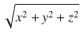

# 11. 控制流

## 11.1 控制流简介

当你逐行求值 Julia 代码时，有时需要将执行流程从这种逐行方式转移到代码的不同点。换句话说，程序流程需要被改变。需要进行这种转移的原因有很多。例如，需要检查一个条件，然后流程可以定向到多个方向之一；计算的某些部分是重复的，因此程序需要在返回之前进行更改；或者可能发生错误，需要重定向流程。Julia 为这些情况提供了强大的结构，这将在本章中进行描述。

## 11.2 三元表达式

当需要根据条件的简单“是”或“否”答案在两个方向中选择流程时，可以在一行语句中高效地使用三元运算符 `?` 和 `:`。例如，假设构造一个向量（由 `a` 引用）为 `[1,2,3,4,5]`。如果此向量的长度小于 3，则所有元素都必须平方。如果此向量的长度大于 3，则必须对所有元素取平方根。可以实现以下代码来实现此目的：

```julia
julia> a = [1,2,3,4,5]
5-element Array{Int64,1}:

julia> length(a) a=[1,2]
2-element Array{Int64,1}:

julia> length(a)<3?a.²:sqrt.(a)
2-element Array{Int64,1}:
```

由于第一种情况下 `a` 的长度实际上是 5（它有五个元素），因此条件不满足，因此对元素取平方根。在第二种情况下，`a` 的长度变为 2，条件满足，这就是元素被平方的原因。这个简单的结构提供了一种强大的方法，可以在仅仅一行代码内引导流程。

## 11.3 布尔开关

与三元表达式类似，布尔开关出现在单个或复合逻辑语句输出 `true` 或 `false` 布尔数据类型的情况下。运算符 `&&` 表示“与”运算符，而 `||` 表示“或”运算符。它们的用法可以通过以下 Julia 代码理解：

```julia
julia> a = 1

julia> isodd(a) && true
true
#验证
julia> isodd(a)
true
julia> true && true
true
julia> isodd(a) || true
true
#验证
julia> true || true
true
```

这些运算符用于评估特定的逻辑条件，之后可以做出决定，将流程导向所需的方向。

在处理逻辑条件时，使用关键字`if`，后跟一组表达式，当条件为`true`时执行这些表达式。如果条件为`false`，则执行`else`关键字后的表达式。关键字`elseif`可用于检查另一个条件。`elseif`块的数量没有限制，这使得它对复杂系统非常强大。条件使用布尔表达式构建，如第 11.3 节所述。

一个简单的例子可用于检查输入的元素类型是整数还是浮点数。以下 Julia 代码实现了这一点：

```julia
julia> function el_type(a)
           if eltype(a)==Int64
               println("$a is an integer")
           else
               println("$a is a float")
           end
       end
el_type (generic function with 1 method)
julia> el_type(2)
2 is an integer
julia> el_type(2.0)
2.0 is a float
```

可以使用`elseif`关键字改进代码以包含其他数据类型。例如，还可以包含复数类型：

```julia
julia> function el_type(a)
           if eltype(a)==Int64
               println("$a is an integer")
           elseif eltype(a)==Complex64
               println("$a is a complex number")
           else
               println("$a is a float")
           end
       end
julia> el_type(complex(2,3))
2 + 3im is a float
julia> el_type(2)
2 is an integer
julia> el_type(2.0)
2.0 is a float
```

类似地，可以插入多个`elseif`条件。Julia 语法的一个重要方面是，您无需担心在括号中（如 C 和 C++）或通过缩进（如 Python）定义语句块。此处使用的缩进仅用于视觉清晰。Julia 编译器在语法上不要求这样做，因此您也无需为定义代码块而担心使用空格、大括号、缩进、括号、分号等。但是，您需要记住用`end`结束条件结构。此外，`elseif`甚至`else`部分都是可选的。

## 11.4 for 循环

`for ... end`结构有助于遍历列表或一组值，或从起始值到结束值。以下示例有助于理解其用法。假设我们只想打印数组`[1,2,3]`的元素：

```julia
julia> a = [1,2,3]
3-element Array{Int64,1}:

julia> for i in a
           println(a[i])
       end
```

数组的元素通过`i`在数组`a`上使用成员运算符`in`进行迭代，即使用语法`for i in a`。由于 Julia 使用非常直观的语法结构，用户更容易构思和理解代码。

需要注意的是，虽然`a`是一个数组对象，但`for`循环不会返回数组。相反，它返回一个`Void`类型的对象。`Void`对象只有一个实例，称为`nothing`，当没有值返回时，按照约定使用它。循环结束时，不会返回值，因为它只执行它被定义的任务。一些函数和/或代码部分仅用于其副作用，不需要返回值。`for`循环结构就是其中之一。循环结束后，它不能创建对象；因此，它创建一个`Void`对象。因此，REPL 不会为其打印任何内容：

```julia
julia> a=for i in a
           println(a[i])
       end

julia> typeof(a)
Void
```

可以在循环块内包含复杂的数学结构以执行所需操作。例如，考虑一个 Julia 代码，当遇到奇数时打印`Odd`，否则打印`Even`。可以使用函数`isodd()`检查数字：

```julia
julia> a=[1,2,3,4,5]
5-element Array{Int64,1}:

julia> for i in a
           if isodd(i)
               print("Odd \n")
           else
               print("Even \n")
           end
       end
Odd
Even
Odd
Even
Odd
```

循环变量（在前一个代码中为`i`）的存在独立于使用它的循环。它可以在之前退出，此时循环的行为会对其产生影响。如果它之前不存在，那么一旦循环退出，它就会被销毁。以下示例将说明这一点：

```julia
julia> i=1

julia> for i in 1:5 #i already existed
           println(i)
       end

julia> i # final value is governed by loop

julia> for j in 1:5 #j did not existed before
           println(j)
       end

julia> j # j does not exist after loop
ERROR: UndefVarError: j not defined
```

当您希望跳过循环中的某些值时，`continue`非常有用。您可以使用逻辑表达式制定规则，并使用`if`语句跳过这些值。例如，假设您只想从 1 到 10 的数字数组中提取奇数：

```julia
julia> for i in 1:10
           if i%2 == 0
               continue
           end
           println(i)
       end
```

当检查条件`i%2==0`时，它对所有偶数成立。因此，使用`continue`语句跳过它们。其他数字则直接提供给`println()`函数，该函数将其打印出来。

## 11.5 推导式与生成器

### 11.5.1 基本推导式

推导式是使用`for`循环定义数组的便捷方式。这里，规则在`[]`括号内定义（这消除了编写`end`关键字来结束`for`循环的必要性）。例如，如果需要定义一个包含数字 1 到 5 的平方根的数组，可以在一行中编写 Julia 代码如下：

```julia
julia> [sqrt(i) for i in 1:5]
5-element Array{Float64,1}:
1.0
1.41421
1.73205
2.0
2.23607
```

您可以通过在`[]`括号外部定义类型数组来定义元素类型。例如，在方括号外部编写`Complex64`可以确保元素类型为`Complex64`。（复数以 64 位内存存储。）复数定义如下：

```julia
julia> a = Complex64[sqrt(k)+(2k)im for k in 1:5]
5-element Array{Complex{Float32},1}:
1.0+2.0im
1.41421+4.0im
1.73205+6.0im
2.0+8.0im
2.23607+10.0im
julia> eltype(a)
Complex{Float32}
```

### 11.5.2 复杂推导式

还可以创建由推导式规则赋值的元组数组，如下所示：

```julia
julia> [(sqrt(k),k,k²) for k in 1:5]
5-element Array{Tuple{Float64,Int64,Int64},1}:
(1.0,1,1)
(1.41421,2,4)
(1.73205,3,9)
(2.0,4,16)
(2.23607,5,25)
```

在此示例中，每个元素是一个元组，包含数字的平方根、数字本身及其平方。数字范围从 1 到 5。

也可以按如下方式在推导式格式中定义两个迭代器：

```julia
julia> [(a,b) for a in 1:5,b in 2:4]
5x3 Array{Tuple{Int64,Int64},2}:
(1,2)  (1,3)  (1,4)
(2,2)  (2,3)  (2,4)
(3,2)  (3,3)  (3,4)
(4,2)  (4,3)  (4,4)
(5,2)  (5,3)  (5,4)
```

元组的第一个元素范围从 1 到 5；第二个元素范围从 2 到 4。

### 11.5.3 生成器

生成器是 Julia 的新特性，在 0.5 版本中引入。与推导式一样，生成器可用于通过迭代变量产生值。但它们有一个显著的区别。与推导式不同，值是按需生成的。让我们看一个 Julia 代码示例：

```julia
julia> collect(x for x in 1:100 if x%7==0 && x%3==0)
4-element Array{Int64,1}:
```

此示例生成一个数字数组（范围在 1 到 100 之间，且同时是 7 和 3 的倍数）。

### 11.5.4 enumerate 与元组

使用内置函数`enumerate()`，可以生成带有索引的元组值：

```julia
julia> a = ["3",3,3.0]
3-element Array{Any,1}:
"3"

3.0
julia> for(index,value) in enumerate(a)
           println("$index $value")
       end
1 3
2 3
3 3.0
```

在此示例中，定义了一个包含三个值的数组：`"3"`（值为 3 的字符串）、`3`（值为 3 的整数）和`3.0`（值为 3.0 的浮点数）。使用`enumerate()`迭代此列表以生成索引和值对，并将其存储在定义的元组`(index,value)`中。每个值都使用`println()`函数打印。

### 11.5.6 压缩数组

压缩数组是指将每个数组中对应位置的元素作为元组的一个成员。例如：

```julia
julia> for i in zip(1:5,5:10,10:15)
println(i)
end
(1,5,10)
(2,6,11)
(3,7,12)
(4,8,13)
(5,9,14)
```

每个元组的第一个元素取自范围`1:5`，第二个元素取自范围`5:10`，第三个元素取自范围`10:15`。

## 11.6 while 循环

当需要在某个条件为`true`时反复计算一个特定表达式或一组表达式时，可以使用`while ... end`结构。

```julia
julia> x = 0

julia> while x<5
println(sqrt(x))
x+=1
end
0.0
1.0
1.4142135623730951
1.7320508075688772
2.0
```

这段代码首先将名为`x`的变量初始化为 0。接着检查条件`x < 5`。当`x = 0`时，该条件为`true`，然后执行`println(sqrt(x))`。`x+=1`将`x`的值增加到 1，并再次检查条件。如果发现条件为`true`，则执行`println()`语句。这个过程会一直重复，直到条件不再为`true`，即直到`x = 4`。

## 11.7 嵌套循环

在 Julia 编程语言中定义循环最方便的一点就是定义嵌套循环的简洁性。嵌套循环只需用逗号`,`运算符分隔循环即可写出。例如，考虑以下 Julia 代码：首先`x`从 1 遍历到 3，在此循环的每一步内部，`y`从 1 遍历到 3。在`y`循环的每一步中，`z`被定义为一个元组，其中包含`x`和`y`的当前值。因此当`x=1`时，会迭代创建坐标`(1,1), (1,2), (1,3)`，接着`x`增加到`2`，并重复同样的过程：

```julia
julia> for x in 1:3,y in 1:3
    z = (x,y)
    println(z)
end
(1,1)
(1,2)
(1,3)
(2,1)
(2,2)
(2,3)
(3,1)
(3,2)
(3,3)
```

类似地，可以编写另一段 Julia 代码，通过分别在`x`、`y`和`z`上的嵌套循环（顺序相同）来定义向量的三个坐标。这些坐标的创建过程如下：
*   首先，`x` = 1 且 `y` = 1，`z` 取值 1，然后取 2。
    *   创建坐标 `(1, 1, 1)` 和 `(1, 1, 2)`。
*   接着，`x` = 1 且 `y` 增加到 2，`z` 取值 1，然后取 2。
    *   创建坐标 `(1, 2, 1)` 和 `(1, 2, 2)`。
*   接着 `x` = 1 且 `y` 增加到 3，`z` 取值 1，然后取 2。
    *   创建坐标 `(1, 3, 1)` 和 `(1, 3, 2)`。
*   现在 `y` 和 `z` 循环已结束，外部循环 `x` 的值增加到 `x` = 2，并针对这个新的 `x` 值重复该过程。
    *   首先，创建 `(2, 1, 1)` 和 `(2, 1, 2)`。
    *   接着，创建 `(2, 2, 1)` 和 `(2, 2, 2)`。
    *   接着，创建 `(2, 3, 1)` 和 `(2, 3, 2)`。
*   再次，`y` 和 `z` 循环已结束，外部循环 `x` 的值增加到 `x` = 3，并针对这个新的 `x` 值重复该过程。
    *   首先，创建 `(3, 1, 1)` 和 `(3, 1, 2)`。
    *   接着，创建 `(3, 2, 1)` 和 `(3, 2, 2)`。
    *   接着，创建 `(3, 3, 1)` 和 `(3, 3, 2)`。
*   在每种情况下，长度由以下公式计算：



该值存储在名为`distance`的变量中，并在`println()`函数中用于打印。

```julia
julia> for x in 1:3,y in 1:3, z in 1:2
    distance = sqrt(x²+y²+z²)
    println("Length for vector ($x,$y,$z) is $distance")
end
Length for vector (1,1,1) is 1.7320508075688772
Length for vector (1,1,2) is 2.449489742783178
Length for vector (1,2,1) is 2.449489742783178
Length for vector (1,2,2) is 3.0
Length for vector (1,3,1) is 3.3166247903554
Length for vector (1,3,2) is 3.7416573867739413
Length for vector (2,1,1) is 2.449489742783178
Length for vector (2,1,2) is 3.0
Length for vector (2,2,1) is 3.0
Length for vector (2,2,2) is 3.4641016151377544
Length for vector (2,3,1) is 3.7416573867739413
Length for vector (2,3,2) is 4.123105625617661
Length for vector (3,1,1) is 3.3166247903554
Length for vector (3,1,2) is 3.7416573867739413
Length for vector (3,2,1) is 3.7416573867739413
Length for vector (3,2,2) is 4.123105625617661
Length for vector (3,3,1) is 4.358898943540674
Length for vector (3,3,2) is 4.69041575982343
```

## 11.8 `do ... end`

`do ... end`结构可以像推导式一样使用。假设我们有一个包含五个数字的数组`A`。当我们向`find()`函数（该函数返回结果元素的索引）传递一个匿名函数（`x-> x==1||x==4`，其中`x`的值为 1 或 4）时，我们也可以使用`do ... end`结构作为替代。在这里，我们只需避免定义匿名函数，如下列 Julia 代码所示：

```julia
julia> A = [1,2,3,4,5]
5-element Array{Int64,1}:

julia> find(x-> x==1||x==4,A)
2-element Array{Int64,1}:

julia> find(A) do x
        x==1||x==4
    end
2-element Array{Int64,1}:
```

## 11.9 异常

高级编程涉及错误（或异常）处理。这是编写 Julia 代码的一个基本特性，鼓励编码人员使用此特性来编写代码，以便于社区更好地使用和理解，同时也有助于代码的稳定性。当执行 Julia 程序时发生意外情况，定义的函数可能无法向调用者返回合理的值。这通常会发出错误消息，但建议使用异常情况来执行以下操作之一：
*   终止程序。
*   打印诊断性错误消息。
*   如果程序员提供了处理此类异常情况的代码，则允许该代码采取适当的行动。

这样，你就可以控制程序的执行方式，而不仅仅是得到一个错误消息。

### 11.9.1 内置异常

Julia 中有一组内置异常，当发生意外情况时会产生这些异常。我们之前已经遇到过一些类似的错误消息。我们在 REPL 上看到打印的消息是因为生成这些消息的 Julia 代码是为处理异常而编写的。

进入`help`模式（通过在 Julia 终端中输入`?`然后输入`Exception`），你可以获得内置异常的列表。其中一些列在表 [11-1](#A458482_1_En_11_Chapter.html#Tab1) 中。

**表 11-1**  
Julia 中的内置异常

| 语法 | 说明 |
| --- | --- |
| `ArgumentError` | 函数调用的参数与有效的签名不匹配。 |
| `BoundsError` | 对数组`a`的索引操作试图访问越界元素`i`。 |
| `DivideError` | 尝试用分母值 0 进行整数除法。 |
| `DomainError` | 函数或构造函数的参数超出了有效域。 |
| `EOFError` | 没有更多数据可从文件或流中读取。 |
| `InexactError` | 无法精确地进行类型转换。 |
| `InterruptException` | 进程被终端中断（CTRL+C）停止。 |
| `MethodError` | 在给定的泛型函数中不存在具有所需类型签名的方法。 |
| `OutOfMemoryError` | 某个操作分配的内存过多，导致系统或垃圾回收器无法正确处理。 |
| `ReadOnlyMemoryError` | 某个操作试图写入只读内存。 |
| `OverflowError` | 表达式的结果对于指定的类型来说太大，将导致回绕。 |
| `TypeError` | 类型断言失败，或者使用不正确的参数类型调用了内建函数。 |
| `UndefRefError` | 给定对象的项目或字段未定义。 |
| `UndefVarError` | 当前作用域中的某个符号未定义。 |
| `DimensionMismatch` | 调用的对象维度不匹配。 |
| `AssertionError` | 断言的条件的计算结果不为`true`。 |

### 11.9.2 自定义异常

内置异常可以通过内置函数 `throw()` 使用，该函数按照既定规则抛出异常。例如，当用户输入一个专为负数定义的非负数时，可以抛出`DomainError`异常，如下面的 Julia 代码所示：

```julia
julia> f(x) = x<0 ? exp(x) : throw(DomainError())
f (generic function with 1 method)

julia> f(1)
ERROR: DomainError with 1:
```

条件 `x<0` 确保 `x` 应小于 0。

另一个名为 `error()` 的函数用于产生一个 `ErrorException`，它会中断正常的控制流程。例如，下面的 Julia 代码中我们希望只接受整数作为自定义函数的输入。任何其他类型的数据都应显示一条描述性的错误消息，以便用户正确输入：

```julia
julia> f(x)=typeof(x)==Int64 ? e^x : error("Input only integer")
f (generic function with 1 method)

julia> f(1)
2.718281828459045

julia> f(2)
7.38905609893065

julia> f(2.0)
ERROR: Input only integer
Stacktrace:
 [1] f(::Float64) at ./REPL[34]:1
```

### 11.9.3 用于测试异常的 `catch...try` 结构

`try .. catch` 语句允许测试异常。`catch` 子句并非严格必需；省略时，默认返回值为 `nothing`（`Void` 类型的单例实例，当没有值可返回时按惯例使用）。`try ... catch` 结构让我们能够处理异常，既可以通用处理，也可以依赖于变量处理。其通用结构如下：
*   `try`
    *   函数主体应写在此块内。
    *   Julia 将尝试执行此块内的代码。
*   `catch`
    *   此块用于捕获错误。
    *   建议使用一个变量，异常可以被赋值给该变量。
    *   可以在 `if ... elseif ... else` 结构中使用此变量来检查异常。

让我们考虑一个自定义函数的例子，用于计算数量 `x` 的平方根，其中 `x` 必须是正数（`Integer`、`Float`、`Complex` 类型）。如果用户输入一个字符串作为输入，我们会遇到错误。因此，错误被存储在 `err` 变量中，然后使用 `if ... else` 结构。如果 `err` 值是 `MethodError`（即数据类型未在内置 `sqrt()` 函数的方法中定义），则会在终端上打印一条错误消息。这在下面的 Julia 代码中得到验证：

```julia
julia> function square_root(x)
           try
               sqrt(x)
           catch err
               if isa(err,MethodError)
                   println("Input a number")
               end
           end
       end
square_root (generic function with 1 method)

julia> square_root("a")
Input a number

julia> square_root("alpha")
Input a number

julia> square_root(complex(2,3))
1.6741492280355401 + 0.8959774761298381im

julia> square_root(2)
1.4142135623730951
```

代码可以通过使用 `elseif` 选项进行改进以包含 `DomainError`，在此情况下，如果输入一个负数，它将被视为复数并计算平方根：

```julia
julia> function square_root(x)
           try
               sqrt(x)
           catch err
               if isa(err,MethodError)
                   println("Input a number")
               elseif isa(err,DomainError)
                   sqrt(complex(x))
               end
           end
       end
square_root (generic function with 1 method)

julia> square_root(-2)
0.0 + 1.4142135623730951im

julia> square_root("a")
Input a number

julia> square_root(2)
1.4142135623730951
```

### 11.9.4 finally

一旦 `try ... catch` 结构执行完毕，无论操作是否成功，Julia 都会继续执行代码。无论是否存在异常，`finally` 关键字都会执行。这一点非常重要，因为 Julia 代码可能会影响状态变化或使用文件等资源，涉及典型的清理工作（例如关闭文件）。这些任务需要在代码完成时执行（终于！）。异常不是这些任务的好选择，因为它们可能导致代码块在未达到正常结束前就退出。`finally` 关键字提供了一种方法，使得在给定代码块退出时（无论其是否已退出）能够运行特定的 Julia 代码。这对于文件处理尤其重要，因此将在第 12 章中讨论。

## 11.10 总结

在本章中，我们阐述了 Julia 的控制流结构。计算任务的控制流对于任何计算任务都是必不可少的。定义循环、检查比较以及为复杂逻辑语句定义表达式，对于编写解决物理问题的代码至关重要。能够高效地使用不同数据类型及时运行这些任务的能力，使 Julia 成为数值计算的首选。任务的易用性是 Julia 的一个显著特点。在极少数编程语言中可以看到这种一行定义的功能。此外，关于使用缩进和括号来定义代码块并没有太多严格规则，这避免了程序员方面的语法错误。