# 13. 绘图

## 13.1 Julia 绘图简介

绘图是科学和工程研究的重要组成部分。工程概念的可视化有助于更好地理解现象。此外，在当今世界，出版物正成为学术成功的标杆，而优秀的出版物需要吸引人的图表和动画来展示结果。出于这些原因，绘制 2D 和 3D 图形以及为给定过程/方程制作动画是计算处理和后期处理研究的重要组成部分。

基本的 Julia 包不包含任何用于绘图的函数。因此，用户需要使用各种包来实现此目的。以下是用户可以使用的包列表：

*   `Plots`
*   `Pyplots`
*   `GR`
*   `UnicodePlots`
*   `Plotly`
*   `Gadify`
*   `Bokeh`

大多数包以相同的方式定义绘图。绘图函数通常接受数组作为输入，并提供多种选项来装饰图表，例如更改标记样式、标记大小和标记颜色；使用不同大小的线条连接数据点；为图形添加标题、标签和图例；为标签、图例或图形中间的某个位置编写方程式等。本章从`Plots()`包开始，并对其他一些包及其独特功能进行简要介绍。


## 13.2 作为对象的图形

图形是一种需要图形终端来展示的图形对象。在非图形终端上，图形通常通过将字符按特定序列排列来创建。如今，随着图形终端以合理的成本和不错的处理速度日益普及且功能强大，这种方法已经不再流行。因此，大多数 Python 绘图包都会创建图形对象，以便在计算机上处理图形终端。

一个图形对象具有许多属性。以下列举其中一些：

*   **尺寸**：图形在图形终端上显示时的长度和宽度。
*   **形状**：宽高比（图形长度与宽度的比值）。
*   **标题**：用于说明图形主题的字符串。
*   **坐标轴**：显示参考数据点的轴线。
*   **标签**：与坐标轴关联的、用于显示描述性字符串的标签。
*   **标记**：表示数据点的各种形状的符号。
*   **分辨率**：以`dpi`（每英寸点数）衡量，因为在打印时，图像的分辨率取决于打印机将单个像素定义为点的能力，而每英寸的点数将决定图像的像素化程度。
*   **文件格式**：图形可以以多种格式存储，这些格式通常用于照片和其他类型的媒体。
*   **文件名**：文件名在计算机系统中为对象提供了标识标记。

Julia 的图形对象有一个方法来处理所有这些属性。使用这个方法，你可以修改这些特征。还可以保存一个配置文件，以便所有对象都可以从该配置文件中获取其属性的值，从而避免每次创建新对象时都需要定义它们，并保持一致性。

此外，图形对象由图形引擎渲染。同样，可以使用各种不同能力的图形引擎。有些引擎在生成属性更丰富、速度更快的图形方面功能更强大。在使用不同的包时，一些图形引擎提供了一种方法来指定特定的引擎进行后端渲染。确定这一点可以消除对配置一致性、质量和图形对象格式的担忧。

## 13.3 Plots 包

`Plots` 是一个高级绘图包。它提供了强大的绘图能力，通常能满足大多数高性能计算的需求。它与其他绘图包（称为后端或图形引擎）进行交互，以灵活的方式生成图形文件。这些图形后端中的每一个都可以作为独立的绘图包使用，但 `Plots` 提供了一个用户友好、简单且一致的接口。

在使用之前，必须使用 `import <packageName>` 命令将包导入当前的 Julia 会话中。以下是使用 `Plots` 包的首批命令之一：

```
### 如果未安装 Plots 包
julia> using Plots
ERROR: ArgumentError: Module Plots not found in current path.
Run `Pkg.add("Plots")` to install the Plots package.
Stacktrace:
[1] _require(::Symbol) at ./loading.jl:428
[2] require(::Symbol) at ./loading.jl:398
julia> Pkg.add("Plots") # 安装 Plots 包
### 此处省略一长串输出。
julia> using Plots # 首次使用
INFO: Precompiling module Reexport.
INFO: Precompiling module StaticArrays.
INFO: Precompiling module RecipesBase.
INFO: Precompiling module PlotUtils.
INFO: Precompiling module PlotThemes.
INFO: Precompiling module Showoff.
INFO: Precompiling module StatsBase.
INFO: Precompiling module NaNMath.
INFO: Precompiling module Requires.
julia> using Plots # 第二次及以后使用
julia> x = Array([1,2,3,4,5])
5-element Array{Int64,1}:

julia> y = x.² # 对数组 x 进行向量化乘方运算
5-element Array{Int64,1}:

julia> plot(x,y)
```

图 13-1 展示了结果，其中包含出现在计算机图形终端上的图形窗口截图。

值得注意的是，窗口的颜色和分辨率将由用户机器操作系统内图形终端的配置决定，但它看起来会与图 13-1 类似。顶部栏包含关闭、展开和隐藏按钮，而底部栏包含主页、左移、右移、鼠标平移、放大和缩小、更改图形属性以及图形对象属性等按钮。建议用户点击这些标签并逐一探索。解释它们是一种浪费，因为它们非常直观。

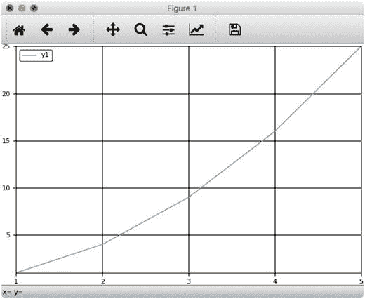

图 13-1

`x` 与 `y = x²` 的图形

由于只有五个数据点，绘制的图形不是一条与数据点相连的非常平滑的直线。理想情况下，

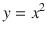

是一条平滑曲线。为了生成图形上精确的曲线，需要更多的数据点，因此 Julia 代码修改如下：

```
julia> x = 1:10e4;
julia> y = x.²;
julia> plot(x,y)
```

现在，我们有了 10⁴ 个数据点而不是五个，这产生了图 13-2。

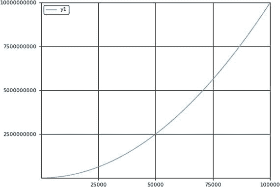

图 13-2

`x` 与 `y = x²` 的图形

`plot()` 函数也可以计算数学表达式，因此以下代码也会得到与图 13-2 相同的图形。

```
julia> x=1:10e4;
julia> plot(x,y)
```

#### 13.3.1 Plots 的默认行为

图 13-2 是在使用名为 `PyPlots` 的默认引擎时，通过 plot 属性的默认行为获得的。也可以选择其他绘图引擎来改变行为。例如，可以调用并使用 `unicodeplots()`，如下所示：

```
julia>Pkg.add("UnicodePlots")
julia>Pkg.build("UnicodePlots")
julia> unicodeplots()# 首次使用
INFO: Precompiling module UnicodePlots.
Plots.UnicodePlotsBackend()
julia> unicodeplots()# 第二次及以后使用
Plots.UnicodePlotsBackend()
julia> x=1:10e4;
julia> plot(x,y)
```

图形不会显示在单独的窗口中，而是显示在 Julia 终端本身上，如图 13-3 所示。

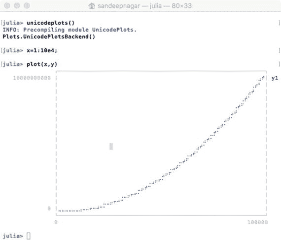

图 13-3

`x` 与 `y = x²` 的 Unicode 图形

由于 `PyPlots` 是用于通用目的生成高质量图形的好选择，因此最好在开头包含以下代码行以确保将 `PyPlot` 设置为后端：

```
julia> pyplot()
Plots.PyPlotBackend()
```

#### 13.3.2 绘制方程的更简单方法

`plot()` 命令提供了一种绘制数学方程的简单方法。假设你想绘制图 13-4 中所示的图形。

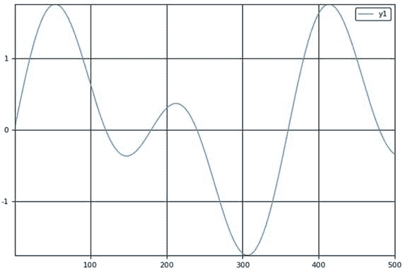

图 13-4

`x` 与 `y = sin(x) + sin(2x)` 的图形

`y = sin(x) + sin(2x)`

执行此任务的 Julia 代码如下：

```
julia> eq(x) = sind(x) + sind(2x)
eq (generic function with 1 method)
julia> plot(equation, 1:500)
```

使用此代码生成的图形如图 13-4 所示。


#### 13.3.3 隐式传递第二个图形

Julia 提供了一种通过使用 `plot!()` 语法来隐式传递第二个绘图参数的方法，该方法会修改原始绘图，因为带有 `!` 的版本会修改由 `plot()` 命令生成的现有对象。以下代码将生成图 13-5 所示的图形：

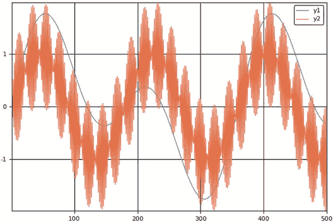

图 13-5

`x` vs. `y = sin(x) + sin(2x)` 和 `y = sin(2x) + sin(3x)`

```
julia> eq(x) = sind(x) + sind(2x)
eq (generic function with 1 method)
julia> plot(eq,1:500)
julia> eq1(x) = sind(2x)+sin(3x)
eq1 (generic function with 1 method)
julia> plot!(eq1,1:500)
```

因此，两个图形会一起呈现在同一个图形窗口中，其中第二个绘图命令被隐式地传递到现有的绘图窗口。

#### 13.3.4 装饰图形

`Plots` 网页 [1] 上的文档详细概述了用于以有意义的方式为图形添加信息装饰的各种选项。以下 Julia 代码执行了一些最相关的任务，并生成了图 13-6 中的图形。鼓励用户阅读文档以了解更多信息。

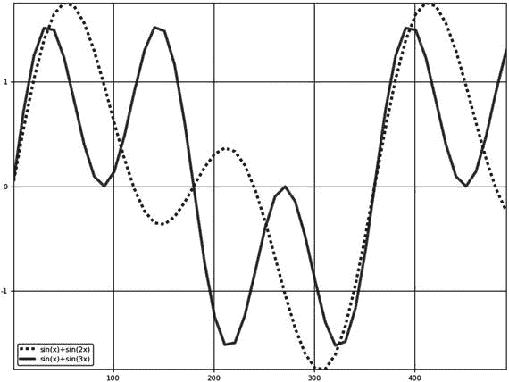

图 13-6

带装饰的 `x` vs. `y = sin(x) + sin(2x)` 和 `y = sin(2x) + sin(3x)`

```
julia> eq1(x) = sind(x) + sind(2x)
eq1 (generic function with 1 method)
julia> eq2(x) = sind(x) + sind(3x)
eq2 (generic function with 1 method)
julia> plot(eq1,
1:10:500,
label = "sin(x)+sin(2x)",
line =(:black,0.9,3, :dot))
julia> plot!(eq2,
1:10:500,
```

```
label = "sin(x)+sin(3x)",
line =(:black,0.7,3, :solid)
size=(800, 600)
)
```

#### 13.3.5 使用 `subplot()` 在同一个窗口中绘制多个图形

可以使用 `subplot()` 函数在同一个图形窗口中绘制多个图形。具有这些配置的图形被视为一个图形矩阵。例如，假设我们将四个图形绘制成一个 `2 × 2` 的图形矩阵。假设我们希望在第一个图形（子图索引为 `subplot(221)`）中绘制 `sin(x)`，在第二个图形（索引为 `subplot(222)`）中绘制 `sin(2x)`，在第三个图形（索引为 `subplot(223)`）中绘制 `sin(3x)`，以及在第四个图形（索引为 `subplot(224)`）中绘制 `sin(4x)`。以下 Julia 代码完成了这项工作，并得到了如图 13-7 所示的图形：

```
julia> x = -4pi:pi/100:4pi;
julia> y1 = sin(x);
julia> y2 = sin(2x);
julia> y3 = sin(3x);
julia> y4 = sin(4x);
julia> fig = PyPlot.figure(
"pyplot_subplot_mixed",
figsize=(10,10),
dpi=200);
julia> PyPlot.subplot(221);
julia> PyPlot.plot(x,y1);
julia> PyPlot.subplot(222);
julia> PyPlot.plot(x,y2);
julia> PyPlot.subplot(223);
julia> PyPlot.plot(x,y3);
julia> PyPlot.subplot(224);
julia> PyPlot.plot(x,y4);
```

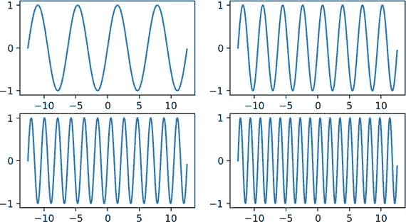

图 13-7

`sin(x)`、`sin(2x)`、`sin(3x)` 和 `sin(4x)` 的子图

#### 13.3.6 直方图

直方图是将数据采样到区间中，并绘制属于特定区间的数据点数量的图形。直方图在统计学中很有用。`Plots` 包有一个名为 `histogram()` 的方法，可以按如下方式使用：

```
julia> x = randn(100000);
julia> Plots.histogram(x)
```

首先，使用 `randn()` 函数生成 100,000 个归一化随机数，然后使用 `Plots` 中的 `histogram()` 函数绘制它们。生成的图形如图 13-8 所示。钟形曲线验证了这些数字确实是正态分布的。

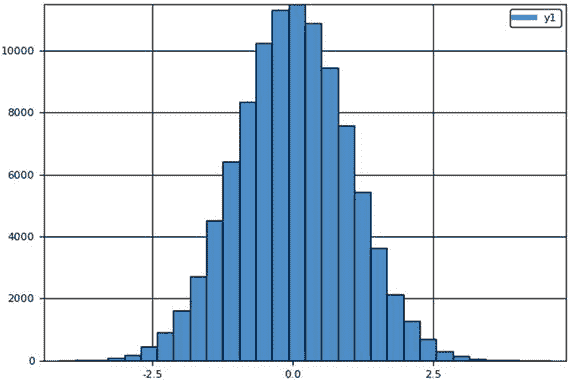

图 13-8

使用 `rand()` 函数生成的随机数的直方图

#### 13.3.7 条形图

条形图根据 y 轴的数据显示垂直条形。让我们用 20 个随机数进行实验。以下 Julia 代码完成了这项工作，图 13-9 是输出结果：

```
julia> x = rand(20);
julia> Plots.bar(x)
```

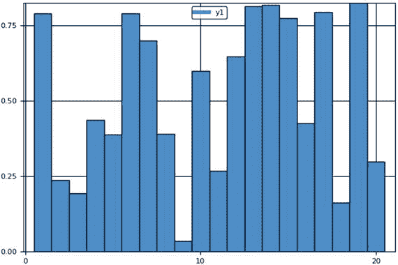

图 13-9

使用 `rand()` 函数生成的 20 个随机数的条形图

#### 13.3.8 饼图

饼图描绘了一个“馅饼”（一个圆形），其面积与数据值成正比。让我们用 10 个随机数进行实验。以下 Julia 代码完成了这项工作，图 13-10 是输出结果：

```
julia> x = rand(10);
julia> Plots.pie(x)
```

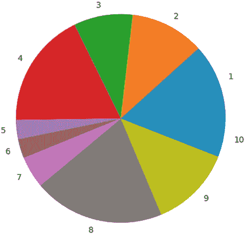

图 13-10

使用 `rand()` 函数生成的 10 个随机数的饼图

#### 13.3.9 散点图

散点图只是在由 `x` 和 `y` 坐标组成的点上放置一个点来表示 `x` 和 `y` 数据。在我们的示例中，x 轴有从 1 到 100 线性分布的 100 个数字，y 轴有 100 个随机数。以下 Julia 代码执行绘制散点图的任务，如图 13-11 所示：

```
julia> x=1:100;
julia> y=randn(100);
julia> Plots.scatter(x,y)
```

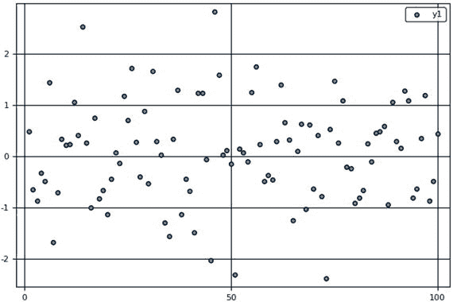

图 13-11

使用 `rand()` 函数生成的 100 个随机数的散点图

## 13.4 三维图形

`plot3d()` 可用于绘制三维图形，它接受三个参数。这里的 `x` 和 `y` 变量构成了定义 `z` 的平面。在以下 Julia 代码中，`z = sin(x) + sin(y)`，生成的图形如图 13-12 所示。

```
julia> x = 1:0.01:10;
julia> y = 1:0.01:10;
julia> z = sin(x)+sin(y);
```

```
julia> Plots.plot3d(x,y,z);
```

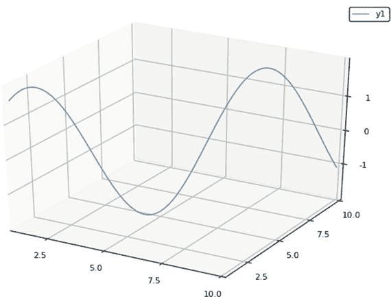

图 13-12

使用 `plot3d()` 函数绘制三维图形

## 13.5 总结

在本章中，我们描述了 Julia 处理数据并有效将结果可视化为图形的能力。图形的多样性及其简单的定义是 Julia 的关键特性之一。本章还涉及一个不由 Julia 基础包处理，而是由外部包处理的计算任务。因此，本章也演示了如何使用外部包并定义其配置。需要指出的是，解释 Julia 的绘图功能本身就可以写成一本专著。因此，本章仅通过 `Plots` 包提供的其中一种选项，对这些功能进行了初步展示。这为用户探索其余选项并做出明智决策留下了空间。

