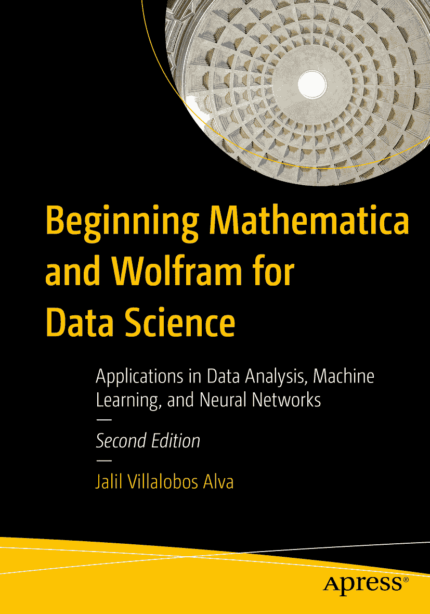

ISBN 979-8-8688-0347-5 电子书 ISBN 979-8-8688-0348-2 [`doi.org/10.1007/979-8-8688-0348-2`](https://doi.org/10.1007/979-8-8688-0348-2) © Jalil Villalobos Alva 2021, 2024 本作品受版权保护。所有权利均由出版商独家许可，无论涉及材料的全部或部分，具体包括翻译权、重印权、插图复用权、朗诵权、广播权、微缩胶片或其他任何物理形式的复制权，以及传输或信息存储与检索、电子改编、计算机软件，或目前已知或未来开发的类似或不同方法的权利。本出版物中使用通用描述性名称、注册商标名称、商标、服务标志等，即使未作明确声明，也不意味着这些名称不受相关保护性法律和法规的约束，因此可自由用于一般用途。出版商、作者和编辑假定，本书中的建议和信息在出版之日是真实准确的。出版商、作者或编辑均不对本书所含材料或可能存在的任何错误或遗漏提供明示或暗示的担保。出版商对已出版地图和机构归属中的管辖权主张保持中立。

本 Apress 印记由隶属于 Springer Nature 的注册公司 APress Media, LLC 出版。

注册公司地址为：1 New York Plaza, New York, NY 10004, U.S.A.

*献给我的家人，他们在各方面给予了我支持*

