# 1. Mathematica 简介

本章首先初步介绍了为什么 Mathematica 是一个有用且实用的工具。它探讨了 Wolfram 语言的核心概念及其语法。首先解释了 Mathematica 的内部结构以及如何有效地添加代码。介绍了笔记本的概念，这对于理解 Mathematica 处理的格式类型很重要。本章考察了这个接口类，并演示了笔记本如何同时支持代码和文本。这样，笔记本就是一个可计算的文本文件。接下来，你将检查可以在笔记本中使用的各种附加组件，以帮助用户最大化其代码的能力。

下一节演示了如何在 Mathematica 中编写表达式，考察了算术、代数、符号、全局和局部变量、内置函数、日期和时间格式、绘图函数、逻辑运算符、性能度量、延迟表达式以及访问 Wolfram Alpha 等主题。然后，你将了解 Mathematica 如何执行代码计算，包括其接受的输入类型以及这些输入的评估。本章最后提供了在 Mathematica 中寻求支持、管理和处理错误、搜索解决方案以及安全处理包含动态内容的笔记本中的安全问题的技巧。

## 为什么选择 Mathematica？

Mathematica 是一个数学软件包，由斯蒂芬·沃尔夫勒姆在 35 多年前创建。它的第一个官方版本（Mathematica 1.0）于 1988 年问世，最初是作为一个能够处理符号计算的代数计算系统而创建的。然而，Mathematica 已经确立了自己作为一种能够高效、自动且直观地执行复杂任务的工具的地位。Mathematica 广泛应用于许多学科，如工程、光学、物理学、图论、金融工程、游戏开发和软件开发。

Mathematica 提供了一个完整、集成的平台来导入、分析和可视化数据。Mathematica 不需要插件。它还具有混合语法，可以同时执行符号和数值计算。它通过将笔记本作为标准格式实现，提供了一种可访问的代码阅读方式，这也用于创建所执行过程的详细报告。Mathematica 可以被描述为一个强大的平台，能够实现高效且简洁的工作形式。在计算机语言中，Wolfram 语言属于被归类为高级、多范式解释型语言的编程语言组。与传统编程语言不同，Wolfram 语言遵循独特的规则，有助于实现有序、清晰且紧凑的代码编写。

## Wolfram 语言

Mathematica 由 Wolfram 语言驱动，这是一种解释型高级编程语言，兼具符号计算和数值计算能力。要理解 Wolfram 语言，必须记住该语言的核心本质类似于普通的数学文本，而非其他编程语言的语法。以下描述了 Wolfram 语言的一些显著特性。

-   内置函数单词的首字母大写，并且具有可读性。
-   语言中引入的任何元素都被视为一个表达式。
-   表达式由 Wolfram 语言的原子表达式构成。
    -   由字母、数字或字母数字内容组成的符号
    -   四种类型的数字：整数、有理数、实数和复数
    -   默认字符串写在引号（`" "`）内
-   在 Mathematica 中，有三种方式对表达式进行分组。
    -   圆括号用于对表达式内的项进行分组 `(expr1 + expr2) + (expr3)`。
    -   命令条目用方括号 `[ ]` 括起来。此外，方括号用于括起内置函数的参数，例如 `F[x]`。
    -   Mathematica 使用花括号 `{}`（例如 `{a, b, c}`）来表示列表、数组、矩阵和其他集合。

## Mathematica 的结构

在输入代码之前，你需要了解 Mathematica 的布局。要启动 Mathematica，请前往你的 `Applications` 文件夹并选择 Mathematica 图标。此操作将打开新的欢迎屏幕，如图 1-1 所示。

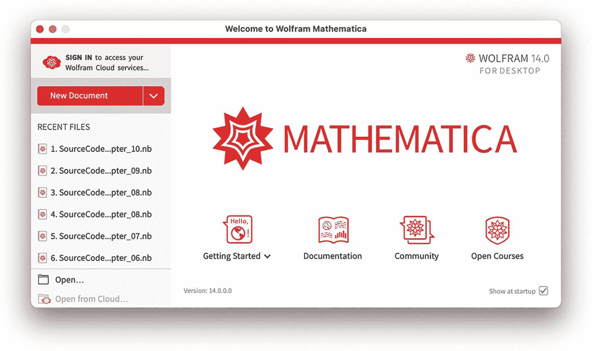

Wolfram Mathematica 页面的截图。它包含一个最近文件列表，以及底部的入门、文档、社区和开放课程等工具。

图 1-1 Mathematica 最新版本的默认欢迎屏幕

提示 启动窗口为新老用户提供了有价值的信息，包括 Mathematica 版本、文档访问、资源以及 Wolfram 社区等。

启动屏幕出现后，你可以通过选择 `New Document` 按钮创建一个新笔记本，此时应出现一个空白页面，如图 1-2 所示。也可以通过选择 `File ➤ New ➤ Notebook` 或使用 `⌘+N`（macOS）或 `Ctrl+N`（Win）键盘快捷键命令来创建新文档。

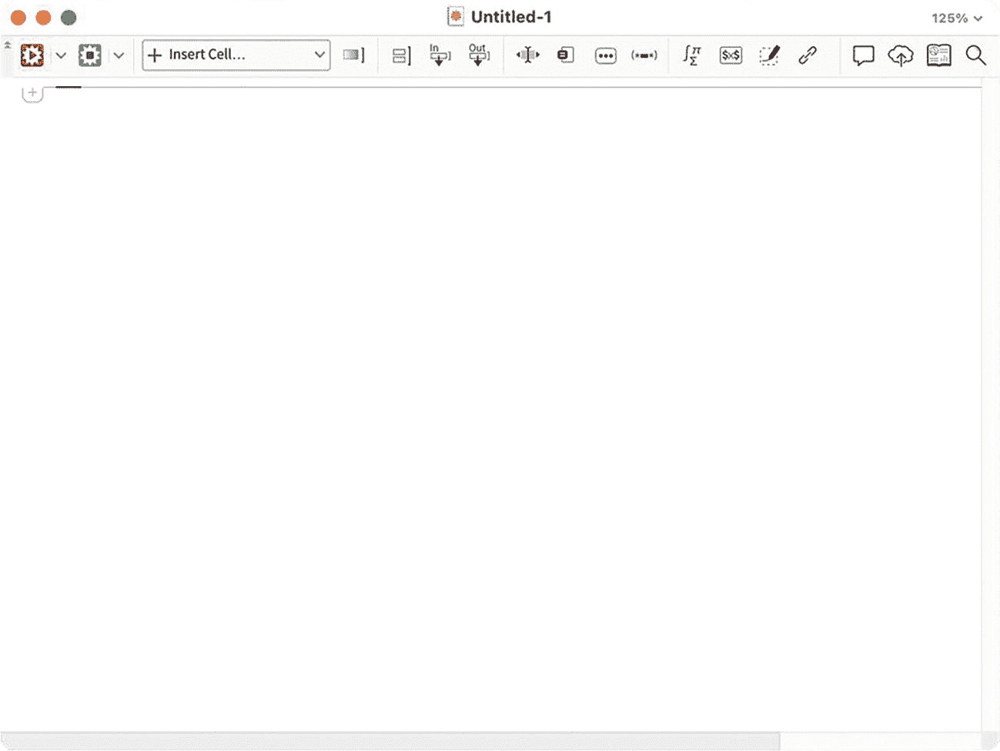

无标题 1 页面的截图。它包含一个带有插入单元格的空白页面，工具栏上有几个工具。

图 1-2 一个准备接收输入的空白笔记本

出现的空白文档称为笔记本，它是用户与 Mathematica 交互的核心。可以通过菜单栏选择 `File ➤ Save`（或 `Save as`）将笔记本保存到本地。初始化 Mathematica 时总是会显示一个无标题的笔记本。笔记本是标准文档格式。它们可以自定义以在计算旁边显示文本。然而，Mathematica 的关键特性在于其执行计算的能力，这超越了数值计算，无论笔记本的用途如何。

注意 Mathematica 13.1 版本引入了一个新的默认助手工具栏。

Mathematica 的笔记本被分隔成称为单元格的输入空间。单元格由笔记本右侧的方括号表示。每个输入和输出单元格都有自己的括号。被更大括号括起来的括号表示相关的计算，无论是输入还是输出。分组单元格由包含整个求值单元格的嵌套括号表示。其他单元格可以通过右键单击选择并分组来组合。单元格还可以通过双击单元格来显示或隐藏输入。要添加新单元格，将文本光标向下移动，应出现一条水平线，标记新单元格已准备好接收输入表达式。该行中的加号选项卡是辅助输入选项卡，显示了 Mathematica 支持的各种输入类型。图 1-3 显示了分组的输入（`In[-]`）和输出（`Out[-]`）单元格。

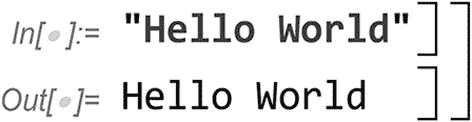

一个页面展示了两个输入和输出单元格，内容为文本 Hello World。每个输入和输出单元格的右侧都有一个方括号，并被一个更大的方括号括起来。

图 1-3 按输入和输出分组的表达式单元格

有四种主要的输入类型。默认输入是 Wolfram 语言代码输入。自由格式输入涉及 Wolfram 知识库服务器，结果以 Wolfram 语言语法显示。Wolfram Alpha 查询与在 Wolfram Alpha 网站上明确显示的结果相关联。外部语言输入是 Mathematica 对常见外部编程语言的内置支持。

有四种主要的输入类型。

-   默认输入：Wolfram 语言代码输入
-   自由格式输入：涉及 Wolfram 知识库服务器，结果以 Wolfram 语言语法显示
-   Wolfram Alpha 查询：与在 Wolfram Alpha 网站上明确显示的结果相关联
-   外部语言输入：Mathematica 对常见外部编程语言的内置支持

这些如图 1-4 所示。

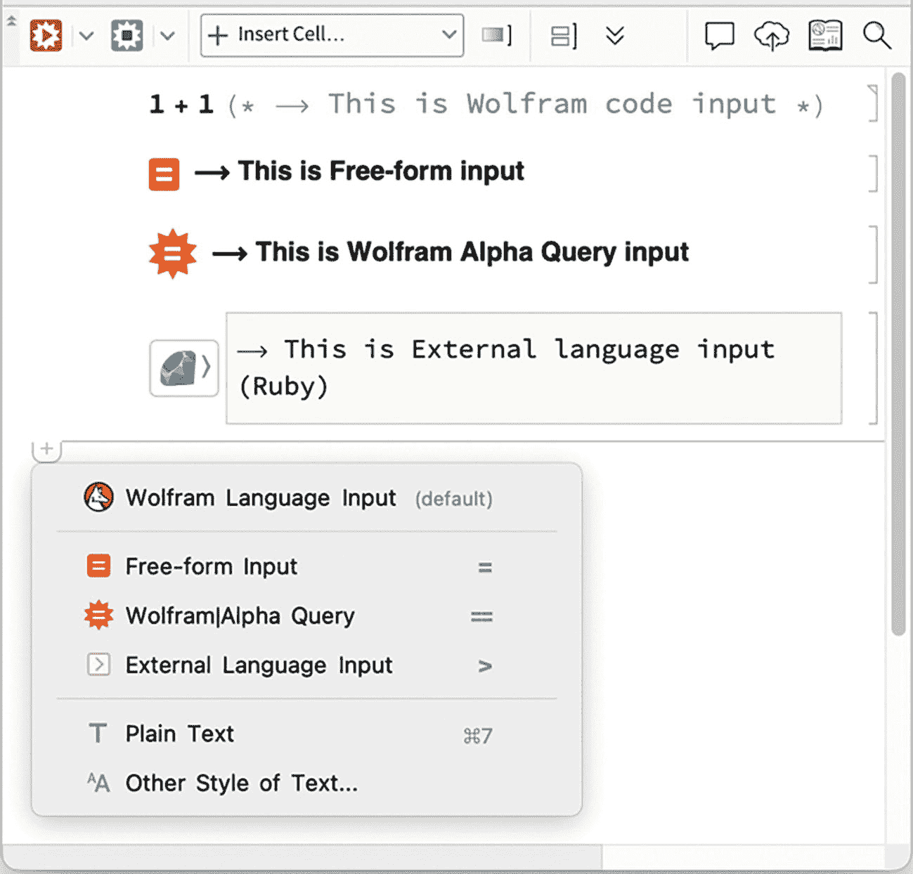

Mathematica 页面的截图。它包含三个输入：自由格式、Wolfram Alpha 查询和外部语言。它有一个下拉列表，包含默认的 Wolfram Alpha 查询、自由格式、外部语言输入、纯文本和其他文本样式。

图 1-4 Mathematica 中的主要输入类型

提示 前端指令命令的键盘快捷键显示在每个面板的右侧或左侧。

### Mathematica 的设计

现在你已经对 Mathematica 的基本格式有了大致了解，可以学习其内部工作原理了。在 Mathematica 内部，有两个基本进程：Mathematica 内核和图形界面。Mathematica 内核负责执行编程计算；它是 Wolfram 语言被解释执行的地方，并与每个 Mathematica 会话相关联。Mathematica 界面允许用户与 Wolfram 语言函数进行交互，同时记录你的工作进度。每个笔记本都包含多个单元格，Mathematica 内核接收到的命令在这些单元格中被编写并随后被求值。每个单元格都有一个关联的编号。单元格有两种类型：输入单元格和输出单元格。它们相互关联，并具有以下表达式：`In[n]:= 表达式` 和 `Out[n] := 结果` 或（“新表达式”）。求值过程根据哪个单元格先被求值来排序，并按升序继续。当退出内核会话时，所有信息、已执行的计算和存储的变量都会被释放，内核会重新启动，包括单元格表达式。要退出内核会话，请选择 `Evaluation ➤ Quit Kernel ➤ Local`。

提示 要启动一个新的内核会话，请点击 `Evaluation ➤ Start Kernel ➤ Local`。

首先，尝试输入以下计算。

```
In[1] := (11*17) + (4/2)
Out[1] = 189
```

该计算显示 `In` 和 `Out` 带有一个数字。这个数字是与被求值表达式相关联的编号。

每个表达式被求值后，会出现一个建议栏（见图 1-5）。除非用户隐藏，否则 Mathematica 中的建议栏始终可见。建议栏会提供可能应用于生成输出的新命令或函数的建议。如果你不确定下一步该编写什么代码，建议栏有时会很有帮助；如果使用得当，它可能会很有用。


Mathematica 中建议栏的截图。它包括质因数分解、除数、名称、二进制形式等。

图 1-5 用于更多可能求值的建议栏

Mathematica 的输入形式很直观；要在 Mathematica 笔记本中编写内容，只需将光标放在空白区域，光标会指示你位于一个尚未被求值的单元格内。要求值一个单元格，请按下 `[Shift + Enter]` 键，指示 Mathematica 内核求值所编写的表达式。下一章将介绍使用新工具栏求值表达式的新形式。

要求值整个笔记本，请转到工具栏上的 `Evaluation` 选项卡，然后选择 `Evaluate Notebook`。如果计算的执行时间超出预期，你执行了错误的代码，或者想要中止计算，Mathematica 提供了几种停止计算的方法。要中止计算，请转到 `Evaluation ➤ Abort Evaluation`。或者，在 Windows 中使用键盘快捷键 `[Alt + .]`，在 macOS 中使用 `[⌘ + .]`。

当创建一个新笔记本时，默认设置会应用于每个单元格（输入样式）。尽管如此，可以在 Mathematica 中使用各种选项编辑偏好设置。要访问它们，请转到 `Edit ➤ Preferences`。在 macOS 上，偏好设置（设置）菜单位于应用程序菜单中，请转到 `Mathematica ➤ Settings`。

打开后，会弹出一个窗口（见图 1-6），其中包含多个选项卡（`Interface`、`Appearance`、`AI Settings` 等）。基本的自定义设置包括缩放、语言设置和其他一般指令。`Appearance` 选项卡与代码语法颜色（即符号、字符串、注释、错误等）相关。`AI Settings` 选项卡是与 LLM（大型语言模型）求值器关联的新选项卡。其他选项属于本书未使用的高级设置。请随意浏览每个选项。

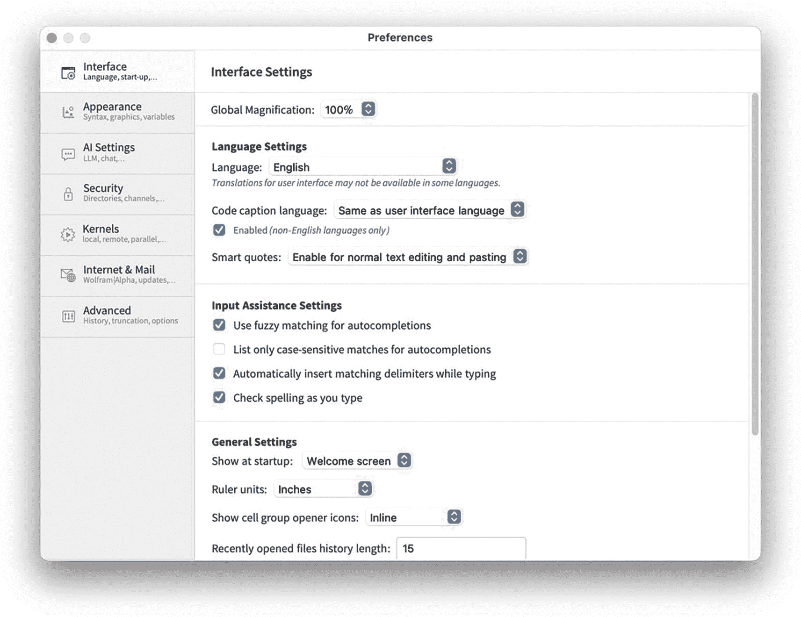

偏好设置窗口的截图。它列出了界面下的选项，包括界面、语言、输入辅助和常规设置。

图 1-6 偏好设置窗口

稍后，你将学习笔记本界面的深度设置和自定义选项，这些选项允许你定制偏好设置。

## Mathematica 环境

本节将探讨 Mathematica 的用户界面，重点关注笔记本界面以及其他用户体验功能。

### 笔记本界面

Mathematica 始终致力于提升用户体验和工作效率。在 13.1 版本中，引入了一项重大增强——在所有标准笔记本用户界面（UI）中无缝集成了一个默认工具栏（见图 1-7）。


Mathematica 窗口中工具栏的截图。它包含 `evaluate`、`setting`、`insert cell`、`queued cells`、`text field`、`search` 以及其他几个工具。

图 1-7 新的 UI 默认工具栏展示了高效代码开发所需的基本工具和功能。工具栏图标可能因 Mathematica 版本而异。

这个新工具栏（从左到右描述）包含多项新功能，旨在提升用户体验。`Evaluate` 允许用户进行基本和自定义的代码评估。`Abort` 让用户取消排队中的单元格并移除选定的单元格；这两个选项如图 1-8 所示。如前所述，这些功能也可以通过键盘访问。

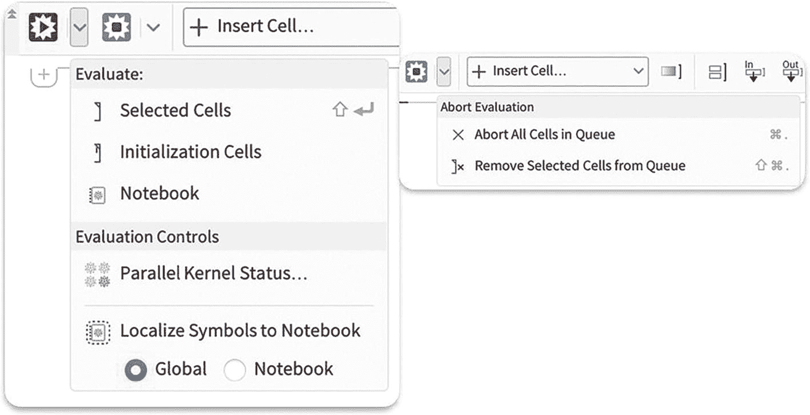

`evaluate` 下拉列表的截图，其中包括 `selected cells`、`initialization cells` 和 `notebook`、评估控制，以及包含 `abort all cells in the queue` 和 `remove selected cells from the queue` 的 `abort evaluation`。

图 1-8 笔记本界面中用于代码评估和终止的广泛选项；双箭头形状可隐藏工具栏。

其他选项集成了文本单元格格式化功能，提供诸如单元格样式（标题、副标题等）和单元格背景颜色等样式选项。用户还能受益于便捷的单元格管理功能，例如分组、拆分、合并单元格，以及插入输入/输出单元格，所有这些都简化为简单的按钮。继续查看诸如 `extend selection`、`convert natural language into Wolfram Language code`、`collapse cells`、`insert comment`、`math form input` 和 `LATEX rendering` 等选项，用户还可以使用 `drawing canvas` 和 `hyperlink` 功能。最后，工具栏最右侧部分包含用于 `chat notebooks`（利用 LLM 功能）、保存或发布到 Wolfram Cloud、访问文档（本地或基于 Web）以及在笔记本内搜索的按钮。

注意 根据光标所在位置的选定单元格类型（从文本到代码格式），可能会出现不同的按钮。图 1-7 显示的是 Wolfram 语言代码输入单元格。图 1-9 显示的是文本显示单元格。


文本单元格的截图，包含以下工具：`bold`、`italic`、`underline` 和 `insert code text`。

图 1-9 笔记本界面中用于 `bold`、`italic`、`underline` 和 `insert code text` 评估与终止选项的文本单元格选项。

这一重要补充提供了连贯的用户体验，并在 Mathematica 中营造了一个更精简、更高效的程序设计环境。例如，图 1-10 显示了一个带有彩色背景的代码输入单元格。

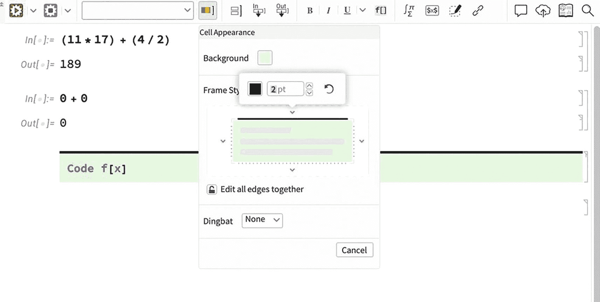

Mathematica 页面的截图。它展示了输入和输出单元格的结构，以及一个包含 `background`、`frame style`、`dingbat` 和 `cancel button` 的单元格外观下拉列表。

图 1-10 浅绿色代码输入单元格，带有 2pt 黑色上边距。

除了默认工具栏之外，还对其他工具栏进行了更多改进：`Ruler`、`Formatting`、`Templating` 和 `Testing`，如图 1-11 所示。后两个未显示，因为它们更与特定类型的程序化笔记本相关，这超出了本书的范围。

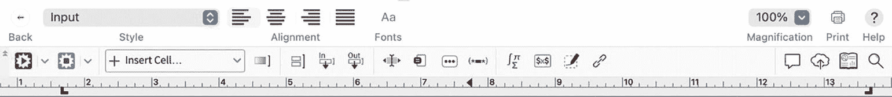

Mathematica 窗口中工具栏的截图。它包含 `styles`、`alignments`、`fonts`、`magnification`、`print` 和 `help`。

图 1-11 笔记本应用程序工具栏菜单，展示了三个不同的工具栏：`Formatting`（上方）、`Default`（中间）和 `Ruler`（下方）。

注意 要显示或隐藏任何工具栏，请转到 `Window` ➤ `Toolbar`。工具栏的可用性因版本而异。

突出的 `Ruler` 工具栏使用可拖动的标记来指示和调整指定单元格的文本边距，从而提供对文本格式的控制。`Formatting` 工具栏带来了高级的文本设计选项，而 `Templating` 和 `Testing` 工具栏（图中未显示）则有助于高效创建新模板和测试程序化笔记本。

# 文本处理

笔记本可以包含解释性文本、标题、章节和子章节。Mathematica 笔记本更像是一种可计算的文档，而非编程命令行。文本对于描述代码非常有用，可以以文本单元格的形式插入到单元格中，这些单元格通常与相应的计算相关。Mathematica 允许您使用多种形式的文本单元格，包括文本行、章节、公式、项目、项目符号等。与文字处理工具类似，笔记本可以包含标题、章节、子章节。通过选择`格式 ➤ 样式`，可以启用更多选项。要更精细地控制样式单元格，请使用格式工具栏（见图 1-12），该工具栏可通过菜单栏中的`窗口 ➤ 工具栏 格式`找到。格式工具栏简化了单元格样式设置，允许用户将文本左对齐、居中对齐、右对齐或两端对齐。


工具栏的截图。它包含样式、对齐方式、字体、缩放、打印和帮助功能。

**图 1-12** `样式格式`工具栏提供了一个用户友好的界面，用于自定义文本外观。

单元格类型可以根据笔记本的格式以不同形式排列。在单元格中添加文本有多种形式；最直接的方法是在输入单元格中键入文本，`助手`选项卡输入会自动建议将其转换为文本。另一种方法是从工具栏中选择单元格类型，使用输入选择器或快捷键（`⌘+7`或`Ctrl+7`）。

可以通过格式工具栏或选择`格式 ➤ 样式 ➤（标题、章节、文本、代码、输入等）`中的所需样式来创建样式化文本。在`样式`菜单中，请注意所有可用文本样式的键盘快捷键。可以使用它来代替每次都进入菜单栏。纯文本也可以通过将单元格格式化为`输入`样式来转换为输入文本。文本转换没有限制；文本可以转换为格式菜单中支持的任何样式。

> **注意**  
> 要转换文本，请高亮显示文本或选择包含该文本的单元格。

如图 1-13 所示，样式化单元格看起来与其他单元格不同。每种样式都有一个独特的顺序，笔记本据此组织成单元格组。标题单元格在笔记本中具有更高的顺序，因此其他单元格都锚定到标题单元格，如图 1-13 所示，但这并不意味着如果添加另一个标题单元格，两个标题会被分组。如果标题单元格被折叠，则标题是唯一显示的文本。

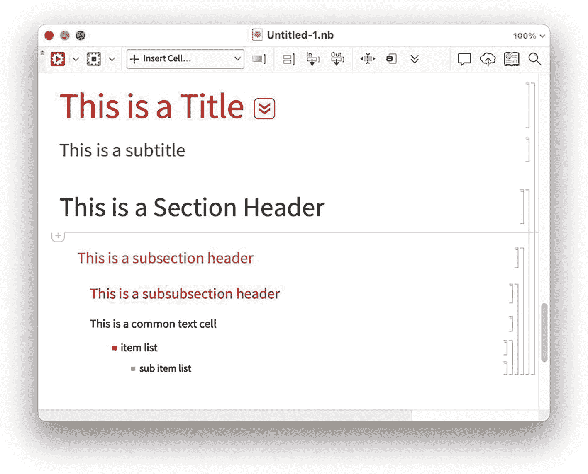

无标题 1 笔记本页面的截图。它展示了不同的格式样式，文本内容为标题、副标题、节标题、子节标题、次子节标题、带有项目列表的通用文本单元格以及子项目列表。

**图 1-13** 一个包含不同格式样式的笔记本；这包括标题、副标题、节、子节、纯文本、项目列表和子项目列表。

文本可以赋予特定的样式，进行更改，并在整个笔记本中应用不同的格式。通过从`格式`菜单中选择`字体`或`显示字体`（macOS 用户），会弹出一个窗口，允许您更改字体、字体样式、大小和其他特性。

> **提示**  
> 要清除单元格的格式样式，请选择该单元格，然后右键单击并选择`清除格式`。

# 面板

面板展示了向 Mathematica 输入各种命令的不同方式。Wolfram 语言中使用了大量特殊字符和排版符号，这些符号可以在表达式中键入，以更接近数学文本。访问这些符号的最佳方式是使用 Mathematica 内置的面板。要选择一个简单的面板，请转到`面板 ➤ 基本数学助手`。每个面板都有不同的选项卡，代表不同的类别，包含不同的命令以及可以使用面板插入的各种字符或占位符。要输入符号，请键入`ESC`，然后输入符号的名称，再键入`ESC`。尝试键入（`ESC a ESC`）来键入小写希腊字母 alpha。图 1-14 显示了 Mathematica 中的基本数学助手面板。

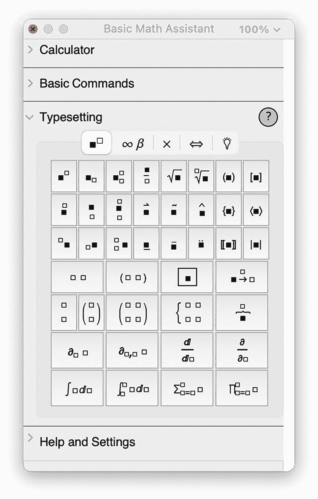

基本数学助手页面的截图。它包括计算器、基本命令、排版以及帮助和设置。

**图 1-14** `基本数学助手`面板。

> **注意**  
> 将鼠标光标悬停在某个符号或字符上时，会弹出一个信息提示，显示键盘快捷键。这也适用于占位符。

## 笔记本样式与功能

在包含 13.0 及更高版本的新版本中，`Mathematica`一直在完善和打磨其笔记本界面，通过添加新功能来提供更流畅的用户体验。一项显著的改进涉及用户界面中大量输出的处理。用户可以高效地管理和解读大量输出，而不会使笔记本显示过载或导致内存问题。以下示例生成了大量数据，这些数据可以被隐藏、显示，甚至存储在笔记本中（见图 1-15）。

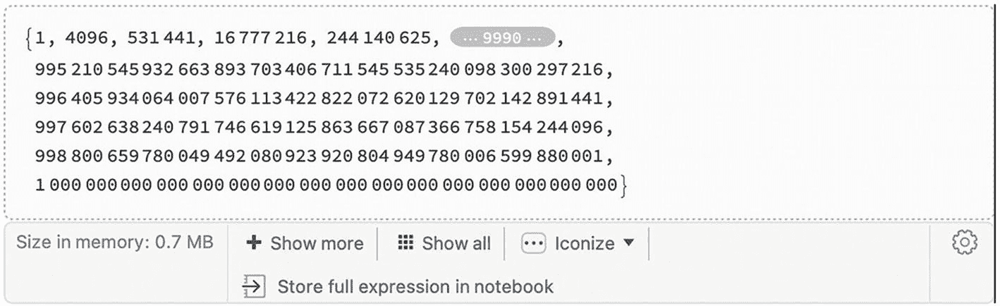

窗口截图。其中包含带有以下选项的输出表格：内存占用大小、显示更多、显示全部、图标化以及将完整表达式存储在笔记本中。

**图 1-15** 显示额外用户控制功能的大型输出菜单

```
In[2]:= Table[i¹²,{i,1,10⁴}]
Out[2]=
```

图 1-15 显示输入代码返回了一个响应式输出。用户可以展开、显示、图标化或选择存储整个数据表达式。此外，数据可以完全存储在笔记本中，保留整个输出以供将来操作，并占用 0.7MB 内存。如果对大型输出进行图标化，则会显示数据结构的摘要信息，包括结构类型、长度和大小。见图 1-16。

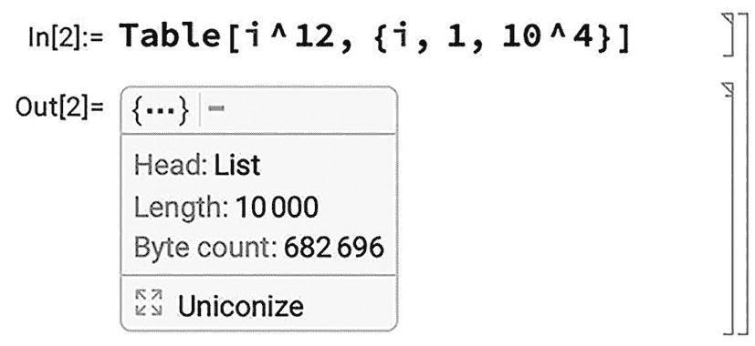

页面截图。其中展示了输入和输出单元格的结构，包含头部、长度、字节数以及取消图标化选项。头部、长度和字节数分别为列表、10000 和 682696。

**图 1-16** 包含 10,000 个项且字节数为 682,696 的列表结构

另一个得到更新的方面是偏好设置。整个设置界面在自定义选项方面经历了显著的刷新，如图 1-6 所示。具体来说，关于笔记本前端，通过选择“外观”选项卡（见图 1-17），用户可以定制自己的选择以优化笔记本代码样式，从而获得更个性化的体验。

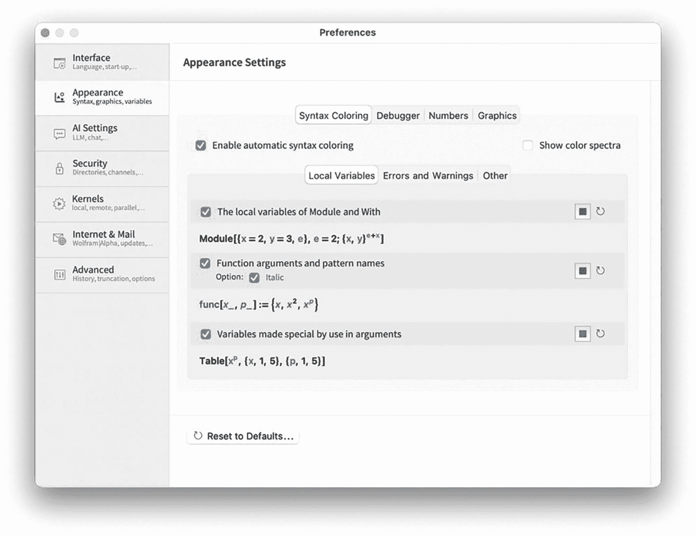

偏好设置页面截图。它列出了“外观”下的选项，包括带有语法着色、局部变量、带参数和模式名称的模块以及表格的外观设置。

**图 1-17** 笔记本设置自定义

图 1-17 显示了“外观设置”窗口。“语法着色”选项卡与代码元素（变量、错误、自动着色、高亮显示等）的视觉表示相关。“调试器”选项卡包含关于调试器高亮、断点和求值点的着色选项。“数字”选项卡根据格式和配置选择提供多种选项，其中提及了数字控制数值表示法等。“图形”选项卡允许您选择 2D 和 3D 图形的渲染方式，从最低到最高质量。

> **注意**  
> 要更改“外观”窗口中代码语法选项的颜色。选中“变量”复选框，然后点击绿色方块。会弹出一个颜色选择器，允许您更改颜色。此过程对于三个代码设置选项是相同的。此外，如您所见，还有不同的选项卡。

# Mathematica 中的表达式

在`Mathematica`中，可以使用常见且直观的形式执行基本算术运算。

```
In[3]:= (3*3) + (4/2)
Out[3] = 11
```

`Mathematica`还提供了使用传统数学符号的能力。要插入占位符，请按 [Ctrl + 6]。要表示乘法运算，请在表达式之间使用空格或添加星号（`*`）。

```
In[4]:= 100² ∗ 10
Out[4]= 100000
```

```
In[5]:= 2 1
Out[5]= 2
```

标准的`Mathematica`格式旨在提供最接近其常规形式的值，因此，在处理小数或一般数学符号时，`Mathematica`始终为您提供最佳精度（在某些情况下涉及无限精度）。但是，它允许您以数值方式操作表达式，要显示数值，请使用`N`函数。要插入平方根，请按 [Ctrl + 2]。

```
In[6]:= 1/2 + \sqrt{2}
Out[6]= 1/2 + \sqrt{2}
```

```
In[7]:= N[1/2 + \sqrt{2}]
Out[7]= 1.91421
```

您可以管理数值表达式的数字精度。在这种情况下，您可以设定 10 位小数。

```
In[8]:= N[77/13,10]
Out[8]= 5.923076923
```

要使用小数点的快捷方式，只需在表达式中的任意位置输入一个点（`.`），这样您就告诉`Mathematica`使用机器精度计算该值。

```
In[9]:= \frac{4.}{2}+\frac{2}{13}
Out[9]= 2.15385
```

`Mathematica`按照从左到右的顺序执行运算，与书写的表达式一致，同时遵循标准的数学运算顺序。要计算表达式但不显示结果，请在第一个项末尾添加分号（`;`）。在以下示例中，`11/7`被计算但未显示，而另一个项则被显示出来。

```
In[10]:= 11/7; Sqrt[4]
Out[10]= 2
```

最后一种代码形式称为复合表达式。表达式可以写在一行代码中，通过复合表达式，它们会按预期顺序进行计算。如果在每个表达式后都写上分号，`Mathematica`不会返回值，但它们会被计算。

```
In[11]:= 3*4; 100*100; Sqrt[4];Power[2,2];
Out[11]=
```

没有输出，但所有表达式都已被计算。稍后，您将使用复合表达式来理解延迟表达式的概念。Wolfram 语言的这一基本特性使得表达式可以被计算但不显示，从而节省内存。

## 赋值

在 Wolfram 语言中，每个变量都需要一个唯一的标识符来与其他变量区分。Wolfram 语言中的变量可以由多个字母和数字组合而成；同时，它不能与受保护的词（即指代命令或内置函数的保留字）重合。请记住，Wolfram 语言是区分大小写的。建议用户变量使用小写字母，以避免与内置符号混淆。

**注意**

`Mathematica`支持为变量赋值，这使得代数变量的有效处理成为可能。

未定义的变量或符号以蓝色字体显示，而已定义的或可识别的内置函数则以黑色字体显示。此外，上述特性也可以在偏好设置窗口中进行更改。

使用键盘快捷键`Esc pi Esc`（圆周率）来写入特殊常数和希腊字母。每次输入`Esc`时，应出现一个垂直省略号 (⋮) 的符号。另一种选择是输入名称的首字母，此时会显示一个包含选项列表的子菜单。

```
In[12]:= a=Pi
x=11
z+y
Out[12]= π
Out[13]= 11
Out[14]= y+z
```

在上一个示例中，即使输入单元格只有一个，`Mathematica`也会为每个输出分配其独立的单元格。这是因为`Mathematica`为每个单元格分配了唯一的标识符。要访问之前的计算结果，可以使用符号 (`%`)。此外，`Mathematica`允许你通过`% #`命令结合单元格编号，或者显式地使用`In [# of cell]`或`Out [# of cell]`命令，利用单元格的输入/输出信息来检索先前的值。如下一个示例所示，`Mathematica`为每个表达式返回了相同的值。

```
In[15]:=
%12
In[12]
Out[12]
Out[15]= π
Out[16]= π
Out[17]= π
```

要判断一个词在 Wolfram 语言中是否为保留字，可以使用`Attributes`命令；该命令会显示与关联命令相关的属性。属性是定义 Wolfram 语言中函数的一般性特征。当属性中出现“Protected”（受保护）一词时，意味着该函数名是保留的。下一个示例展示了“Power”一词是否为保留字。

```
In[18]:= Attributes[Power]
Out[18]= {Listable,NumericFunction,OneIdentity,Protected}
```

从属性中可以看出，“Power”是一个受保护的词。重要的是，`Mathematica`中的大多数内置函数都是可列表的（listable）——也就是说，该函数会作用于作为其参数出现的列表中的每个元素。

变量在笔记本中可以以下列方式呈现：(1) 全局变量，即那些已定义并可在整个笔记本中使用的变量，如前面示例中的变量；(2) 局部变量，它们仅定义在对应于所谓模块（`Module`）的某个代码块中，并且仅在该模块内有效。模块具有以下形式：`Module[{符号 1, 符号 2...}, 模块主体]`。

```
In[19]:= Module[{l=1,k=2,h=3},h Sqrt[k+l] + k + l]
Out[19]= 3 + 3 \sqrt{3}
```

模块内部的变量默认会变为绿色；这是一个方便查看模块代码块内部结构的功能。局部变量仅存在于模块内部，因此，如果你尝试在模块外部访问它们，该符号将是未赋值的，如下例所示。

```
In[20]:= {l,k,h}
Out[20]= {l,k,h}
```

变量可以通过多种命令清除，但最合适的命令是`Clear[symbol]`，它会移除指定变量的已赋值。因此，如果你在`Clear`之后对该变量求值，`Mathematica`会将其视为一个符号，你可以使用`Head`命令来验证这一点；`Head`总是返回表达式的头部，即 Wolfram 语言中对象的类型。

```
In[21]:= Clear[a,x]
```

如果你检查`a`的头部，你会看到“a”是一个符号。

```
In[22]:= Head[a]
Out[22]= Symbol
```

在会话期间赋值的符号或变量会保留在内存中，除非它们被移除或内核会话结束。

**注意**

`Remove`是`Clear`的替代命令。

# 内置函数

内置命令或函数以常见的英文单词书写，且首字母大写。有些函数使用缩写，而另一些则采用帕斯卡命名法（PascalCase），包含两个大写字母。这里展示了不同的函数示例。内置函数和分组表达式通常需要参数，这些参数是函数执行正确操作所需的值。函数可以接受参数，也可以不接受；参数之间用逗号分隔。

```
In[23]:= RandomInteger[]
Out[23]= 0
```

**注意**

不带参数的`RandomInteger`会返回一个 0 到 1 区间内的随机整数，因此如果结果不同，不必惊慌。

```
In[24]:= Sin[90 Degree] + Cos[0 Degree]
Out[24]= 2
In[25]:= Power[2,2]
Out[25]= 4
```

内置函数也可以被赋予符号。

```
In[26]:= d=Power[2,2]
F=Sin[π] + Cos[π]
Out[26]= 4
Out[27]= -1
In[28]:= Clear[d,F]
```

`Mathematica`中的某些命令或内置函数具有可以在特定表达式中指定的选项。要查看内置函数是否有可用选项，请使用`Options`。在下一个示例中，`RandomReal`函数会在一个设定的区间内生成一个伪随机实数。

```
In[29]:= Options[RandomReal]
Out[29]= {WorkingPrecision → MachinePrecision}
```

`RandomReal`只有一个选项，用于在`WorkingPrecision`命令内指定特定指令。此选项的默认值是`MachinePrecision`。`WorkingPrecision`定义了内部计算所需的精度位数，而`MachinePrecision`是用于近似实数的符号，用`$MachinePrecision`表示。要查看`MachinePrecision`的值，请输入`$MachinePrecision`。下一个示例展示了使用选项默认值与使用自定义值之间的区别。

```
In[30]:= RandomReal[{0,1},WorkingPrecision->MachinePrecision]
RandomReal[{0,1},WorkingPrecision->30]
Out[30]= 0.19858
Out[31]= 0.451259323577871140781571594337
```

**提示**

在 Wolfram 语言中，全局常量（可视为环境变量）总是以美元符号开头（例如，`$MachinePrecision`）。

第一个函数返回一个保留六位小数的值，而另一个函数返回一个保留三十位小数的值。然而，某些内置函数（如`Power`）没有任何关联的选项。

```
In[32]:= Options[Power]
Out[32]= {}
```

### 日期与时间

`DateObject` 命令用于具体操作日期和时间（见图 1-18）。支持日期和时间的输入以及基本词汇。


一个日期与时区选项卡。显示为 2023 年 9 月 13 日星期三，以及 12 小时 44 分钟 31 秒。

图 1-18

2023 年 9 月 13 日星期三的日期及时区

```
In[33]:= DateObject[]
Out[33]=
```

不带参数的 `DateObject` 会给出当前日期，如图 1-19 所示。Mathematica 支持自然语言——例如，获取 2023 年 9 月 13 日星期三之后的日期。


一个日期选项卡的截图。显示为 2023 年 9 月 14 日星期四。

图 1-19

2023 年 9 月 14 日星期四的日期

```
In[34]:= Tomorrow
Out[34]=
```

日期格式按年、月、日输入。它还支持字符串日期格式和不同的历法，如下面的代码日期所示。

```
In[35]:= DateString[DateObject[{2020,6,10}]]
Out[35]= Wed 10 Jun 2020
In[36]:= DateString[DateObject[Today,CalendarType->"Julian"]]
DateString[DateObject[Today,CalendarType->"Jewish"]]
Out[36]= Wed 31 Aug 2023
Out[37]= Yom Revi'i 27 Elul 5783
```

该命令还支持与时区相关的选项。

```
In[38]:= DateString[DateObject[{2010,3,4},TimeZone->"America/Belize"]]
Out[38]= Thu 4 Mar 2010
```

可以计算您当前位置的日出和日落时间（支持数据下载）。

```
In[39]:= DateString[Sunset[Here,Now]]
DateString[Sunrise[Here,Yesterday]]
Out[39]= Wed 13 Sep 2023 18:41:27
Out[40]= Tue 12 Sep 2023 06:23:34
```

要获取当前时间，请使用不带参数的 `TimeObject`（见图 1-20）。它可以按 24 小时制或 12 小时制输入。要引入时间，请输入小时、分钟和秒。


一个 24 小时制时区选项卡的截图。显示为 13 小时 22 分钟 37 秒。

图 1-20

周三 9 月 13 日 GMT-6 时间

```
In[41]:= TimeObject[]
Out[41]=
```

支持时区转换；将下午 5 点从 GMT-5 坎昆时间转换为洛杉矶太平洋时间。您也可以使用 `DatesString` 来使用纯字符串对象。

```
In[42]:=
DateString[TimeZoneConvert[TimeObject[{17,0,0},TimeZone-> "America/Cancun"],"America/Los_Angeles"]]
Out[42]= 15:00:00
```

### 字符串

当需要描述代码时，文本会很有用。Mathematica 允许您将文本输入到单元格中，并创建与您的计算相关的文本单元格。Mathematica 有多种处理文本单元格的方式。文本单元格可以包含多行文本，并且根据文本的用途，您可以使用不同的文本格式，例如创建章节、小节或仅是一般文本。与文本单元格不同，您可以为需要解释其用途或仅需描述的表达式添加注释。为此，您只需在符号 `(* *)` 内编写注释。注释会以不同颜色显示；注释也始终作为未计算的表达式保留。注释可以是单行或多行的。
Mathematica 可以处理字符串。要输入字符串，请将文本括在引号“文本”中；Mathematica 就知道它正在处理文本。字符可以是您键入或输入到单元格中的任何内容。

```
In[43]:= "Hello World" (*这是一个注释*)
Out[43]= Hello World
```

Mathematica 通过将输入内容括在引号中来假定其为文本，尽管您始终可以使用 `ToString` 命令强制将其显式视为文本。您可以检查表达式的头部以确保您正在处理字符串。

```
In[44]:= ToString[23.423563]
Out[44]= 23.4236
In[45]:= % // Head(*我们使用 Head 来了解对象的类型*)
Out[45]= String
```

字符串在输入时不显示撇号，因为这是默认格式。

```
In[46]:= "Welcome to Mathematica"
Out[46]= Welcome to Mathematica
```

每当您将类型光标放在 Mathematica 中的字符串上并输入时，它会自动显示为被撇号包围。这样，您就可以知道您正在处理字符串。
稍后，您将了解 `AtomQ` 的功能。以下内容演示了在 Wolfram 语言中字符串不能包含子表达式。输出为 true，表明字符串输入是一个单一的、不可分割的单元。

```
In[47]:= AtomQ["The sky is blue and tomorrow is expected to rain"]
Out[47]= True
```

您还可以按字符分隔字符串。

```
In[48]:= Characters["Hello World"] (*将字符串分解为其字符的函数*)
Out[48]= {H,e,l,l,o, ,W,o,r,l,d}
```

使用规则运算符（`→` 或 `->`，在纯文本中）替换字符串中的特定字符。

```
In[49]:= StringReplace["Hello this is a string ",{"h","H"}->"4"] (*此函数每次出现模式规则时替换字符串，即替换为 4*)
Out[49]= 4ello t4is is a string
```

将文本字符串转换为大写或小写。

```
In[50]:= ToUpperCase["hello my name is"]
Out[50]= HELLO MY NAME IS
In[51]:= ToLowerCase["HELLO MY NAME IS"]
Out[51]= hello my name is
```

连接文本字符串。

```
In[52]:= StringJoin["Nice","to","have","you","back"]
Out[52]= Nicetohaveyouback
```

或者使用字符串连接符号（`<>`）。

```
In[53]:= "Nice""to""have""you""back"
Out[53]= Nicetohaveyouback
```

### 基本绘图

Wolfram 语言提供了基本描述，可轻松创建二维和三维图形。它拥有多种图形类型，例如直方图、等高线图、密度图和时序图。要绘制简单的数学函数，请使用 `Plot` 命令，并附上变量符号以及您想要绘图的区间（见图 1-21）。

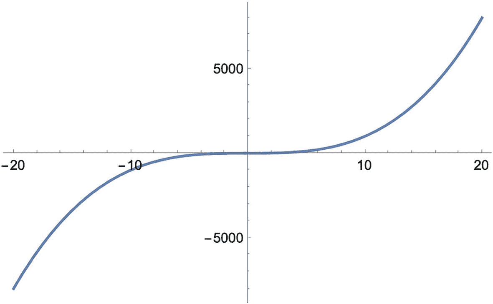

一张纵轴与横轴的坐标图。它绘制了一条曲线，该曲线从第三象限的（负 20，负 7000）点开始，经过原点，延伸至第一象限，并在（20，7000）点结束。数据为近似值。

图 1-21

一个三次函数图

```
In[54]:= Plot[x³,{x,-20,20}]
Out[54]=
```

`Plot` 函数也支持处理多个函数；只需将函数放在花括号内即可。图 1-22 在同一张图中显示了两个函数；每个函数都有独特的颜色。

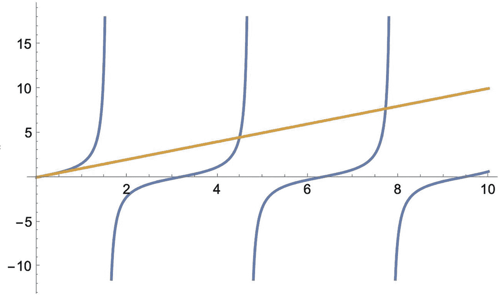

一张纵轴与横轴的坐标图。它绘制了多个函数的曲线。1，从原点开始。2 和 3，从第四象限开始并向第一象限延伸。4，从第四象限开始并延伸。5，从原点开始斜率递增。

图 1-22

绘制的多个函数

```
In[55]:= Plot[{Tan[x],x},{x,0,10}]
Out[55]=
```

如果曲线是粗线或虚线，您还可以自定义图形的颜色；这可以通过 `PlotStyle` 选项实现（见图 1-23）。

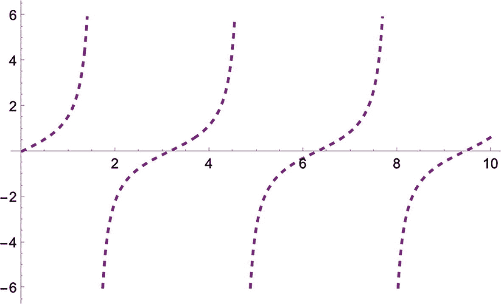

一张纵轴与横轴的坐标图。它绘制了多个正切函数的虚线曲线。1，从原点开始。2 和 3，从第四象限开始并向第一象限延伸。4，从第四象限开始并略微向第一象限延伸。

图 1-23

虚线正切函数图

```
In[56]:= Plot[Tan[x],{x,0,10},PlotStyle->{Dashed,Purple}]
Out[56]=
```

`PlotLabel` 选项允许您通过添加标题来为图形添加基本描述。另一方面，`AxesLabel` 选项允许您为坐标轴（x 轴和 y 轴）添加名称，如图 1-24 所示。

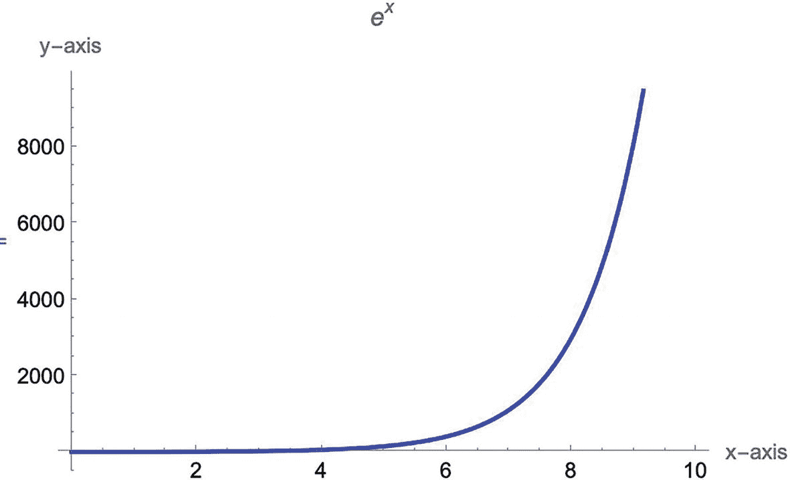

一张纵轴与横轴的坐标图。它绘制了 e 的 x 次方的凹向上递增趋势。该曲线从原点开始，并从（6，100）点迅速增加到（9，9000）点。数据为近似值。

图 1-24

带有标题和坐标轴标签的图

```
In[57]:= Plot[E^x,{x,0,10},PlotStyle->{Blue}, PlotLabel -> "ex" ,AxesLabel->{"x-axis","y-axis"}]
Out[57]=
```

### 逻辑运算符与中缀表示法

中缀表示法和逻辑运算符常用于逻辑语句或表达式比较中，其结果值为真或假。表 1-1 展示了 Wolfram 语言的关系运算符。

表 1-1

运算符及其定义

| 定义 | 运算符形式 |
| --- | --- |
| 大于 | `>` |
| 小于 | `<` |
| 大于或等于 | `>=` |
| 小于或等于 | `<=` |
| 等于 | `==` |
| 不等于 | `!=` |
| 结构相等 | `===` |

关系运算符，也称为比较运算符和逻辑二元运算符，用于检查特定关系命题的真假。包含它们的表达式称为关系表达式。它们接受各种类型的参数，结果可以为真或假——即布尔结果。如您所见，它们都是二元运算符，其中两个是相等条件运算符 `==` 和 `!=`。这些用于验证表达式的相等或不相等。

```
In[58]:= 6*1>2
Out[58]= True
```

```
In[59]:= 6*1<2
Out[59]= False
```

```
In[60]:= >=1/2
Out[60]= True
```

```
In[61]:= 1/4<=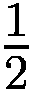
Out[61]= True
```

```
In[62]:= 3.12 == 2.72
Out[62]= False
```

```
In[63]:= π != 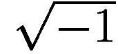
Out[63]= True
```

```
In[64]:= 2===2.
Out[64]= False
```

布尔操作数产生真或假的结果，或测试某个条件是否满足。表 1-2 展示了 Wolfram 语言的布尔运算符。

表 1-2

布尔运算符及其定义

| 定义 | 运算符形式 |
| --- | --- |
| 与 | `&&` 或 `∧` |
| 或 | `||` 或 `∨` |
| 异或 | `⊻` |
| 等价 | `⇔` |
| 非 | `¬` |

与运算符在两个表达式都为真时返回真值。否则，结果为假。

```
In[65]:= 2==1 && 3.12==2
Out[65]= False
```

或运算符在任意一个表达式为真时返回真。否则，返回假。该运算符的操作与上一个类似。

```
In[66]:= 2*2==3||23*2==1
Out[66]= False
```

异或运算符是一个排他性的“或”运算符，当两个表达式不同时返回真。否则，当表达式具有相同值时返回假。

```
In[67]:= 2==1 \[Xor] 2==2
Out[67]= True
```

等价运算符在表达式彼此可推导时返回真。否则，返回假。

```
In[68]:= Power[1,2] \[Equivalent] 1²
Out[68]= True
```

非运算符，也称为逻辑非，返回一个值，该值可以是计算结果为某个结果的表达式。此运算符的结果始终是布尔类型。

```
In[69]:= \[Not]2==1
Out[69]= True
```

另一种方法，不是使用布尔运算符，而是使用带有后缀（`Q`）的不同函数，这包括测试某个对象是否满足内置函数的条件。值得一提的几个函数有 `SameQ`、`UnsameQ`、`AtomQ`、`IntegerQ` 和 `NumberQ`。下一个示例测试一个数字是浮点表达式还是整数。

```
In[70]:=
IntegerQ[1]
IntegerQ[1.]
Out[70]= True
Out[71]= False
```

`AtomQ` 函数的一个有价值的应用是判断一个表达式是否可细分为子表达式。稍后，您将了解如何使用列表处理子表达式。如果结果为真，则该表达式不能细分为子项；如果为假，则该表达式包含子项。

```
In[72]:= AtomQ[12]
Out[72]= True
```

如上所示，数字不能被细分，因为数字是一个规范表达式；字符串也是如此，如前所述。

### 代数表达式

Wolfram 语言可以处理代数表达式。例如，执行符号计算、代数展开和化简。许多代数中常用的普通语言词汇在 Mathematica 中得以保留。要展开一个代数表达式，请使用 `Expand`。

```
In[73]:= Expand[((x²)+y²)*(x+y)]
Out[73]= x³+x² y+x y²+y³
```

在变量之间添加空格等同于添加乘法运算符。这可以通过 `a*x == a x` 来验证。

```
In[74]:= Expand[a x²*(a x)³]
Out[74]= a⁴ x⁵
```

但在编写代数表达式时要小心，因为符号 `ax` 与 `a x` 不同。这也可以通过 `SameQ[ax, a x]` 或其简写形式 `a x === ax` 来检查。
要化简一个已展开的表达式，请使用 `Simplify` 或 `FullSimplify`。

```
In[75]:= Simplify[x³+x² y+x y²+y³]
FullSimplify[x³+x² y+x y²+y³]
Out[75]= x³+x² y+x y²+y³
Out[76]= (x+y) (x²+y²)
```

区别在于后者会尝试更广泛的变换来化简表达式。要合并具有重复分母的项，请使用 `Together`。要展开为部分分式，请使用 `Apart`。

```
In[77]:= Together[1/z + 1/(z+1) - 1/(z+2)]
Apart[(2+4z+z²)/(z(1+z)(2+z))]
Out[77]= (2+4 z+z²)/(z (1+z) (2+z))
Out[78]= 1/z+1/(1+z)-1/(2+z)
```

### 求解代数方程

有多种函数可用于求解代数方程。最常用的是 `Solve` 函数。第一个参数是要求解的方程或表达式，第二个参数是要求解的变量。

```
In[79]:= Solve[z²+1==2,z]
Out[79]= {{z → -1},{z → 1}}
```

**注意**

你可能还记得，等于用双等号（`==`）表示；不要使用单等号（`=`），因为那表示给符号或变量赋值。

结果意味着 `z` 有两个解：一个是 –1，另一个是 1。每个结果都以规则的形式表示。规则表达式在应用时，会将左侧的赋值更改为右侧的赋值（`left → right`）。例如，`z → 1` 等同于 `Rule[z, 1]`。

要验证解，必须将 `z` 的值（–1, 1）代入原方程。为此，你可以使用 `ReplaceAll` 运算符（`/.`）以及规则命令 `→` 或 `Rule`，该命令用于对变量或模式应用变换，并与其他表达式结合。

```
In[80]:= z²+1 /.Rule[z,{1,-1}]
Out[80]= {2,2}
```

另一种选择是直接在方程中显式输入解。

```
In[81]:= {1²+1==2, (-1)²+1==2}
Out[81]= {True,True}
```

也可以求解多个方程，给定一个方程组和一个感兴趣的变量列表。要解方程，请将方程组放在一个列表中，将变量放在另一个列表中。

例如，求解以下方程组。

`x` + `y` + `z` == 2

6`x` - 4`y` + 5`z` == 3

5`x` +2`y` +2`z` ==1

解为

```
In[82]:= Solve[{x+y+z == 2, 6x-4y+5z == 3, x+2y+2z == 1},{x,y,z}]
Out[82]= {{x→3,y→10/9,z→-19/9}}
```

**注意**

结果以列表形式列出。列表是 Wolfram 语言中的基本结构，将在下一章讨论。

后一个过程也适用于赋值给变量的方程。你可以使用复合表达式来编写。

```
In[83]:=
EQ1=x+y+z==2;
EQ2=6 x-4 y+5 z==3;
EQ3=x+2 y+2 z==1;
Solve[{EQ1,EQ2,EQ3},{x,y,z}]
Out[83]= {{x→3,y→10/9,z→-19/9}}
```

`Solve` 函数也适用于纯代数方程。

```
In[84]:= Solve[{x + y + z == a, 6 x - 4 y + 5 z == b, x + 2 y + 2 z == c}, {x, y, z}]
Out[84]= {{x→2a-c,y→(7a-b-c)/9,z→(-16a+b+10c)/9}}
```

`Solve` 函数支持包含逻辑运算符的表达式，用 `z` 表示 `y` 和 `x`。

```
In[85]:= Solve[EQ1 && EQ2, {x, y}]
Out[85]= {{x→(11-9z)/10,y→(9-z)/10}}
```

它也使用 OR 运算符。

```
In[86]:= Solve[x² + y² == 0 || x - 2 y == 1, x]
Out[86]= {{x→-iy},{x→iy},{x→1+2y}}
```

`Solve` 函数会为输入的每个方程返回解。

使用 AND 运算符建立条件，可以返回满足条件的解；例如，以下方程有两个解 1 和 –1，但你可以通过条件 `z` 必须不等于 1 来求解方程。

```
In[87]:= Solve[z^-2 + 1 == 2 && z != 1, z]
Out[87]= {{z → -1}}
```

为了获得更通用的结果，可以使用 `Reduce`，如下例所示。

```
In[88]:= Reduce[Cos[x]==-1,x]
Out[88]= c[1]∈Z && (x==-π+2πc[1] || x==π+2πc[1])
```

这里，备选解由 OR 运算符分隔，条件由 AND 建立。这意味着有两个可能的解 `-π + 2πc1` 或 `π + 2πc1`，并且常数 `c1` 必须是属于整数集 (Z) 的数。此外，`Reduce` 也可以求解不等式。

```
In[89]:= Reduce[h²+k2<11,{h,k}]
Out[89]= -√11<h<√11 && -√(11-h²)<k<√(11-h²)
```

这里，联立方程是关于 `h` 和 `k` 的。此外，`Reduce` 可以展示带有特定条件的方程组合。

```
In[90]:= Reduce[α+β*α²==E,α]
Out[90]= (β==0 && α==e) || (β≠0 && (α==(-1-√(1+4eβ))/(2β) || α==(-1+√(1+4eβ))/(2β)))
```

第一个解是 `α` 和 `β` 必须分别是数字 `e` 和零。第二个解是关于 `α` 的，并且条件为 `β` 必须不等于零。

### 在 Mathematica 中使用 Wolfram Alpha

Mathematica 内部一个非常实用的应用是利用 Wolfram Alpha 可计算知识库。可以通过 Wolfram Alpha 查询从 Mathematica 中调用 Wolfram Alpha。要输入 Wolfram Alpha 查询，请在输入任何表达式之前键入双等号；此时应出现一个带有白色等号的橙色星号，表示输入的文本是自然语言查询。要执行该单元格，请点击 `Enter` 键。

例如，可以使用 Wolfram Alpha 查询来求解代数方程。在输入单元格中键入双等号（`==`），Wolfram Alpha 查询符号就会出现（见图 1-25）。或者，从新单元格的 `+` 菜单（水平线左侧）中选择“Wolfram Alpha 查询”作为新的输入。

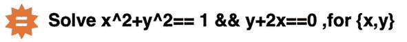

输入内容为 `solve x cap 2 plus y cap 2 equals equals 1 and and y plus 2 x equals equals 0, for left curly bracket x comma y right curly bracket`。

**图 1-25** Wolfram Alpha 查询输入

```
In[91]:=

Out[91]=
```

图 1-25 和图 1-26 展示了 Wolfram Alpha 查询的输入和输出。

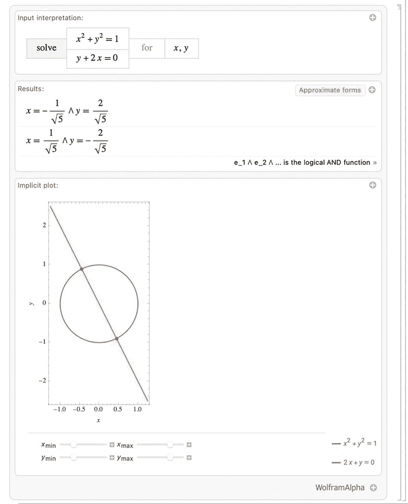

输出窗口截图。它包括输入解释、结果及其对应的隐式图。一个垂直轴与水平轴的图。它绘制了一个圆，被一条递减的斜线在两个方程的两个点处相交。

**图 1-26** Wolfram Alpha 查询输出

如图所示，系统返回了 `x` 的解和其他计算结果。该单元格以 Wolfram Alpha 形式呈现计算结果。点击加号图标会显示不同输入形式的列表。要查看 Wolfram 语言中的等效形式，请选择 `Input` 选项。另一种使用 Wolfram Alpha 的相关方式是使用自由格式输入。值得一提的是，与 Mathematica 命令相关的词语，如 `Reduce`，也可以使用。图 1-27 展示了自由格式输入中的输入单元格。点击加号图标会显示更多计算，类似于 Wolfram Alpha 查询。以下代码是所输入内容的 Wolfram 语言等效形式。点击该代码，将其替换为 Wolfram 语言语法。


输入内容为 `reduce x cap 2 plus y cap 2 equals equals 1 and and y plus 2 x equals equals 0, for left curly bracket x comma y right curly bracket`，以及其对应的自由格式输入。

**图 1-27** 自由格式输入中的输入代码

`In[91]:=`

`Out[91]=` 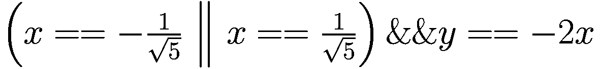

这里需要说明的是，不仅可以进行计算。通过 Wolfram Alpha，可以访问各种主题的精选数据；例如，获取某只股票在 3 月份的财务数据（见图 1-28）或澳大利亚的人口数据，如图 1-29 所示。

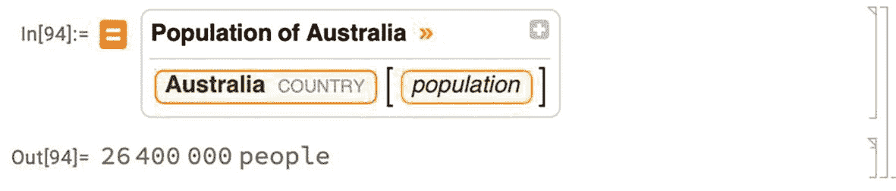

窗口截图。它包含一个输入结构，内容为澳大利亚人口。输出单元格结构包括澳大利亚总人口，即 26400000。

**图 1-29** 澳大利亚人口输入

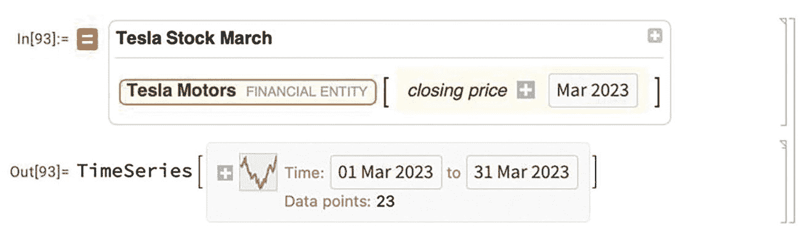

窗口截图。它包含一个输入，内容为特斯拉股票 3 月，包含财务实体和 2023 年 3 月的收盘价。输出单元格结构包括时间序列，以及 2023 年 3 月 1 日至 2023 年 3 月 31 日之间的时间图和数据点。

**图 1-28** 2023 年 3 月特斯拉股票的输入和输出。由财务实体识别，并返回一个 `TimeSeries` 对象，这得益于 Mathematica 的最新版本

```
In[93]:=
Out[93]=
```

```
In[94]:=
Out[94]=
```

自由格式输入和 Wolfram Alpha 查询都是有用且实用的工具。例如，如果你不知道某个函数或命令的正确语法，可以尝试使用自然语言的自由格式输入，这样在求值时，你可以获得该函数的等效 Wolfram 语言语法。然而，Wolfram Alpha 查询的一个缺点是计算是在 Mathematica 外部完成的，这意味着计算是在 Wolfram Alpha 服务器上进行的。相比之下，使用自由格式输入的计算可以在 Mathematica 内部重现。有时，直接使用 Wolfram 语言来更好地管理结果会更可取，因为从 Wolfram Alpha 提取结果可能很繁琐。需要注意的是，要从 Mathematica 访问这两个功能，必须通过网络连接到 Wolfram 服务器。

### 延迟与即时表达式

Wolfram 语言有两个重要特性。首先，我们来看看 `Set` 机制是如何工作的。符号 `=` 是 `Set` 的脚本，而 `:=` 是 `SetDelayed` 的脚本。`Set` 机制由 `W = expr` 表示。`W` 是你正在赋值的变量，`expr` 是你赋给 `W` 的表达式或值。这意味着 Mathematica 会立即计算该表达式，然后每次调用该变量或定义的函数时，都会写入 `W` 的值并显示结果。相反，使用 `W:= expr` 意味着表达式在被调用之前不会被计算，因此每次调用 `W` 时，它都会重新计算存储的表达式。

```
In[95]:= W=RandomReal[]
Out[95]= 0.536369
```

测试 `W` 是否等于 `W`。

```
In[96]:= W==W
Out[96]= True
```

在这种情况下条件为真，因为使用 `Set` 声明了变量 `W` 并使用了 `RandomReal` 函数，该函数返回一个从 0 到 1 的伪随机选择。同样的方法用于 `SetDelayed`，结果为假，因为每次出现 `W` 时，都会调用该函数进行新的计算。你可以将代码编写为复合表达式。

```
In[97]:= Clear[W];W:=RandomReal[];W
Out[97]= 0.550058
```

让我们检查一下。

```
In[98]:= W==W
Out[98]= False
```

结果为假，因为每次调用 `W` 时都会重新计算 `RandomReal` 函数。因此，第一个 `W` 计算 `RandomReal`，第二个 `W` 再次计算 `RandomReal`，即使它们是相同的符号。

同样的方法适用于 `Rule`（`→`）用于即时求值，以及 `RuleDelayed`（`:>`）用于仅在使用时求值。考虑以下示例。

`In[99]:=`

`z=2; (*将 2 赋值给 z*)`

`R=z->z³; (*Rule 示例*)`

`RD=z:>z³; (*RuleDelayed 示例*)`

`R`

`RD`

`Out[102]=` 2 → 8

`Out[103]=` 2 ⧴ `z³`

表达式返回 `2 → 8`，因为 `z` 被立即求值，而表达式 `z ⧴ z³` 将 `z³` 的求值延迟到应用时。这些运算符可以与 `ReplaceAll` 运算符（`/.`）一起使用，正如之前在代数方程中看到的那样。

## 改进代码

代码效率对于实现性能、减少资源消耗至关重要，从而带来更快的执行时间和更好的可维护性。在 Mathematica 和 Wolfram 语言中，改进代码以提高效率和可靠性是其中一个具体场景。作为开发者，通过使用内置函数，你可以实现更高的可读性并简化故障排除。此外，内置符号针对效率进行了优化，因此比定义自己的符号更可取。

## 代码性能

在 Mathematica 中，有多种方式可以编写相同形式的表达式。然而，当执行长代码操作时，可能存在一种更好的表示法来提升代码性能，从而避免消耗过多的计算资源。这可以通过比较实现相同结果的不同函数的相对性能来实现。Wolfram 语言提供了对此的度量。`Timing` 函数以秒为单位显示每个进程相对于 `$TimeUnit` 值的性能，`$TimeUnit` 是 Wolfram 语言内核执行该进程所花费的 CPU 时间。`$TimeUnit` 因系统而异，因此你可能会得到不同的值——例如 `1/1000`。

**注意**

`$TimeUnit` 的值越低，被认为比使用它更精确，因为它提供了时间测量中更高的粒度或分辨率。

以下示例展示了使用内置函数和普通幂表达式计算表达式所需的时间。`Timing` 返回两个值：单位时间和计算结果，但由于结果值非常大，输出被抑制。

```
In[104]:= Timing[Power[10,10⁸];]
Out[104]= {1.1401,Null}
In[105]:= Timing[10¹⁰⁸;]
Out[105]= {1.54863,Null}
```

如你所见，两者之间存在差异；这与 Wolfram 语言处理每次计算的方式以及你的计算机规格有关。要查看绝对时间：

```
In[106]:= AbsoluteTiming[10¹⁰⁸;];]
Out[106]= {1.13833,Null}
In[107]:= AbsoluteTiming[Power[10,10⁸];]
Out[107]= {1.13189,Null}
```

与 `Timing` 的情况一样，也存在差异。要限制计算时间，请使用 `TimeConstrained`。使用此命令，可以为计算添加时间限制。如果代码仍在运行且已达到时间限制，则计算会被中止。例如，在 1 秒后中止计算。

```
In[108]:= TimeConstrained[10¹⁰⁸,1]
Out[108]= $Aborted
```

`EchoTiming` 函数已得到改进，可以显示已计算表达式的计时信息。`EchoTiming` 支持 `Timing` 和 `AbsoluteTiming` 的后一种方法。

```
In[109]:=
EchoTiming[Power[10,10⁸];,"Time in seconds:",Method->Timing]
EchoTiming[Power[10,10⁸];,"Time in seconds:",Method->AbsoluteTiming]
Out[109]= Time in seconds:  1.13813
Out[110]= Time in seconds:  1.12619
```

### 处理错误

错误可能很常见，因为你在持续学习的过程中最常编写代码。当函数失败时，Mathematica 会在编写的函数下方显示一条消息。消息形式提供了与错误关联的函数名称，以及可能对错误原因的描述。

接下来，让我们看看这是如何工作的（见图 1-30）。


消息截图显示：字符串连接 冒号 字符串 期望在位置 2 处，hello I am 左尖括号 右尖括号, Jeff。

**图 1-30** 输入代码的错误消息

```
In[111]:= StringJoin["hello","I am ",Jeff]
Out[111]= helloI am Jeff
```

消息中关联的函数以红色显示（见图 1-20）。这里发生的情况是，`StringJoin` 函数仅适用于字符串，而你编写的是一个变量 `Jeff`，而不是字符串，因此出现了错误。

要了解更多关于错误的信息，请点击红色的省略号图标。将出现一个菜单，列出可用于处理错误的不同选项。要在文档中查看错误，必须点击错误选项，即带有打开书本图标的选项。此选项会将你带到关联函数的文档。

弹出菜单中的另一个选项是**显示堆栈跟踪**。此选项以图形化和块状方式显示函数及其表达式是如何被评估的。此选项类似于 `Trace` 命令。让我们看看下一个错误示例和图 1-31。


消息截图显示：幂 冒号 无限表达式 1 除以 0 遇到。

**图 1-31** 无限表达式的错误消息

```
In[112]:= Power[x/0,2]
Out[112]= ComplexInfinity
```

这里，错误是 Mathematica 遇到了除以零的情况，这是未定义的，你可以在图 1-32 中看到带有**堆栈跟踪**的函数跟踪。

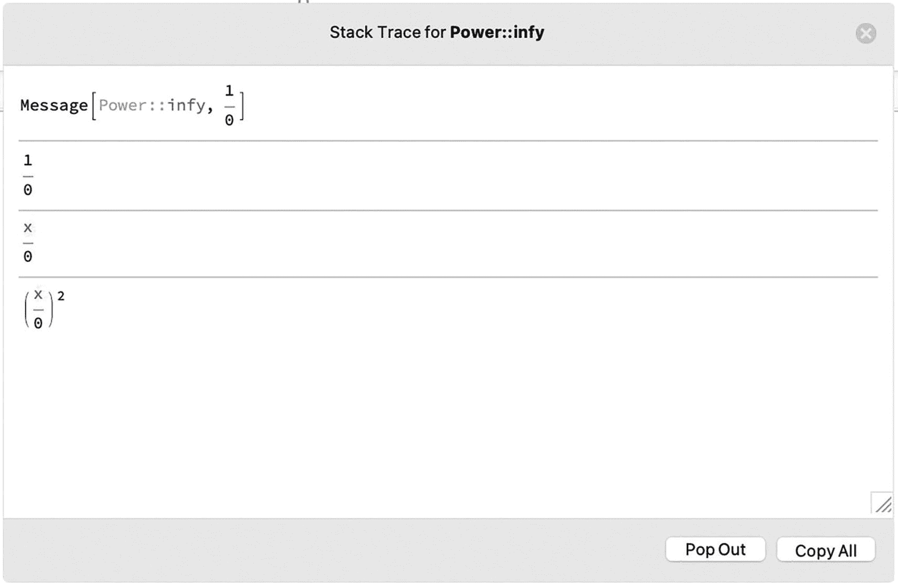

幂无限窗口的堆栈跟踪截图。它包含输入消息，内容为幂 冒号 冒号 无限 逗号 1 除以 0，以及以下选项：1 除以 0，x 除以 0，以及 x 除以 0 的平方。

**图 1-32** 显示跟踪堆栈弹出窗口

### 调试技术

在 Mathematica 中，调试实践帮助程序员识别、诊断和修复其编写的代码段中的错误或异常行为。使用 Wolfram 语言内置函数（如 `Trace`、`Echo` 和 `Print` 等）的传统代码操作，让你能够跟踪代码运行时的每一步。这使得更容易专注于特定的实现细节，而不是代码执行的整个抽象操作，从而提供对代码或代码块应执行操作的灵活且稳健的理解。

自版本 13 起，一些改进的内置函数（如 `EchoLabel` 和 `EchoEvaluation`）已被添加到函数库中，如下例所示。

```
In[113]:=
x=2;
Echo[x];x=x²+1;
Echo[x];x=x²+1;
Echo[x];
Out[114]=
>> 2
>> 5
>> 26
```

让我们回顾一下这里发生了什么。最初，值 `2` 被赋给 `x`。第一个 `Echo` 打印 `x` 的值，即 `2`。然后，在第二个操作中，`x` 根据其原始形式进行更新。随后，第二个 `Echo` 打印新值 `5`，这个过程一直持续到最终值 `26`（`5² + 1`）。

使用 `EchoLabel` 和 `EchoEvaluation` 也可以实现同样的效果，但可以添加自定义消息标签。

```
In[117]:=
x=2;
Echo[x,"Initial Value: "];
x=x²+1;
EchoLabel["First Iteration: "][x];
x=x²+1;
EchoEvaluation[x=x²+1,"Second Iteration: "->"Output :"];
Out[118]=
>> Initial Value:   2
>> First Iteration:   5
<< Second Iteration:   x=x²+1
<< Output :  677
```

前面的示例对相同的初始值执行了三次相同的操作。第一个 `Echo` 打印 `x` 的值。第二个 `EchoLabel` 使用自定义标签打印第一次迭代的输出，并以最后一次评估和标签关联结束。在评估之前，会打印初始标签，然后在评估完成后打印第二个标签。在整个过程中，结果会以不同颜色的符号显示在值旁边：橙色（`>>`）和蓝色（`<<`）。第一个符号代表输出，第二个符号代表输入。

现在，通过使用之前看到的测量时间的操作，你可以将它们结合起来，以精确定位哪些阶段需要更多计算时间，如下例所示。

```
In[123]:=
x=2;
EchoTiming[Echo[x,"Initial Value: "]];
x=x²+1;
EchoTiming[EchoLabel["First Iteration: "][x]];
x=x²+1;
EchoTiming[EchoEvaluation[x=x²+1,"Second Iteration: "->"Output :"]];
Clear[x];
Out[124]=
>> Initial Value:   2
⌚ 0.013603
>> First Iteration:   5
⌚ 0.018695
> Output :  677
⌚ 0.031909
```

如所见，最后一次评估花费的时间最长（`0.031909` 秒），而初始值评估最快（`0.013603` 秒）。当程序流程被分解成易于理解的小代码块时，这些技术非常有用，例如在关键点可视化变量值以及评估计算时间以进行性能分析。

## Mathematica 的工作原理

本节探讨计算的内部工作机制，并发现使用多个基本但强大的命令来可视化数据的方法。

### 计算如何进行（输入形式）

每次 `Mathematica` 在输入单元格中接收到计算时，都会使用 `StandardForm`，这是 Wolfram 语言中表达式的输出表示形式，具有许多常见数学符号的特征。输入可以用多种形式编写，但要知道表达式在 Wolfram 语言中是如何书写的，就需要使用 `StandardForm`。

```
In[130]:= StandardForm[1/x+x²]
Out[130]//StandardForm=
```

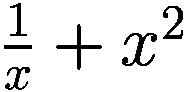

`InputForm` 的工作方式类似，但生成的输出可作为 Wolfram 语言输入直接使用。

```
In[131]:= {InputForm![$$ \frac{1}{x}+{x}² $$], InputForm[a^x], InputForm[Subscript[a, x]], InputForm![$$ \sqrt{2} $$]}
Out[131]= {x^(-1) + x², a^x, Subscript[a, x], Sqrt[2]}
```

每种格式都对应一行代码文本，例如平方根符号（`√`）与 `Sqrt[]` 含义相同。要将输入转换为 `StandardForm`、`InputForm` 及其他形式，请选中单元格块，然后前往 **Cell ➤ Convert To ➤ StandardForm** 和 `InputForm` 等选项。`StandardForm` 和 `InputForm` 适用于 Wolfram 语言中的每个表达式。尝试对之前的绘图使用 `InputForm`，看看表达式是如何完整书写的。为了更好地理解 `Mathematica` 的工作原理，你需要了解符号计算或数值计算是如何执行或书写的。可以使用 `FullForm` 和 `TreeForm` 命令来查看表达式是如何以符号形式表示的。`TreeForm` 以图形格式表示命令，而 `FullForm` 则表示 Wolfram 语言内部管理的表达式形式。

```
In[132]:= FullForm![$$ \frac{t}{2}+2\hat{\mkern6mu} 2 $$]
Out[132]//FullForm= Plus[4,Times[Rational[1,2],t]]
```

`FullForm` 也像 `InputForm` 一样将输入表示为一行输出代码。但既然 `InputForm` 也能返回一行输出代码，为什么不用 `InputForm` 呢？原因是 `FullForm` 表示的是 `Mathematica` 所理解的输入形式。正因如此，`FullForm` 很有用，因为它能让你知道 `Mathematica` 对输入内容是如何解释的。在 `Mathematica` 中，数学运算顺序是保持不变的。因此，之前的输出如下：首先，`Mathematica` 检测到有理数 `1/2`（`Rational[1,2]`）和符号 `t`，接着是这两个元素的乘法（`Times[Rational[1,2],t]`），然后是 `2²` 的加法（`Plus[4, Times[Rational[1,2],t]]`）。

另一种有助于可视化 `Mathematica` 如何操作表达式的命令是 `TreeForm`。`TreeForm` 将表达式以树状图的形式返回（见图 1-33）。或者，你也可以使用后缀形式 `expr // function` 来应用命令，而不必使用规范形式 `F[expression]`。

```
In[133]:= 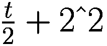//TreeForm
Out[133]//TreeForm=
```

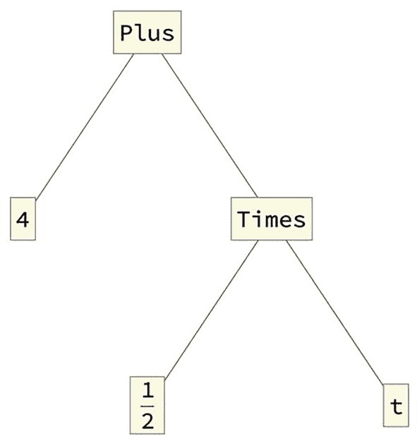

一个 `plus` 的树状图被分为 `4` 和 `times`，而 `times` 又被分为 `1 over 2` 和 `t`。

**图 1-33** 树状图表示

简而言之，`Mathematica` 检测到 `1/2` 乘以 `t`，然后将乘积结果与 2 的平方相加。树状图从下往上读取，直到到达树的顶端。

另一个有用的命令是 `Trace`。`Trace` 返回与求值行对应的各个形式，其中包含被求值表达式的形式序列。

```
In[134]:= Trace[Plus[4,Times[Rational[1,2],t]]]
Out[134]= {{{Rational[1,2], }, }, 4+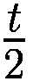}
```

因此，这里的操作顺序如下：首先使用项 `Rational[1, 2]`，接着是 `1/2`，然后 `1/2` 乘以 `t`，最后将结果与 `4` 相加。在 `Trace` 中使用 `FullForm` 可以让你看到内部结构的变化。

```
In[135]:= FullForm[Trace[Plus[4,Times[Rational[1,2],t]]]]
Out[135]//FullForm= List[List[List[HoldForm[Rational[1,2]],HoldForm[Rational[1,2]]],HoldForm[Times[Rational[1,2],t]]],HoldForm[Plus[4,Times[Rational[1,2],t]]]]
```

可以看到，每一步的项都在变化。`HoldForm` 命令用于以未求值的形式查看输出。作为 `Trace` 的补充，`FullForm` 和 `TreeForm` 可以结合使用，以查看表达式内部操作的层次结构，如图 1-34 所示。

```
In[136]:= Trace![$$ \frac{t}{2}+2\hat{\mkern6mu} 2 $$]//TreeForm
Out[136]//TreeForm=
```

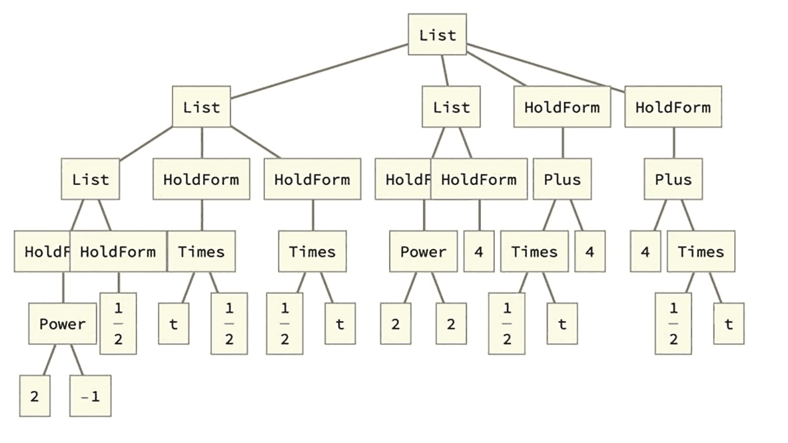

一个列表的树状图被分为 list、list、hold form 和 hold form。第一个 list 包含一个 list、hold form 和 hold form，第二个 list 包含 hold form 和 hold form，而一个 hold form 包含一个 plus，每个都带有相应的计算。

**图 1-34** `TreeForm` 和 `Trace` 结合使用

这里，树状图显示了变化是如何进行的，并且从左到右读取。阅读树状图，你会看到 `Mathematica` 识别出 `1/2` 是 `2^-1`；接着是 `t` 乘以 `1/2`，然后是 `2²`（即 `4`），依此类推直到结束。将光标移到每个块上，会显示正在被保持的操作的表示形式。有时你可能会遇到不理解的操作或表达式。解决方法是使用上述命令，这些命令允许你查看表达式的内部结构，从而理解操作是如何执行的。

### 搜索帮助

Wolfram 文档中心包含所有内置函数的注册信息。可以通过前端访问函数文档，方法是打开新窗口、单击工具栏上的“帮助”选项卡或输入表达式。自 13.1 版本起，还可以通过工具栏最右侧的图标（一个打开的书本图标）访问文档。当输入命令或相关的合理选项时，输入助手会以自动完成或建议栏的形式显示。在编写内置函数或命令时，Mathematica 会尝试自动补全该短语。

如图 1-35 所示，输入单词 `Random`，不同的相关命令会作为建议出现。如果所需的命令已列出，您可以使用光标指针选择它。

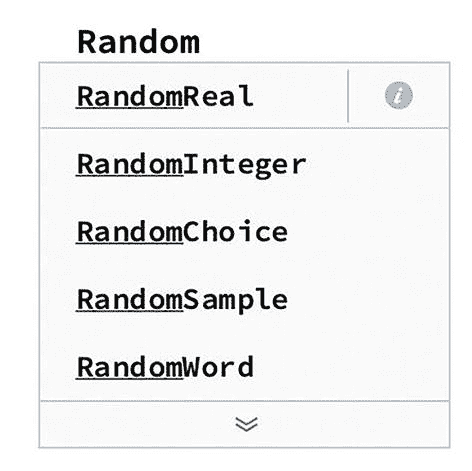

随机数的下拉列表包括 `RandomReal`、`RandomInteger`、`RandomChoice`、`RandomSample` 和 `RandomWord`。

**图 1-35** 自动完成弹出菜单

要访问特定命令的文档，请单击命令名称旁边的“i”文档图标，文档窗口将会出现。

> **注意**
> 自动完成功能也适用于已赋值的符号。

当编写内置函数或命令后紧跟左方括号时，会出现补全菜单；如果单击双下箭头，它会显示该命令支持的输入形式，如图 1-36 所示。

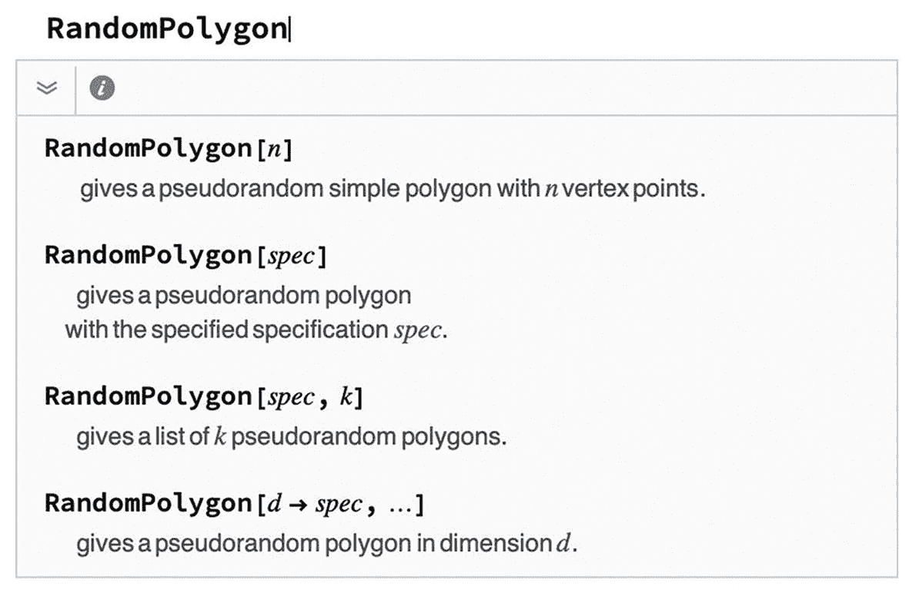

`RandomPolygon` 窗口的截图。它展示了一个具有 `n` 个顶点的随机多边形、指定的规格、`k` 个伪随机多边形以及维度 `d` 下的伪随机多边形。

**图 1-36** 具有不同输入形式的内置函数 `RandomPolygon`

如示例所示，`RandomPolygon` 函数有四种输入形式；此外，在菜单中，您可以看到与不同输入形式相关的文本。

要了解函数如何工作或内置函数如何编写，最佳资源是查阅 Wolfram 文档中心。您还可以检查是否可以使用替代输入表达式。因此，如果您需要帮助理解 `Head` 函数的工作原理，可以在函数名称前输入问号（`?`），这样您就能简单了解该命令的工作方式（见图 1-37）。如果您想要更多与函数属性相关的信息，可以使用双问号（`??`）。作为建议，Wolfram 文档中心可用于获取更深入的选项。使用 `F1` 快捷键，它会打开文档中心。如果您高亮显示符号名称并按 `F1`，您将直接跳转到该符号的文档页面。

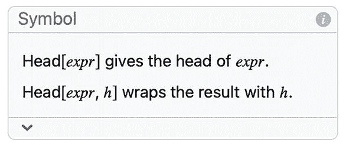

一个符号窗口的截图。它包含两个 `Head` 命令，表达式的 `Head`，并用 `h` 包装结果。

**图 1-37** `Head` 命令的输出信息

```
In[137]:= ?Head
Out[137]=
```

前面的命令展示了如何显示与特定函数相关的信息。但如果您不记得确切的拼写，可以写入名称的前几个字母后跟一个星号（`*`），Mathematica 会提供一个与您的查询匹配的列表。在以下示例中，输出的是名称以“Hea”开头的函数（见图 1-38）。在需要更深入知识的场景中，可以使用 Wolfram 文档。

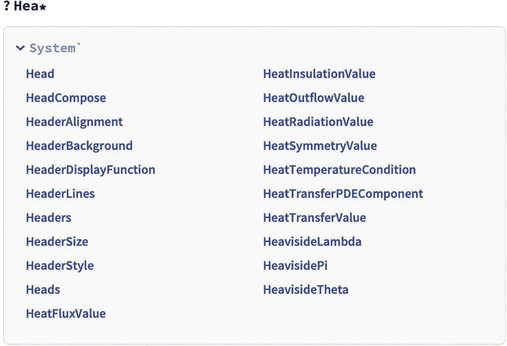

系统窗口的截图。它包含几个命令，其中一些是 `Head`、`HeadCompose`、`HeaderAlignment`、`HeaderBackground`、`HeaderDisplayFunction`、`HeaderLines`、`Headers`、`HeaderSize`、`HeaderStyle`、`Heads`、`HeatFluxValue` 和 `HeatInsulationValue`。

**图 1-38** 以字母 `Head` 开头的命令的输出信息

```
In[138]:= ?Hea*
Out[138]=
```

### 笔记本安全性

Wolfram 语言提供了创建和运行动态内容的能力。这些内容允许用户创建能够执行有用且复杂任务的程序；在某些情况下，可能会执行不需要的内容或滥用代码。笔记本可能包含也可能不包含动态内容作为其代码的一部分。包含动态内容的笔记本可以在无需用户任何操作的情况下立即下载。有时，当笔记本包含动态内容时，Mathematica 会提醒用户，显示如图 1-39 所示的消息。

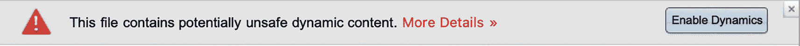

警告消息的截图。它包含文本“此文件包含可能不安全的动态内容”和一个“启用动态”按钮。

**图 1-39** 动态内容的警告消息

如果笔记本不在受信任的目录中，则会有一条消息警告用户该笔记本包含不可靠的动态内容。如果笔记本位于可靠目录中，则动态内容会在不向用户显示先前消息的情况下执行。要查明笔记本是否位于名为 `TrustedPath` 的受信任目录中，请检查受信任的数学目录，这些目录位于 (1) `$BaseDirectory`、(2) `$UserBaseDirectory` 和 (3) `$InitialDirectory`。

```
In[139]:= $BaseDirectory
Out[139]= /Library/Mathematica
In[140]:= $UserBaseDirectory
Out[140]= /Users/macosx/Library/Mathematica
In[141]:= $InitialDirectory
Out[141]= /Users/macosx
```

在这种情况下，这些是受信任的目录；您的目录可能不同。默认情况下，称为 `UntrustedPath` 的目录是那些您可以存储可能有害文件（例如从互联网下载的文件）的目录。为此，在 Wolfram 语言中，用户的写入目录和配置目录被称为 `UntrustedPath`。要添加、更改或删除受信任和不受信任的目录，请转到“偏好设置”菜单，然后转到“安全”选项卡。那里有编辑不可靠和受信任目录的选项。

## 总结

本章作为 Mathematica 的介绍，Mathematica 是一款用于数学计算和分析的综合软件。本章还介绍了该软件中使用的独特的 Wolfram 语言，重点介绍了其笔记本界面、文本处理、面板以及各种样式和功能。它还深入探讨了 Mathematica 中的表达式，并以与代码性能、错误和调试管理以及确保安全性相关的主题作为结尾。