# 2. 数据操作

本章回顾了 Wolfram 语言中数据创建和数据处理的基础知识。本章从语言中列表和结构的概念开始。讨论了数字、数字以及将它们与常见数学函数一起使用的简单方法。接下来，向您介绍对象列表、表示和生成列表，深入探讨数据数组并检查嵌套列表、向量、矩阵以及用于各种目的的相关操作。本章以研究列表操作技术（检索、分配或删除数据）和构建列表作为结尾，为理解 Wolfram 语言中的列表操作提供通用指南。

## 列表

列表是 Wolfram 语言中数据构建的核心。列表可以收集对象、构建数据结构、创建表格、存储值或变量、进行从基础到复杂的计算，以及描述数据特征。列表可以表示 Wolfram 语言中的任何表达式（数字、文本、数据、图像、图形等）——即任何数据集合。

如果你访问列表的信息结构，如图 2-1 所示，你可以看到构成列表的典型格式。列表由花括号或 `List` 命令表示。在 Wolfram 语言中，几乎每个数据对象的结果都可以是列表形式的；换句话说，列表允许你将保持某种关系的数据分组，即使它们类型不同，也可以通过整体操作（使用相同的标识符）或单独操作来处理它们。

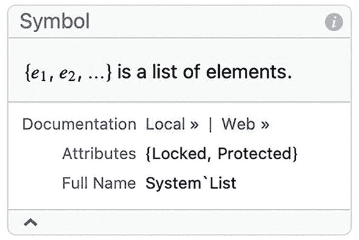

一个符号窗口的截图，其中包含一个元素列表，包括 e 1 和 e 2。下方给出了文档、属性和全名。

**图 2-1** Wolfram 语言中的列表定义

```
In[1]:= ??List
Out[1]=
```

如评估结果所示，逗号分隔元素，整个列表位于花括号之间。此外，`List` 是一个受保护的变量，这意味着你不能为名称 `List` 赋值。

### 数字类型

Wolfram 语言中的基本数字类型由整数、有理数、实数和复数表示。

首先，整数具有精确的结果，因为它们是不能用小数点表示的数字。

```
In[2]:= {10, InputForm[10]}
Out[2]= {10,10}
```

因此，Wolfram 语言中的整数以无限精度和无限准确度处理。

```
In[3]:= {10//Accuracy, InputForm[10]//Precision}
Out[3]= {∞, ∞}
```

其次，有理数可以表示为两个整数的商。

```
In[4]:= {5/10,InputForm[10/12]}
Out[4]= {1/2, 5/6}
```

Mathematica 对待有理数的方式与整数完全相同，因此每当 Mathematica 处理有理数时，它都会返回表示该数字的最小表达式。

```
In[5]:= {5/10 //Accuracy,InputForm[10/12] //Precision}
Out[5]= {∞, ∞}
```

第三，实数——通常称为浮点数——在 Wolfram 语言中由任何带小数点的数字表示。

```
In[6]:= {2.72 //Precision, InputForm[2.72]}
Out[6]= {MachinePrecision,2.72}
```

由于实数是近似值，它们没有精确的精度。这些数字被视为机器数，其精度由 `$MachinePrecision` 变量决定。需要注意的是，在 Wolfram 语言中，数字 `1` 和 `1.0` 的处理方式不同。尽管 Mathematica 识别它们是等价的表达式，但必须考虑到它们在 Wolfram 语言中并非同一个对象。

为了证实这一点，让我们看下面的例子，其中你使用 `SameQ` 来测试 `1` 和 `1.0` 的表达式是否相同。

```
In[7]:= SameQ[1,1.0]
Out[7]= False
```

这些表达式的头部不同，因为一个是整数，另一个是实数。

```
In[8]:= {Head[1],Head[1.0]}
Out[8]= {Integer, Real}
```

复数是包含实部和虚部的数字。复数的形式是 `a + bi`，其中“a”是实部，“b”是虚部。符号“i”表示负数 –1 的平方根。

```
In[9]:= 10+19I
Out[9]= 10+19I
```

这些数字的精度类型可以是精确的或近似的，因为这些数字可以由前面描述的数字构建而成。

```
In[10]:= {Precision[I], Precision[1 + 0.3I], FullForm[11+1I]}
Out[10]= {∞, Machineprecision, Complex[11, 1]}
```

尽管复数看起来像一个单一的原子表达式，但这些数字可以细分为不同的表达式，例如提取实部或虚部时。

```
In[11]:= 1+I //AtomQ
Out[11]= True
In[12]:= {ReIm[1+3I],Re[1+0.3I],Im[Complex[1,0.2]]}
Out[12]= {{1,3},1.,0.2}
```

当你处理像圆周率和黄金比例这样的超越数时，这些数字被视为符号——也就是说，Mathematica 保留了这些符号，因为它们是重要的数值常数。因此，尽管是实数，它们具有精确的精度。

```
In[13]:= {Accuracy[\[Pi]],Precision[E],Accuracy[I],Precision[GoldenRatio]} //NumberQ
Out[13]= False
```

要确定给定值在 Wolfram 语言中是否被视为数字，请使用 `NumberQ` 命令。如果表达式是数字，则返回“True”，否则返回“False”。这可以在前面的命令（针对超越数）和以下示例中观察到。

```
In[14]:= {NumberQ[1/2],NumberQ[1],NumberQ[E]}
Out[14]= {True,True,False}
```

因此，你可以看到有理数和整数是数字，但数字 `E` 不是。实际上，`E` 是一种符号类型。

```
In[15]:= {Head[E],FullForm[E]}
Out[15]= {Symbol,E}
```

一般来说，在 Wolfram 语言中组合不同类型的数字没有限制。你可以在不同类型之间执行运算。

```
In[16]:= {1+0.2+1/2+1+11+1I}
Out[16]= {13.7 +1\. I}
```

近似数到精确数的转换通过 `Rationalize` 执行。

```
In[17]:= Rationalize[2.72]
Out[17]= 68/25
```

此外，还支持科学记数法等替代数字表示法。科学记数法是一种用十的幂次表示大数的有用工具。

```
In[18]:= {ScientificForm[N@E/1000000],2.71828*^-6}
Out[18]= {2.71828 × 10^(−6), 2.71828 × 10^(−6)}
```

你知道 `N` 函数用于计算近似数。它将精确表达式转换为近似表达式，同时也可以指定所需的精度。

不同的形式通常可以推广到 Wolfram 语言中所有内置函数的表示法。

*   使用 `N` 函数 `[ ]` 直接应用于表达式

```
    In[19]:= N[13/7]
    Out[19]= 1.85714
```

*   利用中缀表示法 `~N~`

```
    In[20]:= E~N~E
    Out[20]= 2.72
```

*   通过后缀表示法 `// N`

```
    In[21]:= E//N
    Out[21]= 2.71828
```

*   使用前缀表示法 `N@`

```
    In[22]:= N@E
    Out[22]= 2.71828
```

当未定义精度时，Mathematica 使用 `$MachinePrecision` 的值来确定近似数的标准精度。`$MachinePrecision` 的值会变化，因为它是由 Mathematica 根据每台计算机的特性设定的浮点数。

```
In[23]:= $MachinePrecision
Out[23]= 15.9546
```

使用 `SetPrecision` 设置任意精度，或使用机器精度。

```
In[24]:= SetPrecision[E, 17]
Out[24]= 2.7182818284590452
```

以下使用机器精度。

```
In[25]:= SetPrecision[E,MachinePrecision]
Out[25]= 2.71828
```

当未引入精度时，Mathematica 使用 `MachinePrecision` 数字。

```
In[26]:= SetPrecision[e,MachinePrecision] == N@e
Out[26]= True
```

另一种输入具有特定精度的近似数的方法是在实数后添加重音符（`'`），后跟精度。例如，用于六位精度。

```
In[27]:= 77/3`6
Out[27]= 25.6667
```

### 处理数字

要提取构成精确数字的各位数字，请使用 `IntegerDigits` 函数。

```
In[28]:= IntegerDigits[234544553]
Out[28]= {2,3,4,5,4,4,5,5,3}
```

对于近似数字，使用 `RealDigits`。

```
In[29]:= {RealDigits[321.4546554],RealDigits[N@E]}
Out[29]={{{3,2,1,4,5,4,6,5,5,4,0,0,0,0,0,0},3},{{2,7,1,8,2,8,1,8,2,8,4,5,9,0,4,5},1}}
```

对于复数，则需要根据情况提取其实部和虚部，然后再提取每个部分的数字。

```
In[30]:= RealDigits[ReIm[113+2.7213I]]
Out[30]= {{{1,1,3,0,0,0,0,0,0,0,0,0,0,0,0,0},3},{{2,7,2,1,3,0,0,0,0,0,0,0,
0,0,0,0},1}}
```

默认情况下，上述两个函数以十进制为基数给出结果。要指定基数，请将所需基数作为函数的第二个参数输入；例如，使用基数 2。

```
In[31]:= RealDigits[321.4546,2]
Out[31]= {{1,0,1,0,0,0,0,0,1,0,1,1,1,0,1,0,0,0,1,1,0,0,0,0,0,1,0,1,0,1,0,1,
0,0,1,1,0,0,1,0,0,1,1,0,0,0,0,1,1,0,0,0,0},9}
```

指定数字 `e` 在十进制表示中的前三位数字。

```
In[32]:= RealDigits[N@E, 10, 3]
Out[32]= {{2,7,1},1}
```

可以使用 `FromDigits` 函数从其整数表示中重建数字。

```
In[33]:= FromDigits[{2,7,1,1}]
Out[33]= 2711
```

此外，还可以构成一个浮点数。

```
In[34]:= N@FromDigits[{{2,7,1,1},1}]
Out[34]= 2.711
```

以及测量整数的长度。

```
In[35]:= IntegerLength[2711]
Out[35]= 4
```

### 一些数学函数

Wolfram 语言提供了广泛的数学函数库，从最基础到最专业的函数一应俱全。这些函数可以进行数值或符号运算，便于纯解析操作。

三角函数可以以弧度或度数形式使用。直接输入数字将计算并以弧度形式返回值。

```
In[36]:= Cos[Pi]
Out[36]= -1
```

在数字后输入 `Degree` 单位或度数符号（`°`）将计算并以度数形式返回值。

```
In[37]:= Sin[90 Degree]==Sin[90\[Degree]]
Out[37]= True
In[38]:= Sin[90\[Degree]]
Out[38]= 1
```

双曲三角函数和反三角函数同理。

```
In[39]:= N[Cosh[Pi]]
N[Tanh[45 Degree]]
Out[39]= 11.592
Out[40]= 0.655794
In[41]:= N[ArcTan[Pi]]
N[ArcSinh[45 Degree]]
Out[41]= 1.26263
Out[42]= 0.721225
```

对数函数和指数函数的写法与常见数学符号一致。仅输入一个数字的对数计算自然对数。

```
In[43]:= Log[E]
Out[43]= 1
```

要指定底数，将数字作为第一个参数，底数作为第二个参数输入。

```
In[44]:= Log[10,10]
Out[44]= 1
```

指数可以用 `Exp` 或常数 `E` 表示。

```
In[45]:= Exp[2]==E²
Out[45]= True
```

阶乘可以通过在数字后输入感叹号或使用 `Factorial` 函数表示。

```
In[46]:= 12!
Out[46]= 479001600
In[47]:= Factorial[12]
Out[47]= 479001600
```

### 数值函数

在 Wolfram 语言中，有用于处理数值数据的函数，这些函数可以处理任何类型的数字，包括实数、整数、有理数和复数。用户可以精确地处理精度，也可以使用浮点精度。

要截断数字 `z` 到其最接近的整数，请使用不带参数的 `Round` 函数。通过添加第二个参数，`Round` 函数将 `z` 舍入到最接近的第二个参数的倍数。

```
In[48]:=Round[8.9]
Out[48]= 9
In[49]:=Round[8.9,2]
Out[49]= 8
```

其他类似的、可以截断给定数字 `z` 的函数有 `Floor` 和 `Ceiling`。`Floor` 函数向下舍入到小于或等于输入数字的最大整数。`Ceiling` 函数向上舍入到大于或等于输入数字的最小整数。

```
In[50]:= Floor[Pi]
Out[50]= 3
In[51]:= Ceiling[Pi]
Out[51]= 4
```

`Floor` 和 `Ceiling` 函数可以用其数学符号表示，`Floor` 为 `⌊z⌋`，`Ceiling` 为 `⌈z⌉`，方法是输入 `ESC lf ESC` 表示左 Floor 符号，`ESC rf ESC` 表示右 Floor 符号。`Ceiling` 同理——只需将 `lf` 改为 `lc`（左 Ceiling），`rf` 改为 `rc`（右 Ceiling）。

```
In[52]:= ⌊Pi⌋
Out[52]= 3
In[53]:= ⌈Pi⌉
Out[53]= 4
```

将浮点数转换为有理近似值可以使用 `Rationalize`。然而，添加数字 `0` 作为第二个参数可以强制计算找到浮点数的最精确形式；例如，数字 `E` 的有理近似值。

```
In[54]:= Rationalize[N[E],0]
Out[54]= 325368125/119696244
```

`Max` 和 `Min` 函数返回数字列表中的最大值和最小值。

```
In[55]:= Max[{9,8,7,0,3,12}]
Out[55]= 12
In[56]:= Min[{0987,32,9871}]
Out[56]= 32
```

## 对象列表

本节扩展了 Wolfram 语言中列表的概念，重点介绍了创建和管理列表、通过专用函数嵌套列表以及有效将数据存储在变量中的技术。该主题涵盖了如何创建数据集以及如何从各种函数派生数据集，因为列表的组成可以包含多种元素，例如数字集、文本字符串、方程、算术运算或 Mathematica 中的任何表达式。尽管如此，您还将探索数组和稀疏数组等概念及其各自的对象类型。此外，本节还讨论了嵌套列表以及以嵌套形式创建数据的多种方法。

### 列表表示

花括号表示一个通用对象列表，每个成员之间用逗号分隔。创建列表的最简单形式是将数据括在花括号中，或使用 `List` 函数。以下示例演示了如何将列表赋值给变量以及如何将对象收集到列表中。

```
In[57]:= {x2+1, "Dog", π}
List[1,P,Power[3,2]] (* Power[3,2] 表示 3 的 2 次方 *)
Out[57]= {x2+1, "Dog", π}
Out[58]= {1,P,9}
```

列表标识符或符号是创建结构的可选名称。

```
In[59]:= List["23.22","Dog", π,2,4,6,456.,56,2==3 && 3==2]
Out[59] = {23.22,Dog, π,2,4,6,456.,56,False}
```

在列表内部，花括号之间，您可以定义所有您认为适合列出的元素。

```
In[60]:= {1+I, π + π,"number 4",Sin[23 Degree],425+I-413-3I,24,4456., "dog" + "cat"}
Out[60]= {1+I, 2π,number 4,Sin[23°],12-2 I,24,4456.,cat+dog}
```

在 Mathematica 中，存在不同类型的对象。要识别对象类型，必须使用 `Head` 函数。返回值是表达式的头部，即数据类型。如果将 `Head` 应用于列表，您会得到表达式的头部是一个列表。

```
In[61]:= % //Head
Out[61]= List
```

这意味着您创建的对象是一个 `List` 对象。

### 生成列表

列表可以使用自定义值创建，但 Mathematica 提供了多种函数来生成自动化列表，例如 `Range` 和 `Table`。`Range` 和 `Table` 函数都能生成等间距的数字列表。不过，`Table` 可以生成指定间隔的列表，例如当 `i` 从 1 到 10 时。Wolfram 语言还允许你在列表内部使用内置函数。

```
In[62]:= Range[10]
Table[i,{i,1,10}]
Table["Soccer",{i,1,15}]
Out[62]= {1,2,3,4,5,6,7,8,9,10}
Out[63]= {1,2,3,4,5,6,7,8,9,10}
Out[64]= {Soccer,Soccer,Soccer,Soccer,Soccer,Soccer,Soccer,Soccer,Soccer,Soccer,Soccer,Soccer,Soccer,Soccer,Soccer}
```

`Table` 函数也可用于创建索引列表。每个间隔都在花括号 `{ }` 内指定，如前面和下面的示例所示。

```
In[65]:= Table["Red and Blue",5]
Range[-5,5]
Out[65]= {Red and Blue,Red and Blue,Red and Blue,Red and Blue,Red and Blue}
Out[66]= {-5,-4,-3,-2,-1,0,1,2,3,4,5}
```

`Table` 函数可以带或不带内部迭代器工作，但为了创建结构化的列表，建议使用迭代器。

```
In[67]:= Table[i^i,{i,1,5}]
Out[67]= {1,4,27,256,3125}
```

下面展示的是不带迭代器的函数。

```
In[68]:= Table[10³,{5}]
Out[68]= {1000,1000,1000,1000,1000}
```

**注意**
使用迭代器时，请确保正确编写表达式以避免错误。当 `Table` 识别出迭代器时，它会改变颜色，因为该字母不再是一个符号。

你可以创建一个列表的列表。这种结构被视为嵌套列表。

```
In[69]:= {Range[5], Table[h, {h, -6, 2}]}
Out[69]= {{1, 2, 3, 4, 5}, {-6, -5, -4, -3, -2, -1, 0, 1, 2}}
```

迭代器也可以是一个字母数字变量。

```
In[70]:= Table[data2, {data2, 0, 6}]
Out[70]= {0, 1, 2, 3, 4, 5, 6}
```

也可以创建具有相同数据的数组结构，例如一个 2×2 的数组。

```
In[71]:= Table[11,{2},{2}]
Out[71]= {{11,11},{11,11}}
```

`Table` 函数支持多个迭代器，这在构建表格数据时非常有用。

```
In[72]:= Table[i+j+k,{i,1,4},{j,1,4},{k,1,4}]
Out[72]={{{3,4,5,6},{4,5,6,7},{5,6,7,8},{6,7,8,9}},{{4,5,6,7},{5,6,7,8},{6,7,8,9},{7,8,9,10}},{{5,6,7,8},{6,7,8,9},{7,8,9,10},{8,9,10,11}},{{6,7,8,9},{7,8,9,10},{8,9,10,11},{9,10,11,12}}}
```

要使用 `Grid` 命令以更结构化的方式显示列表。

```
In[73]:= Table[i-j,{i,1,2},{j,1,2}]//Grid
Out[73]= 0    -1
1    0
```

`Grid` 命令的替代方案是 `TableForm` 命令，它可以让你将创建的列表显示为表格。此命令将在后面详细解释。

```
In[74]:= Table[i+j,{i,1,2},{j,4,6}]//TableForm
Out[74]//TableForm= 5    6    7
6    7    8
```

迭代器的间隔没有限制。你可以选择让 `i` 从 0 到 3，`j` 从 `i` 到 3，并使用 `TableForm` 查看。

```
In[75]:= Table[{i,j},{i,3},{j,i,3}]//TableForm
Out[75]//TableForm= 1 1 1
1 2 3
2 2
2 3
```

你甚至可以在间隔迭代器中使用其他语法符号，例如自增（`++`）或自减（`--`）。

```
In[76]:= Table[{i,j},{i,2},{j,i++,2}]
Out[76]= {{{2,1},{2,2}},{{3,2}}}
```

自增（`++`）和自减（`--`）运算符也可以用于已赋值的变量；此运算符可以具有优先级或后置性。当写在变量之前时，它们被称为 `PreIncrement` 或 `PreDecrement`。

```
In[77]:= x=0;x++;x (*应用于当前值，并在下次调用 x 时显示*)
Out[77]= 1
In[78]:= Clear[x];x=0;--x (*应用于当前值，并在调用 x 时显示*)
Out[78]= -1
```

或者，你可以使用符号（`/.`）应用替换规则。例如，创建一个由 0 或 1 组成的随机整数列表，然后将出现的所有 1 替换为 2。在条件表达式之间添加一个空格以避免输入错误，并使用正确的右箭头（`\[Rule]`）。`Table` 的另一种形式也可以与迭代器的显式值一起使用。

```
In[79]:= Table[RandomInteger[],{i,1,10}]/. 1->2
Out[79]= {2,0,2,0,2,2,0,0,2,2}
In[80]:= Table[i²,{i,{1,2,3,4,5}}]
Out[80]= {1,4,9,16,25}
```

### 数据数组

创建数组有多种形式。最常用的形式是列表，正如你在上一节中看到的。但是，作为 `Table` 命令或 `Range` 命令的替代方案，可以使用 `Array` 命令创建数组，该命令会生成一个列表，并对创建的元素应用特定函数。`Array`、`ConstantArray` 和 `SparseArray` 函数也可用于构建列表。这些函数的形式与之前的类似。

```
In[81]:= Array[Cos[90 Degree],{3,3}]//Grid
Out[81]= 0[1,1]    0[1,2]    0[1,3]
0[2,1]    0[2,2]    0[2,3]
0[3,1]    0[3,2]    0[3,3]
```

`Array` 的作用是从一个函数构建数组。在前面的示例中，你从 90 度余弦的数值生成了一个数组，后面跟着数组的结构，即 3×3。数组值右侧的索引是每个元素在数组中的位置。

如果你将其推广到任意函数，就能更好地理解 `Array` 的工作原理。

```
In[82]:= Array[F,{2,2}]//Grid
Out[82]= F[1,1]    F[1,2]
F[2,1]    F[2,2]
```

正如你所观察到的，`F` 函数被应用，并且分别对应排列中的每个元素。

要创建一个常量值的数组，可以使用 `ConstantArray` 函数。编写该函数时，首先写入你想要重复的值，然后是你希望重复的次数。

```
In[83]:= ConstantArray[\[Pi],5]
Out[83]= {π,π,π,π,π}
```

你也可以创建具有指定维度的排列。

```
In[84]:= ConstantArray[\[Pi],{4,4}]
Out[84]= {{π,π,π,π},{π,π,π,π},{π,π,π,π},{π,π,π,π}}
```

要显示数据数组，可以使用 `MatrixForm` 命令，顾名思义，它以矩阵形式显示数组。

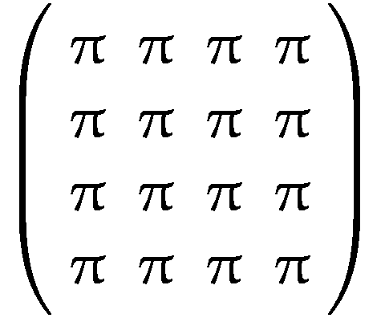

```
In[85]:= ConstantArray[\[Pi],{4,4}]//MatrixForm
Out[85]//MatrixForm=
```

稀疏排列是指其中元素通常具有相同值的排列。`SparseArray` 命令允许你定义数组位置的值。默认情况下，如果任何位置未定义，其值为 0。

`SparseArray` 命令生成一个 `SparseArray` 类型的对象，如图 2-2 所示，其中包含命令名称和一个出现的灰色框。

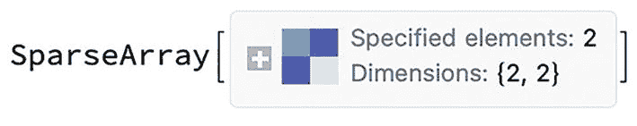

**图 2-2** `SparseArray` 对象

```
In[86]:= SparseArray[{{1,1},{2,2}}->{1,2}]
Out[86]=
```

如果你点击 `+` 图标，你会看到数组的特性及其规则；如图 2-3 所示。

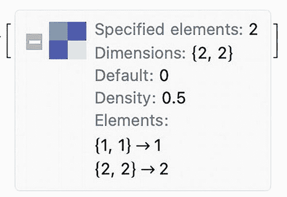

**图 2-3** 数组的规格

在 Wolfram 语言中，`SparseArray` 的内容没有限制。

此外，你可以创建一个在其对角线上具有相同值的数组。

图 2-4 说明了数组中相同值的元素以一种颜色显示，不同值的元素以另一种颜色显示。

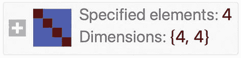

**图 2-4** 具有更多元素的稀疏数组

```
In[87]:= SpArray=SparseArray[{{1,1}->"A",{2,2}->"A",{3,3}->"A",{4,4}->"A"},{4,4}]
Out[87]=
```

借助 `MatrixForm`，你可以将排列可视化为一个矩阵。

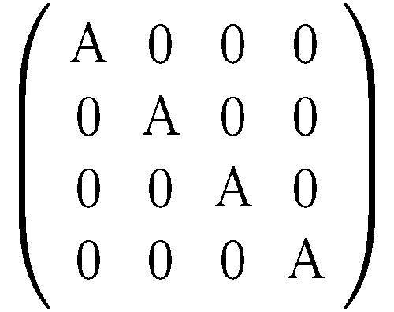

```
In[88]:= MatrixForm[%]
Out[88]//MatrixForm=
```

要将稀疏数组对象转换为列表对象，请使用 `Normal` 将其标准化为表达式形式。

```
In[89]:= Normal[SpArray]
Out[89]= {{A,0,0,0},{0,A,0,0},{0,0,A,0},{0,0,0,A}}
```

现在你处理的是一个列表。

```
In[90]:= Head[%]
Out[90]= List
```

### 嵌套列表

嵌套列表是一个列表的列表，其中列表的元素对应另一个列表，以此类推。嵌套列表可用于有序或无序的数据结构。要创建嵌套列表，可以在花括号内使用花括号，或使用内置函数。

```
In[91]:= {{"This","is","A"},{"Nested","List","."}}
Out[91]= {{This,is,A},{Nested,List,.}}
```

你也可以使用 `Table` 函数。

```
In[92]:= Table[Prime[i]+Prime[j],{i,1,3},{j,2,4}]
Out[92]= {{5,7,9},{6,8,10},{8,10,12}}
```

要测量一个列表，必须使用 `Length` 命令。

```
In[93]:= NestL=Table[Prime[i]+RandomReal[j],{i,1,3},{j,1,3}];
Length[NestL]
Out[93]= 3
```

列表的长度是 3，因为 `Length` 适用于扁平列表。要正确测量嵌套列表的深度，`Dimensions` 更适合此任务。

```
In[94]:= Dimensions[NestL]
Out[94]= {3,3}
```

`Dimensions` 提供了嵌套列表维度的整体信息，这意味着你的列表由三个子列表构成，且每个子列表各有三个元素。Mathematica 构建了一个包含三个元素的列表，这三个元素本身也是列表，这些列表各有三个元素，每个元素对应一个特定的值形式。

**注意：** 你可能想使用 `TreeForm` 来探索 Mathematica 如何处理嵌套列表表达式；例如，`TreeForm[NestL]`。

`ArrayDepth` 命令用于测量嵌套列表或数组的深度。

```
In[95]:= ArrayDepth[NestL]
Out[95]= 2
```

现在你通过编程方式知道 `NestL` 的深度为 2。

## 向量

Mathematica 处理向量的方式与处理列表相同。线性代数的常规计算可以是符号计算或数值计算。

```
In[96]:= V={6,3,2}
Out[96]= {6,3,2}
```

向量始终以列表形式显示。要以常规符号形式查看向量，可使用 `MatrixForm` 命令。

```
In[97]:= MatrixForm[V]
Out[97]//MatrixForm=
```

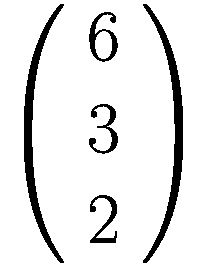

`VectorQ` 命令可以告诉你正在处理的列表是否为向量。

```
In[98]:= VectorQ[V]
Out[98]= True
```

要查看向量的秩，可以使用 `ArrayDepth` 或 `TensorRank`。

```
In[99]:= {TensorRank[V],ArrayDepth[V]}
Out[99]= {1,1}
```

向量使用与创建列表相同的命令创建：`Table`、`Array`、`Range`、花括号、`SparseArray`、`ConstantArray` 等。此外，向量的常见操作与普通列表相同。

```
In[100]:=
Print["加法: "ToString[V+V]]
Print["减法: "ToString[V-V]]
Print["标量积: "ToString[2*V]]
Print["叉积: "ToString[Cross[V,{1,3,2}]]]
Print["范数: "ToString[Norm[V]]]
加法: {12, 6, 4}
减法: {0, 0, 0}
标量积: {12, 6, 4}
叉积: {0, -10, 15}
范数: 7
```

## 矩阵

矩阵是一个方形的列表或列表的列表，按 n 行 m 列排列，其中 n 和 m 是矩阵的维度。


最简单的形式是创建一个列表的列表。

```
In[105]:= {{3,3,1},{7,8,7}}//MatrixForm
Out[105]//MatrixForm=
```

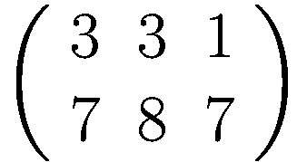

另一种方法是转到“插入” ➤ “表格/矩阵” ➤ “新建”。会弹出一个菜单；选择“矩阵”并在该菜单中指定行和列。使用此选项，你还可以指定填充内容和对角线，并添加网格或边框，如下一个示例所示，该示例在列之间绘制了线条。

`In[106]` 示例的内容在原文中缺失，根据上下文推断其为单位矩阵，故保持代码块原样。

```
In[106]:=
Out[106]:= {{1,0,0},{0,1,0},{0,0,1}}
```

要测试一个列表的列表是否为矩阵，请使用 `MatrixQ`。

```
In[107]:= MatrixQ[A]
Out[107]= True
```

`Transpose` 返回矩阵的转置——即将其行与列互换。对于矩阵 `A`，其转置记为 `A^(T)`。

```
In[108]:= Transpose[{{0,1,0},{0,1,0},{0,1,0}}]//MatrixForm
Out[108]//MatrixForm=
```

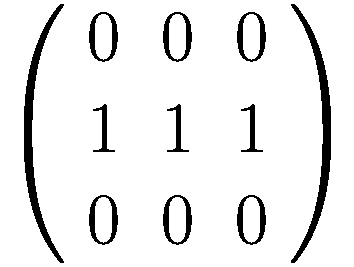

### 矩阵运算

矩阵之间的常见运算遵循线性代数规则：加法、减法和乘法。请记住，当两个矩阵 `A` 和 `B` 相乘时，`A` 的列数必须与 `B` 的行数匹配。用数学术语表示：`A`[`m` × `n`] × `B`[`n` × `l`] = `C`[`m` × `l`]。

```
In[109]:= B={{0,1,0},{0,1,0},{0,1,0}};
Print["加法: "ToString[A+B]]
Print["减法: "ToString[A-B]]
Print["乘积: "ToString[Dot[B,V]]]
加法: {{1, 1, 0}, {0, 2, 0}, {0, 1, 1}}
减法: {{1, -1, 0}, {0, 0, 0}, {0, -1, 1}}
乘积: {3, 3, 3}
```

要计算行列式，请使用 `Det`。

```
In[113]:= {Det[A],Det[B]}
Out[113]= {1,0}
```

要构造对角矩阵，请使用 `DiagonalMatrix` 命令；对于单位矩阵，请使用 `IdentityMatrix` 命令。`DiagonalMatrix` 用于自定义值，而 `IdentityMatrix` 返回一个对角线元素相同的矩阵。

```
In[114]:= DiagonalMatrix[{X,Y,Z}]//MatrixForm
IdentityMatrix[{2,2}]//MatrixForm(*2 乘 2 的单位矩阵*)
Out[114]//MatrixForm=
```

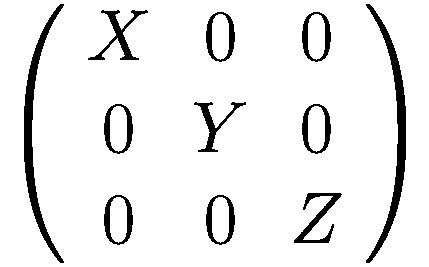

```
Out[115]//MatrixForm=
```

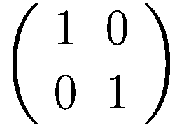

### 重构矩阵

矩阵重构使用与列表重构相同的命令，例如用新值替换元素。

```
In[116]:= ReplacePart[A,{{1,1},{2,2}}-> 3]//MatrixForm
Out[116]//MatrixForm=
```

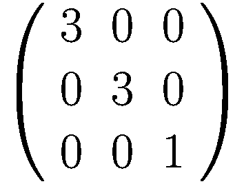

也可以通过赋值来完成。要访问矩阵的元素，请输入符号，后跟感兴趣元素的下标，并使用双括号表示法（`[[ ]]`）。稍后你将看到这种简写表示法的正确功能。在此例中，你更改了矩阵中位置 (1,1) 的元素的值。

```
In[117]:= A[[1,1]] = 2;
MatrixForm[A]
Out[118]//MatrixForm=
```


如果再次调用矩阵 `A`，新值会被保留。要反转一个方阵，请使用 `Inverse`。

```
In[119]:= Inverse[A]//MatrixForm
Out[119]//MatrixForm=
```

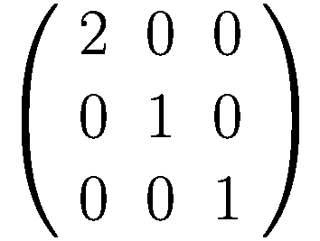

测量矩阵的维度使用 `Dimensions`。

```
In[120]:= Dimensions[A]
Out[120]= {3,3}
```

## 操作列表

上一节演示了创建列表的不同方法，包括数组、嵌套列表和表格。本节将介绍如何通过引用名称、函数和紧凑符号来操作这些列表。你将学习如何根据位置访问列表的数据，如何添加和删除列表中的元素，替换单个部分，以及更改特定元素的值。你还将研究在构建列表后如何重组列表、对其进行排序，以及根据嵌套深度将嵌套列表转换为线性列表。最后，本节将探讨如何通过模式查看列表中的数据，并研究 Wolfram 语言中的模式行为。

### 检索数据

存在多个用于处理列表元素的函数。`Part["list", i]` 函数允许你选择索引为 `i` 的列表部分。

**注意**

列表中的索引从 1 开始。索引 0 用于列表的头部。

例如，定义一个名为 `list1` 的列表，并使用 `Part` 访问列表内部的元素。`Part` 函数通过定义所需元素的位置来工作。

```
In[121]:= list1={1,2};
Part[{1,2},1]
Out[122]= 1
```

它也可以与索引符号一起使用。

```
In[123]:= {1,2}[[1]]
Out[123]= 1
```

列表可以通过其分配的名称进行完全引用。可以使用双中括号 `[[ i ]]` 符号或双括号的特殊字符符号 `⟦ ⟧` 来访问结构内部的元素。

**提示**

要输入双中括号字符，请键入 `Esc [[ Esc` 和 `Esc ]] Esc`。

```
In[124]:= list1[[1]] (*[[i]] 允许你访问列表中位置 i 的元素。*)
Out[124]= 1
```

**注意**

方括号（`[[ ]]`）是 `Part` 的简写符号。

要通过指定位置来访问列表的元素，可以使用跨度符号，即双分号（`;;`）。

```
In[125]:= list2=List[34,6,77,4,5,6];
Part[list2,1;;4] (*从第 1 项到第 4 项*)
Out[126]= {34,6,77,4}
```

你也可以使用反向索引，即从右向左计数，也就是从最后一个元素到第一个元素。现在选择从位置 –6 到 –4 的元素。

```
In[127]:= list2[[-6;;-4]]
Out[127]= {34,6,77}
```

对于嵌套列表，应用相同的过程。这个概念可以扩展到更一般的方面。下一个示例创建了一个具有三个级别的嵌套列表，并选择一个唯一元素。

```
In[128]:= list3=List[2³,2.72,{\[Beta],ex,{Total[1+2],"Plane"}}];
list3[[3,3,2]]
Out[129]= Plane
```

在前面的示例中，你创建了一个深度为三的嵌套列表。接着，你选择了列表 `{8, 2.72, {β, ex, {Total[1 + 2], "Plane"}}` 的第三个元素，然后从该列表中，选择了前一个列表的第三个元素，即 `{Total[1 + 2], "Plane"}`。最后，你选择了最后一个列表中第二个位置的元素，即 `"Plane"`。

如果你在处理嵌套列表，请使用你在跨度符号中看到的相同概念。下一个示例选择 `list3` 的第三个元素，然后显示从位置 1 到 2 的元素。

```
In[130]:= list3[[3,1;;2]]
Out[130]= {β, ex}
```

对于更深层的列表也是如此；你使用列表的第三个元素，然后显示从位置 3 到 3 的元素，并选择第 1 部分。

```
In[131]:= list3[[3,3;;3,1]]
Out[131]= {3}
```

可以根据你感兴趣的数据部分来显示数据段。例如，`Rest` 函数显示除第一个元素之外的所有数据元素。`Most` 显示除最后一个（或多个，取决于列表类型）元素之外的整个列表。

```
In[132]:= Rest[list3]
Out[132]= {2.72,{ β,ex,{3,Plane}}}
In[133]:= Most[list3]
Out[133]= {8,2.72}
```

前面函数的替代方案是 `Take` 函数，它允许你更广泛地选择列表中的数据。有三种可能的方式来实现这一点。

*   通过指定前 `i` 个元素

    ```
    In[134]:= Take[list3,2]
    Out[134]= {8,2.72}
    ```

*   通过指定最后 `-i` 个元素

    ```
    In[135]:= Take[list3,-1]
    Out[135]= {{ β,ex,{3,Plane}}}
    ```

*   通过选择从 `i` 到 `j` 的元素

    ```
    In[136]:= Take[list3,{1,3}]
    Out[136]= {8,2.72,{ β,ex,{3,Plane}}}
    ```

### 赋值或移除值

一旦建立了一个列表——如果你为它定义了一个名称——它就可以像任何其他类型一样使用。这意味着元素可以被其他元素替换。要更改一个或多个值，请选择项目的位置，然后设置新值。

```
In[137]:= list4={"Soccer","Basketball",0,9};
list4[[2]]=1 (*位置 2 对应字符串 Basketball，我们将其改为数字 1*)
Out[138]= 1
```

你可以检查新值是否已添加。

```
In[139]:= list4
Out[139]= {Soccer,1,0,9}
```

除了使用简写符号外，你还可以使用 `ReplacePart` 函数处理特定值，并选择列表、新元素和位置。

```
In[140]:= ReplacePart[list4,Exp[X],4]
Out[140]= Soccer, 1, 0, ⅇX
```

要添加新值，请使用 `PrependTo` 和 `AppendTo`；前者将值添加到列表的左侧，而后者将其添加到列表的右侧。`Append` 和 `Prepend` 的操作方式相同，但会将新值存储到原始变量中。

```
In[141]:= PrependTo[list4,"Blue"]
Out[141]= {Blue,Soccer,1,0,9}
In[142]:= AppendTo[list4,4]
Out[142]= {Blue,Soccer,1,0,9,4}
In[143]:= list4(*我们可以检查新值的添加情况。*)
Out[143]= {Blue,Soccer,1,0,9,4}
```

要移除列表中的值，请使用 `Drop`。`Drop` 可以按级别规范或要删除的元素数量来工作。

```
In[144]:= Drop[list4,3];(*前 3 个元素，Delete[list3,3]*)
Droplist4,{5}
Out[145]:= {Blue,Soccer,1,0,4}
```

`Delete` 命令也可以通过定义列表中的特定位置来完成此操作——例如，删除位置 1 和 5 的内容。

```
In[146]:= Delete[list4,{{1},{5}}]
Out[146]= {Soccer,1,0,4}
```

作为 `Append` 和 `Prepend` 的替代方案，还有 `Insert` 函数，你可以通过它添加元素，并指明新数据想要放置的位置。给定表达式（`list4`），在第三个位置插入新元素（`2/43.23`）。因此，数字 `2/43.23` 现在占据了列表的第三个槽位。

```
In[147]:= Insert[list4,2/43.23,3]
Out[147]= {Blue,Soccer,0.0462642,1,0,9,4}
```

`Insert` 函数允许同时使用多个位置；例如，在位置 –6（第二个）和 7（最后一个位置）插入数字 `0.023`。

```
In[148]:= Insert[list4,0.023,{{-6},{7}}]
Out[148]= {Blue,0.023,Soccer,1,0,9,4,0.023}
```

如果你想向列表或数组添加重复项或移除项，可以使用 `ArrayPad` 函数。如果未定义要添加的项，则标准值为零。

```
In[149]:= ArrayPadlist4,1
Out[149]= {0,Blue,Soccer,1,0,9,4,0}
```

如果你想添加单边项，写法如下。

```
In[150]:= ArrayPadlist4,{1,2}
Out[150]= {0,Blue,Soccer,1,0,9,4,0,0}
```

要添加非零值，必须将该值写在重复次数之后。

```
In[151]:= ArrayPadlist4,{0,3},"z"
Out[151]= {Blue,Soccer,1,0,9,4,z,z,z}
```

使用 `ArrayPad` 可以添加引用列表；例如，在左侧或右侧添加一个新的值列表。

```
In[152]:= newVal={0,1,4,9}; (*这里我们将它们添加到左侧*)
ArrayPad[list4,{4,0},newVal]
Out[153]= {4,9,0,1,Blue,Soccer,1,0,9,4}
```

`ArrayPad` 也可以使用负索引对称地从列表中移除元素。

```
In[154]:= ArrayPadlist4,-1
Out[154]= {Soccer,1,0,9}
```

**注意**

使用 `ArrayPad` 时，除非另有指定，否则添加和删除操作是对称的。

## 列表结构

在处理列表时，除了各种访问和删除内容的方式外，你可能还会遇到需要对列表进行整理、分段或限制的情况。以下探讨了几种实现这些任务的方法。

要按特定顺序对列表排序，请使用 `Sort` 后跟排序函数。

```
In[155]:= Sort[{1,12,2,43,24,553,65,3},Greater]
Out[155]= {553,65,43,24,12,3,2,1}
```

默认情况下，`Sort` 按从小到大的顺序对数值或文本进行排序。

```
In[156]:= Sort[{"b","c","zz","sa","t","p"}]
Out[156]= {b,c,p,sa,t,zz}
```

要反转列表，请使用 `Reverse` 命令。

```
In[157]:= Reverse[{1,12,2,43,24,553,65,3}]
Out[157]= {3,65,553,24,43,2,12,1}
```

除了之前看到的创建嵌套列表的方法外，你还可以通过重新排列列表元素来生成扁平列表的分区。例如，你可以创建列表的分区，将列表细分为若干对。

```
In[158]:= Partition[{1,12,2,43,24,553,65,3},2]
Out[158]= {{1,12},{2,43},{24,553},{65,3}}
```

你可以选择包含连续元素的分区。

```
In[159]:= Partition[{1,12,2,43,24,553},3,1]
Out[159]= {{1,12,2},{12,2,43},{2,43,24},{43,24,553}}
```

根据你想要的嵌套列表形式，你可以为分区添加偏移量；例如，每两个元素一组，偏移量为四。

```
In[160]:= Partition[{"b","c","zz","sa","t","p"},2,4]
Out[160]= {{b,c},{t,p}}
```

要恢复为扁平列表，请使用 `Flatten` 函数。

```
In[161]:= Flatten[{{1,12},{2,43},{24,553},{65,3}}]
Out[161]= {1,12,2,43,24,553,65,3}
```

根据列表的深度，你可以决定 `Flatten` 的展开深度。

```
In[162]:= Flatten[{{{{1},1},1},1},1] (*这里我们将列表展开到深度 1*)
Out[162]= {{{1},1},1,1}
```

`ArrayReshape` 函数允许你将数据重塑为特定的矩形数组；例如，创建一个 3×3 的数组。

```
In[163]:= ArrayReshape[{1,12,2,43,24,553,65,3},{3,3}]
Out[163]= {{1,12,2},{43,24,553},{65,3,0}}
```

用于补全数组形式的元素为零。下一个示例展示了如何使用 `ArrayReshape` 从列表中的一个元素创建 2×2 的数组。

```
In[164]:= ArrayReshape[{6},{2,2}]
Out[164]= {{6,0},{0,0}}
```

在处理嵌套列表时，也会用到 `SortBy`，但此时使用的不是排序函数，而是内置函数。例如，根据元素的近似值结果对列表进行排序。

```
In[165]:= SortBy[{1,4,553,12.52,4.3,24,7/11},N]
Out[165]= {7/11,1,4,4.3,12.52,24,553}
```

## 条件筛选

可以使用特定条件选择列表中的特定值；通过使用`Select`命令可以将条件应用于列表。该函数选择列表中符合所设定条件的元素；用于条件的函数可以是排序函数。

```
In[166]:= nmbrList=List[12,5,6,345,7,3,1,5];
Select[nmbrList,EvenQ] (*仅选择返回 True 的值，此处为偶数*)
Out[167]= {12,6}
```

`Pick`是`Select`的另一种替代方案。

```
In[168]:= Pick[nmbrList,PrimeQ @ nmbrList]
Out[168]= {5,7,3,5}
```

在 Wolfram 语言中，模式匹配用于判定给定的条件是否应与某个表达式相关联。在 Wolfram 语言的上下文中，存在三种不同类型的模式。

*   下划线符号 (`_`) 表示 Wolfram 语言中的任意表达式。
*   双下划线符号 (`__`) 表示包含一个或多个表达式的序列。
*   三下划线符号 (`___`) 表示包含零个或多个表达式的序列。

每个模式都有其内置的函数名称。一个下划线是 `Blank`，两个下划线是 `BlankSequence`，三个下划线是 `BlankNullSequence`。

为了更好地理解以下示例，你将使用 `Cases` 函数，该函数允许你选择与模式匹配的数据。

以下是一个数据对列表，你将在其中编写选择模式 (`_`)。

```
In[169]:= Cases[{{1,1},{1,2},{2,1},{2,2}},{_}]
Out[169]={}
```

它没有选择任何元素，因为它不具有列表模式的形式；例如，形式 `{a, b}`。现在，如果你更改此形状，你会看到它选择了所有与模式形状匹配的元素。

```
In[170]:= Cases[{{1,1},{1,2},{2,1},{2,2}},{_,_}]
Out[170]= {{1,1},{1,2},{2,1},{2,2}}
```

如果使用双下划线，也可以获得相同的结果。

```
In[171]:= Cases[{{1,1},{1,2},{2,1},{2,2}},{__}]
Out[171]= {{1,1},{1,2},{2,1},{2,2}}
```

以下示例展示了如何从包含数值和分类数据的列表中选择数据。你将使用 `RandomChoice` 函数，该函数从列表中随机选择。在此例中，是在单词 Red 或 Blue 之间进行随机选择。下一章将解释此随机函数在 Wolfram 语言中的工作原理。

```
In[172]:= SeedRandom[1234]; (*使用 SeedRandom[s] 确保以下示例中伪随机序列相同*)
tbl=Table[{i,j,k,RandomChoice[{"Red","Blue"}]},{i,1,3},{j,1,3},{k,1,3}]//TableForm
Out[173]//TableForm=
1 1 1 Blue       1 2 1 Red        1 3 1 Red
1 1 2 Blue       1 2 2 Red        1 3 2 Red
1 1 3 Blue       1 2 3 Red        1 3 3 Red
2 1 1 Blue       2 2 1 Blue       2 3 1 Blue
2 1 2 Blue       2 2 2 Red        2 3 2 Red
2 1 3 Red        2 2 3 Red        2 3 3 Blue
3 1 1 Blue       3 2 1 Red        3 3 1 Red
3 1 2 Red        3 2 2 Blue       3 3 2 Red
3 1 3 Blue       3 2 3 Red        3 3 3 Red
```

右侧的数字被命名为 Red 或 Blue。例如，你可以使用 `Cases` 来选择 Blue 或 Red 类别中的值。由于这是一个深度为四的嵌套列表，你必须指定 `Cases` 应搜索模式的层级 (`{4}`)。

```
In[174]:= Cases[tbl,{_,_,_,"Blue"},{4}]
Out[174]=
{{1,1,1,Blue},{1,1,2,Blue},
{1,1,3,Blue},{2,1,1,Blue},{2,1,2,Blue},
{2,2,1,Blue},{2,3,1,Blue},{2,3,3,Blue},
{3,1,1,Blue},{3,1,3,Blue},{3,2,2,Blue}}
```

此外，使用双下划线也可以获得相同的结果。仅使用数字 4，将在层级 1 到 4 中搜索。

```
In[175]:= Cases[tbl,{__,"Blue"},{4}]
Out[175]=
{{1,1,1,Blue},{1,1,2,Blue},
{1,1,3,Blue},{2,1,1,Blue},{2,1,2,Blue},
{2,2,1,Blue},{2,3,1,Blue},{2,3,3,Blue},
{3,1,1,Blue},{3,1,3,Blue},{3,2,2,Blue}}
```

你甚至可以统计 Blue 类别的数量。

```
In[176]:= Count[tbl,{__,"Blue"},{4}]
Out[176]= 11
```

`Count` 的工作形式如下：`Count["列表", 模式, 层级规格]`。

现在你已经了解了`underscore`函数，可以使用`Cases`函数来检查条件并筛选值。要附加条件，请使用形式`(/; "condition")`，其中符号`/;`后跟规则或模式，表示后续表达式是 Mathematica 中的条件或模式。在下一个示例中，`x_`表示任意元素`x`，在此处代表列表中的元素。然后应用条件`x > 5`。

```
In[177]:= Cases[nmbrList, x_ /; x > 5]
(*只选择大于 5 的值。*)
(*x 可以被任意符号替换，尝试使用 z_ 和 z > 5，结果应相同*)
Out[177]= {12, 6, 345, 7}
```

正如你在上一个示例中看到的，使用`_`意味着表达式`x_`必须应用于条件`> 5`，因为`_`表示任意表达式，即列表本身。

`Cases`还可以选择条件对于已建立模式或规则集为真的数据。下一个示例选择整数数据。模式对象由下划线或表达式规则表示。

```
In[178]:= mixList = {1., 1.2, "4", \[Pi], {"5.2", "Dog"}, 3, 66, {Orange, Red}};
Cases[mixList, _Integer]
(*我们现在选择整数类型的数字*)
Out[179]= {3, 66}
```

下划线可以应用于检查表达式头部（即整数）的模式。`Cases`会逐个比较每个元素，判断它们是否为整数。

至于条件匹配，如果模式的空白后跟问号（`?`）和测试函数，则输出为布尔值。

```
In[180]:= MatchQ[mixList, _?ListQ] (*我们测试 mixList 的头部是否为 List*)
Out[180]= True
```

你可以使用`Cases`指定层级。下一个示例选择字符串类型的元素；你写入`2`作为层级规格，因为`mixList`是一个包含两个子列表的嵌套列表。

```
In[181]:= Cases[mixList, _?StringQ, 2]
Out[181]= {4, 5.2, Dog}
```

你可以包含多个带有备选模式的模式。要测试不同的备选方案，请在模式之间放置竖线（`|`），形式为`"pattern1" | "pattern2" | "pattern3" | ...`。

```
In[182]:= Cases[mixList, _?NumberQ | _?String] (*我们选择数字和字符串*)
Out[182]= {1., 1.2, 3, 66}
```

## 总结

本章作为列表概念的入门，列表是 Mathematica 中使用的核心结构。它强调了列表的实用性，并介绍了独特的 Wolfram 语言语法。本章涵盖了可以表示为列表的各种对象类型。最后，介绍了基于数据需求操作列表的基本功能。