# 3. 处理数据与数据集

本章回顾了在 Wolfram 语言中处理数据和数据集的基础知识。首先介绍如何将函数应用于列表，然后介绍如何定义可在整个笔记本中使用的用户函数。接下来，你将学习如何使用 Wolfram 语言中一种强大的语法（称为纯函数）编写代码。自然地，你将深入探讨关联（Associations），解释如何将键与值关联，以及为什么它们对于在 Wolfram 语言中正确构建数据集至关重要。本章最后概述了关联如何作为分层数据表示的抽象结构。

## 列表操作

让我们看看如何对列表以及列表之间执行操作。这一点很重要，因为在大多数情况下，Mathematica 中的结果都可以视为列表。本节解释如何执行算术运算：加法、减法、乘法、除法和标量乘法。你还将学习如何使用`Map`和`Apply`将函数应用于列表。这些工具在处理线性列表和嵌套列表时非常有用，因为它们允许你指定函数应用的深度层级。本节还讨论了如何创建用户自定义函数、它们的语法、项分组、接收组以及像使用其他函数一样使用它们。它回顾了 Wolfram 语言的一个重要概念——纯函数，因为这些函数对于执行强大的任务和活动以及紧凑地编写代码非常重要。

### 列表的算术运算

本节讨论列表如何支持数字之间以及列表之间的不同算术运算。你可以对列表执行基本的算术运算，如加法、减法、乘法和除法。

#### 加法和减法

以下是加法和减法运算的示例。

```
In[1]:= List[1, 2, 3, 4, 5, 6] + 1
Out[1]= {2, 3, 4, 5, 6, 7}
In[2]:= List[1, 2, 3, 4, 5, 6] - 5
Out[2]= {-4, -3, -2, -1, 0, 1}
```

#### 除法和乘法

以下是除法和乘法运算的示例。

`In[3]:= List[1, 2, 3, 4, 5, 6] /` *π*

`Out[3]=` 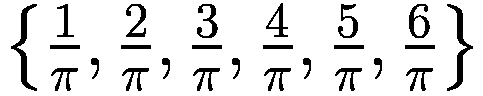

也可以执行标量乘法运算。

```
In[4]:= List[1, 2, 3, 4, 5, 6] * 2
Out[4]= {2, 4, 6, 8, 10, 12}
```

#### 幂运算

以下是使用幂运算的示例。

```
In[5]:= List[1, 2, 3, 4, 5, 6] ^ 3
Out[5]= {1, 8, 27, 64, 125, 216}
```

列表也支持列表之间的基本算术运算。

```
In[6]:= List[1, 2, 4, 5] - List[2, 3, 5, 6]
Out[6]= {-1, -1, -1, -1}
```

你也可以使用数学符号来执行运算。

`In[7]:=` 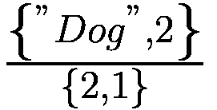

`Out[7]=` 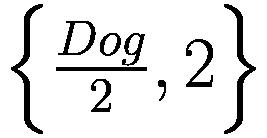

要在列表之间执行计算，列表的长度必须相同；否则，Mathematica 会返回一个错误，指出列表维度不同，如下例所示。

```
In[8]:= {1, 3, -1} + {-1}
During evaluation of In[8]:= Thread::tdlen: Objects of unequal length in {1,3,-1}+{-1} cannot be combined.
Out[8]= {-1} + {1, 3, -1}
```

#### 合并列表

要将一个列表与另一个列表合并——即连接两个列表——可以使用`Union`命令，它会合并列表的元素并将其显示为一个新列表。

```
In[9]:= Union[List["1", "v", "c"], {13, 4, 32}, List["adfs", 3, 1, "no"]]
Out[9]= {1, 3, 4, 13, 32, 1, adfs, c, no, v}
```

除了`Union`命令，还有`Intersection`命令，其功能类似于集合论中的交集。此命令允许你观察列表中的共同元素。

```
In[10]:= Intersection[{7, 4, 6, 8, 4, 7, 32, 2}, {123, 34, 6, 8, 5445, 8}]
Out[10]= {6, 8}
```

如你所见，这些列表仅共同拥有数字 6 和 8。


### 将函数应用于列表

函数可以简洁地应用于列表并实现自动化。最常用的函数是 `Map` 和 `Apply`。一种简写方式是使用符号 `@` 代替方括号 `[ ]`；`f@ "expr"` 等价于 `f[expr]`。

```
In[11]:= Max@{1,245.2,2,5,3,5,6.0,35.3}
Out[11]= 245.2
```

`Map` 具有以下形式：`Map[f, "expr"]`；另一种表示方式是使用符号 `@` 的简写记号。`f /@ "expr"` 和 `Map[f, "expr"]` 是等价的。该函数也支持嵌套列表。

```
In[12]:= Factorial/@List[1,2,3,4,5,6]
Out[12]= {1,2,6,24,120,720}
```

`Map` 可以应用于嵌套列表。

```
In[13]:= Map[Sqrt,{{1,2},{3,4}}]
Out[13]= {{1,Sqrt[2]},{Sqrt[3],2}}
```

`Map` 函数会应用于列表的每个元素。`Map` 也可以处理嵌套列表，如上一个示例所示。下一个示例使用 `Table` 创建了一个包含 10 个元素的列表。这些元素是 0 到 1 之间的随机数，然后你映射一个函数将它们转换为字符串表达式。

```
In[14]:= data=Range[RandomReal[{0,1}],10];(*列表*)
ToString/@data (*映射函数以转换为字符串*)
Head/@% (*检查每个元素的数据类型*)
Out[15]= {0.526418,1.52642,2.52642,3.52642,4.52642,5.52642,6.52642,7.52642,8.52642,9.52642}
Out[16]= {String,String,String,String,String,String,String,String,String,String}
```

让我们看看如何使用附加函数将函数应用于列表。`Apply` 的形式为 `Apply[f, "expr"]`，其简写记号为 `f @@ "expr"`。

```
In[17]:= ApplyPlus,data
Out[17]= 50.2642
In[18]:= Plus@@data
Out[18]= 50.2642
```

此外，命令可以在同一行代码中应用于列表，这在处理大型列表时非常有用。例如，如果你想了解某个元素是否满足条件，无需逐个检查每个值，可以将元素收集到一个列表中，然后针对指定条件进行测试。

```
In[19]:= primelist=Range[100];Map[PrimeQ,primelist]
Out[19]= {False,True,True,False,True,False,True,False,False,False,True,False,True,False,False,False,True,False,True,False,False,False,True,False,False,False,False,False,True,False,True,False,False,False,False,False,True,False,False,False,True,False,True,False,False,False,True,False,False,False,False,False,True,False,False,False,False,False,True,False,True,False,False,False,False,False,True,False,False,False,True,False,True,False,False,False,False,False,True,False,False,False,True,False,False,False,False,False,True,False,False,False,False,False,False,False,True,False,False,False}
```

上一个示例创建了一个从 1 到 100 的列表，然后使用 `PrimeQ` 函数测试哪些数字满足质数条件。其他函数可用于测试数字和字符串的不同条件。此外，还可以使用更具体的函数来测试列表中的逻辑关系（`MemberQ`、`SubsetQ`）。

### 定义自己的函数

可以编写用户函数来执行重复性任务并减小程序规模。将代码分割成函数，可以创建执行特定任务的代码片段。函数在调用时可以通过参数从外部接收数据，并返回一个固定的结果。

可以使用 Set 或 SetDelayed 符号定义函数，但请记住，使用 Set 符号会将结果赋值给定义。要定义一个函数，首先编写名称或符号，后跟引用变量和下划线。与通常情况一样，下划线告诉 Mathematica 你正在处理一个虚拟变量。警告：定义的函数名称字母之间不能有空格。函数也可以接收多个参数。

```
In[20]:=  MyF[z_]:=12+2+z;MyF2[x_,z_]:=z/x
```

现在，你可以使用不同的 `z` 值调用该函数。

`In[21]:= List[MyF[1],MyF[324],MyF[5432],MyF2[154,1],MyF2[14,4],MyF2[6,9]]`

`Out[21]=` 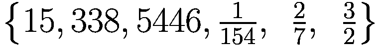

此外，另一种编写函数的方法是编写复合函数。这个概念类似于复合表达式；不同类别的表达式被写在定义内部。每个计算可以以分号结束，也可以不以分号结束。以下示例展示了这个概念。

```
In[22]:= StatsFun[myList_]:={Max@myList,Min@myList,Mean@myList,Median@myList,Quantile@@{myList,1}(*25%分位数*)(*要使用简写记号编写具有多个参数的函数，请使用花括号*)}
```

你也可以将一个列表作为参数发送。

```
In[23]:= myList=Table[m-2,{m,-2,10}];
StatsFun[myList]
Out[24]= {8,-4,2,2,8}
```

你可以在一个函数内执行多个操作，并可以选择为参数创建需要满足的条件。要编写条件，请使用短横线和分号（`/;`）符号。当条件为真时，函数被求值；否则，如果条件不为真，函数不被求值。复合函数需要分组；否则，Mathematica 会将它们视为位于整个函数体之外。

下一个示例创建了一个函数，用于判断任意字符串是否为回文（即单词正反写都一样）。

```
In[25]:= PalindromeWord[string_/;StringQ@string==True]:=(*我们可以检查输入是否真的是字符串*)
(ReverseWord=StringJoin[Reverse[Characters[string]]];
(*这里我们将字符分开，反转列表，然后将它们连接成一个字符串*)
ReverseWord==string (*然后我们测试该单词是否为回文，整个函数的输出将为 True 或 False*))
```

让我们测试这个新函数。

```
In[26]:= PalindromeWord/@{"hello","room","jhon","kayak","civic","radar"}
Out[26]= {False,False,False,True,True,True}
```

当你在复合函数或函数中有局部赋值时，所使用的符号仍然会被赋值，因此如果在函数外部调用这些符号，可能会导致编码错误。需要考虑的一点是，当函数不再使用时，你可以清除该函数和局部符号。仅清除函数名不会移除局部赋值。另一种解决方案是在模块内部声明变量，因为变量仅被局部处理，如下所示。

```
In[27]:= MyFunction[a0_,b0_]:=Module{m=a0,n=b0},(*局部变量*)m+n (*模块主体*)
In[28]:= Clear[MyF,MyF2,StatsFun,PalindromeWord,ReverseWord] (*移除函数和局部符号的标签名称*)
```


## 纯函数

纯函数，也称为匿名函数，是 Wolfram 语言的一项强大特性。它允许在不引用名称的情况下执行函数，并可显式地赋值给某个操作。纯函数中的参数用井号（`#`）表示。要引用特定参数，请在井号后附加数字（例如，`#1`、`#2`、`#3`……分别代表第一个、第二个、第三个……参数）。在定义末尾使用与号（`&`）来表示使用了井号引用。纯函数可以使用 `Function` 关键字构建，也可以使用井号和与号的简写符号。

```
In[29]:= Function[#^-1][z]==#^-1&[z]
#^-1&[z] (*两个表达式都表示 1/z*)
Out[29]= True
Out[30]= 1/z
```

纯函数的一些示例如下。

```
In[31]:= {#^-1&[77],#1+#2-#3&[x,y,z] (*我们可以想象 #1、#2、#3 分别是第一个、第二个和第三个变量*),Power[E,#]&[3]}
Out[31]= {1/77,x+y-z,E³}
```

你可以将纯函数与 `Map` 和 `Apply` 结合使用，将列表中的每个参数传递给特定函数。`#` 代表列表中的每个元素，而 `&` 表示 `#` 已被填充并针对列表中的元素进行测试。

```
In[32]:= N[#]&/@ {1,1,1,12,3,1}
Sqrt[#]&/@{-1,2,4,16}
Out[32]= {1.,1.,1.,12.,3.,1.}
Out[33]= {I,Sqrt[2],2,4}
```

使用 `Apply` 和纯函数可以使代码编写得更紧凑，如下例所示。你可以选择大于 10 的数字。

```
In[34]:= Select@@{{1,22,41,7,62,21},#>10&}
Out[34]= {22,41,62,21}
```

## 索引表

你可以创建表格并以表格形式显示结果，从而快速观察和管理一组相关数据，这引出了如何在 Wolfram 语言中创建表格，例如为列添加标题和为行命名。本节将提供一系列示例，帮助你掌握使用表格的基本要点，以便你能恰当地展示数据。

### 使用 Wolfram 语言创建表格

表格通过嵌套列表创建，这些列表使用 `TableForm` 显示。

```
In[35]:= table1={{"Dog","Wolf"},{"Cat","Leopard"},{"Pigeon","Shark"}};
TableForm[table1]
Out[36]//TableForm=
Dog     Wolf
Cat     Leopard
Pigeon  Shark
```

`TableForm` 的格式为 `["list", options]`。格式化选项允许你以三种方式对齐表格列：左对齐、居中和右对齐。在下一个示例中，表格内容居中对齐。

```
In[37]:= TableForm[table1,TableAlignments\[RightArrow]Right]
Out[37]//TableForm=
Dog     Wolf
Cat     Leopard
Pigeon  Shark
```

可以使用 `TableHeadings` 选项命令添加标题，并指定是显示行标签和列标签，还是仅显示其中之一。选择 `Automatic` 选项会为行和列提供索引标签。请记住在引号内写入字符串，或使用 `ToString`。

```
In[38]:= TableForm[table1,TableHeadings->{{"Row 1","Row 2","Row 3"},{"Column 1","Column 2"}}]
Out[38]//TableForm=
| Column 1  Column 2
_______|___________________
Row 1  | Dog       Wolf
Row 2  | Cat       Leopard
Row 3  | Pigeon    Shark
```

可以使用所需的名称自定义带标签的行和列。

```
In[39]:= colname={"Domestic Animals","Wild Animals"};
rowname={"Animal 1","Animal 2","Animal 3"};
TableForm[table1,TableHeadings->{rowname,colname}]
Out[41]//TableForm=
| Domestic Animals   Wild Animals
_______|_________________________________
Row 1  | Dog                Wolf
Row 2  | Cat                Leopard
Row 3  | Pigeon             Shark
```

同样的概念也适用于仅标记列或行，只需在行或列选项处输入 `None` 即可。

```
In[42]:= TableForm[table1,TableHeadings->{None,{"Domestic Animals","Wild Animals"}}]
Out[42]//TableForm=
Domestic Animals   Wild Animals
________________________________
Dog                Wolf
Cat                Leopard
Pigeon             Shark
```

可以使用 `Table` 和 `Range` 创建自动化的表格形式。通过在 `TableHeadings` 中应用 `Automatic` 选项，可以为数据创建索引标签。

```
In[43]:=tabData={Table[i,{i,7}],Table[5^i,{i,7}]};TableForm[tabData,TableHeadings->Automatic]
Out[43]//TableForm=
| 1  2   3    4    5     6      7
_ |_____________________________________
1 | 1  2   3    4    5     6      7
2 | 5  25  125  625  3125  15625  78125
```

出于展示原因，表格也可以进行转置。

```
In[44]:= TableForm[Transpose[tabData],TableHeadings->Automatic]
Out[44]//TableForm=
| 1  2
_ |_______
1 | 1  2
2 | 2  25
3 | 3  125
4 | 4  625
5 | 5  3125
6 | 6  15625
7 | 7  78125
```

另一个有用的工具是 `Grid`，它以表格格式显示列表或嵌套列表。与 `TableForm` 一样，`Grid` 也可以进行自定义以更恰当地展示数据。

注意

`Grid` 适用于任何表达式。

```
In[45]:= tabData2=Table[{i,Exp[i],N@Exp[i]},{i,7}];
Grid[tabData2]
Out[46]=
i    Expi    Numeric approx.
1    e    2.71828
2    e2    7.38906
3    e3    20.0855
4    e4    54.5982
5    e5    148.413
6    e6    403.429
7    e7    1096.63
```

要添加表头，请将它们作为字符串插入到原始列表的第一个位置。

```
In[47]:= Grid[Insert[tabData2,{"i","Expi","Numeric approx."},1]]
Out[47]=
i    Expi    Numeric approx.
1    e    2.71828
2    e2    7.38906
3    e3    20.0855
4    e4    54.5982
5    e5    148.413
6    e6    403.429
7    e7    1096.63
```

你也可以添加分隔线和间距。使用 `Dividers` 和 `Spacing`，你可以分隔或设置 y 轴和 x 轴的间距。

```
In[48]:= Grid[Insert[tabData2,{"i","Expi","Numeric approx."},1],Dividers->{All,False},Spacings->{1,1}]
Out[48]=
| i | Expi | Numeric approx.
| 1 | e     | 2.71828
| 2 | e2   | 7.38906
| 3 | e3   | 20.0855
| 4 | e4   | 54.5982
| 5 | e5   | 148.413
| 6 | e6   | 403.429
| 7 | e7   | 1096.63
```

可以使用 `Background` 选项添加背景。此选项允许对表格或列表格的特定部分进行着色。

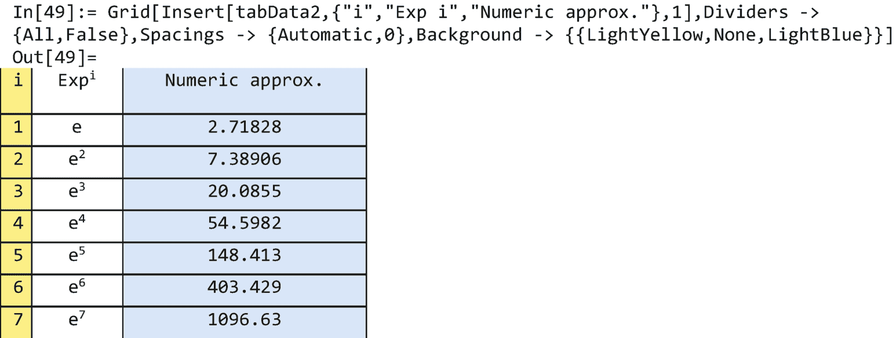

一个表格包含以下数据：表达式、数值近似值、i 值。顶部有三行代码片段。


## 关联

关联是开发 Wolfram 语言的基础；关联用于索引列表或其他表达式，并创建更复杂的数据结构。与许多其他编程语言中的字典类似，关联是一种更具结构性的构造，允许你提供创建键值对的过程。稍后你将看到，它们在处理 Wolfram 语言中的数据集时非常重要。

关联的形式为 `Association["key_1" → val_1, key_2 → val_2 ...]` 或 `<| "key_1" → "val_1", "key_2" → "val_2" ... |>`；它们将键与值关联起来。键和值可以是任何表达式。`Association` 命令用于构造关联，或者你也可以使用符号输入 `<| --- |>`。

`In[50]:= Associt=<|1->"a",2->"b",3->"c"|> (*等同于 Association[a\[RightArrow]"a",b\[RightArrow]"b",c\[RightArrow]"c"]*)`

`Associt2=Association[dog->"23","score"->\[Pi]*\[Pi],2*2->Sin[23 Degree]]`

`Out[50]=` < ∣ 1 → *a*, 2 → *b*, 3 → *c* ∣ >

`Out[51]=` < ∣ *dog* → 23, *score* → *π*², 4 → *Sin*[23°] ∣ >

关联中的条目是有序的，因此可以根据值的键或条目在关联中的位置来访问数据，就像列表一样。位置与值（条目的位置）相关联，而不是与键相关联，因为键的顺序并不总是保持不变。

```
In[52]:= Associt1
Associt2[[2]] (*这是键 2 的位置，即 π2 *)
Out[52]= a
Out[53]= π2
```

如后一个示例所示，位置与值相关联，而不是与键相关联。因此，如果你想显示关联的部分内容，请使用分号。

```
In[54]:= Associt[[1;;2]]
Associt2[[2;;2]]
Out[54]= 
Out[55]= 
```

可以使用 `Keys` 和 `Values` 命令提取值和键。

```
In[56]:= Keys@Associt2
Values@Associt2
Out[56]= {dog, score, 4}
Out[57]= {23, π2,Sin[23 °]}
```

如果你请求一个没有正确引用的键，将会收到错误提示。

```
In[58]:= Associt"a"
Out[58]= Missing[KeyAbsent,a]
```

关联也可以是关联。下一个示例展示了如何关联关联，从而生成一个关联的关联。这个概念是理解 Wolfram 语言中数据集如何工作的基础。

`In[59]:= Association[Associt,Associt2]`

`Out[59]= <|` 1 → *a*, 2 → *b*, 3 → *c*, *dog* → 23, *score* → *π*², 4 → *Sin*[23°] `|>`

你还可以使用 `AssociationThread` 创建与列表不同的关联。键对应第一个参数，值对应第二个参数。`AssociationThread` 将键列表与值列表进行线程化处理，形式如下：`< | {"key_1", "key_2", "key_3" ...} → {"val_1", "val_2", "val_3" ... } | >`。后一种形式可以看作是一个键列表标记一个值列表。当你定义了键和值的列表后，该命令可以将一个列表与另一个列表关联起来。你还可以创建一个关联列表，将键作为行和列来读取。

`In[60]:=AssociationThread[{"class","age","gender","survived"},{"Economy",29,"female",True}]`

`Out[60]= <|` *class* → *Economy*, *age* → 29, *gender* → *female*, *survived* → *True* `|>`

你可以构造键和值的列表。

```
In[61]:= keys={"class","age","gender","boarded"};
values={"Economy",29,"female",True};
AssociationThread@@{keys,values}
Out[63]= 
```

可以使用关联创建更复杂的结构。例如，下一个关联基于一辆跑车的信息创建了一个数据结构，包含型号名称、发动机、功率、扭矩、加速时间和最高速度。

```
In[64]:= Association@{"Model name" -> "Koenigsegg CCX",
"Engine" -> "Twin supercharged V8",
"Power" -> "806 hp",
"Torque" -> "5550 rpm",
"Acceleration 0-100 km/h" -> "3.2 sec",
"Top speed" -> "395 Km/h"}
Out[64]= 
```

你可以看到标签及其元素是如何以分组方式创建的。此外，它还展示了花括号如何标记每一行可以如何排列键/值对。

## 数据集格式

关联是创建结构化数据形式的重要组成部分。Wolfram 语言中的数据集通过提供一种访问数据集内部数据的方法，提供了一种组织和展示分层数据的方式。本节通过示例展示了如何将列表、嵌套列表和关联转换为数据集。还涵盖了如何添加值、访问数据集中的值、删除和移除值、对数据集应用映射函数、处理重复数据以及按行或列应用函数。


### 构建数据集

`Datasets` 用于构建分层数据框架，其中列表、关联和嵌套列表具有顺序。`Datasets` 有助于以易于访问的结构化格式展示大量数据。`Datasets` 能以清晰的格式显示包含行标题、列标题和编号元素的嵌套结构。将数据作为`dataset`，可以让你从多种角度查看数据。

`Datasets` 可以通过四种形式构建。

- 列表的列表；一个没有行和列标签的表格
- 关联的列表，一个带有列标签的表格；一个具有重复键和不同或相同值的表格
- 列表的关联，一个带有行标签的表格；一个具有不同键和不同或相同值的表格
- 关联的关联；一个带有行和列标签的表格

创建新`dataset`最常见的形式是使用列表的列表。使用`Dataset`函数在花括号`{}`内创建一个列表。每个花括号代表表格的一部分。图 3-1 展示了`Dataset`函数的输出。

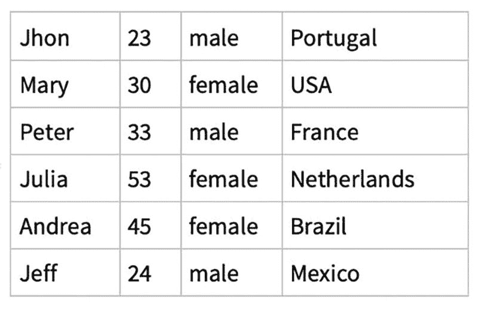

一个四列六行的表格。第 1 行：Jhon，23，男，葡萄牙。第 2 行：Mary，30，女，美国。第 3 行：Peter，33，男，法国。第 4 行：Julia，53，女，荷兰。第 5 行：Andrea，45，女，巴西。第 6 行：Jeff，24，男，墨西哥。

**图 3-1** 由输入代码创建的 Dataset 对象

```
In[65]:= Dataset@{{"Jhon",23,"male","Portugal"},{"Mary",30,"female","USA"},{"Peter",33,"male","France"},{"Julia",53,"female","Netherlands"},{"Andrea",45,"female","Brazil"},{"Jeff",24,"male","Mexico"}}
Out[65]=
```

将鼠标光标悬停在数据集的元素上，可以在左下角看到它们的位置。名称 France 对应第 3 行第 4 列。数据集的表示法是先行后列。如果你有列标签、行标签或两者都有，你会看到列名和行名，而不是数字。

使用关联列表构建数据集时，首先创建具有重复键的关联，然后将它们包含在一个列表中。首先，创建关联；重复的键指定每个列标题。值代表列的内容。数据集具有`Dataset`的头表达式。

```
In[66]:=
Dataset@{
"Jhon","Age"->23,"Gender"->"male","Country"->"Portugal"|>,
"Mary","Age"->30,"Gender"->"female","Country"->"USA"|>,
"Peter","Age"->33,"Gender"->"male","Country"->"France"|>,
"Julia","Age"->53,"Gender"->"female","Country"->"Netherlands"|>,
"Andrea","Age"->45,"Gender"->"female","Country"->"Brazil" |>,
 "Jeff", "Age" -> 24, "Gender" -> "male", "Country" -> "Mexico" |>}(*Head @ % *)
Out[66]=
```

如图 3-2 所示，Mathematica 识别出 Name、Age、Gender 和 Country 是列标题，这就是为什么框的颜色不同。

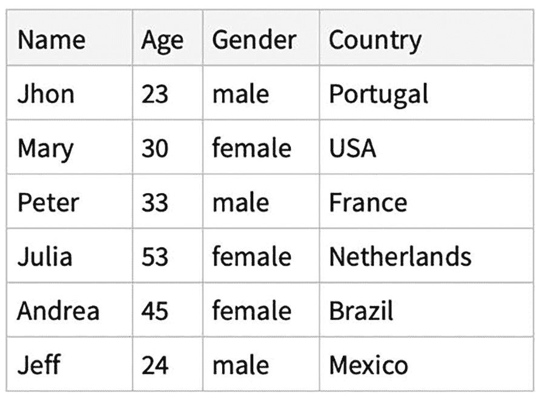

一个四列六行的表格。列标题是 name、age、gender 和 country。第 1 行：Jhon，23，男，葡萄牙。第 2 行：Mary，30，女，美国。第 3 行：Peter，33，男，法国。第 4 行：Julia，53，女，荷兰。第 5 行：Andrea，45，女，巴西。第 6 行：Jeff，24，男，墨西哥。

**图 3-2** 带有列标题的数据集

当光标经过列标签时，它们会以蓝色高亮显示，因此可以点击标签的名称，然后它只会产生选定的标签，而不是整个数据集，如图 3-3 所示。

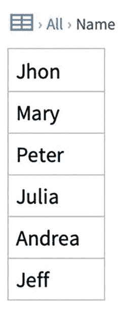

一个一列六行的表格。在数据集中选择了列名。它列出了 Jhon、Mary、Peter、Julia、Andrea、Jeff。

**图 3-3** 在数据集中选中的列名

发生这种情况时，列的名称也会出现。要返回整个数据集，请点击左上角的电子表格图标  或名称 All。这种布局在处理大量行和列，并且只想关注数据集的几个部分时非常实用。

在列表的关联中，键代表行的标签，值是行元素的列表；然后，你将整个块关联起来。下一个代码块生成一个列表的关联。

**注意：** 这里也是如此。无论何时点击行的名称，它只会显示该行。

```
In[67]:=  Dataset@
{"Jhon",23,"male","Portugal"},
"Subject B"->{"Mary",30,"female","USA"},
"Subject C"->{"Peter",33,"male","France"},
"Subject D"->{"Julia",53,"female","Netherlands"},
"Subject E"->{"Andrea",45,"female","Brazil"},
"Subject F"->{"Jeff",24,"male","Mexico"}|>
Out[67]=
```

如图 3-4 所示，现在行已被标记。

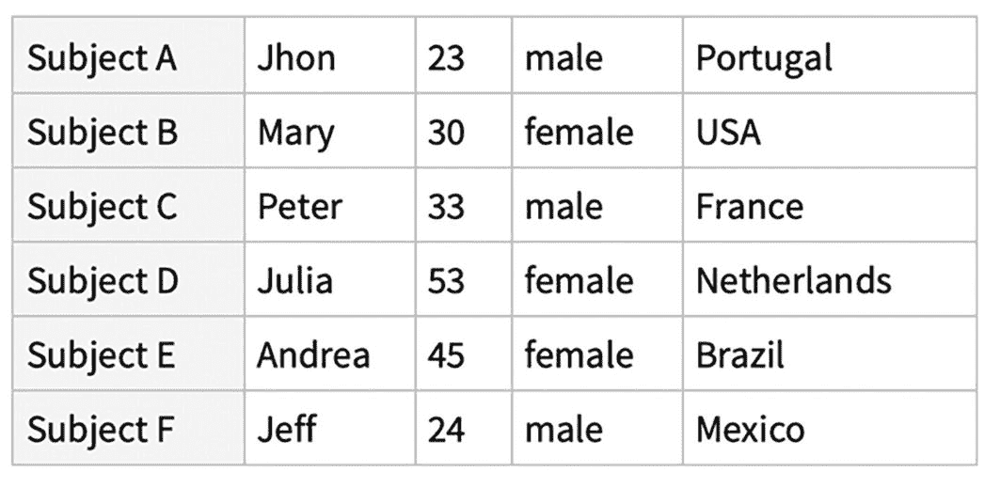

一个 5 列 6 行的表格。第 1 行：Subject A，Jhon，23，男，葡萄牙。第 2 行：Subject B，Mary，30，女，美国。第 3 行：Subject C，Peter，33，男，法国。第 4 行：Subject D，Julia，53，女，荷兰。第 5 行：Subject E，Andrea，45，女，巴西。第 6 行：Subject F，Jeff，24，男，墨西哥。

**图 3-4** 带有行标签的数据集

行标签被识别并显示在颜色框中。当选择行的标签时，它只显示该行，如图 3-5 所示。

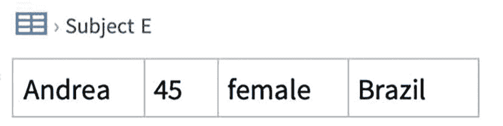

一个四列一行的表格。顶部有电子表格图标，其中选择了 Subject E。它显示：Subject E，Andrea，45，女，巴西。

**图 3-5** 选中的 Subject E 行

在关联的关联中，关联的关联的重复键是列标签和数据集的数值。在第二个关联中，键是行的标签，第一个关联是第二个关联的值。下一个例子阐明了这一点。

```
In[68]:= Dataset@
"Jhon","Age"->23,"Gender"->"male","Country"->"Portugal"|>,"Subject B"->"Mary","Age"->30,"Gender"->"female","Country"->"USA"|>,"Subject C"->"Peter","Age"->33,"Gender"->"male","Country"->"France"|>,
"Subject D"->"Julia","Age"->53,"Gender"->"female","Country"->"Netherlands"|>,"Subject E"->"Andrea","Age"->45,"Gender"->"female","Country"->"Brazil"|>,"Subject F"->"Jeff","Age"->24,"Gender"->"male","Country"->"Mexico"|>|>
Out[68]=
```

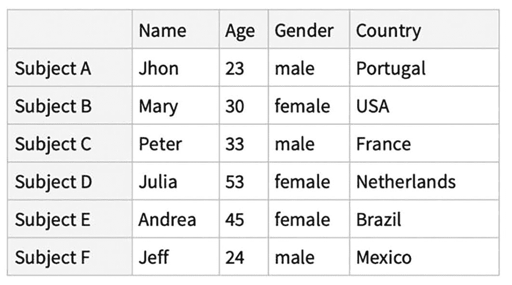

一个五列六行的表格。列标题是 name、age、gender 和 country。行标题是 subject A、subject B、subject C、subject D、subject E 和 subject F。

**图 3-6** 行和列都有名称的数据集

如图 3-6 所示，现在行和列都被标记了。与前面的例子一样，列和行标签被识别并显示在颜色框中。当选择行或列的标签时，它只显示该行或列，如图 3-7 所示。

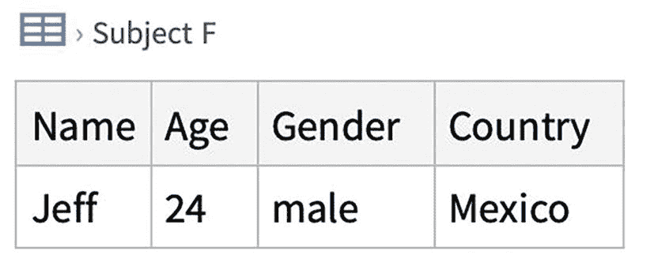

一个四列一行的表格。列标题是 name、age、gender 和 country。顶部有电子表格图标，其中选择了 Subject F。它显示：Jeff，24，男，墨西哥。

**图 3-7** 仅选中一行

如果你只选择一个特定的值，那么只会显示该值。图 3-8 展示了其形式。

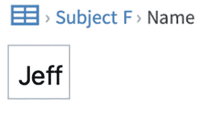

一个单元格。顶部有电子表格图标，其中在 Subject F 下选择了 name。它显示：Jeff。

**图 3-8** Subject F 的 Name


从关联的关联创建数据集最适合紧凑型数据集，因为有时提取值和键会变得混乱。然而，最好的方法是适合你的方法。

### 访问数据集中的数据

`Mathematica`为每个元素分配一个唯一的索引；因此，如果你有兴趣从数据集中选择数据，请为数据集分配一个符号，然后以下一种形式指定每个输出。参数的第一和第二位置代表行和列 [第 n 行，第 m 列]。因此，要基于列名或一组列提取数据，请将列括在括号中。你也可以使用双括号表示法。如果只接收一个参数，则它仅代表行。首先，让我们创建数据集。

```
In[69]:= Dst = Dataset@{
   "Jhon", "Age" -> 23, "Gender" -> "male", "Country" -> "Portugal" |> ,
   "Mary", "Age" -> 30, "Gender" -> "female", "Country" -> "USA" |> ,
   "Peter", "Age" -> 33, "Gender" -> "male", "Country" -> "France" |> ,
   "Julia", "Age" -> 53, "Gender" -> "female", "Country" -> "Netherlands" |> ,
   "Andrea", "Age" -> 45, "Gender" -> "female", "Country" -> "Brazil" |> ,
   "Jeff", "Age" -> 24, "Gender" -> "male", "Country" -> "Mexico" |> };
```

符号`[[ ]]`与双括号的特殊字符（`⟦ ⟧`）作用相同。此外，你可以使用值的特定键来选择数据，如图 3-9 所示。

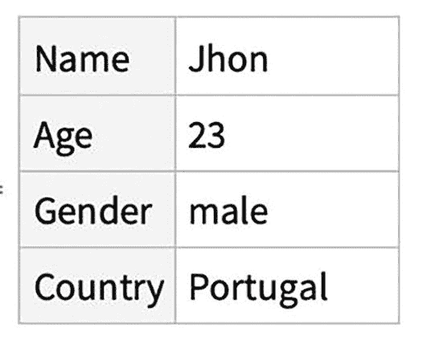

一个两列四行的表格。行标题是姓名、年龄、性别和国家。内容为：Jhon, 23, male, Portugal。

**图 3-9**

`Dst`的第 1 行

```
In[70]:= Dst[[1, 2]] (*这是第 1 行，第 2 列*)
Dst[1] (*第 1 行*)
Out[70]= 23
Out[71]=
```

让我们看看下面的内容以及图 3-10。

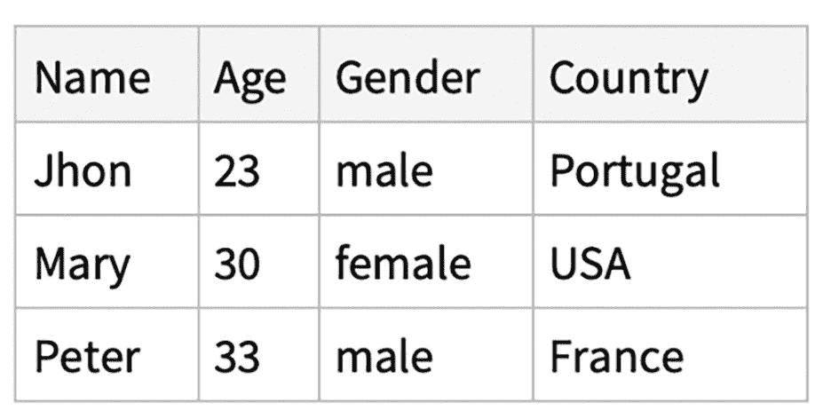

一个四列四行的表格。列标题是姓名、年龄、性别和国家。第 1 行：Jhon, 23, male, Portugal。第 2 行：Mary, 30, female, USA。第 3 行：Peter, 33, male, France。

**图 3-10**

第 1 到 3 行以及第 1 到 3 列的值

```
In[72]:= Dst[1 ;; 3] (*要操作列的数据，请尝试 Dst[1;;3,1;;3]*)
Out[72]=
```

此案例选择了从位置 1 到 3 的数据，即从 John 到 Peter。同样的方法适用于列。

你还可以显示特定的列，并保留所有固定行及其键。当每一行都有标签时，应用相同的过程。输入`All`表示列或行中的所有元素。输出如图 3-11 所示。

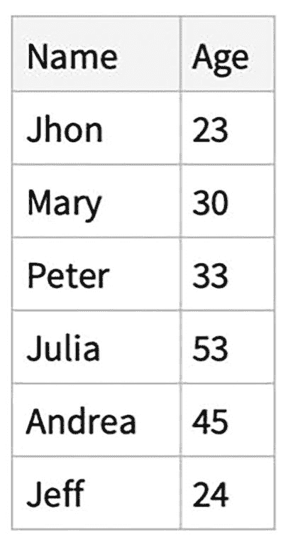

一个两列六行的表格。列标题是姓名和年龄。第 1 行：Jhon, 23。第 2 行：Mary, 30。第 3 行：Peter, 33。第 4 行：Julia, 53。第 5 行：Andrea, 45。第 6 行：Jeff, 24。

**图 3-11**

姓名和年龄列的值

```
In[73]:= Dst[All, {"Name", "Age"}] (*如果添加了多个列标签，则将标签用花括号括起来。*)
Out[73]=
```

或者，你可以将列或行提取为列表，以便在 Wolfram 语言中更好地操作它们。为此，你需要使用`Normal`函数和`Values`命令。请记住，你正在处理关联，因此如果你想要值，请使用`Values`命令，然后使用`Normal`将其转换为普通表达式。

```
In[74]:= Normal@Values@Dst[All, {"Name", "Age"}] (*姓名和年龄列的值*)
Out[74]= {{Jhon, 23}, {Mary, 30}, {Peter, 33}, {Julia, 53}, {Andrea, 45}, {Jeff, 24}}
```

行的概念相同：如果它们有标签，你可以使用它们。

```
In[75]:= Normal@Values@Dst[[1, All]]
Out[75]= {Jhon, 23, male, Portugal}
```

如果你先执行`Normal`再执行`Values`，结果相同。

```
In[76]:= Values@Normal@Dst[[1, All]]
Out[76]= {Jhon, 23, male, Portugal}
```

另一个可以使用的函数是`Query`，它是一个专门用于数据集的函数。查询必须应用于数据集的符号或直接应用于数据集。查询很有用，因为它们允许轻松选择值；你可以提取行或列并获取单个记录。

```
In[77]:= Query[All, "Country"]@Dst
Query[3]@%
Out[77]=
```

图 3-12 显示你可以使用`Query`提取列和值。

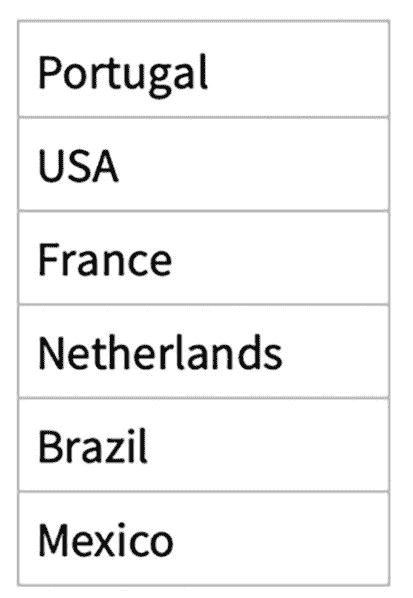

一个一列六行的表格。它列出了以下内容：Portugal, USA, France, Netherlands, Brazil, Mexico。

**图 3-12**

国家值

```
Out[78]= France
```

另一个更直观的函数是`Take`，你可以在其中指定数据集的符号，然后指定要显示的行数和列数。`Take`在处理大型数据集时非常有用，并且你只想查看数据的特定部分。

```
In[79]:= Take[Dst, 2] (*前 2 行*)
(*Take[Dst,3,3] 前 3 行和 3 列*)
Out[79]=
```

图 3-13 显示你可以使用`Take`作为替代方法。

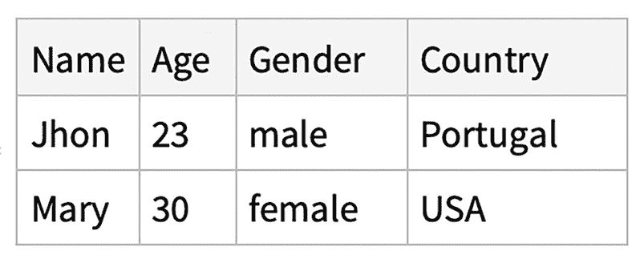

一个四列两行的表格。列标题是姓名、年龄、性别和国家。第 1 行：Jhon, 23, male, Portugal。第 2 行：Mary, 30, female, USA。

**图 3-13**

数据集的前两行


### 添加数值

在了解了如何访问数据集中的元素后，现在可以往数据集中添加新值了。你可以使用 `Append` 或 `Prepend` 添加行，但请记住，也可以使用 `AppendTo` 和 `PrependTo`。不过，它们会将新结果赋值给指定的变量。`Append` 在末尾添加，而 `Prepend` 在开头添加。

要添加一行，你需要像编写具有重复键的关联那样编写新行，先调用数据集，然后是函数，接着是新行，如图 3-14 所示。

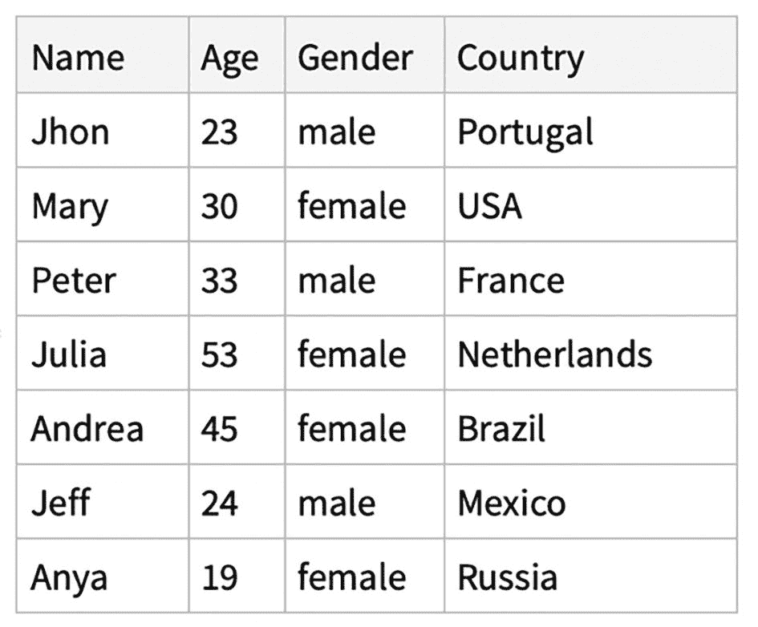

一个 4 列 7 行的表格。第 1 行：Jhon，23，男，Portugal。第 2 行：Mary，30，女，U S A。第 3 行：Peter，33，男，France。第 4 行：Julia，53，女，Netherlands。第 5 行：Andrea，45，女，Brazil。第 6 行：Jeff，24，男，Mexico。第 7 行：Anya，19，女，Russia。

**图 3-14** 在数据集末尾添加的新行

```
In[80]:= Dst[Append["Anya","Age"->19,"Gender"->"female","Country"->"Russia"|>]]
Out[80]=
```

本例中使用了 `Append` 函数的运算符形式。Wolfram 语言中的运算符形式允许更简洁、更易读的代码语法。它们本质上允许函数直接使用，而无需方括号。这种形式可以与其他函数（如 `Apply`）一起使用，以形成更自然的表达式。例如，要在数据集顶部添加新行，可以尝试使用代码 `Dst@Prepend[<|“Name”->“Anya”, “Age”->19, “Gender”->“female”, “Country”->“Russia”|>]`，这与 `Dst[Prepend[<|"Name"->"Anya","Age"->19,"Gender"->"female", "Country"->"Russia"|> ]]` 相同。

添加一个仅包含单个值的新列，只需使用键名（即列名）为数据集列侧赋值即可。图 3-15 显示了添加的新列。

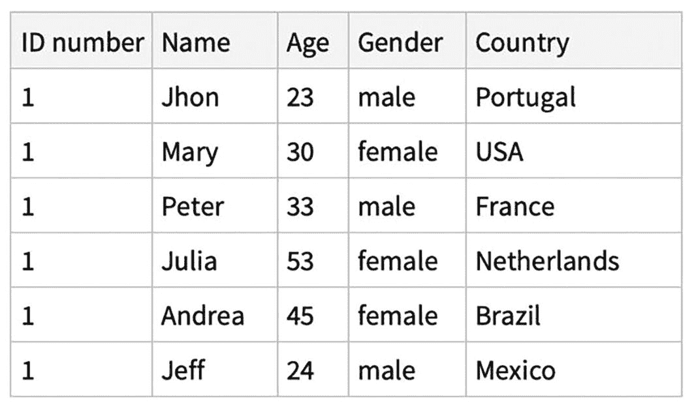

一个 5 列 6 行的表格。第 1 行：1，Jhon，23，男，Portugal。第 2 行：1，Mary，30，女，U S A。第 3 行：1，Peter，33，男，France。第 4 行：1，Julia，53，女，Netherlands。第 5 行：1，Andrea，45，女，Brazil。第 6 行：1，Jeff，24，男，Mexico。

**图 3-15** 添加的 ID 列

```
In[81]:= Dst[All,Prepend["ID number"->1]]
Out[81]=
```

要添加一个值列表作为列，首先创建一个值列表。然后，使用 `AssociationThread` 将每个值与同一个键关联，为重复的键创建一个值的关联。接着，创建新关联的数据集，并使用 `Join` 函数将其与原始数据集合并。这会合并具有相同头部的表达式。

```
In[82]:= Id={1,2,3,4,5,6};(*我们的值列表*)ID=AssociationThread["ID"->#]&/@Id (*该过程在线程中处理列表*)
Out[82]= {1|>,2|>,3|>,4|>,5|>,6|>}
```

每个元素需要逐个关联以供后续块使用，因为 `AssociationThread` 会抑制重复键，所以你只会得到一个关联，而你需要一个重复键来标记不同的值。

接下来，创建具有相同键的新数据集，如图 3-16 所示。

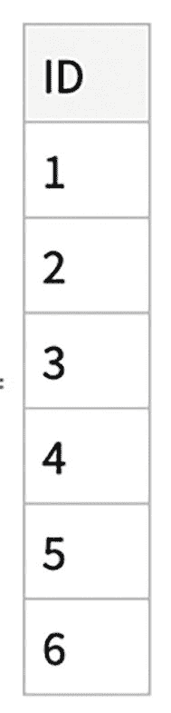

一个 1 列 6 行的表格。列标题为 I D。第 1 行：1。第 2 行：2。第 3 行：3。第 4 行：4。第 5 行：5。第 6 行：6。

**图 3-16** ID 列数据集

```
In[83]:= Dataset[ID]
Out[83]=
```

最后，合并相同的对象；这里，`Join` 使用了层级规范 2，因为新数据集是一个深度为 2 的子列表。如果要在左侧添加列，新列放在前面，然后是数据集；在右侧添加则相反。图 3-17 显示了输出数据集。

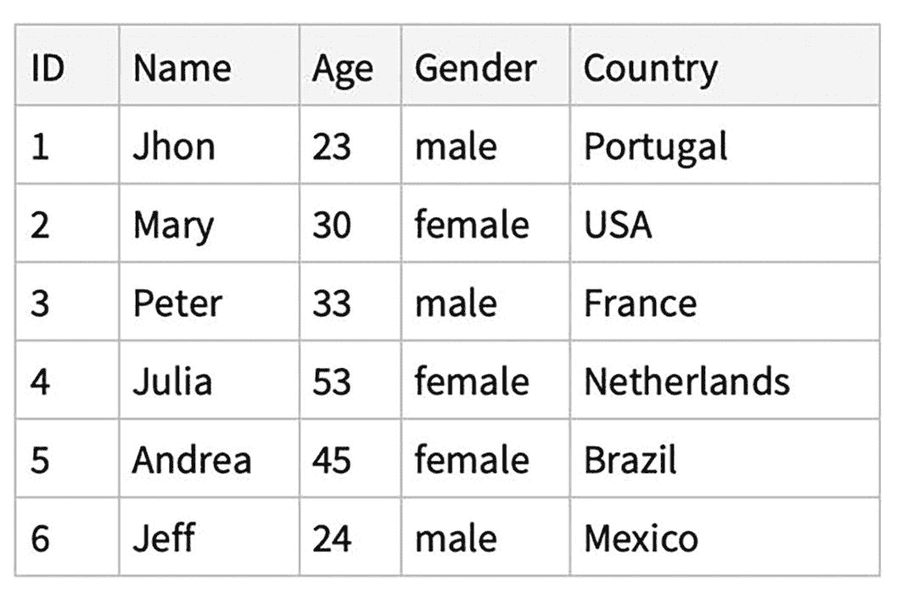

一个 5 列 6 行的表格。列标题为 I D、name、age、gender 和 country。第 1 行：1，Jhon，23，男，Portugal。第 2 行：2，Mary，30，女，U S A。第 3 行：3，Peter，33，男，France。第 4 行：4，Julia，53，女，Netherlands。第 5 行：5，Andrea，45，女，Brazil。第 6 行：6，Jeff，24，男，Mexico。

**图 3-17** 添加的 ID 列

```
In[84]:= Join[%,Dst,2]
Out[84]=
```

前面的例子处理的是来自关联列表的数据集；由于你只处理带标签的行，或带标签的行和列，添加行或列是通过向数据集添加相同结构来保持的。因此，向关联列表添加新行将采用 `<| "key" -> {elem, ... } |>` 的形式；对于列，则是创建数据集并合并它们的过程。对于列表的列表，添加行的方法相同，但没有键。对于关联的关联，添加行将是 `<| "key" -> <| "key 1" -> "val 1", ... |> |>`，而对于列，则与之前相同，即一个键关联一个值。不过，数据的容纳方式没有限制。

最后，要更改单个值，请选择该项并赋予新内容。如果行和列都有标签，原始形式仍然保留：`"rows"`、`"columns"`。因此，如果你想替换 Jhon 的年龄，请使用 `ReplacePart` 函数，调用数据集的符号，指定列标签，然后赋予新值 50。如果你只处理行标签或列标签，过程相同，但使用行或列标签，然后是元素的位置编号。图 3-18 显示新值为 50。

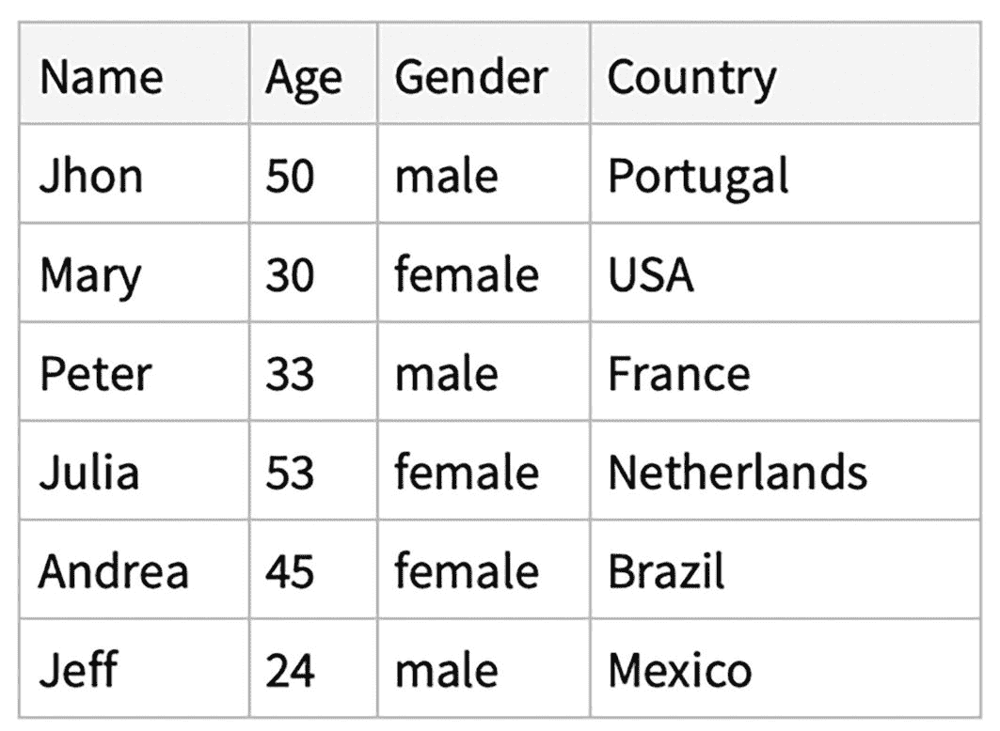

一个 4 列 6 行的表格。列标题为 name、age、gender 和 country。第 1 行：Jhon，23，男，Portugal。第 2 行：Mary，30，女，U S A。第 3 行：Peter，33，男，France。第 4 行：Julia，53，女，Netherlands。第 5 行：Andrea，45，女，Brazil。第 6 行：Jeff，24，男，Mexico。

**图 3-18** Jhon 的年龄值更改为 50

```
In[85]:= ReplacePartDst,{1,"Age"}->50
Out[85]=
```


### 删除值

你可以删除行或列的内容，而无需删除整个表格结构。为此，请使用 `Drop` 函数或 `Delete` 函数。使用 `Drop` 时，将行号或列号用 `{ }` 括起来，以删除特定的行或列（见图 3-19）。

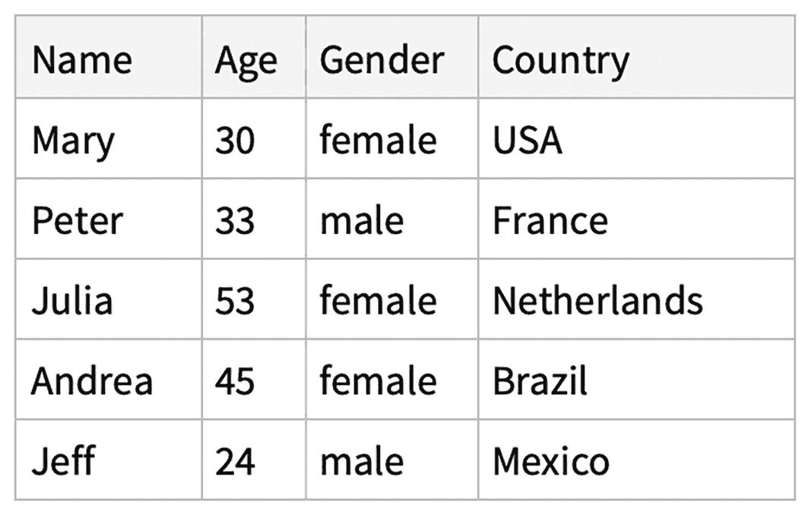

一个 4 列 5 行的表格。列标题为姓名、年龄、性别和国家。第 1 行：Mary，30，女，美国。第 2 行：Peter，33，男，法国。第 3 行：Julia，53，女，荷兰。第 4 行：Andrea，45，女，巴西。第 5 行：Jeff，24，男，墨西哥。

图 3-19

删除第 1 行

```
In[86]:= DropDst,{1}
Out[86]=
```

图 3-19 显示第一行已被删除。你也可以同时删除行和列。图 3-20 显示了删除第二行和最后一列后的结果。

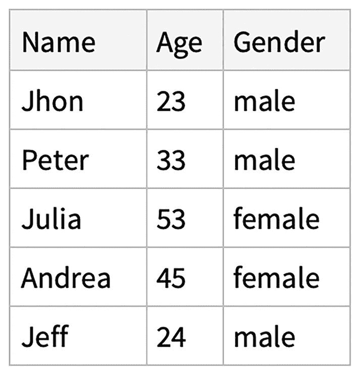

一个 3 列 5 行的表格。列标题为姓名、年龄和性别。第 1 行：John，23，男。第 2 行：Peter，33，男。第 3 行：Julia，53，女。第 4 行：Andrea，45，女。第 5 行：Jeff，24，男。

图 3-20

删除第 2 行和第 4 列后的新数据集

```
In[87]:= Drop[Dst,{2},{4}]
Out[87]=
```

另一种方法是在行或列标签上使用 `Delete`，如图 3-21 所示。

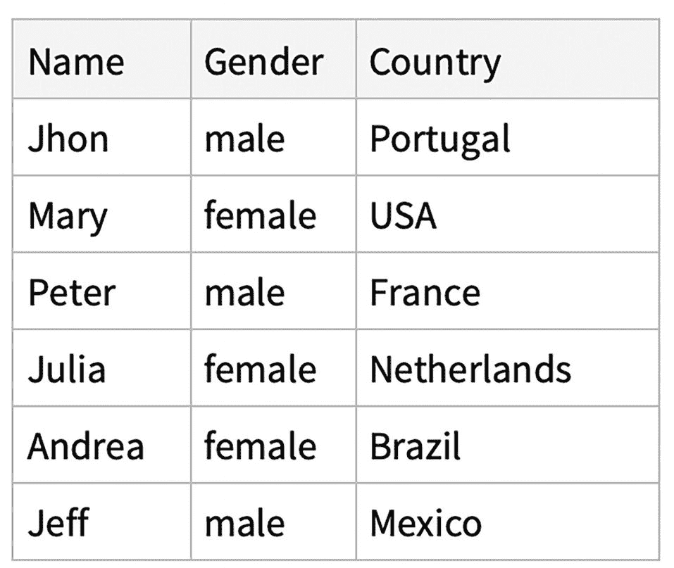

一个 3 列 6 行的表格。列标题为姓名、性别和国家。第 1 行：Jhon，男，葡萄牙。第 2 行：Mary，女，美国。第 3 行：Peter，男，法国。第 4 行：Julia，女，荷兰。第 5 行：Andrea，女，巴西。第 6 行：Jeff，男，墨西哥。

图 3-21

年龄列已删除

```
In[88]:= Dst[All,Delete["Age"]] (*要删除一行，请使用 ["标签行",All]*)
Out[88]=
```

### 筛选值

将数据作为数据集，可以让你从多个角度查看数据。现在，让我们使用带标签的数据集来更好地展示筛选值的工作原理。首先，我们使用图 3-22 中所示的带标签数据集。

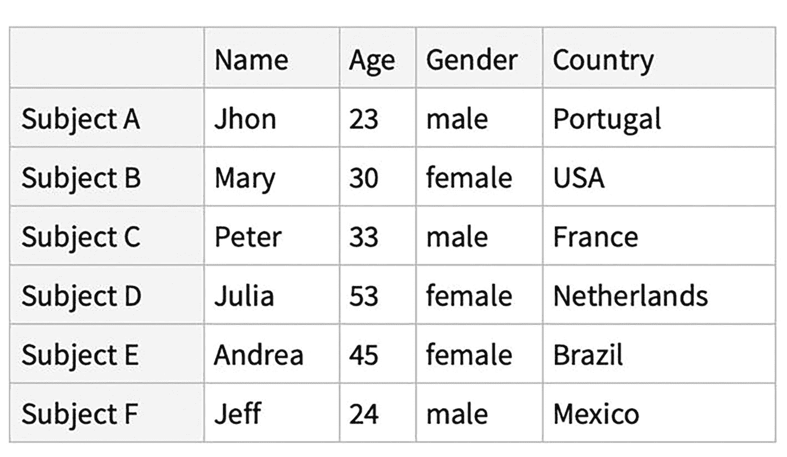

一个 5 列 6 行的表格。列标题为姓名、年龄、性别和国家。行标题为受试者 A、受试者 B、受试者 C、受试者 D、受试者 E 和受试者 F。

图 3-22

带标签的数据集

```
In[89]:= Clear[Dst];(*让我们清除符号 "Dst" 之前的赋值*)
Dst=Dataset@
"Jhon","Age"->23,"Gender"->"male","Country"->"Portugal"|>,"Subject B"->"Mary","Age"->30,"Gender"->"female","Country"->"USA"|>,"Subject C"->"Peter","Age"->33,"Gender"->"male","Country"->"France"|>,
"Subject D"->"Julia","Age"->53,"Gender"->"female","Country"->"Netherlands"|>,"Subject E"->"Andrea","Age"->45,"Gender"->"female","Country"->"Brazil"|>,"Subject F"->"Jeff","Age"->24,"Gender"->"male","Country"->"Mexico"|>
|>
Out[90]=
```

与列表一样，你可以创建一个或多个筛选条件；例如，你可以选择年龄大于 30 的数据，并获取一个数据集对象（见图 3-23）。

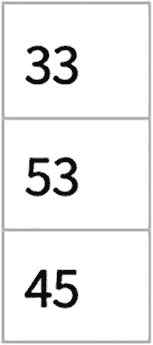

一个 1 列 3 行的表格。列出了 33、53 和 45。

图 3-23

从年龄列筛选出的数据

```
In[91]:= Cases[Dst[All,"Age"],x_/;x>30](*我们也可以使用 == 符号选择完全等于 30 的数据*)
Out[91]=
```

图 3-23 显示了筛选后的数据。可以根据真或假的结果来选择数据。为此，你可以使用 `Select` 函数。图 3-24 显示了选中的受试者。

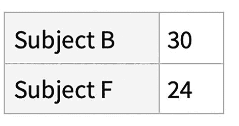

一个 2 列 2 行的表格。行标题为受试者 B 和受试者 F。第 2 列列出了 30 和 24。

图 3-24

选中的受试者

```
In[92]:= Select[Dst[All,"Age"],EvenQ]
Out[92]=
```

也可以使用纯函数。请记住，`#Age` 代表年龄列中的元素，如图 3-25 所示。

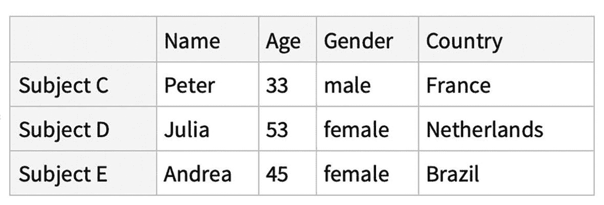

一个 5 列 3 行的表格。列标题为姓名、年龄、性别和国家。行标题为受试者 A、受试者 B、受试者 C、受试者 D、受试者 E 和受试者 F。第 1 行：Peter，33，男，法国。第 2 行：Julia，53，女，荷兰。第 3 行：Andrea，45，女，巴西。

图 3-25

使用纯函数语法选中的值

```
In[93]:= Dst[Select[#Age>30&]]
Out[93]=
```

此外，你还可以对分类数据值进行计数，如图 3-26 所示。当你想要识别数据中有多少种类别时，这很有帮助。例如，你可以计算数据集中女性和男性的数量。

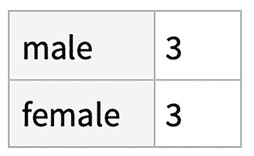

一个 2 列 2 行的表格。行标题为男和女。第 2 列列出了 3 和 3。

图 3-26

男性和女性类别的计数数据

```
In[94]:= Counts[Dst[All,"Gender"]] (*替代形式: Dst[Counts,"Gender"]*)
Out[94]=
```

可以基于某个类别创建更复杂的分组；例如，你可以按性别对数据集进行分组，如图 3-27 所示。

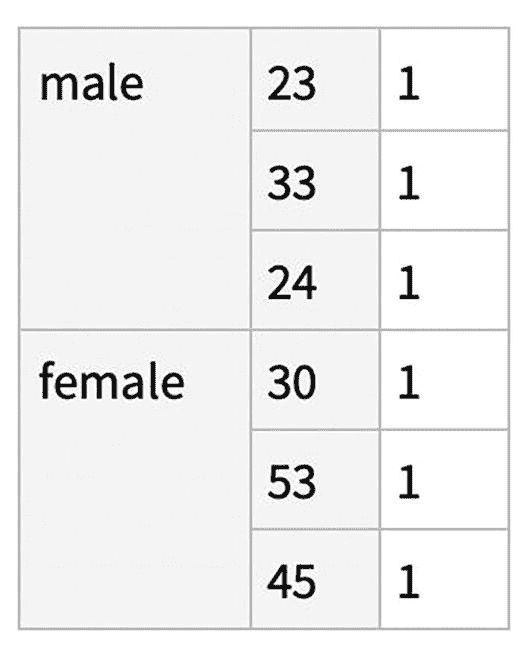

一个 2 行 3 列的表格。行标题为男和女。在每个标题内，行堆叠为 3，列堆叠为 2。

图 3-27

按类别和年龄排列的数据

```
In[95]:= Dst[GroupBy["Gender"],Counts,"Age"]
Out[95]=
```

作为良好实践，当符号不再使用时，请清除它们。

```
In[96]:= Clear[Dst]
```


## 应用函数

函数可应用于数据集，以获取统计信息、确定维度或转换数据。函数可以应用于单列或数据结构中的单个元素。首先，让我们创建一个包含 10 个元素的数据集，其列分别为 1 到 10 的阶乘、0 到 1 之间的随机实数，以及 1 到 10 的自然对数。图 3-28 展示了这个新数据集。

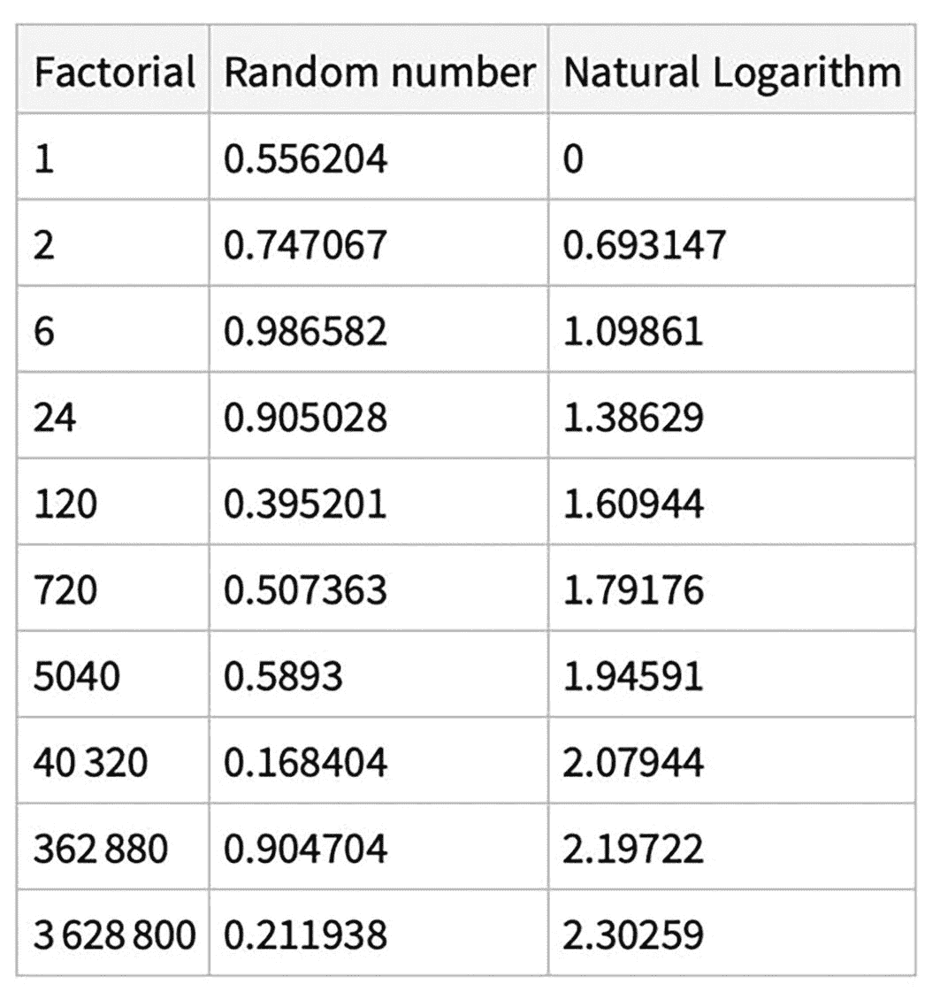

一个三列十行的表格。列标题为阶乘、随机数和自然对数。它按递增顺序列出了从 1 到 3628800 的阶乘。

图 3-28
数值数据集

```
In[97]:= DataNumbr=Dataset@Table[Factorial[i],"Random number"->RandomReal[{0,1}],"Natural Logarithm"->Log[E,i]|>,{i,1,10}]
Out[97]=
```

现在你可以对数据执行基本运算，比如计算阶乘和随机数的平均值，如图 3-29 所示。

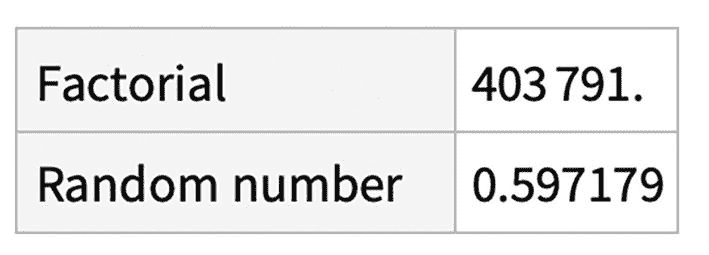

一个两列两行的表格。行标题为阶乘和随机数。第 2 列列出了 403791 和 0.597179。

图 3-29
阶乘和随机数列的平均值

```
In[98]:= DataNumbr[Mean,{"Factorial","Random number"}]//N
Out[98]=
```

也可以使用括号和函数组合，通过`@`（组合）符号来关联应用于数据的操作。图 3-30 展示了按从小到大排序的随机数数据。

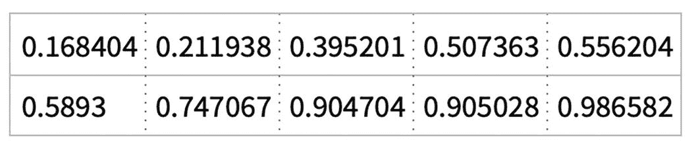

一个 2 行 5 列的表格。第 1 行：0.168404, 0.211938, 0.395201, 0.507363, 0.556204。第 2 行：0.5893, 0.747067, 0.904704, 0.905028, 0.986582。

图 3-30
按规范顺序排序的数据

```
In[99]:= DataNumbr[All,"Random number"]@(Sort@*N)
Out[99]=
```

你可以对数据应用不同的函数。如图 3-31 所示，数据集以十进制形式显示数字；否则，它将无法容纳在方框中。

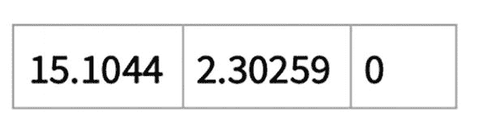

一个 3 列 1 行的表格。第 1 行：15.1044, 2.30259, 0。

图 3-31
自然对数列的总和、最大值和最小值

```
In[100]:= DataNumbr[{Total,Max,Min},"Natural Logarithm"]
Out[100]=
```

你也可以应用自己的函数；让我们使用一个之前构建的函数。图 3-32 展示了你之前创建的函数应用于数据集列的结果。

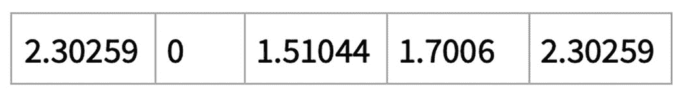

一个 5 列 1 行的表格。第 1 行：2.30259, 0, 1.51044, 1.7006, 2.30259。

图 3-32
`StatsFun` 应用于自然对数列

```
In[101]:= DataNumbr[{StatsFun},"Natural Logarithm"]
Out[101]=
```

也可以应用像 `Reverse` 这样的函数来重构数据集，如图 3-33 所示。

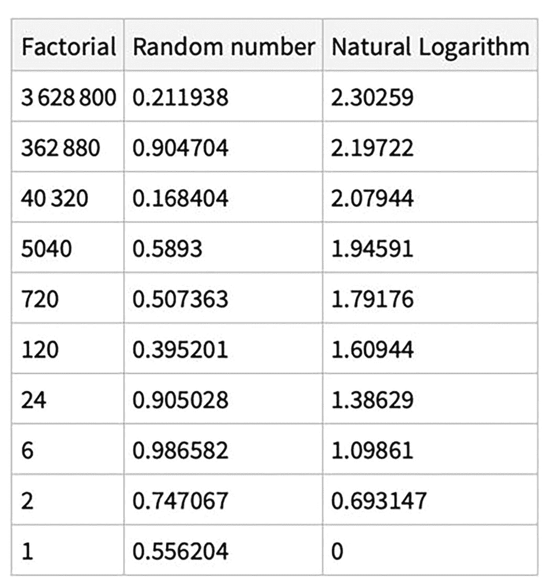

一个十行三列的表格。列标题为阶乘、随机数和自然对数。它按递减顺序列出了从 3628800 到 1 的阶乘。

图 3-33
数据集的元素反转

```
In[102]:= DataNumbr[Reverse,All]
Out[102]=
```

`Map` 也可以应用函数，就像你在前面章节中看到的列表那样。下一个示例将函数直接映射到数据集中，如图 3-34 所示。

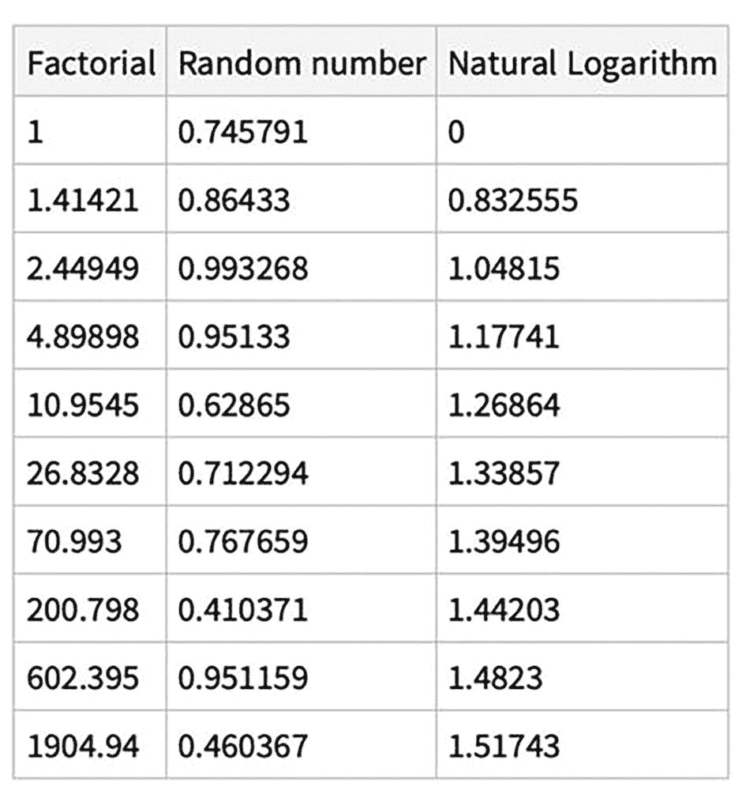

一个十行三列的表格。列标题为阶乘、随机数和自然对数。它以平方根值的形式列出了阶乘。

图 3-34
在数据集中映射的平方根函数

```
In[103]:= Map[Sqrt,DataNumbr]
Out[103]=
```

转置是一种将列转换为行、将行转换为列的操作，有时可以帮助你从不同角度观察数据。要获取数据集的转置，请使用应用于数据集的 `Transpose` 函数。图 3-35 展示了所有列现在都变成了行，并且由于行内容庞大，显示得比较紧凑。

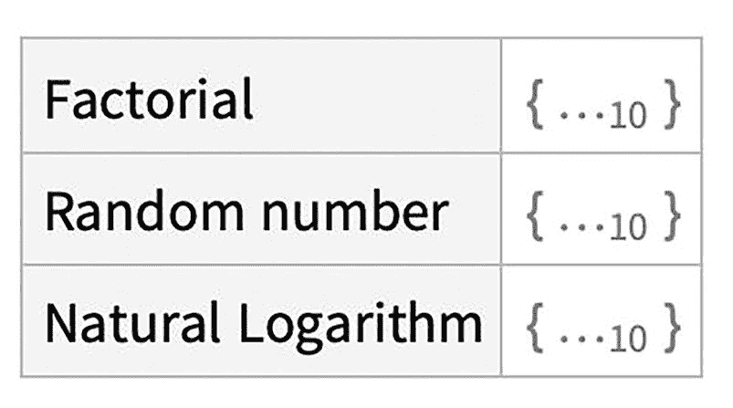

一个两列三行的表格。行标题为阶乘、随机数和自然对数。第 2 列列出了以下内容：左花括号省略号 10，右花括号。左花括号省略号 10，右花括号。左花括号省略号 10，右花括号。

图 3-35
由于内容庞大，Mathematica 显示的数据集值

```
In[104]:= DataNumbr//Transpose
Out[104]=
```

如果你点击某一行，应该会得到该行对应的值。


### 按列或按行应用函数

另一种方法是直接将函数应用于列的值，你可以指定一个转换规则。例如，你可以对`自然对数`列中的所有值向上取整到最小的整数。图 3-36 显示了输出结果。

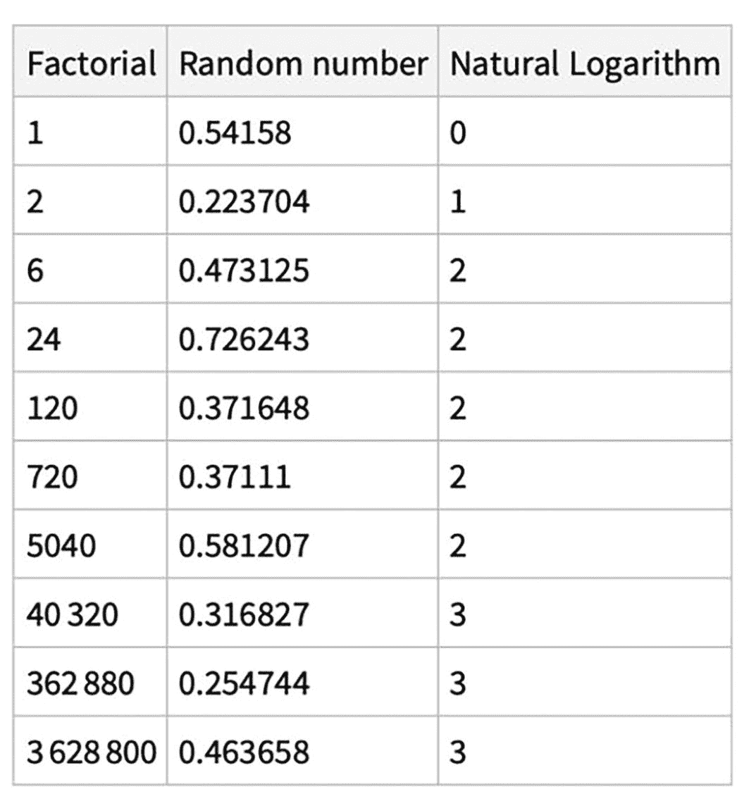

一个十行三列的表格。列标题为阶乘、随机数和自然对数。它按递增顺序列出了从 1 到 3628800 的阶乘。

**图 3-36** 作为规则应用的向上取整函数

```
In[105]:= DataNumbrAll,{"Natural Logarithm"->Ceiling}
Out[105]=
```

你可以对第一行应用平方根。`Map` 也可以用于对行应用函数。图 3-37 显示了生成的输出。

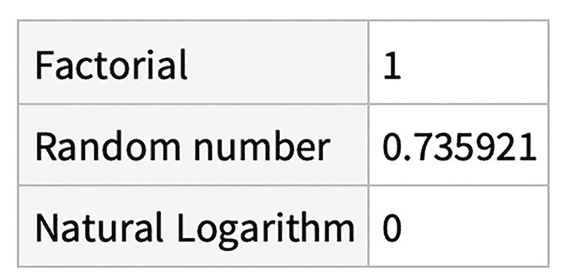

一个两列三行的表格。行标题为阶乘、随机数和自然对数。第 2 列列出了以下内容：1, 0.735921, 0。

**图 3-37** 由前述代码生成的输出

```
In[106]:= DataNumbr[1,Sqrt] (*Map[Sqrt,DataNumbr[1;;2,All]] can also do the work for the first 2 rows*)
Out[106]=
```

当你想要将函数应用于定义的层级时，可以使用 `MapAt`。`MapAt` 的形式为 `MapAt[f, "expr", {i, j, ...}]`，其中 `{i, j}` 表示位置的层级，如图 3-38 所示。

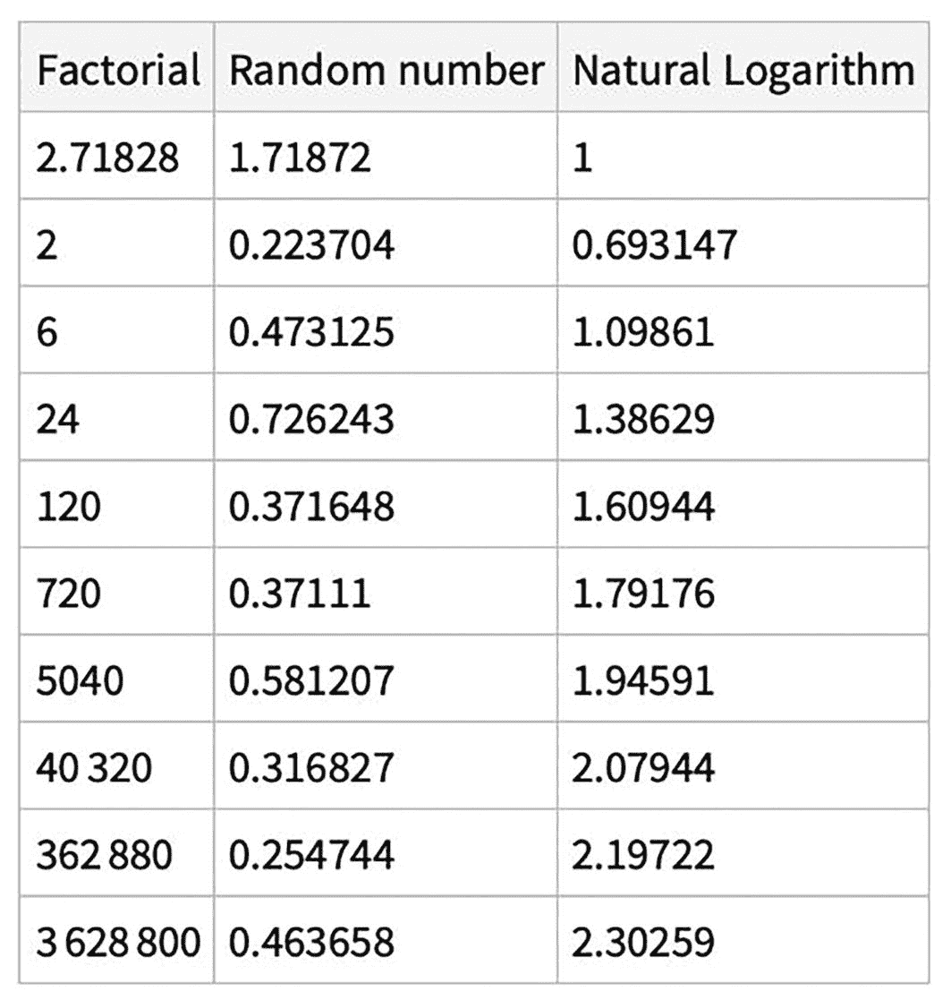

一个十行三列的表格。列标题为阶乘、随机数和自然对数。

**图 3-38** 仅对第一行使用 `MapAt` 进行指数运算

```
In[107]:= MapAtExp,DataNumbr,{1} (*Double semi-colon can be used to define from row to row,try using 4;;6\. Caution you might get big numbers*)
Out[107]=
```

有时，你可能会遇到重复数据，这使得理解数据变得困难，尤其是在出现问题时。一种方法是删除整行或整列，正如你在前面章节中看到的；但作为替代方案，你可以使用能完成此任务的内置函数。`DeleteDuplicates` 函数是最常用的。`DeleteCases` 也可以使用，但与 `DeleteDuplicates` 不同，它会删除与模式匹配的数据。让我们为示例创建一个数据集。

```
In[108]:= Sales = Dataset@{
 1, "Product" -> "PC", "Price" -> "800 €",  "Sale Month" -> "January"|>,
 2, "Product" -> "Smart phone", "Price" -> "255 €", "Sale Month" -> "January"|>,
 3, "Product" -> "Anti-Virus", "Price" -> "100 €",  "Sale Month" -> "March"|>,
 4, "Product" -> "Earphones", "Price" -> "78 €", "Sale Month" -> "February"|>,
 5, "Product" -> "PC", "Price" -> "809 €",  "Sale Month" -> "March"|>,
 5, "Product" -> "PC", "Price" -> "809 €", "Sale Month" -> "March"|>,
 6, "Product" -> "Radio", "Price" -> "60 €", "Sale Month" -> "January"|>,
 7, "Product" -> "PC", "Price" -> "700 €", "Sale Month" -> "February"|>,
 8, "Product" -> "Mouse", "Price" -> "100 €", "Sale Month" -> "March"|>,
 9, "Product" -> "Keyboard", "Price" -> "125 €", "Sale Month" -> "January"|>,
 10, "Product" -> "USB 64gb", "Price" -> "90 €", "Sale Month" -> "March"|>,
 11, "Product" -> "LED Screen", "Price" -> "900 €", "Sale Month" -> "February"|>,
 11, "Product" -> "LED Screen", "Price" -> "900 €", "Sale Month" -> "February"|>}
Out[108]=
```

图 3-39 显示了数据集中有两个重复行：ID 编号 5 和 11。`DuplicateFreeQ` 函数可以检测数据集是否看起来有重复项。当存在重复数据时，该函数返回 `False`，不存在时返回 `True`。它可以直接应用于数据集，或者你可以检测那些看起来重复的行。


一个 11 行四列的表格。列标题为 ID、产品、价格和销售月份。它两次读取相同的产品作为重复项。

**图 3-39** 重复数据的数据集示例

让我们检查第 1 行到第 7 行是否有重复项。

```
In[109]:= DuplicateFreeQ[Sales[1;;7,All]]
Out[109]= False
```

通过编程方式在数据集中发现了重复数据。你也可以按列检查重复项。

```
In[110]:= Sales[All,{"Id"}]@DuplicateFreeQ
Out[110]= False
```

要删除重复项，使用 `DeleteDuplicates` 函数。它可以作为函数应用于数据集、列或行。生成的输出如图 3-40 所示。


一个 11 行四列的表格。列标题为 ID、产品、价格和销售月份。产品有 PC、智能手机、防病毒软件、耳机、PC、收音机、PC、鼠标、键盘、USB 64gb 和 LED 屏幕。

**图 3-40** 无重复项的数据集

```
In[111]:= DeleteDuplicates[Sales] (*Datas[All,{"ID"}]@DuplicateFreeQ*)
Out[111]=
```

另一种方法是使用 `GroupBy` 来识别数据集中哪些数据是重复的。注意在图 3-41 中，重复的数据被堆叠在一起。


一个 11 行四列的表格。列标题为 ID、产品、价格和销售月份。重复的数据被堆叠在一起。

**图 3-41** 按重复项分组的数据集

```
In[112]:= GroupBy[Sales,"Id"]
Out[112]=
```

### 连接与合并数据集

基于共享属性将多个数据集合并为一个是一项常见任务。此过程可以通过数据集应如何连接来实现。对数据集进行操作的三个不同函数是 `Join`、`JoinAcross` 和 `Merge`。

第一个函数将两个数据集首尾相连，有效地将它们拼接成一个单一数据集（见图 3-42）。

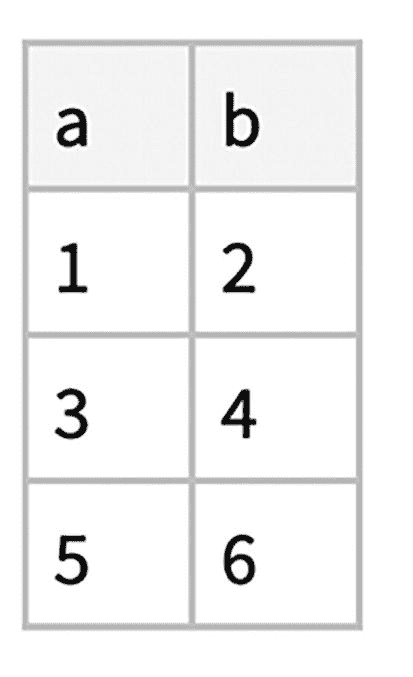

一个两列三行的表格。列标题为 a 和 b。第 1 行：1, 2。第 2 行：3, 4。第 3 行：5, 6。

**图 3-42** 通过 `Join` 函数分组的数据集

```
In[113]:= dataset1={1,"b"->2|>,3,"b"->4|>};
dataset2={5,"b"->6|>};
Join[dataset1,dataset2]//Dataset
Out[116]=
```

第二个函数根据一个或多个指定的键来组合数据集，类似于关系数据库基于公共键连接表的方式（见图 3-43）。类似于关系数据库中的操作，如连接、左连接、右连接、内连接、外连接等。

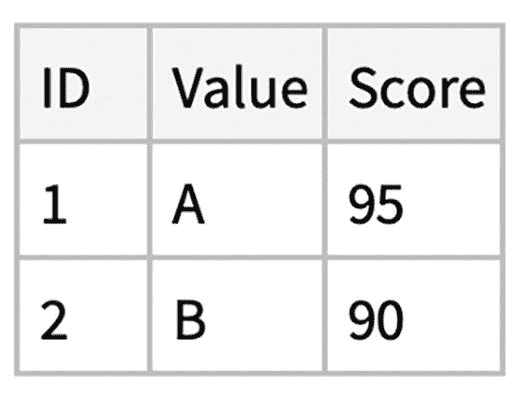

一个三列两行的表格。列标题为 ID、值和分数。第 1 行：1, A, 95。第 2 行：2, B, 90。

**图 3-43** 通过 `JoinAcross` 函数组合的数据集

```
In[117]:= dataset3={1,"Value"->"A"|>,2,"Value"->"B"|>};
dataset4={1,"Score"->95|>,2,"Score"->90|>};
JoinAcross[dataset3,dataset4,"ID"]//Dataset
Out[119]=
```

第三个函数使用函数 `f` 来组合具有相同键的值，返回单个值，从而组合数据集（见图 3-44）。

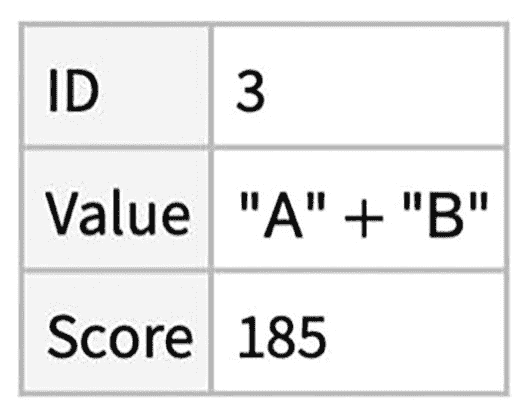

一个两列三行的表格。行标题为 ID、值和分数。第 2 列列出了以下内容：2, "A" + "B", 185。

**图 3-44** 通过每个键的 `Merge` 和 `Total` 函数组合的数据集

```
In[120]:= Merge[Dataset[JoinAcross[dataset3,dataset4,"ID"]],Total]
Out[120]=
```


### 自定义数据集

数据集可以根据您希望展示数据的方式进行自定义。处理数据集时，可以根据个人偏好进行个性化设置。为了探索这一点，下一个代码块将从 Wolfram 参考服务器加载示例数据，以了解如何根据您的需求个性化数据。从服务器加载数据时，根据您的网络连接情况，可能会弹出一个加载框架，尝试访问 Wolfram 服务器。

让我们使用 `ExampleData` 加载数据，然后选择动物体重的统计数据，并将列表转换为数据集。通过使用 `MaxItem` 选项，您可以控制数据集中显示的行数或列数。本示例显示了前四行和前两列。查看数据集时，左侧和顶部会出现滚动条；使用它们可以浏览数据集。或者，您可以将内容对齐到左侧、居中或右侧。在图 3-45 中，仅显示了左侧滚动条。

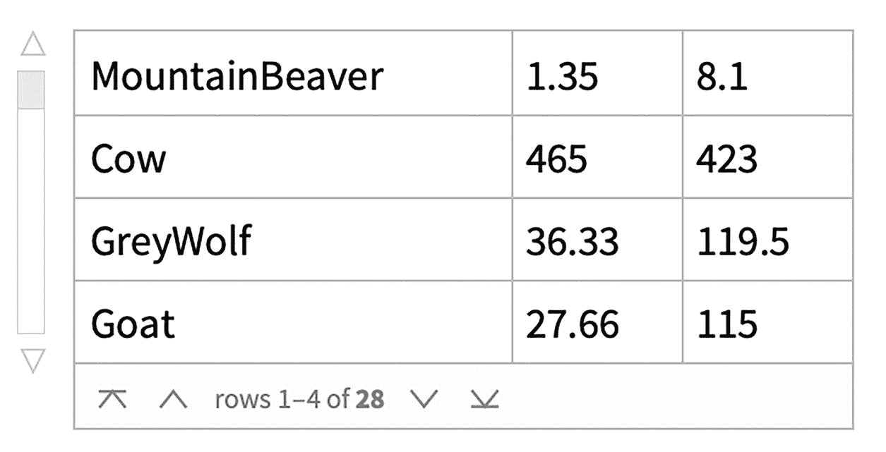

一个 3 列 4 行的表格。表格左侧有一个滑块条。底部显示：第 1 至 4 行，共 28 行。第 1 行：山狸，1.35，8.1。第 2 行：牛，465，423。第 3 行：灰狼，36.33，119.5。第 4 行：山羊，27.66，115。

图 3-45

动物数据集

```
In[121]:= AnimalData=ExampleData[{"Statistics","AnimalWeights"}];Dataset[AnimalData,MaxItems->{4,3},Alignment->Center] (*要对齐单列，使用 Alignment-> "列名" -> Left*)
Out[121]=
```

`Background` 选项用于为数据集的内容着色；符号 `{行, 列}` 的颜色会被保留。要为整个数据着色，只需输入颜色。要按行或列着色，请将颜色作为嵌套列表输入——即 `{{"颜色 _ 行 1", "颜色 _ 行 2", ... }, {"颜色 _ 列 1", "颜色 _ 列 2", ... } }`。也可以通过嵌套嵌套颜色来混合颜色。对于特定值，需要输入值的位置。下一个示例为前两列着色，如图 3-46 所示。

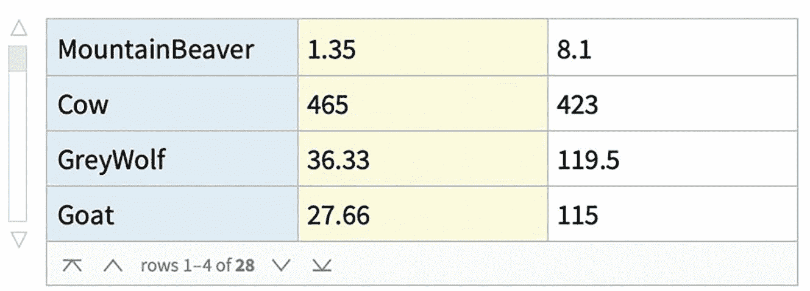

一个 3 列 4 行的表格。表格左侧有一个滑块条。底部显示：第 1 至 4 行，共 28 行。第 1 行：山狸，1.35，8.1。第 2 行：牛，465，423。第 3 行：灰狼，36.33，119.5。第 4 行：山羊，27.66，115。

图 3-46

第 1 列和第 2 列已着色

```
In[122]:= Dataset[AnimalData,MaxItems->{4,3},Background-> {{None},{LightBlue,LightYellow}},ItemSize->{12}]
Out[122]=
```

对于特定值，需要输入值的位置。另一个选项是项目的大小，通过 `ItemSize` 选项控制。如果您想编辑相同的选项但带有标题，您可以使用 `HeaderAlignment` 来将文本左对齐、居中或右对齐；使用 `HeaderSize` 来控制标题的大小；使用 `ItemStyle` 来控制项目字体的样式。图 3-47 显示了以粗体样式呈现的数据集。

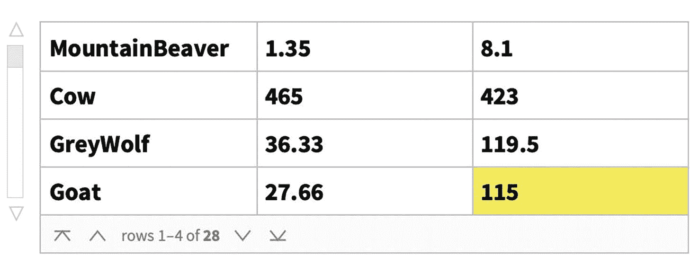

一个 3 列 4 行的表格。表格左侧有一个滑块条。底部显示：第 1 至 4 行，共 28 行。第 1 行：山狸，1.35，8.1。第 2 行：牛，465，423。第 3 行：灰狼，36.33，119.5。第 4 行：山羊，27.66，115。最后一个元素 115 被高亮显示。

图 3-47

粗体样式的数据集

```
In[123]:= Dataset[AnimalData,MaxItems->{4,3},Background->{{4,3}->Yellow},ItemSize->{12},ItemStyle->Bold]
Out[123]=
```

另一个有用的选项是 `HiddenItems`，它可以隐藏不应显示的项目。因此，要隐藏第 1 行和第 1 列，请使用 `HiddenItems → {"行#", "列#"}`。列可以通过其关联的标签来隐藏。图 3-48 展示了数据集中被隐藏的行和列的形式。对于特定值，请嵌套值的位置并尝试 `HiddenItems → {{2,3}}`。

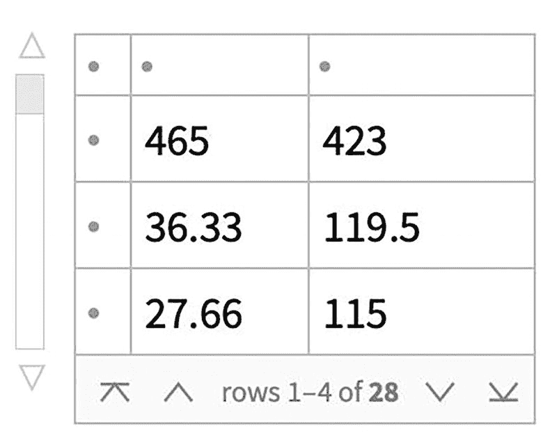

一个 2 列 3 行的表格。表格左侧有一个滑块条。底部显示：第 1 至 4 行，共 28 行。第 1 行：465，423。第 2 行：36.33，119.5。第 3 行：27.66，115。

图 3-48

第 1 列和第 1 行被隐藏

```
In[124]:= Dataset[AnimalData,MaxItems->{4,3},HiddenItems->{1,1}]
Out[124]=
```

您可以使用 `Query` 命令为新的数据集中的每一列添加标题。要重命名列，应用相同的过程；新名称将映射到旧名称——即 `"新名称" → "动物名称"`，如图 3-49 所示。


一个 3 列 20 行的表格。列标题分别是动物名称、体重和脑重。表格左侧有一个滑块条。

图 3-49

添加了列标题的动物数据集

```
In[125]:= Query[All,1,"Body Weight"->2,"Brain Weight"->3|>]@Dataset[AnimalData]
(*为了显示目的，我们取第 7 到 9 行，使用 All 表示整个数据集*)(*或 "数据集符号"[All, 1,"Body Weight"->2,"Brain Weight"->3|>]*)
Out[125]=
```


## 哈希表的泛化

哈希表是一种关联式数据结构，它允许数据存储，并进而能够从称为键的对象中快速检索元素（值）。哈希表可以在数组内部实现，其主要组成部分是键和值。在数组中搜索元素的方法是使用哈希函数，该函数将键映射到值对，并给出该元素在数组中的位置（索引）。

换句话说，哈希函数搜索特定的键，评估该键，并返回一个索引。这个过程被称为哈希处理。图 3-50 展示了哈希表的代表性示意图。


哈希表的数据流图。一堆数量为 n 的键通过哈希函数进行处理。它评估这些键，并将每个值用索引分隔开。

**图 3-50** 哈希表的图形化表示

在哈希表内部，键和值的数量可以不断增加，这也是哈希表非常有用的原因之一；它们可以存储大量信息。在 Wolfram 语言中，关联（Association）可以表示哈希表。这主要是因为关联是一种抽象数据结构，具有键和值等基本组成部分，就像哈希表一样。这结合了关联数组和索引列表的结构，更像是一个哈希数组的嵌套。由于关联具有不可变的关键属性，每个关联类型的对象都是唯一的，对一个关联的引用与另一个关联没有联系，即使它们引用的是同一个符号。

还有其他一些特殊命令可用。让我们首先创建一个关联。嵌套关联被定义为内部包含其他关联的关联——换句话说，就是一个键指向一个值桶，而这些值又对应着内部包含其他值的键（见图 3-51）。


一个四列一行的表格。列标题是 ID 和参数。参数列被拆分为三个列：活跃、区域和互联网流量。行标题是用户，被拆分为两行：Edgar 和 Anya。

**图 3-51** 数据集格式中的嵌套关联

```
In[126]:= Asc=
 01, "Parameters"->True,"Region"->"LA","Internet Traffic"->"1 GB"|>|>,
02,"Parameters"->False,"Region"->"MX","Internet Traffic"->"3 GB"|>|>
|>|>|>;
Dataset[%]
Out[127]=
```

执行诸如访问项、更新值和删除等操作，由与键和值相关的命令支持。请记住，`Keys` 返回关联的键，`Values` 返回值。`Keys` 仅在嵌套关联的表面层级工作，如下代码所示。

```
In[128]:= Keys[Asc]
Out[128]= {User}
```

应用 `Keys` 命令仅返回键 User。需要将 `Keys` 命令应用于更深层级才能看到嵌套关联内部的键，这可以通过指定子层级的 `Map` 来实现。

```
In[129]:= Map[Keys,Asc,#]&/@{{0},{1},{2}}//Column
Out[129]= {User}
{Edgar,Anya}|>
{id,Parameters},Anya->{id,Parameters}|>|>
```

如表面层级（0）所示，键是 User。下一个子层级有键 Edgar 和 Anya，最后一个层级对于 Edgar 和 Anya 这两个键各有键 ID 和 Parameters。`MapIndexed` 允许你查看整个关联内部，并将 `Keys` 应用于子层级以显示键的前驱。

```
In[130]:=
Print["Level 0: "ToString@MapIndexed[Keys,Asc,{0}]]
Print["Level 1: "ToString@MapIndexed[Keys,Asc,{1}]]
Print["Level 2: "ToString@MapIndexed[Keys,Asc,{2}]]
Out[130]=
Level 0: {{}[User]}
Level 1:  {{Key[User]}[Edgar], {Key[User]}[Anya]}|>
Level 2:   {{Key[User], Key[Edgar]}[id], {Key[User], Key[Edgar]}[Parameters]}, Anya -> {{Key[User], Key[Anya]}[id], {Key[User], Key[Anya]}[Parameters]}|>|>
```

在层级 0，只存在 User 键，其前驱是 `{}`。在层级 1，前驱是 User，而 Edgar 和 Anya 键是 User 键的值。在层级 2，对于 ID 和 Parameters 键，前驱键是 Edgar/Anya 和 User。换句话说，表达式 `{Key[User], Key[Anya]}[id]` 意味着 ID 对应于 Anya 键，而 Anya 对应于 User 键，依此类推。这也很有用，因为它意味着访问一个键的值可以通过将运算符形式应用于指定了键的关联来实现。

```
In[133]:= Asc["User"]["Edgar"]"id"
Out[133]= 1
```

如图所示，你得到了 User 键下 Edgar 内部 ID 对应的值。要查看前述表达式的图形化表示，你可以使用 `MapIndexed` 来标记键的位置和应用的 dataset，例如，在子层级 4 中（见图 3-52）。


一个四列一行的表格。列标题包括 ID 和参数。行标题是用户，被拆分为两行 Edgar 和 Anya。参数列被拆分为三行：活跃、区域和互联网流量。它们包含了键和数据集的位置。

**图 3-52** 标记了嵌套关联内部键的数据集表示

```
In[134]:= Dataset@MapIndexed[Framed[Labeled[#2,#1],FrameMargins->0,RoundingRadius->5]&,Asc,{4}] (*尝试更改数字以查看表达式如何变化*)
Out[134]=
```

每个框都包含前驱键的值。这就是为什么 1 GB 对应于 `{Key[User],Key[Edgar],Key[Parameters],Key[Internet Traffic]}`。要查看整个表达式，层级规格为 Infinity（见图 3-53）。


一个框架定义了键和数据集的位置。它包括两个堆栈，分别用于用户 Edgar 和 Anya。堆栈内的框包含前驱键的值。它包括用户、参数和互联网流量。

**图 3-53** 嵌套关联中键的框架化层级

```
In[135]:=MapIndexed[Framed[Labeled[#2,#1,ImageMargins->0,Spacings->0],FrameMargins->0,RoundingRadius->5]&,Asc,Infinity]
Out[135]=
```

`Values` 使用与 `Keys` 相同的方法。要测试一个键是否存在，请使用 `KeyExistQ`；如果键存在则返回 true，否则返回 false。要在更深层级内部测试，请使用 `Map`。

```
In[136]:={KeyExistsQ[Asc,"User"],Map[KeyExistsQ["Anya"],Asc,{1}],Map[KeyExistsQ["Anya"],Asc,{2}]}
Out[136]= {True,True|>,False,Anya->False|>|>}
```

另一种测试特定形式的键是否存在于关联中的方法是使用 `KeyMemberQ`——例如，是否存在一个字符串模式的键。

```
In[137]:= KeyMemberQ[Asc["User"]["Anya"],_String]
Out[137]= True
```

要测试给定键是否存在值，请使用 `Lookup`。

```
In[138]:= Lookup[Asc["User"]["Anya"],"Parameters"]
Out[138]= False,Region->MX,Internet Traffic->3 GB|>
```

要根据条件选择键，请使用 `KeySelect`。

```
In[139]:= KeySelect[Asc["User"]["Anya"],StringQ]
Out[139]= 2,Parameters->False,Region->MX,Internet Traffic->3 GB|>|>
```

或者使用 `KeyTake` 来抓取特定的键。

```
In[140]:= KeyTake[Asc["User"]["Anya"]["Parameters"],{"Region","Internet Traffic"}]
Out[140]= MX,Internet Traffic->3 GB|>
```

要移除一个键，请使用 `KeyDrop`。

```
In[141]:= KeyDrop[Asc["User"],"Edgar"]
Out[141]= 2,Parameters->False,Region->MX,Internet Traffic->3 GB|>|>|>
```

要分配一个新值，与该键关联的值将被赋予新值。

```
In[142]:= Asc["User"]["Edgar"]["Parameters"]["Region"]="CZ"
Out[142]= CZ
```

将其传入一个数据集，你可以查找新分配的值（见图 3-54）。


## 排版后的内容

一个四列一行的表格。列标题为`I D`和`parameters`。`parameters`列被拆分为三个子列：`active`、`region`和`internet traffic`。行标题为`user`，它被拆分为两行：`Edgar`和`Anya`。

图 3-54

`region`值已更改为`CZ`的数据集

```
In[143]:= Dataset[Asc]
Out[143]=
```

要向关联中添加键和值，你可以通过指定键的位置来插入新表达式（见图 3-55）。


一个三列三行的表格。列标题为`I D`和`parameters`。`parameters`列被拆分为三个子列：`active`、`region`和`internet traffic`。行标题为`Alexandra`、`Edgar`和`Anya`。

图 3-55

通过键位置添加的新行

```
In[144]:= Insert[Asc["User"],"Alexandra"->0,"Parameters"->False,"Region"->"RS","Internet Traffic"->"12 GB"|>|>,Key["Edgar"]]//Dataset
Out[144]=
```

## 总结

本章继续构建第 2 章中介绍的列表操作。你探索了 Wolfram 语言中纯函数的独特语法，并深入研究了创建索引表和关联的几种方法。此外，你还过渡到了数据集（datasets）的强大功能，它提供了一种结构化和有组织的方式来处理和分析数据。本章最后深入介绍了关联和键值管理的基本组成部分。

