# 导入与导出

本章回顾了数据的导入与导出，包括相关的 Wolfram 语言命令以及 Mathematica 支持的导入和导出格式。实验数据可能来自不同的来源；处理这些外部数据的方法是通过 Wolfram 语言将其导入。已经计算或从外部获得的数据可以传输到 Mathematica 中，并导出以供其他平台使用。然而，Mathematica 拥有处理不同数据类型（数字、文本、音频、图形和图像）的工具。本章重点介绍数值数据和分类数据的处理，这是分析中最常用的数据类型。

将来自多个来源的数据导入 Mathematica，可以将数据加载到笔记本中进行分析。Wolfram 语言支持多种导入格式；要查看支持哪些格式，请键入美元符号（`$`）后跟 `ImportFormats` 命令。目前，Mathematica 支持 256 种文件格式。如下代码所示，自本书上一版本以来，已添加并更新了新的格式。

```
In[1]:= Short[$ImportFormats, 4]
Out[1]//Short= {3DS,7z,AC,ACO,Affymetrix,AgilentMicroarray,AIFF,ApacheLog,ArcGRID,ASC,ASE,AU,AVI,Base64,BDF,Binary,BioImageFormat,Bit,BLEND,BMP,>,WAV,Wave64,WDX,WebP,WL,WLNet,WMLF,WXF,X3D,XBM,XGL,XHTML,XHTMLMathML,XLS,XLSX,XML,XPORT,XYZ,ZIP,ZSTD}
```

列表中有很多格式，包括音频、图像和文本。但让我们专注于基于文本的格式。要导入任何文件，请使用 `Import` 命令。`Import` 接收两个参数：文件路径和选项。选项可能因文件格式、元素以及 Mathematica 中其他类型的对象（如云和本地）而异。要选择文件路径，请前往工具栏，然后选择“插入 ➤ 文件路径”。应该会出现一个文件浏览器；搜索你想要导入的文件并选择它。路径用撇号括起来，就像字符串一样。

另一个选项是“插入”菜单中的命名文件。与 `File Path` 不同，`File` 选项直接引入文件内容，而无需 Mathematica 预先格式化。`File` 更适合导入笔记本或其他 Wolfram 格式。

### 注意

接下来的一系列导入文件都包含在源代码中。为方便使用，这些文件位于主机的桌面文件夹中。

让我们来看一下如何传输一个简单的文本文件。首先，使用 `Import` 命令选择 `HelloWorld.txt` 文件路径。

```
In[2]:= Import["/Users/macosx/Desktop/Hello_World.txt"]
Out[2]= Hello world!
```

### 注意

根据你的操作系统，文件路径会显示正斜杠（Linux、macOS）或反斜杠（Windows 文件系统分隔符）。

你已经成功导入了第一个文件。Mathematica 会根据文件扩展名识别它，然后自动导入。如果你导入一个没有文件扩展名但你知道文件中使用的格式类型的文件，你可以选择适当的格式作为选项。

```
In[3]:= Import["/Users/macosx/Desktop/Hello_World.txt", "Text"]
Out[3]= Hello world!
```

## 导入文件

导入简单的文本文件既简单又直观。但是，根据你想要导入的文件类型，在 Mathematica 中显示数据的选项和格式可能会有所不同。

### CSV 与 TSV 文件

本节重点介绍如何将文件导入 Mathematica。示例将处理逗号分隔值（CSV）文件、制表符分隔值（TSV）文件和 Excel 电子表格样式文件。CSV 和 TSV 文件是包含文本和数值的文件。在 CSV 文件中，字段由逗号分隔；每一行是一条记录。而在 TSV 文件中，每条记录由制表符分隔。

使用 `Import`，您可以分别导入扩展名为 `.tsv` 或 `.csv` 的 TSV 或 CSV 文件。首先，我们通过指定文件路径和 CSV 选项来导入一个常规的 CSV 文件。

```
In[4]:= Import["/Users/macosx/Desktop/Grocery_List.csv", "CSV"]
Out[4]= {{id,grocery item,price,sold items,sales per day},{1,milk,4$,4,4 Jun 2019},{2,butter,3$,2,6 Jun 2019},{3,garlic,2$,1,7 Jun 2019},{4,apple,2$,4,1 Jun 2019},{5,orange,3$,5,8 Jun 2019},{6,orange juice,5$,2,8 Jun 2019},{7,cheese,5$,2,6 Jun 2019},{8,cookies,2$,5,9 Jun 2019},{9,grapes,4$,3,21 Jun 2019},{10,potatoe,2$,5,26 Jun 2019}}
```

现在文件内容已导入，根据内容的格式，数据会以嵌套列表或其他形式呈现。嵌套列表的元素代表行，整个列表的元素代表列。

导入数据时，可以只导入部分数据——也就是说，如果您只需要某一行或某一列。

```
In[5]:= Import["/Users/macosx/Desktop/Grocery_List.csv", {"Data", 5;;10}]
Out[5]= {{4,apple,2$,4,1 Jun 2019},{5,orange,3$,5,8 Jun 2019},{6,orange juice,5$,2,8 Jun 2019},{7,cheese,5$,2,6 Jun 2019},{8,cookies,2$,5,9 Jun 2019},{9,grapes,4$,3,21 Jun 2019}}
```

上一个示例导入了第 5 行到第 10 行的数据。

当您只对单个值感兴趣时，可以使用以下形式。

```
In[6]:= Import["/Users/macosx/Desktop/Grocery_List.csv", {"Data", 6, 2}]
Out[6]= orange
```

根据表达式的最大字节数，Mathematica 会截断导入的数据，并向您显示一个包含整个数据简化版本的建议框。要查看最大字节大小，请转到“编辑”➤“高级”选项卡，在“截断前的最大输出大小”中，输入截断前的新字节数。此首选项适用于 Mathematica 中的每个输出表达式。

让我们使用相同的方法来导入 TSV 文件。使用简写命令，您可以显示部分数据，以防数据量过大。

```
In[7]:= Short[Import["/Users/macosx/Desktop/Color_table.tsv", "TSV"]] (*Rest,to view the remain*)
Out[7]//Short= {{number,color},{1,red},>,{9,magenta},{10,brown}}
```

因此，在结果中，导入文件的元素之间会出现一个 `7`。出现此结果是因为该文件包含七个不可见的元素。现在您已经学会了如何导入 CSV 和 TSV 文件，您可以使用 `Grid` 或 `TableForm` 以表格格式显示导入的数据。

```
In[8]:= Import["/Users/macosx/Desktop/Grocery_List.csv", "CSV"];
Grid[%]
Out[9]=
id    grocery item    price    sold items   sales per day
1     milk            4$       4            4 Jun 2019
2     butter          3$       2            6 Jun 2019
3     garlic          2$       1            7 Jun 2019
4     apple           2$       4            1 Jun 2019
5     orange          3$       5            8 Jun 2019
6     orange juice    5$       2            8 Jun 2019
7     cheese          5$       2            6 Jun 2019
8     cookies         2$       5            9 Jun 2019
9     grapes          4$       3            21 Jun 2019
10    potato          2$       5            26 Jun 2019
```

一旦文件导入完成，数据就可以在笔记本中作为列表或任何其他结构进行处理。数据的各个部分以导入的数据命名，并且可以提取其内容，这将在后续章节中讨论。

## XLSX 文件

以下示例展示了如何导入数据、将数据显示为电子表格，并将其转换为数据集。为了举例说明，我们使用 XLSX 格式的购物清单文件，而不是 CSV 文件。首先，您需要导入数据。

```
In[10]:= path = "/Users/macosx/Desktop/Grocery_List.xlsx";
Import[path, "Data"]
Out[11]= {{{id,grocery item, price, sold items,sales per day},{1.,milk,4 $,4.,4-Jun-2019},{2.,butter,3$,2.,6-Jun-2020},{3.,garlic,2 $,1.,7-Jun-2021},{4.,apple,2 $,4.,1-Jun-2022},{5.,orange,3 $,5.,8-Jun-2023},{6.,orange juice,5 $,2.,8-Jun-2024},{7.,cheese,5 $,2.,6-Jun-2025},{8.,cookies,2 $,5.,9-Jun-2026},{9.,grapes,4 $,3.,21-Jun-2027},{10.,potatoe,2 $,5.,26-Jun-2028}}}
```

如您所见，导入的数据显示为嵌套列表，因为 Excel 文件内部可以包含多个工作表。在此例中，您只有一个工作表。要查看工作表的数量和名称，请分别使用 `SheetCount` 和 `Sheets`。

```
In[12]:= Import[path, #]& /@ {"SheetCount", "Sheets"}
Out[12]= {1, {Grocery_List}}
```

要将数据显示为电子表格，您可以使用 `TableView` 命令（参见图 4-1）。以下格式用于选择工作表：`{"Data", # of sheet}`。要选择字符编码，请使用 `CharacterEncoding` 选项。此外，可以导入自定义的行或列，同时保留格式：`{"Data", # of the sheet, # row, # column}`。

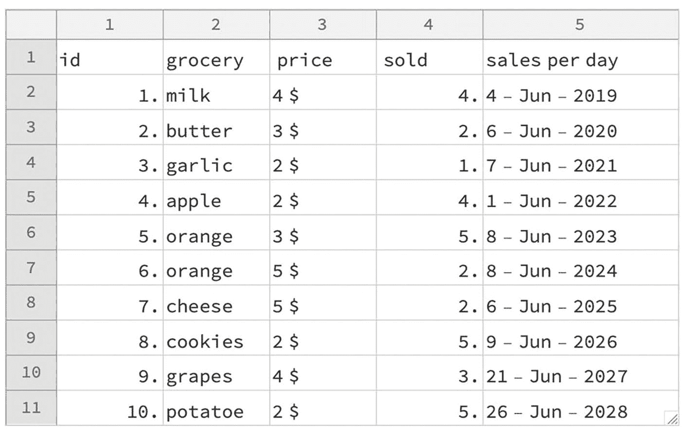
*图 4-1 使用 `TableView` 命令的电子表格视图*

```
In[13]:= TableView[Import[path, {"Data", 1}, CharacterEncoding -> "UTF-8"]]
Out[13]=
```

> **注意**
> 使用 `"Data"`，将数据作为嵌套列表导入。

现在您可以在电子表格格式中看到数据。使用 `TableView`，您可以像在电子表格软件中一样查看数据，并带有选择工具、滚动条和内容文本编辑功能。然而，缺点之一是使用 `TableView` 无法直接访问文件的内容，也无法进行计算。要进行计算，您可以将其转换为数据集。

您可以将数据转换为数据集，以便在 Mathematica 中更好地处理。通过将 `"Dataset"` 作为选项而不是 `"Data"` 输入，导入的文件将成为一个数据集，但没有标题（参见图 4-2）。要添加标题，请使用 `HeaderLines` 选项，并通过 `HeaderLines -> {# row, # column}` 选择按行或按列指定标题。使用的文件是 `Grocery List 2.xlxs`。

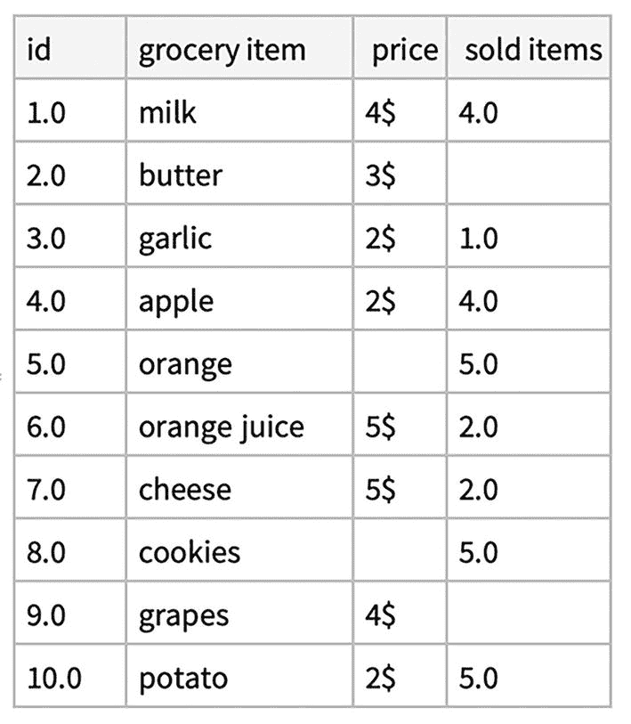
*图 4-2 不完整的购物清单数据集*

```
In[14]:= file = "/Users/macosx/Desktop/Grocery_List_2.xlsx";
Import[file, {"Dataset", 1}, HeaderLines -> 1]
Out[14]=
```

您已导入了不完整的数据。`EmptyField` 被实现为一种转换规则，用于处理空白区域。如果数据包含空白区域且未指定规则，则这些空白区域将被视为空字符串。图 4-3 显示了输出结果。

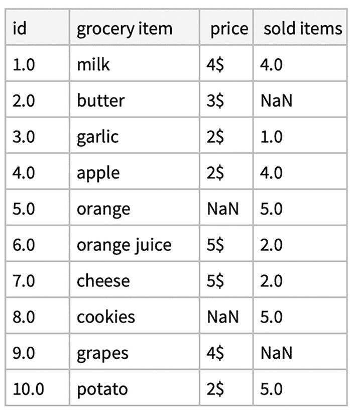
*图 4-3 填充了 NaN 的数据集*

```
In[15]:= Import[file, {"Dataset", 1}, "EmptyField" -> "NaN", HeaderLines -> 1]
Out[15]=
```

## JSON 文件

JavaScript 对象表示法（`JSON`）文件扩展名是一种数据表示文件。`JSON` 文件将数据存储为有序的值列表，每个列表由一组值对构成。要导入 `JSON` 文件，需指定两个选项：`JSON` 或 `RawJSON`。

```
In[16]:=json=Import["/Users/macosx/Desktop/Sports_cars.json","JSON"]
Out[16]=
{{Model->Enzo Ferrari,Year->2002,Cylinders->12,Horsepower HP->660,Weight Kg->1255},{Model->Koenigsegg CCX,Year->2000,Cylinders->8,Horsepower HP->806,Weight Kg->1180},{Model->Pagani Zonda,Year->2002,Cylinders->12,Horsepower HP->558,Weight Kg->1250},{Model->McLaren Senna,Year->2019,Cylinders->8,Horsepower HP->800,Weight Kg->1309},{Model->McLaren 675 LT,Year->2015,Cylinders->8,Horsepower HP->675,Weight Kg->1230},{Model->Bugatti Veyron,Year->2006,Cylinders->16,Horsepower HP->1001,Weight Kg->1881},{Model->Audi R8 Spyder,Year->2010,Cylinders->10,Horsepower HP->525,Weight Kg->1795},{Model->Aston Martin Vantage,Year->2009,Cylinders->8,Horsepower HP->926,Weight Kg->1705},{Model->Maserati Gran Turismo,Year->2010,Cylinders->8,Horsepower HP->405,Weight Kg->1955},{Model->Lamborghini Aventador S,Year->2017,Cylinders->12,Horsepower HP->740,Weight Kg->1740}}
```

鉴于 `JSON` 文件结构的特点，Mathematica 在导入时会识别每个结构，并将每个键解释为其对应的值。正如你在之前的输出中所见，键对应 `Model`、`Year`、`Cylinders`、`Horsepower` 和 `Weight`，每个键都有其对应的值。以上所有内容说明所有记录都位于一个嵌套列表中。这一结果让你得出结论：如果你想将其以数据集的形式呈现，不能直接应用 `Association`，因为 `Association` 会抑制重复的键。由于它是一个嵌套列表，你必须为每条记录创建一个关联，这可以通过 `Map` 实现，并指定 `Association` 命令的深度级别。如下代码所示。

```
In[17]:= Map[Association,Json,1]
Out[17]= {Enzo Ferrari,Year->2002,Cylinders->12,Horsepower HP->660,Weight Kg->1255|>,Koenigsegg CCX,Year->2000,Cylinders->8,Horsepower HP->806,Weight Kg->1180|>,Pagani Zonda,Year->2002,Cylinders->12,Horsepower HP->558,Weight Kg->1250|>,McLaren Senna,Year->2019,Cylinders->8,Horsepower HP->800,Weight Kg->1309|>,McLaren 675 LT,Year->2015,Cylinders->8,Horsepower HP->675,Weight Kg->1230|>,Bugatti Veyron,Year->2006,Cylinders->16,Horsepower HP->1001,Weight Kg->1881|>,Audi R8 Spyder ,Year->2010,Cylinders->10,Horsepower HP->525,Weight Kg->1795|>,Aston Martin Vantage,Year->2009,Cylinders->8,Horsepower HP->926,Weight Kg->1705|>,Maserati Gran Turismo,Year->2010,Cylinders->8,Horsepower HP->405,Weight Kg->1955|>,Lamborghini Aventador S,Year->2017,Cylinders->12,Horsepower HP->740,Weight Kg->1740|>}
```

现在每条记录都已作为关联存在，你可以将其转换为数据集，如图 4-4 所示。

图 4-4 汽车数据集  
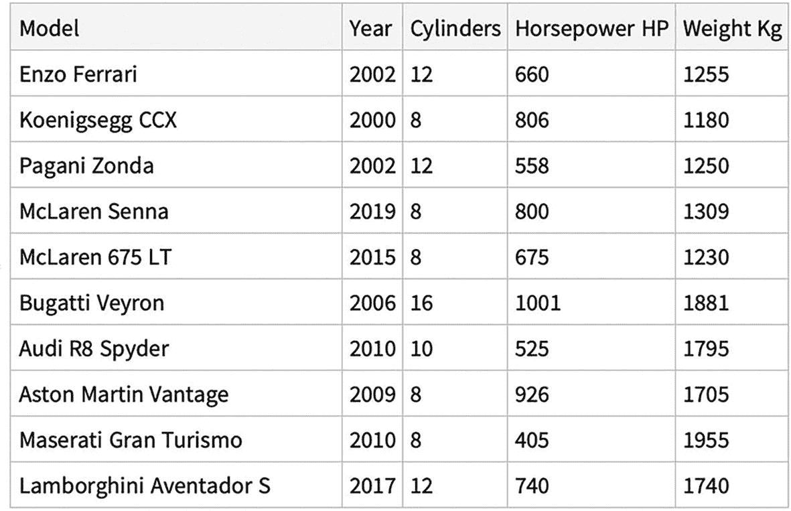  
一个包含 10 行 5 列的表格。列标题为：型号、年份、气缸数、马力（HP）和重量（千克）。型号列列出了 10 种汽车型号，包括 Enzo Ferrari、Koenigsegg CCX、Pagani Zonda、McLaren Senna、McLaren 675 LT、Bugatti Veyron 和 Audi R8 Spyder。

```
In[18]:= Dataset[%]
Out[18]=
```

现在你可以将 `JSON` 文件作为数据集来处理。然而，还有另一种方法，无需像之前那样进行大量计算。在导入文件时，你必须将其作为 `RawJson` 导入，因为使用 `RawJson` 时，Wolfram 语言会将每条记录识别并导入为一个关联列表，而不是一个单一的嵌套列表，如下所示。这是因为 `JSON` 文件扩展名的键和值的本质决定的。

```
In[19]:= Import["/Users/macosx/Desktop/Sports_cars.json","RawJSON"]
Out[19]=
{Enzo Ferrari,Year->2002,Cylinders->12,Horsepower HP->660,Weight Kg->1255|>,Koenigsegg CCX,Year->2000,Cylinders->8,Horsepower HP->806,Weight Kg->1180|>,Pagani Zonda,Year->2002,Cylinders->12,Horsepower HP->558,Weight Kg->1250|>,McLaren Senna,Year->2019,Cylinders->8,Horsepower HP->800,Weight Kg->1309|>,McLaren 675 LT,Year->2015,Cylinders->8,Horsepower HP->675,Weight Kg->1230|>,Bugatti Veyron,Year->2006,Cylinders->16, Horsepower HP->1001,Weight Kg->1881|>,Audi R8 Spyder ,Year->2010,Cylinders->10,Horsepower HP->525,Weight Kg->1795|>,Aston Martin Vantage,Year->2009,Cylinders->8,Horsepower HP->926,Weight Kg->1705|>,Maserati Gran Turismo,Year->2010,Cylinders->8,Horsepower HP->405,Weight Kg->1955|>,Lamborghini Aventador S,Year->2017,Cylinders->12,Horsepower HP->740,Weight Kg->1740|>}
```

该文件以每条记录作为关联的形式被导入，你可以将其转换为数据集。

```
In[20]:=Cars=Dataset[%];
```

作为补充，数据导入后，你可以对数据集执行操作，例如按年份从低到高对型号进行排序。

```
In[21]:=Cars[SortBy[#Year&]];
```

**注意**  
前面的示例也可以使用查询命令实现。（`Query [SortBy[#Year &]][Cars]`）。

## 网络数据

另一方面，`Import` 也支持网络数据。无需插入文件路径，而是将 URL 网址作为 `Import` 命令的参数插入。下一个示例从美国国家海洋和大气管理局（NOAA）导入一个简单的文本文件。该文本文件包含用于全球综合无线电探空仪档案（IGRA）的国家代码列表。文件所在的父目录是 [`https://www1.ncdc.noaa.gov/pub/data/igra/`](https://www1.ncdc.noaa.gov/pub/data/igra/)，但我们只导入国家列表文件。你需要连接互联网才能完成此操作。

```
In[22]:=Short[Import["https://www1.ncdc.noaa.gov/pub/data/igra/igra2-country-list.txt","HTML"]]
Out[22]//Short= AC Antigua and Barbuda AE United Arab Emirates AF ...  WS Samoa YM Yemen ZA Zambia ZI Zimbabwe ZZ Ocean
```

该文件是纯文本，但你可以通过插入文件格式作为选项来更改数据的导入方式。例如，你可以将其作为 CSV 文件导入。

```
In[23]:=Short[Import["https://www1.ncdc.noaa.gov/pub/data/igra/igra2-country-list.txt","CSV"]]
Out[23]//Short= {{AC Antigua and Barbuda},{AE United Arab Emirates},>,{ZI Zimbabwe},{ZZ Ocean}}
```

当你尝试对导入的数据进行计算时，这非常有用。或者，你可以使用 `URL` 命令来检查在线文件的状态，然后下载它。要检查在线文件的状态，请使用 `URLRead`。当文件在线时，你应该会得到一个类似图 4-5 所示的 HTTP 响应对象。你甚至可以在导入数据之前执行此操作，以确保内容在线可用。

图 4-5 所输入 URL 的 HTTPResponse 对象  
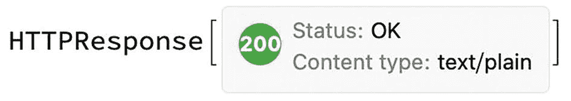  
一个 HTTP 响应对象的屏幕截图。左侧圆圈内数字为 200。状态为正常，内容类型为 text/plain。

```
In[24]:= URLRead["https://www1.ncdc.noaa.gov/pub/data/igra/igra2-country-list.txt"]
Out[24]=
```

现在你知道了状态，可以使用 `URLDownload` 下载数据文件。

```
In[25]:= URLDownload["https://www1.ncdc.noaa.gov/pub/data/igra/igra2-country-list.txt"]
Out[25]=
```

你应该会得到一个包含文件位置（见图 4-6）、名称和扩展名的文件对象；在本例中，它位于一个临时文件夹中。

图 4-6 包含已下载文件位置的文件对象  
  
一个文件对象的屏幕截图，显示了文件的位置：igra2-country-list-b7add4af-0a18-4cea-bbcd-3ec04b94f363.txt。

点击双尖括号图标可在外部查看器中打开该文件。

## 语义导入

到目前为止，你已经了解了如何导入不同格式的文件，但还有一个名为 `SemanticImport` 的工具，它可以让你以语义方式导入文件，并返回一个数据集作为结果。让我们看一个关于 CSV 文件的简单示例。

```
In[26]:= sImprt=SemanticImport["/Users/macosx/Desktop/Grocery_List.csv"]
Out[26]=
```

图 4-7 展示了当你使用语义导入时，Mathematica 会以数据集的形式导入数据，并且在此过程中，它会识别出一些量。

图 4-7 使用 `SemanticImport` 以数据集形式导入的文件  
  
一个包含 10 行 5 列的表格。列标题分别为：ID、食品杂货、价格、已售商品和每日销售额。食品杂货包括：牛奶、黄油、大蒜、苹果、橙子、橙汁、奶酪、饼干、葡萄和土豆。所有单元格均已填充。

这些量对应于数值及其单位，例如价格和每日销售额列中的元素。在处理量时，元素的颜色会发生变化；正如你在数据集中所见，这些元素与其他内容显示不同，因为它们现在由语义类型对象表示。语义对象包括量、实体、日期和地理位置。换句话说，它们是自由格式解释器根据 Wolfram 知识库做出的解释。

**注意**  
要检查数据是否被识别为量或语义类型对象，请使用 `Normal[sImprt]`；你应该会看到实体以不同颜色显示。

在导入的数据中，有两种日期类型对象（你在第一章中见过）和一种量类型。需要理解的是，要处理量，你必须了解它们的来源。

### 量

`Quantity` 命令将带有单位的数值转换为量类型，以便转换带有各自单位的数值；先输入数值，然后以字符串形式输入其单位。执行此操作时，Mathematica 会像其他情况一样显示自动补全菜单。以下示例展示了这一点。

```
In[27]:= Quantity[2,"USDollars"]
Out[27]= $2
```

因此，它被转换为量类型。当你将鼠标悬停在结果上时，会显示一个提示，表明结果已经是一个单位。在本例中，它是美元单位。现在，如果你检查表达式的头部，它会显示这是一个量类型。

**注意**  
量以浅棕色显示。

```
In[28]:= Quantity[2,"USDollars"]//Head
Out[28]= Quantity
```

你也可以在菜单栏中使用内联自由格式输入：插入 ➤ 内联自由格式输入。这种输入类型与 Wolfram Alpha 搜索引擎相关联，因此内联自由格式输入可以将自然语言转换为 Wolfram 语言输入。

在输入框内，你会看到数值和量。这种输入类型的优点之一是允许使用自然语言。以下示例输入了 `77 min` 这个量，表示 77 分钟。图 4-8 展示了内联自由格式输入的输入单元格。

图 4-8 表示 77 分钟量的自由内联自由格式输入  
  
一个输入单元格的截图，内容为“77 min”，包含一个省略号按钮和一个对勾。

```
In[29]:=

Out[29]= 77min
```

要运行代码，请按 ENTER 键，因为它会给出结果。会出现一些选项卡，你可以点击子菜单或对勾。如果你点击对勾，则表示接受所做的解释。如果你认为解释有误，可以点击另一个选项，即“替代解释”，它会显示一个小弹出窗口，列出不同的解释。图 4-9 展示了该示例的弹出窗口。

图 4-9 输入量的选项  
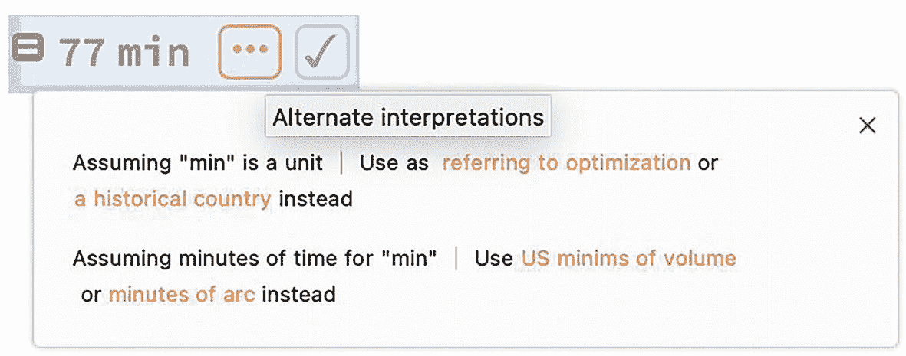  
一个输入单元格的省略号按钮弹出的窗口截图，内容为“77 min”。窗口标题为“替代解释”，包含两个关于“min”作为单位的假设，以及“min”表示时间分钟。

一旦解释被接受，结果的颜色会改变，并成为一个量类型对象。它可以像其他任何量类型对象一样使用。

当你拥有量时，不能直接在数字之间进行运算；量已经是不同的类型。对此，有两种选择：将数据转换为量，或者提取量的数值。`QuantityMagnitude` 命令用于提取数值。请确保复制实体（浅棕色输出），而不是纯文本 `77 min`。

```
In[30]:= {QuantityMagnitude[77 min],Head[%]}
Out[30]= {77,Quantity}
```

你已经提取了数值，它现在是一个整数。假如需要单位，`QuantityUnit` 命令可以提取单位。

```
In[31]:= QuantityUnit[77 min]
Out[31]= Minutes
```

### 带量纲的数据集

另一个需要强调的方面：在执行运算时，物理量之间进行算术运算的概念得以保留；否则，运算无法进行，你会得到一个单位不一致的错误。当你在量之间执行运算时，结果也属于量类型。

```
In[32]:= {77min-77min,77min+77min,77min*77min,77min/77min,77min*3m}
Out[32]= {0min,154min,5929(min)²,1,231m min}
```

这个例子展示了结果如何属于量类型。除了除法（它已经是相同单位之间的商），最后一个结果是 231 米每分钟。

回到导入的数据，你可以从价格列中提取数据，如图 4-10 所示。

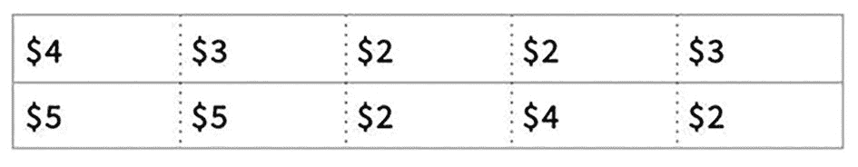

一个包含 5 列 2 行价格数据的表格。第一行依次为：$4、$3、$2、$2、$3。第二行依次为：$5、$5、$2、$4、$2。

`图 4-10` 价格列

```
In[33]:= sImprt[[All,"price"]]
Out[33]=
```

如果你想将它们放入一个列表中，必须使用 `Normal` 命令。

```
In[34]:= Normal[%]
Out[34]= {$ 4,$ 3,$ 2,$ 2,$ 3,$ 5,$ 5,$ 2,$ 4,$ 2}
```

结果是一个列表，但元素是量类型。可以说，你可以对量进行运算，但如果重要的是数值大小，你可以将其提取出来。值得注意的是，仅处理数值大小通常更快、更高效，这减少了处理量带来的额外开销。除非需要特定的量，否则转换为纯数字可能是更优的选择。

让我们看看如何操作。

```
In[35]:= QuantityMagnitude[#]&[%]
Out[35]= {4,3,2,2,3,5,5,2,4,2}
```

现在你只处理数值大小。

你甚至可以处理日期和量，如图 4-11 所示，首先显示产品 ID 及其销售日期。

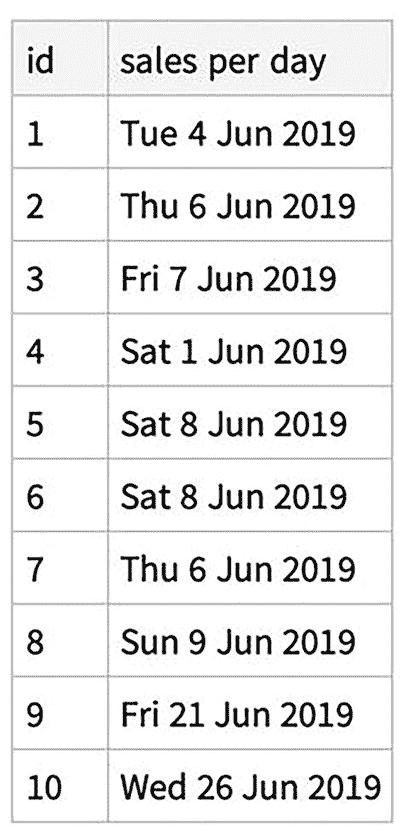

一个包含 10 行 2 列的表格。列名分别为 ID 和每日销量。ID 1 到 10 在每日销量列下对应着 2019 年 6 月的日期。

`图 4-11` ID 和每日销量列

```
In[36]:= sImprt[[All,{"id","sales per day"}]]
Out[36]=
```

完成此操作后，你可以提取值并直接处理日期对象类型。

```
In[37]:= Normal[Values[%]]//InputForm
Out[37]//InputForm=
{{1, DateObject[{2019, 6, 4}, "Day"]},
 {2, DateObject[{2019, 6, 6}, "Day"]},
 {3, DateObject[{2019, 6, 7}, "Day"]},
 {4, DateObject[{2019, 6, 1}, "Day"]},
 {5, DateObject[{2019, 6, 8}, "Day"]},
 {6, DateObject[{2019, 6, 8}, "Day"]},
 {7, DateObject[{2019, 6, 6}, "Day"]},
 {8, DateObject[{2019, 6, 9}, "Day"]},
 {9, DateObject[{2019, 6, 21}, "Day"]},
 {10, DateObject[{2019, 6, 26}, "Day"]}}
```

每个值都使用 `DateObject` 表示一个日期，可以轻松地使用 `AbsoluteTime` 转换为数值。这对于涉及日期的数值运算非常方便，使数据处理更加灵活高效。

> **注意：** 在测试代码时，你应该得到日期对象，而不是纯文本；这里使用 `InputForm` 是为了避免图像冲突。

了解这一点后，你可以在每个产品的 ID 与其销售日期之间建立关联，在嵌套列表内部应用 `Rule` 命令并创建关联。

```
In[38]:= Association[Apply[Rule,%,1]]//InputForm
Out[38]//InputForm=
<|1 -> DateObject[{2019, 6, 4}, "Day"],
  2 -> DateObject[{2019, 6, 6}, "Day"],
  3 -> DateObject[{2019, 6, 7}, "Day"],
  4 -> DateObject[{2019, 6, 1}, "Day"],
  5 -> DateObject[{2019, 6, 8}, "Day"],
  6 -> DateObject[{2019, 6, 8}, "Day"],
  7 -> DateObject[{2019, 6, 6}, "Day"],
  8 -> DateObject[{2019, 6, 9}, "Day"],
  9 -> DateObject[{2019, 6, 21}, "Day"],
  10 -> DateObject[{2019, 6, 26}, "Day"]|>
```

为了说明这一点，创建一个时间线可视化，如图 4-12 所示，标记已售出的产品及其销售日期。

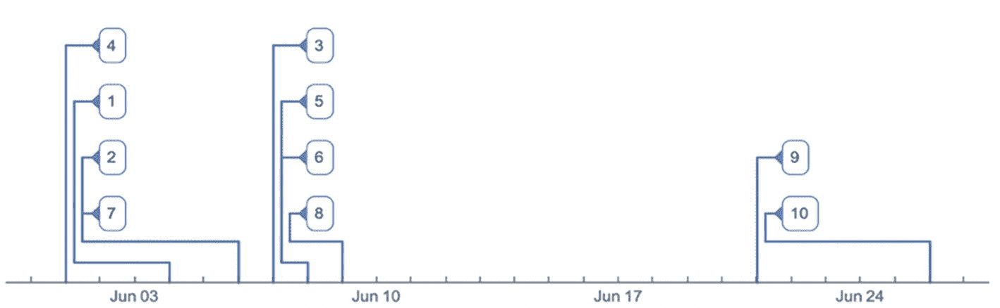

六月份的时间线。ID 4 最早，其次是 1、2 和 7（大约在 6 月 3 日左右），然后是 3、5、6 和 8（大约在 6 月 10 日左右），最后是 9 和 10（大约在 6 月 24 日左右）。

`图 4-12` 时间图

```
In[39]:= TimelinePlot[%]
Out[39]=
```

每个已售杂货商品的日期通过 ID 显示。当光标悬停在时间线上的数字上时，工具提示会显示确切日期。

关键在于，当你使用 `SemanticImport` 时，可以整合 Wolfram 语言的不同形式，并了解如何在导入数据时利用这一点。语义导入使得将数据与其他选定数据进行比较成为可能。`SemanticImport` 为你提供了处理各种语义对象类型的工具。需要重点观察的是，你可以导入货币类型、日期以及任何带有相应单位的量纲，而不是导入标准文本，正如前面的例子所示。这使得数据能够与 Wolfram 语言中的不同命令相关联。

### 自定义导入（处理大型数据集）

关于语义导入，我们已经说了很多。你可以导入数据，并选择如何解释导入文件中每一列的内容。然而，基于你之前看到的相同理念，使用语义导入，你还可以选择要导入哪些数据（例如，只导入某一列或某几列），如图 4-13 所示。

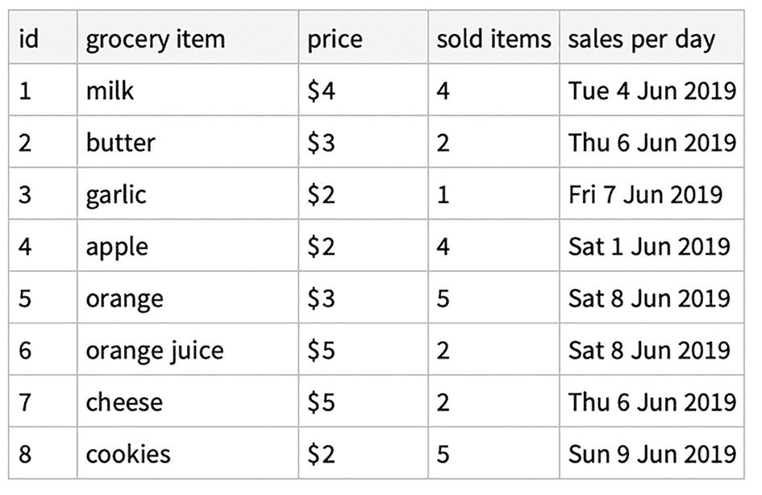

一个包含 8 行 5 列的表格。列标题分别为：ID、食品杂货、价格、已售商品、每日销售额。食品杂货包括：牛奶、黄油、大蒜、苹果、橙子、橙汁、奶酪和饼干。

`图 4-13` 排除了部分行的数据集

```
In[40]:= SemanticImport["/Users/macosx/Desktop/Grocery_List.csv",{"Integer","String","Currency","Real","Date"}]
Out[40]=
id    grocery item  price  sold items  sales per day
1     milk          $ 4    4.0         Tue 4 Jun 2019
2     butter        $ 3    2.0         Thu 6 Jun 2019
3     garlic        $ 2    1.0         Fri 7 Jun 2019
4     apple         $ 2    4.0         Sat 1 Jun 2019
5     orange        $ 3    5.0         Sat 8 Jun 2019
6     orange juice  $ 5    2.0         Sat 8 Jun 2019
7     cheese        $ 5    2.0         Thu 6 Jun 2019
8     cookies       $ 2    5.0         Sun 9 Jun 2019
9     grapes        $ 4    3.0         Fri 21 Jun 2019
10    potato        $ 2    5.0         Wed 26 Jun 2019
```

通过这个结果，可以观察到导入的第一列包含整数，第二列包含文本，第三列包含货币类型数量，第四列包含实数，最后一列包含日期对象。完成此操作后，与处理电子表格文件类似，你可以按列或按行导入列表形式的特定类型信息。以下示例导入了第 1 到第 5 行。

```
In[41]:=SemanticImport["/Users/macosx/Desktop/Grocery_List.csv",Automatic,"Rows"][[1;;5]]//InputForm
Out[41]//InputForm= {{1, "milk", Quantity[4, "USDollars"], 4, DateObject[{2019, 6, 4}, "Day"]}, {2, "butter", Quantity[3, "USDollars"], 2, DateObject[{2019, 6, 6}, "Day"]}, {3, "garlic", Quantity[2, "USDollars"], 1, DateObject[{2019, 6, 7}, "Day"]}, {4, "apple", Quantity[2, "USDollars"], 4, DateObject[{2019, 6, 1}, "Day"]}, {5, "orange", Quantity[3, "USDollars"], 5, DateObject[{2019, 6, 8}, "Day"]}}
```

如前所述，也可以导入第 1 到第 2 列。

```
In[42]:=SemanticImport["/Users/macosx/Desktop/Grocery_List.csv",Automatic,"Columns"][[1;;2]]
Out[42]= {{1,2,3,4,5,6,7,8,9,10},{milk,butter,garlic,apple,orange,orange juice,cheese,cookies,grapes,potato}}
```

需要强调的是，如果你想排除数据，建议使用 `ExcludedLines` 语句进行导入。例如，排除第 9 行和第 10 行，请记住标题在第 1 行，如图 4-13 所示。

```
In[43]:=SemanticImport["/Users/macosx/Desktop/Grocery_List.csv",ExcludedLines->{{10},{11}}]
Out[43]=
```

在处理大型数据集时，管理内存使用至关重要。请检查你的系统是否能处理大数据量。如果数据量太大无法一次性导入，请尝试分小块导入，并根据需要过滤/管理数据。以下示例使用 `Select` 中的纯函数，根据指定条件从 `buildings.dat` 数据集中有效地选择了前 10 栋建筑（见图 4-14）。

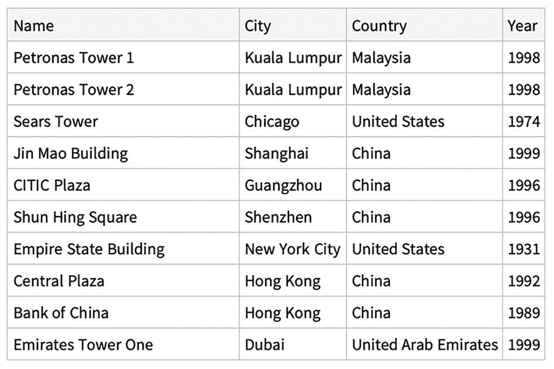

一个包含 10 行 4 列的表格。列标题分别为：名称、城市、国家和年份。建筑名称包括：双子塔 1 号和 2 号、西尔斯大厦、金茂大厦、中信广场、信兴广场、帝国大厦、中环广场、中国银行大厦和阿联酋大厦一号楼。

`图 4-14` 选定了部分行的建筑数据集

```
In[44]:= SemanticImport["ExampleData/buildings.dat",Automatic,"City"->Automatic,"Country"->Automatic,"Year"->Automatic|>,HeaderLines->1];
Select[%,#[[4]]<=2000&][[1;;10]]
Out[45]=
```

根据 `Year` 列（索引 4）小于或等于 2000 的条件来过滤数据集。然后，使用 `[[1;; 10]]` 从过滤后的数据集中选择前十个元素，即满足条件的前十栋建筑。

## 导出

Mathematica 支持多种格式；要查看所有支持的格式，请输入 `$ExportFormats`。

```
In[46]:= Short[$ExportFormats,5]
Out[46]//Short= {3DS,AC,ACO,AIFF,ASE,AU,AVI,Base64,Binary,Bit,BLEND,BMP,BREP,BSON,Byte,BYU,BZIP2,C,CDF,>,WDX,WebP,WL,WLNet,WMLF,WXF,X3D,XBM,XGL,XHTML,XHTMLMathML,XLS,XLSX,XML,XPORT,XYZ,ZIP,ZPR,ZSTD}
```

导出数据通过 `Export` 命令执行。`Export` 的格式为 `Export["目录路径", 表达式, "格式"]`。

首先，你需要设置一个工作目录。如果没有设置，文件将导出到 Mathematica 的默认工作目录。要查看默认工作目录，请使用 `Directory`。

```
In[47]:= Directory[]
Out[47]= /Users/macosx
```

在此例中，默认目录是桌面文件夹。

有两个关键命令：一个是 `SetDirectory`，其参数是新工作目录的路径；另一个是 `NotebookDirectory`，即文件所在位置。

首先，让我们将新工作目录设置为笔记本所在位置，以便将文件导出到该位置。将笔记本目录作为 `SetDirectory` 的参数，你告诉 Mathematica 新工作目录就是你当前正在使用的笔记本所在位置。

```
In[48]:= SetDirectory[NotebookDirectory[]]
Out[48]= /Users/macosx/Desktop
```

现在你已经设置好了新目录，可以导出在 Mathematica 中创建的数据了。下一个示例将 1 到 10 的质数列表分别导出为文本文件中的表格和 CSV 文件。与 `Import` 一样，也可以使用选项，但如果添加了文件扩展名，则不必强制写入格式选项。

**注意：** 无论是为数据列表指定名称，还是直接在导出中创建数据，都没有限制。

```
In[49]:= mydata=Table[Prime[i],{i,1,10}];
{Export["New_File.txt",mydata,"Table"], Export["New_File.csv",mydata]}
Out[50]= {New_File.txt,New_File.csv}
```

输出会生成已导出新文件的名称。另一种方法是手动输入文件的目标位置，而不是设置新的工作目录；在此例中，桌面被设置为新位置。

```
In[51]:= Export["/Users/macosx/Desktop/New_File.TSV",mydata,"TSV"]
Out[51]= /Users/macosx/Desktop/New_File.TSV
```

现在你已经将数据导出到了新位置，输出结果就是新文件的完整路径。如果你想从 Mathematica 中打开该文件，可以使用 `SystemOpen`。此命令会打开操作系统的资源管理器。

```
In[52]:= SystemOpen["/Users/macosx/Desktop/New_File.TSV"]
```

`SystemOpen` 允许你打开笔记本目录文件夹，以便打开该目录下的其他文件。

```
In[53]:= SystemOpen[NotebookDirectory[]]
```

另一方面，在处理表格数据时，可以将其导出为电子表格。下一个示例先创建一个表格数据结构，然后将其导出为电子表格格式。

要创建表格数据，我们使用 `Table` 命令。

```
In[54]:=
tabD1=Table[i,{i,4}];
tabD2=SetPrecision[Table[i/11,{i,4}],3];
```

现在你已经有了一组坐标，可以通过将数据的引用名称输入到选项列表中来将数据导出到不同的工作表：`{数据 _ 工作表 1, 数据 _ 工作表 2, ...}`

```
In[56]:= Export["Tabular_data.xls",{{tabD1},{tabD2}}]
Out[56]= Tabular_data.xls
```

用电子表格查看器打开该文件，你应该会看到 `tabD1` 在工作表 1 中，`tabD2` 在工作表 2 中。

要自定义工作表的名称，你需要使用规则运算符（`➤`）将名称作为规则列表输入。

```
In[57]:= Export["Tabular_data_2.xls",{"Page number 1"->tabD1,"Page number 2"->tabD2}]
Out[57]= Tabular_data_2.xls
```

如果你打开该文件，现在应该会看到两个工作表，其名称就是你设置的名字。

除此之外，还可以将相同的数据放在单个电子表格中。要做到这一点，你只需将要放在同一工作表中的数据用花括号括起来。

```
In[58]:= Export["New_data.xls",Transpose[{tabD1,tabD2}]]
Out[58]= New_data.xls
```

打开文件后，你应该会看到类似以下代码的内容。

```
In[59]:= Grid[Transpose[{tabD1,tabD2}]]
Out[59]=
1    0.0909
2    0.182
3    0.273
4    0.364
```

你甚至可以导出表格。

```
In[60]:= table1={{"Dog","Wolf"},{"Cat","Leopard"},{"Pigeon","Shark"}};
Export["Animal_table.xls",table1]
Out[61]= Animal_table.xls
```

### 其他格式

通过推进主题，可以将数据导出为简单的格式，例如 `TXT`、`DAT`、`CSV` 和 `CSV`。为此，您只需放置要导出到的文件路径，以及新文件的名称，后跟所需文件的扩展名。第二个参数写入要导出的数据或包含数据的变量。第三个参数指定您希望数据导入的格式。

让我们看下面的示例，该示例将新数据导出为文本和 `DAT` 格式。在这种情况下，您只需写入文件名，这表明您希望将其导出到之前建立的工作目录，该目录对应于笔记本的目录。

```
In[62]:= newD=Table[{i+j,i*j},{i,1,5},{j,1,5}];
{Export["File_text.txt",newD,"Text"],Export["File_dat.dat",newD,"Table"]}
Out[63]= {File_text.txt,File_dat.dat}
```

建议稍作停顿。如前面的代码所示，`Table` 格式用于 `DAT` 文件。这是因为使用了 `Table`，以便导出的数据成为 Wolfram 语言中的表达式。导出后，请验证文件是否已导出。同样，您可以为文件选择格式。例如，您可以将其导出为 `TSV` 格式，而不是输入文本。

```
In[64]:= Export["File_text.txt",newD,"TSV"]
Out[64]= File_text.txt
```

类似地，您可以导出 `CSV` 和 `TSV` 文件。

```
In[65]:={Export["File_csv.csv",newD,"CSV"],Export["File_tsv.tsv",newD,"TSV"]}
Out[65]= {File_csv.csv,File_tsv.tsv}
```

可以为导出时的数据列添加标题，无论是 `CSV` 还是 `TSV` 格式。

```
In[66]:= Export["File_csv.csv",newD,"CSV",TableHeadings->{"column 1","column 2","column 3","column 4","column 5"}]
Out[66]= File_csv.csv
```

也可以如下定义列名称列表。

```
In[67]:= labels={"Coordinates 1","Coordinates 2","Coordindates 3","Coordinates 4","Coordindates 5"};Export["File_csv.csv",newD,"CSV",TableHeadings->labels]
Out[67]= File_csv.csv
```

同样，您可以将数据集导出为已知格式。让我们使用基于速度的汽车制动距离统计数据。为此，使用 `ExampleData` 命令加载数据。在其中搜索 `"Statistics"`；然后在其中搜索 `"CarStoppingDistances"`。

```
In[68]:= spData=ExampleData[{"Statistics","CarStoppingDistances"}]
Out[68]={{4,2},{4,10},{7,4},{7,22},{8,16},{9,10},{10,18},{10,26},{10,34},{11,17},{11,28},{12,14},{12,20},{12,24},{12,28},{13,26},{13,34},{13,34},{13,46},{14,26},{14,36},{14,60},{14,80},{15,20},{15,26},{15,54},{16,32},{16,40},{17,32},{17,40},{17,50},{18,42},{18,56},{18,76},{18,84},{19,36},{19,46},{19,68},{20,32},{20,48},{20,52},{20,56},{20,64},{22,66},{23,54},{24,70},{24,92},{24,93},{24,120},{25,85}}
```

要获取数据集的列和描述，请添加 `Description` 和 `ColumnDescriptions`。

```
In[69]:= ExampleData[{"Statistics","CarStoppingDistances"},#]&/@{"Description","ColumnDescriptions"}
Out[69]= {Car stopping distances as a function of speed.,{Speed in miles per hour.,Stopping distance in feet.}}
```

继续探索，您会看到第一个数字代表以英里每小时为单位的速度，第二个数字代表以英尺为单位的距离。

**注意**

如需更多信息，请将属性作为第二个参数添加到 `ExampleData`。

继续练习，您可以添加列标题。这在您构建数据集时区分了每种数据类型（见图 4-15）。

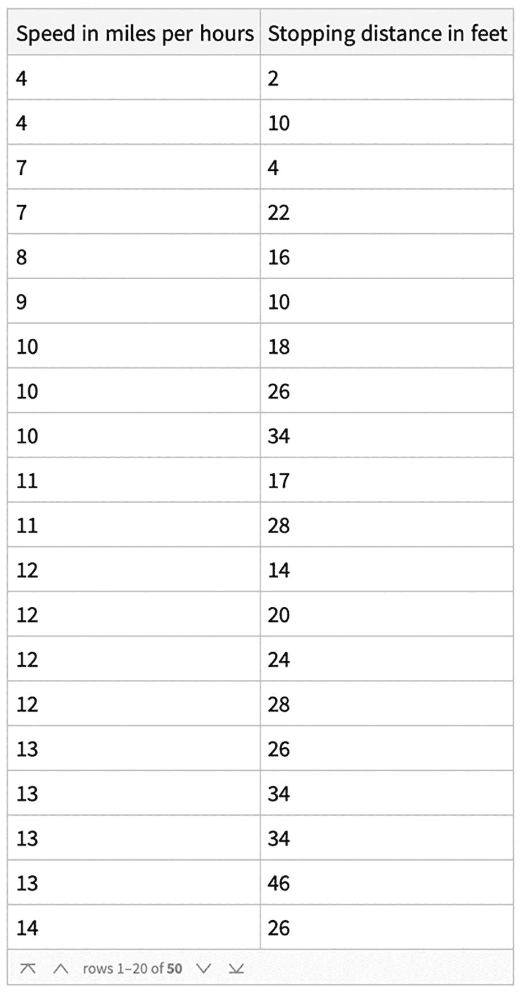

一个包含 20 行和 2 列的表格。列名是速度（英里/小时）和停止距离（英尺）。页脚显示：第 1 到 20 行，共 50 行。

**图 4-15** `CarStoppingDistances` 数据集

```
In[70]:= spDataset=Dataset[spData,Background->LightBlue][All,1,#2->2|>]&["Speed in miles per hours","Stopping distance in feet"]
Out[70]=
```

您已完成数据集的创建。现在可以将此数据和相应的列标题导出为 `CSV` 格式。

```
In[71]:= Export["Dataset_csv.csv",spDataset,"CSV"]
Out[71]= Dataset_csv.csv
```

如果导出成功，您应该会得到一个格式正确的 `CSV` 文件。对于 `TSV` 文件的情况，请参见以下形式。

```
In[72]:= Export["Dataset_tsv.tsv",spDataset,"TSV"]
Out[72]= Dataset_tsv.tsv
```

### XLS 和 XLSX 格式

值得区分的是，要将数据集导出为电子表格格式（如 `XLS` 或 `XLSX`），您应该将数据集作为列表处理，因为直接导出数据集会导致关联被导出到单个单元格中，而这不是您想要的。关于第二点，既然您已经有了数据集，要提取值，请使用 `Normal` 命令，该命令将数据集转换为普通表达式，然后使用 `Values` 从大括号中提取值。

```
In[73]:= Values@Normal@spDataset
Out[73]={{4,2},{4,10},{7,4},{7,22},{8,16},{9,10},{10,18},{10,26},{10,34},{11,17},{11,28},{12,14},{12,20},{12,24},{12,28},{13,26},{13,34},{13,34},{13,46},{14,26},{14,36},{14,60},{14,80},{15,20},{15,26},{15,54},{16,32},{16,40},{17,32},{17,40},{17,50},{18,42},{18,56},{18,76},{18,84},{19,36},{19,46},{19,68},{20,32},{20,48},{20,52},{20,56},{20,64},{22,66},{23,54},{24,70},{24,92},{24,93},{24,120},{25,85}}
```

现在您有了数据，可以添加列标题并导出从数据集中提取的数据。

```
In[74]:= colTitles={"Speed in miles per hours","Stopping distance in feet"};
```

要附加这两个列表，让我们使用 `Prepend` 并将新值命名为 `exprtData`。

```
In[75]:= Short[exprtData=Prepend[%%,colTitles],1]
Out[75]//Short= {{Speed in miles per hours,Stopping distance in feet},{4,2},{4,10},>,{24,93},{24,120},{25,85}}
```

您没有定义变量来组合此数据列表和标题。使用百分比符号是为了简化代码。现在您有了完整的数据，可以将其导出为 `XLS` 或 `XLSX` 格式。

```
In[76]:= Export["Stopping_distance_Dataset.xlsx",exprtData,"XLSX"]
Out[76]= Stopping_distance_Dataset.xlsx
```

如果您验证该文件，您应该会得到类似于之前创建的数据集的内容。

### JSON 格式

也可以将信息导出为 JSON 等格式。以下示例从一个关联中创建了一个 JSON 结构。

```
In[77]:= Association@{"Name"->"Ellis","Date of birth"->"1990,01,04","Height"->"180 cm","Favorite color"->"Red","Hobbies"->"Soccer, Pc gaming, Board games","Social netwoks"->"Twitter, Facebook"};
Export["File_json.json",%,"JSON"]
Out[78]= File_json.json
```

如果你打开这个新的 JSON 文件，会发现其结构与 JSON 文件相对应。对于嵌套列表的情况，过程也是相同的，不过你也可以在导出时使用 `"Rawjson"` 格式。其核心思想是，你可以从关联中将数据导出为 JSON 格式；如你所见，关联的键和值可以是任何表达式。这意味着可以添加更多关联，并且这些关联也可以被导出。需要特别注意的一点是，鉴于 JSON 格式具有键值对成对出现的特性，从关联中导出 JSON 格式的数据是可行的。当处理数据集时（见图 4-16），请按如下步骤操作。


一个包含 5 行 2 列的表格。姓名为 Ellis，出生日期为 1990 年 1 月 4 日星期四，身高为 180 厘米，最喜欢的颜色是红色，爱好是足球、电脑游戏和棋盘游戏，社交网络是 Twitter 和 Facebook。

**图 4-16** JSON 文件数据集

```
In[79]:=Association@{"Name"->"Ellis","Date of birth"->DateObject[{1990,01,04}],"Height"->Quantity[180,"Centimeters"],"Favorite color"->"Red","Hobbies"->"Soccer, Pc gaming, Board games","Social netwoks"->"Twitter, Facebook"};
user=Dataset[%]
Out[80]=
```

数据集已构建完成，但在某些情况下，数据集中可能包含数量或其他语义对象，例如本例中的日期和身高。因此，导出它们的方式与之前相同，但需要使用 JSON 选项格式，而不是 `Rawjson`，因为后者不允许导出数据集对象。要使用 `Rawjson`，必须将语义对象转换为字符串或数字。

```
In[81]:= Export["Dataset_json.json",user,"JSON"]
Out[81]= Dataset_json.json
```

如果你有一个包含重复键的数据集，可以将其导出为 JSON 格式（见图 4-17）。

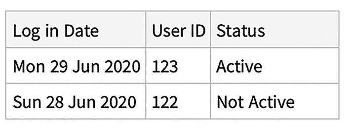

一个包含 3 列 2 行的表格。列标题为登录日期、用户 ID 和状态。第一行内容为 2020 年 6 月 29 日星期一、123、活跃。第二行内容为 2020 年 6 月 28 日星期日、122、不活跃。

**图 4-17** 用户数据集

```
In[82]:= assoc1=DateObject[{2020,06,29}],"User ID"->123,"Status"->"Active"|>;
assoc2=DateObject[{2020,06,28}],"User ID"->122,"Status"->"Not Active"|>;Dataset[{assoc1,assoc2}]
Export["Dataset2_json.json",%,"JSON"]
Out[83]=
```

```
Out[84]= Dataset2_json.json
```

准确地说，你可以导出包含复杂结构（例如关联的关联）的数据集形状。让我们看下面的示例，它构建了一个数据集（见图 4-18）。

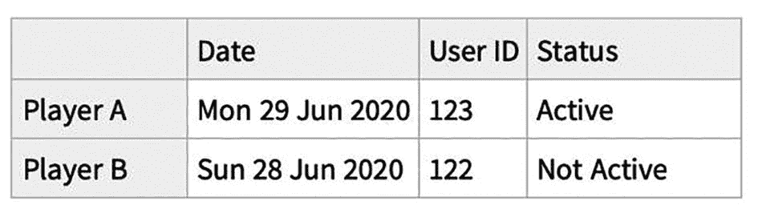

一个包含 3 列 2 行的表格。列标题为日期、用户 ID 和状态。行标题为玩家 A 和玩家 B。玩家 A 的行内容为 2020 年 6 月 29 日星期一、123、活跃。玩家 B 的行内容为 2020 年 6 月 28 日星期日、122、不活跃。

**图 4-18** 带标签的数据集

```
In[85]:= assoc3="Player A"->Association["Date"->DateObject[{2020,06,29}],"User ID"->123,"Status"->"Active"];assoc4="Player B"->Association["Date"->DateObject[{2020,06,28}],"User ID"->122,"Status"->"Not Active"];Dataset[{}]
Out[85]=
```

随后，继续导出数据集。

```
In[86]:= Export["Dataset3_json.json",%,"JSON"]
Out[86]= Dataset3_json.json
```

让我们尝试更好地理解如何以 JSON 格式导出。当你导出规则列表或单个关联等信息时，导出的 JSON 文件中的内容结构是通过键值对集合来组织的。相反，当你拥有有序结构（例如列表的关联和关联的关联）时，JSON 文件中的内容结构则表现为一个有序数组，该数组位于键值对集合的数组内部。恰恰相反，导出嵌套列表时，它已经是排序数组的形式了。为了澄清这一点，读者可以通过以下代码观察规则列表是如何导出的。

```
In[87]:= rules={"apple"->3,"car"->"3","2"->2};
Export["Rules.json",rules,"JSON"]
Out[88]= Rules.json
```

此外，对于嵌套列表或列表的列表：

```
In[89]:= arry=Array[{#1,#2}&,{4,4}]
Export["Array.json",arry,"JSON"]
Out[89]= {{{1,1},{1,2},{1,3},{1,4}},{{2,1},{2,2},{2,3},{2,4}},{{3,1},{3,2},{3,3},{3,4}},{{4,1},{4,2},{4,3},{4,4}}}
Out[90]= Array.json
```

如果观察创建的文件，它必须在 JSON 文件内部包含一个数组的数组。

### 内容文件对象

应该得出结论，对于所有导出的文件，你可以创建一个内容对象来显示所创建文件的属性。这是通过 `ContentObject` 函数完成的，该函数提供文件的内容。让我们使用关联的示例来创建一个 JSON 文件以执行此操作。

```
In[91]:= Association@{"Name"->"Ellis","Date of birth"->DateObject[{1990,01,04}],"Height"->Quantity[180,"Centimeters"],"Favorite color"->"Red","Hobbies"->"Soccer, Pc gaming, Board games","Social netwoks"->"Twitter, Facebook"};
user=Dataset[%];
jsonFile=Export["Dataset_json_2.json",user,"JSON"];
```

现在，你需要使用 `AbsoluteFileName` 获取文件所在的路径。

```
In[94]:= AbsoluteFileName[jsonFile]
Out[94]= /Users/macosx/Desktop/Dataset_json_2.json
```

现在，让我们使用该文件来创建文件对象类型的表示。然后，将 `ContentObject` 应用于该文件对象。

```
In[95]:= ContentObject[%]
Out[95]=
```

出现一个内容类型对象（见图 4-19）。

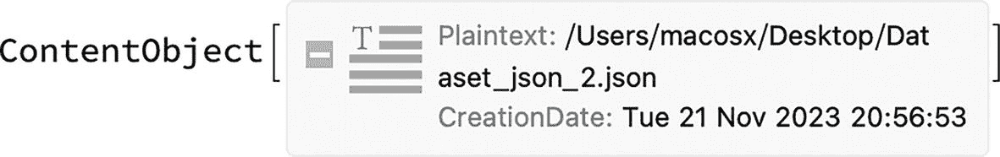

一个内容对象的截图，左侧有一个段落图标。纯文本内容为：/Users/macosx/Desktop/Dataset_json_2.json。创建日期为 2023 年 11 月 21 日星期二 20:56:53。

**图 4-19** 为创建的 JSON 文件生成的 `ContentObject`

按下 `+` 图标可以查看导出文件的属性，例如名称、大小、创建日期和文件位置。你可以使用以下形式以编程方式访问这些属性。

```
In[96]:= ContentObject[%%]["Properties"]
Out[96]= {CreationDate,Plaintext}
```

这也可以应用于其他导出的文件。

## 使用 Wolfram 语言搜索文件

借助 Wolfram 语言，你可以查看一个或多个文件的位置。

`NotebookDirectory` 命令用于查看笔记本目录的路径。它会显示你当前正在使用的笔记本所在的完整目录。

```
In[97]:= NotebookDirectory[]
Out[97]= /Users/macosx/Desktop/
```

现在，使用 `SetDirectory` 将某个工作目录设置为当前目录。你可以输入所需目录的路径，并将其设为工作目录。不过，这里我们将笔记本目录设置为新的工作目录。

```
In[98]:= SetDirectory[NotebookDirectory[]]
Out[98]= /Users/macosx/Desktop
```

设置好这个新目录后，你就可以在新目录（即笔记本所在位置）中查找文件了。在这里，`FileNames` 命令让你能够探索工作目录中的文件，在本例中，由于前一段代码的设置，工作目录就是笔记本的目录。

```
In[99]:= FileNames[]
Out[99]= {Color_table.txt,Grocery_List.csv,Hello_World,Hello_World.
txt,import export.nb,weather.csv}
```

`FileNames` 会显示目录中所有可用的文件类型。如果目录中有很多文件，你可以使用 `FindFile` 并输入文件名（作为字符串）来搜索特定文件。系统会显示该文件的完整路径。

```
In[100]:= FindFile["Color_table.txt"]
Out[100]= /Users/macosx/Desktop/Color_Table.txt
```

文件扩展名也可以被搜索。

```
In[101]:= FileNames["*.txt"]
Out[101]= {Color_table.txt,File_text.txt,Hello_World.txt,New_File.txt}
```

**注意**

还有其他类型的 `File` 命令；要查找与文件名相关的更多命令，请输入 `??File*`。

请记住，这是在将工作目录设置为笔记本目录的情况下。如果你之前没有设置过目录，Mathematica 会搜索你机器的默认目录，这些目录可以通过输入 `$Path` 来查看。

## 连接到外部服务

除了导出和导入功能外，Mathematica 还可以连接到各种外部服务，例如外部资源、外部连接以及通过外部评估进行数据库管理。

### 外部连接

随着 Mathematica 13 版本的发布，特别是在与外部服务连接方面，进行了多项改进。一个显著的特性是外部评估器，它支持与多种语言进行交互，例如 Julia、Ruby、R、Python、Java、Octave、Node.js、Shell 和 SQL。要发现并使用已安装的评估器系统，请使用 `FindExternalEvaluators`，它会扫描标准目录，以便在任何本地评估中使用。

执行不带参数的 `FindExternalEvaluators[]`，会搜索你计算机上所有可用的语言。让我们查找 Shell 评估器的版本。在 macOS 上，它通常指 Bash shell；在 Windows 上，则通常是 PowerShell。

```
In[102]:= FindExternalEvaluators["Shell"]//Normal//Print
Out[102] =
,
b217afb1-d97f-3cfa-3c52-19ec78df64bc → ,
342330ff-7009-e5ec-c00a-86949f3c0f7a → |>
```

在这种情况下，输出列出了三个 shell 版本：Bash（Bourne Again SHell）、Sh（Bourne Shell）和 Zsh（Z Shell）。

**注意**

如果 `Registered` 值未设置为 `True` 或 `Automatic`，则无法使用该外部语言。如需故障排除，请访问 Wolfram 文档页面：[`https://reference.wolfram.com/language/workflowguide/ConnectingToExternalSoftware.xhtml`](https://reference.wolfram.com/language/workflowguide/ConnectingToExternalSoftware.xhtml)。

一旦外部评估器注册成功，就可以通过 `ExternalEvaluator` 来使用它。你可以直接应用 `ExternalEvaluate` 函数，或者在新单元格中键入 `>` 来启动命令行（此时会出现一个黄色块状线条）。从左侧图标的下拉列表中选择你的语言，或者直接将其作为字符串输入，然后输入代码，如图 4-20 所示。

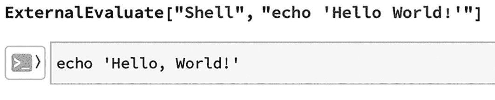

一个 Z shell 代码片段和一个命令块。shell 脚本内容为：`ExternalEvaluate["Shell", "echo 'Hello World!'"]`。该块内容为：`echo 'Hello World!'`。

**图 4-20** 使用 `ExternalEvaluate` 和 `>` 类型命令块对 Z shell 代码进行外部评估

执行以下代码将使用 Z shell 打印出 “Hello World!”。生成的退出代码为 0，表示成功，并作为标准笔记本输出显示（见图 4-21）。

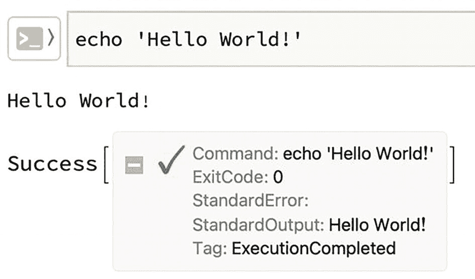

一个命令块和外部评估器的截图。该块内容为：`echo 'Hello World!'`。评估成功，命令后跟退出代码 0、标准输出 `Hello World!` 以及标签“执行完成”。

**图 4-21** 使用 Z shell 代码 `Hello World!` 进行外部评估

```
In[103]:=
Out[103]=
```

根据你打算使用的外部语言，可能需要满足不同的先决条件，例如额外的库和该语言的可执行文件。虽然语言单元格很方便，但 `ExternalEvaluate` 提供了更灵活的程序化输出方式。

### 外部资源

上一节重点介绍了 `ExternalEvaluate` 在笔记本中集成外部语言的作用。尽管如此，Mathematica 也可以生成和利用外部资源，例如外部函数。本书编写时使用的是 Node.js 21.2.0 版本。可以从官方网站或经批准的仓库安装。本例中使用了 `Homebrew` 包安装程序。根据 Wolfram 文档，使用 Node.js 需要 `zeromq` 库，该库通过 `npm` 安装。

**注意**

有关详细信息，请访问 Wolfram 文档。用于 `ExternalEvaluate` 的 NodeJS：[`https://reference.wolfram.com/language/workflow/ConfigureNodeJSForExternalEvaluate.xhtml`](https://reference.wolfram.com/language/workflow/ConfigureNodeJSForExternalEvaluate.xhtml)

要自动识别 Node.js，请使用 `FindExternalEvaluators["NodeJS"]`，类似于 shell 语言的处理过程。如果成功，`Registered` 将显示为 `Automatic`，表示设置完成。如果出现 `MissingDependencies`，则 Mathematica 无法找到必要的依赖项，需要手动注册。无论如何，建议通过添加可执行文件的路径来手动注册外部计算器，以确保其正常运行。

与 shell 过程类似，要自动检测 Node.js，请使用 `FindExternalEvaluators["NodeJS"]`。如果 `Registered` 显示为 `Automatic`，则所有设置均已完成。如果显示 `MissingDependencies`，则 Mathematica 缺少所需的依赖项，需要手动注册。无论如何，您都应该通过添加可执行文件的路径来手动注册外部计算器，以确保其正常运行。

```
In[104]:= RegisterExternalEvaluator["NodeJS","/opt/homebrew/bin/node"]
Out[104]= 629ba62a-8d17-e9fe-6cd9-870f94c7933c
```

然后，再次尝试查找。

```
In[105]:= FindExternalEvaluators["NodeJS"] // Normal // Print
Out[105]=
|>
```

`Registered` 键的值为 `True`，表示手动注册成功。为了测试，计算 25 的平方根。

```
In[106]:= ExternalEvaluate["NodeJS","Math.sqrt(25)"]
Out[106]= 5
```

设置好 Node.js 后，可以实现自定义函数——例如，一个用于计算数字平方根的主要函数。

```
In[107]:=  jsFun1 =ExternalFunction["NodeJS","Math.sqrt"]
Out[107]= ExternalFunction[System : NodeJS Command : Math. sqrt Session : Automatic ]
```

外部的 Node.js 系统使用 `Math.sqrt` 进行计算。如果没有手动设置外部会话，则其为自动。现在，该函数已在笔记本中可用。

```
In[108]:= jsFun1[#]&/@{25,36,49,64}
Out[108]= {5,6,7,8}
```

函数语法可以不同，但过程相同；例如，使用箭头函数。

```
In[109]:= jsFun2 =
ExternalFunction["NodeJS", "(number) => Math.sqrt(number);"];
jsFun2[#] &/@ {25,36,49,64}
Out[109]= {5,6,7,8}
```

使用外部块也同样方便。图 4-22 显示 node.js 函数已链接到默认的外部 node.js 会话。

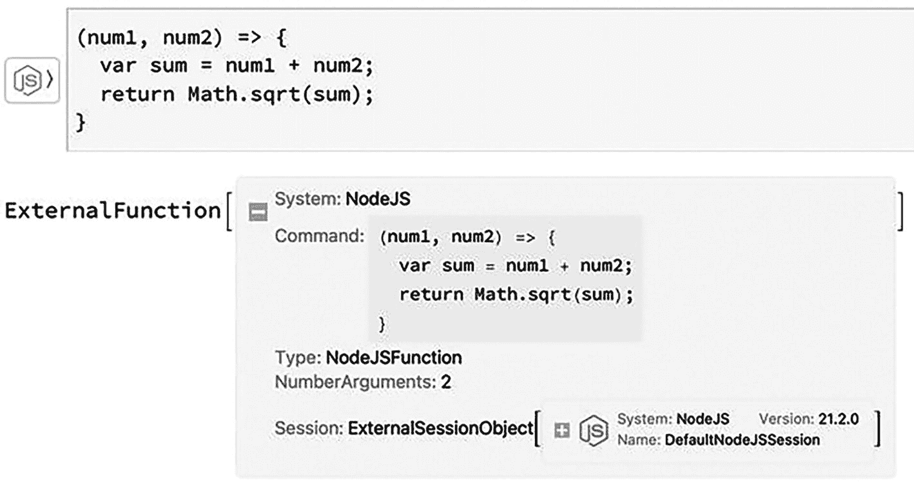

一个代码编辑器和外部函数块的截图。代码内容为：num 1, num 2 greater than or equal to v a r sum = num 1 plus num 2, return Math dot s q r t of sum。该块的系统为 Node J S，命令为 type，参数数量为 2，会话为外部会话对象。

**图 4-22**

返回两个数字之和的平方根的 Node.js 函数

```
In[111]:=
Out[111]=
```

```
In[113]:= %[18,18]
Out[113]= 6
```

**注意**

为了确保可以使用 `ExternalFunction` 在 NodeJS 中调用函数，必须显式地返回该函数。

要注销外部计算器，请输入系统语言和可执行文件路径。在本例中，它与注册时使用的路径相同。

```
In[114]:= UnregisterExternalEvaluator["NodeJS","/opt/homebrew/bin/node"]
Out[114]= 629ba62a-8d17-e9fe-6cd9-870f94c7933c
```

### 数据库与文件操作 (SQL)

可以使用外部语言（如 SQL）在 Mathematica 中执行数据库和文件操作。通过利用 `ExternalEvaluate`，可以执行 SQL 查询并直接处理数据集格式。

您可以使用示例数据文件夹中的表为数据库生成一个引用对象。

```
In[115]:= DatabaseReference[FindFile["ExampleData/ecommerce-database.sqlite"]];
Shallow[%]
Out[116]//Shallow=
DatabaseReference[]
```

使用 `FindFile` 检索到的文件引用将 `.sqlite` 本地文件与设置为 SQLite 的后端 SQL 引擎关联起来，该引擎执行操作和数据管理。

**注意**

SQL 应该在 Mathematica 中可用，但请检查它是否显示为已注册的外部计算器 `FindExternalEvaluator["SQL"]`。如果没有，请确保注册该计算器。

引用后，查看所有数据库表名（见图 4-23）。选择一个表（`offices`）（见图 4-24），并选择 territory 和 city，按 territory 排序（见图 4-25）。

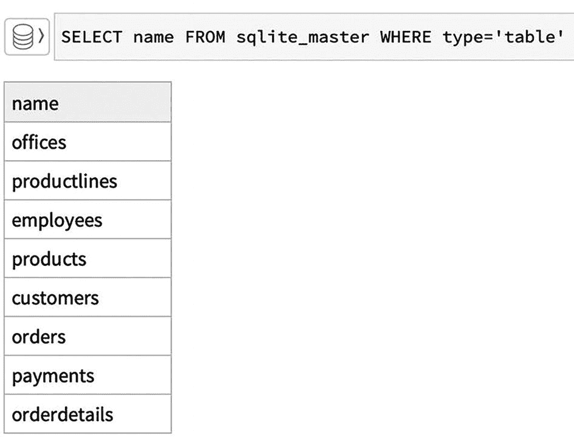

一个 SQL 查询和结果表。查询内容为：select name from s q lite underscore master where type = table。name 列下的 8 行分别是 offices, product lines, employees, products, customers, orders, payments, 和 order details。

**图 4-23**

列出所有表

```
In[117]:=
Out[117]=
```

```
In[118]:=
Out[118]=
```

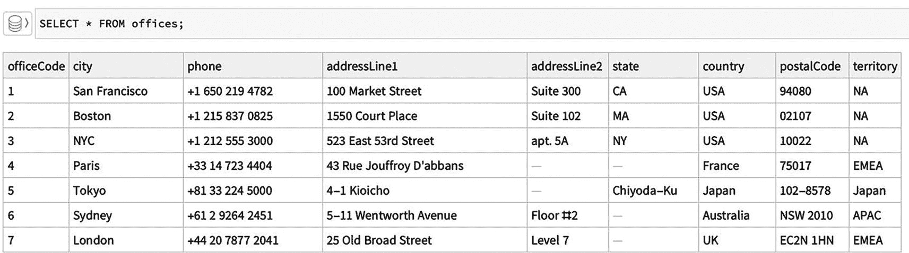

一个 SQL 查询和结果表。查询内容为：select asterisk from offices。该表有 7 行，列名为 office code, city, phone, address line 1, address line 2, state, country, postal code, 和 territory。

**图 4-24**

获取所有办公室数据

```
In[119]:=
Out[119]=
```

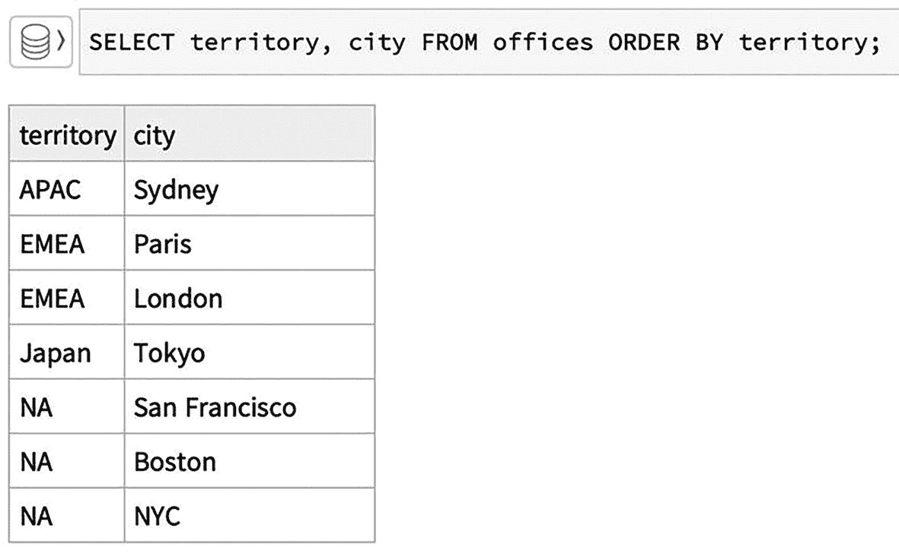

一个 SQL 查询和结果表。查询内容为：select territory, city from offices order by territory。该表有 7 行，包含 territory 和 city 两列。前 4 行的 territory 为 APAC, EMEA, EMEA, 和 Japan，最后 3 行的 territory 为 N A。

**图 4-25**

按区域对办公室进行排序

## 总结

本章探讨了导入和导出各种文件格式（包括自定义导入）的基本方面。它提供了语义导入的基础知识，处理了数量和大型数据集。本章还深入探讨了数据管理以及笔记本中内容文件对象的搜索。本章最后讨论了连接到外部元素、建立连接以及使用外部资源、数据库和文件。