# 5. 数据可视化

本章更深入地讨论数据可视化，展示以不同方式可视化表示数据、使用不同命令以及创建一系列不同类型的图表。它还解释了如何自定义绘图和使用预定义的绘图主题。

## 基础可视化

数据可视化是理解数据信息的关键。诸如二维图、等高线图、三维图和时间序列等可视化工具提供了一种便捷的形式来查看和理解数据的趋势和模式。Wolfram 语言的特点之一是它包含一些命令，使您能够以简单的形式绘制图表。现在，您可以更好地了解绘图的工作原理。Mathematica 将每个绘图视为一个图形对象，这是因为每个图形都是由基本元素（点、线、多边形、几何图形等）、指令（样式、形状、大小、宽度、模糊度等）和选项（视觉修改、样式、框架、纵横比、文本等）创建的。不过，让我们专注于二维和三维图表的领域。


### 二维绘图

如你在第 1 章中看到的 `Plot` 函数，在指定范围内创建简单的二维绘图相对容易。Wolfram 语言让你能够精确控制绘图；例如，你可以定义绘图的范围以及许多选项。比如，你可以为下一个绘图添加标题，即 `LogPlot`，这是一个对数刻度的函数（见图 5-1）。

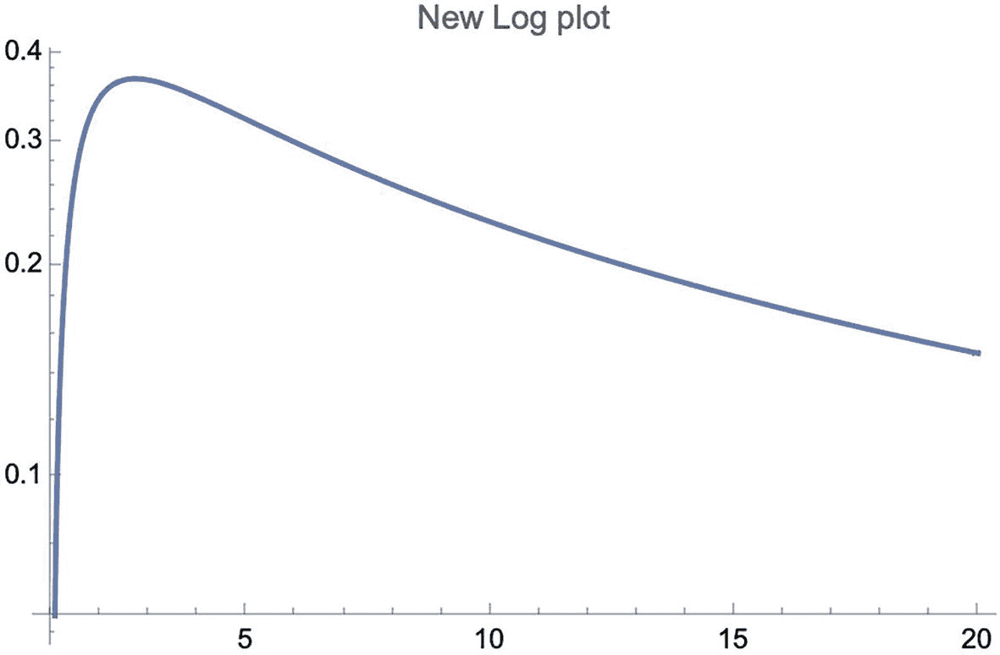

一个标题为“新对数图”的折线图。一条线从原点上升到 (2, 0.35)，然后指数衰减到 (20, 0.2)。数据为近似值。

图 5-1

`LogPlot`

```
In[1]:= LogPlot[Log[x]/x,{x,1,20},PlotLabel->"New Log plot"]
Out[1]=
```

图 5-1 显示已添加标题。

在区间内绘制点时，Mathematica 会自动生成默认的绘图范围。但使用 `PlotRange`，你可以覆盖该选项并输入所需范围（见图 5-2）。

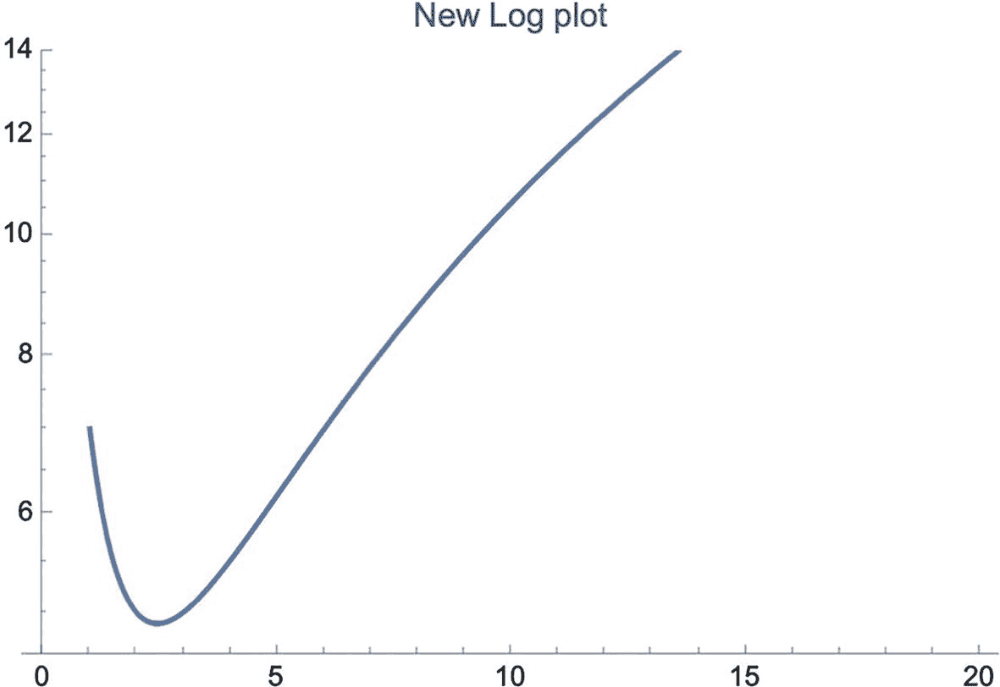

一个标题为“新对数图”的折线图。一条线从 (1, 7) 急剧下降到 (2.5, 2)，然后指数上升到 (15, 14)。数据为近似值。

图 5-2

`x+(6/x)` 的 `LogPlot`，带有自定义范围

```
In[2]:= LogPlot[x+(6/x),{x,1,20},PlotLabel->"New Log plot",PlotRange->{0,14}]
Out[2]=
```

在 `PlotRange` 中选择 `All` 时，y 轴会增大。或者，你也可以通过输入 `{y min, y max}` 的形式来选择范围。有时，图形可能不经过所需的坐标点；为了强制实现这一点，可以使用 `AxesOrigin`（见图 5-3）。交点以 `{x,y}` 的形式书写，其中坐标表示 x 和 y 的原点。

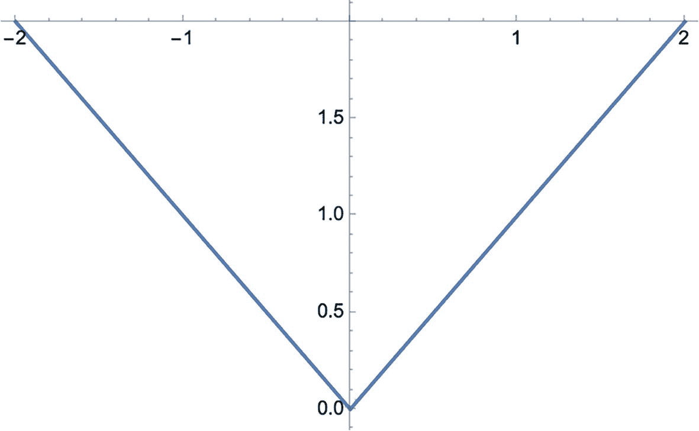

一个 y 轴范围从 0.9 到 0 的折线图。x 轴范围从 -2 到 2。一条线从 (-2, 0) 急剧下降到 (0, 0.0)，然后上升到 (2, 0)，形成 V 形图案。数据为近似值。

图 5-3

原点为 (0, 2) 的 x 的绝对值

```
In[3]:= Plot[Abs[x],{x,-2,2}, AxesOrigin->{0,2}]
Out[3]=
```

`AspectRatio` 用于通过高度和宽度控制图形比例。此选项允许你指定图形的大小，计算高宽比 (h/w)。然而，当使用 `ImageSize` 直接选择图形的宽度和高度时，如果只指定高度，最好将 `AspectRatio` 设置为 `Full`。这可以确保宽度相应调整时比例正确。这两个选项如图 5-4 所示。

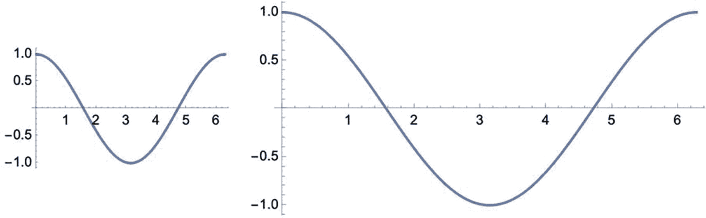

两个带有连续波形的折线图。右侧图形的大小大于左侧图形。

图 5-4

第一个图形使用 `ImageSize`；第二个使用 `AspectRatio`

```
In[4]:=GraphicsRow[{Plot[Cos[x],{x,0,2\[Pi]},ImageSize->Small], Plot[Cos[x],{x,0,2\[Pi]},AspectRatio->0.5]}]
Out[4]=
```

### 绘制数据

在绘制图形时，一组点可以在绘图中表示。数据可以根据其用途使用不同的命令进行绘制。要绘制坐标列表，使用 `ListPlot`，绘图的参数表示为 x, y 坐标（`{x1,y1}`, `{x2,y2}` ...）。你可以创建一个值列表并将其作为参数传递。以下示例创建一个值表来模拟双曲余弦，每个点之间间隔一步（见图 5-5）。

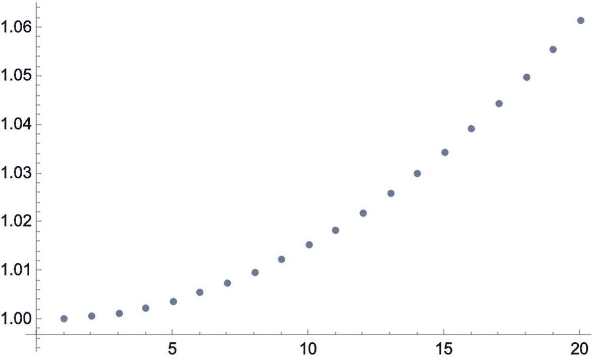

一个 y 轴范围从 1.00 到 1.06 的散点图。x 轴范围从 0 到 20，增量为 5。数据点以递增的凹形方式从 (1, 1.00) 绘制到 (20, 1.06)。数据为近似值。

图 5-5

双曲余弦图，范围从 1 到 20

```
In[5]:= ListPlot[Table[Cosh[i Degree],{i,1,20}]]
Out[5]=
```

在这种情况下，你只生成 `{1, y1}`, `{2, y2}` 中的点，但你也可以绘制 x 和 y 值。让我们用 `Table` 生成 x 点，然后将 x 的每个元素与 y 元素配对并绘制（见图 5-6）新的坐标集。

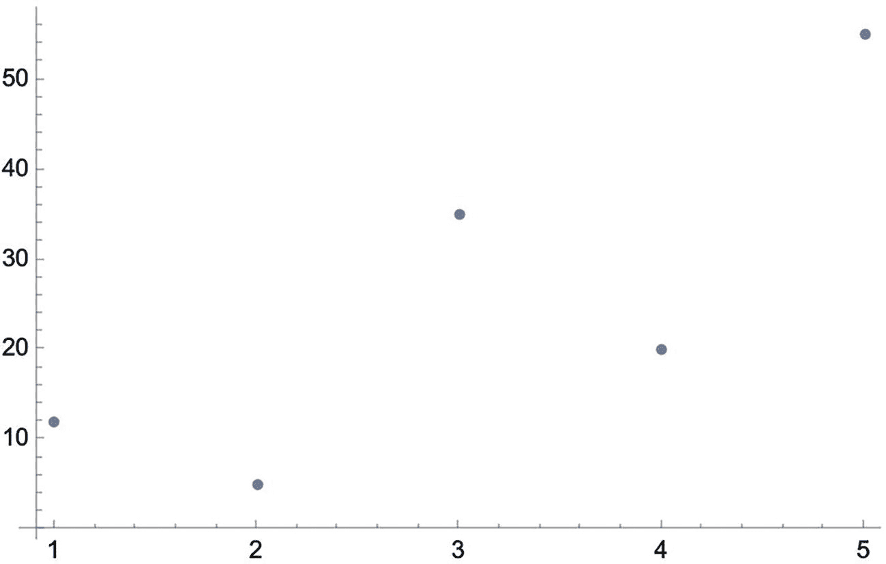

一个 y 轴范围从 0 到 50，增量为 10 的散点图。x 轴范围从 1 到 5。数据点位于 (1, 11), (2, 5), (3, 38), (4, 20) 和 (5, 56)。数据为近似值。

图 5-6

x 和 y 坐标的 `ListPlot`

```
In[6]:= xcoor=Table[i,{i,1,5}];
ycoor={12,5,35,20,55};
coordinates=Thread[{xcoor,ycoor}];
ListPlot[coordinates]
Out[9]=
```

另一个有用的命令是 `ListLinePlot`，它通过用线连接点来绘制点。`ListLinePlot`（见图 5-7）也可以绘制预定义的坐标。你可以使用 `Mesh` 选项显示要显示多少个点，以了解绘图是如何构建的。

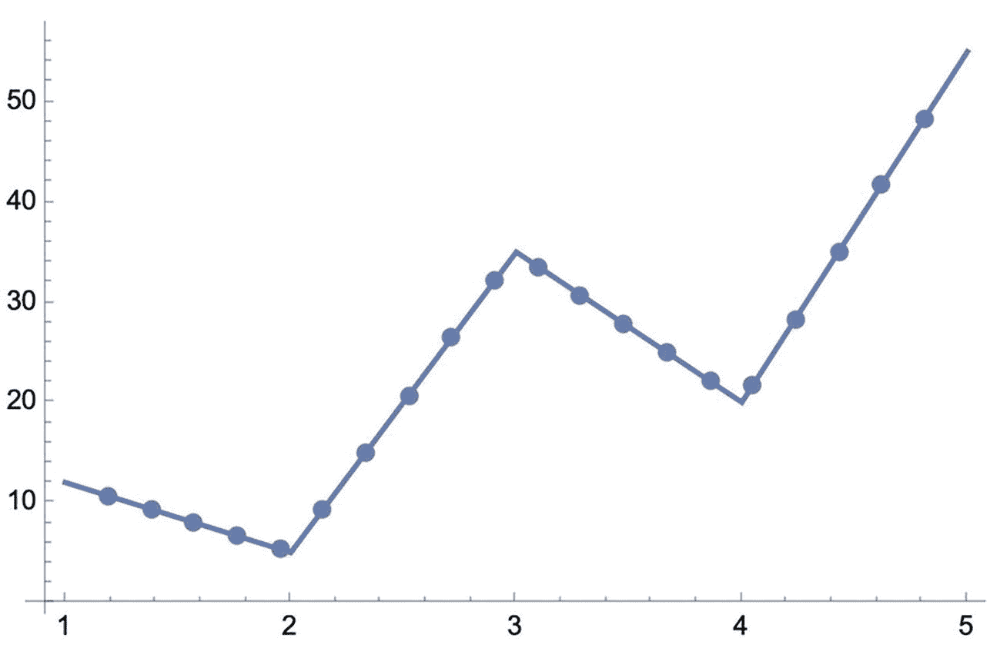

一个散点-折线图。一条线从 (1, 10) 急剧下降到 (2, 5)，上升到 (3, 36)，骤降至 (4, 20)，然后再次增长到 (5, 50)。一条线连接了数据点。数据为近似值。

图 5-7

`ListLinePlot`，网格选项设置为 20

```
In[10]:= ListLinePlot[coordinates,Mesh->20]
Out[10]=
```

绘图可以用不同的颜色和标记来表示。颜色和标记便于区分不同的绘图。要引入标记，输入 `PlotMarkers` 选项，后跟标记符号。标记可以是特殊字符或字母；使用特殊字符面板获取完整的符号和字符列表。默认情况下，不同的集合会以不同颜色着色，但要选择特定颜色，请使用 `PlotStyle`。使用 `PlotStyle` 还可以更改线条的粗细，如图 5-8 所示。

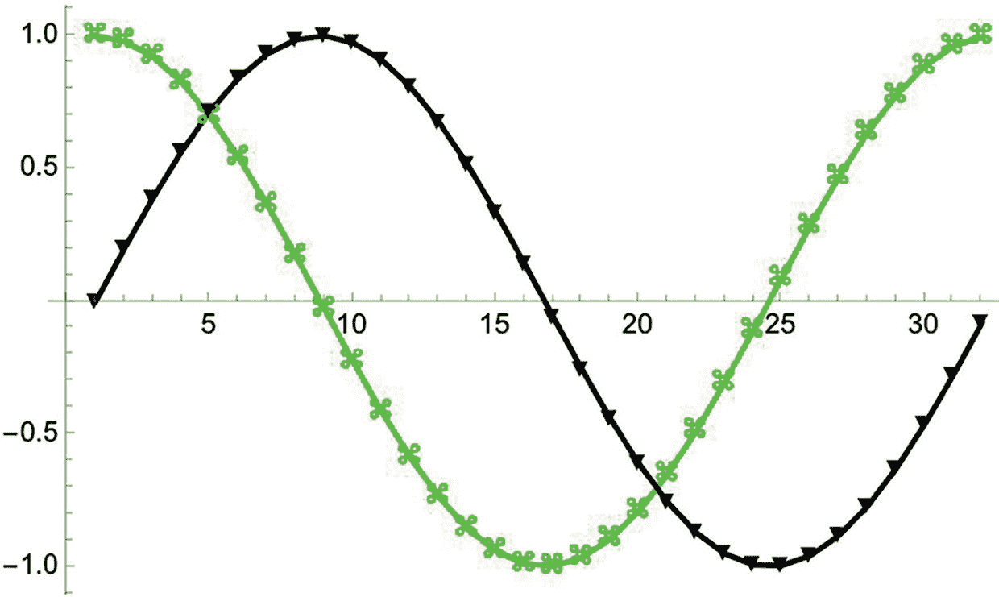

一个散点-折线图。它绘制了余弦波和正弦波。波上有标记点。两个波通过两种颜色的标记点进行区分。

图 5-8

带有不同标记点的绘图

```
In[11]:=
ListLinePlot[{Table[Cos[i], {i, 0, 2 \[Pi], 0.2}],
Table[Sin[i], {i, 0, 2 \[Pi], 0.2}]}, PlotMarkers -> {"\[CloverLeaf]", "\[FilledDownTriangle]"}, PlotStyle -> {Green, Black}]
Out[11]=
```

另一个通用选项是 `Ticks`。使用此选项，你可以修改 x 轴和 y 轴上的刻度指示器。例如，在图 5-9 中，绘图刻度标记在 x 轴上；刻度为 –1 和 1。y 轴设置为自动（见图 5-9）。

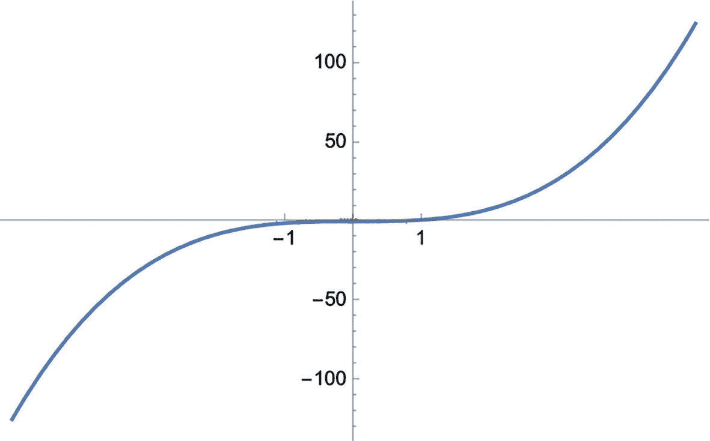

一个笛卡尔坐标系图形。它绘制了一条线，从第三象限的左下角开始，向下凹地增加到 (-1, 0)，水平延伸到 (1, 0)，然后向上凹地增加到第一象限的右上角。数据为近似值。

图 5-9


x 轴刻度标记在 –1 和 1 上的绘图

```
In[12]:= Plot[x³,{x,-5,5},Ticks->{{-1,0,1},Automatic}]
Out[12]=
```

此外，包含日期的绘图可以使用 `DateListPlot` 显示。`DateListPlot` 具有以下形式：`DateListPlot[{v1,v2, ... }, “日期规范”]`。使用 `DateListPlot`，x 轴会转换为时间线，y 轴则对应数值（`v1, v2, ...`）。图 5-10 展示了一个从六月开始到十一月结束的 `DateListPlot`。

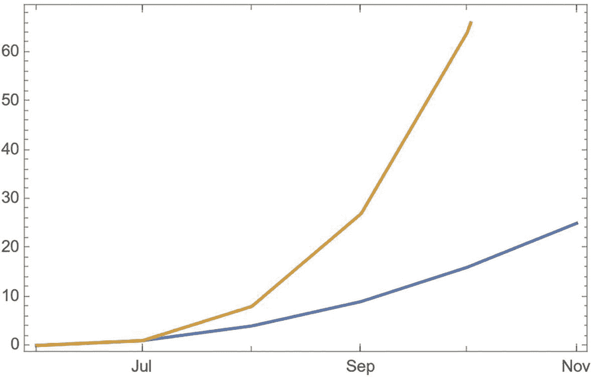

两条递增且呈凹向上趋势的多线图。两条趋势线通过颜色区分。x 轴范围从七月到十一月。

图 5-10

日期图，绘图从 2006 年 6 月到 2006 年 11 月

```
In[13]:= data1=Table[Power[i,2],{i,0,5}];
data2=Table[Power[i,3],{i,0,5}];
DateListPlot[{data1,data2},{2006,06}]
Out[15]=
```

此外，你也可以使用 `ListLinePlot` 或 `ListPlot` 来创建日期图。将 `ScalingFunction` 选项与 `{“Date”, Identity}` 结合使用，可以沿日期轴进行适当缩放，从而实现随时间变化的良好数据可视化，如下面的代码和图 5-11 所示。

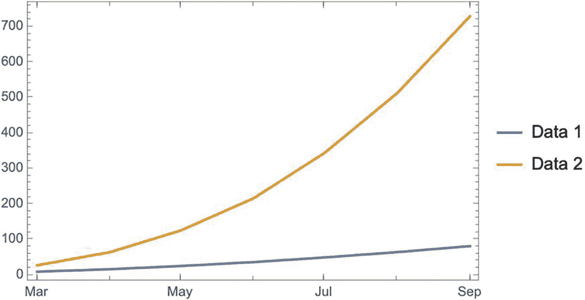

一个多线图绘制了数据 1 和数据 2 的两条递增凹向上趋势。两条趋势线通过颜色区分。x 轴范围从七月到十一月。与数据 1 相比，数据 2 具有最高峰值。

图 5-11

使用 `ListLinePlot` 和 `ScalingFunctions` 的日期图

```
In[16]:= data1=Table[{DateObject[{2006,i}],Power[i,2]},{i,3,9}];
data2=Table[{DateObject[{2006,i}],Power[i,3]},{i,3,9}];
ListLinePlot[{data1,data2},ScalingFunctions->{"Date",Identity},PlotStyle->Automatic,Frame->True,PlotLegends->{"Data 1","Data 2"}]
Out[17]=
```

### 绘制已定义的函数

你可以定义并绘制自定义函数（见图 5-12）。用户函数也可以用作绘图命令的参数。函数可以包含单个或多个变量，例如在 3D 绘图中。

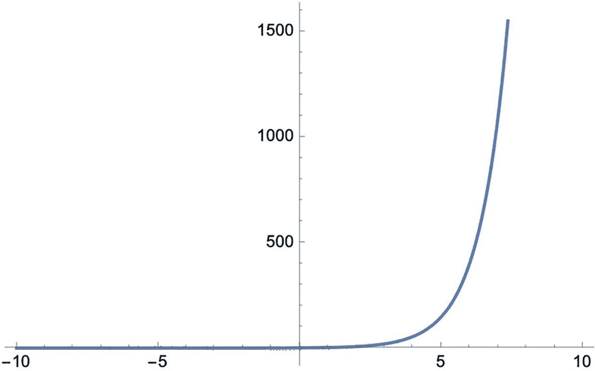

一个第一和第二象限的线图，显示递增凹向上的趋势。一条线从（负 10, 0）开始，水平增长到（3, 0），然后凹向上递增到（8, 1500）。数据为近似值。

图 5-12

`x` 的 `Exp` 用户自定义函数

```
In[17]:= F[x_]:=Exp[x];
Plot[F[x],{x,-10,10}]
Out[18]=
```

此外，也支持多个已定义的函数。当多个绘图位于同一图形中时，每个绘图会以不同颜色显示（见图 5-13）。

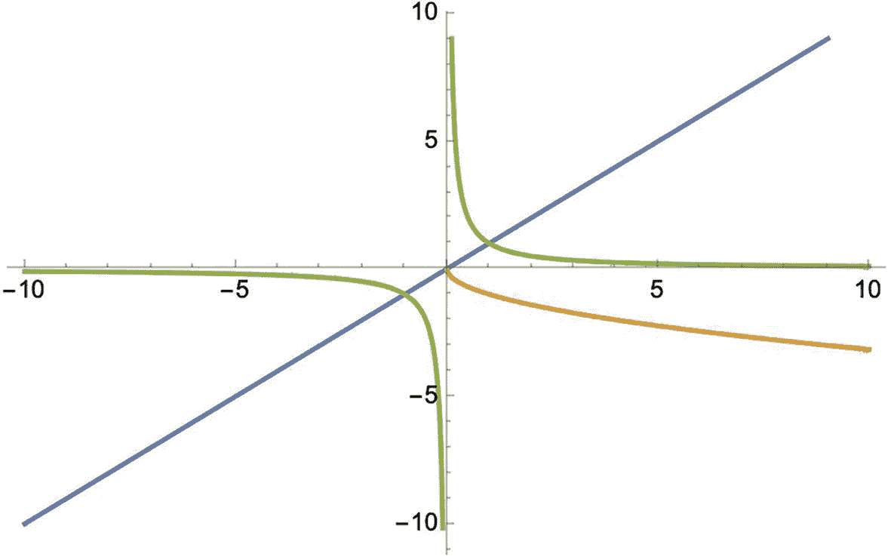

一个包含多条趋势线的笛卡尔图。它绘制了一条双曲线、一条从第三象限到第一象限的递增斜线，以及一条在第四象限递减的凹向上曲线。

图 5-13

多个绘图

```
In[18]:= X[x_]:=x;Y[y_]:=-Sqrt[y];Z[z_]:=1/z;
Plot[{X[x],Y[x],Z[x]},{x,-10,10}]
Out[19]=
```

## 自定义绘图

Wolfram 语言允许用户根据需求自定义绘图，例如添加文本、更改颜色样式、添加填充、在表格框架中呈现等。许多用于 2D 绘图的命令也保留在 3D 绘图中。根据图形表示的不同，选项在不同命令之间可能有所差异。

### 向图表添加文本

向图表添加文本，例如标记和数值范围，可以使图表包含更多信息。还可以添加许多其他元素。

`PlotLabel` 为图表添加标题。除了此选项外，还有 `AxesLabel` 和 `PlotLegends`。前者允许你以 `{“x 标签,” “y 标签”}` 的形式为坐标轴添加标签；后者允许你为图形中的每个表达式添加相关文本（见图 5-14）。

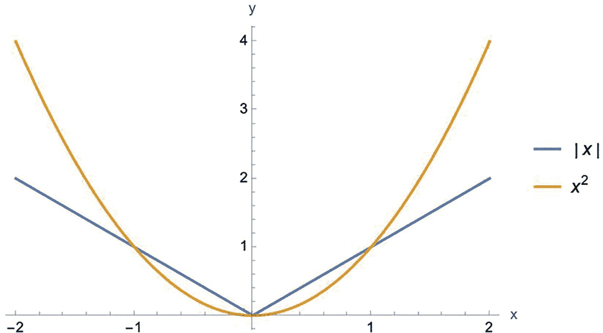

一个第一和第二象限的图。它绘制了 `x` 平方的上开口抛物线以及 `x` 的模的 V 形趋势线。两者顶点相同，都在原点。

图 5-14

带有标签坐标轴和函数的绘图

```
In[20]:= Plot[{Abs[x], x²}, {x, -2, 2}, AxesLabel -> {"x", "y"},
PlotLegends -> "Expressions"]
Out[20]=
```

你可以使用 `Labeled` 在绘图上添加自定义文本表达式（见图 5-15）。至于新的 Mathematica 版本，将光标悬停在绘图上会显示 `x` 和 `y` 坐标，而无需创建显式的工具提示。

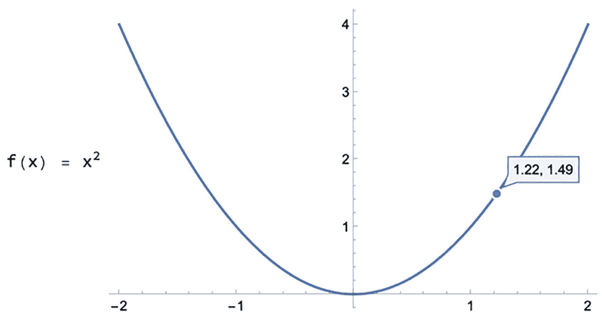

一个第一和第二象限的图。它绘制了 `f` 等于 `x` 平方的上开口抛物线。在抛物线的右臂上标记了一个点 (1.22, 1.49)。

图 5-15

放置在图形左侧的标签

```
In[21]:= Labeled[Plot[x², {x,-2,2}], "f(x) = "x2,, Left]
Out[21]=
```

即使使用 `Labeled` 命令，也可以构建 `Tooltips`。`Tooltips` 为任何表达式显示一个标签工具提示（见图 5-16）。当鼠标指针悬停在工具提示表达式上时，会显示 `Tooltips`。`Tooltips` 和 `PlotLegends` 之间的区别在于，`PlotLegends` 是一个选项，而不是一个命令。

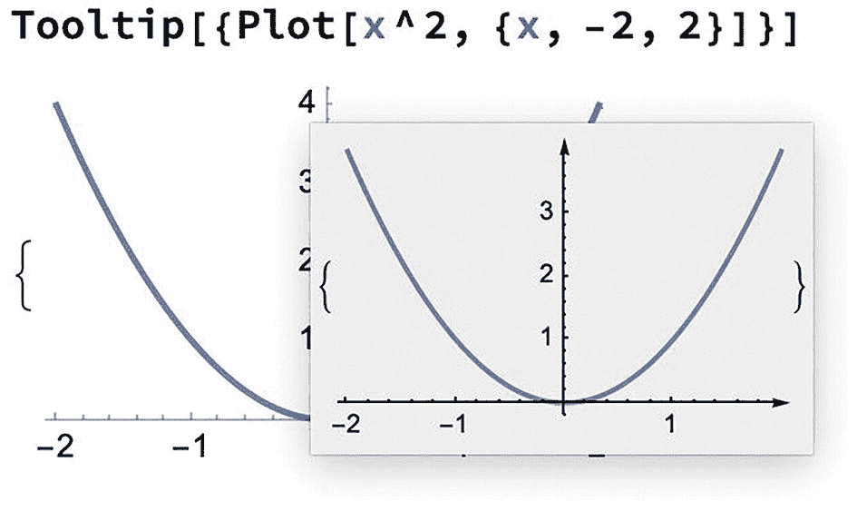

一个第一和第二象限的图，标题为“绘图 `x` 平方，`x`，负 2，2 的工具提示”，被另一个图形覆盖。它绘制了一条从（负 2, 4）到（0, 0）再上升到（2, 4）的上开口抛物线。数据为近似值。

图 5-16

为绘图表达式创建的工具提示

```
In[22]:= Tooltip[{Plot[x²,{x,-2,2}]}]
Out[22]= {}
```

当你将鼠标悬停在整个图形上时，它会显示整个图形的工具提示，因为你指定了它。但你也可以只针对函数的表达式进行操作（见图 5-17）。

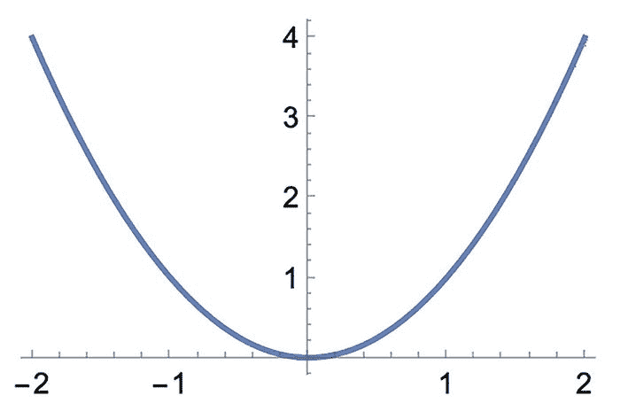

一个第一和第二象限的图。它绘制了一条从（负 2, 4）到（0, 0）再上升到（2, 4）的上开口抛物线。数据为近似值。

图 5-17

曲线表达式的工具提示

```
In[23]:= Plot[Tooltip[x²],{x,-2,2},ImageSize->200]
Out[23]=
```

如果你将鼠标悬停在曲线上，它会显示 `x²` 的工具提示；此函数也适用于其他类型的绘图。你可以使用 `ToolTipStyle` 选项来设置工具提示的样式（见图 5-18）。

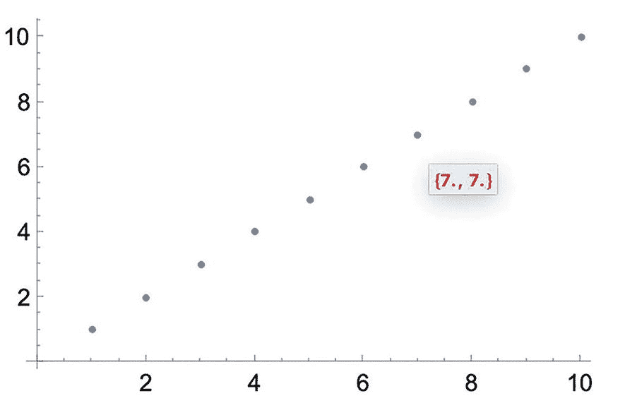

一个散点图。数据点呈递增趋势绘制。图中标记了一个点 (7, 7)。

图 5-18

每个绘制点的工具提示

```
In[24]:=ListPlot[Tooltip[Range[10], TooltipStyle -> {Bold,Red, Background -> LightBlue}], ImageSize -> 250]
Out[24]=
```

如果将光标移动到这些点上，你会得到以红色书写的点的坐标，并且工具提示的背景为浅蓝色。


### 框架与网格

绘图可以添加框架和网格。使用 `Frame` 选项，若要为框架添加标签，则使用 `FrameLabel`，其接收的指令与 `AxesLabel` 类似（见图 5-19）。

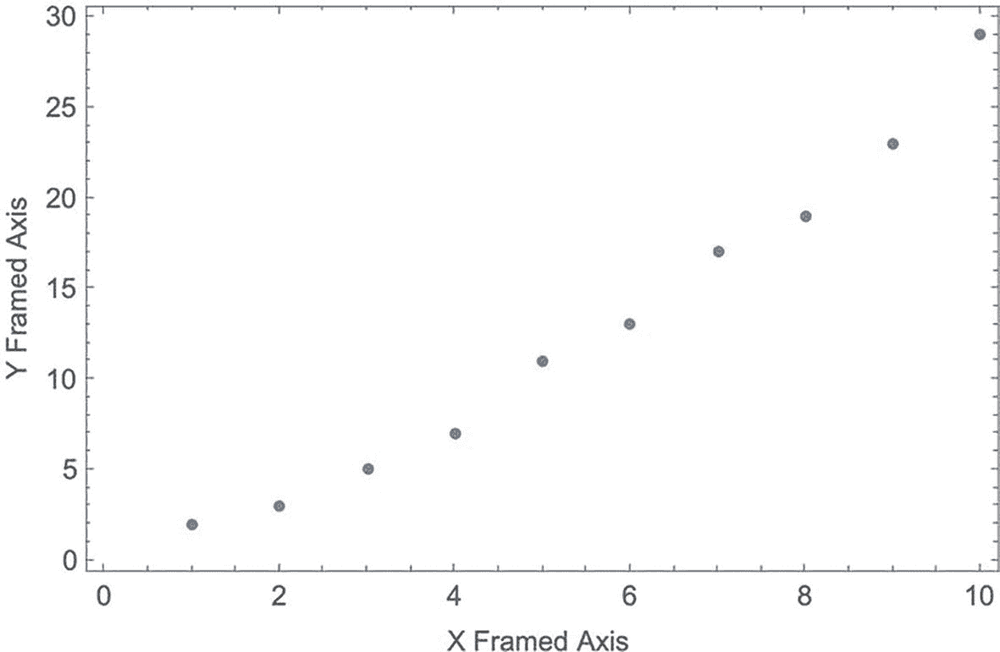

一个以 `Y` 框架轴为纵轴、`X` 框架轴为横轴的散点图。数据点依次绘制在 (1, 2.5)、(2, 5.6)、(4, 7)、(6, 14)、(8, 20) 和 (10, 29) 处。数据为近似值。

**图 5-19** 带框架的 `ListPlot`

```
In[25]:= ListPlot[Table[Prime[i],{i,1,10}],Frame->True,FrameLabel->{"X Framed Axis ","Y Framed Axis"}]
Out[25]=
```

要添加网格（见图 5-20），请使用 `GridLines` 选项。

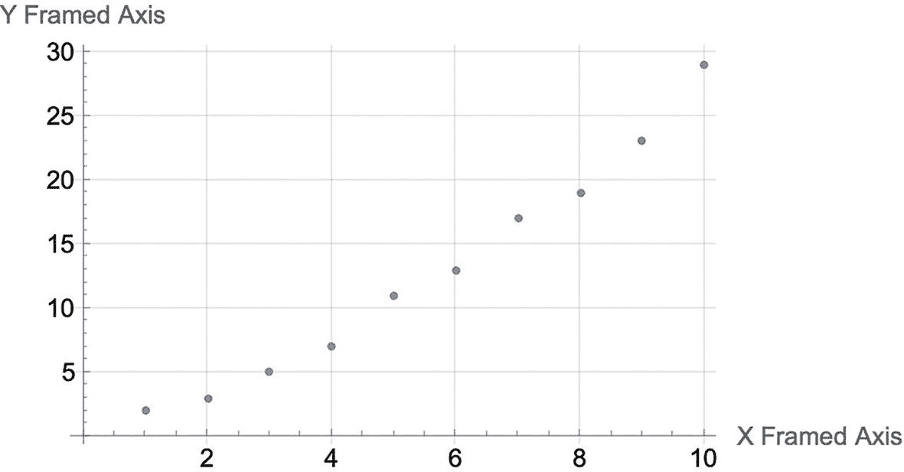

一个以 `Y` 框架轴为纵轴、`X` 框架轴为横轴的网格散点图。数据点依次绘制在 (1, 2.5)、(2, 3)、(4, 7)、(6, 14)、(8, 19) 和 (10, 29) 处。数据为近似值。

**图 5-20** 带网格的绘图

```
In[26]:= ListPlot[Table[Prime[i],{i,1,10}],GridLines->Automatic,AxesLabel->{"X Framed Axis ","Y Framed Axis"}]
Out[26]=
```

要修改网格样式，请使用 `GridLinesStyle` 选项，该选项可以通过 `Directive` 设置特定的粗细（见图 5-21）。

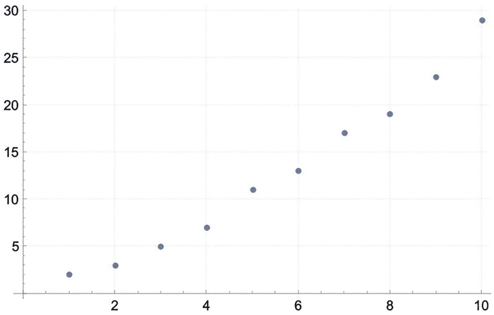

一个网格散点图。数据点依次绘制在 (1, 2.5)、(2, 3)、(4, 7)、(6, 14)、(8, 19) 和 (10, 29) 处。数据为近似值。

**图 5-21** 颜色为浅红色的 `GridLines`

```
In[27]:= ListPlot[Table[Prime[i], {i, 1, 10}], GridLines -> Automatic, GridLinesStyle -> Directive[Thickness[0.0002], LightRed]]
Out[27]=
```

## 填充图

绘图可以以多种形式进行填充——例如，在 x 轴之间，从曲线的底部和顶部进行填充（见图 5-22）。

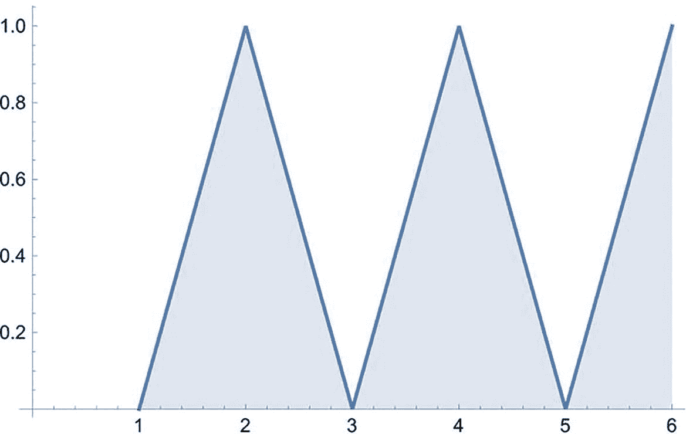

一个绘制三角形趋势的折线图。线条从 (1, 0) 开始，急剧上升至 (2, 1.0)，然后骤降至 (3, 0)，再次上升至 (4, 1.0)，下降至 (5, 0)，最后增长至 (6, 1.0)。三角形内部的区域被着色。数据为近似值。

**图 5-22** 从绘图点到轴底部的填充图

```
In[28]:= ListLinePlot[Table[Mod[i,2],{i,0,5}],Filling->Bottom]
Out[28]=
```

曲线之间的指定区域也可以通过引入 `Filling -> {"1st curve" -> {"2nd curve"}, "2nd curve" -> {"3rd curve"}}` 来填充，如图 5-23 所示。

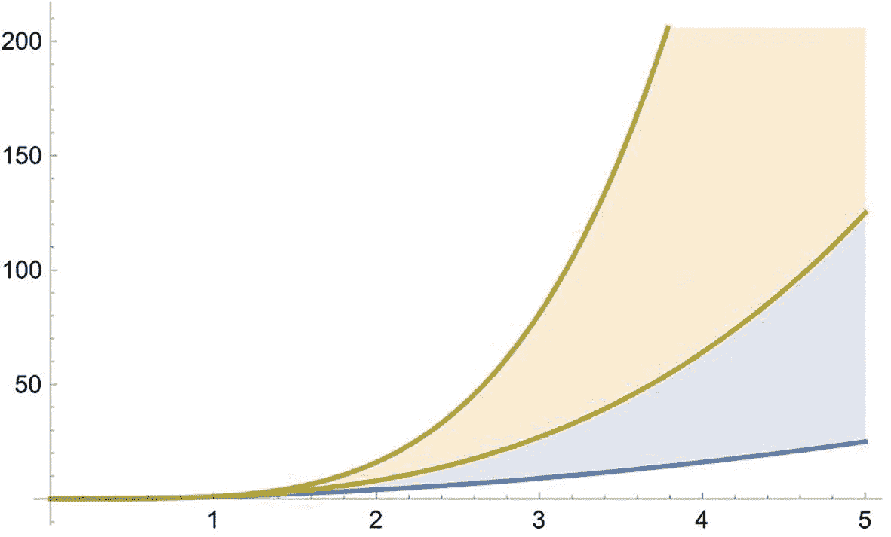

一个绘制三条递增凹向上趋势的多线图。趋势之间的区域以不同颜色着色。

**图 5-23** 填充图

```
In[29]:= Plot[{x², x³, x⁴},{x,0,5}, Filling->{1->{2}, 2->{3}}]
Out[29]=
```

### 填充图案与渐变

更新版本增加了新功能，例如交叉影线填充器。此增强功能的使用方式与图 5-24 中所示的标准选项类似。

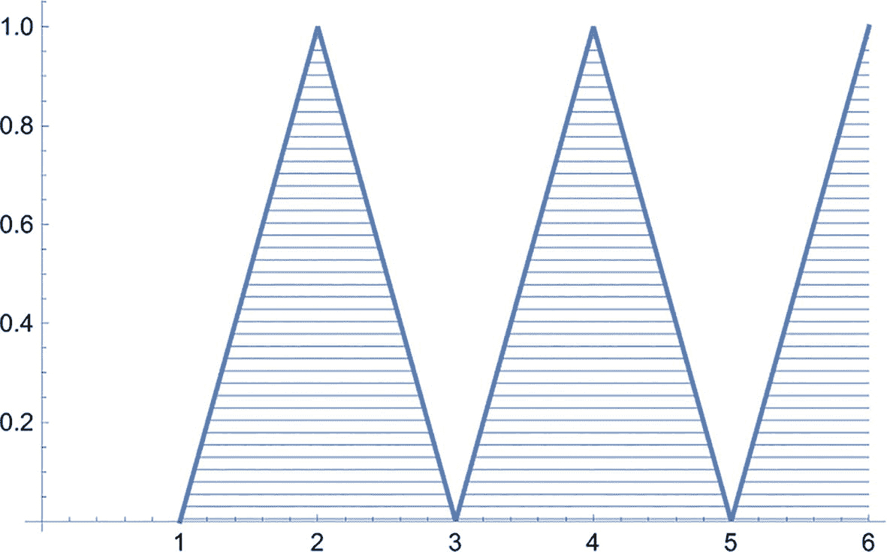

一个绘制三角形趋势的折线图。线条从 (1, 0) 开始，急剧上升至 (2, 1.0)，然后骤降至 (3, 0)，再次上升至 (4, 1.0)，下降至 (5, 0)，最后增长至 (6, 1.0)。三角形内部的区域被着色。数据为近似值。

**图 5-24** 水平样式填充

```
In[30]:= ListLinePlot[Table[Mod[i,2], {i,0,5}], Filling -> Bottom, FillingStyle -> HatchFilling["Horizontal"]]
Out[30]=
```

新功能的添加通过样式或图案实现，如图 5-25 所示。

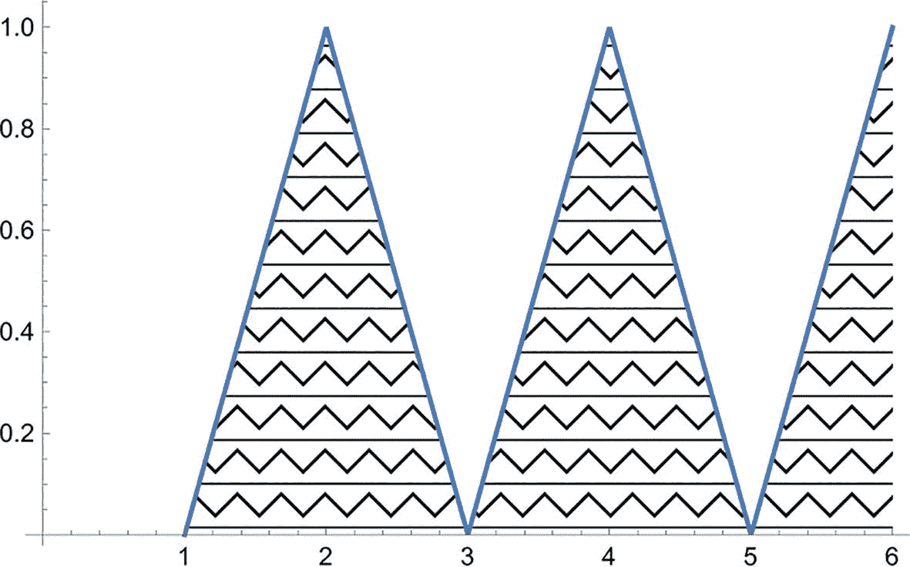

一个绘制三角形趋势的折线图。线条从 (1, 0) 开始，急剧上升至 (2, 1.0)，然后骤降至 (3, 0)，再次上升至 (4, 1.0)，下降至 (5, 0)，最后增长至 (6, 1.0)。三角形内部的区域填充了 V 形图案。数据为近似值。

**图 5-25** 填充的 V 形水平线样式

```
In[31]:= ListLinePlot[Table[Mod[i,2], {i, 0, 5}], Filling -> Bottom, FillingStyle -> PatternFilling["ChevronLine", ImageScaled[1/20]]]
Out[31]=
```

同样适用于着色函数；通过渐变技术实现新增功能，如图 5-26 所示。

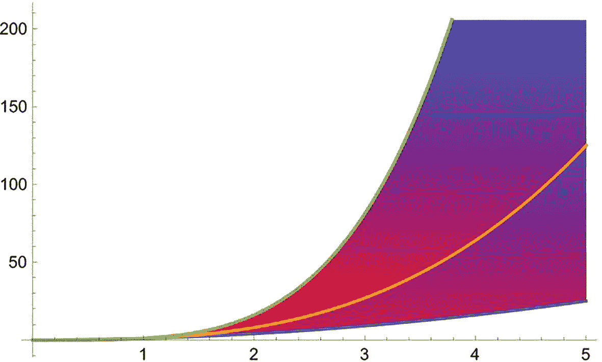

一个绘制三条递增凹向上趋势的多线图。趋势之间的区域以从浅到深的色调渐变着色。

**图 5-26** 线性填充渐变（红色、蓝色）线条样式

```
In[32]:= Plot[{x²,x³,x⁴}, {x,0,5},FillingStyle -> LinearGradientFilling[{Red,Blue},Top],Filling -> {1->{2},2->{3}}]
Out[32]=
```

## 组合绘图

要显示重叠图形，即使图形类型不同，也有多种方法可以显示它们。以下示例为绘图分配名称而不显示每个绘图的结果，最后显示这三个图形。`Show` 命令显示先前定义的绘图；其参数是图形对象后跟选项。这是执行多个可列表子图的替代方法。

```
In[33]:= plot1=Plot[x,{x,0,10},PlotStyle->Red];
plot2=Plot[Cos[x],{x,0,10},PlotStyle->Black];
plot3=ListPlot[Table[Sin[i]+1,{i,1,10}],PlotStyle->Brown];
Show[plot1,plot2,plot3,PlotRange->Automatic]
Out[33]=
```

如图 5-27 所示，`Show` 会改变图形的外观；输入图形的顺序在显示时保持不变。虽然可以在 `Show` 内部创建图形，但也可以在 `Plot` 命令中添加颜色以区分不同的图形（见图 5-28）。

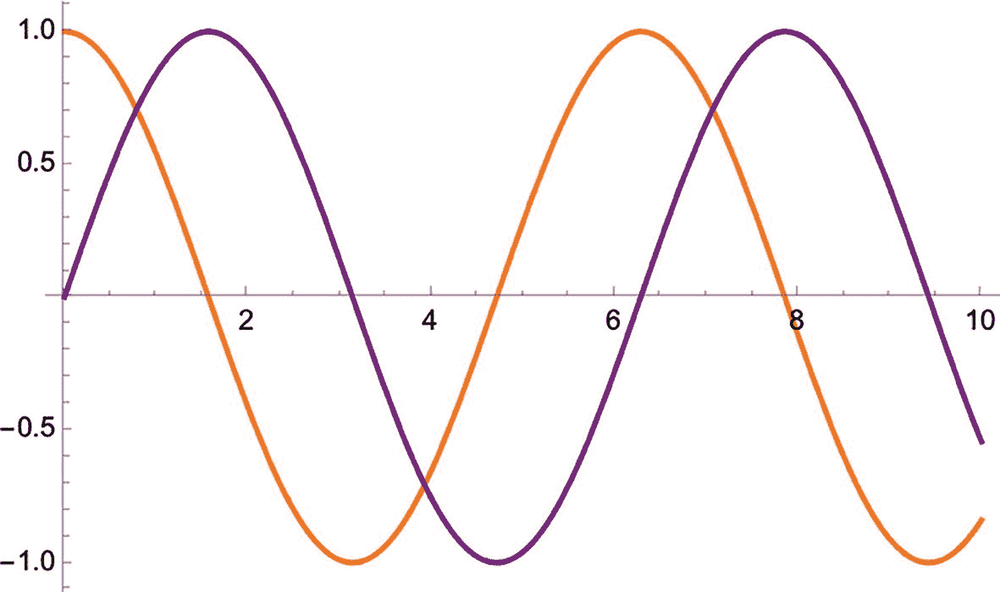

一个绘制正弦波和余弦波的多线图。两个波形通过颜色区分，并具有相同的最大值和最小值。

**图 5-28** 同一图形中的余弦和正弦图

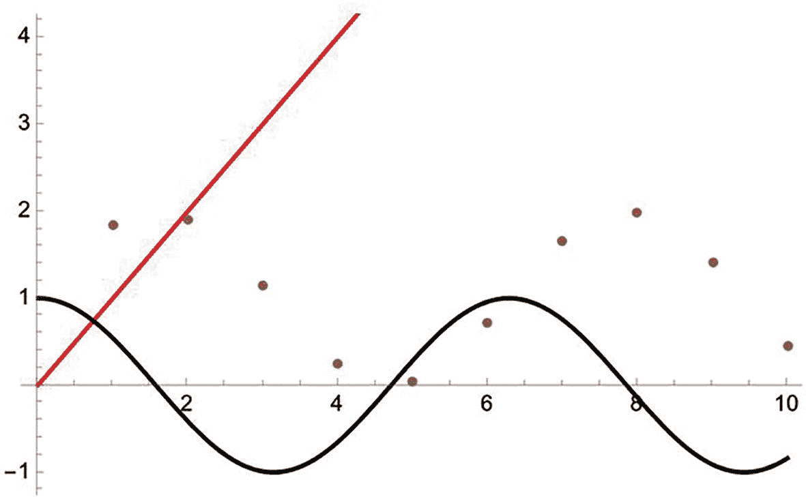

一个绘制三条趋势的多线散点图。一条递增的斜线、一条连续的波浪线以及呈波浪形式的数据点。

**图 5-27** 显示在同一图形中的组合图

```
In[34]:= Show[Plot[Cos[x],{x,0,10},PlotStyle->Orange],
Plot[Sin[x],{x,0,10},PlotStyle->Purple],PlotRange->Automatic]
Out[34]=
```

有几种方法可以创建图形列表。您可以将变量分配给图形，并将它们作为列表部署。

```
In[35]:= {Plot1,Plot2,Plot3}
Out[35]=
```

如图 5-29 所示，这三个图形用逗号分隔，因为它是一个列表。

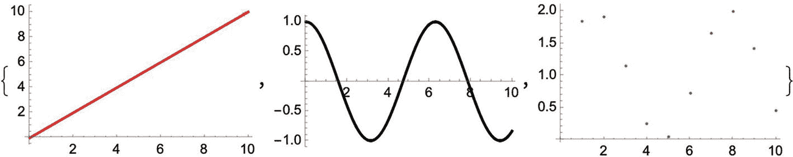

三个图形水平排列在一行中，并用花括号括起来。左侧的图形是带有递增斜率的折线图。中间的图形是连续波浪的折线图。右侧的图形是数据点的散点图。图形之间插入了逗号。

**图 5-29** 三个不同绘图的列表


### 多图显示

可以在单个输出单元格中显示多个图形。为此，请使用 `Row` 命令；此命令允许图形水平显示，每个图形并排放置（见图 5-30）。然而，`Row` 通常以行形式显示表达式，而不仅仅是图形。

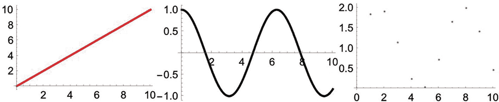

三个图形水平排成一行。左侧的图形是斜率递增的折线图。中间的图形是连续波的折线图。右侧的图形是数据点随机分布在整个图形中的散点图。

**图 5-30** – 以行形式显示的图形

```
In[36]:= Row[{plot1,plot2,plot3}]
Out[36]=
```

通过为 `Row` 输入第二个参数（见图 5-31），你可以选择在图形之间添加分隔符。

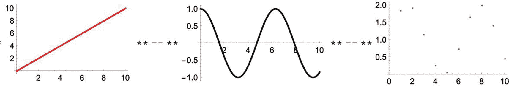

三个图形水平排成一行。左侧的图形是斜率递增的折线图。中间的图形是连续波的折线图。右侧的图形是数据点的散点图。图形之间插入了分隔符。

**图 5-31** – 在每个图形之间添加了分隔符（`--`）

```
In[37]:= Row[{plot1,plot2,plot3},"**--**"]
Out[37]=
```

另外，还有 `Column` 命令，其作用与 `Row` 类似，但以列形式显示表达式或图形（见图 5-32）。

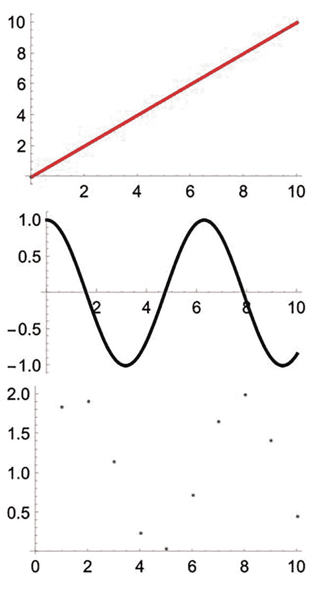

三个图形垂直排成一列。顶部的图形是斜率递增的折线图。中间的图形是连续波的折线图。底部的图形是数据点随机分布在整个图形中的散点图。

**图 5-32** – 以列形式显示的图形

```
In[38]:= Column[{plot1,plot2,plot3}]
Out[38]=
```

如果你查看以下示例，可以为列和行在整个图表周围添加边框（见图 5-33）。

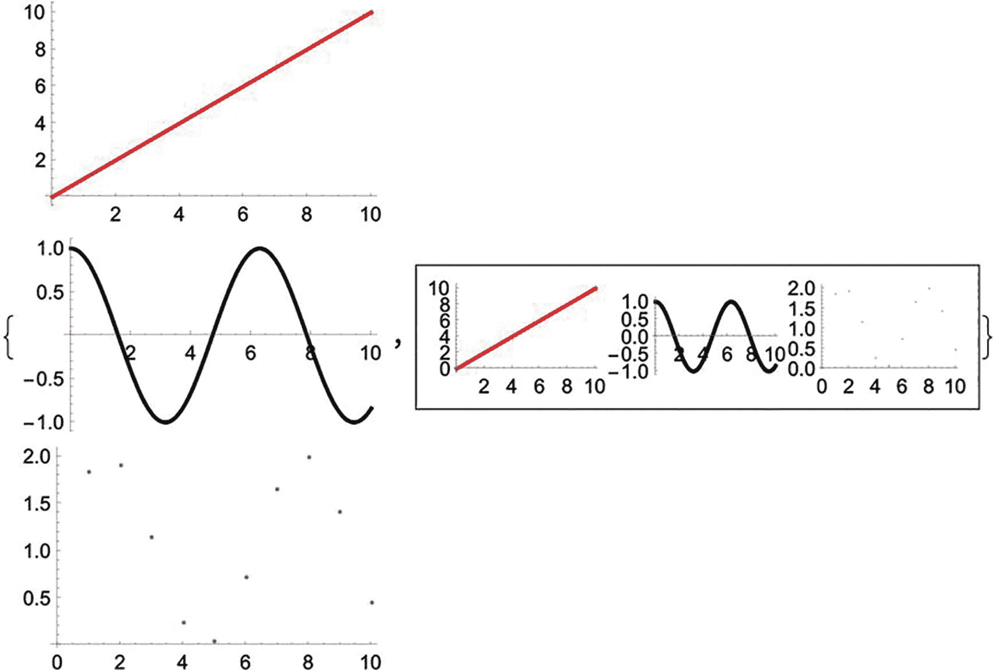

三个图形分别排成一列和一行，并被一个花括号括起来。每个图形都包含一个斜率递增的折线图、一个连续波的折线图和一个数据点随机分布在整个图形中的散点图。

**图 5-33** – 三个图形的列和行表达式展示

```
In[39]:={Column[{plot1,plot2,plot3},Frame-> True], Row[{plot1,plot2,plot3},Frame->True, FrameMargins->Medium]}
Out[39]=
```

### 多轴图形

自新版本起，要创建一个包含多个坐标系并整合到单个包中的图形，需要使用 `MultiAxisArrangement` 将不同样式的轴链接起来。这样，曲线通过同一轴连接（见图 5-34）。

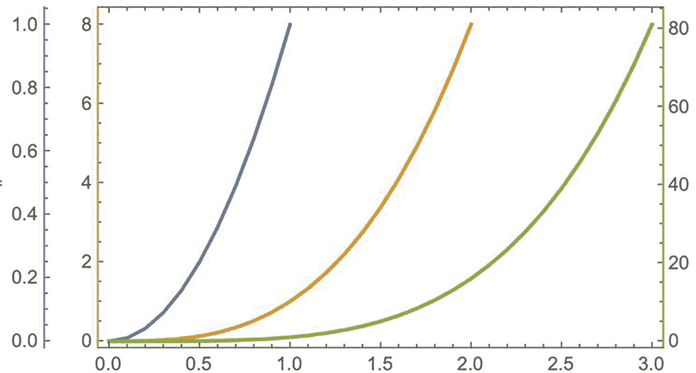

一个具有三条递增凹向上趋势的多线图。y 轴两侧都有数值。左侧有一列代表额外的 y 轴。

**图 5-34** – 三个图形的列和行表达式展示

```
In[40]:= ListLinePlot[{Table[{x,x²},{x,0,1,0.1}],Table[{x,x³}, {x,0,2,0.1}],Table[{x,x⁴},{x,0,3,0.1}]},MultiaxisArrangement-> All]
Out[40]=
```

### 为图形网格着色

`Column` 和 `Row` 允许你自定义图形。有多种方法可以更改边框颜色并为图形添加阴影（见图 5-35）。

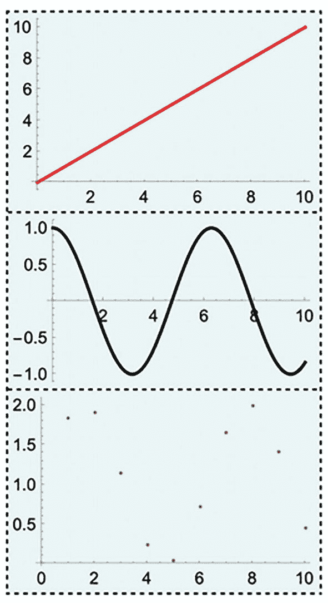

三个网格垂直排列。每个网格包含一个图形。顶部的网格是斜率递增的折线图。中间的网格是正弦波的折线图。底部的网格是数据点随机分布在整个图形中的散点图。

**图 5-35** – 具有多种功能的列图形

```
In[41]:= Column[{plot1,plot2,plot3},Frame->True,Background->LightCyan,FrameStyle->Directive[Black,Dashed],Dividers->All]
Out[41]=
```

某些选项是否可用取决于你使用的是 `Row` 还是 `Column`。使用 `Column` 时，有分隔线选项；而在 `Row` 中，没有此选项，但如前所述，可以通过分隔符来实现。使用 `Table`，可以通过颜色或边框在图形上创建不同的形状，如图 5-36 所示。

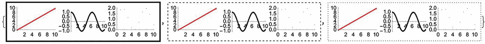

三个网格水平排列在一个花括号内，并用逗号分隔。每个网格包含三个图形。这些图形分别是斜率递增的折线图、正弦波的折线图以及数据点随机分布在整个图形中的散点图。

**图 5-36** – 使用 `Row` 命令实现的多种功能表格

```
In[42]:= Table[Row[{plot1,plot2,plot3},Frame->True,FrameStyle->Opts],{Opts,{Thick,Dashed,Dotted}}]
Out[42]=
```

接下来，我们来讨论现有的替代方案，即使用 `GraphicsRow` 和 `GraphicsColumn`。围绕这些命令，还有关于图像大小的选项（见图 5-37）。

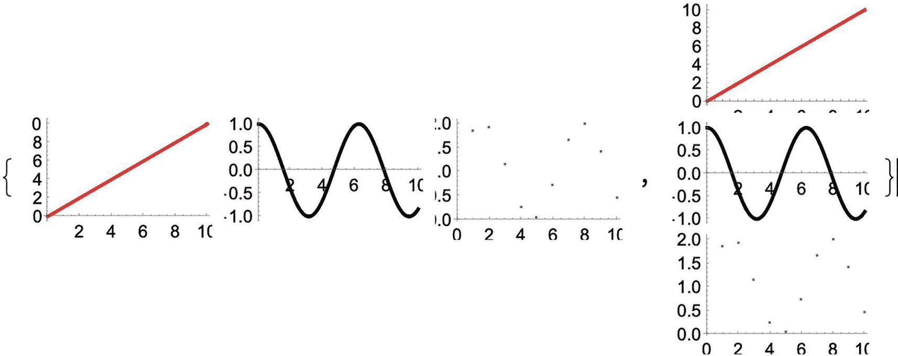

一个包含三个图形的图形，它们被花括号括起来，并按行和列排列。这些图形包括一个斜率递增的折线图、一个正弦波的折线图以及一个数据点随机分布在整个图形中的散点图。

**图 5-37** – `GraphicsRow` 与 `GraphicsColumn` 对比

```
In[43]:= {GraphicsRow[{plot1,plot2,plot3},ImageSize->Medium],
GraphicsColumn[{plot1,plot2,plot3},ImageSize->Small]}
Out[43]=
```

`GraphicsRow` 和 `GraphicsColumn` 是用于构建图形（如多边形、线条、点等）的具有特定形状的命令。此外，使用 `Rows` 和 `Columns` 时，图形是独立的。而使用 `GraphicsRow` 或 `GraphicsColumn` 时，如果你选中该图形，它是一个包含（在此例中）你所创建的三个图形的单一图像。

另一个有用的命令可以以网格形式显示图形，这承接了之前的观点——如果你选中该图形，它是一个单一图像。下面的示例添加了另一个图表，以更好地说明为什么使用 `GraphicsGrid` 很有帮助（见图 5-38）。

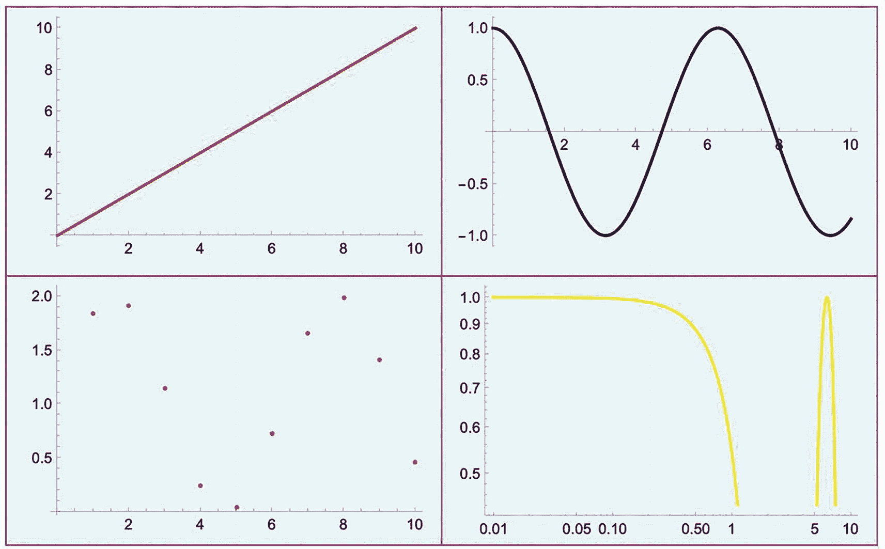

一个由四个图形组成的网格，排列成两行两列。第 1 行是一个斜率递增的折线图和一个正弦波的折线图。第 2 行是一个数据点随机分布在整个图形中的散点图和一个波动趋势的折线图。

**图 5-38** – 显示四个不同图形的 `GraphicsGrid`

```
In[44]:=plot4=LogLogPlot[Cos[x],{x,0,10},PlotStyle->Yellow];
GraphicsGrid[{{plot1,plot2},{plot3,plot4}},Frame->All,FrameStyle->Purple,Background->LightCyan]
Out[44]=
```

如图 5-38 所示，这种形状可以帮助你一次紧凑地可视化四个图形。毫无疑问，图形不必如此简单。你在本章中看到的选项，例如标题和轴标签、网格线和颜色等，也可以添加进来，如下例所示。


```mathematica
In[45]:=
newPlot1=Plot[x,{x,0,10},PlotStyle->{Purple,Thick},PlotLabel->"X"];
newPlot2=Plot[Cos[x],{x,0,10},GridLines->{{-1,0,1},{-1,0,1}},GridLinesStyle->Directive[Dotted,Blue],PlotLabel->"Cos[x]",ColorFunction->"Rainbow"];
newPlot3=ListPlot[Table[Sin[i]+1,{i,1,10}],Frame->True,FrameLabel->{Style["X",Bold],Style["Y",Bold]},PlotStyle->Red,PlotMarkers->"X",PlotLabel->"2D Scatter Plot"];
newPlot4=LogLogPlot[Cos[x],{x,0,9},Filling->Axis,ColorFunction->"BlueGreenYellow",PlotRange->{0,1},PlotLabel->"Log Log Plot"];
```

现在你已经有了这些新图形，可以将它们作为嵌套列表放入 `GraphicsGrid` 中进行比较（见图 5-39）。

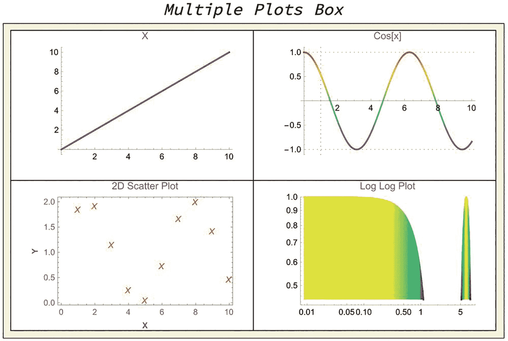

一张由两行两列排列的四个网格组成的图形，标题为“多图框”。第一行是斜率递增的 x 折线图和 x 的余弦波折线图。第二行是数据点的二维散点图和波动趋势的等高线图，标题为“对数-对数图”。

**图 5-39** 多图网格

```
In[46]:=Labeled[GraphicsGrid[{{newPlot1,newPlot2},{newPlot3,newPlot4}},Frame->All,Background->White,Spacings->1],Style["Multiple Plots Box",20,Italic],Top,Frame->True,Background->LightYellow]
Out[46]=
```

这不仅限于显示二维图形；它也适用于三维图形和其他类型的图表。

## 颜色调色板

如果你对更多颜色感兴趣，Mathematica 中提供了各种类型的颜色。为此，请前往菜单中的“调色板”➤“配色方案”，如图 5-40 中的颜色调色板所示。

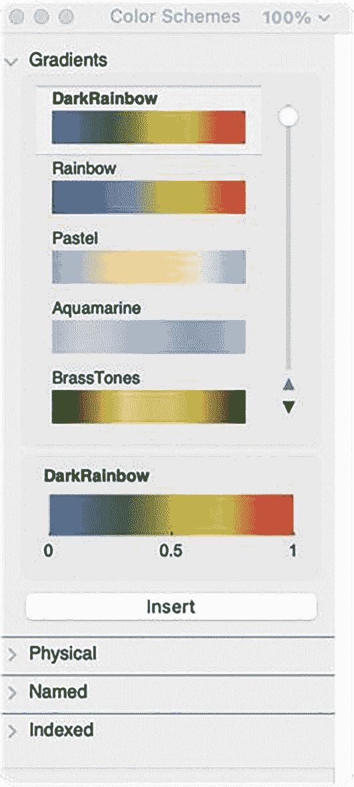

配色方案弹出窗口的截图。它列出了渐变类型：暗彩虹、彩虹、柔和、海蓝宝石和黄铜色调。暗彩虹被选中，因为它在底部显示了一个带有颜色渐变比例和插入按钮的预览。底部是物理、命名和索引菜单。

**图 5-40** 颜色调色板

出现的选项卡是与不同类别相关联的颜色。要浏览选项卡中的颜色，请使用箭头，会显示颜色的不同名称及其颜色或渐变。如果你想引入非保留字的颜色，则使用插入按钮。例如，转到“渐变”选项卡并单击“插入”按钮，该按钮会将带有选定颜色的函数插入到笔记本中。

为了说明，让我们看下面的例子。选择颜色 `BrownCyanTones`，用按钮插入它，计算表达式，并得到 `ColorDataFunction` 的结果（见图 5-41）。

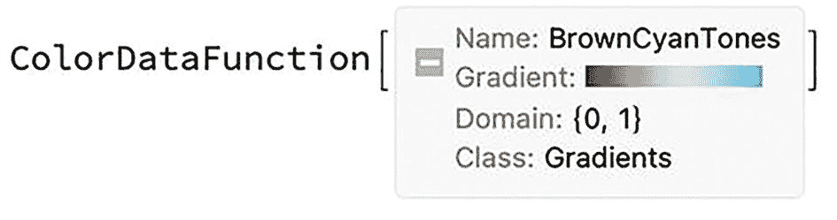

颜色数据函数格式的截图，包含在方括号内。它列出了名称：棕青色色调，渐变，域：0, 1，类别：渐变。

**图 5-41** `ColorData` 对象

```
In[47]:= ColorData["BrownCyanTones"]
Out[47]=
```

这会给你一个颜色数据对象，显示名称、颜色类型、类别和域。渐变颜色在文本中很复杂，最好与 `ColorFunction` 函数一起使用。所以现在你知道了名称，就可以为其分配颜色（见图 5-42）。

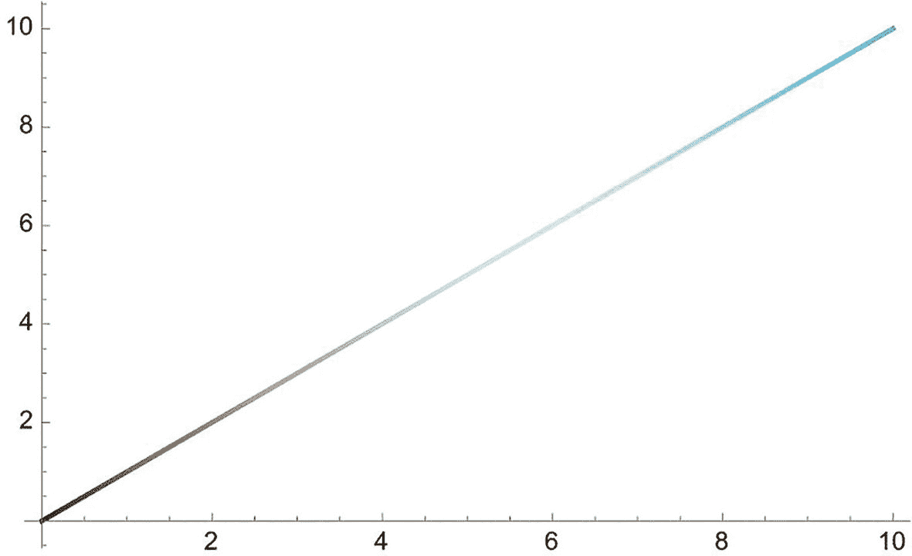

一条斜率递增的折线图。一条从原点出发的线，以斜率增长至 (10, 10)。该线以颜色渐变绘制。

**图 5-42** 直线 x 的渐变颜色

```
In[48]:= Plot[x,{x,0,10},ColorFunction->ColorData["BrownCyanTones"]]
Out[48]=
```

> **注意：** 纯色位于调色板的“命名”选项卡中。

## 三维图

Mathematica 可以执行各种类型的三维图形，其中许多都很简单。三维函数显示为空间中的曲面。图 5-43 展示了一个示例。

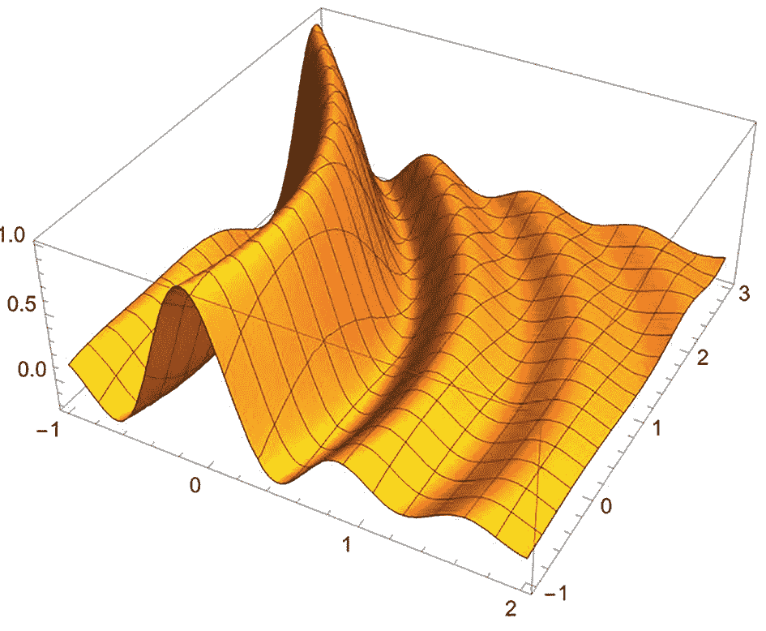

一个三维图形，在一个矩形立方体内绘制了一个颜色渐变的波动网格面。它类似于一个具有多个波峰和波谷的波浪。

**图 5-43** 三维图

```
In[49]:= Plot3D[Sinc[x*8+y²],{x,-1,2},{y,-1,3},ImageSize->Medium, PlotPoints->20]
Out[49]=
```

Mathematica 允许你通过移动光标来观察图形。将鼠标悬停在图表上，光标会变为旋转箭头，这意味着你可以移动图表，从不同角度观察它。最后一点是，当你按下 `Ctrl` 或 `Cmd` 键时，可以放大图表，同时保持其位置固定。

请注意，光标可以操作三维图形，以便你可以可视化角度分布图。常见的标准 Mathematica 将图形显示为网格，可以通过 `Mesh` 选项进行修改，正如你之前所见，或者通过使用 `PlotPoints` 选项添加更多评估点。这会增加 x 和 y 两个方向上的点数。它也有助于提高图表的质量。

### 自定义三维图

三维图形也可以像二维图形一样进行自定义（见图 5-44），例如添加轴标签、颜色、网格等。图 5-44 显示了一个带有 `AxesLabel`、`ColorFunction` 和 `FaceGrids` 选项的三维图。

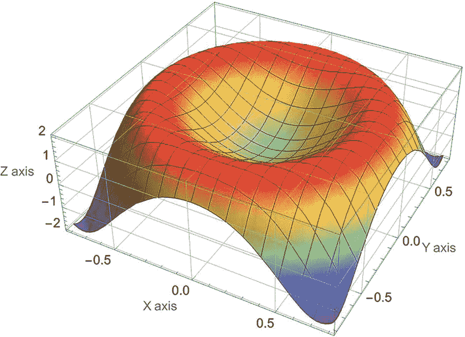

一个三维图形，在一个矩形立方体内绘制了一个颜色渐变的网格面。它类似于一个在四边呈向下抛物线形状、中心有凸起图案的面。

**图 5-44** 带网格的三维图

```
In[50]:= Plot3D[Sin[4(x²+y²)]/0.5,{x,-0.8,0.8},{y,-0.8,0.8}, AxesLabel->{"X axis","Y axis","Z axis"},ColorFunction->"Rainbow", FaceGrids->All]
Out[50]=
```

表 5-1 显示了三维图形的一般选项。

**表 5-1** 绘图选项

| 选项 | 说明 |
| --- | --- |
| `AspectRatio` | 高宽比 |
| `AxesLabel` | 为坐标轴添加文本 |
| `PlotStyle` | 颜色、不透明度、粗细等 |
| `PlotRange` | 值的范围 |
| `PlotLabel` | 绘图标题 |
| `Background` | 背景颜色 |

图形的自定义取决于你打算如何展示它们。图形的呈现方式没有限制。下面的示例绘制了一个三维函数，并将背景着色为浅黄色（见图 5-45）。

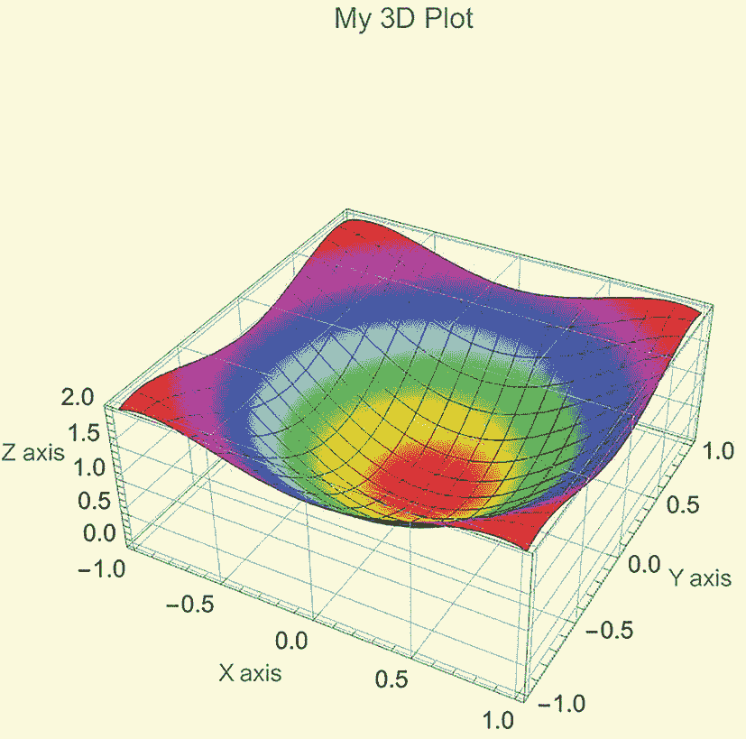

一个三维图形，标题为“我的三维图”。它在一个矩形立方体内绘制了一个颜色渐变的凸起网格面。顶点位于 x 轴上。边缘和中心颜色相同。

**图 5-45** 自定义的三维图

```
In[51]:= Plot3D[Sin[0.9(x²+y²)]/0.5,{x,-1,1},{y,-1,1},AxesLabel->{"X axis","Y axis","Z axis"},FaceGrids->All,ColorFunction->Hue, PlotLabel->"My 3D Plot",Background->LightYellow,ViewAngle->Pi/7]
Out[51]=
```


### 色调颜色函数与 `List3D`

`Hue` 颜色函数是一种指令，用于指定根据数值所处的高度为其着色。`Hue` 颜色函数有四个参数：第一个参数用于颜色的色调（色相）；第二个参数标记饱和度；第三个参数标记亮度；第四个参数是不透明度。使用 `Hue`，可以从前述四个特征中，从图形上充分识别高低区域（见图 5-46）。你可以标记这四个不同的参数。色调参数的取值范围是 0 到 1。

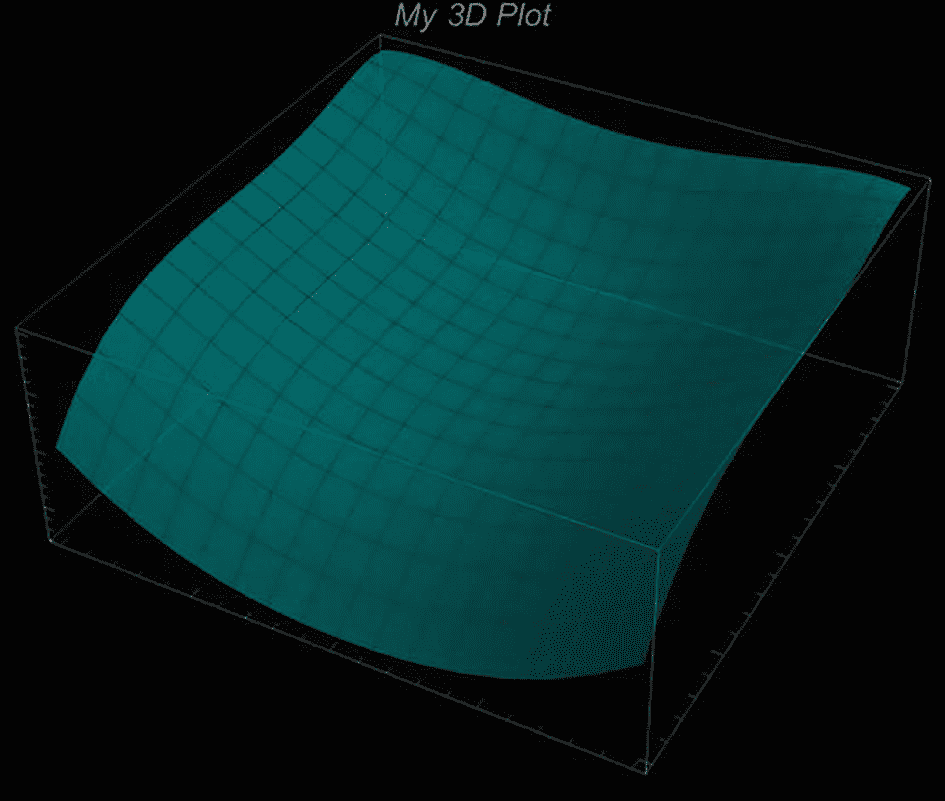

一个三维图，标题为“我的三维图”。它在矩形立方体内绘制了一个带有颜色渐变的网格曲面。

图 5-46
带有彩色色调值的 3D 图

```
In[52]:= Plot3D[Sin[0.9(x²+y³)]/0.5,{x,-1,1},{y,-1,1}, FaceGrids-> None,ColorFunction -> (Hue[0.5,1,0.6,0.5]&),PlotLabel->Style["My 3D Plot",Italic,"Arial"], Background->Black]
Out[52]=
```

对于三维散点图（见图 5-47），你可以使用相同的数据来实现。使用 `ListPlot3D`，这些点被连接起来，形成一个由每个点的高度值表示的曲面。使用 `ListPointPlot3D`，则会生成一个三维散点图。

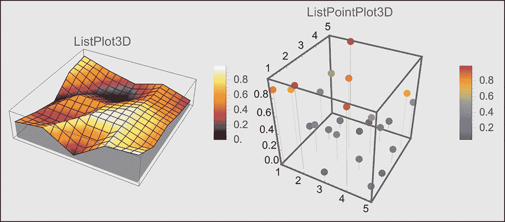

两个三维图。左侧的图标题为“List Plot 3D”，在矩形立方体内绘制了一个波动的颜色渐变网格曲面。右侧的图标题为“List Point Plot 3D”，在方形立方体内绘制了带有离群值的数据点。两个图都带有颜色渐变比例尺。

图 5-47
针对随机实数的 `ListPlot3D` 和 `ListPointPlot3D`

```
In[53]:=Row[{ListPlot3D[Table[RandomReal[1,5],{i,5}],ColorFunction->"SunsetColors",Ticks->None, PlotLegends-> BarLegend[Automatic,egendMarkerSize->90],ImageSize-> Small,PlotLabel->"ListPlot3D",Filling->Bottom,BoxRatios-> Automatic] , ListPointPlot3D[Table[RandomReal[1,5],{i,5}], ColorFunction->"Rainbow", PlotLegends->BarLegend[Automatic, LegendMarkerSize->90], ImageSize->Small, PlotLabel->" ListPointPlot3D",Filling->Bottom,BoxStyle->Thick, BoxRatios->{1,1,1}]},Background->Lighter[Gray,0.80],Frame->True]
Out[53]=
```

## 等高线图

可视化二元函数的一种方法是使用标量场，其中标量 `z = f (x, y)` 被映射到点 `(x, y)`。标量场可以通过其等高线（或等值线）来表征，沿着这些线，`f (x, y)` 的值是恒定的。等高线图或等值线的迹线可以使用 `ContourPlot` 命令来完成，如下例所示。

```
In[54]:= ContourPlot[-((Pi*x)/(3+x²+y²)),{x,-5,5},{y,-5,5},ColorFunction->"Temperature",PlotLegends->Automatic,FrameLabel->{x,y}]
Out[54]=
```

图 5-48 使用 `ColorFunction` 和 `PlotLegends` 选项绘制了一个等高线图。当你使用 `PlotLegends` 时，你可以指定图表应使用的图例类型；在此例中，你使用了自动设置。这会根据每条轮廓线的颜色显示等高线的比例尺；例如，红色表示数值在 0.8 或以上。当光标经过等高线曲线时，会显示该曲线的数值。要在图形图像中标记等高线曲线的数值，请添加 `ContourLabels` 选项并将其值设置为 true，如图 5-49 所示。要添加穿过图形的线条，可以使用之前见过的 `GridLines` 命令，或者使用 `Mesh`。`Mesh` 可以与 `MeshFunction` 或 `MeshStyle` 结合使用。

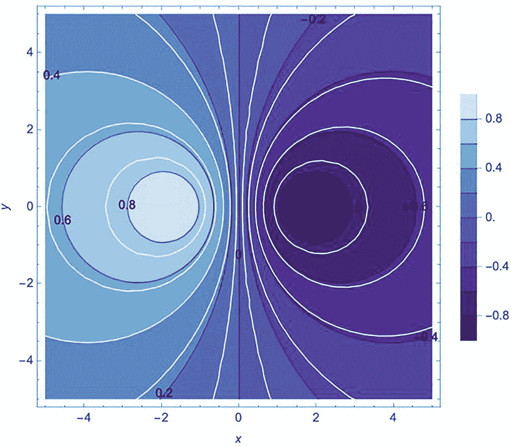

一个等高线图，带有从 -0.8 到 0.8 的颜色渐变比例尺。原点左侧以明亮色调着色，表示较高数值，而原点右侧以暗色调着色，表示较低数值。两侧都绘制了带有等高线的同心环。

图 5-49
在等高线图中添加了等高线

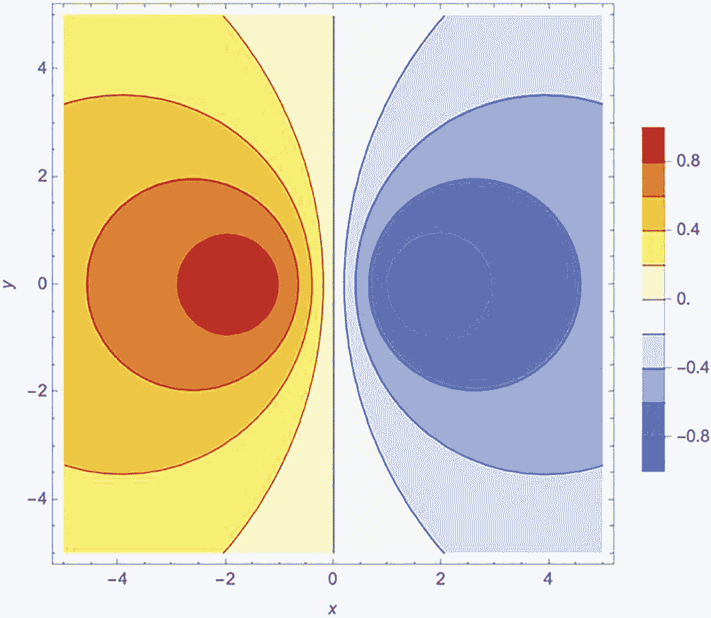

一个等高线图，带有从 -0.8 到 0.8 的颜色渐变比例尺。原点左侧以明亮色调着色，表示较高数值，而原点右侧以暗色调着色，表示较低数值。两侧都绘制了同心环。

图 5-48
针对定义的 z 函数的等高线图

```
In[55]:= ContourPlot[-((Pi*x)/(3+x²+y²)), {x,-5,5}, {y,-5,5}, ColorFunction->"DeepSeaColors", PlotLegends-> Automatic, FrameLabel->{x,y}, ContourLabels->True, Mesh->{10,10}, MeshStyle->{White}, MeshFunctions-> {#3&}]
Out[55]=
```

要将数据绘制成等高线图（见图 5-50），请使用 `ListContourPlot`。`ListContourPlot` 根据以高度值表示的数值数组创建等高线图。

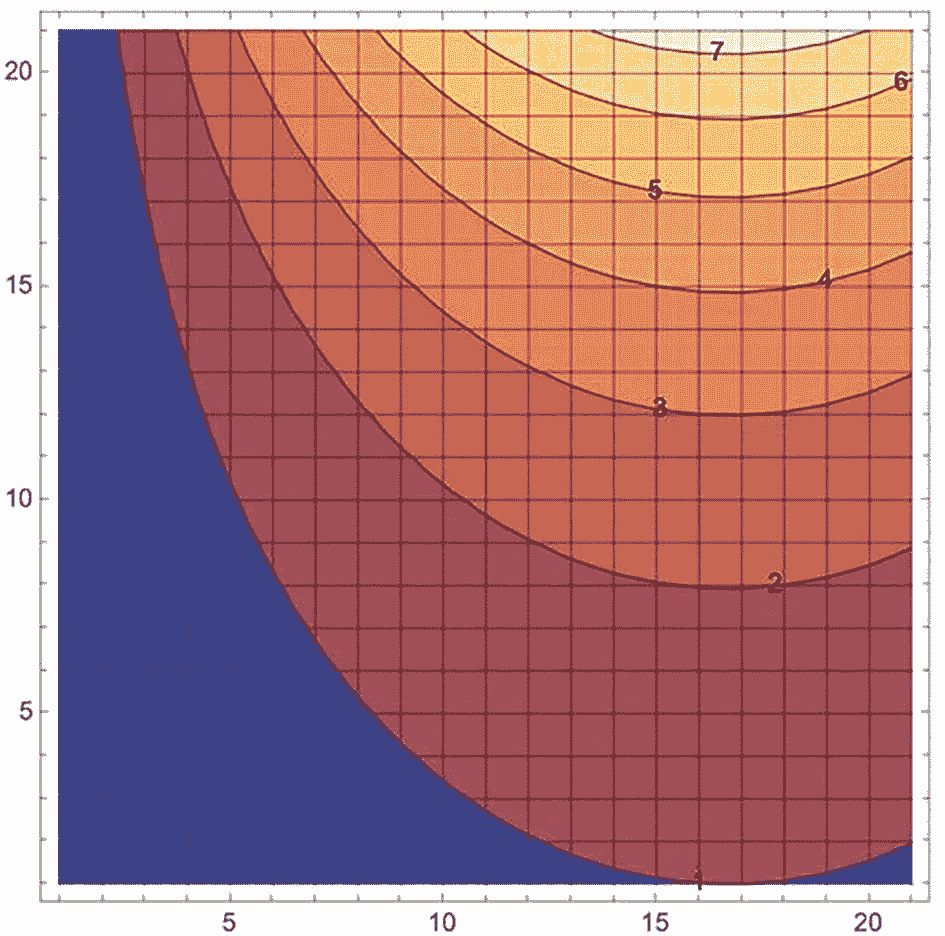

一个等高线图，绘制了同心凸形图案。图的右上角以明亮色调着色，表示较高数值，而图的左下角以暗色调着色，表示较低数值。

图 5-50
`ListContourPlot`

```
In[56]:= ListContourPlot[Table[Exp[x]*Sin[y],{x,0,2,.1},{y,0,2,.1}],ContourLines->True,Mesh->Full,ContourLabels->True]
Out[56]=
```

另一种绘图是 `DensityPlot`（见图 5-51）。`DensityPlot` 的工作方式与 `ContourPlot` 类似。


一个等高线图，以不同色调的圆形斑块绘制密度。这些斑块包含深色和浅色的颜色渐变。

图 5-51
密度图

```
In[57]:= DensityPlot[(Sin[2x]*Cos[3y])/5,{x,0,5},{y,0,5}, ColorFunction->"SunsetColors", Mesh->Full]
Out[57]=
```

你可以使用 `ListDensityPlot` 根据数据绘制密度图（见图 5-52）。


一个等高线图，绘制了呈下降凹形趋势的密度，以不同色调着色。这些趋势包含深色和浅色的颜色渐变。颜色渐变比例尺范围从 -0.5 到 2.5。

图 5-52
以密度图表示的数据

```
In[58]:= ListDensityPlot[Table[x/3 + Sin[3 x + y²], {x, 0, 5, 0.1}, {y, 0, 5, 0.1}],ColorFunction -> "LightTemperatureMap", Mesh -> 10, PlotLegends -> Placed[Automatic, Left]]
Out[58]=
```


### 3D 绘图与二维投影

使用 Wolfram 语言，可以在三维空间中绘制函数，同时将等高线图投影到坐标平面上，如图 5-53 所示。


一个在 XYZ 平面上的三维等高线图。它在图形的顶部和底部绘制了两层颜色渐变层。这些层具有环状和网格状的几何图案。

图 5-53

带有沿 xy 平面等高线图的三维绘图

```
In[59]:= Show[Plot3D[(Sin[2 x]*Cos[2 y])/4, {x, 0, 2}, {y, 0, 2},
PlotStyle -> Directive[Opacity[1]], AxesLabel -> {"X axis", "Y axis", "Z axis"},ColorFunction -> "Rainbow", PlotTheme -> "Marketing"],SliceContourPlot3D[(Sin[2 x]*Cos[2 y])/4, {z == -0.15,    z == 0.15}, {x, 0, 2}, {y, 0, 2}, {z, -1, 1}, ColorFunction -> "Rainbow", Boxed -> False],  ViewPoint -> {1, -1, 1}]
Out[59]=
```

我们来讨论一下代码中的操作。你首先绘制了一个三维函数（见图 5-53），然后使用命令指令为该函数添加颜色，并定义透明度类型，此处设置为 1。接着，为 x、y 和 z 轴分别指定了相应的轴名称。`ColorFunction` 选项有助于定义颜色类型的函数；在本例中，它被设置为 `Rainbow`。`PlotTheme` 是一个用于选择不同可视化主题进行绘图的选项。至此，我们继续使用 `SliceContourPlot3D`，它可以在一个平面或曲面上生成函数的图形。这里我们绘制了当 `z` 等于 ± 0.15 时的图形。这是在 xy 平面上进行的一个切片操作。此时 `x` 和 `y` 的取值范围是 0 到 2，`z` 的取值范围是 –1 到 1。最后，使用 `Show` 命令将两个图形组合在一起；之所以使用这个命令，是因为仅通过绘制切片等高线图是无法得到函数的三维图形的。

## 绘图主题

可以使用 `PlotTheme` 选项访问预构建的主题。当你添加 `PlotTheme` 选项并紧跟第一个撇号时，会看到自动补全菜单。图 5-54 展示了存在的不同主题。


一个列出弹出菜单的图表截图。它列出了可用的主题及其对应的图形。列表包括：Web、Minimal、Detailed、Business、Marketing、Scientific、Monochrome、Classic 和 Default。底部是绘制主题和图形的选项。

图 5-54

`PlotTheme` 弹出菜单

`PlotTheme` 支持三维绘图，如图 5-55 所示。


一个三维散点图，带有从 -0.10 到 0.10 的颜色渐变标度。它以波浪形式绘制数据点。图形顶部数值较高，以明亮色调表示；底部数值较低，以暗色调表示。

图 5-55

三维散点图

```
In[60]:= data=Flatten[Table[{x,y,Sin[10(x²+y²)]/10},{x,-2,2,0.2},{y,-2,2,0.2}],1]; ListPointPlot3D[data,ColorFunction->"LightTemperatureMap", PlotTheme->"Detailed",ViewPoint->{0,-2,0}, ImageSize->250,PlotLegends->Placed[BarLegend[Automatic, LegendMarkerSize->90],Left], ImageSize->20]
Out[60]=
```

这些主题既可用于二维图形，也可用于三维图形。现在，让我们看看另一种用于二维图表的主题（见图 5-56）。


一个标题为“cos of x”的二维线图。它绘制了一条余弦波，最大值为 1.0，最小值为 -1.0。

图 5-56

二维绘图主题：Detailed

```
In[61]:= Plot[Cos[x],{x,0,10},PlotLabel->"Cos[x]",PlotTheme-> "Detailed"]
Out[61]= cos(x)
```

我们来讨论一下 `PlotTheme` 的一个特性。有些主题内部已经包含了某些功能。图 5-55 显示，`Detailed` 主题添加了框架、图例和网格线，尽管你也可以手动添加它们。

同样值得注意的是，其他主题可能仅用于解释和演示目的——也就是说，图表上不需要额外信息，但你需要能够有效且具体地表达信息，例如 `Business` 和 `Minimal` 主题（见图 5-57）。


两个标题为“cos of x”的二维线图。两个图形都描绘了一条最大值为 1.0、最小值为 -1.0 的余弦波。左侧图形上的波浪颜色比右侧图形深。

图 5-57

Business 和 Minimal 绘图主题

```
In[62]:= Table[Plot[Cos[x],{x,0,10},PlotLabel->"Cos[x]",PlotTheme->Pl],{Pl,{"Business","Minimal"}}]
Out[62]=
```

虽然也有一些主题会显示更多细节，比如你之前看到的 `Detailed` 主题，但还存在其他主题，例如 `Scientific` 主题，如图 5-58 所示。你可以添加更多选项，例如 `ColorFunction` 和通过 `ViewProjection` 选项设置视图，该选项允许你固定观察点。


一个 XYZ 轴的三维散点图。颜色渐变标度范围从 -0.10 到 0.10。图形顶部的数据点以明亮色调着色，代表较高数值；而图形底部的数据点以暗色调着色，代表较低数值。

图 5-58

正交视图

注意

`PlotLegends` 可以与 `ColorFunction` 协同工作，显示点的颜色如何从最低值到最高值在蓝色和红色之间过渡。

```
In[63]:= data=Flatten[Table[{x,y,Sin[10(x²+y²)]/10},{x,-2,2,0.2},{y,-2,2,0.2}],1]; ListPointPlot3D[data,ColorFunction->"LightTemperatureMap",PlotLegends-> Placed[BarLegend[Automatic, LegendMarkerSize->90],Left], PlotTheme->"Scientific", ViewProjection->"Orthographic"]
Out[63]=
```

如果你想通过坐标测量进行观察，请使用 `Viewpoint` 选项，它由 `{x 坐标, y 坐标, z 坐标}` 控制。这些坐标是相对于图形中心的，如图 5-59 所示。


一个三维散点图，数据点绘制在 XYZ 轴上。数据点通过颜色区分。数据点随机分布在图形中。

图 5-59

`Viewpoint` 设置为 x 和 y 等于 0，z 等于 –2

```
In[64]:= ListPointPlot3D[Data,ColorFunction->"LightTemperatureMap", PlotLegends->Automatic,PlotTheme->"Scientific", ViewPoint->{0,0,-2},ImageSize->Medium]
Out[64]=
```

## 总结

本章介绍了数据可视化的基础知识，重点讲解了二维绘图、数据绘图和用户自定义函数。随着内容的深入，关于自定义绘图的章节涵盖了从文本到图表、框架、网格和填充图，包括填充图案和渐变填充的进一步内容，接着讨论了如何进行绘图组合，重点介绍了多图绘制、为绘图网格着色，并着重介绍了多轴绘图等新增功能。此外，还概述了调色板，随后对三维绘图进行了细分，详细阐述了自定义、色调着色和等高线图。最后，本章以对三维图形各种绘图主题的展望作为结尾。


