# 6. 统计数据数据分析

本章回顾了使用 Wolfram 语言进行分析的概念和技术，通过方程进行线性调整，并利用统计函数实现 Wolfram 语言的专用功能。Wolfram 语言是用于统计和概率的有用工具。Mathematica 具有执行描述性统计、随机分布、随机数和随机抽样方法的数值和近似计算的功能，如本节所示。

## 随机数

本节回顾了生成随机数（包括整数、实数和复数）的基本命令。你将看到执行有放回和无放回随机抽样的函数，此外，还能确保随机数的结果可重现。

要创建随机数，有多个函数可用于生成随机整数和实数。`RandomInteger` 函数生成输入的随机数；如果函数中未输入参数，则生成区间为 0 或 1。

```
In[1]:= RandomInteger[]
Out[1]= 0
```

要输入一个范围，必须在函数内定义它；例如，介于 -1 和 1 之间。

```
In[2]:= RandomInteger[{-1,1}]
Out[2]= 1
```

要生成一个随机数列表，必须定义列表中所需的数字个数。

```
In[3]:= RandomInteger[{-1,1},7]
Out[3]= {-1,0,1,1,1,1,1}
```

要重复数字，请将列表或嵌套列表的形式作为第二个参数添加。例如，创建一个嵌套列表，每个子列表包含七个项目，总共四个子列表。

```
In[4]:= RandomInteger[{-10,10},{7,4}]
Out[4]= {{-8,7,7,0},{-4,-8,10,-8},{10,8,-8,0},{-2,-6,8,-10},{8,-1,-6,-4},{1,4,0,-1},{5,7,9,10}}
```

用于生成带小数点的随机数的函数称为 `RandomReal`。它的工作方式与 `RandomInteger` 类似，区间位于花括号之间。

```
In[5]:= RandomReal[]
Out[5]= 0.020413
```

也存在用于生成随机复数和素数的命令。

```
In[6]:= RandomComplex[]
Out[6]= 0.727318 +0.998602 I
```

对于随机素数，必须定义一个最小和最大区间——例如，如果它是前 100 个素数中的一个。

```
In[7]:= RandomPrime[{1,100},6]
Out[7]= {89,2,59,71,53,29}
```

这类函数生成伪随机数，因此你可以设置一个种子来生成这些数字。这通过 `SeedRandom` 完成。使用种子，可以确保生成的随机数起始序列相同，从而使随机输出可重现。要设置种子，请使用 `SeedRandom` 命令。以下示例设置一个种子，后跟一个随机数序列；一旦引入种子，该种子的结果应相同。

```
In[8]:= SeedRandom[6467789];RandomInteger[{-1,1},3]
Out[8]= {0,1,0}
```

种子必须放在同一个代码块中才能生成结果。可以选择方法。以下示例使用 `MersenneTwister` 方法生成随机数。使用另一种方法可以生成不同的随机数序列。

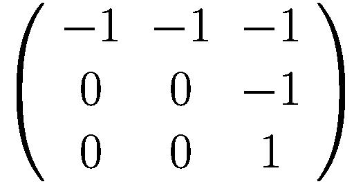

```
In[9]:=SeedRandom[Method->"MersenneTwister"];RandomInteger[{-1,1},{3,3}] // MatrixForm
Out[9]//MatrixForm
```

种子在无参数的情况下进入函数以恢复原始值。

```
In[10]:= SeedRandom[];
```

除了引入种子，你还可以创建随机数块，在其中可以局部使用函数，而不会影响这些块外部的随机行为。这是通过 `BlockRandom` 函数完成的。

```
In[11]:= BlockRandom[RandomReal[1]]
Out[11]= 0.774569
```

如果你在 `BlockRandom` 内运行一个产生随机数的算法并声明了种子，这不应影响在 `BlockRandom` 外部生成随机数的其他过程。为了说明，让我们看一个例子。

```
In[12]:= SeedRandom[121];
{RandomReal[],BlockRandom[RandomReal[]],RandomReal[],RandomReal[]}
Out[13]= {0.994955,0.788549,0.788549,0.957081}
```

如所见，后面的过程生成了不同的随机数。

### 随机抽样

使用 `RandomChoice` 函数进行有放回抽样。要选择单个项目，只需写入列表。你可以设置一个种子以获得相同的结果。

```
In[14]:= SeedRandom[12345]; ranData=RandomReal[{0,1},10]
Out[15]={0.158069,0.599452,0.656143,0.918006,0.0805897,0.682397,0.638187,0.431772,0.126333,0.973705}
```

这生成了一个包含 10 个从 0 到 1 的随机数的列表，现在你从这些数字中随机选择一个项目。

```
In[16]:= RandomChoice[ranData]
Out[16]= 0.973705
```

这会从包含 10 个项目的列表中给出一个单一结果。类似地，你可以选择具有某些元素的样本数量，形式如下：`RandomChoice["数据", "样本数量", "若干元素"]`。现在你从十个元素中选取三个样本，每个样本包含一个元素。

```
In[17]:= RandomChoice[ranData,{3,1}]
Out[17]= {{0.126333},{0.431772},{0.973705}}
```

不过，如果你希望它们在同一个样本中，只需指定要选择的元素数量。

```
In[18]:= RandomChoice[ranData,5]
Out[18]= {0.0805897,0.158069,0.158069,0.0805897,0.973705}
```

要进行无放回抽样，请使用 `RandomSample`。此函数仅从数据列表中选择一个列表项一次。要选择，你只需将样本中的元素数量指定为第二个参数，因为第一个参数对应于数据列表。

```
In[19]:= RandomSample[ranData,9]
Out[19]={0.158069,0.682397,0.431772,0.599452,0.918006,0.638187,0.656143,0.126333,0.0805897}
```

查看细节，你会注意到没有重复的值。列表中的每个项目在抽样中被选中的概率相等。

如果列表中的每个项目都关联了特定的权重，那么要输入这些项，你使用以下表达式形式：`{w1, w2, w3...} -> {元素 1, 元素 2, 元素 3...}`；项目列表与有放回抽样的特定权重相关联。你表示权重列表，并通过关联权重和元素进行抽样。

```
In[20]:=w={0.03`,0.08`,0.22`,0.04`,0.12`,0.3`,0.12`,0.03`,0.04`,0.02`};RandomChoice[w->ranData,2]
Out[20]= {0.656143,0.638187}
```

它们的选择取决于每个元素如何被分配权重。对于无放回抽样，过程类似。

```
In[21]:= RandomSample[w->ranData,3]
Out[21]= {0.682397,0.656143,0.599452}
```


### 系统抽样

要进行系统抽样，您必须确定样本量 `M`。要获取样本量，您可以列出列表中的项目或获取列表的长度。首先，创建一个包含 200 个质数的列表。

```
In[22]:= SeedRandom[09876]; rPrime=RandomPrime[{1,100},200];
Length[rPrime]
Out[24]= 200
```

样本总量已计算得出，因此您需要确定特定样本的大小；在本例中，您需要一个包含 20 个元素的样本。确定样本量后，您需要计算抽样间隔 `j`；`j` 通过一个比率计算得出，即原始样本总量除以指定样本中的元素总数。

```
In[25]:= j=Length[rPrime]/20
Out[25]= 10
```

这意味着新样本的抽样间隔为 1 到 10。接下来，您在此间隔内选择一个随机数，然后每次加上 `j` 来选择下一个元素；也就是说，第一个元素是范围 `[1,10]` 内的一个随机数 `h`，第二个元素是 `h + j`，第三个是 `h + 3j`，依此类推，直到达到原始样本的大小。

您选择了一个介于 1 到 10 之间的随机数。

```
In[26]:= RandomSample[Range[10],1]
Out[26]= {6}
```

结果意味着您从第六个元素开始选择。您展开列表以便更好地查看数据。

```
In[27]:= rPrime
Out[27]={7,41,3,7,83,61,41,29,89,5,17,3,41,73,73,67,29,71,23,13,31,19,89,41,79,19,47,83,13,73,37,67,59,29,13,17,83,43,17,71,89,11,71,23,29,37,89,3,89,11,41,59,2,37,41,31,59,79,61,13,59,53,53,59,2,43,11,73,41,37,3,31,13,83,83,3,31,5,37,2,89,23,2,37,23,3,79,17,47,71,79,13,47,13,17,41,71,73,2,53,29,7,2,7,79,97,83,31,3,43,29,11,37,67,11,41,67,13,23,2,59,53,89,61,29,19,29,13,11,7,61,71,59,53,5,71,13,43,67,2,73,2,5,67,83,53,11,7,61,71,7,11,83,59,47,67,17,83,43,53,17,59,11,11,61,2,11,97,2,73,41,7,41,19,41,71,53,3,3,41,29,5,73,53,79,43,13,19,29,2,73,67,29,41,13,3,43,23,59,89}
```

要获取待选项目的位置，即选择的随机数（这里是 6）加上 `n` 乘以 `j`，直到获得 20 个元素。

```
In[28]:= Table[6+n*j,{n,0,19}]
Out[28]= {6,16,26,36,46,56,66,76,86,96,106,116,126,136,146,156,166,176,186,196}
```

注意

请记住，位置索引从 1 开始，到 `n` 个元素结束。

您必须选择前一个输出中显示的位置。要选择，请使用双方括号表示法。

```
In[29]:= Table[rPrime[[6+n*j]],{n,0,19}]
Out[29]= {61,67,19,17,37,31,43,3,3,41,97,41,19,71,53,67,2,71,43,3}
```

让我们借助 `MapAt` 和 `Style` 更仔细地查看所选元素，并用红色（此处为纯文本）突出显示它们。

```
In[30]:= MapAt[Style[#,FontColor-> ColorData["HTML"]["Red"]]&, RPrime,{#}&/@{61,67,19,17,37,31,43,3,3,41,97,41,19,71,53,67,2,71,43,3}]
Out[30]={7,41,3,7,83,61,41,29,89,5,17,3,41,73,73,67,29,71,23,13,31,19,89,41,79,19,47,83,13,73,37,67,59,29,13,17,83,43,17,71,89,11,71,23,29,37,89,3,89,11,41,59,2,37,41,31,59,79,61,13,59,53,53,59,2,43,11,73,41,37,3,31,13,83,83,3,31,5,37,2,89,23,2,37,23,3,79,17,47,71,79,13,47,13,17,41,71,73,2,53,29,7,2,7,79,97,83,31,3,43,29,11,37,67,11,41,67,13,23,2,59,53,89,61,29,19,29,13,11,7,61,71,59,53,5,71,13,43,67,2,73,2,5,67,83,53,11,7,61,71,7,11,83,59,47,67,17,83,43,53,17,59,11,11,61,2,11,97,2,73,41,7,41,19,41,71,53,3,3,41,29,5,73,53,79,43,13,19,29,2,73,67,29,41,13,3,43,23,59,89}
```

如您所见，系统抽样并不会产生完全随机的样本。随机选择过程仅出现在第一部分，即您选择第一个项目来创建新样本时。一旦选定了第一个项目，后续的选择就来自一系列非随机数。另一个需要考虑的方面是原始样本的顺序；如果元素是周期性的，这可能导致组件选择出现显著的可变性。

## 常用统计度量

掌握常用的统计公式对于理解数据在给定条件下的行为至关重要。描述性统计在数据收集后实施，是探索性数据分析过程中的首要步骤之一，它使您能够从收集的数据中发现模式、异常、趋势、季节性、变异等洞察。

探索性数据分析是一组用于检测那些在数据收集后不易察觉或揭示的特征的技术。该技术的基本结构依赖于数值数据分析、图形表示和统计模型。使用数据探索性分析的原因有很多，包括检查缺失数据、描述底层结构的一般和特定概念、分析与模型创建相关的不同假设等等。

该过程的提议由约翰·图基于 1977 年提出。要更深入地了解此技术，请参考以下文献：*《探索性数据分析》*（图基，J. W. [1977]，第 2 卷，第 131-160 页）。

### 集中趋势度量

给定一个数据样本，您可以计算描述性度量。集中趋势度量是那些为您提供待研究数据平均值的参数。均值，也称为算术平均数，是一个通过样本值之和除以元素个数之和计算得出的参数。`Mean` 函数用于计算平均值。

```
In[31]:= list1=Table[Prime[i],{i,10}];
"Prime list :"ToString@list1
"Mean: "ToString@Mean@N@list1
Out[32]= Prime list :{2, 3, 5, 7, 11, 13, 17, 19, 23, 29}
Out[33]= Mean: 12.9
```

注意

符号 `<>` 是 `StringJoin` 的简写形式。

中位数是将样本分成两等份的值；由于它是数据的中点，因此中位数是相对于数据量的对称值。`Median` 函数可给出此值。

```
In[34]:= "Median: "ToString@Median@list1
Out[34]= Median: 12
```

众数是样本中出现频率最高的值。您可以使用 `Counts` 命令，该命令会给出列表中每个项目出现的次数。

```
In[35]:= Counts[list1]
Out[35]= 1,3->1,5->1,7->1,11->1,13->1,17->1,19->1,23->1,29->1|>
```

在这种情况下，出现次数均为 1。没有重复值；可以说此数据样本中没有众数。


## 离散程度的度量

离散程度的度量揭示了样本中存在的变异性信息。`range`（极差）告诉你数据变化的区间。它通过最大值减去最小值得到。`Max` 和 `Min` 函数返回列表的最大值和最小值。

```
In[36]:= "Range: "ToString[Max[list1]-Min[list1]]
Out[36]= Range: 27
```

`Variance`（方差）是通过将样本中每个元素减去均值得到的度量。结果进行平方，然后将各元素相加。总和除以样本大小。其函数是 `Variance`。

```
In[37]:= "Variance: "ToString[N[Variance[list1],3]]
Out[37]= Variance: 81.4
```

`Standard deviation`（标准差）是通过对方差取平方根或使用 `StandardDeviation` 函数得到的度量。

```
In[38]:= {"Square root of Variance: "  ToString[N[Sqrt[Variance[list1]], 2]],"StandardDeviation: "  ToString[N[StandardDeviation[list1], 2]]}
Out[38]= {Square root of Variance: 9.0,StandardDeviation: 9.0}
```

标准分数 `z` 是一个衡量每个样本元素距离算术平均值有多少个标准差的分数。其数学公式为 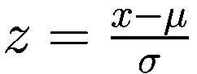，其中 `x` 是测量值，`μ` 是均值，`σ` 是标准差。如果 `z` 为正，则该元素大于均值。当 `z` 为负时，情况相反。你可以计算列表中第二个元素的 `z` 分数。

```
In[39]:= z=N[(list1[[2]]-Mean@list1)/StandardDeviation@list1,3];
"z score: "ToString@z
Out[40]= z score: -1.10
```

这个结果意味着第二个元素的分数低于平均值 1.10 倍。

`Quartile`（四分位数）计算将数据分成四个相等的部分。下四分位数对应数据的 25% 分位数，第二个四分位数是 50%，第三个四分位数（上四分位数）是 75%，第四个四分位数是 100%。要计算四分位数，你可以使用 `Quartiles` 函数，该函数返回第一、第二和第三四分位数的值。

```
In[41]:= "Quartiles: "  ToString@Quartiles[list1]
Out[41]= Quartiles: {5, 12, 19}
```

如果你想获取单个值，可以使用 `Quantile` 函数，后跟要计算的分位数。然后，使用以下代码计算第三个四分位数（第 75 百分位数）。

```
In[42]:= Quantile[list1,0.75]
Out[42]= 19
```

要计算四分位距（即上四分位数与下四分位数之差），请使用 `InterquartileRange` 函数。

```
In[43]:= InterquartileRange[List1]
Out[43]= 14
```

## 统计图表

使用图表展示数据是 Mathematica 中一种直接的方法。很多时候，研究包含各种类型的信息。Mathematica 根据用户对更直观、更易理解的演示的需求，提供了一系列统计图表。

## 条形图

有时，在进行统计研究时，你会遇到定量变量和定性变量，并可以为这些变量创建条形图表示。条形图（见图 6-1）是一种图形表示，其中离散定性变量的频数显示在一个轴上。

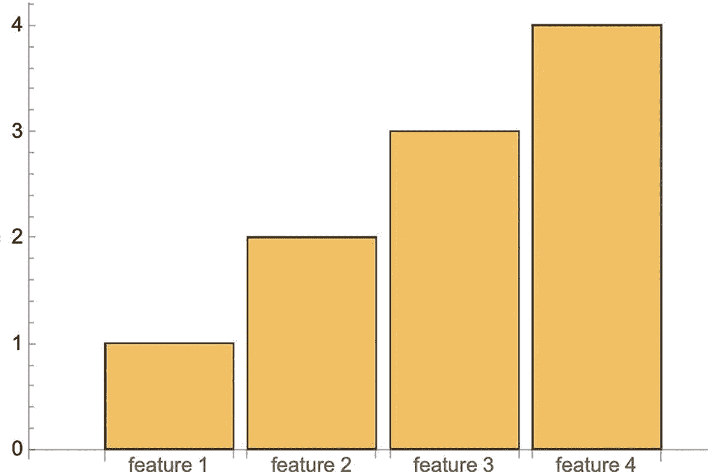

条形图比较了特征 1、2、3 和 4 的频数。特征 1，1。特征 2，2。特征 3，3。特征 4，4。数据为近似值。

**图 6-1** 条形图

```
In[44]:= BarChart[{1,2,3,4},ChartLabels->{"feature 1","feature 2","feature 3","feature 4"}]
Out[44]=
```

定性变量的不同模态位于其中一个轴上。另一个轴显示每个类别在给定尺度上的值或频数。特征 2 的条形关联值为 2。图形的方向可以是垂直的，其中类别位于水平轴上，条形是垂直的；也可以是水平的，其中类别位于垂直轴上，条形是水平的（见图 6-2）。

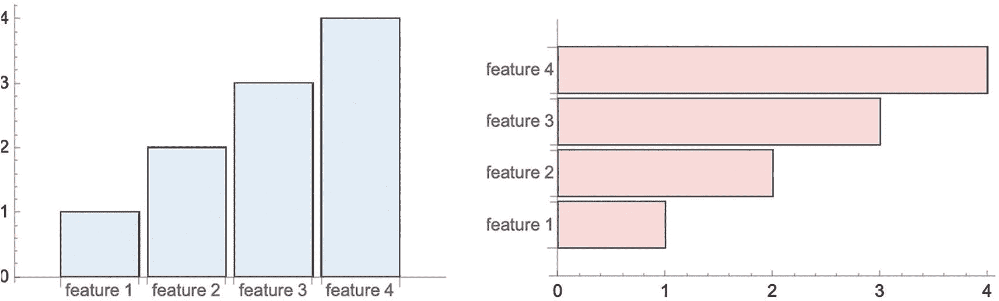

两个条形图比较了特征 1、2、3 和 4 的频数。A. 垂直条形图。B. 水平条形图。特征 1，1。特征 2，2。特征 3，3。特征 4，4。数据为近似值。

**图 6-2** 底部和左侧原点条形图

```
In[45]:= GraphicsRow[{BarChart[{1,2,3,4},ChartLabels->{"feature 1","feature 2","feature 3","feature 4"},BarOrigin->Bottom,ChartStyle->LightBlue],BarChart[{1,2,3,4},ChartLabels->{"feature 1","feature 2","feature 3","feature 4"},BarOrigin->Left,ChartStyle->LightRed]}]
Out[45]=
```

条形图可用于比较不同类别的量级，并观察数值如何根据固定变量（例如，每个特征）变化。此外，你可以选择如何显示条形：如前面的示例所示，显示单个系列；分组显示，包含多个数据系列，并用不同类型的条形表示；或堆叠显示，其中条形被分成不同颜色的段，代表不同的类别。百分位布局以百分比尺度显示，如图 6-3 所示。

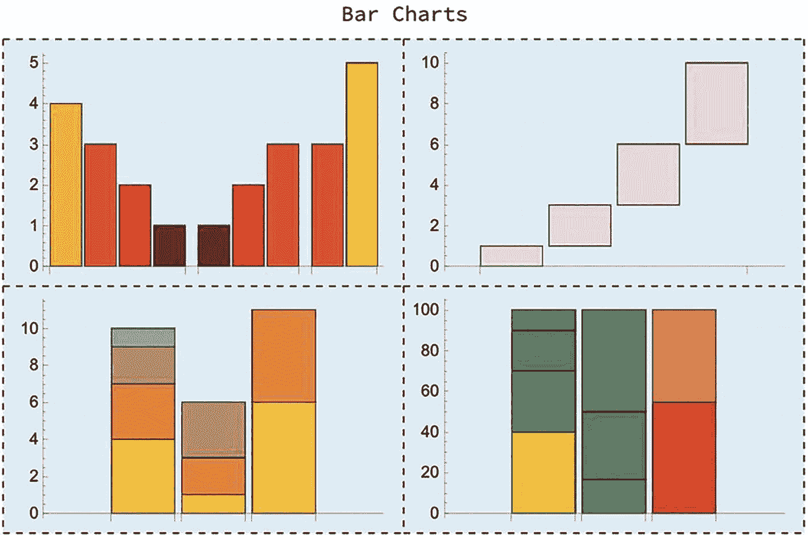

一个由四个条形图组成的网格比较了频数。A. 波动趋势的垂直条形图。B. 增长趋势的垂直条形图。C 和 D 是堆叠条形图。

**图 6-3** 条形图网格

```
In[46]:= Labeled[GraphicsGrid[{{BarChart[{{4, 3, 2, 1}, {1, 2, 3}, {3, 5}}, ChartLayout -> "Grouped", ColorFunction -> "SolarColors"], BarChart[{1, 2, 3, 4}, ChartStyle -> LightRed, ChartLayout ->
"Stepped"]}, {BarChart[{{4, 3, 2, 1}, {1, 2, 3}, {6, 5}}, ChartLayout -> "Stacked"], BarChart[{{4, 3, 2, 1}, {1, 2, 3}, {6, 5}}, ChartLayout -> "Percentile", ColorFunction -> "DarkRainbow"]}},
Frame -> All, FrameStyle -> Directive[Black, Dashed], Background -> LightBlue, ImageSize -> 500], "Bar Charts", Top]
Out[46]=
```

还有对应的 3D 图形，使用 `BarChart3D`（见图 6-4）。

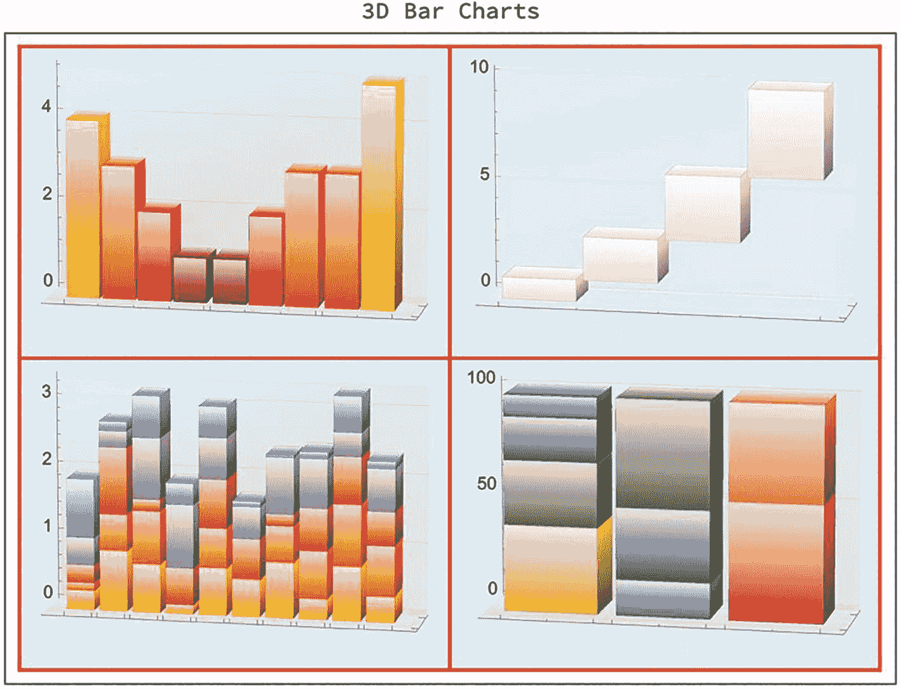

一个由四个 3D 条形图组成的网格比较了频数。A. 波动趋势的垂直条形图。B. 增长趋势的垂直条形图。C 和 D 是堆叠条形图。

**图 6-4** 3D 条形图网格

```
In[47]:= SeedRandom[123];
Labeled[GraphicsGrid[{{BarChart3D[{{4, 3, 2, 1}, {1, 2, 3}, {3, 5}},
ChartLayout -> "Grouped", ColorFunction -> "SolarColors"],
BarChart3D[{1, 2, 3, 4}, ChartStyle -> LightRed, ChartLayout -> "Stepped"]}, {BarChart3D[RandomReal[1, {10, 5}], ChartLayout -> "Stacked"], BarChart3D[{{4, 3, 2, 1}, {1, 2, 3}, {6, 5}}, ChartLayout -> "Percentile", ColorFunction -> "DarkRainbow"]}},  Frame -> All, FrameStyle -> Directive[Red, Thick],Background -> LightBlue, ImageSize -> 500], "3D Bar Charts", Top, Frame -> True, Background -> White]
Out[48]=
```


## 直方图

直方图是一种在统计研究中常用的可视化方式。通过直方图，你可以观察样本的分布情况。直方图用于表示定量变量的频数。变量类别位于水平轴上，频数位于另一轴上。以下示例绘制了一个包含 50 个介于 0 和 1 之间的随机值的总体的直方图，并将组数设置为 10。直方图的第二个参数用于定义组数（见图 6-5）。

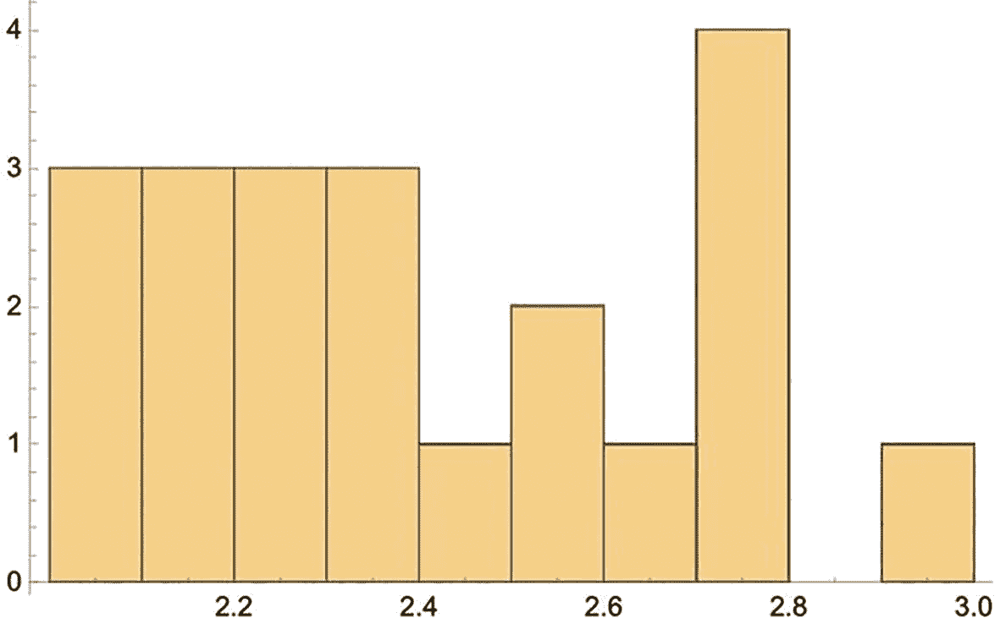

直方图比较了变量类别与频数。变量 2.8 的最大频数为 4，而变量 2.5、2.7 和 3.0 的最小频数为 1。数据为近似值。

**图 6-5** 随机实数的直方图

```
In[49]:= SeedRandom[4322];
hist1=Table[RandomReal[{2,3}],{i,0,20}];
Histogram[hist1,10]
Out[51]=
```

> **注意：** 处理图表时，如果将指针光标悬停在图形上，会出现信息提示标记该值。

与条形图类似，有多种方法可以编辑直方图的起点及其显示方式——堆叠或重叠——如图 6-6 所示。

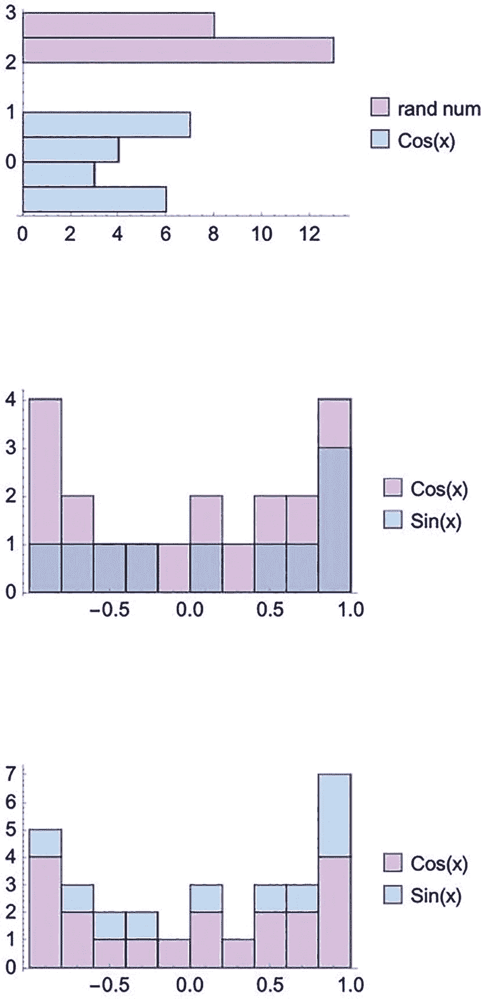

三个条形图比较了频数数量。A. 一个水平条形图，显示随机数和 x 的余弦值。B 和 C. 一个堆叠条形图，显示 x 的余弦值和正弦值。

**图 6-6** 直方图形状网格

```
In[51]:= hist2=Table[Cos[i],{i,1,20}];
hist3=Table[Sin[i],{i,1,10}];
GraphicsColumn[{Histogram[{hist1,hist2},10,BarOrigin->Left,ChartStyle->"Pastel",ChartLegends->{"rand num", "Cos(x)"}],Histogram[{hist2,hist3},10,ChartLayout-> "Overlapped",ChartStyle->"Pastel",ChartLegends-> {"Cos(x)","Sin(x)"}],Histogram[{hist2,hist3},10,ChartLayout-> "Stacked",ChartStyle->"Pastel",ChartLegends->{"Cos(x)","Sin(x)"}]}]
Out[54]=
```

基于此，你还可以使用`PairedHistograms`绘制双向直方图。这些直方图可以是水平或垂直方向，包含两个数据系列，其条形方向相反（见图 6-7）。

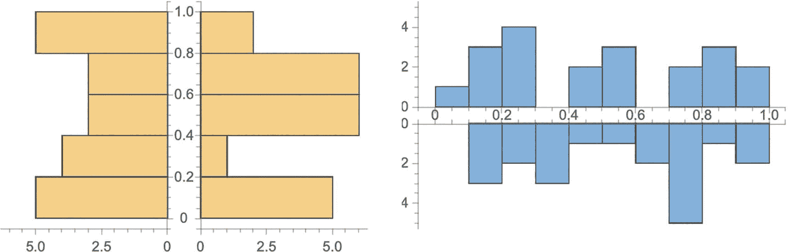

两个配对条形图比较了频数数量。A. 一个水平条形图，包含多个方向相反的条形。B. 一个垂直条形图，包含多个方向相反的条形。

**图 6-7** 不同起点的配对直方图

```
In[55]:=SeedRandom[123] ;GraphicsRow[{PairedHistogram[{RandomReal[{0,1},20]},{RandomReal[{0,1},20]},BarOrigin->Left], PairedHistogram[{RandomReal[{0,1},20]}, {RandomReal[{0,1},20]},10,BarOrigin->Top, ChartStyle->"Pastel"]}]
Out[55]=
```

虽然直方图提供了可视化数据分布的强大方式，但你可以通过直接在笔记本中整合各种统计函数来增强这些可视化效果。默认情况下，Wolfram 语言中的直方图显示每个组内的数据计数。然而，可视化累积分布函数（CDF）和概率密度函数（PDF）通常也很有价值，如下例和图 6-8 所示。

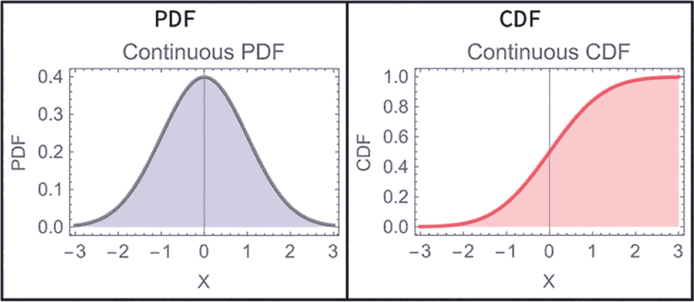

两个图形的网格。左侧：PDF 与 x 的关系图。它绘制了一条连续 PDF 的钟形曲线，峰值在 (0, 0.4)。右侧：CDF 与 x 的关系图。它绘制了一条连续 CDF 的 S 形曲线，峰值在 (3, 1.0)。数据为近似值。

**图 6-8** 标准正态分布的 PDF 和 CDF 图

```
In[56]:= (*common options*)
continuousOpts = {Filling -> Axis, Frame -> True, FrameLabel -> {"X", #}, PlotLabel -> "Continuous "  #} &;
(*Continuous PDF and CDF plots*)
continuousPlots =
Grid[{{Labeled[Plot[PDF[NormalDistribution[0, 1], x], {x, -3, 3},     Evaluate@continuousOpts["PDF"],  PlotStyle -> Directive[Blue, Opacity[0.5]]], "PDF", Top],  Labeled[Plot[CDF[NormalDistribution[0, 1], x], {x, -5, 5},  Evaluate@continuousOpts["CDF"], PlotStyle -> Directive[Red, Thick]], "CDF", Top]}}, Frame -> All]
Out[57]=
```

上述代码生成了连续分布（标准正态分布，均值 0，标准差 1）的 PDF 和 CDF 图。它将分布作为参数传递给`PDF`和`CDF`函数。为清晰起见，图表已相应添加标签。类似地，该过程也可用于离散分布（见图 6-9）。

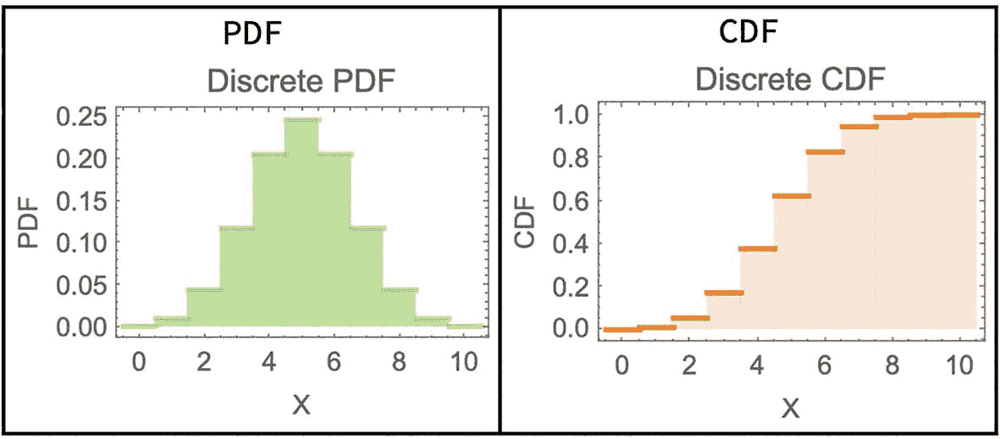

两个图形的网格。左侧：PDF 与 x 的关系图。它绘制了离散 PDF 的钟形模式，以离散条形表示。右侧：CDF 与 x 的关系图。它绘制了离散 CDF 的 S 形曲线，以离散条形表示。

**图 6-9** 参数 n=10 和 p=0.5 的二项分布的 PDF 和 CDF 图

```
In[57]:= (*common options*)
discreteOpts = {ExtentSize -> Full, Frame -> True, FrameLabel -> {"x", #}, PlotLabel -> "Discrete "  #} &;
(*Discrete PDF and CDF plots*)
discretePlots =  Grid[{{Labeled[ DiscretePlot[PDF[BinomialDistribution[10, 0.5], x], {x, 0, 10}, Evaluate@discreteOpts["PDF"], PlotStyle -> Directive[Green, Opacity[0.5]]], "PDF", Top], Labeled[DiscretePlot[CDF[BinomialDistribution[10, 0.5], x], {x, 0, 10}, Evaluate@discreteOpts["CDF"], PlotStyle -> Directive[Orange, Thick]], "CDF", Top]}}, Frame -> All]
Out[58]=
```

### 饼图和扇形图

饼图是被分成两个或多个扇区的圆形。它们表示构成总体的定量变量；例如，扇区的大小与其代表的值成比例绘制，并以百分比表示，这仅提供相对的定量信息。饼图使用`PieChart`命令制作（见图 6-10）。

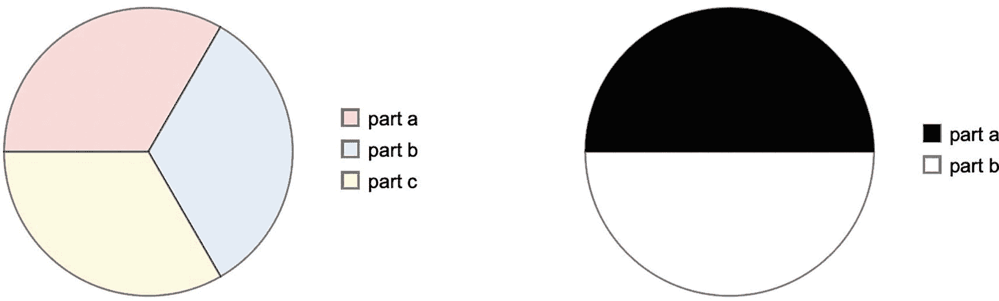

两个饼图。左侧：有三个分区，分别为部分 a、b 和 c。右侧：有两个相等的分区，分别为部分 a 和 b。

**图 6-10** 饼图

```
In[59]:= GraphicsRow[{PieChart[{1,1,1},ChartLegends->{"part a","part b","part c"},ChartStyle->{LightRed,LightBlue,LightYellow}], PieChart[{1,1}, ChartLegends->{"part a","part b"},ChartStyle-> "SunsetColors"]}]
Out[59]=
```

扇形图使用`SectorChart`命令绘制（见图 6-11）。它们用于比较发生在同一位置的不同数据。它们由 x 的比例大小与 y 的半径值构成。表示数量的量纲对于所有扇区必须相同。

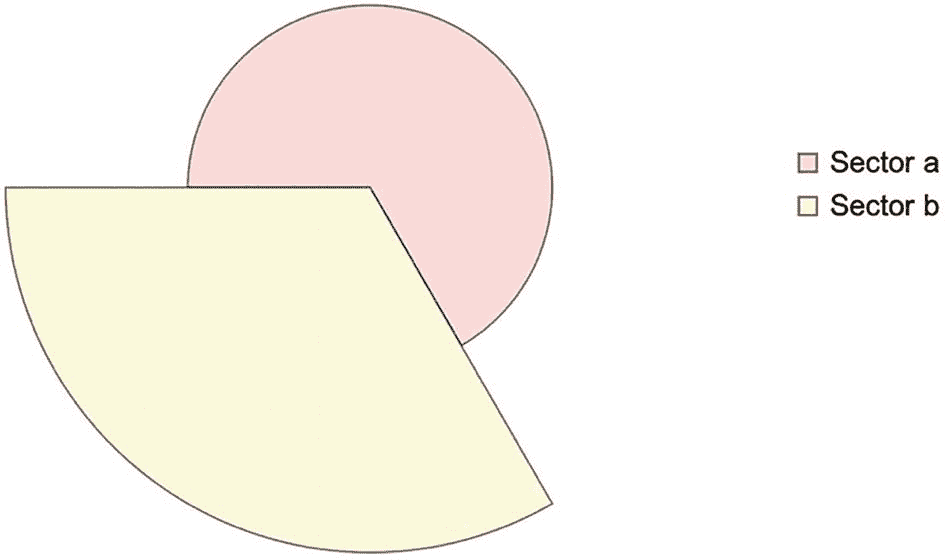

一个图表比较了扇区 a 和 b 的数据，以不同色调显示。扇区 a 包含四分之三的部分，而扇区 b 包含四分之一的组成部分。

**图 6-11** 扇形图

```
In[60]:= SectorChart[{{2,1},{1,2}},ChartLegends->{"Sector a","Sector b"},ChartStyle->{LightRed,LightYellow}]
Out[60]=
```

对于所见的每个图形，都有相应的命令可以创建其 3D 版本，如图 6-12 所示。

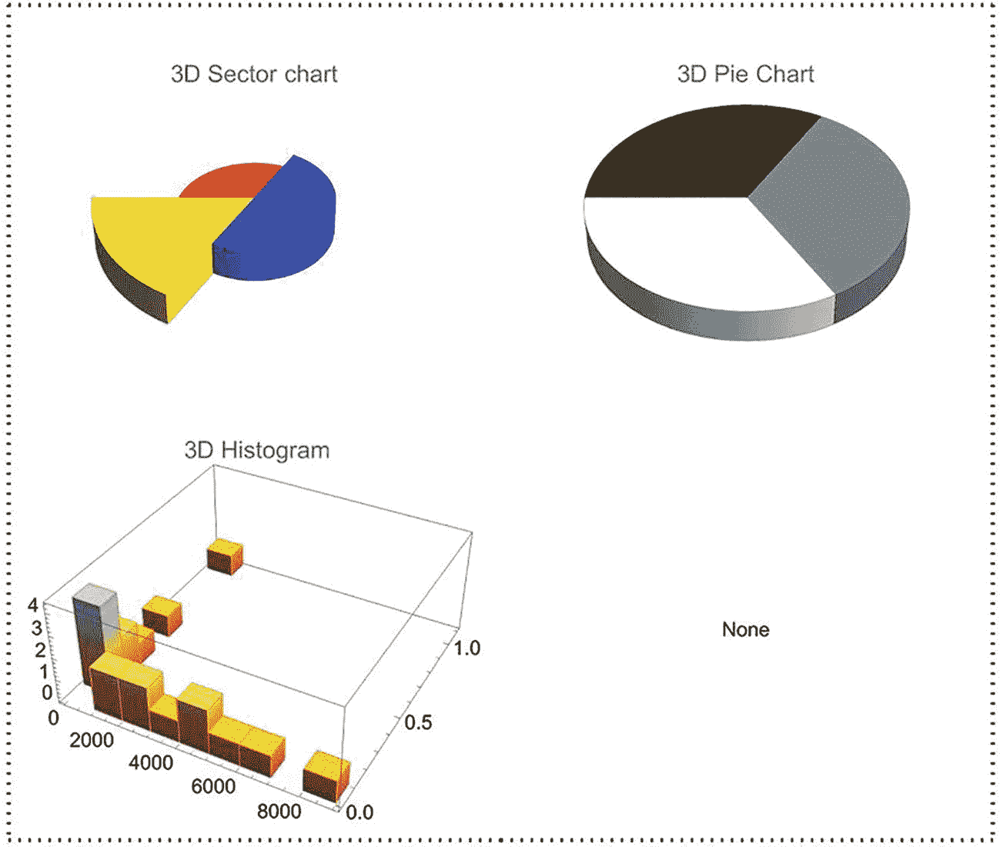

一页包含三个不同的 3D 图表。其中包括一个具有三个扇区的扇形图、一个具有三个扇区的饼图以及一个具有多个垂直条形的直方图。

**图 6-12** 3D 网格图表

```
In[61]:=
GraphicsGrid[{{SectorChart3D[{{2, 1, 1}, {3, 1, 2}, {1, 2, 2}},     PlotLabel -> "3D Sector chart",     ChartStyle -> {Red, Blue, Yellow}],    PieChart3D[{1, 1, 1}, ChartStyle -> "GrayTones",     PlotLabel -> "3D Pie Chart"]}, {Histogram3D[    Table[{i³, i^-1}, {i, 20}], 10,     ChartElementFunction -> "GradientScaleCube",     PlotLabel -> "3D Histogram"], None}}, ImageSize -> 500,  Frame -> True, FrameStyle -> Directive[Thick, Dotted]]
Out[61]=
```


## 箱线图

箱线图是一种表示和观察数据分布的方式。从根本上说，它突出了单个或多个序列中数据分布的各个方面。要绘制箱线图，可以使用 `BoxWhiskerChart` 命令（见图 6-13）。

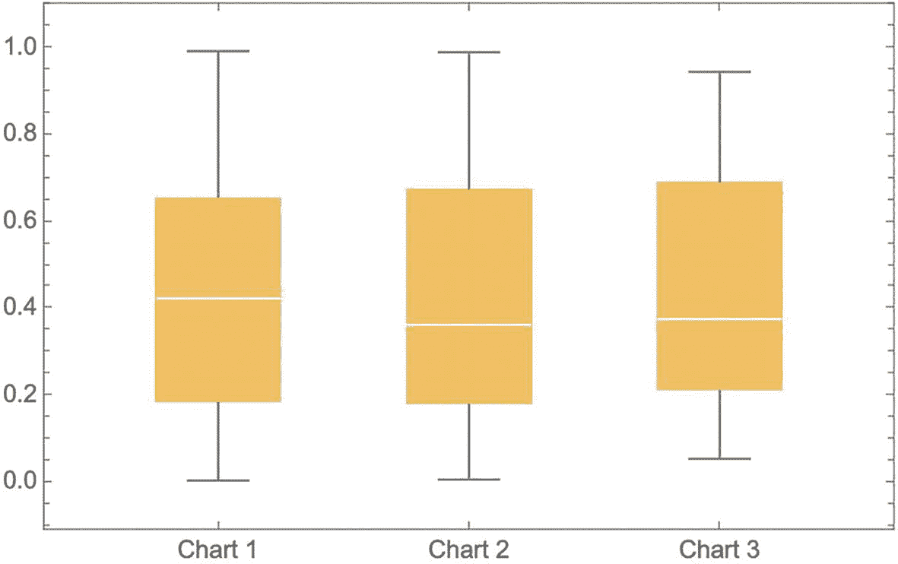

箱线图比较了图表 1、2 和 3 的分布范围。图表 1：0.65，延伸至 1.0。图表 2：0.7，延伸至 1.0。图表 3：0.75，延伸至 1.0。数据为近似值。

**图 6-13** 箱线图

```
In[62]:= SeedRandom[1234] BoxWhiskerChart[{Table[RandomReal[],{i,0,50}],Table[RandomReal[],{i,0,50}], Table[RandomReal[],{i,0,15}]},ChartLabels→{"Chart 1","Chart 2","Chart 3"}]
Out[62]=
```

箱体由一个矩形表示，标记了分布的四分位距。从下到上的第一条线标记了第一四分位数（25%）的值，穿过箱体的线是中位数，界定箱体的最后一条线是第三四分位数（75%）。须线是标记最大值和最小值的线。当鼠标光标悬停在图表上时，会显示数据信息；这包括最小值、最大值、中位数、第 75 百分位数和第一四分位数。根据具体规格，这可能会影响显示的参数及其显示方式（见图 6-14）。

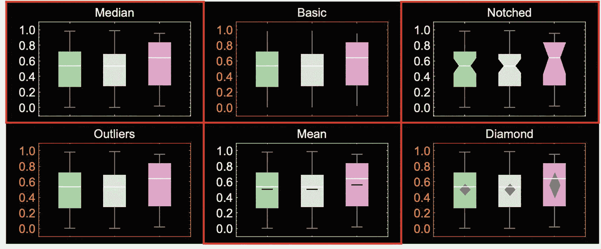

一个包含六个箱线图的网格。其中包括三个矩形箱体，分别代表中位数、基本、带凹口、异常值、均值和菱形，并带有最小值和最大值的延伸线。

**图 6-14** 多个箱线图

```
In[62]:= SeedRandom[123];
data = {Table[RandomReal[], {i,0,50}],Table[RandomReal[], {i,0,50}], Table[RandomReal[], {i,0,15}]};
options = {ImageSize -> Medium, ChartStyle -> "MintColors", FrameStyle -> Directive[White, 12]};
GraphicsGrid[{{BoxWhiskerChart[data, "Median", PlotLabel -> Style["Median", White], options], BoxWhiskerChart[data, "Basic", PlotLabel -> Style["Basic", LightOrange], FrameStyle -> Directive[Orange, 12], options], BoxWhiskerChart[data, "Notched",
PlotLabel -> Style["Notched", White], options]},
{BoxWhiskerChart[data, "Outliers", PlotLabel -> Style["Outliers", LightOrange], FrameStyle -> Directive[Orange, 12], options], BoxWhiskerChart[data, "Mean", PlotLabel -> Style["Mean", White], options],BoxWhiskerChart[data, "Diamond", PlotLabel -> Style["Diamond", LightOrange], FrameStyle -> Directive[Orange, 12], options]}},FrameTicksStyle -> 18, Frame -> {None, None, {{1, 1} -> True, {2, 2} -> True, {1, 3} -> True}}, FrameStyle -> Directive[Thick, Red], Background -> Black]
Out[63]=
```

中位数是默认规格；它在箱体中心显示中位数。基本模式仅显示箱体。带凹口模式显示中位数的置信区间。异常值模式显示并标记非典型数据点。均值模式标记分布的均值，菱形模式则标记均值的置信区间。

## 分布图

小提琴图用于可视化数据的分布和概率密度。要绘制小提琴图（见图 6-15），可以使用 `DistributionChart` 命令。

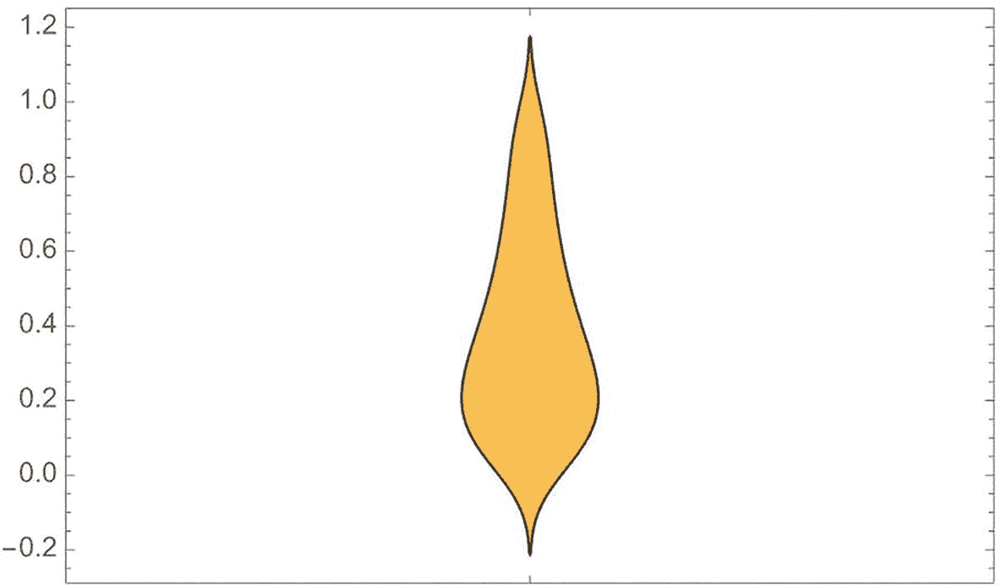

概率分布相对于水平轴的小提琴图。它绘制了一条密度曲线，中心为中位数，随后是四分位距，分布的峰值约为 1.2。

**图 6-15** 小提琴图

```
In[64]:= DistributionChart[Table[i^Exp[i],{i,0,1,0.01}]]
Out[64]=
```

图中的图形结合了箱线图和两侧的密度图，以展示数据的分布方式。`DistributionChart` 有不同的形状可供绘制（见图 6-16）。

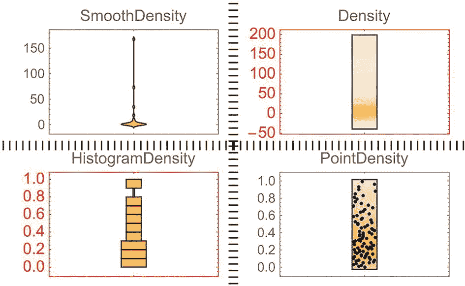

一个包含四个图表的网格。它展示了四种不同的小提琴图：平滑密度、密度、直方图密度和点密度。平滑：数据分布有一个峰值。密度：一个矩形箱体。直方图：由多个方块排列而成。点：一个带有多个点的矩形箱体。

**图 6-16** 不同形状的小提琴图

```
In[65]:= GraphicsGrid[{{DistributionChart[Table[i^Exp[i], {i, 0, 2, 0.1}], ChartElementFunction -> "SmoothDensity", PlotLabel -> "SmoothDensity"], DistributionChart[Table[i^Exp[i], {i, 1, 2, 0.1}], ChartElementFunction -> "Density", PlotLabel -> "Density",
FrameStyle -> Directive[Red, 12]]}, {DistributionChart[ Table[i^Exp[i], {i, 0, 1, 0.09}], ChartElementFunction -> "HistogramDensity", PlotLabel -> "HistogramDensity", FrameStyle -> Directive[Red, 12]], DistributionChart[Table[i^Exp[i], {i, 0, 1, 0.0112}], ChartElementFunction -> "PointDensity", PlotLabel -> "PointDensity"]}}, ImageSize -> Medium, FrameStyle -> Directive[Thickness[0.02], LightGray], Dividers -> {2 -> Directive[Black, Dotted], 2 -> Directive[Black, Dotted]}, Frame -> {1 -> False, False}]
Out[65]=
```


### 图表调色板

为图表添加选项的另一种方法是通过`图表元素方案`调色板，该调色板位于`调色板`菜单中（`调色板` ➤ `图表元素方案`）。此调色板如图 6-17 所示。

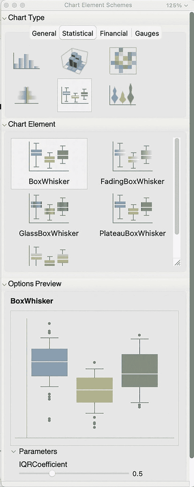

图表元素方案窗口的截图。其中包含图表类型和图表元素，并选中了箱线图。选项预览区域显示了一个带有标记参数的选中箱线图。

**图 6-17**  
*图表元素方案调色板*

在调色板中，您会看到三个类别。`图表类型`用于选择图表的类型。它包含四个选项卡：(1) 常规，其中包含条形图、扇形图、页脚图等图形；(2) 与数据分布相关的统计图；(3) 金融，与金融数据图表相关；(4) 仪表盘，即度量图。第二个类别用于通过`ChartElementFunction`选项选择图形的形状。第三个类别用于预览从前两个类别中选择的选项。

为了说明这一点，让我们看看下面的练习。首先，绘制一个密度直方图，然后借助调色板修改图形的形状。要绘制密度直方图，请使用`DensityHistogram`命令（见图 6-18）。

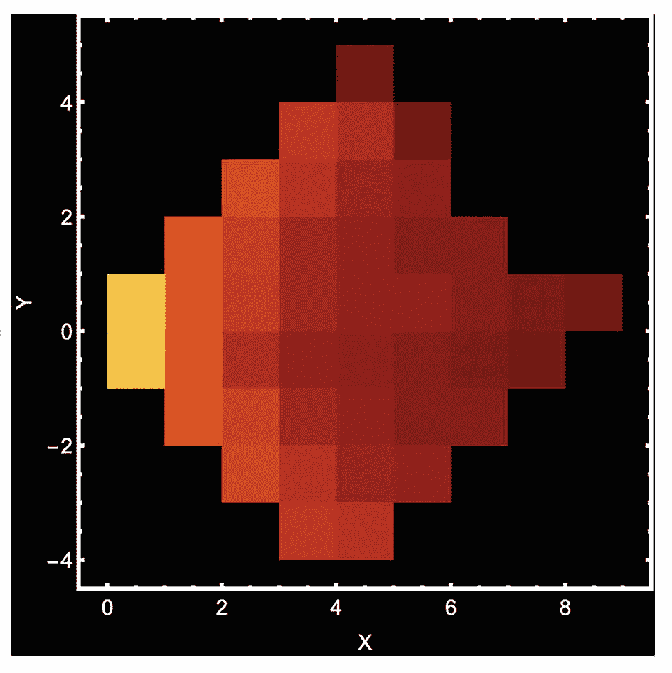

一个带有 Y 轴和 X 轴数值的直方图。它绘制了一个菱形结构，其中包含一组颜色渐变的方块。

**图 6-18**  
*密度直方图*

```
In[66]:= DensityHistogram[Flatten[Table[{x²+y²,x²-y²}, {x,0,2,0.1},{y,0,2,0.1}],1],ChartBaseStyle->Red,ColorFunction->"SolarColors",Background->Black,FrameStyle->Directive[White,Thick], FrameLabel->{"X","Y"},ImageSize->300]
Out[66]=
```

图形绘制完成后，使用调色板头部添加一个选项，并打开`图表元素方案`调色板。在图表类型中，点击统计选项卡，然后选择`DensityHistogram`图表。选择图表后，转到`图表元素`，并将形状类型选为`Bubble`。然后转到`选项预览`查看图形效果；如果点击`形状`，会弹出一个包含其他形状的菜单；选择`hexagon`。图 6-19 显示了所选图表元素的预览效果。

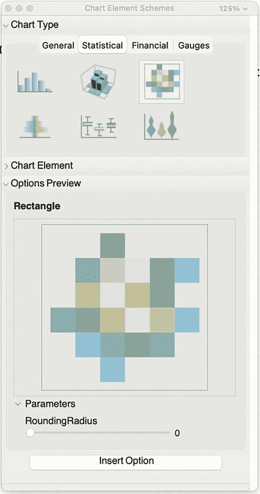

图表元素方案窗口的截图。其中包含选中的统计图表类型和图表元素。选项预览区域显示了一组带有标记参数的矩形框。

**图 6-19**  
*选中的密度直方图选项*

选择完成后，点击插入按钮，它会插入以下代码：`ChartElementFunction` ➤ `ChartElementDataFunction["Bubble", "Shape" ➤ "Hexagon"]`。为了正确绘制图形，将此代码作为选项添加，然后进行绘制（见图 6-20），以观察新添加的选项。

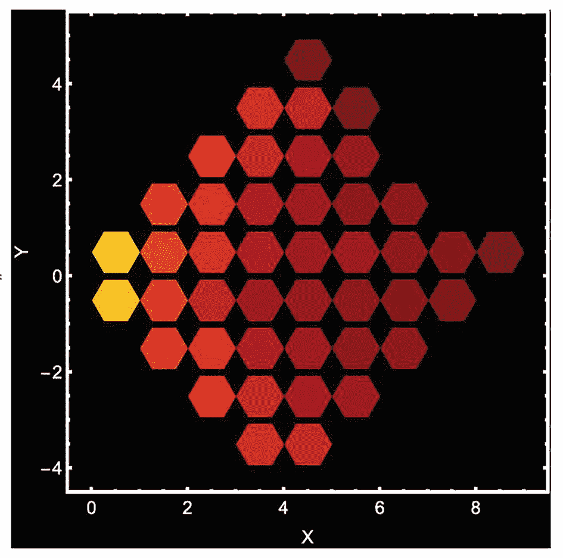

一个带有 Y 轴和 X 轴数值的直方图。它绘制了一个菱形结构，其中包含一组颜色渐变的六边形。

**图 6-20**  
*六边形密度直方图*

```
In[67]:= DensityHistogram[Flatten[Table[{x² + y², x² - y²}, {x, 0, 2, 0.1}, {y, 0, 2, 0.1}], 1], ChartBaseStyle -> Red, ColorFunction -> "SolarColors", Background -> Black, FrameStyle -> Directive[White, Thick], FrameLabel -> {"X", "Y"}, ImageSize -> 300, ChartElementFunction -> ChartElementDataFunction["Bubble", "Shape" -> "Hexagon"]]
Out[67]=
```

`DensityHistogram`命令允许您选择如何沿坐标轴显示数据分布；如果您选择`Method`类型作为选项，它可以显示为维度、箱线图或直方图（见图 6-21）。

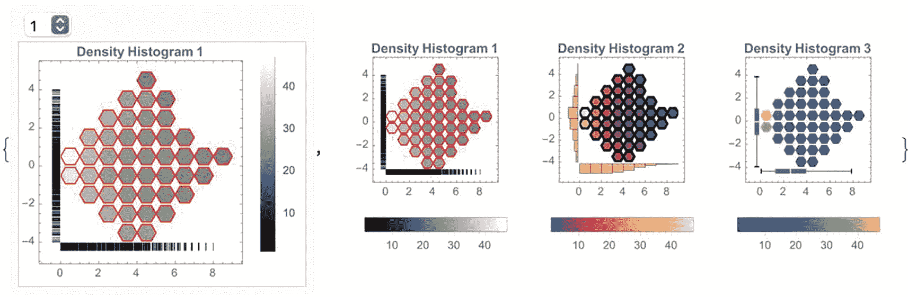

一页展示了三个密度直方图。密度直方图 1 被选中，它绘制了垂直轴与水平轴的关系。它显示了一个菱形图案，其中包含一组颜色渐变的六边形。颜色标尺位于右侧。

**图 6-21**  
*三种不同方法图的菜单视图*

```
In[68]:= hist = Flatten[Table[{x²+y²,x²-y²}, {x,0,2,0.1}, {y,0,2,0.1}],1];
densityHistogram[distAxes_, colFunc_, baseStyle_, plotLabel_, imgSize_] := DensityHistogram[Hist, Method -> {"DistributionAxes" -> distAxes},ColorFunction -> colFunc, ChartBaseStyle -> baseStyle, PlotLabel -> Style[plotLabel, Bold], ChartLegends -> Automatic,
ChartElementFunction -> ChartElementDataFunction["Bubble", "Shape" -> "Hexagon"],ImageSize -> imgSize] {MenuView[{densityHistogram[True, GrayLevel, Directive[FaceForm[Opacity[0.5]], EdgeForm[Red]], "Density Histogram 1", 200], densityHistogram["Histogram", Automatic,  Directive[EdgeForm[Thick]], "Density Histogram 2", 200], densityHistogram["BoxWhisker", "BlueGreenYellow", Automatic, "Density Histogram 3", 200]}], GraphicsRow[{densityHistogram[True, GrayLevel, Directive[FaceForm[Opacity[0.5]], EdgeForm[Red]],
"Density Histogram 1", 130], densityHistogram["Histogram", Automatic, Directive[EdgeForm[Thick]], "Density Histogram 2", 130],
densityHistogram["BoxWhisker", "BlueGreenYellow", Automatic, "Density Histogram 3", 130]}]}
Out[70]=
```

这些图形以菜单形式显示在内部，因此要访问不同的图形，您必须在菜单中逐个选择。尽管如此，我们还是以小比例展示了这些图形，以演示它们应有的外观（见图 6-21）。第一个图形显示了数据分布沿坐标轴的维度。第二个图形以直方图形式显示了数据分布，第三个图形显示了箱线图。


## 普通最小二乘法

普通最小二乘法通过数据点找到最佳拟合直线。该方法用于研究因变量与自变量之间的关系。其过程基于寻找形如 `y = mx + b` 的直线表达式，其中 `x` 是自变量，`y` 是因变量，`m` 是斜率，`b` 是 y 轴截距。斜率和截距 `b` 通过以下公式计算得出。

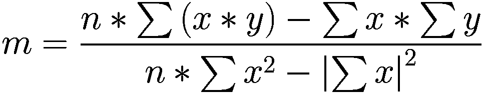

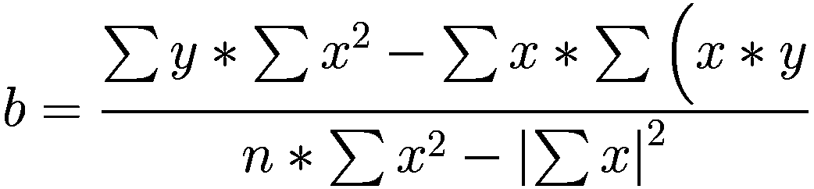

求和符号用希腊大写字母西格玛（∑）表示；`n` 是样本中的数据量。该方法针对测量得到的数据对进行计算，并计算出斜率值和 y 轴截距源，以创建数据对直线的最佳拟合。通过代入一般方程，即可得到该数据集的直线方程。

为了说明该方法，我们来看一个使用因变量和自变量数据点的示例。

```
In[71]:= data={{-1,10},{0,9},{1,7},{2,5},{3,4},{4,3},{5,0},{7,-1}};
Grid[Transpose[Prepend[data,{"X","Y"}]],Dividers->{2->True,2->True},Alignment-> Center]
Out[72]=
X | -1 0 1 2 3 4 5 7
__|______________________
Y | 10 9 7 5 4 3 0 -1
```

接下来，计算获取斜率和 y 轴截距所需的数据。

```
In[73]:=n = Length[data];
sumX = Total@data[[All, 1]];
sumY = Total@data[[All, 2]];
sumXY = Total[data[[All, 1]]*data[[All, 2]]];
sumXSqr = Total@(data[[All, 1]]²);
m = N@((n*sumXY-sumX*sumY)/n*sumXSqr-Abs[sumX]²);
b = N@((sumY*sumXSqr-sumX*sumXY)/n*sumXSqr-Abs[sumX]²);
```

使用 `Solve` 命令求解形如 `y = mx + b` 的方程。第一个参数是方程，第二个参数是要求解的变量。输入方程时必须使用双等号，因为单等号用于赋值指令。

```
In[80]:= Solve[SetPrecision[y==m*x+b,3],y]
Out[80]= {{y->8.47-1.47 x}}
```

由此得到直线方程为 `y = 1.47 x + 8.47`。根据此方程，你可以绘制数据点以及最佳拟合这些点的直线（见图 6-22）。

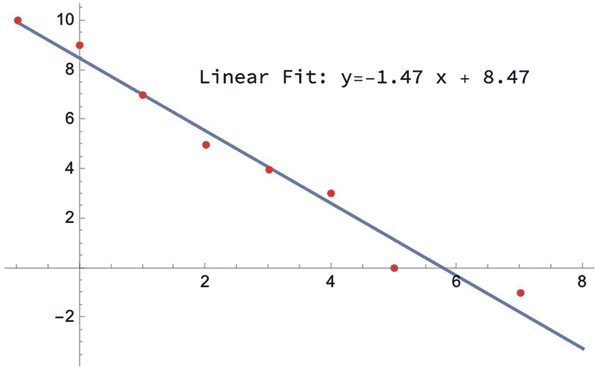

一个坐标图，纵轴与横轴相对。它绘制了 `y = 1.47 x + 8.47` 的递减斜率。该直线穿过 (0, 8.2) 和 (5.7, 0) 两点，并包含多个数据点。数据为近似值。

**图 6-22** 数据与拟合曲线图

```
In[81]:= Show[Plot[b + m*x,{x,-1,8}, PlotLegends->Placed["Linear Fit: y=-1.47x+8.47",{0.6,0.8}],PlotRange->Automatic], ListPlot[data, PlotStyle -> Red]]
Out[81]=
```

得到方程后，你可以观察到这是一个具有负斜率的模型，蓝色显示的方程图也证实了这一点。

## 皮尔逊系数

衡量数据点与方程拟合程度的指标是皮尔逊相关系数，记为 `r`。当数据点呈正斜率时，`r` 为正值。当数据点呈负斜率时，`r` 为负值。该系数的取值范围为 –1 到 1，决定了拟合的正确程度。当 `r` 值为 1 或 –1 时，表示数据点完全拟合直线。`r` 越接近 –1 或 1，表明研究变量之间存在线性关系。反之，当 `r` 等于 0 时，表示拟合不正确，因此可以得出结论：不存在明显的线性关系。

确定该系数的公式如下。

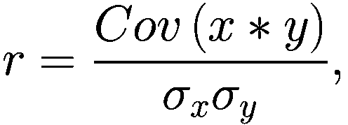

`Cov` 表示 `x` 和 `y` 的协方差。符号 `𝜎_x` 和 `𝜎_y` 分别表示 `x` 和 `y` 的标准差。

现在，你继续计算所创建拟合的系数 `r`。为此，你只需引入 `x` 和 `y` 的数据点，用于计算协方差和标准差。

```
In[82]:= r= N@(Covariance@@{data [[All,1]],data [[All,2]]} /(StandardDeviation@data[[All,1]]*StandardDeviation@data[[All,2]]))
Out[82]= -0.987814
```

结果接近 1；因此，该直线对数据的拟合相当合理。虽然可以通过公式计算，但 Mathematica 提供了专门用于此计算的函数。`Correlation` 函数根据两个列表计算系数，因此你只需将 `x` 数据放入一个列表，将 `y` 数据放入另一个列表即可。

```
In[83]:= N@Correlation[data[[All,1]],data[[All,2]]]
Out[83]= -0.987814
```

你得到了与之前相同的结果。

## 线性拟合

Mathematica 拥有专门用于寻找最佳线性模型的函数，即 `LinearModelFit`。给定数据集后，你可以编写 `LinearModelFit` 命令，指定要处理的数据以及用于编写方程的变量。此外，你还可以使用 `WorkingPrecision` 指定拟合的精度级别。

```
In[84]:= model=LinearModelFit[data,x,x,WorkingPrecision->10]
Out[84]= FittedModel[8.473684211-1.466165414 x]
```

你得到了相同的方程，但精度更高。在模型内部，你可以访问与数据、模型及其他拟合参数相关的不同属性，以及拟合优度度量等。为了说明这一点，我们来看看如何对 `BestFit`、`BestFitParameters` 和 `Function` 选项进行操作，它们分别返回最佳拟合方程（以列表形式）、最佳参数以及用于纯函数的模型构造。

一个关键方面是，尝试使用拟合方程（`8.47 – 1.47 x`）对范围外的 `x` 值进行未来值预测，可能会产生异常值，因为你尚未确定方程在 `x` 范围之外的关系是否成立。图 6-23 展示了拟合曲线的计算结果。

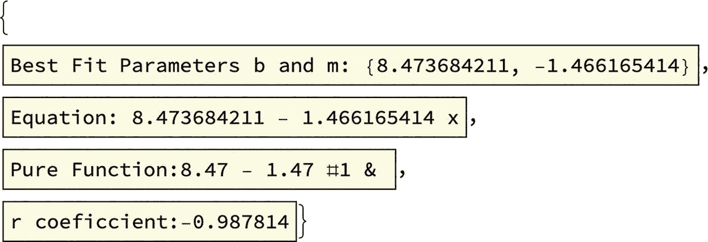

一页展示了四条命令行。其中包括 `b` 和 `m` 的最佳拟合参数、方程、纯函数以及 `r` 系数。方程为 `8.473684211 减去 1.466165414 x`。

**图 6-23** 拟合参数、方程和皮尔逊系数

```
In[85]:= {"\n" Framed["Best Fit Parameters b and m: " 
ToString[model["BestFitParameters"]], Background -> LightYellow], "\n" Framed["Equation: "  ToString[model["BestFit"]],  Background -> LightYellow], "\n" Framed["Pure Function:"  ToString[SetPrecision[model["Function"], 3]], Background -> LightYellow], "\n" Framed["r coeficcient:"  ToString[r], Background -> LightYellow]}
Out[85]=
```

既然你已经得到了最佳拟合直线，就应该考虑 `x` 和 `y` 之间是否存在关系。如何判断拟合是否充分描述了 `x` 和 `y` 变量之间的线性关系？为了解决这个问题，引入了残差的概念。


### 模型属性

残差可作为衡量拟合直线与数据点吻合程度的指标。残差是垂直偏差，可为正值或负值。一个残差点是因变量观测值与预测调整值之间的差值。要获取残差点，请在模型中写入 `FitResiduals` 属性。

```
In[86]:= model["FitResiduals"]
Out[86]= {0.06015038,0.52631579,-0.00751880,-0.54135338,-0.07518797,0.39097744,-1.14285714,0.78947368}
```

利用这些点，您可以绘制残差图（见图 6-24），即 x 变量与残差点的关系图。

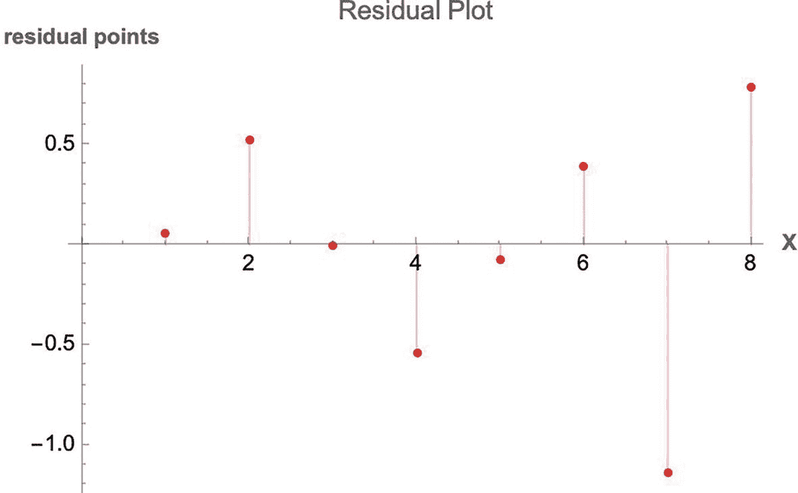

一张纵轴与横轴的残差图。图中绘制了若干条垂直线。最大和最小残差点分别为 0.7 和 -1.3。数据为近似值。

**图 6-24** 拟合数据的残差图

```
In[87]:= ListPlot[model["FitResiduals"],PlotStyle->{Red,Thick}, PlotLabel->"Residual Plot",AxesLabel-> {Style["X",Bold], Style["residual points",Bold]},Filling->Axis]
Out[87]=
```

要仅显示单次预测的观测值和预测值，请使用 `SinglePredictionConfidenceIntervalTable` 选项。

| `Observed` | `Predicted` | `Standard Error` | `Confidence Interval` |
| --- | --- | --- | --- |
| `10` | `9.93984962` | `0.78481739` | `{8.0194706,11.8602286}` |
| `9` | `8.47368421` | `0.74856412` | `{6.6420138,10.3053546}` |
| `7` | `7.00751880` | `0.72287410` | `{5.2387096,8.7763280}` |
| `5` | `5.54135338` | `0.70889670` | `{3.8067456,7.2759611}` |
| `4` | `4.07518797` | `0.70732661` | `{2.3444221,5.8059538}` |
| `3` | `2.60902256` | `0.71824519` | `{0.8515399,4.3665052}` |
| `0` | `1.14285714` | `0.74110068` | `{-0.6705509,2.9562652}` |
| `-1` | `-1.78947368` | `0.81811053` | `{-3.7913180,0.2123707}` |

```
In[88]:= model["SinglePredictionConfidenceIntervalTable"]
Out[88]=
```

除了残差点之外，您还可以使用 `ParameterTable` 属性从调整后的模型参数中提取表格。

|   | `Estimate` | `Standard Error` | `t-Statistic` | `P-Value` |
| --- | --- | --- | --- | --- |
| `1` | `8.473684211` | `0.34167121` | `24.800697` | `2.8278226*10^-7` |
| `x` | `-1.466165414` | `0.094310214` | `-15.5461996` | `4.4832546*10^-6` |

```
In[89]:= model["ParameterTable"]
Out[89]=
```

表中显示了系数。第一个系数是原点纵坐标，与变量 e 相关的系数是斜率。这两个系数都有各自的标准误差。要了解参数的置信区间，请写入 `ParameterConfidenceIntervalTable` 属性。

|   | `Estimate` | `Standard Error` | `Confidence Interval` |
| --- | --- | --- | --- |
| `1` | `8.473684211` | `0.34167121` | `{7.63764488,9.30972355}` |
| `x` | `-1.466165414` | `0.094310214` | `{-1.69693419,-1.23539663}` |

```
In[90]:= model["ParameterConfidenceIntervalTable"]
Out[90]=
```

默认置信区间为 95%。利用这些置信度值，您可以绘制该区间内外的数据点（见图 6-25），从预测中提取值并将置信区间选项设置为 0.95。

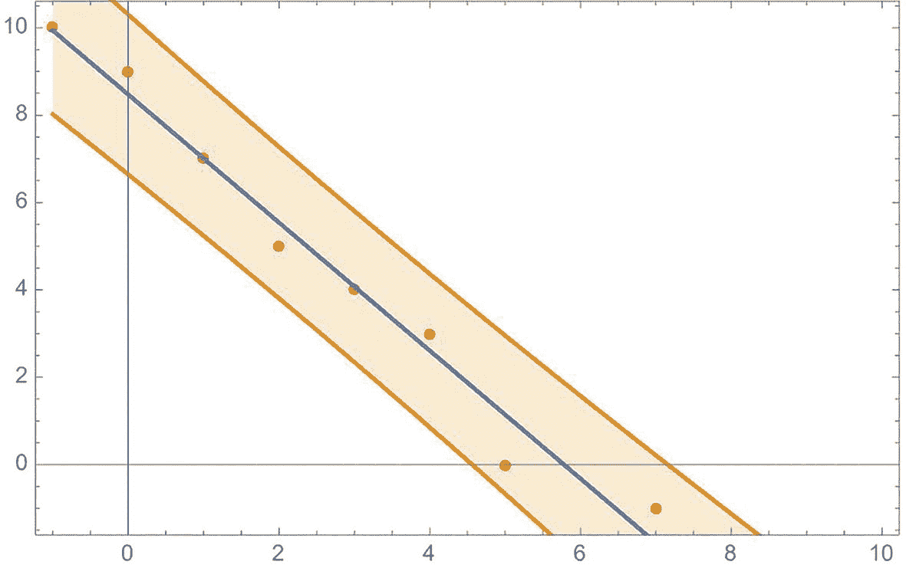

一张带有 y 轴和 x 轴数值的图表。它绘制了一条递减的斜率线，其间有多个数据点位于两条阴影平行线之间。该线穿过点 (-1, 10) 和 (7, -1)。数据为近似值。

**图 6-25** 填充区域表示 95% 置信区间

```
In[91]:= model[x];
model["SinglePredictionBands", ConfidenceLevel -> 0.95]; Show[
ListPlot[data, PlotStyle -> Red], Plot[{Model[x], Model["SinglePredictionBands", ConfidenceLevel -> 0.95]}, {x, -1, 10}, Filling -> {2 -> {1}}], PlotRange -> {Automatic, {-1, 10}}, Frame -> True, ImageSize -> 400]
Out[92]=
```

最后，要获取与误差平方和相关的属性，请使用 `ANOVATable` 属性。

|   | `DF` | `SS` | `MS` | `F-Statistic` | `P-Value` |
| --- | --- | --- | --- | --- | --- |
| `X` | `1` | `107.213346` | `107.213346` | `241.68432` | `4.48325*10^-6` |
| `Error` | `6` | `2.6616541` | `0.44360902` |   |   |
| `Total` | `7` | `109.8750000` |   |   |   |

```
In[93]:= model["ANOVATable"]
Out[93]=
```

## 总结

本章涵盖了使用 Wolfram 语言进行统计分析的概念和技术，以及如何通过方程进行线性调整（最小二乘法、线性拟合）并实现专门的统计函数——展示了 Wolfram 语言是一种有效的统计工具。此外，您还了解了 Mathematica 中可用于描述性统计、随机分布、数字和抽样方法的数值和近似计算的参考函数。

