# 7. 数据探索

本章通过 Wolfram 数据存储库在线平台及其在 Mathematica 中的使用，探讨了数据管理的基础知识。您还将学习如何在数据集中查看数据，以及如何应用用户函数和查询命令。

## Wolfram 数据存储库

Wolfram 数据存储库是一个云中的数据存储库。该数据存储库包含来自不同类别的信息，例如计算机科学、气象学、农业、体育、文本与文学教育等等。尽管该存储库属于 Wolfram Research，但其特点是属于公共领域。

Wolfram 数据存储库由可计算数据组成，这些数据经过选择、结构化和整理，可直接用于执行数值计算、估计、分析、统计或演示。该存储库中托管的内容来自众多来源的数据、全球知名的数据集以及出版物数据。所有这些信息的设计旨在让任何个人都能在全球范围内访问。Wolfram 数据存储库系统提供了一个数据源，同时也能存储新信息。存储在该存储库中的信息旨在直接实现 Wolfram 语言。

正如您在数据导入部分所见，您可以通过接收 HTTP 类型的响应来了解网站是否活跃，如图 7-1 所示。

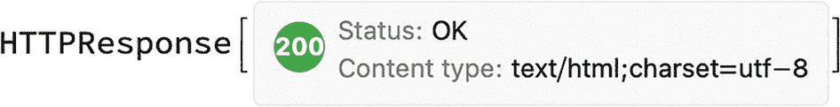
一张 HTTP 响应的截图，内容包含在方括号内。它显示状态为 OK，内容类型为 html 链接。

**图 7-1** Wolfram 数据存储库的 HTTP 响应对象。如您所见，您已收到成功响应。

```
In[1]:= URLRead["https://datarepository.wolframcloud.com/"]
Out[1]=
```

### Wolfram 数据仓库网站

要访问此网站，请在您常用的浏览器中输入以下网址：`https://datarepository.wolframcloud.com`。图 7-2 展示了 Wolfram 数据仓库的欢迎页面。

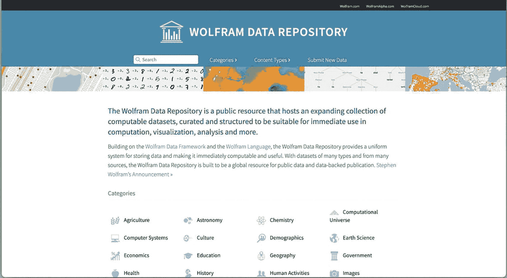
Wolfram 数据仓库网站的截图。页面显示的是主页，包含可用的图表和位置，并在底部列出了分类。

**图 7-2** Wolfram 数据仓库网站

> **注意**
> 显示的图片均为链接，点击后会跳转到与该图片关联的数据集。

网站加载完成后，您会看到一个菜单，其中包含浏览网站的选项，可以按分类或数据类型进行浏览。在该菜单中，您可以找到不同的分类和数据类型：文本、数值数据、图像等。您还可以在菜单选项中找到联系方式、自定义搜索以及“提交新数据”选项。后者会跳转到另一个页面，该页面显示了向此仓库发布和上传新数据的说明。向下滚动，您还可以看到现有的分类和数据类型。如果存在，您可以通过点击**浏览所有资源**链接（网页底部）来浏览所有资源。要浏览分类，您可以从菜单中选择分类，或者点击初始页面上的分类名称。图 7-3 展示了选择某个分类（此处为生命科学）后网站的外观。

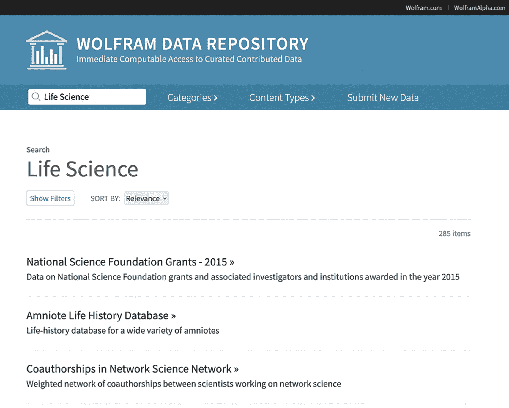
Wolfram 数据仓库网站的截图。搜索栏中键入了“生命科学”。页面显示生命科学的搜索结果，包含三个链接：国家科学基金会资助、羊膜动物生活史数据库以及网络科学网络中的合著关系。

**图 7-3** Wolfram 数据仓库的“生命科学”分类

> **注意**
> 按数据类型浏览的过程与此相同。随着新数据的添加，内容会定期更新。

### 选择分类

每个分类都显示标题、该分类中的元素数量，以及按数据类型筛选分类内容的选项。关于内容，每个样本数据类型都显示其标题、对所包含数据的简短描述，以及与该样本数据关联的不同标签。例如，图片显示了著名的费雪鸢尾花数据集。选择某个样本数据集后，您将进入包含该数据集相关信息的网站，如图 7-4 所示，其中选择了费雪鸢尾花数据集。

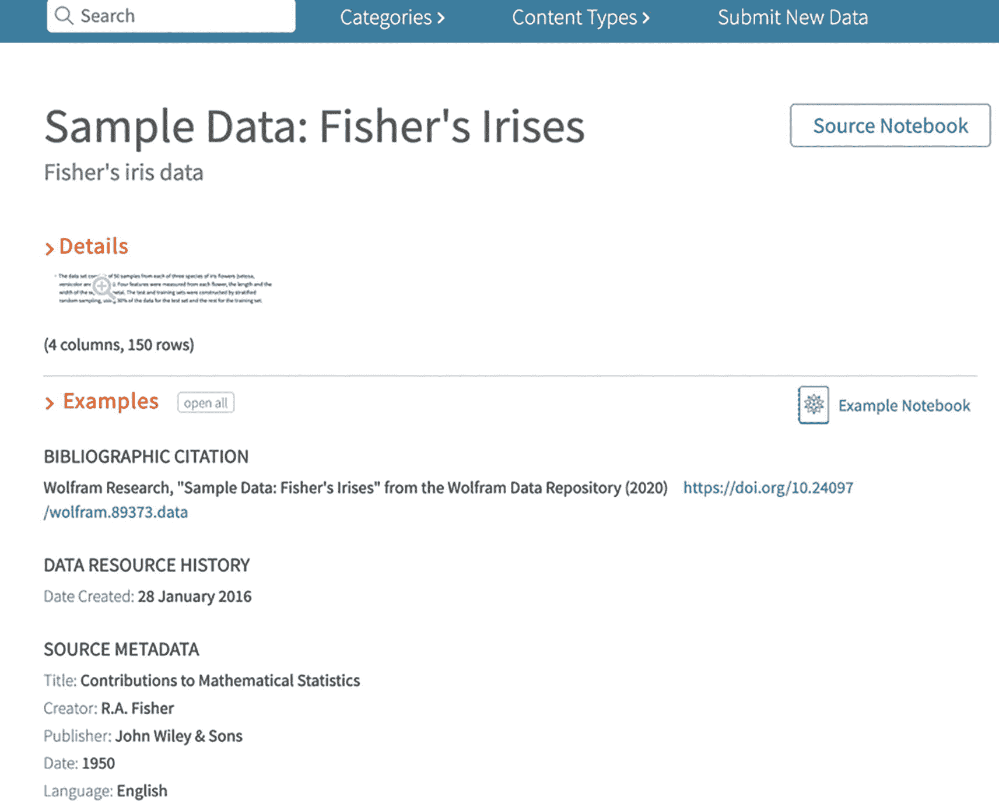
Wolfram 数据仓库网站的截图。页面显示样本数据为“费雪鸢尾花”。它列出了详细信息与示例，并附有相应的源笔记本和示例笔记本。

**图 7-4** 费雪鸢尾花数据集

选择样本数据集后，会显示该数据集的简要描述，以及可以进行的各种计算和下载数据或笔记本的不同格式。除此之外，它还包含相关信息，如文献引用、数据资源历史和数据来源。在某些情况下，数据可以以不同格式下载，例如逗号分隔值（CSV）、制表符分隔值（TSV）、JavaScript 对象表示法（JSON）等。在开始从 Wolfram 数据仓库下载数据之前，需要拥有一个 Wolfram ID。此 ID 是一个账户，除了其他好处（如 Wolfram One 和 Wolfram Alpha）之外，它还能让您访问 Wolfram 数据仓库的内容。要从 Mathematica 登录，请前往 **帮助** ➤ **登录** 菜单，此时会弹出一个如图 7-5 所示的窗口。

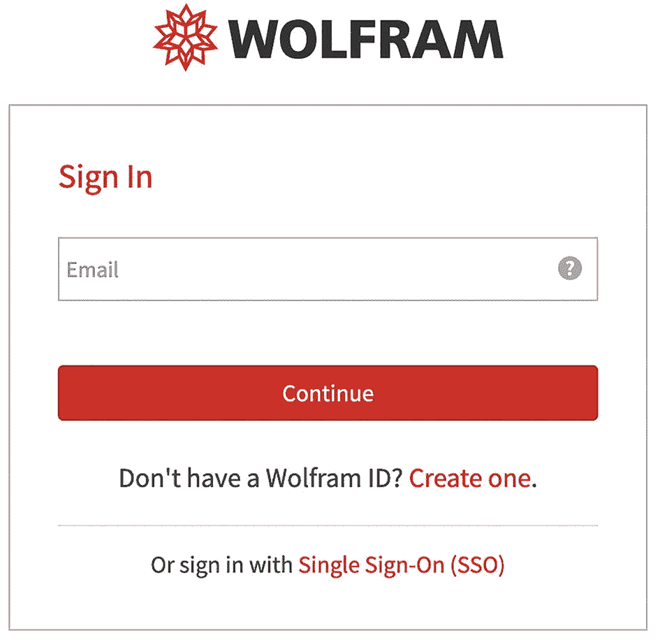
Wolfram 登录页面的截图。它有一个用于输入电子邮件的字段，下方有一个“继续”按钮。底部有创建 Wolfram ID 和单点登录的链接。

**图 7-5** Wolfram Cloud 登录提示

在新窗口中，输入您的电子邮件和密码，即可从 Mathematica 访问 Wolfram 数据仓库的内容。

## 从 Wolfram 数据仓库提取数据

首先，让我们查看费雪数据集的信息和属性；为此，您需要通过 `ResourceObject` 来检索信息。使用 `ResourceObject`（见图 7-6），您现在可以通过点击加号图标来查看已发布数据的不同属性。将显示关于数据的详细信息，例如样本名称、类型、版本、数据大小等等。

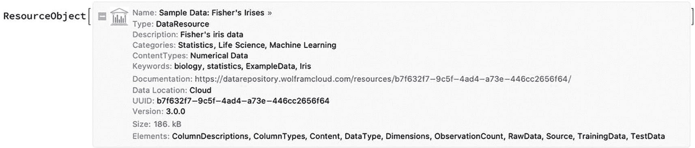
资源对象格式的截图，包含在方括号内。它列出了名称、类型、描述、分类、内容类型、关键词、文档、数据位置、UUID、版本、大小和元素。

**图 7-6** `ResourceObject` 费雪鸢尾花

```
In[2]:= ResourceObject["Sample Data: Fisher's Irises"]
Out[2]=
```

如果您想查看资源对象的属性，请输入以下代码。这段代码会给出一个可访问的、与数据样本相关的属性列表。

```
In[3]:= ResourceObject["Sample Data: Fisher's Irises"]["Properties"]
Out[3]= {AllVersions, AutoUpdate, Categories, ContentElementLocations, ContentElements, ContentSize, ContentTypes, ContributorInformation, DatedElementVersions, DefaultContentElement, Description, Details, Documentation, DocumentationLink, DOI, DownloadedVersion, ExampleNotebook, ExampleNotebookObject, Format, InformationElements, Keywords, LatestUpdate, Name, Originator, Properties, PublisherUUID, ReleaseDate, RepositoryLocation, ResourceLocations, ResourceType, SeeAlso, ShortName, SourceMetadata, UUID, Version, VersionInformation, VersionsAvailable, WolframLanguageVersionRequired}
```

了解了与信息相关的属性列表后，您现在可以从 Mathematica 下载该数据样本的练习笔记本。

```
In[4]:= ResourceObject["Sample Data: Fisher's Irises"]["ExampleNotebook"]
Out[4]= NotebookObject[Sample Data: Fisher's Irises | Example Notebook]
```

一旦您完成代码评估，它会自动打开新的笔记本。如果您想从云端操作该笔记本，可以输入 `NotebookObject`。此输出会返回一个与超链接关联的云端对象。

```
In[5]:= ResourceObject["Sample Data: Fisher's Irises"]["ExampleNotebookObject"]
Out[5]= CloudObject[https://www.wolframcloud.com/obj/5e59b79e-d95e-4f6f-a7c8-f1276ba17be2]
```

如果您点击新笔记本的链接，它会打开互联网浏览器，并向您显示它位于 Wolfram Cloud 中。图 7-7 展示了这一点。

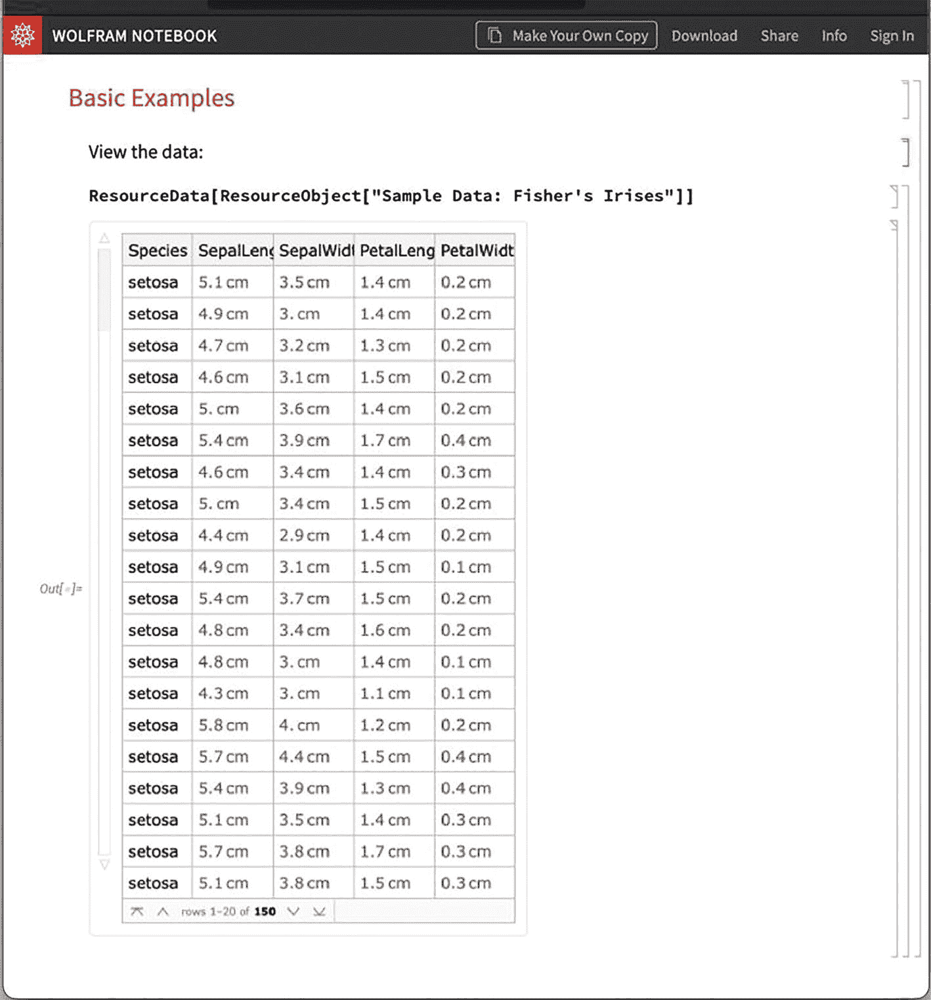
Wolfram 数据仓库网站的截图。页面显示带有基本示例的 Wolfram 笔记本图表。它列出了资源数据格式和一个包含五列的表格。它列出了 setosa 物种的花萼长度、花萼宽度、花瓣长度和花瓣宽度。

**图 7-7** 从 Wolfram Cloud 打开的费雪鸢尾花数据样本

要从 Mathematica 访问原始样本数据网站，请输入 `Documentation`，它会返回一个 `URL` 对象，您可以通过点击双尖括号图标进入该对象。

```
In[6]:= ResourceObject["Sample Data: Fisher's Irises"]["Documentation"]
Out[6]= URL[https://datarepository.wolframcloud.com/resources/b7f632f7-9c5f-4ad4-a73e-446cc2656f64/]
```

### 在 Mathematica 中访问数据

同样的方法也适用于使用 `ResourceData` 将数据下载到对象资源中。通过 `ResourceData`，你可以访问指定资源的内容；在本例中，它是费雪鸢尾花数据样本（见图 7-8）。

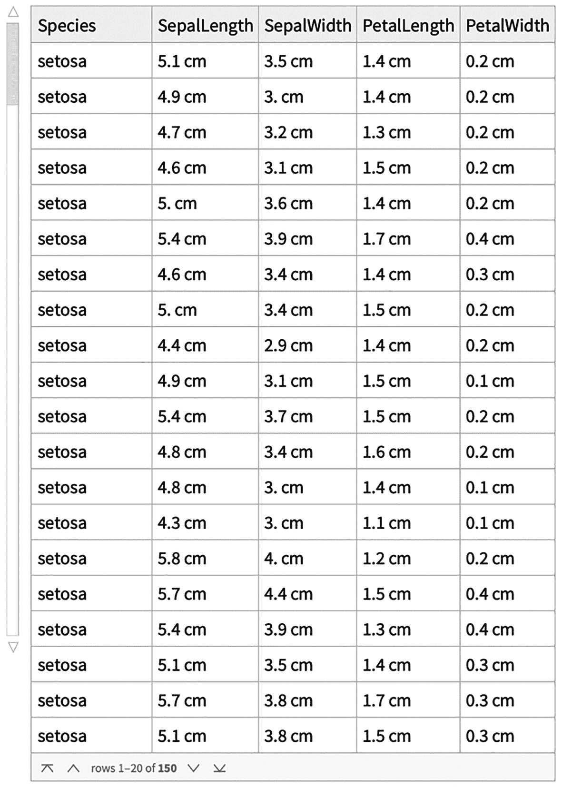
一个包含 5 列 20 行的表格。列标题为：物种、花萼长度、花萼宽度、花瓣长度和花瓣宽度。图表左侧有一个滑块条。底部显示“第 1 至 20 行，共 150 行”。

**图 7-8** 费雪鸢尾花数据集对象

```
In[7]:= ResourceData[ResourceObject["Sample Data: Fisher's Irises"]]
Out[7]=
```

如图 7-8 所示，返回的对象是一个以数据集为头部的 `ResourceData`。对数据样本进行目视检查后，你会发现它是一个包含 150 个值的数据集，共有五列：`Species`、`SepalLength`、`SepalWidth`、`PetalLength` 和 `PetalWidth`。如果仔细观察，你会发现 `SepalLength`、`SepalWidth`、`PetalLength` 和 `PetalWidth` 列的值都是带单位的量。进一步查看整个数据集，物种被分为三类：setosa、versicolor 和 virginica。如果你想访问与数据集相关的信息，必须通过资源对象，并以 `ResourceData` 的形式进行检索，如下所示。

```
In[8]:= ResourceObject["Sample Data: Fisher's Irises"]["ContentElements"]
Out[8]= {ColumnDescriptions, ColumnTypes, Content, DataType, Dimensions, ObservationCount, RawData, Source, TrainingData, TestData}
```

通过 `ContentElements` 属性，你可以访问数据样本的元素，这些元素会出现在资源对象中。`ContentElements` 向你展示了与样本数据相关的信息，例如列信息、数据来源、训练数据和测试数据——不要与所创建资源对象的属性混淆，因为两者并不相同，你可以为另一个关联名称构建一个资源对象。要检索 `ContentElements` 中的信息，必须使用 `ResourceData`。该命令允许你访问数据样本的内容——在本例中，就是费雪鸢尾花数据。现在，让我们获取各列的数据类型。

```
In[9]:= ResourceData[ResourceObject["Sample Data: Fisher's Irises"], "ColumnTypes"]
Out[9]= {Numeric, Numeric, Numeric, Numeric, Categorical}
```

`ResourceData` 命令的第二个参数是你正在查找的元素。运行上述代码后，你会看到有四种数据类型：三种数值型和一种分类型。使用纯函数，你可以通过单个表达式获取信息。如果添加 `Column` 命令，则可以更清晰地查看信息。

```
In[10]:= Column[ResourceData[ResourceObject["Sample Data: Fisher's Irises"], #] & /@ {"ColumnDescriptions", "Dimensions", "Source"}]
Out[10]= {Sepal length in cm., Sepal width in cm., Petal length in cm., Petal width in cm., Species of iris}
{150, 4}
Fisher, R.A. "The use of multiple measurements in taxonomic problems" Annual Eugenics, 7, Part II, 179-188 (1936); also in "Contributions to Mathematical Statistics" (John Wiley, NY, 1950).
```

通过这种方式，你可以了解列中的信息类型，例如维度（150 行，4 列）以及数据来源。

### 数据观察与查询

本节将解释如何观察数据集中的数据。你将使用从 Wolfram 数据仓库中提取的鸢尾花数据集。首先，将数据样本命名为 `fisher`；该变量包含带有单位的数据集。

```
In[11]:= fisher = ResourceData[ResourceObject["Sample Data: Fisher's Irises"]];
```

在数据集中，数字都带有单位和量纲。有了数据集，你可以执行无限多的操作，例如按类别变量（即物种类型）对内容进行分组。（此示例访问了 `fisher` 变量中包含的数据集。）让我们查看按物种分组后各列包含的数据（见图 7-9）。

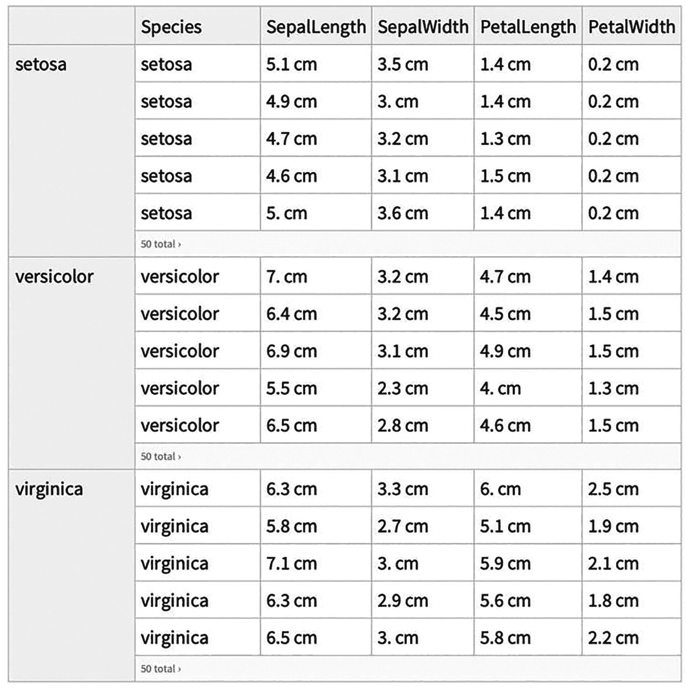

一个包含 5 列 3 行的表格。列标题为：物种、花萼长度、花萼宽度、花瓣长度和花瓣宽度。行标题为：setosa、versicolor 和 virginica。每行被拆分为 5 行。

**图 7-9** 按物种分组的鸢尾花数据

```
In[12]:= fisher[GroupBy["Species"]]
Out[12]=
```

让我们看看数据是如何被分为三个类别的：`setosa`、`versicolor` 和 `virginica`。每个类别在 `Species` 列的末尾都包含一个数字 50。这意味着除了显示的行之外，每个类别还有 50 行，总共 150 行，这与你在查看样本数据维度时看到的 150 相符。

同时，点击其中一个类别会显示该类别单独的列，如图 7-10 所示。如果你在某个类别内选择特定列，也会发生同样的情况——它只会显示该类别的那一列；你可以尝试一下看看效果。此外，还可以点击任何列，这将只显示所选列在三个类别中的数据。这意味着，如果你选择 `SepalLength`，例如，你将看到该列在三个物种中的内容，如图 7-10 所示。

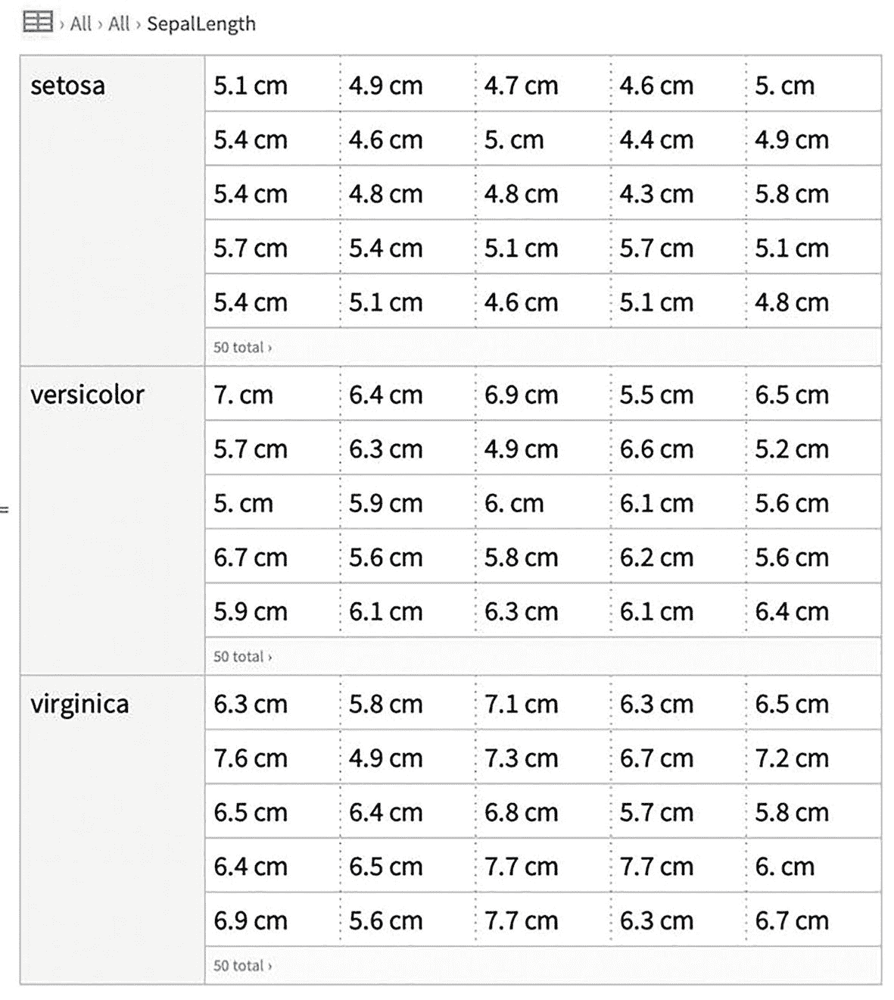

一个包含 5 列 3 行的表格。左上角有一个电子表格图标，在“全部”下方选中了“花萼长度”。行标题为：setosa、versicolor 和 virginica。每行被拆分为 5 行。

**图 7-10** 选中 `SepalLength` 列

可以按物种分组，并仅选择包含数值的列。例如，如果你想目视检查数据集，这会很有帮助（见图 7-11）。

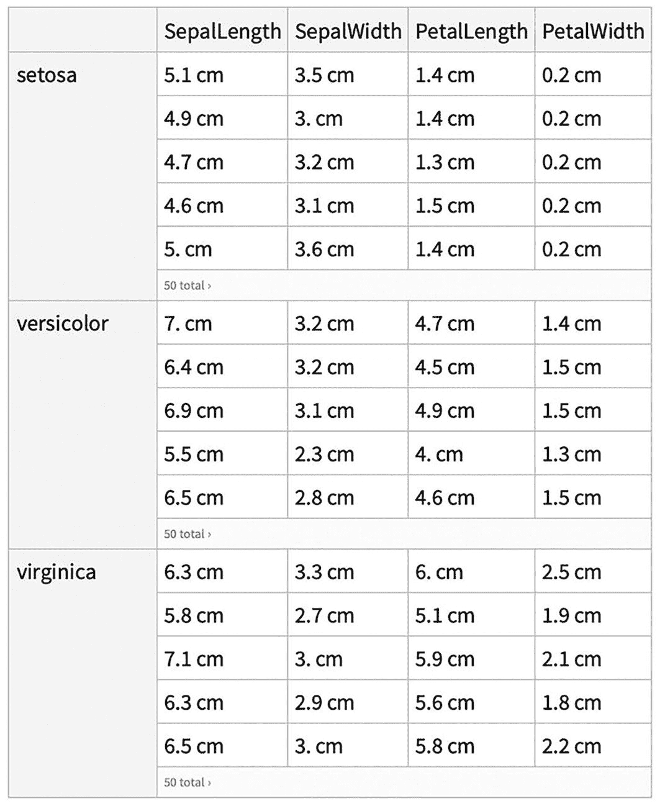

一个包含 5 列 3 行的表格。列标题为：花萼长度、花萼宽度、花瓣长度和花瓣宽度。行标题为：setosa、versicolor 和 virginica。每行被拆分为 5 行。

**图 7-11** 隐藏了物种列的数据集

```
In[13]:= Query[GroupBy[Key["Species"] -> KeyTake[{"SepalLength", "SepalWidth", "PetalLength", "PetalWidth"}]]][fisher]
Out[13]=
```

在后面的代码中，你使用 `Key` 命令来访问物种列的键。访问这些键后，你编写一个转换规则，使得每个提取的键都被分配从列（`SepalLength`、`SepalWidth`、`PetalLength`、`PetalWidth`）中提取的关联（`KeyTake`），然后进行分组并应用于费雪数据集。

如果你想统计费雪数据集中的数据元素，可以添加一个 ID 列作为标签（见图 7-12）来列出其包含的数据。为此，首先创建一个关联，其键和值从 1 到数据集的长度。然后，将此指令应用于数据集对象 `fisher`，从而将 ID 添加为行的标签。

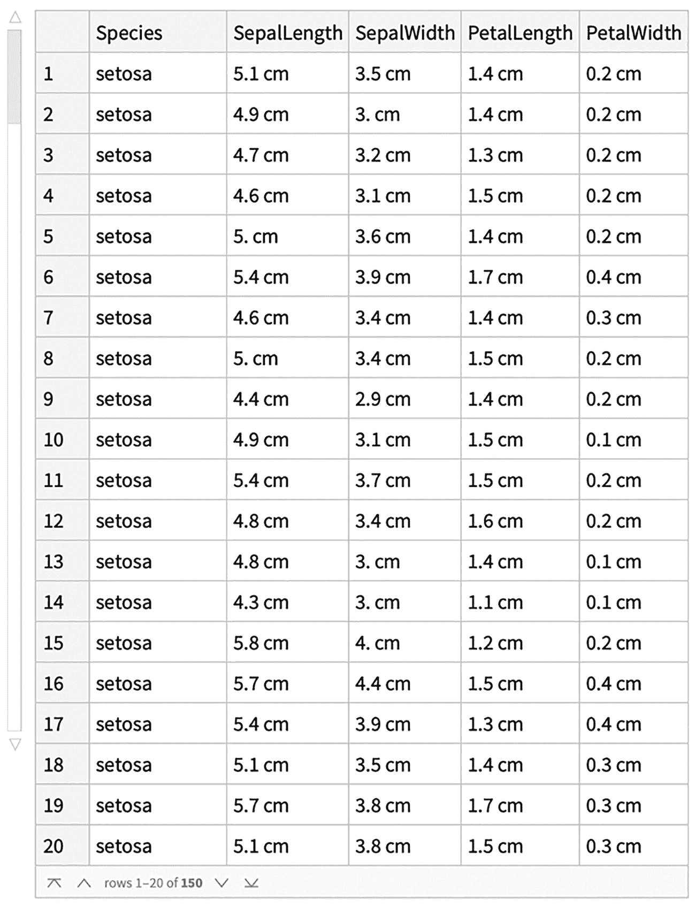

一个包含 6 列 20 行的表格。列标题为：物种、花萼长度、花萼宽度、花瓣长度、花瓣宽度。行标题为：setosa。表格最前面添加了 ID 列。底部显示“第 1 至 20 行，共 150 行”。图表左侧有一个滑块条。

**图 7-12** 为 Fisher 数据集添加 ID

```
In[14]:= Query[AssociationThread[Range[Length@#]→Range[Length@#]]] [fisher]&[fisher]
Out[14]=
```

向下拖动滑块，计数器会显示达到 150 个元素。

如果不想添加枚举列来计数元素，可以使用 `Counts` 命令（见图 7-13）。

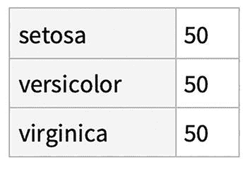

一个包含 2 列 3 行的表格。行标题为：`setosa`、`versicolor`、`virginica`。第 2 列列出：50、50、50。

**图 7-13** 对数据集进行元素计数

```
In[15]:= Fisher[Counts,"Species"]
Out[15]=
```

结果显示 `setosa`、`versicolor` 和 `virginica` 各有 50 条数据。将它们相加得到 150。也可以使用 `Query` 命令：`Query[Counts, "Species"] [Fisher]`。

现在，我们来看看如何获取每个列中三个类别的平均值。如果知道 `setosa`、`versicolor` 和 `virginica` 这三个物种的 `SepalLength`、`SepalWidth`、`PetalLength` 和 `PetalWidth` 的平均值，就可以实现，如图 7-14 所示。

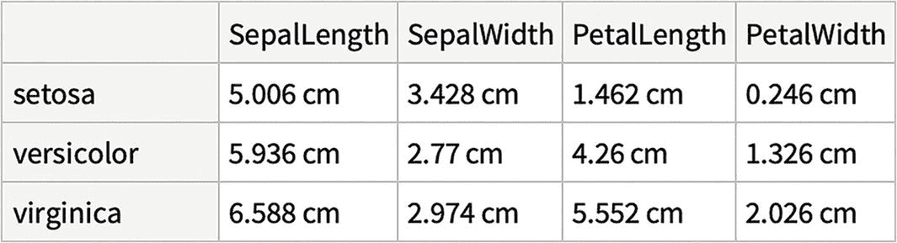

一个包含 5 列 3 行的表格。列标题为：花萼长度、花萼宽度、花瓣长度、花瓣宽度。行标题为：`setosa`、`versicolor`、`virginica`。数值以厘米为单位。

**图 7-14** 按物种划分的四列平均值

```
In[16]:=Query[GroupBy[Key["Species"]→KeyTake[{"SepalLength","SepalWidth", "PetalLength","PetalWidth"}]],Mean][fisher]
Out[16]=
```

但是，如果你想获取所有类别中各列的平均值，一种方法是将 `Mean` 作为查询应用于整个数据集的列数（见图 7-15）。

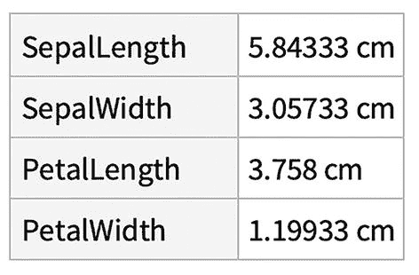

一个包含 2 列 4 行的表格。行标题为：花萼长度、花萼宽度、花瓣长度、花瓣宽度。第 2 列列出：5.84333 厘米、3.05733 厘米、3.758 厘米、1.19933 厘米。

**图 7-15** 所有物种四列的平均值

```
In[17]:= Query[Mean][fisher[[All,2;;5]]]
Out[17]=
```

> **注意**
> `Mean` 命令适用于带单位的量，并返回平均值作为带单位的量。

## 描述性统计

本节演示如何对鸢尾花数据进行描述性统计、在数据集格式内进行计算，以及如何创建自定义网格格式。首先，我们构建一个计算最大值、最小值、平均值、中位数、第一四分位数和第三四分位数的函数。

```
In[18]:
stats[data_]:=
{{#[{"Max: ",Max@data}]},
{#[{"Min: ",Min@data}]},
{#[{"Mean: ",Mean@data}]},
{#[{"Median: ",Median@data}]},
{#[{"1st quartile: ",Quantile[data,0.25]}]},
{#[{"3rd quartile: ",Quantile[data,0.75]}]}
}&[Row]
```

现在，将创建的函数应用于每一列。该函数用于获取 `SepalLength`、`SepalWidth`、`PetalLength` 和 `PetalWidth` 的整体统计信息（见图 7-16）。

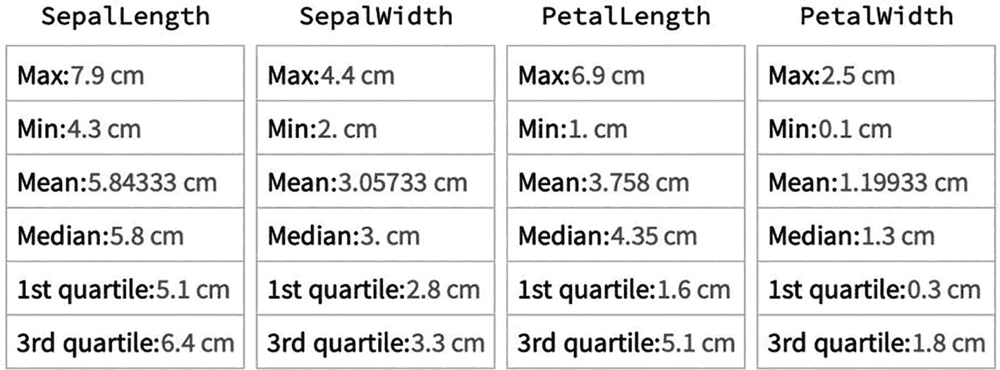

四个表格以 4 列形式列出，分别标记为：花萼长度、花萼宽度、花瓣长度、花瓣宽度。每个图表有 6 行。行标题为：最大值、最小值、平均值、中位数、第一四分位数、第三四分位数。

**图 7-16** 将 `Stats` 函数应用于每一列

```
In[20]:= {{#1,#2,#3,#4},{Fisher[Stats,#1],Fisher[Stats,#2],Fisher[Stats,#3],Fisher[Stats,#4]}}&["SepalLength","SepalWidth","PetalLength","PetalWidth"]//Grid
Out[20]=
```

这也可以使用 `TabView` 以紧凑的选项卡格式显示（见图 7-17）。

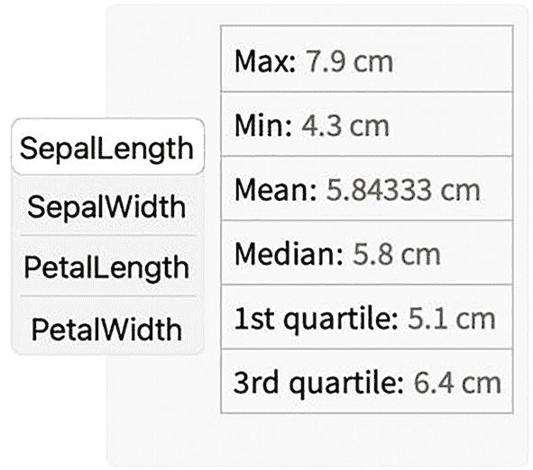

一个包含两列的表格视图。第 1 列列出：花萼长度、花萼宽度、花瓣长度、花瓣宽度。第 2 列列出：最大值、最小值、平均值、中位数、第一四分位数、第三四分位数。

**图 7-17** `TabView` 格式

```
In[21]:= TabView[{#1->Fisher[Stats,#1],#2->Fisher[Stats,#2],#3-> Fisher[Stats,#3],#4->Fisher[Stats,#4]},ControlPlacement-> Left]&["SepalLength","SepalWidth","PetalLength","PetalWidth"]
Out[21]=
```

使用 `TabView`，你可以创建三个以各列名称命名的选项卡，分别显示最大值、最小值、平均值、中位数、第一四分位数和第三四分位数；这些列分别是 `SepalLength`、`SepalWidth`、`PetalLength` 和 `PetalWidth`。

### 表格与网格格式

另一种方法是为每个物种创建一个表格。这样，你可以更好地呈现数据，从而能够正确地读取数据。通过应用 `Nest` 命令来提取数据。使用此命令，你可以指定命令或函数应用的次数；在此例中，你应用了两次。

```
In[22]:= Short[Values[Nest[Normal,fisher,2]]]
{sLall,sWall,pLall,pWall}=%[[All,#]]&/@{2,3,4,5};
Out[22]//Short= {{setosa,5.1cm,3.5cm,1.4cm,0.2cm},{setosa,4.9cm,3.cm,1.4cm,0.2cm},>,{virginica,6.2cm,3.4cm,5.4cm,2.3cm},{virginica,5.9cm,3.cm,5.1cm,1.8cm}}
```

将所有物种的值按列分开后，你创建一个列表而非函数，其中统计信息根据每一列显示，并添加了方差、标准差、偏度和峰度等计算。然后，你将计算结果赋值给 `DescriptiveStats` 变量。

```
In[23]:={Max[#],Min[#],Median[#],Mean[#],Variance[#],StandardDeviation[#],Skewness[#],Kurtosis[#],Quantile[#,0.25],Quantile[#,.75]}&/@{sLall,sWall,pLall,pWall};
```

可以利用这些计算结果创建一个表格（见图 7-18），并添加行和列标题。

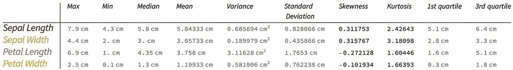

一个 4 行 10 列的表格。列标题为最大值、最小值、中位数、均值、方差、标准差、偏度、峰度、第一四分位数和第三四分位数。行标题为花萼长度、花萼宽度、花瓣长度和花瓣宽度，并以不同颜色高亮显示。

**图 7-18** 按四个特征显示描述性统计的表格

```
In[24]:= tableHeads={Style["Sepal Length",#1,ColorData["HTML"]["Maroon"],#2,#3],Style["Sepal Width",#1,ColorData["HTML"]["YellowGreen"],#2,#3],Style["Petal Length",#1,ColorData["HTML"]["SteelBlue"],#2,#3],Style["Petal Width",#1,ColorData["HTML"]["Orange"],#2,#3]}&["Title",Italic,20];
tableRows={Style["Max",#1,#2],Style["Min",#1,#2],Style["Median",#1,#2],Style["Mean",#1,#2],Style["Variance",#1,#2],Style["Standard\n Deviation",#1,#2],Style["Skewness",#1,#2],Style["Kurtosis",#1,#2],Style["1st quartile",#1,#2],Style["3rd quartile",#1,#2]}&["Text",Italic];TableForm[descriptiveStats,TableHeadings->{tableHeads,tableRows}]
Out[25]//TableForm=
```

请注意，统计量都带有其单位进行计算，但偏度和峰度除外，因为根据定义，它们是无量纲的。不过，你可以利用 `Grid` 创建更好的结构，因为它可以像电子表格格式一样添加分隔线。为此，你将 `TableRows` 添加到数据中，然后进行转置，以便每个计算出的统计量都带有其对应的名称。随后，你添加列标题。

```
In[26]:=
Transpose[Prepend[descriptiveStats,tableRows]];
{" ",Style["Sepal Length",#1, ColorData["HTML"]["Maroon"],#2,#3], Style["Sepal Width",#1,ColorData["HTML"]["YellowGreen"],# 2,#3],Style["Petal Length",#1, ColorData["HTML"]["SteelBlue"],#2, #3], Style["Petal Width",#1,ColorData["HTML"]["Orange"], #2,#3]}&["Title",Italic,20];
newTable=Prepend[%%,%];
```

接下来，将表格创建为电子表格形式（见图 7-19）。

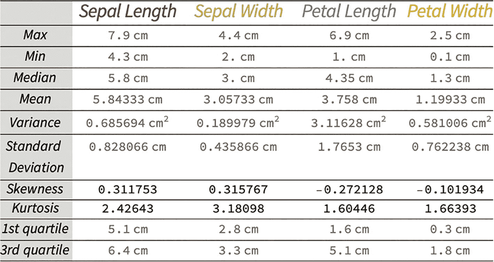

一个四列表格。列标题为花萼长度、花萼宽度、花瓣长度和花瓣宽度，并以不同颜色高亮显示。行标题为最大值、最小值、中位数、均值、方差、标准差、偏度、峰度、第一四分位数和第三四分位数。

**图 7-19** 描述性统计的网格视图

```
In[27]:= Grid[newTable,ItemSize->{{None,Scaled[0.11], Scaled[0.11],Scaled[0.11]}},Background->{{LightGray},None}, Dividers->{{False},{1,2,3,4,5,6,7,8,9,10,11->True,-2->Blue}}, Alignment->Center]
Out[27]=
```

要为每个物种构建表格，你必须首先使用 `Cases` 命令按物种分离数据集。你应该使用 `Cases`，因为它允许你处理模式。首先，编写代码提取原始数据。不要使用 `Short`，而是使用 `Shallow` 来抑制那 150 个值。

```
In[28]:= Shallow[Values[Nest[Normal,fisher,2]],1]
Out[28]//Shallow= {>}
```

为杂色鸢尾物种创建表格，提取杂色鸢尾的值，并将各列的值存储在 `SLVersi`、`SWVersi`、`PLVersi` 和 `PWVersi` 变量中。

```
In[29]:= Shallow[Cases[%,{"versicolor",__}],1]
{sLVersi,sWVersi,pLVersi,pWVersi}=%[[All,#]]&/@{2,3,4,5};
Out[29]//Shallow= {>}
```

接下来，重复计算统计量的过程，但不要留空白，而是在 `Style` 文本中添加名称“Versicolor”，以区分该表格属于杂色鸢尾物种。

```
In[30]:= tableRows;
{Max[#],Min[#],Median[#],Mean[#],Variance[#],StandardDeviation[#],Skewness[#],Kurtosis[#],Quantile[#,0.25],Quantile[#,.75]}&/@{sLVersi,sWVersi,pLVersi,pWVersi};
descriptiveStats2=Prepend[%,%%];
Transpose[descriptiveStats2];
{Style["Versicolor","Text",Red,Italic,20],Style["Sepal Length",#1,ColorData["HTML"]["Maroon"],#2,#3],Style["Sepal Width",#1,ColorData["HTML"]["YellowGreen"],#2,#3],Style["Petal Length",#1,ColorData["HTML"]["SteelBlue"],#2,#3],Style["Petal Width",#1,ColorData["HTML"]["Orange"],#2,#3]}&["Title",Italic,20];
newTable2=Prepend[%%,%];
```

接下来，为杂色鸢尾物种构建表格（见图 7-20）。

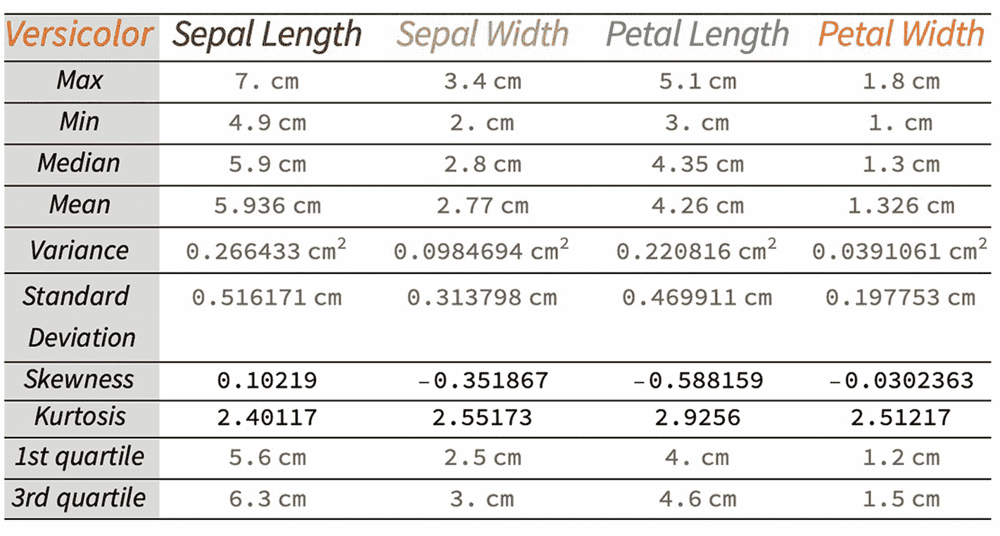

一个四列表格。列标题为杂色鸢尾、花萼长度、花萼宽度、花瓣长度和花瓣宽度，并以不同颜色高亮显示。行标题为最大值、最小值、中位数、均值、方差、标准差、偏度、峰度、第一四分位数和第三四分位数。

**图 7-20** 杂色鸢尾物种的描述性统计

```
In[31]:= Grid[newTable2,ItemSize-> {{None,Scaled[0.11],Scaled[0.11], Scaled[0.11]}},Background->{{LightGray},None}, Dividers-> {{False}, {1,2,3,4,5,6,7,8,9,10,11->True,-2->Blue}},Alignment-> Center]
Out[31]=
```

你仅对杂色鸢尾物种执行了此操作；每个物种都执行相同的过程。例如，如果你选择 `Cases` 处理其他物种，则需要将文本更改为相应的物种名称。

### 数据集可视化

在了解了 Wolfram 语言在数据集中执行描述性统计的能力后，你还可以在数据集格式内实现统计图表，如下所示。

通过图表可以获得更直观的视角；你可以使用数据集格式（见图 7-21）按物种显示图表。

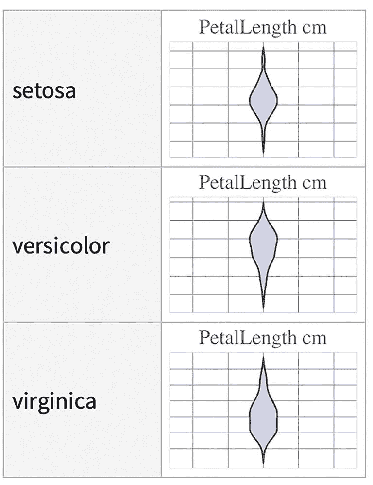

一个包含 2 列 3 行的表格。行标题为 setosa、versicolor 和 virginica。第 2 列为每一行绘制了一个网格图，标题为“花瓣长度（厘米）”。每个图形都呈吊坠状。

图 7-21

分布图

```
In[32]:= fisher[GroupBy["Species"],DistributionChart[#,PlotTheme-> "Classic",PlotLabel->"PetalLength cm",GridLines-> Automatic]&,"PetalLength"]
Out[32]=
```

你可以执行相同的过程，但这次是绘制箱须图（见图 7-22），并选择另一列。

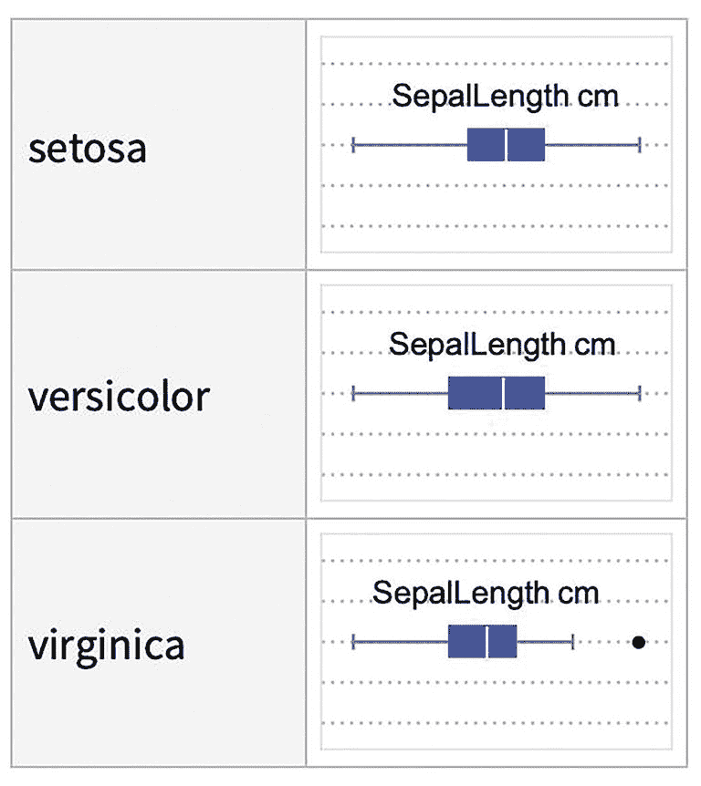

一个包含 2 列 3 行的表格。行标题为 setosa、versicolor 和 virginica。第 2 列为每一行绘制了一个箱须图，标题为“萼片长度（厘米）”。

图 7-22

箱须图

```
In[33]:= fisher[GroupBy["Species"],BoxWhiskerChart[#,"Outliers",PlotTheme-> "Detailed",ChartLabels->Placed[{"SepalLength cm"},Above],BarOrigin-> Right,ChartStyle->Blue]&,"SepalLength"]
Out[33]=
```

如果点击某个物种，图形会放大显示（见图 7-23）。

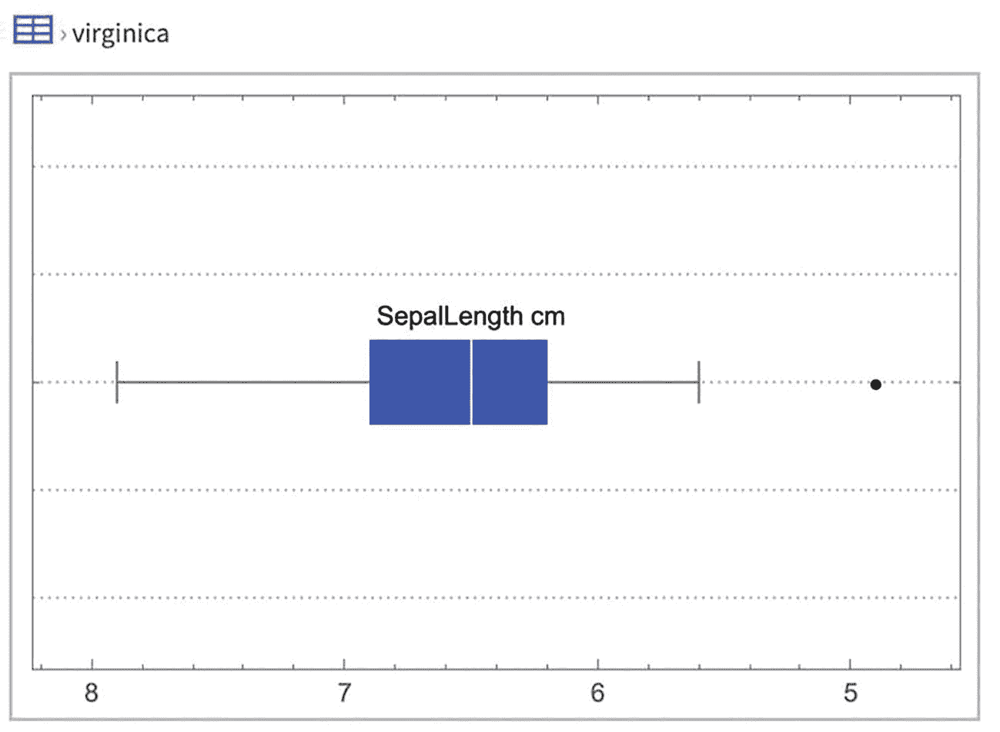

一个箱须图。左上角是电子表格图标，其中 Virginica 被选中。图形标题为“萼片长度（厘米）”。

图 7-23

virginica 物种的箱须图

直方图也是如此。当图形较大时，它在数据集中会以压缩形式显示，但你仍然可以选中它，如图 7-24 所示。

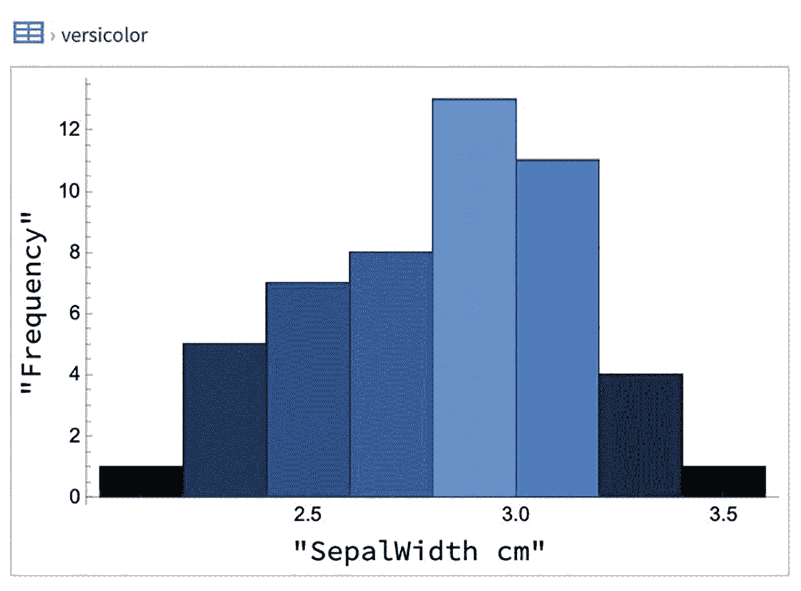

一个频率与萼片宽度（厘米）关系的直方图。左上角是电子表格图标，其中 versicolor 被选中。条形图以渐变色绘制。

图 7-24

versicolor 的直方图

```
In[34]:=fisher[GroupBy["Species"], Labeled[Histogram[#, ColorFunction -> (Hue[3/5, 2/3, #] &)], {Rotate["Frequency", 90 Degree], "SepalWidth cm"}, {Left, Bottom}] &, "SepalWidth"]
Out[34]=
```

这里，我们展示了每个物种的 3D 散点图（见图 7-25），用于显示萼片长度 (x) 与萼片宽度 (y) 的关系。

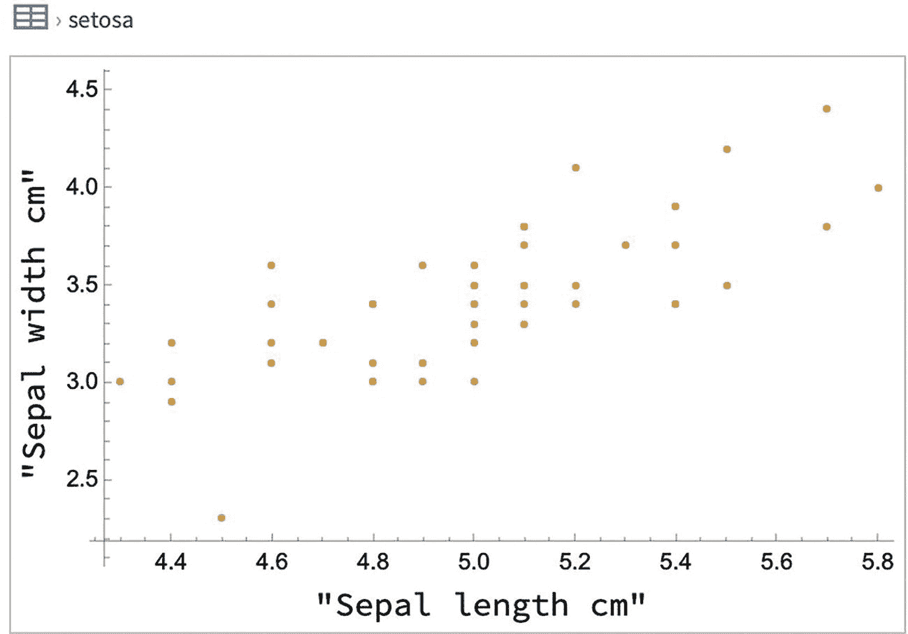

一个萼片宽度（厘米）与萼片长度（厘米）关系的散点图。左上角是电子表格图标，其中 Setosa 被选中。数据点呈递增趋势聚集。

图 7-25

2D 散点图

```
In[35]:=Fisher[GroupBy["Species"], Labeled[ListPlot[{#, #}], {Rotate["Sepal width cm", 90 Degree], "Sepal length cm"}, {Left, Bottom}] &, {"SepalLength","SepalWidth"}]
Out[35]=
```

要返回完整数据集，请像其他操作一样点击数据集图标。

### 数据集格式之外的数据

事实上，也可以按如下方式直接提取原始数据。这样做是为了更好地处理数据。由于列表很长，这里使用了 `Short` 命令。

```
In[36]:= Short[ResourceData[ResourceObject["Sample Data: Fisher's Irises"],"RawData"]]
Out[36]//Short= {setosa,SepalLength->5.1cm,SepalWidth->3.5cm,PetalLength->1.4cm,PetalWidth->0.2cm|>,>|>,>,>|>,>|>}
```

数据提取后，可以使用 `Values` 函数获取数值，并将其转换为常规表达式。

```
In[37]:= Short[Normal[Values[%]]]
Out[37]//Short= {{setosa,5.1cm,3.5cm,1.4cm,0.2cm},{setosa,4.9cm,3.cm,1.4cm,0.2cm},>,{virginica,6.2cm,3.4cm,5.4cm,2.3cm},{virginica,5.9cm,3.cm,5.1cm,1.8cm}}
```

借助 `MapAt`，可以提取这些量的大小。`MapAt` 命令允许你选择在何处应用 `Quantity` 函数。这里决定将其应用于所有行（`All`），但仅限第 2 到第 4 列，因为这些列包含量值。

```
In[38]:= Short[iris=MapAt[QuantityMagnitude,%,{All,2;;5}]]
Out[38]//Short={{setosa,5.1,3.5,1.4,0.2},>,{virginica,5.9,3.,5.1,1.8}}
```

既然可以用单位进行计算，为什么还要移除它们呢？我们提取所有量的数值，是因为它们具有相同的数量级（厘米），因此每次计算都基于相同单位，除非你对数据进行了转换或变换。

### 二维与三维绘图

另一方面，使用 Wolfram 语言处理列表更为便捷。将数据整理成列表形式后，你可以将三列数据绘制成箱线图和分布图（见图 7-26）。这里仅选择三列数据。

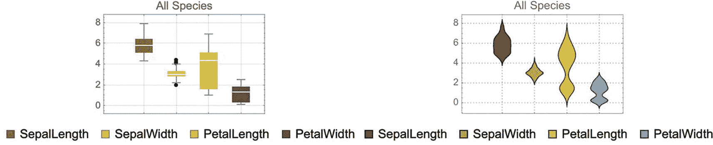

两个箱须图均以“所有物种”为标题。每个图分别比较了花萼长度、花萼宽度、花瓣长度和花瓣宽度，这些数据以不同颜色高亮显示。右侧的图形类似于小提琴图。

**图 7-26** 所有物种的箱须图和分布图

```
In[39]:=
Row[{BoxWhiskerChart[{iris[[All, #1]], iris[[All, #2]], iris[[All, #3]], iris[[All, #4]]}, "Outliers", PlotRange -> Automatic, FrameTicks -> True, ChartStyle -> "SandyTerrain", PlotLabel -> "All Species", GridLines -> Automatic, ChartLegends -> Placed[{"SepalLength", "SepalWidth", "PetalLength", "PetalWidth"}, Bottom], ImageSize -> Small], DistributionChart[{iris[[All, #1]], iris[[All, #2]], iris[[All, #3]], iris[[All, #4]]}, PlotRange -> Automatic, FrameTicks -> True, ChartStyle -> "SouthwestColors", PlotLabel -> "All Species", ChartLegends ->
Placed[{"SepalLength", "SepalWidth", "PetalLength", "PetalWidth"}, Bottom], PlotTheme -> "Detailed", GridLines -> Automatic, ImageSize -> Small]}] &[2, 3, 4, 5]
Out[39]=
```

为了改进，让我们为每个物种分别绘图。你使用 `Cases` 根据各自的物种对列表进行分离（见图 7-27）。

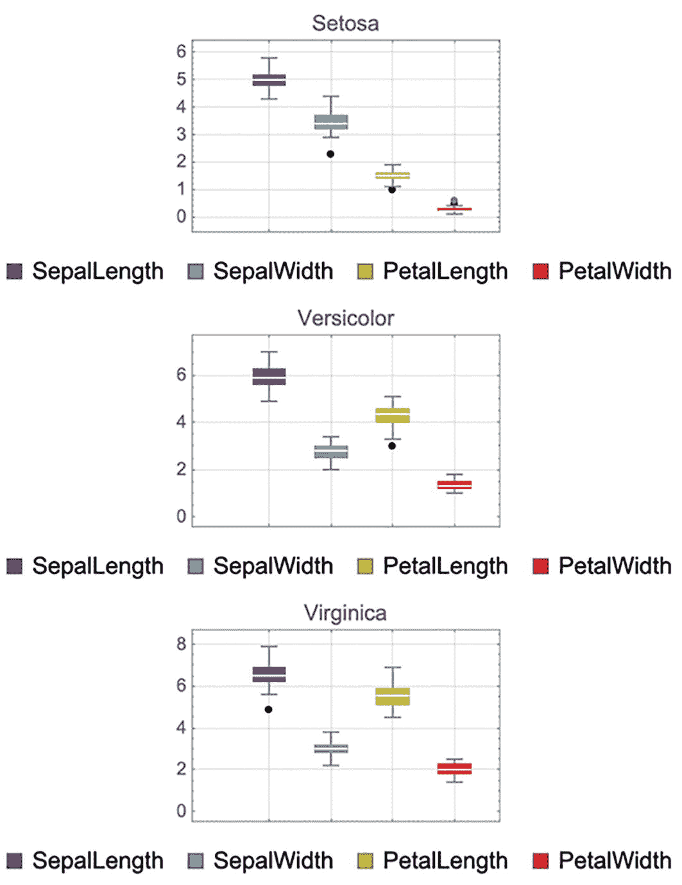

三个箱须图分别以“setosa”、“versicolor”和“virginica”为标题。每个图比较了花萼长度、花萼宽度、花瓣长度和花瓣宽度，这些数据以不同颜色高亮显示。

**图 7-27** 每个物种四个特征的箱须图

```
In[40]:=
Short[setosa=Cases[iris,{"setosa",__}]];
Short[versi=Cases[iris,{"versicolor",__}]];
Short[virgin=Cases[iris,{"virginica",__}]];
Column@{BoxWhiskerChart[{setosa[[All,#1]],setosa[[All,#2]],setosa[[All,#3]],setosa[[All,#4]]},"Outliers",PlotRange->Automatic,FrameTicks->True,ChartStyle->"Rainbow",PlotLabel->"Setosa",ChartLegends->Placed[{"SepalLength","SepalWidth","PetalLength","PetalWidth"},Bottom],GridLines->Automatic],BoxWhiskerChart[{versi[[All,#1]],versi[[All,#2]],versi[[All,#3]],versi[[All,#4]]},"Outliers",PlotRange->Automatic,FrameTicks->True,ChartStyle->"Rainbow",PlotLabel->"Versicolor",ChartLegends->Placed[{"SepalLength","SepalWidth","PetalLength","PetalWidth"},Bottom],GridLines->Automatic],BoxWhiskerChart[{virgin[[All,#1]],virgin[[All,#2]],virgin[[All,#3]],virgin[[All,#4]]},"Outliers",PlotRange->Automatic,FrameTicks->True,ChartStyle->"Rainbow",PlotLabel->"Virginica",ChartLegends-> Placed[{"SepalLength","SepalWidth","PetalLength","PetalWidth"},Bottom],GridLines->Automatic]
}&[2,3,4,5]
Out[40]=
```

此外，你可以将所有物种的花萼宽度与花萼长度的散点图合并在一起（见图 7-28）。

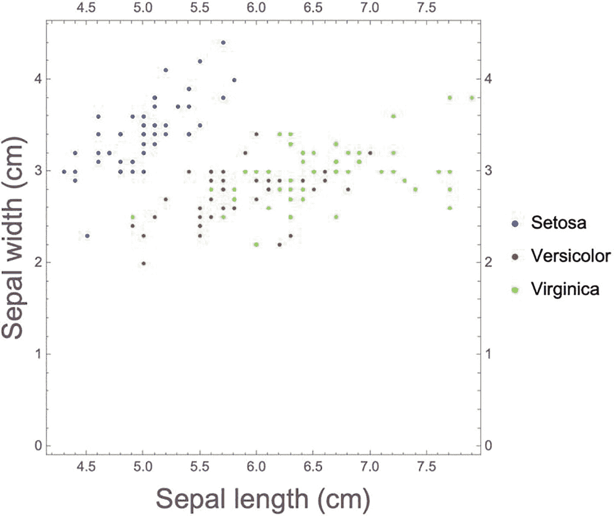

一张二维散点图比较了以厘米为单位的花萼宽度与以厘米为单位的花萼长度。数据点分别代表 `setosa`、`versicolor` 和 `virginica`，并用三种不同颜色区分。

**图 7-28** 所有物种前两个特征的二维散点图

```
In[41]:=
ListPlot[{setosa[[All, {2, 3}]], versi[[All, {2, 3}]],
virgin[[All, {2, 3}]]}, FrameTicks -> All, Frame -> True,
AspectRatio -> 1, PlotStyle -> {Blue, Red, Green},
FrameLabel -> {Style["Sepal length (cm)", FontSize -> 20],
Style["Sepal width (cm)", FontSize -> 20]}, PlotLegends -> {"Setosa", "Versicolor", "Virginica"}]
Out[41]=
```

或者，你可以制作一个包含三个特征的三维散点图（见图 7-29）。

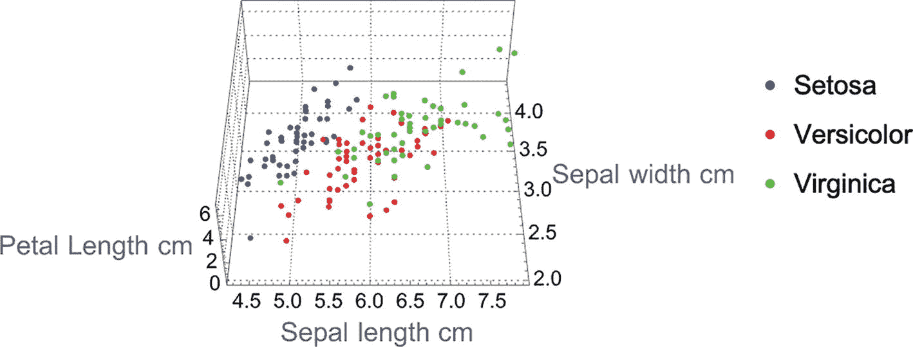

一张三维散点图比较了以厘米为单位的花瓣长度、以厘米为单位的花萼宽度和以厘米为单位的花萼长度。数据点分别代表 `setosa`、`versicolor` 和 `virginica`，并用三种不同颜色区分。

**图 7-29** 每个物种三个特征的三维散点图

```
In[42]:=
ListPointPlot3D[{setosa[[All, {2, 3, 4}]], versi[[All, {2, 3, 4}]], virgin[[All, {2, 3, 4}]]}, Ticks -> All, AspectRatio -> 1,
PlotStyle -> {Blue, Red, Green}, AxesLabel -> {Style["Sepal length cm", FontSize -> 13], Style["Sepal width cm", FontSize -> 13],
Style["Petal Length cm", FontSize -> 13]}, PlotLegends -> {"Setosa", "Versicolor", "Virginica"}, PlotTheme -> "Detailed", ViewPoint -> {0, -3, 3}]
Out[42]=
```

现在，当你完成对资源对象的操作后，需要将其删除，以便正确移除资源的本地缓存。

```
In[43]:=
Clear[fisher]
DeleteObject[ResourceObject["Sample Data: Fisher's Irises"]]
```

## 总结

本章探讨了使用 Wolfram 语言进行数据探索。首先介绍了 Wolfram 数据仓库，其中讲解了如何浏览网站并轻松选择合适的数据类别。接着，本章指导如何从仓库中提取数据，提供了在 Mathematica 中访问、筛选和观察数据的见解。此外，描述性统计部分让读者了解了表格和网格格式。通过本章的学习，读者将掌握二维和三维数据集的可视化技巧。