# 8. 使用 Wolfram 语言进行机器学习

本章介绍了梯度下降算法作为线性回归的优化方法；展示了相应的计算过程以及模型学习曲线的概念。随后，你将看到如何在线性回归、逻辑回归和聚类搜索的情况下，使用 Wolfram 语言中用于机器学习的专用函数，例如 `Predict`、`Classify` 和 `ClusterClassify`。本章展示了这些函数生成的不同对象和结果，以及用于衡量模型的指标。在每种情况下，都解释了使用 Wolfram 语言正确构建模型所必需的关键部分。本书的这一部分使用了已知数据集的示例，例如 Fisher 鸢尾花数据集、波士顿房价数据集和泰坦尼克号数据集。

## 梯度下降算法

梯度下降是一种通过迭代过程寻找函数最小值的优化算法。为了构建该过程，我们在线性模型假设下最小化平方误差损失函数，该假设的形式为 `f(x[j]) = θ[0] + θ[1] * x[j]`，作用于点 `x[j]` 附近。以下表达式给出了损失函数。

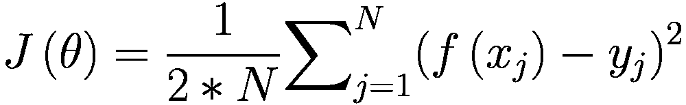

`J(θ)` 是代价函数，`N` 是观测值的数量，`f(x[j])` 是第 `j` 个观测值的预测输出，`y[j]` 是第 `j` 个观测值的实际输出。该算法的迭代过程包括计算系数，直到达到收敛。以下表达式给出了这些系数。

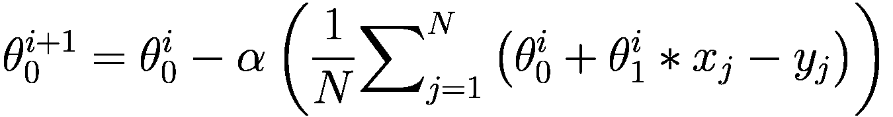

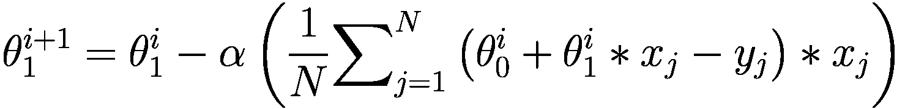

这里，`θ[0]^(i+1)` 和 `θ[1]^(i+1)` 表示第 `i+1` 次迭代后更新的参数。`θ[0]^i` 和 `θ[1]^i` 表示它们在第 `i` 次迭代时的当前值，`α` 是学习率，一个用于更新 `θ[0]` 和 `θ[1]` 的超参数，其作用是在学习过程中最小化误差。同时，`N` 是数据集观测值的总数。`x[j]` 和 `y[j]` 分别是数据集中第 `j` 个自变量和因变量的观测值。这些求和项是通过对 `θ[0]` 和 `θ[1]` 求偏导数得到的。关于该方法及其证明的更深入数学内容，请参阅 Stuart Russell 和 Peter Norvig 所著的 *《人工智能：一种现代方法》*（Prentice Hall，2010 年）。

### 获取数据

首先，使用 `RandomReal` 函数定义数据并设置一个种子。这是为了在练习相同示例时保持数据的可复现性。

```
In[1]:=
SeedRandom[888];
x=RandomReal[{0,1},50];
y=-1-x+0.6*RandomReal[{0,1},50];
```

因此，让我们通过图 8-1 中的二维散点图来观察数据。

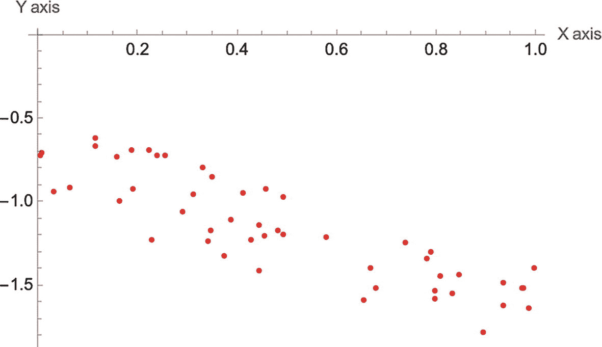

Y 对 X 的散点图显示负相关，最大值约为 (0.1, -0.6)，最小值约为 (0.9, -1.75)。这些数值是近似值。

**图 8-1** 随机生成数据的二维散点图

```
In[4]:= ListPlot[Transpose[{x,y}],AxesLabel->{"X axis","Y axis"},PlotStyle->Red]
Out[4]=
```

### 算法实现

现在，让我们用 Wolfram 语言来实现该算法。算法定义了常量、迭代次数和学习率。然后，创建两个包含初始值零的列表，用于存储每次迭代的系数值。接着，通过一个使用 `Table` 的循环来计算系数，该循环在达到迭代次数时结束。在本例中，我们设置迭代次数为 250，学习率为 1。

```
In[5]:=
itt=250;(*迭代次数*)
\[Alpha]=1;(*学习率*)
\[Theta]0=Range@@{0,itt};(* Theta_0 值的数组*)
\[Theta]1=Range@@{0,itt};(* Theta_1 值的数组*)
Table[{\[Theta]0[[i+1]]=\[Theta]0[[i]]-\[Alpha]/Length@x* Sum[(\[Theta]0[[i]]+\[Theta]1[[i]]* x[[j]]-y[[j]]),{j,1,Length@x}];
\[Theta]1[[i+1]]=\[Theta]1[[i]]-\[Alpha]/Length@x*Sum[( \[Theta]0[[i]]+\[Theta]1[[i]]*x[[j]]- y[[j]])* x[[j]],{j,1,Length@x}];},{i,1,itt}];
```

由于已经确定了系数的计算方法，我们通过构建一个函数并使用最后一次迭代的系数值（这些值位于列表 `θ[0]` 和 `θ[1]` 的前一个位置）来建立线性调整方程。

```
In[10]:= F[X_] := \[Theta]0[[Length@\[Theta]0]] + \[Theta]1[[Length@\[Theta]1]]*X
```

为了了解最佳拟合线的形状，我们将 X 变量作为参数传入。这给出了形式 `F(X) = θ[0] + θ[1] * X`。

```
In[11]:= F[X]
Out[11]= -0.707789-0.923729 X
```

观察图 8-2 中该直线如何拟合数据。

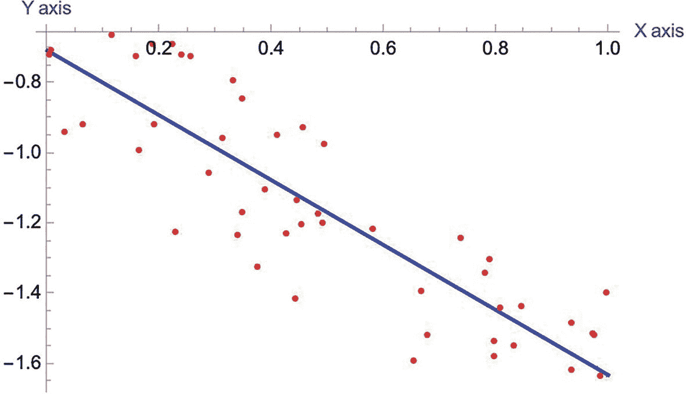

Y 轴对 X 轴的散点图显示负相关，并有一条从 (0, -0.2) 到 (1, -1.6) 的递减直线。数据点随机分布在直线周围。

**图 8-2** 数据拟合直线

```
In[12]:= Show[{Plot[F[X],{X,0,1},PlotStyle->Blue,AxesLabel->{"X axis","Y axis"}],ListPlot[Transpose[{x,y}],PlotStyle->Red]}]
Out[12]=
```

既然已经构建了线性模型，我们可以对学习率随迭代次数变化以及由函数 `J` 给出的损失值进行图形化比较。但首先，必须声明损失函数 `J`。对于求和，既可以使用西格玛（`∑`）的特殊符号，也可以写成 `Sum[expr, {i, i[max]}]`。

```
In[13]:=  J[Theta0_, Theta1_] :=  1/(2*Length[x])* Sum[ (Theta0 + (Theta1*x[[i]]) - y[[i]])², {i, 1, Length@x}]
```

#### 多个 Alpha 值

在了解了之前构建的过程后，你可以针对不同的 alpha 值重复该过程。下图展示了当重复该过程时，对于学习率 `α1=1`、`α2=0.1`、`α3=0.01`、`α4=0.001` 和 `α5=0.001`，损失函数与每次迭代的关系图。

```
In[14]:=\[Alpha]1=Transpose[{Range[0,itt],J[\[Theta]0,\[Theta]1]}];
In[20]:=\[Alpha]2=Transpose[{Range[0,itt],J[\[Theta]0,\[Theta]1]}];
In[26]:=\[Alpha]3=Transpose[{Range[0,itt],J[\[Theta]0,\[Theta]1]}];
In[32]:=\[Alpha]4=Transpose[{Range[0,itt],J[\[Theta]0,\[Theta]1]}];
In[38]:=\[Alpha]5=Transpose[{Range[0,itt],J[\[Theta]0,\[Theta]1]}];
```

使用 `ListLinePlot` 绘制图形，并可视化不同 alpha 值下的学习曲线（见图 8-3）。当改变 alpha 值时，观察调整后的直线如何变化。

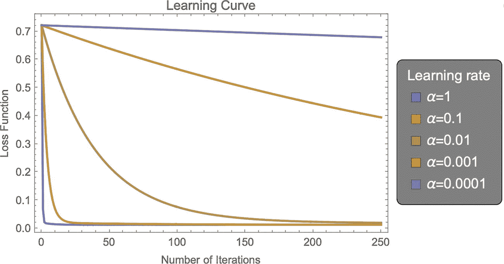

一张以损失函数与迭代次数为坐标的图表被称为学习曲线。图中包含 5 条递减曲线，从下到上对应的学习率 alpha 分别为 1、0.1、0.01、0.001 和 0.0001。其中 3 条曲线是线性的。

**图 8-3** 梯度下降算法的学习曲线

```
In[39]:=ListLinePlot[{\[Alpha]1,\[Alpha]2,\[Alpha]3,\[Alpha]4,\[Alpha]5},FrameLabel->{"Number of Iterations","Loss Function"},Frame->True,PlotLabel->"Learning Curve",PlotLegends-> SwatchLegend[{Style["\[Alpha]=1",#],Style["\[Alpha]=0.1",#],Style["\[Alpha]=0.01",#],Style["\[Alpha]=0.001",#],Style["\[Alpha]=0.0001",#]},LegendLabel->Style["Learning rate",White],LegendFunction->(Framed[#,RoundingRadius->5,Background->Gray]&)]]&[White]
Out[39]=
```

在上图（见图 8-3）中，你可以直观地看到迭代次数与代价的关系，以及它如何随 alpha 值的变化而变化。使用较高的学习率，每一步可以覆盖更大的范围，但存在超过最低点的风险。要判断算法是否有效，你需要观察每次新迭代的损失函数是否在下降。相反的情况则表明算法运行不正确；这可能是由多种因素造成的，例如代码错误或学习率值不正确。如图所示，合适的 alpha 值对应于 1 到 `10^(-4)` 范围内的较小值。并非必须使用这些精确值，你可以使用该范围内的任何值。根据数据的形式，算法可能会或可能不会在不同的 alpha 值下收敛，迭代步数也是如此。如果你选择非常小的 alpha 值，算法可能需要很长时间才能收敛，正如你在 alpha 值为 `10^(-3)` 或 `10^(-4)` 时所看到的那样。

## 线性回归

尽管可以自行构建算法来执行线性回归，但 Wolfram 语言提供了一个专门用于机器学习的函数。对于线性回归问题，有 `Predict` 函数。`Predict` 函数也可以与不同的算法一起使用，而不仅仅是回归任务算法。

### Predict 函数

`Predict` 函数通过使用训练数据创建一个预测函数来帮助你预测数值。它还允许你选择不同的学习算法，其目的是预测数值、视觉、分类值或它们的组合。可供选择的方法包括决策树、梯度提升树、线性回归、神经网络、最近邻、随机森林和高斯过程。每种方法内部都有选项；这些选项取决于用于训练预测函数所选择的算法。让我们来看看线性回归方法。`Predict` 的输入数据可以是规则列表、关联或数据集的形式。

### 波士顿数据集

让我们来看第一个示例，从 Wolfram 数据仓库加载波士顿房价数据（见图 8-4）。该数据集包含马萨诸塞州波士顿地区的住房信息。如需更深入的信息，请参考 David Harrison 和 Daniel Rubinfeld 在《环境经济与管理杂志》（1978 年；5[1]，81–102\. `https://doi.org/10.1016/0095-0696(78)90006-2`）上发表的论文《享乐主义房价与清洁空气需求》，或 David Belsley、Edwin Kuh 和 Roy Welsch 合著的《回归诊断：识别有影响力的数据和共线性来源：546》（Wiley-Interscience，2013 年）。

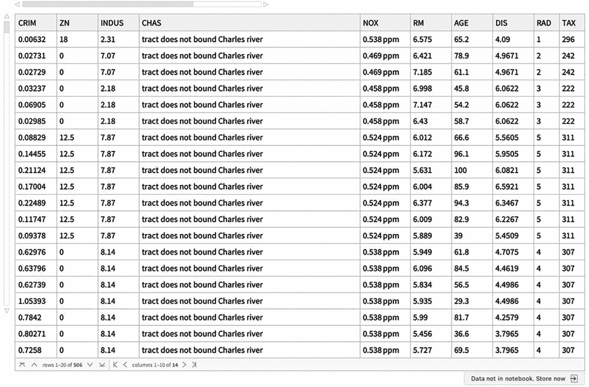

一个包含 10 个表头和 20 个字段的表格。表头分别为：CRIM、ZN、INDUS、CHAS、NOX、RM、AGE、DIS、RAD 和 TAX。所有字段的 CHAS 值都相同，因为该区域不毗邻查尔斯河。

**图 8-4** 波士顿房价数据集

```
In[40]:= bstn=ResourceData[ResourceObject["Sample Data: Boston Homes"]]
Out[40]=
```

尝试使用滚动条来完整查看数据集。让我们查看各列的描述，并以 `TableForm` 形式显示。

```
In[41]:= ResourceData[ResourceObject["Sample Data: Boston Homes"],"ColumnDescriptions"]//TableForm
Out[41]//TableForm= 城镇人均犯罪率
占地面积超过 25000 平方英尺的住宅用地比例
每个城镇非零售商业用地的比例
查尔斯河虚拟变量（1 表示区域毗邻河流，否则为 0）
氮氧化物浓度（每千万分之一）
每栋住宅的平均房间数
1940 年之前建造的自有住房比例
到波士顿五个就业中心的加权平均距离
通往放射状高速公路的便利性指数
每 10000 美元的全额财产税率
城镇的师生比
1000(Bk-0.63)²，其中 Bk 是城镇中黑人或非裔美国居民的比例
人口中较低社会地位者的百分比（百分比）
自有住房的中位价值（以千美元计）
```

## 模型创建

你将创建一个能够通过房屋房间数量预测波士顿地区房价的模型。为此，你需要关注的列是`RM`（每栋房屋的平均房间数）和`MEDV`（自住房屋的中位数价值），因为你希望找出房间数量与房价之间是否存在线性关系。根据常识，房间数量最多的房屋面积更大，因此可以容纳更多人，从而推高价格。

观察图 8-5 中`MEDV`和`RM`的散点图。

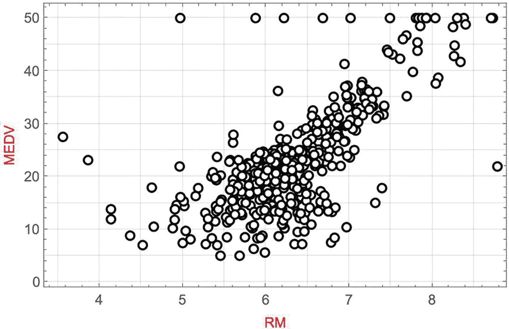

`MEDV`与`RM`的散点图显示出正相关关系。图中中心位置绘制了一组由空心圆圈表示的点簇。

**图 8-5** – `MEDV`与`RM`的二维散点图

```
In[42]:= MEDVvsRM=Transpose[{Normal[bstn[All,"RM"]],Normal[bstn[All,"MEDV"]]}];
ListPlot[MEDVvsRM,PlotMarkers->"OpenMarkers",Frame->True,FrameLabel->{Style["RM",Red],Style["MEDV",Red]},GridLines->All,PlotStyle->Black,ImageSize->Medium]
Out[43]=
```

如图 8-5 所示，房价随着平均房间数的增加而上涨。这表明这两个变量之间存在直接的比例关系。根据图中观察到的情况，我们来了解这些变量之间的相关系数值。你可以通过计算值的相关性、分配刻度标签，并使用`MatrixPlot`绘制相关矩阵来展示这一点（见图 8-6）。

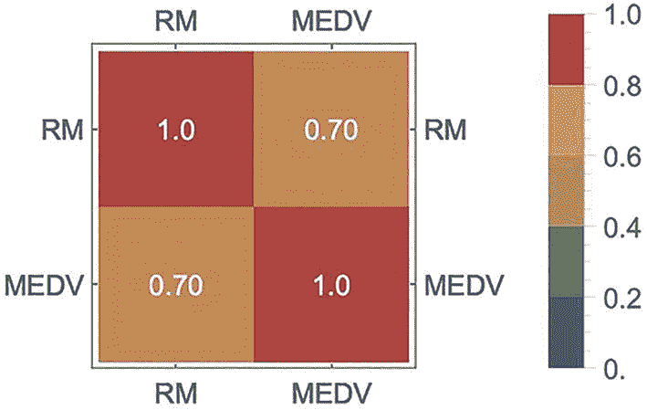

一个相关矩阵。`RM`与`RM`以及`MEDV`与`MEDV`的单元格颜色较深，值为 1。`MEDV`与`RM`以及`RM`与`MEDV`的单元格颜色较浅，值为 0.7。右侧的垂直刻度范围从 0 到 1，增量为 0.2。

**图 8-6** – 矩阵图与相关矩阵的结合

```
In[44]:=correLat=SetPrecision[Correlation[Transpose[{Normal[bstn[All,"RM"]],Normal[bstn[All,"MEDV"]]}]],2];
xTicks={{1,"RM"},{2,"MEDV"},{1,"RM"},{2,"MEDV"}};
yTicks={{1,"RM"},{2,"MEDV"},{1,"RM"},{2,"MEDV"}};
postionsValues={Text[#1,{0.5,1.5}],Text[#1,{1.5,0.5}],Text[#2,{1.5,1.5}],Text[#2,{0.5,0.5}]}&[correLat[[1,1]],correLat[[1,2]]];
MatrixPlot[correLat,ColorFunction->"DarkRainbow",FrameTicks->{  xTicks,yTicks,xTicks,yTicks},Epilog->{White,postionsValues},PlotLegends->BarLegend[{"DarkRainbow",{0,1}},4],ImageSize->180]
Out[48]=
```

通过观察矩阵图（见图 8-6），可以得出结论：`RM`和`MEDV`之间存在极好的线性关系。

现在，让我们随机打乱数据集，并使用`Thread`建立一组规则列表，因为要输入到预测函数中的数据必须采用以下格式：`{x → y}`——换句话说，即输入值和目标值。

```
In[49]:= newData =  RandomSample[Thread[Normal[bstn[All, "RM"]] -> Normal[bstn[All, "MEDV"]]]];
```

随机采样后，你选择前 354 个元素（70%）作为训练集，剩下的 152 个（30%）作为测试集。在分割时，常见的比例包括 70/30（训练/测试）、80/20 和 60/40。其中，训练集用于训练模型，通常占数据的大部分。剩余部分，即测试集，是一个独立的数据集，用于评估模型在未见数据上的性能。选择取决于数据集的大小以及你想要执行的机器学习任务的详细条件等因素。

```
In[50]:= {training, test} = {newData[[;; 354]], newData[[355 ;;]]};
```

你训练模型，该模型是一个以自住房屋平均值（`MEDV`）为目标的预测器。作为方法，你选择线性回归。在训练模型时，训练报告选项的规范包括`Panel`（面板的动态更新）、`Print`（包含时间、训练示例、最佳方法、当前损失的周期性信息）、`ProgressIndicator`（简单的进度条）、`SimplePanel`（无图表的动态更新面板）和`None`。`Panel`是默认选项（见图 8-7）。


一个预测函数，显示为左方括号、加号、输入类型 = 数值、方法 = 线性回归的图形函数、右方括号。

**图 8-7** – 训练模型的`PredictorFunction`对象

```
In[51]:=pF=Predict[training,Method->"LinearRegression",TrainingProgressReporting->"Panel"]
Out[51]=
```

输入代码时，根据添加到`TrainingProgressReporting`的选项，应该会出现一个进度条和面板报告（见图 8-8）。面板显示的时间取决于模型的训练时间。要为训练设置特定时间，可以添加`TimeGoal`作为选项，该选项指定模型训练应持续的时间。时间值是 CPU 时间的秒数——即不带单位的数字。如果使用时间单位（秒、分钟和小时），则需要使用`Quantity`命令，例如`TimeGoal ➤ Quantity [“time magnitude,” #] & / @ {“Second,” “Minute,” “Hour”}`。

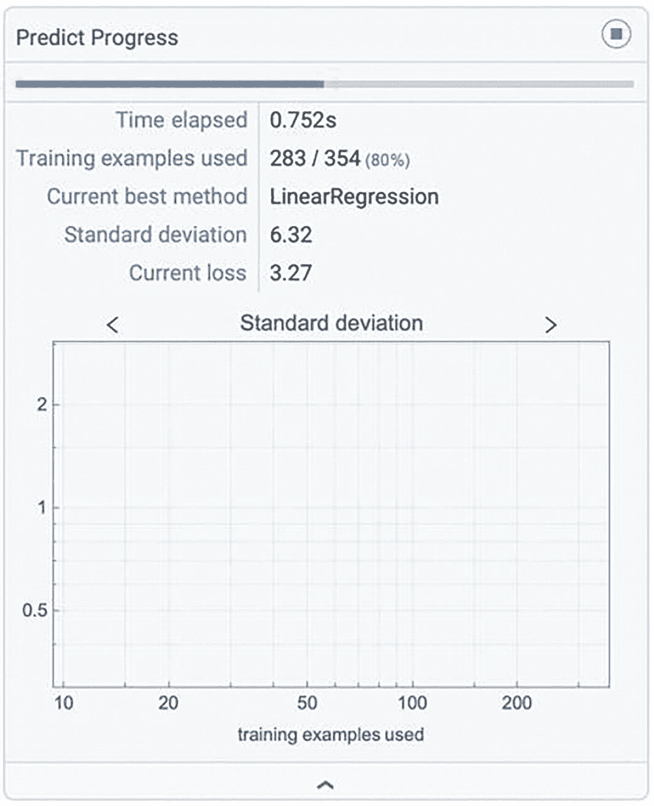

预测进度报告的截图显示，已用时间 = 0.752 秒，使用的训练示例 = 283 / 354，当前最佳方法 = 线性回归，标准差 = 6.32，当前损失 = 3.27。下方绘制了所用训练示例的标准差。

**图 8-8** – `PredictorFunction`的进度报告

让我们回到模型。图 8-7 显示返回对象是一个预测函数（尝试使用`Head`来验证）。当为预测函数分配名称时，可以获取关于模型的附加信息；使用`Information`命令（见图 8-9）。该信息适用于所有其他表达式，而不仅仅是机器学习目的。

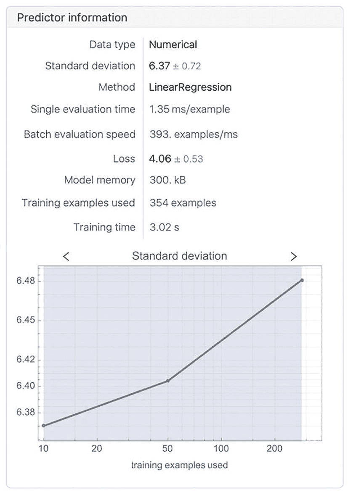

预测器信息报告的截图包括数据类型、标准差、方法、单次评估时间、批量评估速度、损失、模型内存和训练时间。它有一个标准差图，其中一条递增的线穿过点 (10, 6.36)、(50, 6.42) 和 (250, 6.48)。

**图 8-9** – 训练模型的信息报告

> **注意**
> 如果你希望涉及随机数据的结果是固定的，则需要在每次随机操作之前设置种子；这可以确保输出的一致性。

```
In[52]:= Information[pF]
Out[52]=
```

图 8-9 中的信息面板包括数据类型、均方根（`StandardDeviation`）、方法、批量评估速度、损失、模型内存、训练示例数量和训练时间。面板底部的图形分别是标准差、模型学习曲线以及其他算法的学习曲线。将光标指针悬停在数值参数上会显示置信区间和单位。如果方法名称正确，则会显示线性回归方法的参数。由于你没有在`LinearRegression`方法中选择特定的优化算法，Mathematica 会尝试在所有算法中搜索最佳算法（这可以在所有算法的学习曲线中查看）。你将在后续内容中了解如何访问这些选项。

> **注意**
> 预测函数中使用的每种方法都有选项和子选项；如需完全自定义，请使用 Wolfram 语言文档中心。

表 8-1 列出了可用于模型训练的标准选项，以及它们在`PredictorFunction`训练过程中的定义和可能取值。

**表 8-1** 预测函数最常用选项

| 选项 | 定义 |
| --- | --- |
| `Method` | 算法。可能取值：`DecisionTree`、`GradientBoostedTrees`、`LinearRegression`、`NearestNeighbors`、`RandomForest` 和 `GaussianProcess` |
| `PerformanceGoal` | 性能优化。可能取值：`DirectTraining`、`Memory`、`Quality`、`Speed`、`TrainingSpeed`、`Automatic`。支持取值组合（`PerformanceGoal -> {val1, val2}`） |
| `RandomSeeding` | 伪随机数生成器的种子。可能取值：`Automatic`、`"custom seed"`、`Inherited`（先前计算中使用的随机种子） |
| `TargetDevice` | 指定执行训练或测试过程的设备。可能取值：`CPU` 或 `GPU`。如果安装了 GPU，则自动目标设备为 GPU。 |
| `TimeGoal` | 训练过程所花费的时间 |
| `TrainingProgressReporting` | 进度报告。可能取值：`Panel`、`Print`、`ProgressIndicator`、`SimplePanel`、`None` |

## 模型测量

模型构建完成后，必须观察并分析预测函数在测试集上的性能。为此，你需要在`PredictorMeasurments`命令内进行操作。预测函数作为参数传入（见图 8-10），其后跟测试集以及要添加的一个或多个属性。自最新版本起，最终模型特征预测会直接呈现，而不仅仅是`PredictorMeasurements`对象的模型。

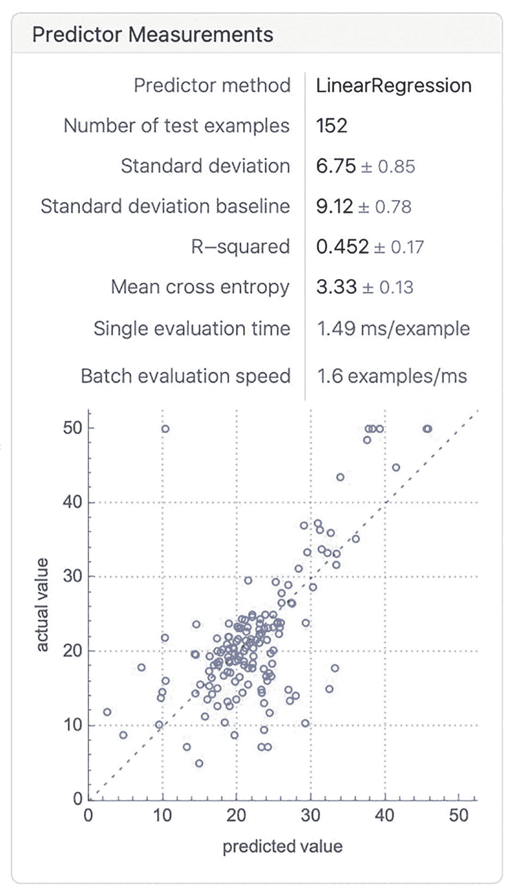

预测测量报告包括预测方法、测试样本、标准差基线、R 平方、平均交叉熵、单次评估时间和批量评估速度。实际值与预测值的散点图通过一条递增的虚线显示了正相关性。

**图 8-10** 被测模型的`PredictorMeasurements`对象

```
In[53]:= pRM = PredictorMeasurements[pF, test]
Out[53]=
```

返回的对象称为`PredictorMeasurementsObject`。你可以从`PredictorMeasurements`命令中添加属性。你可以为该对象分配一个变量，以便更简单地访问它。自 13 新版本起，输出中会直接给出报告，因此测试集的模型报告被抑制，因为它返回的内容与图 8-10 相同。

```
In[54]:= pRM["Report"];
```

图 8-10 中的报告显示了不同的参数，例如标准差和平均交叉熵。它还显示了模型拟合图以及当前值和预测值。该模型适用于大多数情况，但一些异常值仍会影响性能。

为了更好地理解模型的精度，让我们查看图 8-11 中显示的均方根误差 (RMSE) 和`RSquared`（决定系数）。要显示相关的不确定性，请使用值为`True`的`ComputeUncertainty`选项。

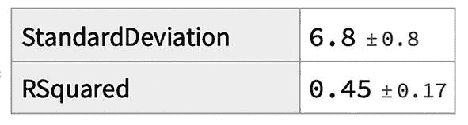

一个 2 行 2 列的表格显示标准差 = 6.8 ± 0.8，R 平方 = 0.45 ± 0.17。

**图 8-11** 线性模型的标准差和 r 平方值

```
In[57]:= Dataset[AssociationMap[pRM[#, ComputeUncertainty -> True] &, {"StandardDeviation", "RSquared"}]]
Out[57]=
```

这给出了一个略高的 RMSE 值，以及一个不算优秀的 r 平方值。请记住，r 平方值表示模型进行预测的效果如何。这两个值表明，尽管房间数量与价格之间可能存在线性关系，但线性回归并不一定能解释这一点。这些观察结果也是一致的，请记住你之前得到的相关系数值为 0.7。

## 模型评估

在模型内部绘制的图形包括模型图和目标变量（`ComparisonPlot`）。要检查方差的分布，请使用`ResidualHistogram`函数；要检查残差图，请使用`ResidualPlot`。这些如图 8-12 所示。

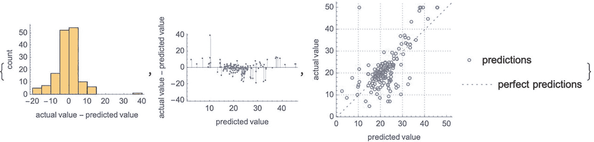

3 张图。左图：计数与实际值减预测值的直方图，最高点在 (0, 50)。中图：实际值减预测值与预测值的残差图。有一条位于 0 的线，并绘制了数据点。右图：实际值与预测值的散点图，显示预测呈正相关性。

**图 8-12** `ResidualHistogram`、`ResidualPlot` 和 `ComparisonPlot`

```
In[58]:= pRM[#] & /@ {"ResidualHistogram", "ResidualPlot", "ComparisonPlot"} /. plot_Graphics :> Show[plot, ImageSize -> Small]
Out[58]=
```

你可以将`Properties`作为参数写入，以找出`PredictorMeasurements`对象的所有属性。这些属性可能因方法而异。

```
In[59]:= pRM["Properties"]
Out[59]= {BatchEvaluationTime, BestPredictedExamples, ComparisonPlot, EvaluationTime, Examples, FractionVarianceUnexplained, GeometricMeanProbabilityDensity, ICEPlots, LeastCertainExamples, Likelihood, LogLikelihood, MeanCrossEntropy, MeanDeviation, MeanSquare, MostCertainExamples, Perplexity, PredictorFunction, ProbabilityDensities, ProbabilityDensityHistogram, Properties, RejectionRate, Report, ResidualHistogram, ResidualPlot, Residuals, RSquared, SHAPPlots, SHAPValues, StandardDeviation, StandardDeviationBaseline, TotalSquare, WorstPredictedExamples}
```

如果你对所选择的方法或超参数不满意，可以通过配置超参数的新值来重新训练模型。你可以借助`Information`命令访问当前方法的值，并添加`Method`（显示用于训练模型的方法）、方法描述（所用方法的描述）和`MethodOption`（方法选项）等属性。

```
In[60]:= Information[pF, "MethodOption"]
Out[60]= Method -> {LinearRegression, L1Regularization -> 0, L2Regularization -> 1.*10^-6, OptimizationMethod -> NormalEquation}
```

你会看到诸如`L1Regularization`、`L2Regularization`和`OptimizationMethod`这样的术语。前两个术语与正则化方法相关，其中`L1`指的是 Lasso 回归的名称，`L2`指的是 Ridge 回归的名称。正则化用于最小化模型的复杂度并减少方差；它还能提高模型的精度，解决过拟合问题。这是通过在损失函数中添加一个惩罚项来实现的；对于`L1`，该惩罚项是系数绝对值之和 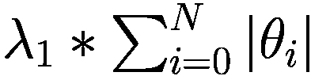，而对于`L2`，其表达式为 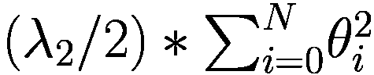，其中需要最小化的函数是损失函数 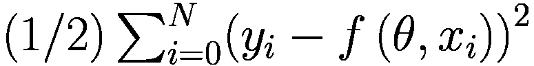。如需更深入的数学知识，请参考 Stuart Russell 和 Peter Norvig 所著的《*人工智能：一种现代方法*》（Prentice Hall，2010 年）以及 Gareth James、Trevor Hastie、Robert Tibshirani 和 Daniela Witten 所著的《*统计学习导论：基于 R 的应用*》（Springer，2017 年）。第三个术语是你想要选择的优化方法；现有的方法包括`NormalEquation`、`StochasticGradientDescent`和`OrthanWiseNewton`。话虽如此，必须强调的是，使用符合`L1`和`L2`标准的系数向量被称为弹性网络回归模型。当参数之间存在相关性时，可能会使用弹性网络。更多理论请参考 Trevor Hastie、Robert Tibshirani 和 Jerome Friedman 所著的《*统计学习基础：数据挖掘、推断与预测*》（Springer，2009 年）。

### 重新训练模型超参数

如下文所述，让我们重新训练模型，但使用以下值：`L1` → 12，`L2` → 100，优化算法 `OptimizationMethod` → `StochasticGradientDescent`，`TrainingProgressReporting` → `None`，`PerformanceGoal` → `"Quality"`，`RandomSeeding` → 10000，`TargetDevice` → `"CPU"`。

```
In[61]:= pF2 = Predict[training, Method -> {"LinearRegression", "L1Regularization" -> 12, "L2Regularization" -> 100, "OptimizationMethod" -> Automatic}, TrainingProgressReporting -> None, PerformanceGoal -> "Quality", RandomSeeding -> 10000, TargetDevice -> "CPU"];
```

要查看与某个示例相关的属性，请在 `PredictorFunction` 的输入数据后输入属性——例如，`PF2["example", "Properties"]`。让我们像之前一样通过显示图表和指标来比较新模型的性能（见图 8-13 和 8-14）。

**注意**

标准差指的是残差的均方根，即均方根误差（RMSE）。

```
In[62]:= pRM2=PredictorMeasurements[pF2,test];
pRM2[#]&/@{"ResidualHistogram","ResidualPlot","ComparisonPlot"}/. plot_Graphics:>Show[plot,ImageSize->Small]
Dataset[AssociationMap[pRM2[#,ComputeUncertainty->True]&,{"StandardDeviation","RSquared"}]]
Out[63]=
Out[64]=
```

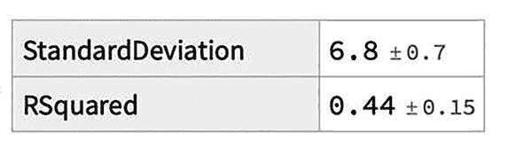

一个包含 2 行 2 列的表格。第 1 行：标准差，6.8 ± 0.7。第 2 行：R 平方，0.44 ± 0.15。

**图 8-14** 标准差和 R 平方的新值

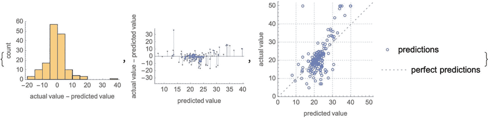

3 张图。左图：计数相对于实际值减预测值的直方图，最高点在 (0, 60)。中图：实际值减预测值相对于预测值的残差图。有一条位于 0 的线，并绘制了数据点。右图：实际值相对于预测值的散点图，预测值呈正相关。

**图 8-13** 重新训练模型的图表

观察图表和数据，你会发现模型只是在一定程度上有所下降；这与新的 R 平方值相符。然而，它仍然是一个用于未来预测的糟糕模型。性能不佳可能是由于优化选择以及 `L1` 和 `L2` 参数导致的。尝试探索不同的 `L1` 和 `L2` 值以寻求潜在的改进。

## 逻辑回归

逻辑回归是一种在统计学中常用，同时也在机器学习中使用的技术。逻辑回归的工作原理是假设响应变量的值只取两个值，0 和 1；这也可以解释为假或真的条件。它是一个二元分类器，使用一个函数来预测条件是否满足的概率，具体取决于模型的构建方式。通常，这种模型类型用于分类，因为它可以提供概率和分类结果，因为逻辑回归的值在两个值之间振荡。在逻辑回归中，目标变量是一个包含编码数据的二元变量。更多信息请参考 Laura Igual、Santi Seguí、Jordi Vitrià、Eloi Puertas、Petia Radeva、Oriol Pujol、Sergio Escalera、Francesc Dantí 和 Lluis Garrido 所著的《*数据科学导论：概念、技术与应用的 Python 方法*》（Springer，2017 年）。

## 泰坦尼克号数据集

在以下示例中，你将使用泰坦尼克号数据集，该数据集描述了乘客的生存状况。所使用的变量包括 `class`、`age`、`sex` 和 `survival condition`。你可以直接从 `ExampleData` 中将数据加载为数据集（见图 8-15），并枚举数据集的行。

**注意：** 本节使用查询语言构建，以便读者更深入地理解如何在数据集中使用它。

```
In[65]:= titanic=Query[AssociationThread[Range[Length@#]->Range[Length@#]]][ExampleData[{"Dataset","Titanic"}]]&[ExampleData[{"Dataset","Titanic"}]]
Out[65]=
```

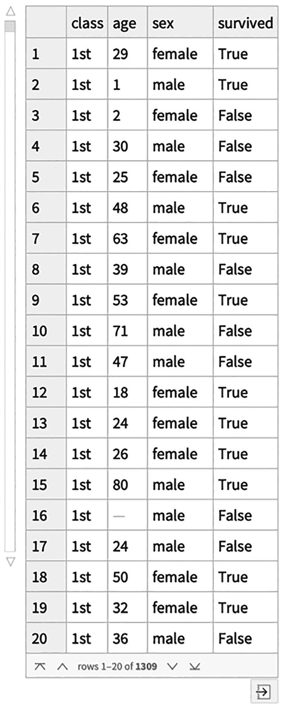

一个包含 4 个表头和 20 个字段的表格。表头分别为 `class`、`age`、`sex` 和 `survived`。`class` 下的所有字段均以 first 形式输入。

**图 8-15** 标准差和 R 平方的新值

让我们使用 `Dimensions` 命令查看数据的维度。

```
In[66]:= Dimensions@titanic
Out[66]= {1309,4}
```

解读结果，你会发现该数据集包含 1309 行和 4 列。数据集有四列，分别按 `class`、`age`、`sex` 和 `survived` 状态分类。使用空格键显示某些元素未录入数据。要查看哪些列包含缺失数据，请执行以下代码，通过统计每列中与缺失模式对应的组件数量。

```
In[67]:=Query[Count[_Missing],#]@titanic&/@{"class","age","sex","survived"}
Out[67]= {0,263,0,0}
```

这表明 `age` 列中有 263 个缺失值，其他列均为 0。让我们删除包含这些缺失数据的行。首先，通过从 `age` 列中选择等于缺失的元素，然后提取行 ID，从缺失数据中提取行号。

```
In[68]:= Query[Select[#age==Missing[]&]][titanic];
Normal@Keys@%
Out[68]={16,38,41,47,60,70,71,75,81,107,108,109,119,122,126,135,148,153,158,167,177,180,185,197,205,220,224,236,238,242,255,257,270,278,284,294,298,319,321,364,383,385,411,470,474,478,484,492,496,525,529,532,582,596,598,673,681,682,683,706,707,757,758,768,769,776,790,796,799,801,802,803,805,806,809,813,814,816,817,820,836,843,844,853,855,857,859,866,872,873,875,877,880,883,887,888,901,902,903,904,919,921,922,923,924,927,928,929,930,931,932,941,943,945,946,947,949,955,956,957,958,959,962,963,972,974,977,983,984,985,988,989,990,992,994,995,998,999,1000,1001,1002,1003,1004,1005,1006,1007,1010,1013,1014,1015,1017,1019,1023,1024,1028,1029,1030,1031,1033,1034,1035,1036,1037,1038,1039,1040,1042,1043,1044,1045,1053,1054,1055,1056,1070,1071,1072,1073,1074,1075,1077,1078,1079,1081,1082,1086,1096,1110,1115,1116,1117,1122,1123,1124,1125,1129,1133,1136,1137,1138,1139,1150,1151,1152,1155,1156,1160,1163,1164,1165,1167,1168,1169,1171,1173,1174,1175,1176,1177,1178,1179,1180,1181,1185,1186,1187,1194,1195,1196,1198,1199,1200,1201,1203,1213,1214,1215,1216,1217,1220,1222,1242,1243,1244,1246,1247,1248,1250,1251,1254,1256,1263,1269,1283,1284,1285,1292,1293,1294,1298,1303,1304,1306}
```

这些数字代表包含 `age` 列缺失数据的行。考虑到第 1 层存在缺失数据，你使用 `DeleteMissing` 命令来消除它们。最终数据集见图 8-16。

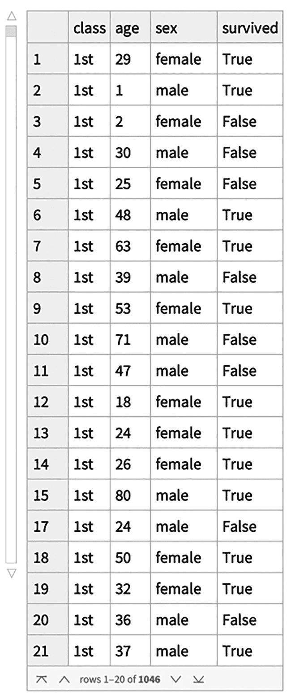

一个包含 4 个表头和 21 个字段的数据集。表头分别为 `class`、`age`、`sex` 和 `survived`。`class` 下的所有字段均以 first 形式输入。

**图 8-16** 无缺失值的泰坦尼克号数据集

```
In[69]:= titanic=DeleteMissing[titanic,1,1]
Out[69]=
```

为了证实没有缺失数据，你可以应用相同的代码进行计数，或者查看已删除行的键，例如。

```
In[70]:= titanic[Key[16]]
Out[70]= Missing[KeyAbsent,Key[16]]
```

这意味着键 16 没有关联的内容。如果你想检查所有键，请使用缺失数据的行列表。

## 数据探索

删除缺失数据后，你可以统计每个 `class`、`sex` 和 `survival status` 的元素数量（见图 8-17）。

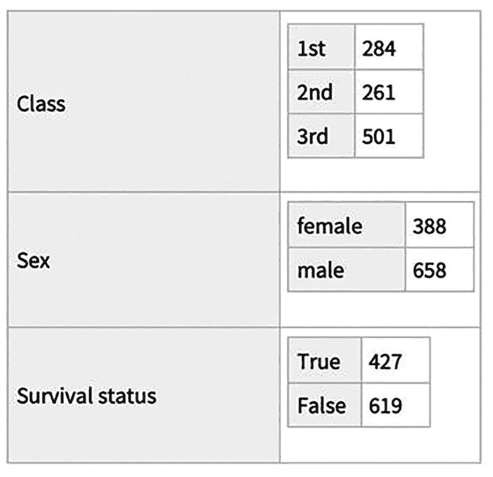

一个嵌套数据集，包含 2 列和 3 行，标题为 `class`、`sex` 和 `survival status`。`class` 的数据集显示 first = 284、second = 261、third = 501。`sex` 的数据集显示 female = 388、male = 658。`survival status` 的数据集显示 true = 427、false = 619。

**图 8-17** `class`、`sex` 和 `survival status` 的基本元素计数

```
In[71]:= Dataset@ Query[Counts, "class"]@titanic, "Sex" -> Query[Counts, "sex"]@titanic, "Survival status" -> Query[Counts, "survived"]@titanic|>
Out[71]=
```

删除包含缺失元素的行后，数据集包含头等舱 284 个元素、二等舱 261 个元素、三等舱 501 个元素（见图 8-18）。此外，请注意超过一半的注册乘客为男性，且死亡人数多于幸存者。可以通过显示百分比来图形化验证这一点。同样的方法也应用于 `class` 和 `sex` 列。

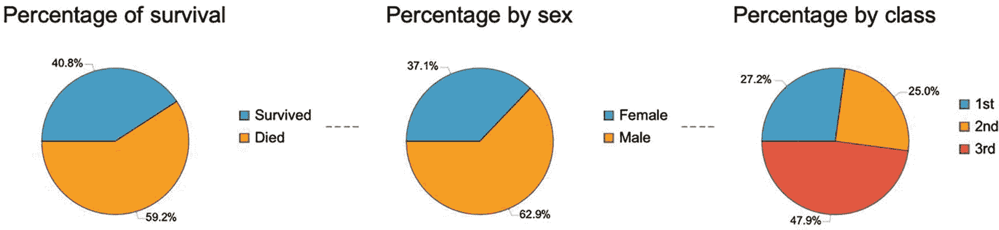

3 个饼图。生存百分比显示 40.8%幸存，59.2%死亡。性别百分比显示 37.1%女性，62.9%男性。等级百分比显示 27.2%头等舱，25%二等舱，47.9%三等舱。

**图 8-18** `class`、`sex` 和 `survival status` 的饼图

```
In[72]:= Row[{PieChart[{N@(#[[1]]/Total@#),N@(#[[2]]/Total@#)}&[Counts[Query[All,"survived"][titanic]]], PlotLabel->Style["Percentage of survival",#3,#4], ChartLegends-> {"Survived", "Died"}, ImageSize->#1,ChartStyle->#2,LabelingFunction->(Placed[Row[{SetPrecision[100#,3],"%"}],"RadialCallout"]&)],
PieChart[{N@(#[[1]]/Total@#),N@(#[[2]]/Total@#)}&[Counts[Query[All,"sex"][titanic]]], PlotLabel->Style["Percentage by sex",#3,#4], ChartLegends->{"Female", "Male"}, ImageSize->#1,ChartStyle->#2,LabelingFunction->(Placed[Row[{SetPrecision[100#,3],"%"}],"RadialCallout"]&)],
PieChart[{N@(#[[1]]/Total@#),N@(#[[2]]/Total@#),N@(#[[3]]/Total@#)}&[Counts[Query[All,"class"][titanic]]], PlotLabel->Style["Percentage by class",#3,#4], ChartLegends->{"1st", "2nd","3rd"}, ImageSize->#1,ChartStyle->#2,LabelingFunction->(Placed[Row[{SetPrecision[100#,3],"%"}],"RadialCallout"]&)]},"----"]&[200,{ColorData[97,20],ColorData[97,13],ColorData[97,32]},Black,20]
Out[72]=
```

本示例考察了*泰坦尼克号*乘客的生存状况。它构建了一个模型，用于分类给定的 `class`、`age` 和 `sex` 是否幸存。特征为 `class`、`age` 和 `sex`；目标为 `survival status`。这些变量是特征，模型随后使用它们来分类某个 `class`、`age` 和 `sex` 是否幸存，即目标变量。数据集被划分为 80%的训练集（837 个元素）和 20%的测试集（209 个元素）。要分割数据集，首先进行随机抽样；然后，提取 ID 的键，并创建一个按训练集和测试集划分的新数据集（见图 8-19）。

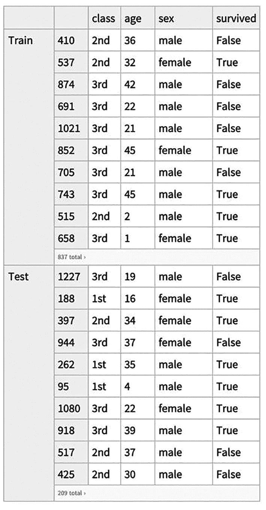

一个数据集被分为两行，标记为 train 和 test，包含 4 个表头：`class`、`age`、`sex` 和 `survived`。每行有 10 个字段，值各不相同。

**图 8-19** 按训练集和测试集划分的泰坦尼克号数据集

```
In[73]:= BlockRandom[SeedRandom[8888];
RandomSample[titanic]];
Keys@Normal@Query[All][%];
{train,test}={%[[1;;837]],%[[838;;1046]]};
dataset=Query[{Map[Key,train]},"Test"->{Map[Key,test]} |> ][titanic]
Out[77]=
```

## 分类函数

`Classify` 命令是 Wolfram 语言机器学习方案中使用的另一个超级函数。此函数可用于解决分类问题的任务。该函数接受的数据包括数值、文本、声音和图像数据。此函数的输入数据可以与 `Predict` 函数的 `{x -> y}` 格式相同。但是，也可以将数据作为元素列表、元素关联或数据集输入。在这种情况下，您将其作为数据集引入。

在这种情况下，您通过指定列输入（`class`、`age`、`sex`）指向目标（`survived`），从数据集格式中提取数据。现在，让我们使用以下选项构建分类器函数（参见图 8-20）：`Method -> {LogisticRegression, L1 -> Automatic, L2 -> Automatic}`。当选择 `Automatic` 时，您让 Mathematica 选择 `L1` 和 `L2` 参数的最佳组合。对于 `OptimizationMethod`，设置 `StochasticGradientDescent` 方法。并将性能目标设置为 `Quality`。最后，选择一个值为 100,000 的种子，并将 `CPU` 单元作为目标设备。逻辑回归的优化方法包括有限内存 Broyden-Fletcher-Goldfarb-Shanno 算法、`StochasticGradientDescent` 和牛顿法。这些用于估计逻辑函数的参数。规则构建是使用 `Query` 语言从数据集内的数据完成的。

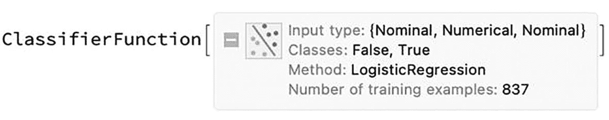
一个分类器函数，读取左方括号减函数，图形输入类型 = 左花括号名义型、数值型、名义型、右花括号，类别 = false、true，方法 = 逻辑回归，训练样本数 = 837，右方括号。
**图 8-20** `ClassifierFunction` 对象

```
In[78]:= cF = Classify[Flatten[Values[Normal[Query["Train", All, All, {#class, #age, #sex} -> #survived &][dataset]]]], Method -> {"LogisticRegression", "L1Regularization" -> Automatic, "L2Regularization" -> Automatic,  "OptimizationMethod" -> "StochasticGradientDescent"},  PerformanceGoal -> "Quality", RandomSeeding -> 100000, TargetDevice -> "CPU", TrainingProgressReporting -> None]
Out[78]=
```

训练后，与 `Predict` 函数类似，`Classify` 函数返回一个分类器函数对象（参见图 8-21），而不是预测器函数。检查分类器函数，您可以看到两种输入数据类型——名义型和数值型——以及类别，即生存状态——`true` 或 `false`。使用的方法（逻辑回归）和样本数（837）。要获取模型信息，请使用 `Information` 命令。让我们查看模型报告。

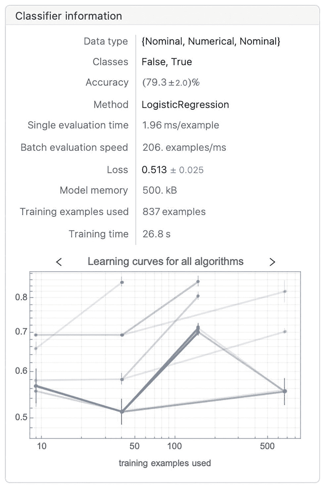
一个分类器信息框，包含数据类型、类别、准确率、方法、单次评估时间、批量评估速度、损失、模型内存、使用的训练样本和训练时间。使用多条线性曲线绘制了所用训练样本的折线图。
**图 8-21** 关于训练好的分类器函数的信息

```
In[79]:= Information[cF]
Out[79]=
```

**注意**
如果您单击图形上方的箭头，将显示三个图：学习曲线、准确率和所有算法的学习曲线。如果您将指针悬停在最后一个图的线上，将出现一个工具提示，显示相应的参数以及使用的方法，如图 8-22 所示。

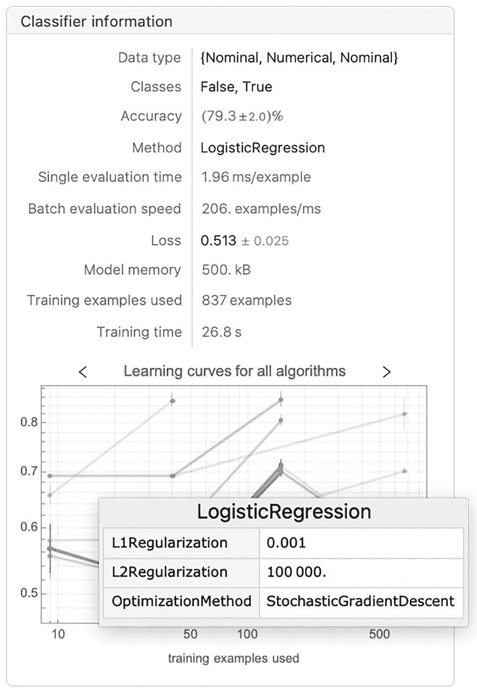
一个分类器信息框，指示数据类型、类别、准确率、方法、单次评估时间、批量评估速度、损失、模型内存、使用的训练样本和训练时间。使用逻辑回归数据集绘制了所用训练样本的折线图。
**图 8-22** 来自逻辑回归方法的算法规范工具提示

您可以看到模型的准确率约为 79%。您还可以通过单击图的箭头观察到，学习曲线和准确率曲线在使用 500 个训练样本时都出现了变化。要访问训练模型的所有属性，请在 `Information` 中添加 `Properties` 作为选项。

```
In[80]:= Information[cF,"Properties"]
Out[80]={AcceptanceThreshold,Accuracy,AnomalyDetector,BatchEvaluationSpeed,BatchEvaluationTime,Calibrated,Classes,ClassNumber,ClassPriors,EvaluationTime,ExampleNumber,FeatureExtractor,FeatureNames,FeatureNumber,FeatureTypes,FunctionMemory,FunctionProperties,IndeterminateThreshold,LearningCurve,MaxTrainingMemory,MeanCrossEntropy,Method,MethodDescription,MethodOption,MethodParameters,MissingSynthesizer,PerformanceGoal,Properties,TrainingClassPriors,TrainingTime,UtilityFunction}
```

**注意**
根据使用的方法，属性可能会有所不同。

让我们检查数据的概率：`class = 3rd`、`age = 23` 和 `sex = male`。`Probability -> name or number of class` 或 `TopProbabilities -> number of most likely classes`。

```
In[81]:= cF[{"3rd",23,"male"},{"Probability"-> False,"TopProbabilities"-> 2}]
Out[81]= {0.676982,{False->0.676982,True->0.323018}}
```

后一个示例的概率表明，该乘客的生存状态可能更倾向于 `False` 状态。

要查看新分类的完整属性，请在示例后键入 `Properties`。包含的属性有 `Decision`（根据概率及其效用函数的最佳类别选择）和 `Distribution`（分类分布对象）。每个类别的概率显示为关联：`ExpectedUtilities`（期望概率）、`LogProbabilities`（自然对数概率）、`Probabilities`（所有类别）和 `TopProbabilities`（最可能的类别）。这在以下数据集中显示（参见图 8-23）。

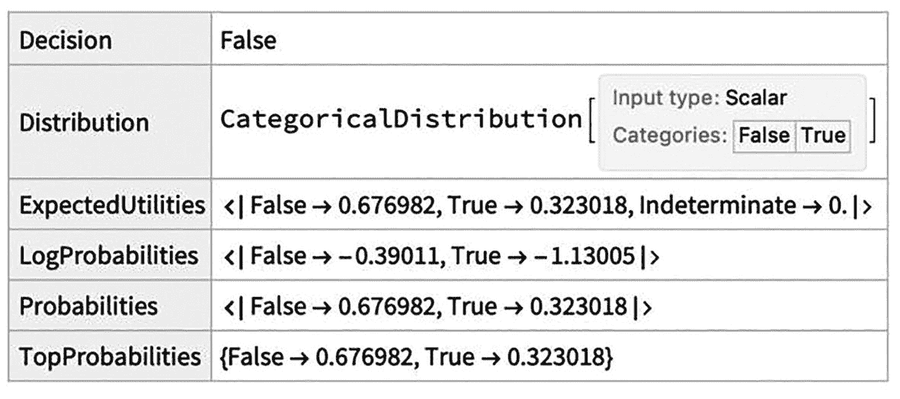
一个包含 2 列 5 行的表格。列标题是决策和 false。行表示分布、期望效用、对数概率、概率和顶部概率。分布指示分类分布，输入类型 = 标量，类别 = false、true。
**图 8-23** 训练模型的分类器函数的属性

```
In[82]:= Dataset@
AssociationMap[cF[{"3rd",23,"male"},#]
&,{"Decision","Distribution","ExpectedUtilities","LogProbabilities","Probabilities","TopProbabilities"}]
Out[82]=
```

**注意**
要检查对数结果，请使用 `Log` 命令，`Log[base, number]`。

## 测试模型

现在，你使用 `ClassifierMeasurements` 命令在测试数据上测试模型，将函数和测试集以及不确定性计算作为参数添加进去。与 `PredictionMeasurement` 类似，返回的输出会显示关于模型的详细信息（见图 8-24）。

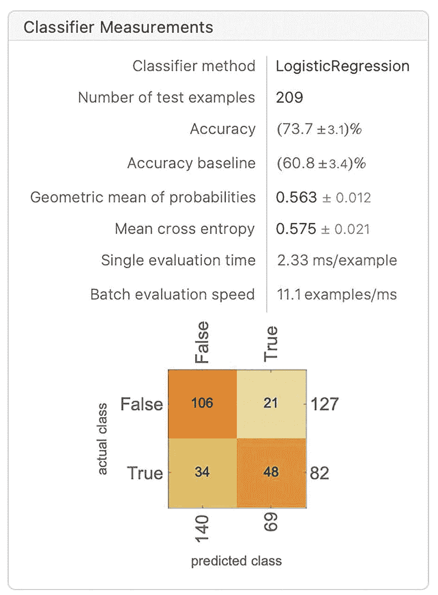
一个分类器测量框显示了分类器方法、测试样本数量、准确率、准确率基线、概率几何平均值、平均交叉熵、单次评估时间和批量评估速度。一个实际类别与预测类别的矩阵显示了 106、21、34 和 48 这些数值。
**图 8-24** 分类器函数的 `ClassifierMeasurements` 对象

```
In[83]:= cM = ClassifierMeasurements[cF,Flatten[Values[Normal[Query["Test", All, All, {#class, #age, #sex} -> #survived &][dataset]]]], ComputeUncertainty -> True, RandomSeeding -> 8888]
Out[83]=
```

返回的对象被称为 `ClassifierMeasurementsObject`（见图 8-25），用于在测试测试集后查找 `ClassifierFunction` 的属性。与线性回归模型一样，测试集的报告被抑制，因为它返回的内容与图 8-24 相同。

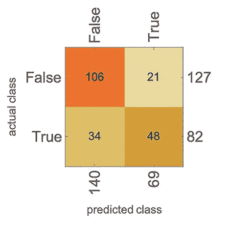
一个实际类别与预测类别的混淆矩阵。假-假值为 106，真-假为 34，假-真为 21，真-真为 48。第 1 行总数为 127，第 2 行总数为 82，第 1 列总数为 140，第 2 列总数为 69。
**图 8-25** 测试模型的混淆矩阵图

```
In[84]:=cM["Report"];
```

图 8-24 中的报告显示了诸如测试样本数量、准确率和准确率基线等信息。它还显示了混淆矩阵，该矩阵展示了分类模型的预测结果，显示了正确和错误预测的数量；这些结果按类别细分，在本例中，返回 `false` 或 `true`，这让你了解模型正在犯的错误以及所犯错误的类型。它显示了每个类别的真正例、真负例、假正例和假负例。

让我们具体看一下这个图（混淆矩阵）（见图 8-25）。

```
In[85]:= cM["ConfusionMatrixPlot"]
Out[85]=
```

要获取混淆矩阵的值，请使用 `cM["ConfusionMatrix"]` 或 `cM["ConfusionFunction"]`。

查看该图，你会发现模型从顶部从左到右分类，正确分类了 106 个 `false` 示例，将 21 个 `false` 分类为 `true`，将 34 个 `true` 分类为 `false`，以及正确分类了 48 个 `true`。为了更好地可视化性能，请查看每个类别的 ROC 曲线（见图 8-26）、它们各自的值，以及马修斯相关系数和 AUC 值。

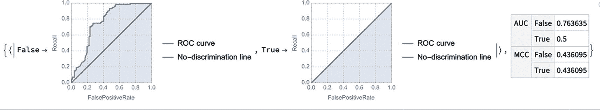
两个召回率与假正率的关系图，其中一条递增的线表示无区分能力。左侧绘制了一条在 (0, 0) 和 (1, 1) 之间波动的递增 ROC 曲线，右侧区域被着色。右侧是包含 AUC 和 MCC 值的真值表。
**图 8-26** 每个类别的 ROC 曲线，以及 AUC 和 MCC 值

```
In[86]:= {cM["ROCCurve"],Dataset@cM["AreaUnderROCCurve"]},{"MCC"->cM["MatthewsCorrelationCoefficient"]}|>}
Out[86]=
```

这两个类别在 AUC 上有不同的值，但比较 ROC 曲线；`False` 类别的分类效果优于 `True` 类别。让我们看看哪个类别有更差的示例。你可以显示模型准确率较低的结果，这些结果具有最高的熵分布和每个类别的平均交叉熵。

```
In[87]:= cM[{"LeastCertainExamples","ClassMeanCrossEntropy"}]
Out[87]= {{{1st,4,male}->True, {1st,19,male}->False, {1st,22,male}->False, {1st,24,male}->False, {1st,25,male}->False, {1st,27,male}->False, {1st,29,male}->False, {1st,30,male}->False, {1st,33,male}->False, {1st,35,male}->True}, 0.552204,True->0.611137|>}
```

要获取 MCC 系数的值，请使用以下属性：`FalseDiscoveryRate`、`FalsePositiveRate`、`FalseNegativeRate`（针对每个类别）、`FalseNegativeExamples`、`FalseNegativeNumber`（真负例）、`FalsePositive` 和 `FalsePositiveNumber`（真正例）。这里以简短形式展示。

```
In[88]:= cM[#] & /@ {"FalseDiscoveryRate", "FalseNegativeRate", "FalsePositiveRate"}
Out[88]= {0.242857,True->0.304348|>,0.165354,True-> 0.414634|>,0.414634,True->0.165354|>}
```

另一种查看模型预测是否一致的方法是查看关键指标值，如准确率、召回率、F1 分数、精确率和准确率拒绝图（见图 8-27）。让我们看看模型的这些指标。

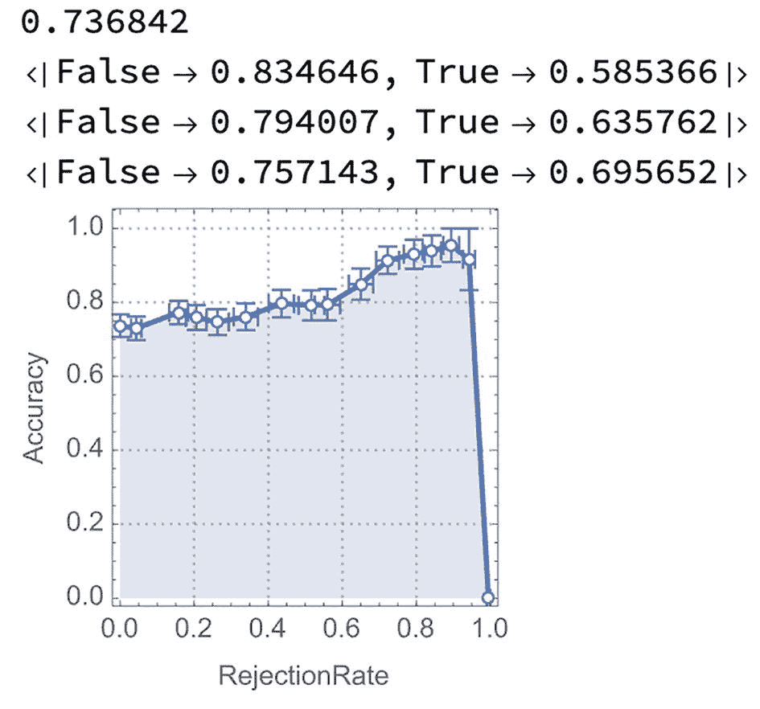
一个准确率与拒绝率的关系图，其中一条线从 (0, 0.75) 增加到 (0.9, 0.95)，然后下降到 (1, 0) 且没有数据点。曲线下方的封闭区域被着色。图的布尔值如上所示。
**图 8-27** `Accuracy`、`Recall`、`F1Score`、`Precision` 和 `AccuracyRejectionPlot` 值的 `TableForm`

```
In[89]:= cM[{"Accuracy", "Recall", "F1Score", "Precision",  "AccuracyRejectionPlot"}] // TableForm
Out[89]//TableForm=
```

要查看与准确率相关的指标，请键入以下属性：`Accuracy`（正确分类的样本数量）、`AccuracyBaseline`（预测标准类别的准确率）和 `AccuracyRejectionPlot`（ARC 图，准确率拒绝曲线）。然而，要查找关于测试集概率和预测类别的信息，请使用以下属性：`DecisionUtilities`（测试集中每个样本的效用函数值）、`Probabilities`（测试集中每个样本的概率）和 `ProbabilityHistogram`（类别概率直方图）。让我们通过绘制乘客生存状态的概率图（见图 8-28）来查看概率的行为，记住 `false` 状态表示乘客未幸存，`True` 表示乘客幸存。

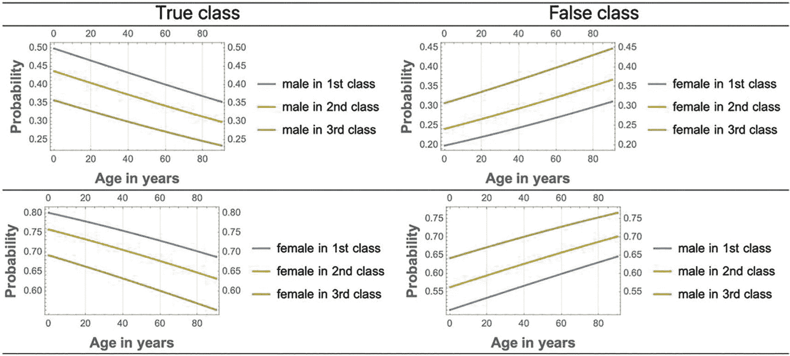
四个概率与年龄（以年为单位）的关系图，分别针对 true 和 false 类别。头等舱、二等舱和三等舱中的男性和女性用不同的阴影线标记。true 类别中的男性和女性呈下降趋势，而 false 类别中的男性和女性呈上升趋势。
**图 8-28** 每个类别的概率，取决于类别、年龄和性别

## 数据聚类

数据聚类方法是一种无监督学习，参考了 M. Emre Celebi 和 Kemal Aydin 合著的《无监督学习算法》（Springer, 2018）。该方法通常用于发现数据簇的结构和特征，将待观测的数据点根据其独特特征划分为不同的组别，并在组间进行比较。

以下示例创建了一个双变量数据序列，并绘制了数据点列表（见图 8-29）。要查找簇，可以使用`FindClusters`命令；该命令根据数据点的相似性对其进行划分。

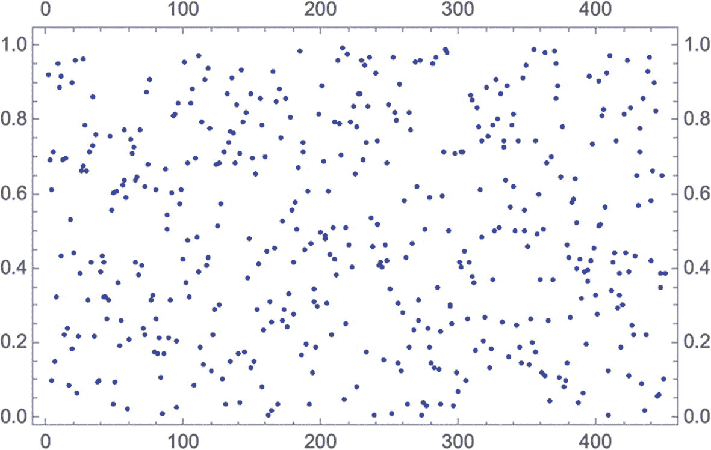

一张散点图，随机分布的点遍布整个平面。纵轴范围从 0 到 1，增量为 0.2。横轴范围从 0 到 400，增量为 100。

**图 8-29** 随机数据的二维散点图

```
In[93]:= BlockRandom[
SeedRandom[321];
rndPts=Table[{i,RandomReal[{0,1}]},{i,1,450}];]
ListPlot[rndPts,PlotRange->All,PlotStyle->Directive[Thick,Blue],Frame-> True,FrameTicks->All]
Out[93]=
```

### 簇识别

`FindClusters`函数用于检测具有相似特征的数据集内的分区。该函数将簇元素收集到其发现的子组中。当你不向`FindClusters`命令添加选项时，Mathematica 会自动设置簇识别参数。该命令也可以使用其他机器学习方法的选项，例如`PerformanceGoal`、`Method`和`RandomSeeding`。

```
In[94]:= clusters=FindClusters[rndPts,PerformanceGoal->"Speed",Method->Automatic,DistanceFunction->Automatic,RandomSeeding->1234];
Short[clusters,1]
Out[95]//Short={{{1,0.924416},{8,0.951038},>,{443,0.824999}},{>},{>}}
```

让我们看看识别出了多少个簇。使用`Length`命令；这样，你就能得到列表的总体形式。

```
In[96]:= Length[clusters]
Out[96]= 3
```

可以看到结果是 3。这可以解释为：列表包含三个元素（即三个子列表），每个列表代表一个簇，每个簇内又包含一个子列表，该子列表包含了每个识别出的簇的数据点。要确定每个簇包含多少个元素，可以使用`Map`命令，并在指定层级应用`Dimension`命令。

```
In[97]:= Map[Dimensions,clusters,1]
Out[97]= {{165,2},{143,2},{142,2}}
```

这表明第一个簇包含 165 个元素，第二个簇包含 143 个元素，第三个簇包含 142 个元素；这些与你之前创建的数据点总数 450 一致。每个簇由一个两点坐标系构成。`FindClusters`命令返回识别出簇的数据点。图 8-30 展示了生成的簇的绘图。

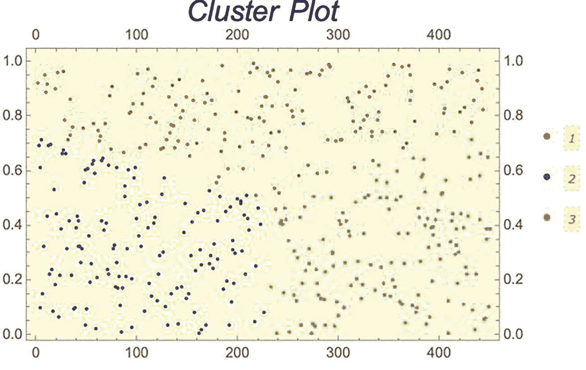

一张散点图，包含 3 个以不同深浅标记为 1、2、3 的簇。顶部区域为簇 1，左下区域为簇 2，右下区域为簇 3。

**图 8-30** 识别出的三个簇的二维散点图

```
In[98]:= ListPlot[clusters,PlotStyle->{Red,Blue,Green},PlotLegends->Automatic,Frame->True,FrameTicks->All,PlotLabel->Style["Cluster Plot",Italic,20,Black],Prolog-> {LightYellow,Rectangle[Scaled[{0,0}],Scaled[{1,1}]]}]
Out[98]=
```

`FindClusters`会自动为簇着色。要明确指定要搜索的簇数量，可以将所需数量作为第二个参数添加——即采用`FindClusters["points", "a number of clusters"]`的形式。在前面的示例中，你将方法选项设置为自动。以下是用于查找簇的不同方法：`Agglomerate`（单链接聚类算法）、`DBSCAN`（基于密度的含噪声应用空间聚类）、`NeighborhoodContraction`（最近邻链算法）、`JarvisPatrick`（Jarvis-Patrick 聚类算法）、`KMeans`（k 均值聚类）、`MeanShift`（均值漂移聚类）、`KMedoids`（k 中心点划分）、`SpanningTree`（最小生成树聚类）、`Spectral`（谱聚类）和`GaussianMixture`（高斯混合模型）。

### 选择距离函数

除了方法选项外，还有`DistanceFunction`（距离函数），其默认值为`Automatic`。该选项定义了点之间距离的计算方式。通常，当选择自动时，会使用平方欧氏距离（∑(*y*[*i*] − *x*[*i*])²）。距离函数还有其他取值，例如欧氏距离（∑ √((*y*[*i*] − *x*[*i*])²)）、曼哈顿距离（∑ |*x*[*i*] − *y*[*i*]|）、棋盘距离或切比雪夫距离（|*x*[*i*] − *y*[*i*]|）等。

现在你已经了解了如何识别聚类，接下来需要知道每个聚类的质心。为此，必须计算聚类中各点的均值。一系列点的质心可通过表达式（μ = ∑ *x*[*i*] / *n*）求得，该表达式可理解为各点的平均值。计算时，你需要从每个聚类中提取数据并计算其算术平均值。

```
In[79]:={cluster1Centroid,cluster2Centroid,cluster3Centroid}={N@Mean@clusters[[1,All]],N@Mean@clusters[[2,All]],N@Mean@clusters[[3,All]]}
Out[79]= {{224.806,0.810328},{105.14,0.331805},{347.514,0.31097}}
```

让我们绘制聚类及其质心，以可视化各点如何根据每个质心进行分类（见图 8-31）。

一张散点图包含 3 个聚类，分别标记为 1、2、3，并以不同色调显示。顶部区域为聚类 1，左下区域为聚类 2，右下区域为聚类 3。每个聚类中心有一个深色标记点。

**图 8-31** 三个已识别聚类及其各自质心的二维散点图

```
In[99]:= clusterPlot=ListPlot[clusters,PlotStyle->{Red,Blue,Green},PlotLegends->{"Cluster 1","Cluster 2","Cluster 3"}];
centroidPlot=ListPlot[{cluster1Centroid,cluster2Centroid,cluster3Centroid},PlotStyle->Black];
Show[{clusterPlot,centroidPlot},Prolog->{LightYellow,Rectangle[Scaled[{0,0}],Scaled[{1,1}]]},Frame-> True,FrameTicks-> All,PlotLabel->Style["Cluster Plot",Italic,20,Black]]
Out[100]=
```

为了确认第一个聚类对应红色点，可以尝试使用`ListPlot`绘制`clusters[[1, All]]`中包含的点，以及第二个聚类（蓝色）和第三个聚类（绿色）中的点。或者，你也可以通过向图表添加`Epilog`选项来突出显示质心区域。`Epilog`是类似于`Prolog`的另一种图形选项，可用于突出显示质心点的位置（见图 8-32）。

一张散点图包含 3 个聚类，分别标记为 1、2、3，并以不同色调显示。顶部区域为聚类 1，左下区域为聚类 2，右下区域为聚类 3。每个聚类中心有一个位于浅色圆圈内的深色标记点。

**图 8-32** 三个已识别聚类及其各自质心的二维散点图

```
In[101]:= Show[{clusterPlot, centroidPlot},  Prolog -> {LightYellow, Rectangle[Scaled[{0, 0}], Scaled[{1, 1}]]},  Frame -> True, FrameTicks -> All, Epilog -> {Opacity[0.2], PointSize[0.1], Point[cluster1Centroid],    Point[cluster2Centroid], Point[cluster3Centroid]}]
Out[101]=
```

### 识别类别

一旦通过`FindClusters`命令识别出聚类，就可以使用`ClusteringComponents`命令来标记或识别所找到的不同类别。由于`ClusteringComponents`有多种使用方式，因此你必须在命令中指定聚类的数量以及查找聚类的位置。

```
In[102]:= classes=ClusteringComponents[clusters,3,2,Method->Automatic,DistanceFunction->Automatic,RandomSeeding-> 1234,PerformanceGoal->"Speed"]//Shallow
Out[102]={{1,1,1,1,1,1,1,1,1,1,1,1,1,1,1,1,1,1,1,1,1,1,1,1,1,2,1,1,2,1,2,1,2,2,1,1,1,1,2,1,1,2,1,1,2,1,2,2,2,2,1,1,2,2,1,2,2,2,2,2,2,1,1,2,2,2,2,1,2,2,2,2,2,2,2,2,2,1,2,2,2,2,2,2,2,2,2,2,2,2,2,2,2,2,2,2,2,2,2,2,2,2,2,2,2,2,2,2,2,2,2,2,2,2,2,2,2,2,2,2,2,2,2,2,2,2,2,2,2,2,2,2,2,2,2,2,2,2,2,2,2,2,2,2,2,2,2,2,2,2,2,2,2,2,2,2,2,2,2,2,2,2,2,2,2},{1,1,1,1,1,1,1,1,1,1,1,1,1,1,1,1,1,1,1,1,1,1,1,1,1,1,1,1,1,1,1,1,1,1,1,1,1,1,1,1,1,1,1,1,1,1,1,1,1,1,1,1,1,1,1,1,1,1,1,1,1,1,1,1,1,1,1,1,1,1,1,1,1,1,1,1,1,1,1,1,1,1,1,1,1,1,1,1,1,1,1,1,1,1,1,1,1,1,1,1,1,1,1,1,1,3,1,1,3,1,3,1,1,1,1,1,1,1,1,3,1,3,3,1,3,1,1,3,1,1,1,1,3,1,3,1,1,1,3,3,1,3,3},{3,3,3,3,3,3,3,3,3,3,3,3,3,3,3,3,3,3,3,3,3,3,3,3,3,3,3,3,3,3,3,3,3,3,3,3,3,3,3,3,3,3,3,3,3,3,3,3,3,3,3,3,3,3,3,3,3,3,3,3,3,2,2,3,3,3,3,3,2,3,3,3,3,3,3,2,3,3,3,3,3,3,3,3,2,3,3,3,3,3,3,2,2,2,3,3,3,3,3,3,3,3,3,3,3,3,3,3,3,3,3,3,3,3,3,3,3,3,3,3,3,3,3,3,3,3,2,3,2,3,3,3,3,3,2,3,3,3,3,2,3,3}}
```

这样，与三个类别对应的数字就出现了。该命令仅识别出三种类型的类别，并未说明每个类别的含义。这是因为聚类方法通常应用于未标记的数据，因此对结果的解读是分析工作的一部分。让我们统计一下每个类别有多少个元素。

```
In[103]:= Flatten[classes]//Counts
Out[103]= 174,2->132,3->144|>
```

该命令返回的结果是：类别一包含 174 个，类别二包含 132 个，类别三包含 144 个。需要澄清的一点是，为什么`FindClusters`和`ClusteringComponents`识别出的聚类结果存在差异。这是因为在距离函数中设置了自动选项，相当于告诉 Mathematica 寻找最优的距离函数。根据数据的不同，某个函数可能会以不同的形式对元素进行分组，这一点你将在后续内容中看到。

### K-Means 聚类

到目前为止，你已经了解了如何以通用方式搜索聚类。本节将重点介绍 k-means 方法。k-means 是一种用于查找和分类数据组（`k`）的技术，其目的是将具有相似特征的元素归为一组，而将特征不相似的元素归为另一组。该方法计算数据到质心的距离，以判断数据是否具有相似性。元素之间距离越小，表明它们共享的相似性越多。该技术是一个迭代过程，会不断调整分组直至达到收敛。k-means 方法是一种简单的算法，它通过在不同组中进行特定分区来进行分类，每个数据点或观测值都属于某个组。聚类是通过最小化每个对象与其所在组质心之间的距离总和来实现的。k-means 聚类技术试图构建簇内变异最小的簇。这是通过最小化表达式 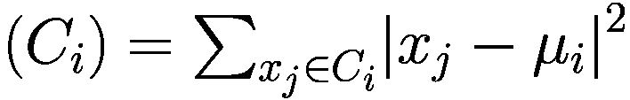 来实现的，其中 `C[i]` 表示第 i 个簇，`x[j]` 表示数据点，`μ[i]` 表示每个簇的质心。函数中的平方项是距离函数；最常用的是平方欧氏距离，本例中也是如此。

要了解该技术背后的数学基础，请参考 Gareth James、Daniela Witten、Trevor Hastie 和 Robert Tibshirani 合著的 *An Introduction to Statistical Learning: With Applications in R*（第 1 版 2013 年，第 7 次印刷 2017 年版：Springer 出版社）。

以下示例中使用了 `ExampleData` 中的费雪鸢尾花数据集。回顾该数据集的特征，执行以下代码。

```
In[104]:= ExampleData[{"Statistics","FisherIris"},"ColumnDescriptions"]
Out[104]= {Sepal length in cm.,Sepal width in cm.,Petal length in cm.,Petal width in cm.,Species of iris}
```

让我们提取数据集并将其赋值给变量 `iris`。

```
In[105]:= iris=ExampleData[{"Statistics","FisherIris"}];
Short[iris,6]
Out[106]//Short= {{5.1,3.5,1.4,0.2,setosa},{4.9,3.,1.4,0.2,setosa},{4.7,3.2,1.3,0.2,setosa},{4.6,3.1,1.5,0.2,setosa},{5.,3.6,1.4,0.2,setosa},{5.4,3.9,1.7,0.4,setosa},{4.6,3.4,1.4,0.3,setosa},>,{6.8,3.2,5.9,2.3,virginica},{6.7,3.3,5.7,2.5,virginica},{6.7,3.,5.2,2.3,virginica},{6.3,2.5,5.,1.9,virginica},{6.5,3.,5.2,2.,virginica},{6.2,3.4,5.4,2.3,virginica},{5.9,3.,5.1,1.8,virginica}}
```

### 降维

由于鸢尾花数据集由四个特征组成，这些特征被分类为三种物种类型，因此你使用 `PCA` 方法，因为该方法用于减少高维问题。在本例中，你希望通过两个主成分来表示这些特征。为此，你需要对数据进行标准化——即使其均值为零，标准差为一，因为方差较大的变量更有可能影响 `PCA`。

```
In[107]:= sT=Standardize[iris[[All,{1,2,3,4}]]];(*Showing only the first 4 terms*)
%[[1;;4]]//TableForm
Out[108]//TableForm= -0.897674    1.0156    -1.33575    -1.31105
-1.1392    -0.131539     -1.33575    -1.31105
-1.38073    0.327318     -1.3924     -1.31105
-1.50149    0.0978893    -1.2791     -1.31105
```

有两种方法可以完成此过程：使用 `DimensionReduce` 命令或 `DimensionReduction` 命令，它们都用于减少数据的维度。两者的区别在于，前者将值作为列表返回。后者返回一个 `DimensionReducerFunction`（见图 8-33）作为输出，类似于 `Predict` 和 `Classify` 的情况。两者都属于 Wolfram 语言中用于机器学习的特殊函数。在本例中，你使用 `DimensionReduction` 命令。既然你已有数据，你可以将标准化后的数据作为参数传入，接着指定目标维度（2），并使用 `PrincipalComponentAnalysis` 方法。这将为你提供 `DimensionReducerFunction`，并将其命名为 `DR`。

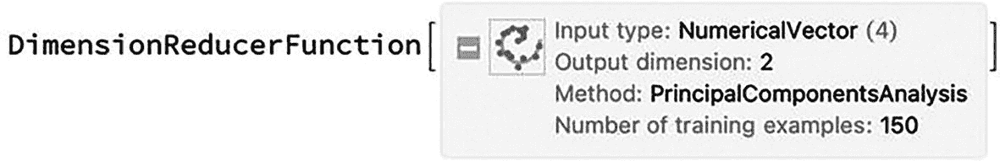

一个维度缩减函数读取器，左方括号，输入类型 = 4 维数值向量，输出维度 = 2，方法 = 主成分分析，训练样本数 = 150，右方括号。

图 8-33

`DimensionReductionFunction` 对象

```
In[109]:= dR=DimensionReduction[sT,2,Method->"PrincipalComponentsAnalysis"]
Out[109]=
```

该函数的属性包括 `"ReducedVectors"`（缩减向量列表）、`"OriginalData"`（根据缩减向量推导出的原始数据列表）、`"ReconstructedData"`（通过缩减和反转进行的数据重建）以及 `"ImputedData"`（用插补值替换缺失值）。你调用标准化数据值函数，并显示前五个值。坐标 `x` 和 `y` 分别对应主成分 1 和主成分 2。

```
In[110]:= pCA=dR[sT,"ReducedVectors"]; TableForm[%[[1;;5]],TableHeadings->{None, {"First principal component","Second Principal component"}},TableAlignments->Center]
Out[111]//TableForm= First principal component    Second Principal component
2.2647    -0.480027
2.08096    0.674134
2.36423    0.341908
2.29938    0.597395
2.38984   -0.646835
```

这将计算每个成分的方差，然后计算总方差，以找出解释的方差比例。`PC1` 代表了 76% 的数据离散度，`PC2` 代表了 23%。要获得累积百分比，你需要将每个成分的变异相加。要更深入地了解变异比例，请参考 G. James、D. Witten、T. Hastie 和 R. Tibshirani 合著的 *An Introduction to Statistical Learning: With Applications in R*（Springer, 2017）。

```
In[112]:= Variance@pCA[[All, All]]/Total@Variance@pCA[[All, All]] //  TableForm[#,    TableHeadings -> {{"First PC variation", "Second PC variation"}, None}] &
Out[112]//TableForm=
First PC variation    | 0.761507
Second PC variation   | 0.238493
```

你查看由上述过程生成的主成分图（见图 8-34）。如果你查看 `ExampleData` 中的完整鸢尾花数据，前 50 个元素对应 setosa 物种，接下来的 50 个对应 versicolor，最后 50 个对应 virginica。

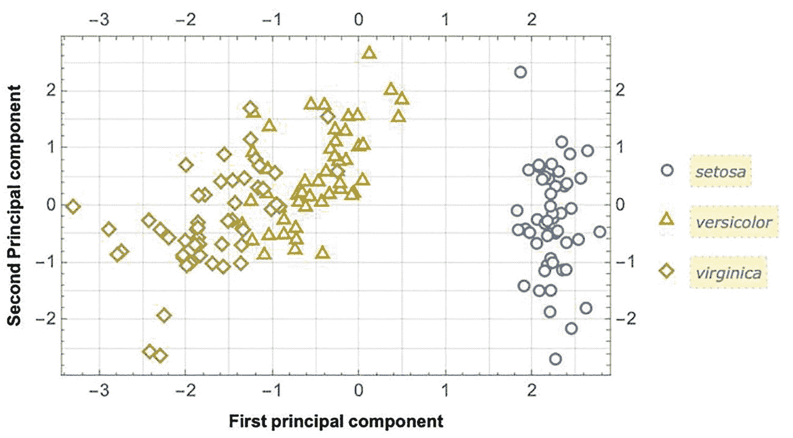

一个第二主成分相对于第一主成分的散点图，显示 setosa 用圆形绘制在右侧，versicolor 用三角形绘制在中间，virginica 用菱形绘制在左侧。

图 8-34

两个主成分的散点图

```
In[113]:= labels={Style["First principal component", Black, Bold],Style["Second Principal component",Black,Bold]};ListPlot[{pCA[[1 ;; 50]], pCA[[51 ;; 100]], pCA[[100 ;; 150]]},PlotLegends->Placed[{Placeholder["setosa"], Placeholder["versicolor"], Placeholder["virginica"]}, Right], PlotMarkers -> "OpenMarkers",  GridLines -> All, Frame -> True, Axes -> False, FrameTicks -> All,  FrameLabel -> labels]
Out[114]=
```

### 应用 K-Means

现在，让我们使用曼哈顿距离通过 k-means 寻找聚类。通过指定寻找三个聚类，你假设数据可以被分成三个聚类。你知道原始数据属于三个物种（setosa、versicolor 和 virginica）。聚类图如下所示（见图 8-35），并标出了各自的质心。选择 k-means 方法时，可以添加子选项，例如 `InitialCentroids`。可以输入自定义的起始质心（一个质心坐标列表），或者你也可以保留自动选项。要输入质心坐标，请使用以下形式 `Method -> {"KMeans", "InitialCentroids" -> {{x1, y1}, {x2, y2}, {x3, y3} ...}}`，其中 `x1`、`y1` 代表 `C1`（聚类 1）的质心。为了保持一定的随机性，没有向 `FindClusters` 命令提供初始质心。

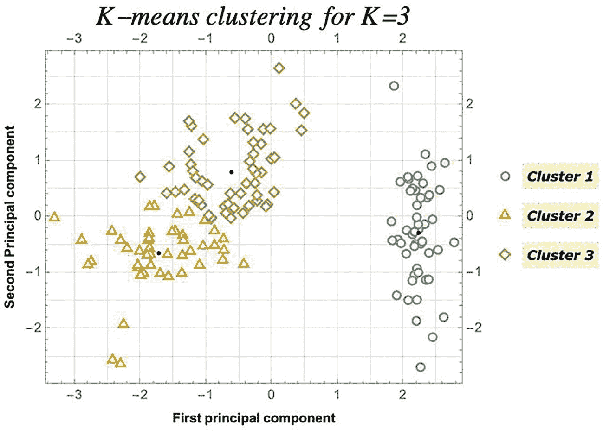

一张第二主成分相对于第一主成分的散点图，标题为 K=3 的 K-means 聚类。图中圆圈表示聚类 1，绘制在右侧；三角形表示聚类 2，绘制在左下方；菱形表示聚类 3，绘制在左上方。

**图 8-35**
识别出的两个主成分的 3 个聚类

```
In[115]:= clstr = FindClusters[pCA, 3, Method -> "KMeans",    DistanceFunction -> SquaredEuclideanDistance,    RandomSeeding -> 8888];ListPlot[clstr, PlotRange -> All, Frame -> True, AspectRatio -> 0.8,  Axes -> False,  PlotStyle -> {ColorData[97, 1], ColorData[97, 2], ColorData[97, 3]},  PlotLabel ->   Style["K-means clustering for K=3", FontFamily -> "Times", Black,    20, Italic], FrameTicks -> All,  PlotLegends ->   Placed[{Placeholder[Style["Cluster 1", Bold, Black, 10]],     Placeholder[Style["Cluster 2", Bold, Black, 10]],     Placeholder[Style["Cluster 3", Bold, Black, 10]]}, Right],  PlotMarkers -> "OpenMarkers", FrameLabel -> labels, GridLines -> All,  Epilog -> {Opacity[1], PointSize[0.01], Point[Mean@clstr[[1, All]]],    Point[Mean@clstr[[2, All]]], Point[Mean@clstr[[3, All]]]}]
Out[115]=
```

在图 8-35 中，该方法将左侧的点识别为单个聚类（setosa 物种），而聚类 2 和聚类 3 之间的某些点可能被错误分类。

### 更改距离函数

更改 `DistanceFunction` 可以修改聚类的排列方式；以下代码展示了 k=3 并选择不同距离函数时的图。在下一个代码块中，针对相同的 k（3）使用不同的距离函数计算聚类，并将结果存储到各自的变量中。然后，针对每个不同的距离函数绘制聚类图（见图 8-36），最后将它们显示在一个图形网格中。

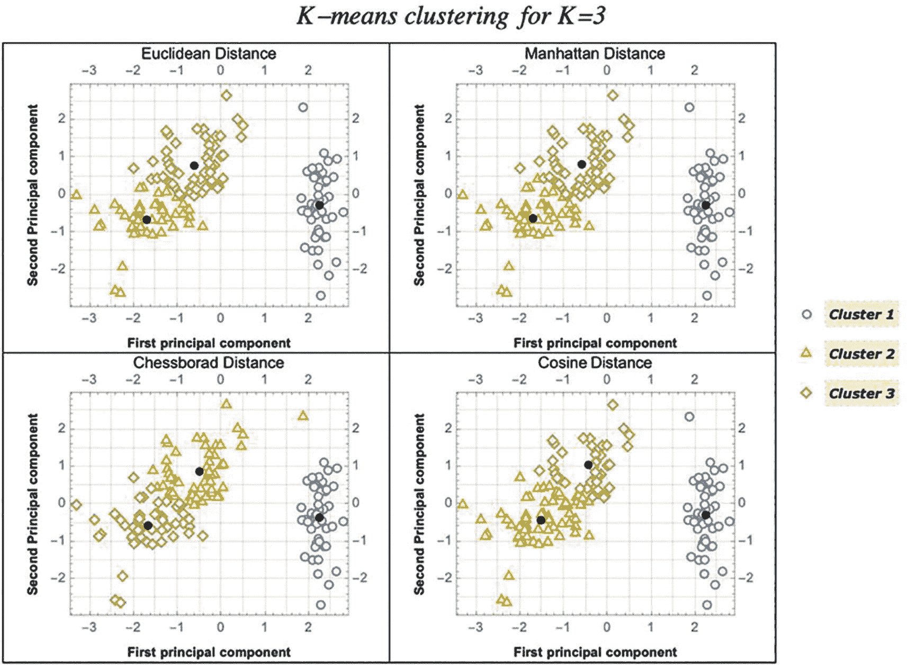

4 张散点图，分别对应欧几里得距离、曼哈顿距离、棋盘距离和余弦距离。这些第二主成分相对于第一主成分的图中，圆圈表示聚类 1，三角形表示聚类 2，菱形表示聚类 3。每个聚类中心有一个深色阴影点。

**图 8-36**
不同距离函数下 K=3 的 K-means 聚类

```
In[116]:= clusteringPlot[distanceName_, distanceFunction_] :=  Module[{clusters, pltTitles, points},   clusters =    FindClusters[pCA, 3, PerformanceGoal -> "Quality",     Method -> "KMeans", DistanceFunction -> distanceFunction,     RandomSeeding -> 8888];  points = Point[Mean[#]] & /@ clusters;  pltTitles = distanceName;  ListPlot[clusters, Frame -> True, AspectRatio -> 0.8,    PlotMarkers -> "OpenMarkers",    PlotStyle -> {ColorData[97, 1], ColorData[97, 2],      ColorData[97, 3]}, GridLines -> All, PlotRange -> Automatic,    ImageSize -> 300, FrameLabel -> labels, Axes -> False,    FrameTicks -> All, Epilog -> {Opacity@1, PointSize@0.03, points},    PlotLabel -> Style[pltTitles, Black]]]
eDplt = clusteringPlot["Euclidean Distance", EuclideanDistance];
mhDplt = clusteringPlot["Manhattan Distance", ManhattanDistance];
chDplt = clusteringPlot["Chessboard Distance", ChessboardDistance];
cosDplt = clusteringPlot["Cosine Distance", CosineDistance];
legendsText = {Placeholder[Style["Cluster 1", Bold, Black, 10]],    Placeholder[Style["Cluster 2", Bold, Black, 10]], Placeholder[Style["Cluster 3", Bold, Black, 10]]};Labeled[Legended[  GraphicsGrid[{{eDplt, mhDplt}, {chDplt, cosDplt}},Frame->All,Background->White,Spacings->1], PointLegend[{ColorData[97,1], ColorData[97,2], ColorData[97,3]}, legendsText, LegendMarkers -> "OpenMarkers"]],  Style["K-means clustering for K=3", FontFamily -> "Times", Black, 20,   Italic], Top]
Out[117]=
```

使用不同的距离函数，聚类可以有不同的排列方式；还需要注意的一点是，每个子图中的聚类质心都会发生变化。

### 不同的 k 值

我们已经看到，对于不同的距离函数，聚类结果可能会有所不同。现在，我们使用不同的 k 值来构建这个过程——即分别取 `k = 2`、`3`、`4` 和 `5`，如图 8-37 所示。

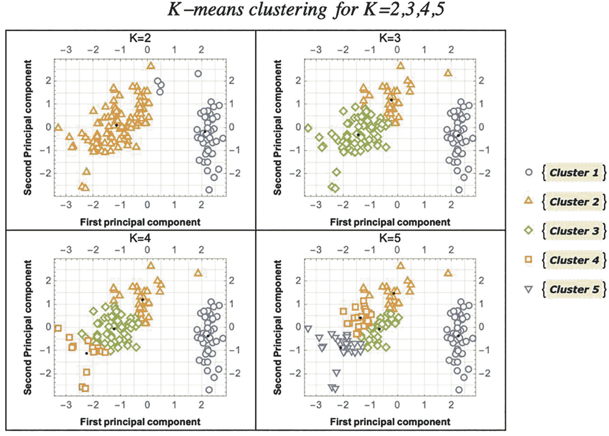

`K = 2` 到 `5` 的四个散点图。第二主成分相对于第一主成分的图用不同的符号表示聚类 1 到 5。`K=2` 有聚类 1 和 2。`K=3` 有聚类 1、2 和 3。`K=4` 有聚类 1、2、3 和 4。`K=5` 包含全部 5 个聚类。

**图 8-37**  
K 从 2 到 5 的 K 均值聚类

```
In[117]:= findKClusters[k_, PCA_] := FindClusters[PCA, k, PerformanceGoal -> "Speed", Method -> "KMeans",DistanceFunction -> SquaredEuclideanDistance, RandomSeeding -> 8888];
plotKClusters[k_, clusters_] := ListPlot[clusters, Frame -> True, AspectRatio -> 0.8, PlotMarkers -> "OpenMarkers", PlotStyle -> ColorData[97, "ColorList"][[;; k]], GridLines -> All, PlotRange -> Automatic, ImageSize -> 260, FrameLabel -> labels, Axes -> False, FrameTicks -> All, Epilog -> {Opacity@1, PointSize@0.015, Point[Mean /@ clusters]}, PlotLabel -> Style["K="  ToString[k], Black]];
kValues = {2, 3, 4, 5};
kClusters = findKClusters[#, pCA] & /@ kValues;
kPlots = plotKClusters[#, kClusters[[#2]]] & @@@ Transpose[{kValues, Range@Length@kValues}];
legendsText2 = {Placeholder[Style["Cluster "  ToString[#], Bold, Black, 10]]} & /@ Range@5;
Labeled[Legended[  GraphicsGrid[Partition[kPlots, 2], Frame -> All,    Background -> White, Spacings -> 1],   PointLegend[ColorData[97, "ColorList"][[;; 5]], legendsText2,    LegendMarkers -> "OpenMarkers"]],  Style["K-means clustering for K=2,3,4,5", FontFamily -> "Times",   Black, 20, Italic], Top]
Out[120]=
```

聚类的排列也取决于 k 的数量。结合使用 `ClusteringComponents`，你可以统计出 `k = 3` 时注册的标签数量。

```
In[120]:= ClusteringComponents[clstr,3,2,Method->"KMeans",DistanceFunction->SquaredEuclideanDistance,RandomSeeding->8888]
Counts[Flatten[%]]
Out[121]={{1,1,1,1,1,1,1,1,1,1,1,1,1,1,1,1,1,1,1,1,1,1,1,1,1,1,1,1,1,1,1,1,1,1,1,1,1,1,1,1,1,1,1,1,1,1,1,1,1,1},{2,2,2,2,2,2,2,2,2,2,2,2,2,2,2,2,2,2,2,2,2,2,2,2,2,2,2,2,2,2,2,2,2,2,2,2,2,2,2,2,2,2,2,2,2},{3,3,3,3,2,3,3,3,3,3,3,3,3,3,3,3,3,3,3,3,3,3,3,3,3,3,3,3,3,3,3,3,3,3,3,3,3,3,3,3,3,2,2,3,2,3,3,3,3,3,3,2,3,3,2}}
Out[122]= 50,2->51,3->49|>
```

对于给定的聚类问题，k-means 技术旨在用于未标记的数据——即没有定义类别的数据。可能改变该方法运行方式的一些因素包括：

*   **离散程度**，即点之间的分散程度。这体现在数据是否包含异常值或是否处于不同量纲，当视觉上观察到相反情况时，这些点可能被错误地归类为某个聚类的一部分。
*   **数据的维度**。由于模型中通常会添加更多的信息和特征，维度数量会增长，导致“维度灾难”。这类问题可以使用数据转换方法来解决，例如从 PCA 中看到的例子，但存在一些限制，因为 PCA 方法可能会丢失特征中的敏感信息。
*   `k` 的值是手动确定的，但当成本函数值较高时，可以解释为聚类内变异较大。当成本函数值较低时，聚类内变异较小。最后两个假设也可以归因于：对于较小的 `k` 值，许多观测值可能被分组到大的单个聚类中；对于较大的 `k` 值，观测值可以形成合适的组。

### 聚类分类

另一个属于聚类函数的命令是 `ClusterClassify`（见图 8-38）。此命令的工作方式与 `Classify` 相同。以下示例使用此命令来查看 k-means 聚类如何根据花萼长度和花萼宽度对物种进行分类。在随机抽样时将数据分成两半。

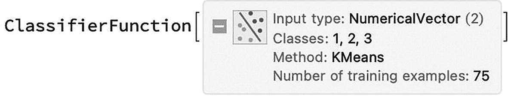

一个分类器函数显示：输入类型 = 2 维数值向量，类别 = 1、2、3，方法 = K-Means，训练样本数 = 75。

**图 8-38**  
聚类分类模型的分类器函数

```
In[122]:= BlockRandom[
SeedRandom[88888];
RandomSample[iris[[All,{1,2}]]];]
trainingSet=%[[1;;75]];
testSet=%%[[76;;150]];
In[123]:= cC=ClusterClassify[trainigSet,3,Method->"KMeans", DistanceFunction->Automatic,PerformanceGoal->"Speed",RandomSeeding->8888 ]
Out[123]=
```

图 8-38 显示了聚类分类模型的详细信息。输入向量是一个数值向量，类别数量（三个）、方法以及训练样本数。

**注意**

要正确使用 k-means 方法，需要指定聚类数量；否则，该命令无法正确执行。

使用 `Information` 命令查看分类器信息（见图 8-39）。

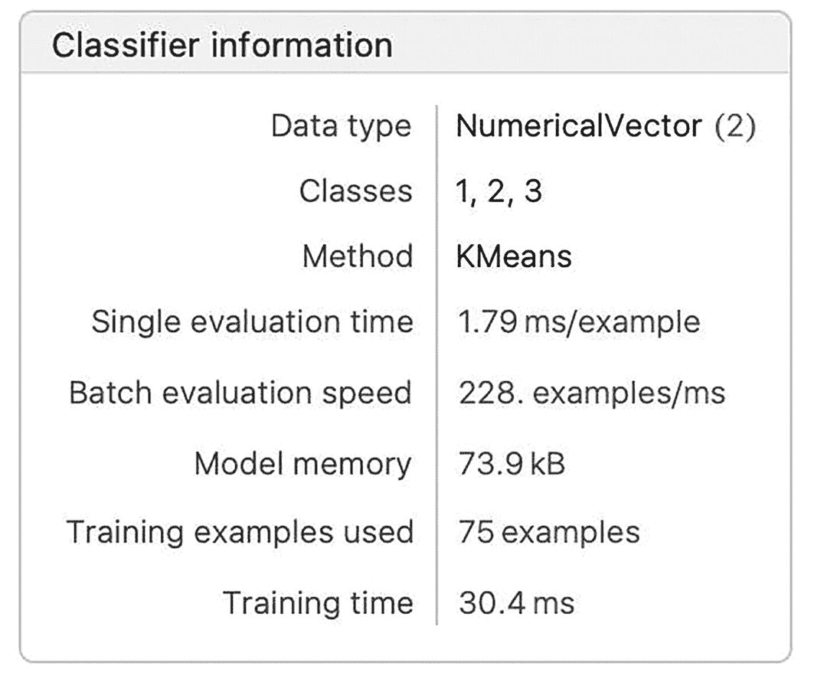

一个分类器信息数据集显示：数据类型 = 2 维数值向量，类别 = 1、2、3，方法 = K Means，单次评估时间 = 每样本 1.79，批处理评估速度 = 228，模型内存 = 73.9 KB，使用的训练样本 = 75 个，训练时间 = 30.4 毫秒。

**图 8-39**  
k-means 的分类器信息

```
In[124]:= Information[cC]
Out[124]=
```

关于分类器函数的更详细信息如图 8-39 所示。要获取完整的属性列表，请将 `"Properties"` 作为第二个参数输入。许多指标，例如 `BatchEvaluationSpeed`、`BatchEvaluationTime` 和 `TrainingTime`，可以比较不同方法的时间。

```
In[125]:= Information[cC,"Properties"]
Out[125]={AcceptanceThreshold,AnomalyDetector,BatchEvaluationSpeed,BatchEvaluationTime,Calibrated,Classes,ClassNumber,ClassPriors,DistanceFunction,EvaluationTime,ExampleNumber,FeatureExtractor,FeatureNames,FeatureNumber,FeatureTypes,FunctionMemory,FunctionProperties,IndeterminateThreshold,LearningCurve,MaxTrainingMemory,Method,MethodDescription,MethodOption,MethodParameters,MissingSynthesizer,PerformanceGoal,Properties,TrainingClassPriors,TrainingTime,UtilityFunction}
```

现在，让我们获取关于从聚类分类器识别出的类别、类别数量、距离函数、特征名称以及训练类别概率的信息。

```
In[126]:=Information[cC,#]&/@{"Classes","ClassNumber","DistanceFunction","FeatureNames","TrainingClassPriors"}
Out[126]= {{1,2,3},3,EuclideanDistance,{f1},0.333333,2->0.293333,3->0.373333|>}
```

共有三个类别：类别 1、类别 2 和类别 3。使用的距离函数是 `EuclideanDistance`，名称 `f1` 指的是数值向量特征。通过选择花萼长度为 1 和花萼宽度为 2 来选择一个简单示例，以展示在测试数据时可以使用的不同属性，结果以数据集形式显示（见图 8-40）。首先写出示例，然后是属性 `Decision`（示例所属的聚类）、`Distribution`（用于直方图绘制的分类分布对象）、`ExpectedUtilities`（期望概率和不确定阈值）、`LogProbabilities`（对数概率）、`Probabilities`（基于类别的测试数据概率）和 `TopProbabilities`（测试数据的最佳概率）。

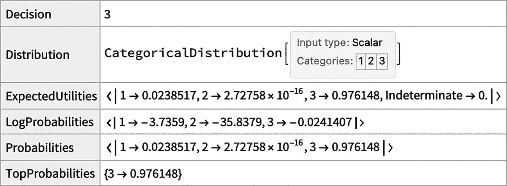

## 数据集与聚类示例

一个数据集有 6 行和 2 列。第 1 列的标题是`decision`、`distribution`、`expected utilities`、`log probabilities`、`probabilities`和`top probabilities`。第 2 列包含每个标题对应的值。

**图 8-40**

简单鸢尾花示例的数据集

```
In[127]:=Dataset[AssociationMap[cC[{1,2},#]&,{"Decision","Distribution","ExpectedUtilities","LogProbabilities","Probabilities","TopProbabilities"}]]
Out[127]=
```

该示例属于第三个聚类，且关联的概率为`3 → 0.976148`。查看其余数据并绘制聚类分类图。分类数据图如图 8-41 所示。

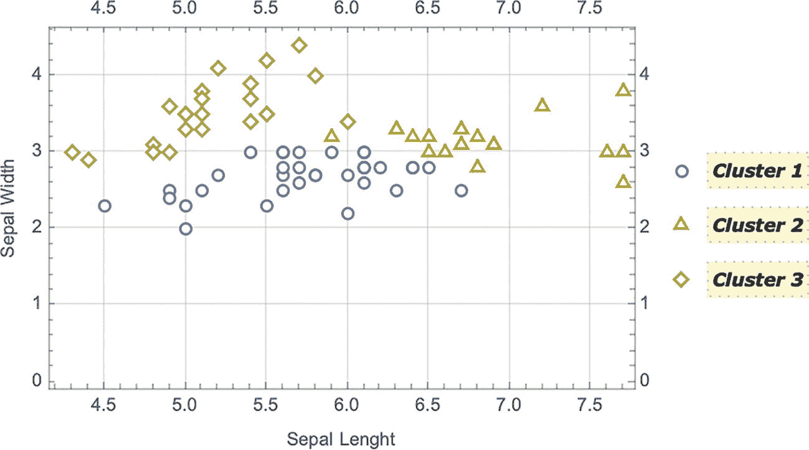

一张花萼宽度与花萼长度的散点图，底部圆圈表示聚类 1，右上角三角形表示聚类 2，左上角菱形表示聚类 3。

**图 8-41**

基于前两个特征的鸢尾花数据聚类分类

```
In[128]:= ListPlot[Pick[testSet,cC[testSet],#]&/@{1,2,3},PlotMarkers->"OpenMarkers",GridLines->Automatic,PlotLegends->{Placeholder[Style["Cluster 1",Bold,Black,10]],Placeholder[Style["Cluster 2",Bold,Black,10]],Placeholder[Style["Cluster 3",Bold,Black,10]]},Frame->True,FrameTicks->All,FrameLabel->{"Sepal Lenght","Sepal Width"}]
Out[128]=
```

作为补充，可以使用`IndeterminateThreshold`为低于设定概率值的值添加概率限制，如图 8-42 所示。

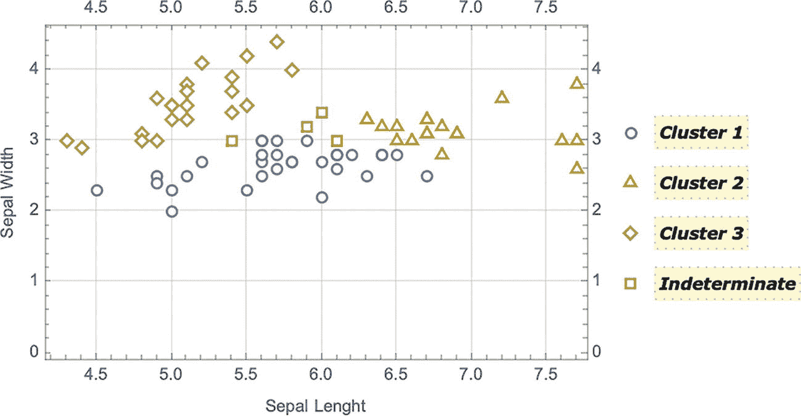

一张花萼宽度与花萼长度的散点图，底部圆圈表示聚类 1，右上角三角形表示聚类 2，左上角菱形表示聚类 3，中间方块表示中间值。

**图 8-42**

基于前两个特征并带有概率限制的鸢尾花数据聚类分类

```
In[129]:= ListPlot[Pick[testSet,CC[testSet,IndeterminateThreshold-> 0.6],#]&/@{1,2,3,Indeterminate},PlotMarkers-> "OpenMarkers",PlotLegends->{Placeholder[Style["Cluster 1",Bold,Black,10]],Placeholder[Style["Cluster 2",Bold,Black,10]],Placeholder[Style["Cluster 3",Bold,Black,10]],Placeholder[Style["Indeterminate",Bold,Black,10]]},Frame->True,FrameTicks->All,FrameLabel->{"Sepal Lenght","Sepal Width"},GridLines->Automatic]
Out[129]=
```

## 总结

本章第一部分讨论了机器学习、梯度下降算法及其全面实现。然后，通过探索波士顿数据集以及创建、测量和优化所创建模型的指南，介绍了线性回归模型。这一过程同样应用于逻辑回归，但使用的是泰坦尼克数据集。在本章结尾，您学习了数据聚类和 k-means 聚类。