# 9. 使用 Wolfram 语言的神经网络

本章从 Wolfram 语言中神经网络框架的基础知识开始。首先介绍层的概念、如何为不同层使用命令以及最常见的层。您将学习如何通过`net port`将数据输入层，以及层的不同等效表达形式。接着，通过区分不同层的符号来识别它们。您将看到层可以具有多个选项，使其能够通过查看 Wolfram 语言方案中的层概念、比较不同用途的层以及执行不同计算来实现各种规格。您还可以通过查看 Wolfram 语言支持的各种激活函数，并检查每个函数的图形以及不同的语法形式来实现这一点。接下来，您将学习编码器和解码器，以及如何使用这些工具根据要完成的任务构建神经网络模型。然后，您将学习如何使用这些编码器和解码器将不同的数据类型转换为数值数组，以及如何将数值数组转换回初始数据。您将介绍容器的概念、它对所创建模型的意义以及存在的类型。您将看到如何使用不同的命令处理和构建容器，并以图形方式可视化所创建的模型。您将了解 Wolfram 神经网络框架如何支持与 MXNet 相关的操作，以及如何将网络导出为 MXNet 操作的格式。

## 层

有必要理解，神经网络（无论是通用的还是在 Wolfram 语言中）都是由层构建的。层是一个术语，可以应用于在神经网络内特定级别上共同运作的一组节点。层是构建神经网络的基本且直接的成员。

### 输入数据

层处理的数据是数值类型，而非其他类型。输入变量可以是向量（一维列表）、矩阵（二维列表）、数组（列表的列表）或任何其他数值张量。这些输入变量可以是研究数据集的特征或属性，具有已知或多维的形状。这些类型的输入属性与输入层相关联，输入层的特征大小必须等于层的输入大小，但并非每个层都接收相同的输入并返回相同的输出；每个输入根据要使用的层类型而变化。这是神经网络中最基本的概念之一，因为它们是涉及“神经网络”这一术语的整个结构的关键组成部分。这里需要区分`input`和`input layer`，因为它们含义不同。

### 线性层

线性层是神经网络中最常见且使用最广泛的层。要在 Wolfram 语言中构建最简单的层，请使用`LinearLayer`命令。

```
In[1]:= LinearLayer["Input"->1,"Output"->2]
Out[1]=
```

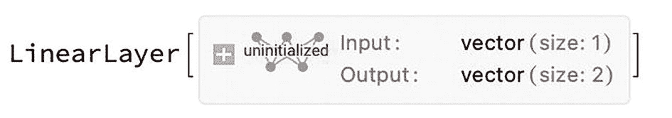

未初始化的线性层截图，输入和输出数据分别为大小为 1 和 2 的向量。

**图 9-1**

`LinearLayer`对象

图 9-1 展示了 Wolfram 语言中的`LinearLayer`对象。单击加号图标可显示内部参数，包括层端口的输入和输出详情，以及线性层的权重和偏置的数组秩，如图 9-2 所示。

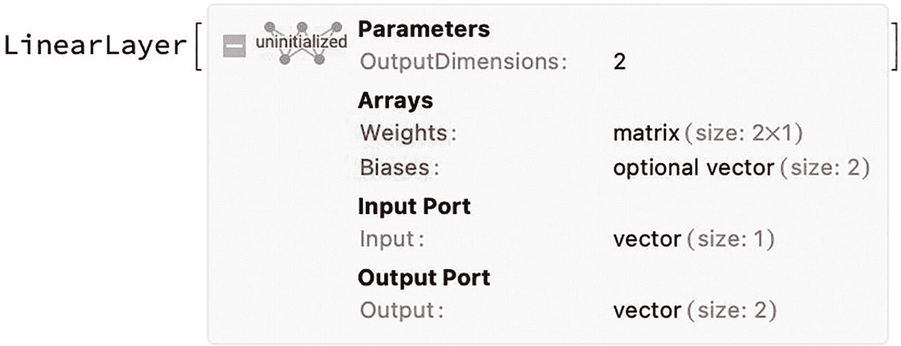

未初始化的线性层截图，显示了参数、数组、输入端口和输出端口数据，分别对应输出维度、权重和偏置、输入和输出。它们包括矩阵、可选向量和向量大小。

**图 9-2**

展开的`LinearLayer`对象

每个层都有一个输入端口和一个输出端口。每个端口都有一个关联的大小，表示进入层和从层输出的内容。在后者的情况下，一个大小为 1 的向量进入，层返回一个大小为 2 的向量。


### 权重与偏置

线性层的一般形式由点积表达式 `**w**·**x + b**` 给出，其中 `**x**` 是数据向量，`**w**` 代表权重矩阵，`**b**` 是偏置向量。线性层还有其他关联名称，例如在 `MXnet` 框架中被称为全连接层。在 Wolfram 语言中，层的输入接收数值张量——也就是说，它们仅作用于数值数组。要明确指定输入和输出的大小，你需要编写输入端口和输出端口的形式，后跟不同的选项：`“Input”` 或 `“Output” → {size, Options.}`。选项包括定义一个实数（`Real`）、一个形式为 `n` 的向量（单个数字 `n`）、一个数组（`{n1 * n2 * n3} ...`），或者一个 `NetEncoder`（你将在后面看到）。以下是一些编写层的等效方法，如图 9-3 所示。

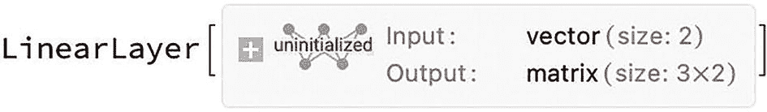

一个未初始化的线性层截图，其输入和输出数据分别为向量和矩阵，大小分别为 2 和 3×2。

图 9-3

具有不同输入和输出秩数组的 `LinearLayer`

```
In[2]:= LinearLayer["Input"->{2,"Real"},"Output"->{3,1}]
Out[2]=
```

如图 9-3 所示，该层接收一个由实数组成的、大小为 2 的向量（长度为 2 的列表），输出是一个形状为 3×2 的矩阵。当在 Wolfram 神经网络框架中指定一个实数时，其精度为 `Real32`。当层未添加任何参数时，输入和输出的形状会被推断出来。要手动分配权重和偏置，请编写 `“Weights” → number`、`“Biases” → number`；也可以使用 `None` 来表示没有权重或偏置。如下例所示，其中权重和偏置被设置为固定值 1 和 2（见图 9-4）。

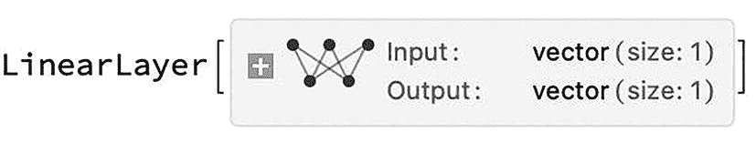

一个线性层的截图，其输入和输出数据均为大小为 1 的向量。

图 9-4

已初始化的线性层，具有固定的偏置和权重

```
In[3]:= LinearLayer["Input"-> 1,"Output"-> 1,"Weights"-> 1,"Biases"-> 2]
Out[3]=
```

### 初始化层

另一个命令允许你使用随机值初始化层：`NetInitialize`。因此，要建立权重或偏置的保持值，你也可以使用 `LearningRateMultipliers` 选项（见图 9-5）。除此之外，`LearningRateMultipliers` 还标记了层在训练阶段的学习速率。

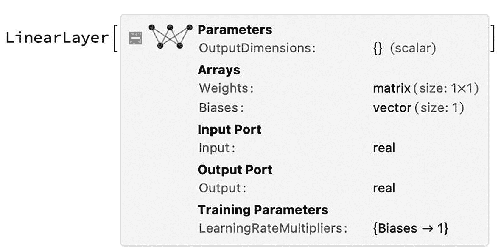

一个线性层的截图，包含参数、数组、输入端口、输出端口以及用于输出维度、权重和偏置、输入、输出和学习率乘数的训练参数数据。它们包括标量、矩阵和向量大小、实数以及偏置 1 数据。

图 9-5

带有训练参数的 `LinearLayer`

```
In[4]:= NetInitialize[LinearLayer["Input"-> "Real","Output"-> "Real",LearningRateMultipliers->{"Biases"->1}]]
Out[4]=
```

当一个层被初始化后，“未初始化”的文本就会消失。如果你观察新层的属性，它们会出现在训练参数中，其中已建立了固定的偏置，并设置了学习率。`NetInitialize` 的选项有 `Method` 和 `RandomSeeding`。可用的方法有 `Kaiming`、`Xavier`、`Orthogonal`（正交权重）和 `Random`（从分布中选择权重）。例如，你可以使用从正态分布采样的 `Xavier` 初始化，如图 9-6 所示。

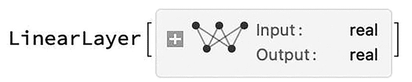

一个线性层的截图，其输入和输出数据均为实数。

图 9-6

使用 `Xavier` 方法初始化的 `LinearLayer`

```
In[5]:= NetInitialize[LinearLayer["Input"-> "Real","Output"-> "Real",LearningRateMultipliers->{"Biases"->1}],Method-> {"Xavier","Distribution"->"Normal"},RandomSeeding->888]
Out[5]=
```

注意

建议使用 `Option` 命令来查看为层设置的选项。

尽管可以手动建立权重和偏置，但建议使用随机值来初始化层，以保持模型整体结构的一定复杂度，因为反之，这可能会影响神经网络的创建，使其无法对非线性行为做出准确预测。

### 检索数据

`NetExtract` 以 `NetExtract [net, {level1, level2, ...}]` 的形式检索权重和偏置的值。线性层的权重和偏置参数被打包在 `NumericArray` 对象中（见图 9-7）。该对象包含层中值的数值、维度和类型。`NetExtract` 也用于提取具有多个层的网络中的层。`NumericArrays` 在 Wolfram 语言中用于减少内存消耗和计算时间。

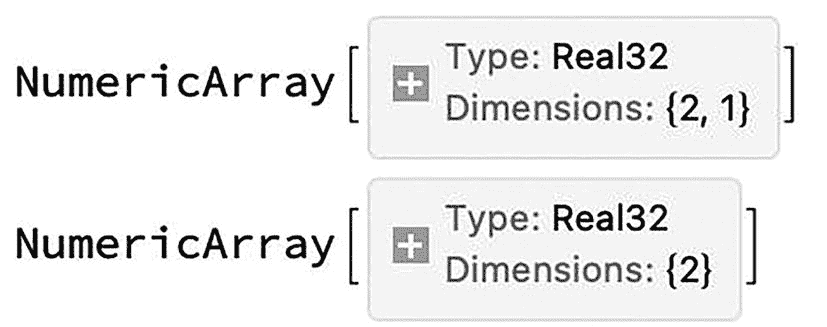

两个数值数组的截图，分别包含类型和维度数据：Real 32 和 2 1，以及 Real 32 和 2。

图 9-7

线性层的权重和偏置

```
In[6]:= linearL=NetInitialize[LinearLayer[2, "Input"-> 1],RandomSeeding->888];
NetExtract[linearL,#]&/@{"Weights","Biases"}//TableForm
Out[7]//TableForm=
```

使用 `Normal`，你可以将它们转换为列表。

```
In[8]:=TableForm[SetPrecision[{{Normal[NetExtract[linearL,"Weights"]]},{Normal[NetExtract[linearL,"Biases"]]}},3],TableHeadings->{{"Weights ->","Biases ->"},None}]
Out[8]//TableForm=
Weights ->    -0.779
0.0435
Biases  ->    0
```

例如，一个层可以接收一个长度为 1 的向量，以产生一个大小为 2 的输出向量。

```
In[9]:= linearL[4]
Out[9]= {-3.11505,0.174007}
```

只有当输入以适当的形状引入时，该层才能被评估。

```
In[10]:= linearL[{88,99}]
During evaluation of In[10]:= LinearLayer::invindata1: Data supplied to port "Input" was a length-2 vector of real numbers, but expected a length-1 vector.
Out[10]= $Failed
```

权重和偏置是模型必须学习的参数，它们可以根据模型接收的输入数据进行调整，这就是为什么它们被随机初始化，因为如果你试图在未初始化的情况下提取这些值，是无法做到的，因为它们尚未被定义。

层具有可微分的属性。这是通过 `NetPortGradient` 实现的，它可以表示网络输出对于某个端口或参数的梯度。例如，对于特定的输入值，给出输出相对于输入的导数。

```
In[11]:= linearL[2,NetPortGradient["Input"]]
Out[11]= {-0.735261}
```


### 均方误差层

到目前为止，你已经了解了具有多种属性的线性层。相比之下，带有相连菱形图标（见图 9-8）的层不包含任何可学习参数，例如 `MeanSquaredLossLayer`、`AppendLayer`、`SummationLayer`、`DotLayer`、`ContrastiveLossLayer` 和 `SoftmaxLayer` 等。

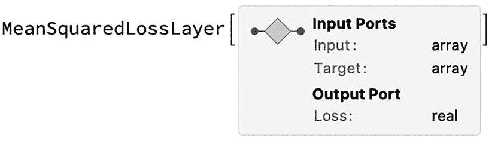

均方误差损失层的截图，显示了输入端口和输出端口的数据：输入、目标以及损失。它们包含数组和实数。

图 9-8

`MeanSquaredLossLayer`

```
In[12]:= MeanSquaredLossLayer[]
Out[12]=
```

`MeanSquaredLossLayer[]` 有多个输入，因为该层计算均方误差损失，其表达式为 `(1/n) ∑ (Input - Target)²`，并且具有比较两个数值数组的属性。使用 `MeanSquaredLossLayer` 时，输入/输出端口的维度以与线性层相同的形式输入，而输入和目标值则以 `Associations` 形式输入。

```
In[13]:= MeanSquaredLossLayer["Input"->{3, 2},"Target" -> {3, 2}][ Association["Input" -> {{1, 2}, {2, 1}, {3, 2}},  "Target" -> {{2, 2}, {1, 1}, {1, 3}}]]
Out[13]= 1.16667
```

后一个示例计算了一个输入/输出维度为三行两列的 `MeanSquaredLossLayer`，或者通过先定义该层，然后将该层应用于数据。

注意

使用 `Matrixform[{{1, 2}, {2, 1}, {3, 2}}]` 命令来验证数据的矩阵形状。

```
In[14]:= lossLayer=MeanSquaredLossLayer["Input"->{3,2},"Target"->{3,2} ];
lossLayer@{{1,2},{2,1},{3,2}},"Target"->{{2,2},{1,1},{1,3}}|>
Out[15]= 1.16667
```

要获取关于某个层的更多详细信息（见图 9-9），请使用 `Information` 命令。

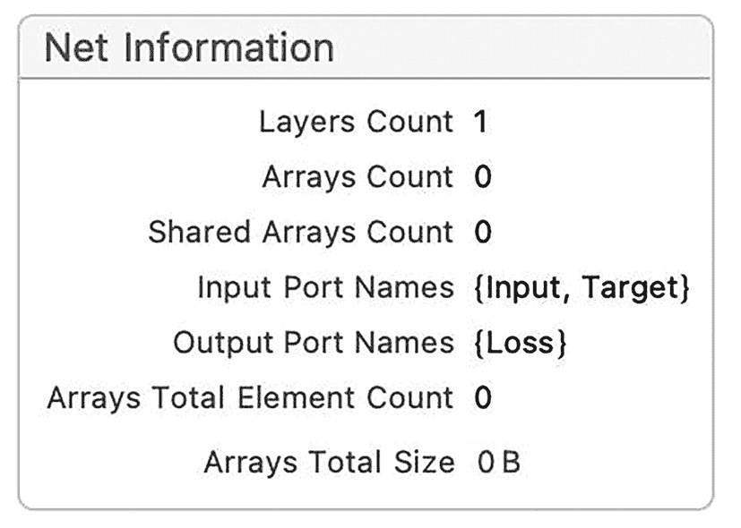

网络信息窗口的截图。它包含层数、数组数、共享数组数、输入端口名称、输出端口名称、数组总元素数和数组总大小的数据。

图 9-9

关于损失层的信息

要了解层的选项，请使用以下命令。

```
In[16]:= Information[lossLayer]
Out[16]=
```

要了解层的选项，请使用以下命令。

```
In[17]:= MeanSquaredLossLayer["Input"->"Real","Target"->"Real"]//Options
Out[17]= {BatchSize->Automatic,NetEvaluationMode->Test,RandomSeeding-> Automatic,TargetDevice->CPU,WorkingPrecision->Real32}
```

输入端口和目标端口的选项与线性层类似，但形式不同：`Input → Real`、`n`（向量 `n` 的一种形式）、`{n1 × n2 × n3}` ...（`n` 维数组）、`Varying`（向量或可变形式）或 `NetEncoder`，但输入和目标必须具有完全相同的维度。图 9-10 展示了几种形式的层。

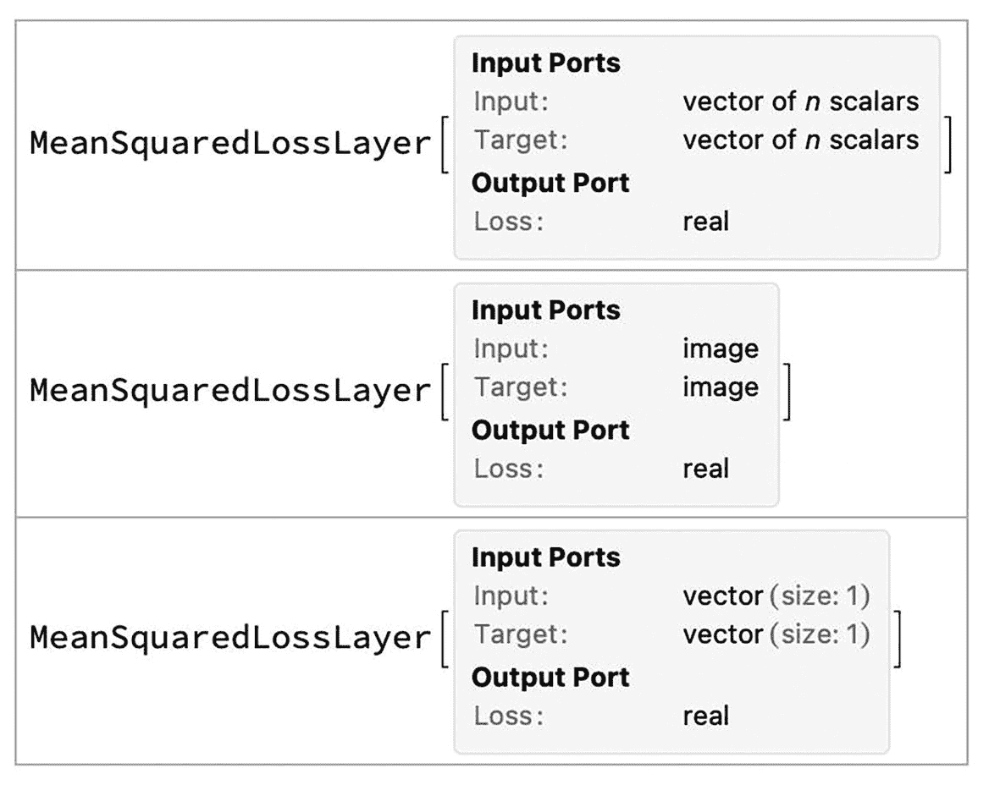

三个均方误差损失层的截图，显示了输入端口和输出端口的数据：输入、目标和损失。它们包括 n 个标量的向量和实数、图像和实数，以及向量大小为 1 和实数数据。

图 9-10

具有不同输入和目标形式的损失层

```
In[18]:= {MeanSquaredLossLayer["Input"->"Varying","Target"->"Varying"], MeanSquaredLossLayer["Input"-> NetEncoder["Image"],"Target"-> NetEncoder["Image"]],MeanSquaredLossLayer["Input"->1,"Target"->1]}//Dataset
Out[18]=
```

## 激活函数

激活函数是构建神经网络的关键部分。激活函数的作用是，给定一个输入，从一个既定范围内返回一个输出。在 Wolfram 语言中，激活函数被视为层。在 Wolfram 语言神经网络框架中，常用于定义激活函数的层是 `ElementwiseLayer`。使用该层，你可以表示能够对输入数据元素应用一元函数（即只接收一个参数的函数）的层。这些函数也称为激活函数。例如，最常用的函数之一是双曲正切函数（`Tanh[x]`），如图 9-11 所示。

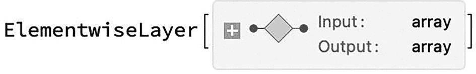

元素级层的截图，显示了输入和输出数据为数组。

图 9-11

`Tanh[x]` 函数层

```
In[19]:= ElementwiseLayer[Tanh[#]&](* 另一种形式 ElementwiseLayer[Tanh]*)
Out[19]=
```

`ElementwiseLayer` 没有可学习参数。使用纯函数是因为层不能接收符号。如果点击加号图标，将显示关于端口和参数以及关联函数 `Tanh` 的详细信息。定义了一个 `ElementwiseLayer` 后，它可以像其他层一样接收值。

```
In[20]:= ElementwiseLayer[Tanh[#]&];
Table[%[i],{i,-5,5}]
Out[21]= {-0.999909,-0.999329,-0.995055,-0.964028,-0.761594,0.,0.761594,0.964028,0.995055,0.999329,0.999909}
```

当没有指定输入或输出形状时，该层会推断其接收或返回的数据类型。例如，仅指定输入为实数，Mathematica 会推断输出也为实数（见图 9-12）。

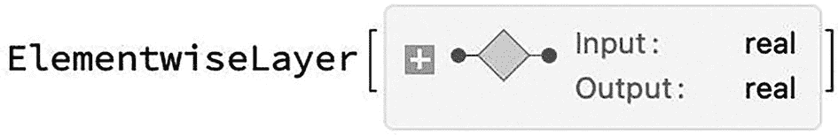

元素级层的截图，显示了输入和输出数据为实数。

图 9-12

输出与输入相同的 `ElementwiseLayer`

```
In[22]:= tanhLayer=ElementwiseLayer[Tanh,"Input"-> "Real"]
Out[22]=
```

或者，对于修正线性单元（ReLU），可以通过仅输入输出来推断（见图 9-13）。

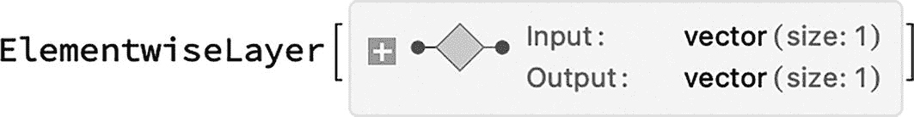

元素级层的截图，显示了输入和输出数据为向量大小 1。

图 9-13

斜坡函数或 ReLU

```
In[23]:= rampLayer=ElementwiseLayerRamp,"Output"-> {1}
Out[23]=
```

注意

点击加号图标会显示元素级层的既定函数和层端口的详细信息。

Wolfram 语言中的每个层都可以通过指定 `TargetDevice` 选项，在图形处理器（GPU）或中央处理器（CPU）上运行。确保你的计算机支持指定的功能至关重要，因此如果你没有 GPU，则强制目标设备为 CPU。例如，在 CPU 上使用 `TargetDevice` 绘制之前创建的层（见图 9-14）。

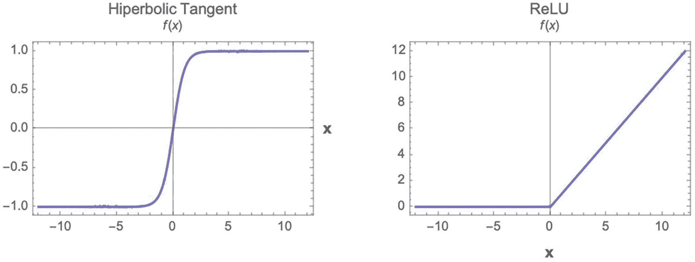

双曲正切 f(x) 和 ReLU f(x) 的两个图形。双曲正切图绘制了一条 S 形曲线。ReLU 图绘制了一条起始呈线性趋势的上升斜线。

图 9-14

`Tanh[x]` 和 `Ramp[x]` 激活函数

```
In[24]:= GraphicsRow@{Plot[tanhLayer[x, TargetDevice -> "CPU"], {x, -12, 12}, PlotLabel -> "双曲正切", AxesLabel -> {Style["x", Bold, 12], Style["f(x)", Italic]}, PlotStyle -> ColorData[97, 25], Frame -> True], Plot[rampLayer[x, TargetDevice -> "CPU"], {x, -12, 12}, PlotLabel -> "ReLU",AxesLabel -> {None, Style["f(x)", Italic]},FrameLabel -> {{None, None}, {Style["x", Bold, 12], None}}, PlotStyle -> ColorData[97, 25], Frame -> True]}
Out[24]=
```


## 其他函数

其他函数可以通过其名称或 Wolfram Language 语法来使用——例如，`SoftPlus`函数，如图 9-15 所示。

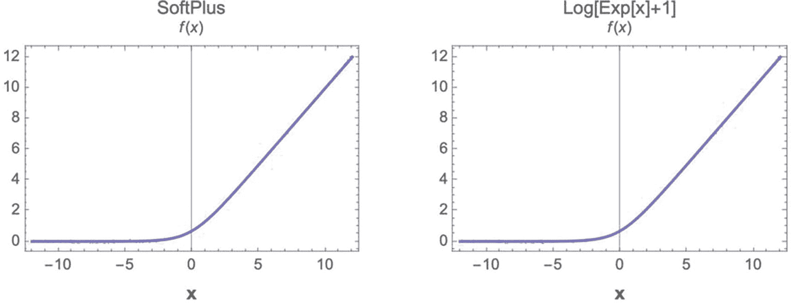

2 graphs of soft plus f of x and Log E x p x + 1 f of x. Both graphs plot concave up, increasing curves.

**图 9-15**  
由关联名称和纯函数生成的`SoftPlus`函数

```
In[25]:= GraphicsRow@{Plot[ElementwiseLayer["SoftPlus"][x, TargetDevice -> "CPU"], {x, -12, 12}, PlotLabel -> "SoftPlus", AxesLabel -> {None, Style["f(x)", Italic]},FrameLabel -> {{None, None}, {Style["x", Bold, 12], None}}, PlotStyle -> ColorData[97, 25], Frame -> True], Plot[Log[Exp[x] + 1], {x, -12, 12}, PlotLabel -> "Log[Exp[x]+1]", AxesLabel -> {None, Style["f(x)", Italic]}, FrameLabel -> {{None, None}, {Style["x", Bold, 12], None}}, PlotStyle -> ColorData[97, 25], Frame -> True]}
Out[25]=
```

其他标准函数显示在接下来的图中，例如缩放指数线性单元（`ScaledExponentialLinearUnit`）、`Sigmoid`、`HardSigmoid`和`HardTanh`（参见图 9-16）。要查看支持的函数，请访问文档并在搜索框中输入`ElementwiseLayer`。

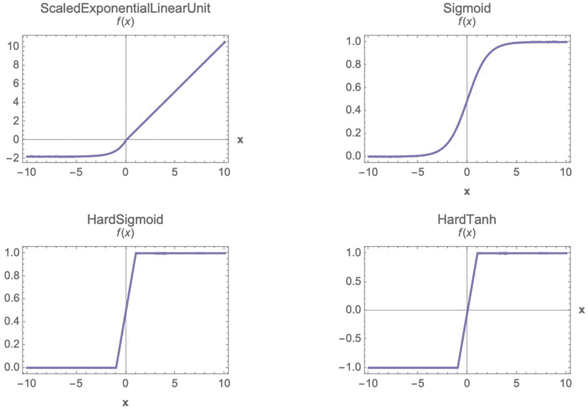

4 graphs of scale exponential linear unit, sigmoid, hard sigmoid, and hard tan h. The scale exponential graph plots an upward slope with a linear trend at the beginning. The sigmoid, hard sigmoid, and hard tan h graphs plot S-shaped curves.

**图 9-16**  
四种不同激活函数的绘图

```
In[26]:= GraphicsGrid@Partition[Table[If[Or[activation == "Sigmoid", activation == "HardSigmoid"], Plot[ElementwiseLayer[activation][x, TargetDevice -> "CPU"], {x, -10, 10}, FrameLabel -> {Style["x", Bold], None}, AxesLabel -> {None, Style["f(x)", Italic]}, PlotStyle -> ColorData[97, 25], Frame -> True, PlotLabel -> activation], Plot[ElementwiseLayer[activation][x, TargetDevice -> "CPU"], {x, -10, 10}, AxesLabel -> {Style["x", Bold], Style["f(x)", Italic]}, PlotStyle -> ColorData[97, 25], Frame -> True, PlotLabel -> activation]], {activation, {"ScaledExponentialLinearUnit", "Sigmoid", "HardSigmoid", "HardTanh"}}], 2]
Out[26]=
```

### Softmax 层

`SoftmaxLayer`是一个使用表达式 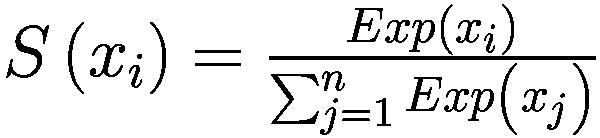 的层，其中`x`表示一个向量，`x[i]`表示向量的分量。该表达式被称为`Softmax`函数。该层的功能是将一个向量转换为一个归一化向量，该向量的值范围在 0 到 1 之间。该层通常用于基于每个类别的概率来表示类别的划分，并用于涉及分类的任务。`SoftmaxLayer`中的输入和输出形式可以像其他常见层一样输入，但`"Real"`形状除外。

```
In[27]:= sFL=SoftmaxLayer["Input"-> 4,"Output"-> 4];
```

现在，可以将该层应用于数据。

```
In[28]:= SetAccuracy[sFL[{9,8,7,6}],3]
Out[28]= {0.64,0.24,0.09,0.03}
```

后者的总和等于 1。`SoftmaxLayer`允许您指定归一化的层级深度，这可以在该层的参数属性中看到。层级`-1`会产生扁平化列表的归一化。此外，`SoftmaxLayer`可以接收多维数组，而不仅仅是扁平化列表。

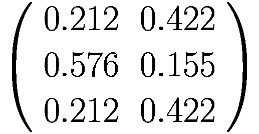

```
In[29]:= SoftmaxLayer[1,"Input"->{3,2}];
SetPrecision[%[{{7,8},{8,7},{7,8}}],3]//MatrixForm
Out[30]//MatrixForm=
```

对第一列的元素求和得到与第二列相同的结果。另一个实用的层叫做`CrossEntropyLossLayer`。该层被广泛用作分类任务的损失函数。这个损失层衡量分类模型的性能。将字符串`"Probabilities"`作为损失层的参数输入，通过比较输入类别概率与目标类别概率来计算交叉熵损失。

```
In[31]:= CrossEntropyLossLayer["Probabilities","Input"->3 ];
```

现在，目标形式被设置为类别的概率；输入和目标的输入方式与`MeansSquaredLoss`相同。

```
In[32]:= %[{0.2,0.5,0.3},"Target"->{0.3,0.5,0.2}|>]
Out[32]= 1.0702
```

当概率构成一个二元选择时，使用层中的`"Binary"`参数。

```
In[33]:= CrossEntropyLossLayer["Binary","Input"-> 1];
%[ 0.1,"Target"-> 0.9|>]
Out[34]= 2.08286
```

总结 Wolfram Language 中层的属性：层的输入和输出始终是标量和数值矩阵。层使用较低的数字精度进行评估，例如单精度数字。层具有可微分的属性；这有助于模型进行高效学习，因为一些学习方法会涉及凸优化问题。Wolfram Language 有许多层，每个层都有特定的功能。要显示 Mathematica 中的所有层，请查看文档或输入`?*Layer`，这将为您提供末尾带有单词`layer`的相关命令。每个层都有不同的行为、操作和参数，尽管有些可能与其他命令相似，例如`Append`和`AppendLayer`。了解不同的层以及它们的功能对于最佳地使用它们非常重要。

### 函数层

另一个最近引入（版本 12.2）并更新（版本 13）的层是`FunctionLayer`。与`ElementwiseLayer`不同，该层允许用户应用文档库中默认不提供的自定义函数。这使其成为更复杂操作的灵活工具，其中要应用的函数由用户决定（参见图 9-17）。

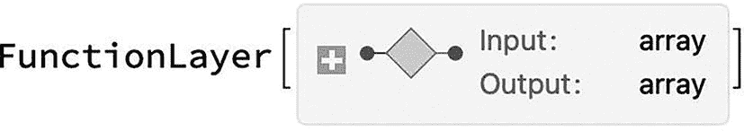

A screenshot of the function layer with input and output data of array.

**图 9-17**  
一个将输入（`#`）乘以 4 的函数层，`&`是纯函数

```
In[35]:= FunctionLayer[#*4&]
Out[35]=
```

输入和输出的定义与您之前看到的层类似。它可以是一个没有形状规范的任意输入数组。然而，输出形状是根据层内使用的函数确定的；例如，在前面的例子中，输入是一个标量（表示为一个单元素数组）并返回一个标量。

```
In[36]:= FunctionLayer[1/(1+Exp[-#])&];
%[{2,-3,4}]
Out[37]= {0.880797,0.0474259,0.982014}
```

使用`FunctionLayer`，也可以使用内置函数而不是用户定义的函数，例如`LogisticSigmoid`函数，它返回与后一段代码相同的结果。

```
In[38]:= FunctionLayer[LogisticSigmoid];
%[{2,-3,4}]
Out[39]= {0.880797,0.0474259,0.982014}
```

`FunctionLayer`和`ElementwiseLayer`之间的一个区别是，在后者中，您可以独立地对每个元素应用一个函数。另一方面，它执行逐元素操作，确保形状一致性。

## 编码器和解码器

假设打算使用音频、图像或其他类型的变量。在这种情况下，这类数据需要被转换为数值数组，以便作为输入引入到层中。这就是编码器和解码器发挥作用的地方。


## 编码器

各层必须在其输入端附加一个 `NetEncoder`，才能正确构建。`NetEncoder` 将图像、音频和数据解释为可在网络模型内部使用的数值。不同的名称对应不同的编码类型。最常见的类型有：`Boolean`（布尔值，真或假，编码为 1 或 0）、`Characters`（字符，将字符串编码为独热向量）、`Class`（类别，将类别标签编码为整数）、`Function`（函数，自定义函数编码）、`Image`（图像，将二维图像编码为秩为 3 的数组）以及 `Image3D`（三维图像，将三维图像编码为秩为 4 的数组）。编码器的参数可以是名称，也可以是名称及其对应的特征（见图 9-18）。

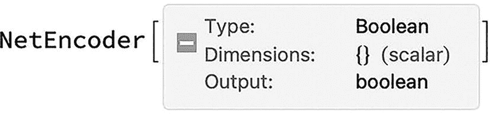

一张网络编码器的截图，分别显示了布尔型、标量型和布尔型的类型、维度和输出数据。

**图 9-18** 布尔类型 `NetEncoder`

要测试编码器，请使用以下代码。

```
In[40]:= NetEncoder["Boolean"]
Out[40]=
```

要测试编码器，请使用以下代码。

```
In[41]:= Print["Booleans:",{%[True],%[False]}]
Out[40]=  Booleans:{1,0}
```

一个 `NetEncoder` 可以包含具有不同索引标签的类别。例如，对于类别 X 和类别 Y 的分类，其对应的索引范围为 1 到 2（见图 9-19）。

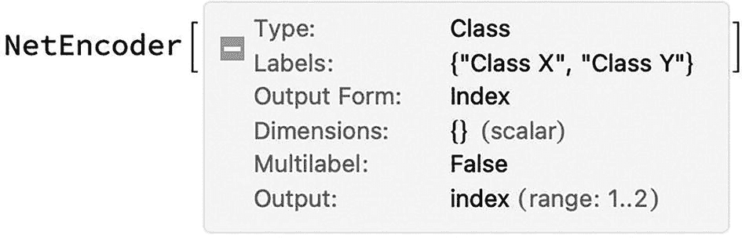

一张网络编码器的截图，显示了类型、标签、输出形式、维度、多标签和输出数据。它们包括：类别、类别 X 和类别 Y、索引、标量、假值，以及范围为 1 到 2 的索引。

**图 9-19** 类别类型 `NetEncoder`

```
In[42]:= NetEncoder[{"Class",{"Class X","Class Y"}}]
Out[42]=
```

```
In[43]:= Print["Classes:", %[Table[RandomChoice[{"Class X", "Class Y"}], {i, 10}]]]
Out[43]= Classes:{1,1,2,2,2,2,2,1,1,1}
```

以下代码用于生成单位向量。

```
In[44]:= NetEncoder[{"Class",{"Class X","Class Y","Class Z"},"UnitVector"}]; Print["Unit Vector:",%[Table[RandomChoice[{"Class X","Class Y","Class Z"}],{i,5}]]] Print["MatrixForm:",%%[Table[RandomChoice[{"Class X","Class Y","Class Z"}],{i,5}]]//MatrixForm[#]&]
Out[47]= Unit Vector:{{0,1,0},{0,1,0},{0,1,0},{1,0,0},{0,0,1}}
MatrixForm:
```

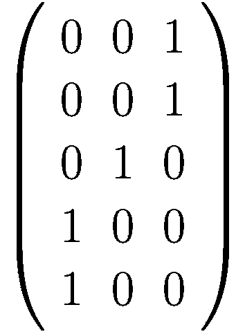

根据 `NetEncoder` 内部使用的名称，与编码器相关的属性可能会有所不同。这体现在所创建的不同编码器对象上。要将 `NetEncoder` 附加到某一层，需要在输入端口输入编码器——例如，对于 `ElementwiseLayer`（逐元素层）（见图 9-20）。在这种情况下，该层的输入端口名称为 `Boolean`；该层会识别出这是一个 `Boolean` 类型的 `NetEncoder`。点击 `Boolean` 名称会显示相关属性。

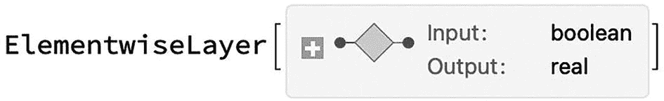

一张逐元素层的截图，其输入和输出数据分别为布尔型和实数型。

**图 9-20** 输入端口附加了编码器的层

```
In[47]:= ElementwiseLayer[Sin,"Input"->NetEncoder["Boolean"]]
Out[47]=
```

对于 `LinearLayer`（线性层），请使用以下形式。

```
In[48]:= LinearLayer["Input"->NetEncoder[{"Class",{"Class X","Class Y"}}], "Output"->"Scalar"]
Out[48]=
```

点击输入端口会显示编码器规格，如图 9-21 所示。

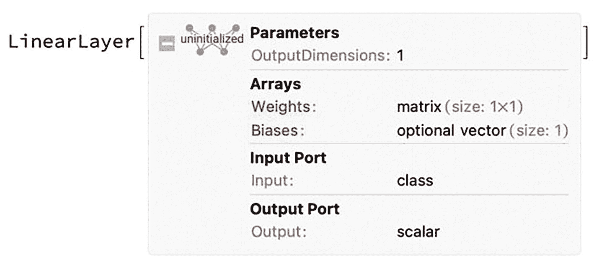

一张未初始化线性层的截图，分别显示了参数、数组、输入端口和输出端口的数据，包括输出维度、权重和偏置、输入和输出。它们包含矩阵和可选向量、类别以及标量数据。

**图 9-21** 附加到 `LinearLayer` 的类别编码器

`NetEncoder` 也用于通过指定类别、输出维度的尺寸（宽度和高度）以及色彩空间，将图像转换为数值矩阵或数组。色彩空间可以是 `Grayscale`（灰度）、`RGB`、`CMYK` 或 `HSB`（色相、饱和度、亮度）；例如，将输入图像编码为 1×28×28 的灰度数组，或 3×28×28 的 RGB 数组（见图 9-22），无论输入图像的原始尺寸如何。数组的第一维代表颜色通道，另外两维代表空间维度。

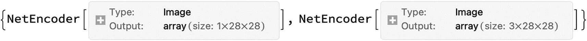

两张网络编码器的截图，其类型和输出数据分别为：图像和数组尺寸 1×28×28，以及图像和数组尺寸 3×28×28。

**图 9-22** 用于灰度图像和 RGB 图像的 `NetEncoder`

```
In[49]:= Table[NetEncoder[{"Image",{28,28},"ColorSpace"-> Color}], {Color,{"Grayscale","RGB"}}]
Out[49]=
```

一旦编码器建立完成，就可以将其应用于目标图像；然后，编码器会创建一个指定尺寸的数值矩阵。为图像创建 `NetEncoder` 会显示相关属性，例如类型、输入图像尺寸和色彩空间等。应用编码器会生成一个预先设定好尺寸的矩阵。

```
In[50]:=I imgEncoder = NetEncoder[{"Image", {3, 3}, "ColorSpace" -> "CMYK"}]; Print["Numeric Matrix:", SetPrecision[%[ExampleData[{"TestImage", "House"}]], 3] // MatrixForm]
Out[50]=
```

![$$ \left(\begin{array}{l}\left(\begin{array}{l}0.255\\ {}0.168\\ {}0.255\end{array}\right)\left(\begin{array}{l}0.145\\ {}0.00392\\ {}0.255\end{array}\right)\left(\begin{array}{l}0.0784\\ {}0.0116\\ {}0.0274\end{array}\right)\\ {}\left(\begin{array}{l}0.153\\ {}0.196\\ {}0.129\end{array}\right)\left(\begin{array}{l}0.2\\ {}0.31\\ {}0.255\end{array}\right)\left(\begin{array}{l}0.259\\ {}0.349\\ {}0.306\end{array}\right)\end{array}\right)\begin{array}{l}\left(\begin{array}{l}0.047\\ {}0.102\\ {}0.00784\end{array}\right)\left(\begin{array}{l}0.164\\ {}0.321\\ {}0.164\end{array}\right)\left(\begin{array}{l}0.262\\ {}0.384\\ {}0.146\end{array}\right)\\ {}\left(\begin{array}{l}0.16\\ {}0.262\\ {}0.184\end{array}\right)\left(\begin{array}{l}0.255\\ {}0.408\\ {}0.478\end{array}\right)\left(\begin{array}{l}0.325\\ {}0.388\\ {}0.569\end{array}\right)\end{array} $$](img/500903_2_En_9_Chapter_TeX_Equqq.png)

生成的输出是一个数值矩阵，现在可以将其用于网络模型。如果输入图像的形状处于不同的色彩空间，编码器会将图像重塑并转换到已建立的色彩空间。此示例中使用的图像来自 `ExampleData[{"TestImage", "House"}]`。


### 池化层

通过向端口指定编码器，可以将编码器添加到单层或容器的端口上，例如一个`PoolingLayer`。这些层主要用于卷积神经网络（见图 9-23）。

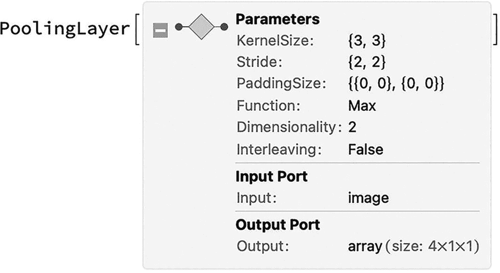

池化层及其参数、输入端口和输出端口数据的截图。参数包括核大小、步长、填充大小、函数、维度和交错。输入和输出端口分别包含输入和输出。

**图 9-23** 带有`NetEncoder`的`PoolingLayer`

```
In[52]:= poolLayer=PoolingLayer{3,3},{2,2},PaddingSize->0,"Function"-> Max,"Input"-> NetEncoder[{"Image",{3,3},"ColorSpace"-> "CMYK"}]
Out[52]=
```

后一个层指定了一个二维`PoolingLayer`，其核大小为 3×3，步长为 2×2，这是核应用之间的步长。`PaddingSize`在输入矩阵的开头和结尾添加元素。这样做是为了使矩阵和核大小之间的除法为整数，防止层间信息丢失。`Function`指示池化操作函数，此处为`Max`；它计算每个滤波器补丁中的最大值。它还可以分别计算滤波器值的平均值和总和，对应平均池化和求和池化。有时，它们可能被称为最大池化层、平均池化层和求和池化层。

```
In[53]:=SetPrecision[poolLayer[ExampleData[{"TestImage","House"}]],3]//MatrixForm
Out[53]//MatrixForm=
```

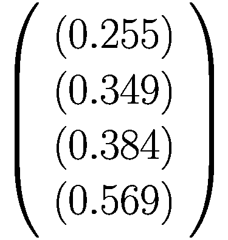

## 解码器

网络操作完成后，会返回数值表达式。另一方面，在某些任务中，你并不需要数值表达式，例如在分类任务中，类别可以作为输出给出，模型可以判断某个特定对象属于类别 A，另一个对象属于类别 B，因此一个向量或数值数组可以表示每个类别的概率。为了将数值数组转换为其他形式的数据，需要使用`NetDecoder`（见图 9-24）。

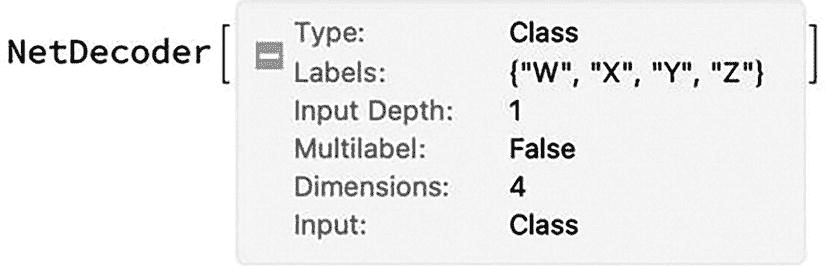

网络编码器的截图，显示了类型、标签、输入深度、多标签、维度以及类别、W X Y Z、1、false、4 和类别的输入数据。

**图 9-24** 用于四个不同类别的`NetDecoder`

```
In[54]:= decoder=NetDecoder[{"Class",CharacterRange["W","Z"]}]
Out[54]=
```

解码器的维度等于类别构造。你可以应用一个概率向量，解码器会对其进行解释并告诉你它属于哪个类别。它还会显示各类别的概率。

```
In[55]:= decoder@{0.3,0.2,0.1,0.4}(*This is the same as Decoder[{0.3,0.2,0.
1,0,4},"Decision"] *)
Out[55]= Z
```

`TopDecisions`、`TopProbabilites`以及概率分布的不确定性显示如下。

```
In[56]:= TableForm{decoder[{0.3, 0.2, 0.1, 0.4}, "TopDecisions" -> 4,  decoder[{0.3, 0.2, 0.1, 0.4}, "TopProbabilities" ->  4],  decoder[{0.3, 0.2, 0.1, 0.4}, "Entropy"]},  TableDirections -> Column,  TableHeadings -> {{Style["TopDecisions", Italic], Style["TopProbabilities", Italic], Style["Entropy", Italic]},
None}]Out[56]//TableForm=
TopDecisions        Z        W         X         Y
TopProbabilities    Z->0.4   W->0.3    X->0.2    Y->0.1
Entropy             1.27985
```

给定值列表，添加输入深度以定义类别的应用层级。

```
In[57]:= NetDecoder[{"Class",CharacterRange["X","Z"],"InputDepth"→2}];
```

将解码器应用于嵌套值列表会产生以下结果。

```
In[58]:= TableForm{%[{{0.1, 0.3, 0.6}, {0.3, 0.4, 0.3}}, "TopDecisions" -> 3,  %[{{0.1, 0.3, 0.6}, {0.3, 0.4, 0.3}}, "TopProbabilities" ->  3],  %[{{0.1, 0.3, 0.6}, {0.3, 0.4, 0.3}}, "Entropy"]},  TableDirections -> Column,  TableHeadings -> {{Style["TopDecisions", Italic], Style["TopProbabilities", Italic], Style["Entropy", Italic]}, None}]
Out[58]//TableForm=
TopDecisions        Z         Y
Y         X
X         Z
Z->0.6    Y->0.4
TopProbabilities    Y->0.3    X->0.3
X->0.1    Z->0.3
Entropy             0.897946  1.0889
```

解码器被添加到层、容器或网络模型的输出端口。

```
In[59]:=SoftmaxLayer["Output"→NetDecoder[{"Class",{"X","Y","Z"}}]];
```

将层应用于数据会生成每个类别的概率。

```
In[60]:= {%@{1,3,5},%[{1,3,5},"Probabilities"],%[{1,3,5},"Decision"]}
Out[60]= {Z,0.0158762,Y->0.11731,Z->0.866813|>,Z}
```

### 应用编码器和解码器

你已经准备好实现图 9-25 中编码和解码的完整过程。首先，将图像宽度调整为 200 像素，以显示编码前原始图像的样子。


一张房屋的特写彩色照片。

**图 9-25** 定义编码器和解码器时的房屋示例图像

```
In[61]:= Img=ImageResize[ExampleData[{"TestImage","House"}],200]
Out[61]=
```

```
In[62]:= encoder=NetEncoder[{"Image",{100,100},"ColorSpace"-> "RGB"}];
decoder=NetDecoder[{"Image",ColorSpace-> "Grayscale"}];
```

然后，将编码器应用于图像，将解码器应用于数值矩阵。检查解码后图像的维度是否与编码器输出维度匹配（见图 9-26）。


一张房屋的特写灰度照片。

**图 9-26** 解码后的房屋示例

```
In[64]:=encoder[img];
decoder[%]
```

图 9-26 显示图像已被转换为具有新维度的灰度图像。

```
In[66]:= ImageDimensions[%]
Out[66]= {100,100}
```

可以看到，图片已被调整大小。尝试查看过程中的步骤，例如查看数值矩阵以及编码器和解码器对应的对象。使用编码器和解码器涉及你所使用的数据类型，因为每个网络模型接收不同的输入并生成不同的输出。

## NetChains 和 Graphs

神经网络由不同的层组成，而不是单独的层本身。使用`NetChain`命令或`NetGraph`命令来构建包含多个层的更复杂结构。


### 容器

在 Wolfram 语言中，容器对于正确操作和构建神经网络非常有价值。容器是组装神经网络模型基础设施的结构，可以有多种形式。`NetChain` 可用于创建线性和非线性结构的网络，这有助于模型学习非线性模式。你可以认为网络中的每一层都具有一个抽象级别，用于检测复杂行为，而如果只使用单层，这些行为是无法被识别的。因此，你可以从三层开始以通用方式构建网络：输入层、隐藏层和输出层。当隐藏层超过两层时，即为深度学习；更多信息请参考 Sandro Skansi 所著的 *《深度学习导论：从逻辑演算到人工智能》*（Springer，2018 年出版）。

`NetChain` 可以连接两个操作。它们可以写成纯函数，而不仅仅是函数名（见图 9-27）。

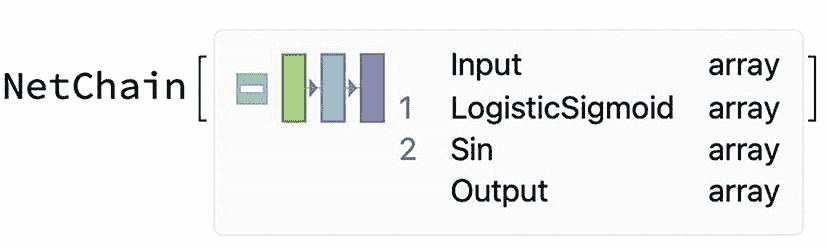

一个带有渐变色块以及输入、逻辑斯谛函数、正弦函数和数组输出数据的网络链截图。

图 9-27

包含两个逐元素层的 `NetChain`

```
In[67]:=NetChain[{ElementwiseLayer[LogisticSigmoid@#&],ElementwiseLayer[Sin@#&]}]
Out[67]=
```

返回的对象是一个 `NetChain`，并显示三个彩色矩形的图标。这意味着创建或引用的对象（`NetChain`）是一个网络链，并且包含多个层。检查该链时，会显示输入层、第一层（`LogisticSigmoid`）、第二层（`Sin`）和输出层。操作按出现顺序执行，因此先应用第一层，再应用第二层。`NetChain` 支持其他层的输入和输出选项，例如单个实数（`Real`）、整数（`Integer`）、长度为“n”的向量以及多维数组（见图 9-28）。

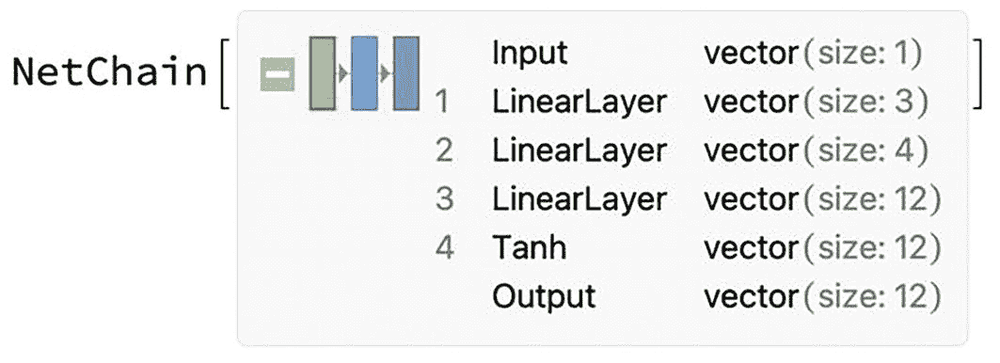

一个带有渐变色块以及输入、3 个线性层、双曲正切函数和输出数据（向量大小分别为 1、3、4、12、12、12）的网络链截图。

图 9-28

包含多个层的 `NetChain`

```
In[68]:= NetInitialize@NetChain[{3,4,12,Tanh},"Input"->1]
Out[68]=
```

`NetChain` 能够识别 Wolfram 语言的函数名，并将其与对应的层关联起来，例如 3、4 和 12。它们代表输出大小分别为 3、4 和 12 的线性层（见图 9-28）。`Tanh` 函数代表逐元素层。

让我们使用 `NetAppend`（见图 9-29）或 `NetPrepend` 向创建的链中添加一个层。Wolfram 语言的许多原始命令具有相同的含义——例如，在链中删除操作是 `NetDelete[net_ name, #_of_layer]`。

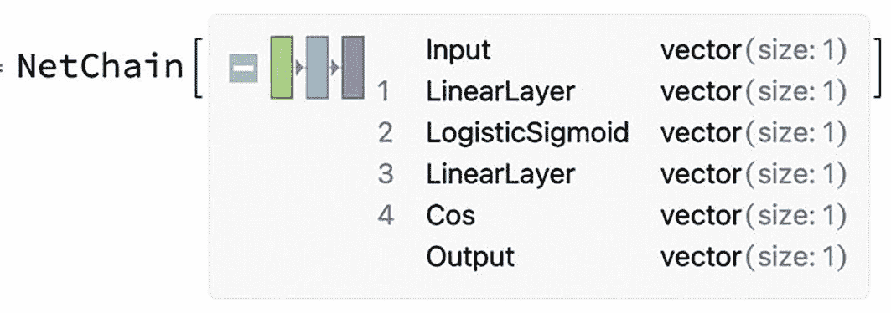

一个带有渐变色块以及输入、线性层、逻辑斯谛函数、线性层、余弦函数和输出数据（向量大小为 1）的网络链截图。

图 9-29

添加了不同层的 `NetChain` 对象

```
In[69]:=NetInitialize@NetChain[{1,ElementwiseLayer[LogisticSigmoid@#&]},"Input"-> 1];
netCH2=NetInitialize@NetAppend[%,{1,ElementwiseLayer[Cos[#]&]}]
Out[70]=
```

将网络应用于数据时，有多种选项可用，例如 `NetEvaluationMode`（评估模式，训练或测试）、`TargetDevice` 和 `WorkingPrecision`（数值精度）。

```
In[71]:= netCH2{{0},{2},{44}},NetEvaluationMode-> "Train",TargetDevice-> "CPU",WorkingPrecision-> "Real64",RandomSeeding-> 8888
Out[71]= {{0.967873},{0.990894},{1.}}
```

另一种形式是在链中显式输入层的名称，以关联（Association）的形式键入（见图 9-30）。

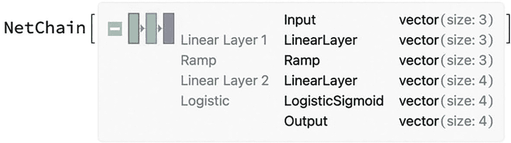

一个带有渐变色块以及输入、线性层、斜坡函数、线性层、逻辑斯谛函数和输出数据（向量大小分别为 3、3、3、4、4、4）的网络链截图。这 4 层分别标记为线性层 1、斜坡函数、线性层 2 和逻辑斯谛函数。

图 9-30

具有自定义层名称的 `NetChain` 对象

```
In[72]:= NetInitialize@NetChain[LinearLayer[3],
"Ramp"-> Ramp,"Linear Layer 2"->LinearLayer[4],"Logistic"-> ElementwiseLayer[LogisticSigmoid]|>,"Input"-> 3]
Out[72]=
```

检查层的内容应在点击层名称或层之后出现。如果要提取某个层，则使用 `NetExtract` 并指定相应层的名称。输出被抑制，但如果移除分号，该层应该会弹出。

```
In[73]:=NetExtract[%,"Logistic"];
```

要在一行代码中提取所有层，`Normal` 可以完成此任务（见图 9-31）。

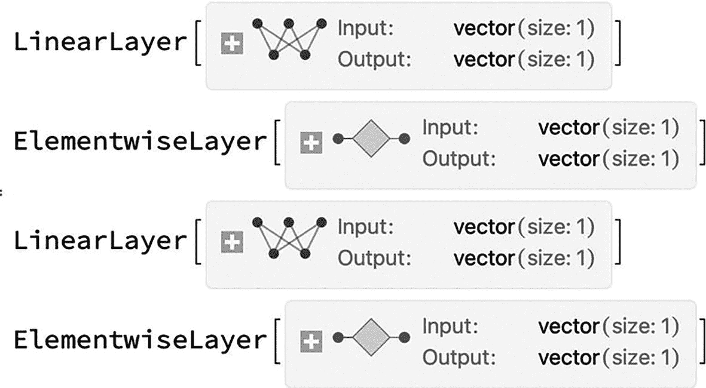

一个包含 2 个线性层和 2 个逐元素层以及输入和输出数据（向量大小为 1）的截图。

图 9-31

`NetChain` `NetCH2` 的各层

```
In[74]:= Normal[netCH2]//Column
Out[74]=
```

### 多重链

链可以通过嵌套链进行连接（见图 9-32）。

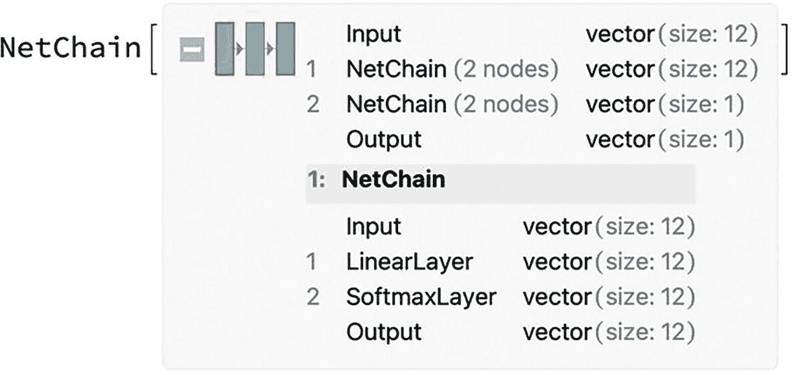

一个带有渐变色块以及输入、2 个各有 2 个节点的网络链、输出、网络链、输入、线性层、Softmax 层和输出数据（向量大小分别为 12 和 1）的网络链截图。

图 9-32

从两个可用链中选中的链 1

```
In[75]:= chain1=NetChain[{12,SoftmaxLayer[]}];
chain2=NetChain[{1,ElementwiseLayer[Cos[#]&]}];
nestedChain=NetInitialize@NetChain[{chain1,chain2},"Input"-> 12]
Out[77]=
```

这个链被分为两个 `NetChain`，每个代表一个链。在此例中，你看到 `chain1` 和 `chain2`，每个链显示其对应的节点。要展平这些链，请使用 `NetFlatten`（见图 9-33）。

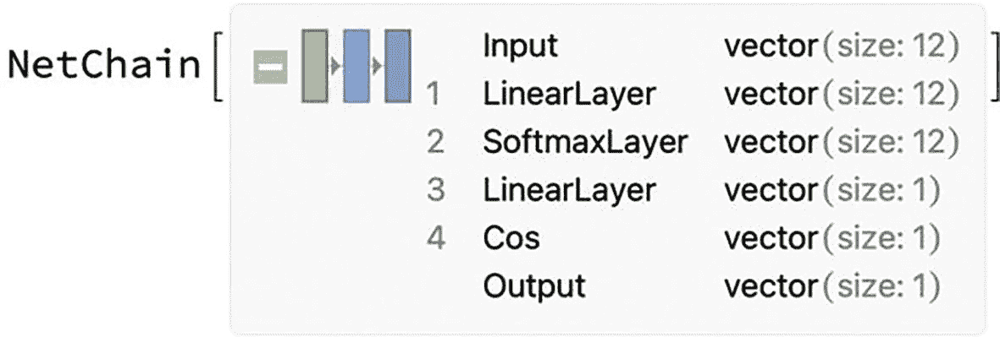

一个带有渐变色块以及输入、线性层、Softmax 层、线性层、余弦函数和输出数据（向量大小分别为 12 和 1）的网络链截图。

图 9-33

展平后的链

```
In[78]:= NetFlatten[nestedChain]
Out[78]=
```


### NetGraphs

`NetChain`命令仅能连接层，其中一层的输出连接到下一层的输入。`NetChain`无法将输入或输出连接到其他层；它只能处理单层结构。为了解决这个问题，需要使用`NetGraph`。除了允许更多的输入和层之外，`NetGraph`还通过图来表示神经网络的结构和过程（见图 9-34）。

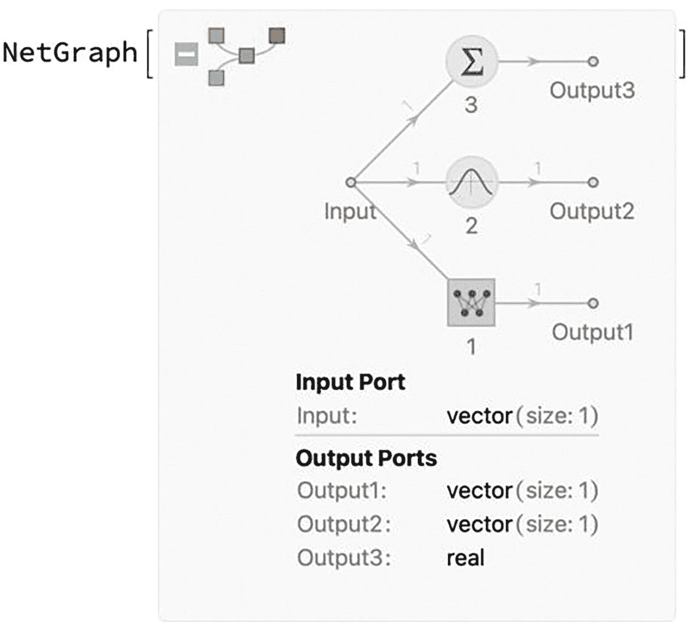

图 9-34 展示了扩展的`NetGraph`，其截图显示了连接的颜色渐变块，包含输入端口和输出端口的数据，用于输入和输出 1 到 3。它们包括向量大小 1 和实数，以及从底部到顶部并行流向输出 1 到 3 的数据流。

**图 9-34** 扩展的`NetGraph`

```
In[79]:= NetInitialize@NetGraph[{ LinearLayer["Output"-> 1,"Input"-> 1],Cos,SummationLayer[]},{}]
Out[79]=
```

创建的对象是一个`NetGraph`，由连接方块的图形表示，如图 9-35 所示。输入进入三个不同的层，每层都有自己的输出。`NetGraph`接受两个参数：第一个参数用于指定层或链，第二个参数用于定义图的顶点或网络的连接性。例如，在后面的代码中，由于未指定顶点，网络有三个输出。`SummationLayer`是一个对所有输入数据求和的层。

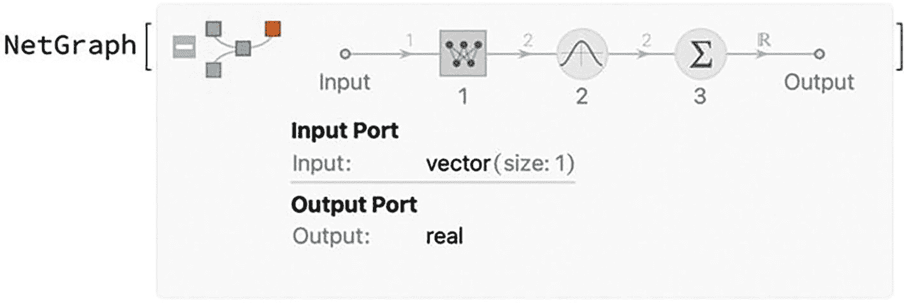

图 9-35 展示了单向`NetGraph`，其截图显示了连接的颜色渐变块，包含输入端口和输出端口的数据，用于输入和输出。它们包括向量大小 1 和实数，以及通过 1、2、3 串联从输入到输出的数据流。

**图 9-35** 单向`NetGraph`

```
In[80]:= net1=NetInitialize@NetGraph[{ LinearLayer["Output"-> 2,"Input"-> 1],Cos,SummationLayer[]},{1-> 2-> 3}]
Out[80]=
```

顶点表示法意味着一个层的输出被传递给另一个层，依此类推。换句话说，`1 -> 2 -> 3` 表示线性层的输出被传递到下一层，直到最后在求和层中求和（见图 9-35），从而保持了层出现的顺序。然而，你可以改变每个顶点的顺序。网络可以被修改，使得输出可以到达网络的其他层，例如从 1 到 3，然后到 2（见图 9-36）。使用`NetGraph`，层和链可以作为列表或关联输入。顶点被输入为规则列表。

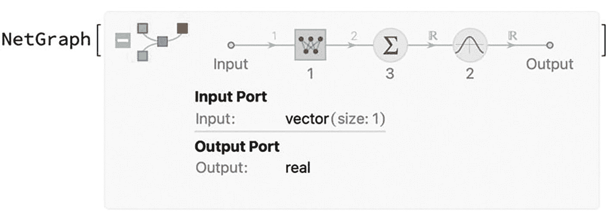

图 9-36 展示了`Net2`的`NetGraph`结构，其截图显示了连接的颜色渐变块，包含输入端口和输出端口的数据，用于输入和输出。它们包括向量大小 1 和实数，以及通过 1、3、2 串联从输入到输出的数据流。

**图 9-36** `Net2`的`NetGraph`结构

```
In[81]:= net2=NetInitialize@NetGraph[{ LinearLayer["Output"-> 2,"Input"-> 1],Cos,SummationLayer[]},{1-> 3->2}]
Out[81]=
```

每个层的输入和输出都通过工具提示标记，当鼠标悬停在图形线条或顶点上时会显示。由于未指定输入和输出，`NetGraph`会推断输入和输出端口的数据类型；例如，所用层输入和输出中的大写字母`R`代表实数。

使用`NetGraph`，层可以作为列表或关联输入。连接被输入为规则列表（见图 9-37）。

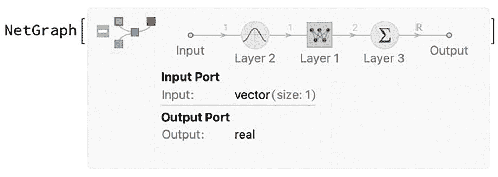

图 9-37 展示了使用命名层初始化的`NetGraph`，其截图显示了连接的颜色渐变块，包含输入端口和输出端口的数据，用于输入和输出。它们包括向量大小 1 和实数，以及通过层 2、1、3 串联从输入到输出的数据流。

**图 9-37** 使用命名层初始化的`NetGraph`

```
In[82]:= NetInitialize@NetGraph[ LinearLayer[2,"Input"-> 1],"Layer 2"-> Cos,"Layer 3"-> SummationLayer[]|>,{"Layer 2"-> "Layer 1"-> "Layer 3"}]
Out[82]=
```

可以使用`NetPort`命令指定一个结构可以有多少个输入和输出（见图 9-38）。

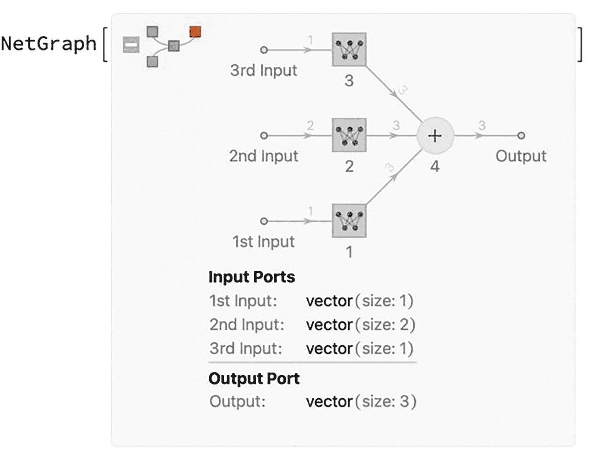

图 9-38 展示了具有多个输入和单个输出的`NetGraph`，其截图显示了连接的颜色渐变块，包含输入端口和输出端口的数据，用于第一、第二和第三输入及输出。它们包括向量大小 1、2 和 3，以及从底部到顶部并行从第一、第二、第三输入到输出的数据流。

**图 9-38** 具有多个输入和单个输出的`NetGraph`

```
In[83]:= NetInitialize@ NetGraph[{ LinearLayer[3, "Input" -> 1],  LinearLayer[3, "Input" -> 2], LinearLayer[3, "Input" -> 1] , TotalLayer[]}, {NetPort["1st Input"] -> 1, NetPort["2nd Input"] -> 2, NetPort["3rd Input"] -> 3, {1, 2, 3} ->   4}] (*Or NetInitialize@NetGraph[,{NetPort["1st Input"]\[Rule] "L1", NetPort["2nd Input"]\[Rule] "L2",NetPort["3rd Input"]\[Rule]"L3",{"L1","L2","L3"} -> "Tot L"}]*)
Out[83]=
```

如果你有多个输入，每个输入都在指定的端口中输入。

```
In[84]:= %[ 32.32,"2nd Input"-> {2,\[Pi]},"3rd Input"-> 1|>]
Out[84]= {82.4758,-42.202,-37.4852}
```

如果有多个输出，结果会针对每个不同的输出显示（见图 9-39）。

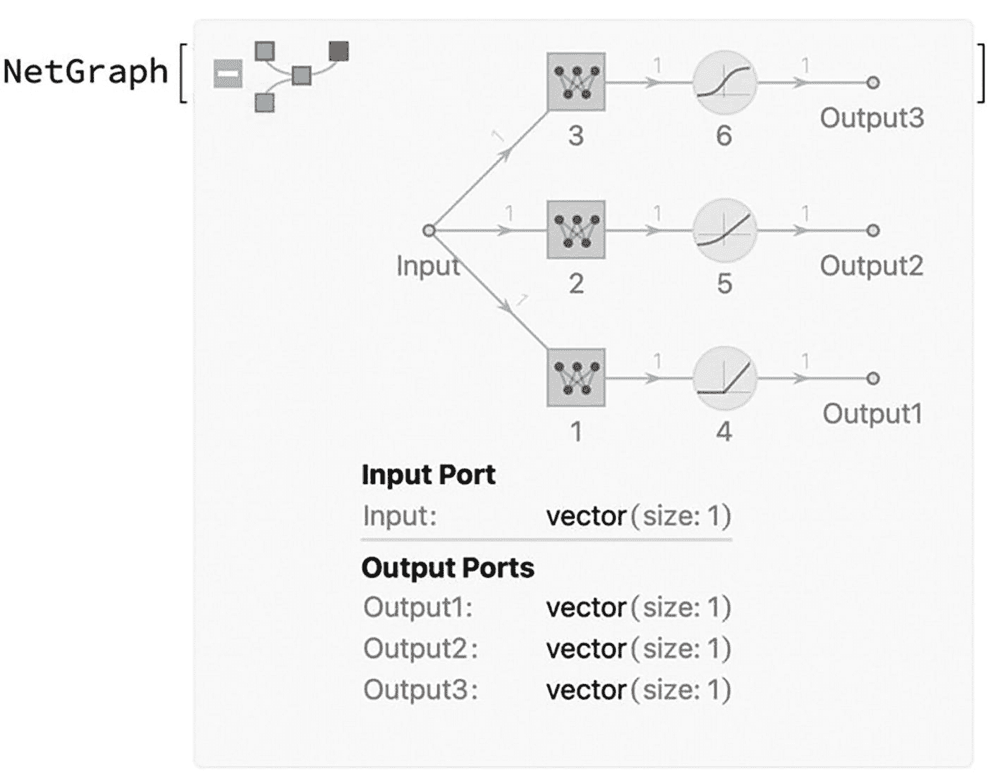

图 9-39 展示了具有单个输入和三个输出的`NetGraph`，其截图显示了连接的颜色渐变块，包含输入端口和输出端口的数据，用于输入和输出 1 到 3。它们包括向量大小 1，以及从底部到顶部并行通过 2 组 3 层从输入到输出 1 到 3 的数据流。

**图 9-39** 具有单个输入和三个输出的`NetGraph`

```
In[85]:= NetInitialize[NetGraph[{LinearLayer[1,"Input"-> 1],LinearLayer[1,"Input"-> 1],LinearLayer[1,"Input"-> 1],Ramp,ElementwiseLayer["ExponentialLinearUnit"],LogisticSigmoid},{1->4-> NetPort["Output1"],2->5-> NetPort["Output2"],3-> 6-> NetPort["Output3"]}],RandomSeeding->8888] %[{1}]
Out[85]=
```

```
Out[86]= {0.},Output2->{-0.289052},Output3->{0.860635}|>
```

`NetChain`容器可以像层一样与`NetGraph`一起使用（见图 9-40）。某些层，例如`CatenateLayer`，接受零个参数。

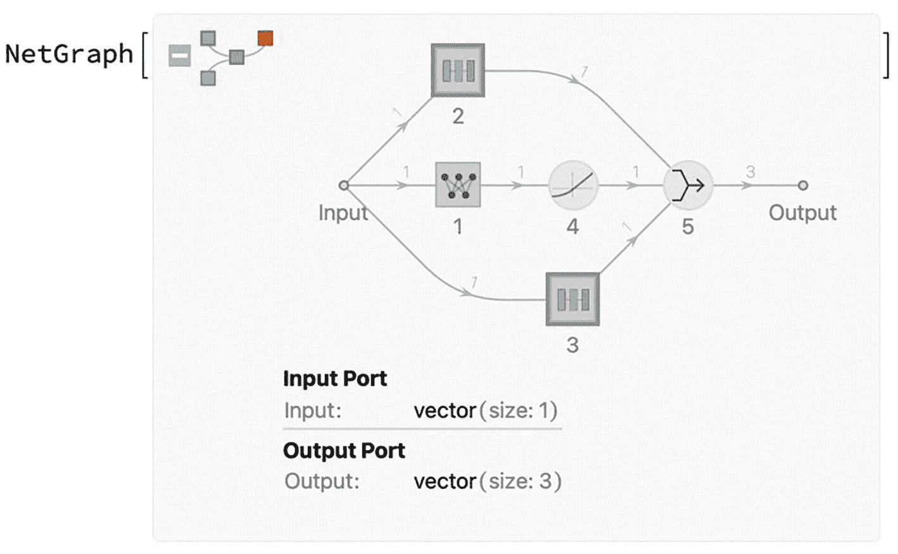

图 9-40 展示了具有多个容器的`NetGraph`，其截图显示了输入端口和输出端口的数据，用于输入和输出。它们包括向量大小 1 和 3，以及通过层 1、4、5 串联以及颜色渐变容器 2 和 3 并行从输入到输出的数据流。

**图 9-40** 具有多个容器的`NetGraph`

```
In[87]:= NetInitialize@NetGraph[{LinearLayer[1,"Input"-> 1], NetChain[{LinearLayer[1,"Input"-> 1], ElementwiseLayer[LogisticSigmoid[#]&]}],NetChain[{LinearLayer[1,"Input"-> 1],Ramp}], ElementwiseLayer["ExponentialLinearUnit"],
CatenateLayer[]},{1->4,2->5,3-> 5,4-> 5}]
Out[87]=
```

点击链或层会显示相关信息，点击链内部的层则会显示所选链上该层的信息。


### 组合容器

`NetChains` 和 `NetGraphs` 可以嵌套以形成不同的结构，如下例所示（见图 9-41），其中 `NetGraph` 可以跟在 `NetChain` 之后，反之亦然。

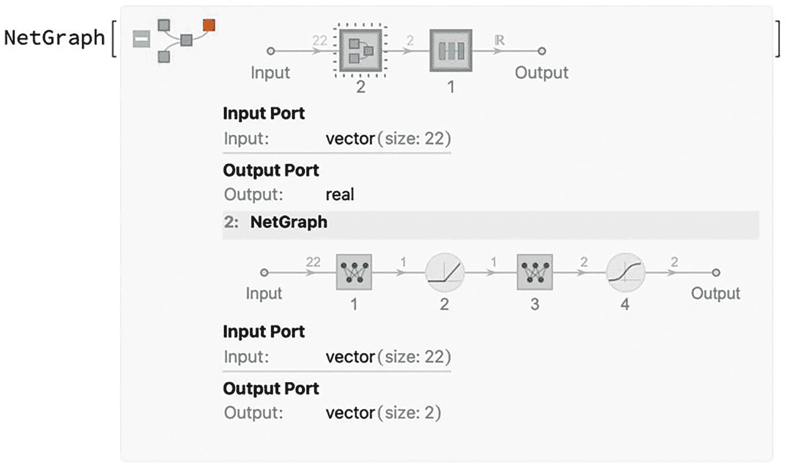

一张网络图截图，包含两组输入和输出端口数据：一组输入输出向量大小为 22 和实数，另一组向量大小为 22 和 2。第一组通过两个串联的渐变色容器从输入流向输出。第二组通过四个串联的层从输入流向输出。

**图 9-41** 嵌套的 `NetGraph` 和 `NetChain`

```
In[88]:= n1=NetGraph[{1,Ramp,2,LogisticSigmoid},{1-> 2,2-> 3,3-> 4}];
n2=NetChain[{3,SummationLayer[]}];
NetInitialize@NetGraph[{n2,n1},{2-> 1},"Input"-> 22]
Out[90]=
```

从图 9-40 的图表中可以清楚地看到，输入进入 `NetGraph`，而 `NetGraph` 的输出则进入 `NetChain`。未初始化的 `NetChain` 或 `NetGraph` 会以红色显示。容器（`NetChain`、`NetGraph`）的一个基本特性是它们可以像层一样运作。考虑到这一点，你可以创建仅包含 `NetChain`、`NetGraph` 或两者都包含的嵌套容器。

仅作演示，可以使用 `NetGraph` 创建更复杂的结构，如图 9-42 所示。一旦创建了网络结构，就可以提取关于每一层或链的属性。例如，使用 `SummaryGraphic`，你可以获取网络结构的图形。

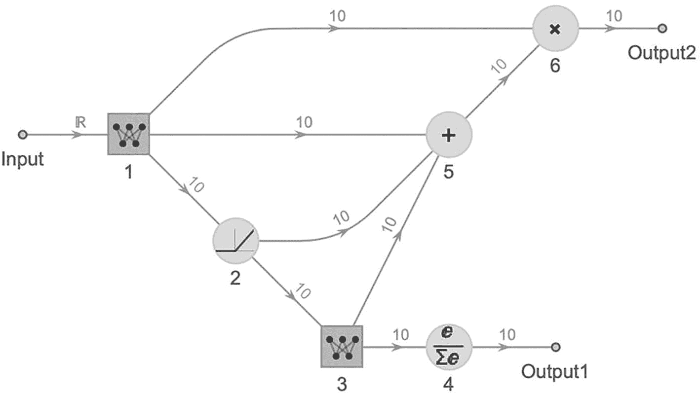

一个流程图显示了输入与两个输出之间的流向，经过层 1、2、3、4（连接到输出 1）以及层 5 和 6（连接到输出 2）。

**图 9-42** 复合图网络结构

```
In[91]:= net = NetInitialize@   NetGraph[{LinearLayer[10], Ramp, 10, SoftmaxLayer[], TotalLayer[], ThreadingLayer[Times]}, {1 -> 2 -> 3 -> 4, {1, 2, 3} -> 5, {1, 5} -> 6}, "Input" -> "Real"];
Information[net, "SummaryGraphic"]
Out[92]=
```

### 网络属性

与网络数值数组相关的属性包括 `Arrays`（给出网络中的每个数组）、`ArraysCount`（网络中数组的数量）、`ArraysDimensions`（网络中每个数组的维度）和 `ArraysPositionList`（网络中每个数组的位置），如图 9-43 所示。

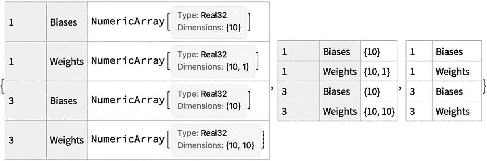

一张截图包含三组关于偏置和权重的数据表。第一组包含数值数组、类型和维度的各种值。第二组和第三组包含偏置和权重的值。

**图 9-43** 包含各种属性的数据集

```
In[93]:={Dataset@Information[net,"Arrays"],Dataset@Information[net,"ArraysDimensions"],Dataset@Information[net,"ArraysPositionList"]}
Out[93]=
```

与输入和输出端口中变量类型相关的信息通过 `InputPorts` 和 `OutputPorts` 显示。

```
In[94]:= {Information[net,"InputPorts"],Information[net,"OutputPorts"]}
Out[94]= {Real|>,10,Output2->10|>}
```

你可以看到输入是一个实数，并且网络有两个大小为 10 的输出向量。与层相关的最常用属性包括 `Layers`（返回网络的每一层）、`LayerTypeCounts`（网络中某层出现的次数）、`LayersCount`（网络中的层数）、`LayersList`（网络中所有层的列表）和 `LayerTypeCounts`（网络中某层出现的次数）。图 9-44 展示了 `Layers` 和 `LayerTypeCounts` 的结果。

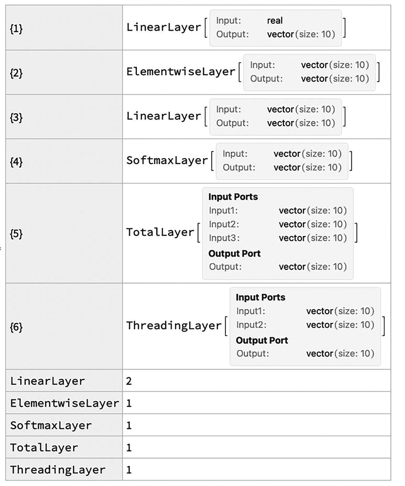

一个表格包含 11 行数据。前 6 行包含线性层、逐元素层、线性层、softmax 层、求和层和线程层的数据，以及它们各自的实数和向量输入输出值。求和层和线程层的数据在输入和输出端口下分组显示。最后 5 行包含它们的值。

**图 9-44** 关于符号 `Net` 中包含的层的信息

```
In[95]:=Dataset@{Information[net,"Layers"],Information[net,"LayerTypeCounts"]}
Out[95]=
```

网络结构的可视化（见图 9-45）通过以下属性实现：`LayersGraph`（显示层连接关系的图）、`SummaryGraphics`（网络结构的图形）、`MXNetNodeGraph`（MXNet 原始图操作）和 `MXNetNodeGraphPlot`（MXNet 操作的注释图）。`MXNet` 是一个支持多种编程语言的开源深度学习框架，Wolfram 语言是其中之一。此外，Wolfram 神经网络框架使用 `MXNet` 结构作为后端支持。

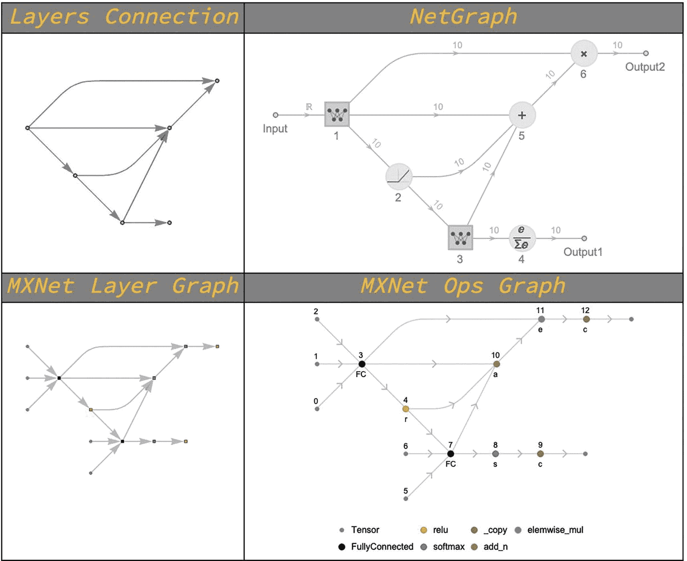

四个流程图：层连接图、网络图、MXNet 层图和 MXNet 操作图。它们各自通过不同的层从输入流向输出。MXNet 操作图以不同颜色的点突出显示了张量、relu、复制、逐元素乘法、全连接、softmax 和 add n 层。

**图 9-45** 显示多个图形的网格

```
In[96]:= Grid[{{Style["Layers Connection",Italic,20,ColorData[105,4]],Style["NetGraph",Italic,20,ColorData[105,4]]},{Information[net,"LayersGraph"],Information[net,"SummaryGraphic"]},{Style["MXNet Layer Graph",Italic,20,ColorData[105,4]],Style["MXNet Ops Graph",Italic,20,ColorData[105,4]]},{Information[net,"MXNetNodeGraph"],Information[net,"MXNetNodeGraphPlot"]}},Dividers->All,Background-> {{{None,None}},{{Opacity[1,Gray],None}}}]
Out[96]=
```

将光标指针悬停在 `MXNet` 符号图中的某个层或节点上时，工具提示会显示 `MXNet` 符号的属性，例如 ID、名称、参数、属性和输入。


### 导出与导入模型

由于 Wolfram 语言与 MXNet 的互操作性，Wolfram 语言支持导入和导出已初始化或未初始化的神经网络。你可以在桌面上创建一个名为 MXNet Nets 的文件夹，并将 `Net` 变量中的网络导出。

```
In[97]:= fileDirectory="/Users/macosx/Desktop";
Export[FileNameJoin[{dileDirectory,"MxNet.json"}],net,"MXNet","ArrayPath"-> Automatic,"SaveArrays"-> True]
Out[98]= /Users/macosx/Desktop/MxNet.json
```

将网络导出为 MXNet 格式会生成两个文件：一个存储神经网络拓扑结构的 JSON 文件，以及一个包含导出架构所需参数（网络中使用的数值数组）数据的 `.params` 类型文件；前提是网络已初始化。当 `ArrayPath` 设置为 `Automatic` 时，params 文件会保存在同一个网络文件夹中。否则，它可以有不同的路径。`SaveArrays` 指示是否导出数值数组（`True`）或不导出（`False`）。让我们检查一下在 MXNets Nets 文件夹中创建的两个文件。

```
In[99]:= FileNames[All,File@fileDirectory]
Out[99]= {/Users/macosx/Desktop/MxNet.json,
/Users/macosx/Desktop/MxNet.params}
```

要导入 MXNet 网络，建议将 JSON 和 params 文件放在同一个文件夹中，因为 Wolfram 语言假定某个 JSON 文件与 params 文件的模式相匹配。有多种导入网络的方法，包括 `Import[file_name.json, "MXNet"]` 和 `Import[file_name.json, {"MXNet", element}]`（与 `.param` 文件相同）。自版本 13 起，网络不再作为网络链或网络图导入，而是可以作为网络外部对象导入。但是，如果你不打算在 Wolfram 语言之外使用该神经网络，将其存储为 WLNet 格式会简单得多，这有助于在 Wolfram 语言环境中更轻松地保存和检索。要将网络导出为 WLNet 格式，你可以使用以下代码：`Export["file_name.wlnet", <net_symbol or variable_name>]`。然后，你可以使用 `Import["file_name.wlnet"]` 导入该网络。

```
In[100]:=Import[FileNameJoin[{fileDirectory,"MxNet.json"}],{"MXNet","NetExternalObject"},InputPorts->{1}|>,"ArrayPath"->None];
```

后一个网络是自动连同 `.params` 文件一起导入的。要在没有参数的情况下导入网络，请将 `ArrayPath` 设置为 `None` 或设置 params 文件路径。导入网络参数可以通过列表（`ArrayList`）、名称（`ArrayNames`）或关联（`ArrayAssociation`）来完成，如图 9-46 所示。

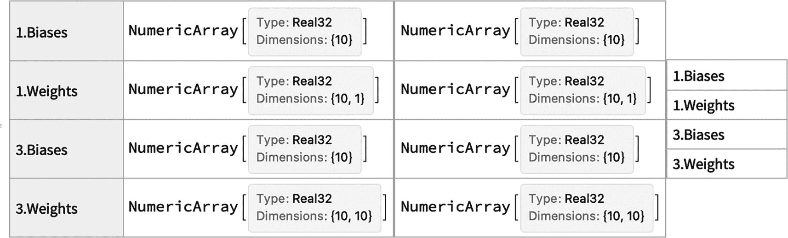

一个表格包含偏置和权重的数据，分为 2 列和 4 行数值数组。这些数值数组列出了类型和维度。

**图 9-46** MXNet 格式的不同导入选项

```
In[101]:= Row[Dataset[Import[FileNameJoin[{fileDirectory,"MxNet.json"}],{"MXNet",#}]]&/@{"ArrayAssociation","ArrayList","ArrayNames"}]
Out[101]=
```

要导入的网络元素包括 `InputNames`、`NetExternalObject`、`NodeDataset`（MXNet 节点的数据集）、`NodeGraph`（MXNet 的节点图）、`NodeGraphPlot`（MXNet 节点的绘图）。以下数据集显示了图 9-47 之前列出的几个选项。

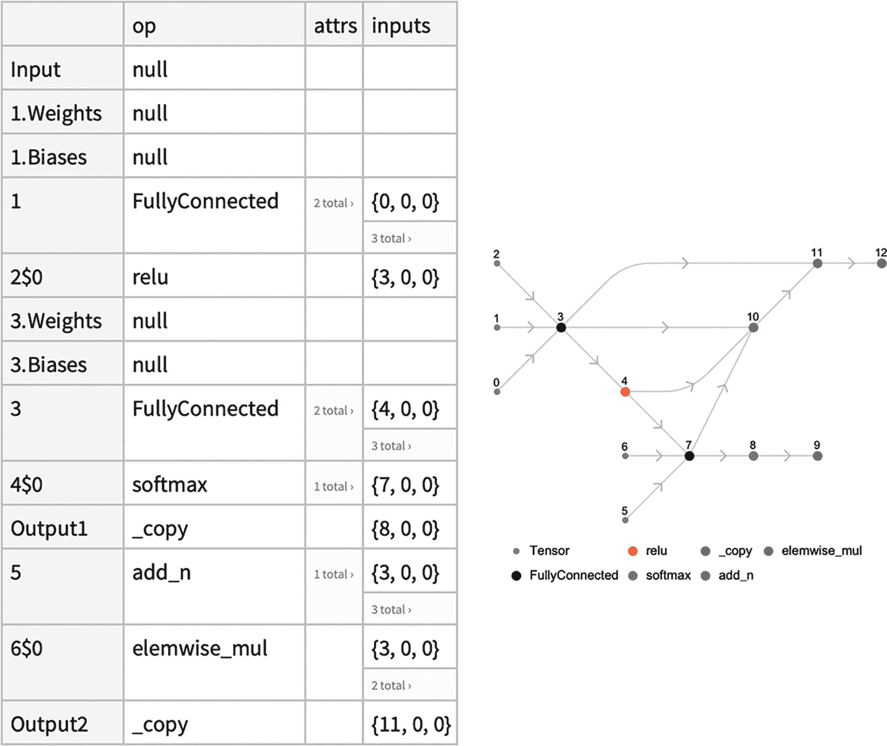

一个表格和一个流程图。该表格有 3 列，分别为 o p、a t t r s 和 inputs，包含 13 行数据，包括 input、weights、biases、output 1、output 2 和其他值。o p 列包含各种层。流程图通过 tensor、r e l u、copy、softmax 等各种层连接输入和输出。

**图 9-47** 节点数据集和 MXNet 操作图

```
In[102]:= {Import[FileNameJoin[{fileDirectory,"MxNet.json"}],{"MXNet","NodeDataset"}],Import[FileNameJoin[{ileDirectory,"MxNet.json"}],{"MXNet","NodeGraphPlot"}]}//Row
Out[102]=
```

Wolfram 语言和 MXNet 之间的某些操作是不可逆的。如果你留意，会发现导出为 MXNet 格式的网络输入被设置为实数，而导入的 MXNet 格式的网络输入则标记输入是一个指定了维度的数组。

在构建神经网络时，一个网络可以拥有的网络链或网络图的数量没有限制。例如，下面的例子是来自 Wolfram 神经网络库的一个神经网络，它具有更深层次的结构（见图 9-48）。这个网络被称为 CapsNet，用于估计图像的深度图。要查阅该网络，请输入 `NetModel["CapsNet Trained on MNIST Data", "DocumentationLink"]` 以访问文档网页；要获取 Wolfram Cloud 上的笔记本，请输入 `NetModel["CapsNet Trained on MNIST Data", "ExampleNotebookObject"]`，或者对于桌面版，只需输入 `ExampleNotebook`。

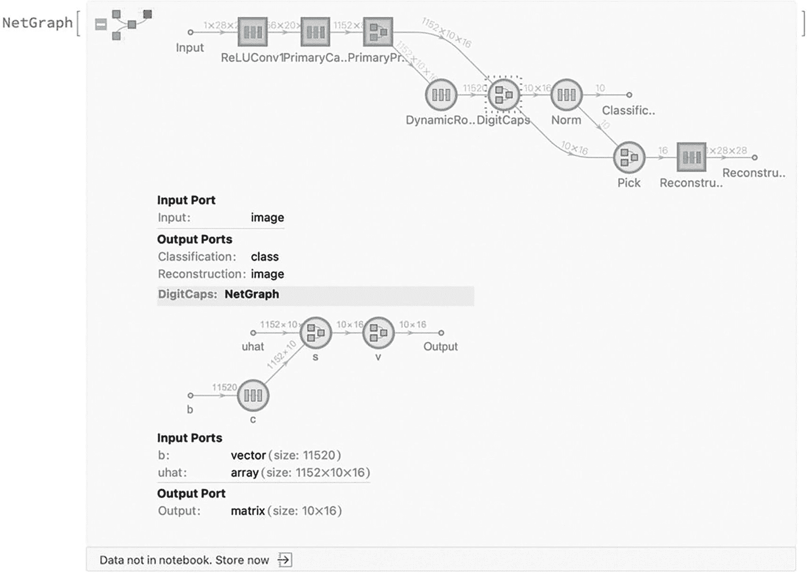

网络图的截图显示了带有颜色渐变的连接块，以及两组用于 input、classification、reconstruction、digit caps、b、u hat 和 output 的输入端口和输出端口数据。它们有两个流程图，展示了 input、r e l u convolution、norm、reconstruction、u hat、output 等之间的流程。

**图 9-48** CapsNet 神经网络模型

```
In[103]:= NetModel["CapsNet Trained on MNIST Data"]
Out[103]=
```

## 总结

本章介绍了 Wolfram 语言中的神经网络方案，并涵盖了基本的层组件：数据输入、权重和偏置。此外，本章重点介绍了编码器和解码器，并解释了其结构。

