# 10. 神经网络框架

本章探讨了在 Wolfram 语言中训练神经网络模型、如何访问结果以及训练好的网络。你回顾了导出和导入网络模型的基本命令。最后，你将探索 Wolfram 神经网络库并回顾 LeNet 网络模型。

## 训练神经网络

Wolfram 语言包含一个非常有用的命令，可以自动化神经网络模型的训练。这个命令是 `NetTrain`。训练神经网络包括微调神经网络的内部参数。其核心在于这些参数可以在训练过程中被学习。这个通用过程是通过一种称为梯度下降的优化算法完成的，该算法通过反向传播算法进行计算。


### 数据输入

使用 `NetTrain` 时，数据可以以不同形式输入。首先，网络模型作为第一个参数，随后是输入→目标、`{inputs, ...}` → `{target, ...}` 或数据或数据集的名称。一旦定义了网络模型，下一个参数就是数据，后面跟着一个可选参数 `All`。`All` 选项会创建一个 `NetTrainResultsObject`，它在计算后显示 `NetTrain` 结果面板，并存储关于训练模型的所有相关信息。用于训练模型的选项作为最后一个参数输入。层和容器中使用的标准选项在 `NetTrain` 中均可用。

下一个示例使用感知器模型构建一个线性分类器。待分类的数据如下图所示（见图 10-1）。

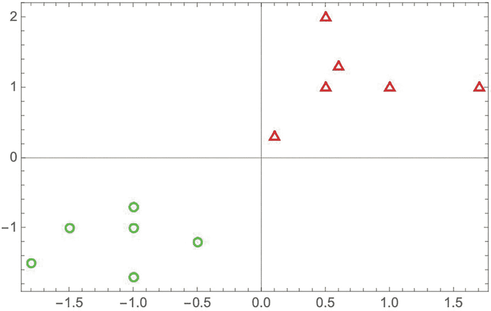

一张散点图绘制了两个不同的点。Y 轴范围从 -1 到 2，X 轴范围从 -1.5 到 1.5。坐标分别为 ((-1, -1.5), (-0.09, -0.5), (1, 0.5), (1, 1))。数值为近似值。

**图 10-1** 显示两个不同绘图点的 `ListPlot`

```
In[1]:= plt=ListPlot[{{{-1.8,-1.5},{-1,-1.7},{-1.5,-1},{-1,-1},{-0.5,-1.2}, {-1,-0.7}}, {{1,1}, {1.7,1}, {0.5,2}, {0.1,0.3}, {0.5,1}, {0.6,1.3}}}, PlotMarkers->"OpenMarkers",Frame->True,PlotStyle->{Green,Red}]
Out[1]=
```

让我们定义数据、目标值和训练数据。

```
In[2]:=data={{-1.8,-1.5},{-1,-1.7},{-1.5,-1},{-1,-1},{-0.5,-1.2},{-1,-0.7},{1,1},{1.7,1},{0.5,2},{0.1,0.3},{0.5,1},{0.6,1.3}};
target={-1,-1,-1,-1,-1,-1,1,1,1,1,1,1};
trainData=MapThread[#1->]{#2}&,{Standardize[data],target},1];
```

`Standardize` 函数在后续代码中至关重要，因为它会在训练神经网络之前对输入数据进行归一化。这一步确保每个特征在训练阶段对学习过程的贡献均等，防止任何单一特征主导其他特征。这个过程可以加快训练过程中的收敛速度，并提高网络模型的整体性能。接下来，让我们定义网络模型。

```
In[3]:= model=NetChain[{LinearLayer[1,"Input"->2], ElementwiseLayer[Ramp[#]&]}];
```

### 训练阶段

准备好数据和模型后，就可以开始训练模型了。训练开始后，会出现一个进度信息面板，其中包含四个主要结果。

*   **摘要**：包含关于批次、轮次和时间速率的相关信息
*   **数据**：涉及已处理的数据信息
*   **方法**：显示使用的方法、批次大小以及用于训练的设备
*   **轮次**：损失值的当前状态

```
In[6]:=net=NetTrain[model,trainData,All,LearningRate->0.01, PerformanceGoal->"TrainingSpeed",TrainingProgressReporting->"Panel", TargetDevice->"CPU", RandomSeeding->88888,WorkingPrecision->"Real64"]
Out[6]=
```

图 10-2 显示了损失值随训练轮次变化的曲线图。

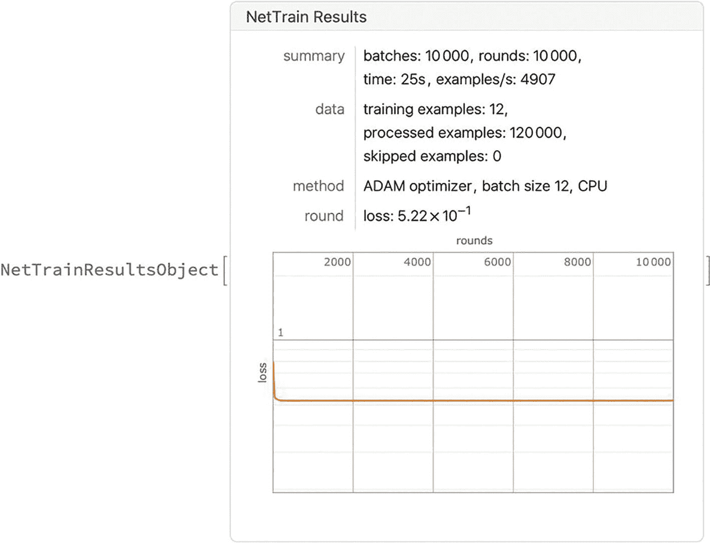

一张关于训练轮次损失图的网络训练结果对象示意图。它包括摘要、数据、方法和带有损失图的轮次信息。轮次范围从 2000 到 10000。数值为估计值。

**图 10-2** `NetTrainResultsObject`

Adam 优化器是随机梯度下降的一种变体，稍后你会看到。生成的对象称为 `NetTrainResultsObject`。

### 模型实现

训练完成后，获取训练好的网络并进行模型实现，如图 10-3 所示。

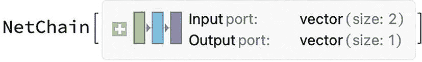

一个用于模型实现的两行代码，包括一个输入端口和一个输出端口，用于一个提取出的网络链，其向量大小分别为 2 和 1。

**图 10-3** 提取出的训练好的网络

```
In[7]:= trainedNet1=net["TrainedNet"]
Out[7]=
```

让我们通过绘制带有密度图的边界来看看训练好的网络如何识别每个点（见图 10-4）。

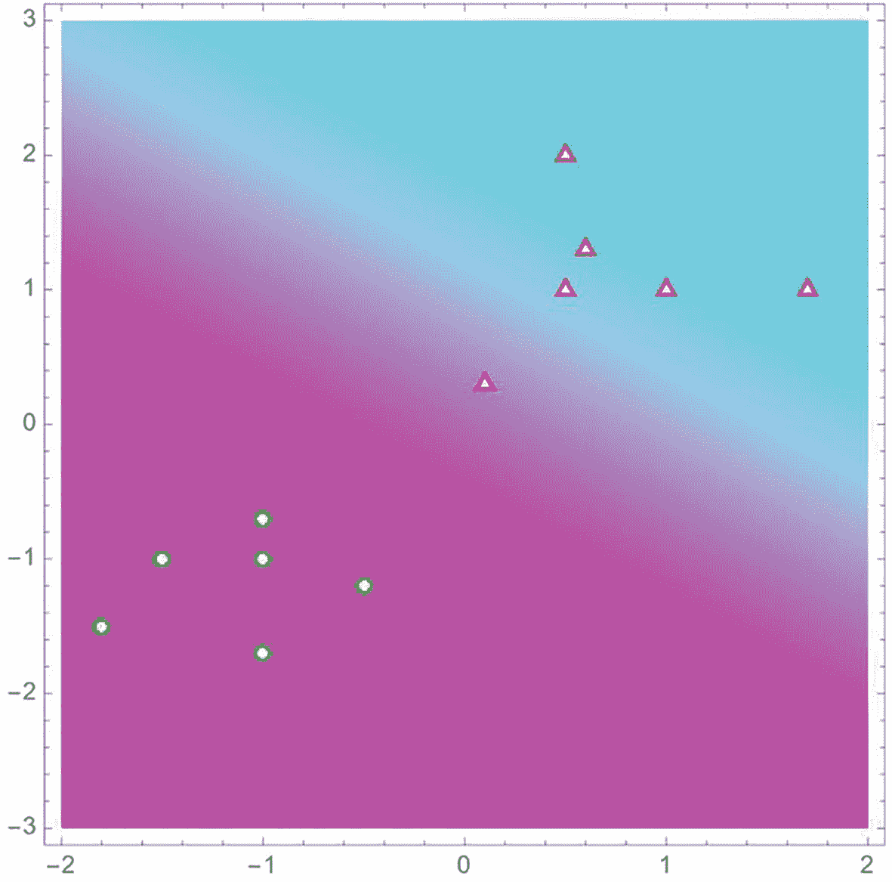

一张颜色编码的密度散点图展示了网络训练后的分类结果。Y 轴范围从 -3 到 3。X 轴范围从 -2 到 2。最高值在 (-2, 1) 处，最低值在 (2, 0.5) 处。数值为近似值。

**图 10-4** 网络分类图

```
In[8]:= Show[DensityPlot[trainedNet1[{x,y}],{x,-2,2},{y,-3,3},PlotPoints->50,ColorFunction->(RGBColor[1-#,2*#,1]&)],Plt]
Out[8]=
```

该图显示边界定义得不够清晰，接近零的点可能会被错误分类。这个结果可以归因于斜坡函数（Ramp function），该函数在接收到任何负数时输出 0，但对于任何正值，则返回该值本身。这个模型仍然可以改进，或许可以通过将激活函数改为双曲正切函数来获得更稳健的边界。


### 批次大小与轮次

若未指定批次大小，系统将自动赋予一个值，通常为 64 或 2 的幂次。请记住，批次大小表示模型在更新内部参数前，于训练过程中使用的样本数量。批次数量等于训练数据集中的样本数除以批次大小。已处理的样本数等于轮次（epochs）乘以训练样本数。通常选择能够整除训练集大小的批次大小。`MaxTrainingRounds`选项决定了训练阶段遍历训练数据集的次数。当完整遍历整个训练集一次时，这被称为一个周期（epoch）。为了更好地理解这一点，在前面的示例中自动选择了批次大小 12，这与训练集中的样本数量相等。这意味着它进入了一个批次为 12/12 -> 1 的周期或轮次。现在，轮次数被自动选择为 10000；这告诉你共有 1 * 10000 个批次。同时，已处理的样本数为 12 * (10000)，等于 120000。如果批次大小不能整除训练集，则最后一个批次的样本数会少于其他批次。

此外，通过`LossFunction -> Loss Layer`选项向容器添加损失函数层，与直接添加损失函数具有相同的效果。在此例中，你使用`MeanSquaredLossLayer`作为损失函数选项，将激活函数更改为`Tanh[x]`，将`Batchsize`设置为 5，并将`MaxTrainingRounds`调整为 1000。

```
In[9]:= net2=NetTrain[NetChain[{LinearLayer[1,"Input"->2], ElementwiseLayer[Tanh[#]&]}],trainData,All,LearningRate->0.01, PerformanceGoal->"TrainingSpeed",TrainingProgressReporting->"Panel", TargetDevice->"CPU",RandomSeeding->88888,WorkingPrecision->"Real64", LossFunction->MeanSquaredLossLayer[],BatchSize->5,MaxTrainingRounds->1000]
Out[9]=
```

图 10-5 显示损失已显著下降。

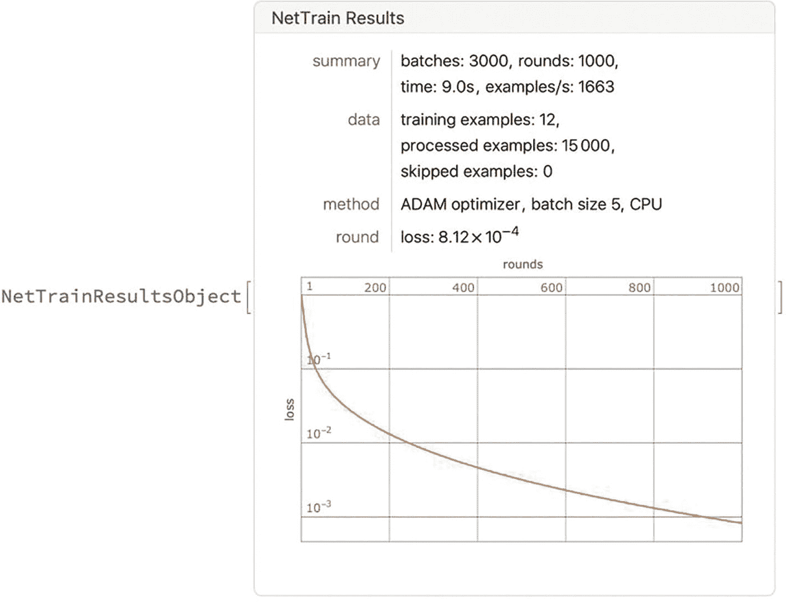

Net 2 损失图的网络训练结果示意图。它包含一个带有损失图的摘要、数据、方法和轮次。轮次范围从 1 到 1000。它呈现下降趋势，数值为估算值。

**图 10-5** Net2 的训练结果

让我们来确定分类结果。

```
In[10]:= trainedNet2=net2["TrainedNet"];
Show[DensityPlot[trainedNet2[{x,y}],{x,-2,2},{y,-3,3}, PlotPoints->50, ColorFunction->(RGBColor[1-#,2*#,1]&)],Plt]
Out[11]=
```

图 10-6 展示了两个边界如何被更好地标示出来。

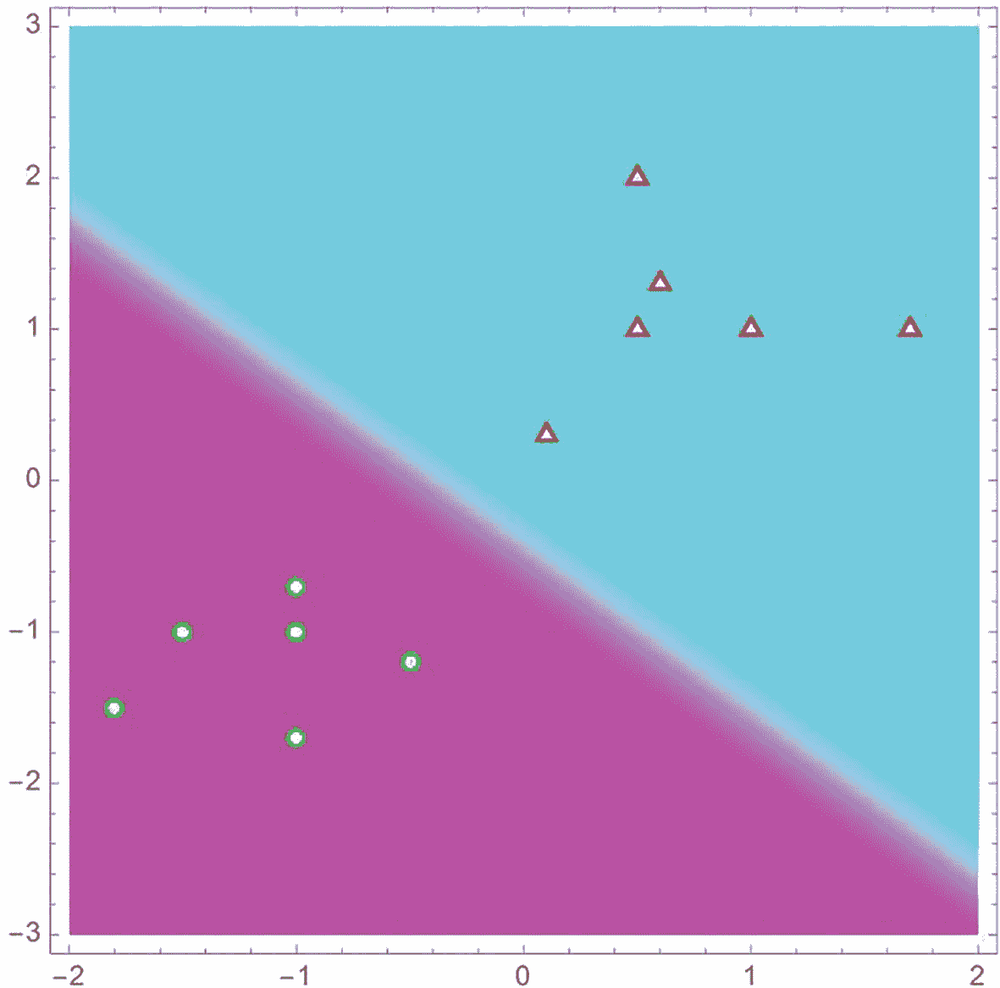

一个颜色编码的密度散点图绘制了 Net 2 的分类结果。y 轴范围从-3 到 3。x 轴范围从-2 到 2。最高值位于(2,0.4)，最低值位于(-2.3, -1)。数值为近似值。

**图 10-6** Net2 分类图

之前的模型代表了一个线性层的预测，在此分类中，预测结果与目标进行比较，以使误差越来越小。

要获取显示训练过程中误差值随轮次变化的图表，可以通过已训练网络的属性来实现。你还可以查看添加损失函数后的网络模型外观。

```
In[12]:= Dataset[{Association["LossPlot"->net2["LossPlot"]], Association["NetGraph"->net2["TrainingNet"]]}]
Out[12]=
```

图 10-7 显示了损失图，它随着轮次的增加而迅速下降。

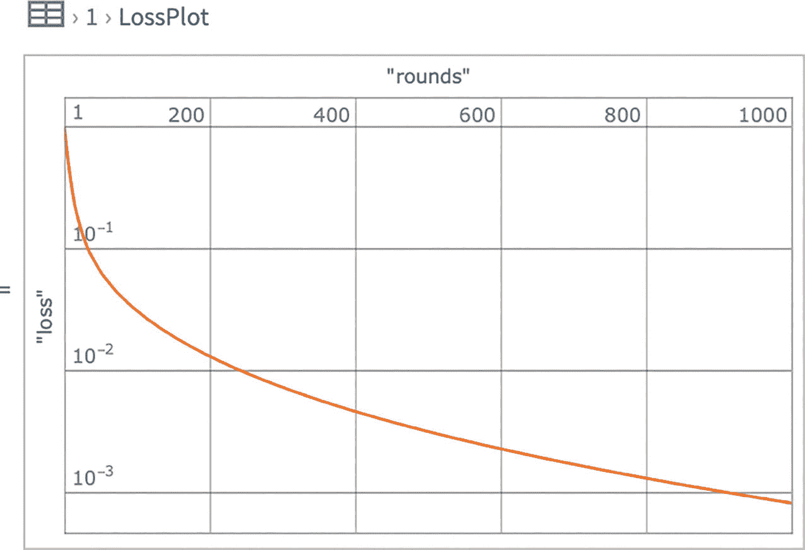

损失图轮次的网络训练对象结果图。轮次值范围从 1 到 1000，损失值范围从 10 的负 1 次方到 10 的负 3 次方。它绘制了一条下降趋势曲线。

**图 10-7** 数据集中包含的 `LossPlot`

要查看用于训练的网络，请执行以下代码。Mathematica 会根据模型的层自动向神经网络添加一个损失函数（见图 10-8）。

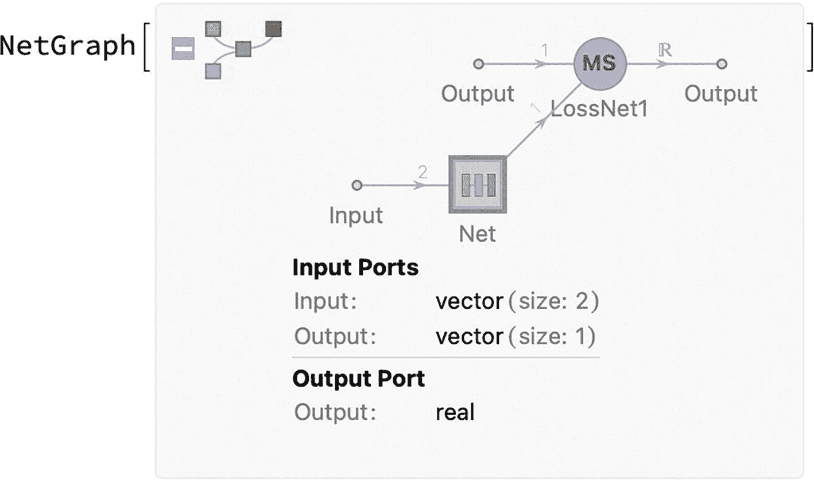

一个 Net 图的 Mathematica 示意图，包含输入端口、输出端口、向量和 Loss Net 1。损失在输入和输出之间的 NET 中被捕获。

**图 10-8** 训练阶段前的网络模型

```
In[13]:= net2["TrainingNet"]
Out[13]=
```

要查看模型的属性，请将字符串 `Properties` 作为参数添加。

```
In[14]:= net2["Properties"]
Out[14]= {ArraysLearningRateMultipliers,BatchesPerRound,BatchesPerSecond,BatchLossList,BatchMeasurements,BatchMeasurementsLists,BatchSize,BestValidationRound,CheckpointingFiles,ExamplesProcessed,FinalLearningRate,FinalPlots,InitialLearningRate,InternalVersionNumber,LossPlot,MeanBatchesPerSecond,MeanExamplesPerSecond,NetTrainInputForm,OptimizationMethod,ReasonTrainingStopped,RoundLoss,RoundLossList,RoundMeasurements,RoundMeasurementsLists,RoundPositions,SkippedTrainingData,TargetDevice,TotalBatches,TotalRounds,TotalTrainingTime,TrainedNet,TrainingExamples,TrainingNet,TrainingUpdateSchedule,ValidationExamples,ValidationLoss,ValidationLossList,ValidationMeasurements,ValidationMeasurementsLists,ValidationPositions}
```

### 训练方法 (`NetTrain`)

让我们通过 `OptimizationMethod` 来了解之前网络的训练方法。梯度下降算法的一些变体与批次大小有关。第一种是随机梯度下降（SGD）。SGD 在采取下一步之前，每次只处理一个训练批次。该算法以随机形式遍历训练样本——没有顺序模式，且一次只处理一个实例。第二种变体是批量梯度下降，这意味着批次大小被设置为训练集的大小。该方法利用所有训练样本，并且只对内部参数进行一次更新。第三种变体是小批量梯度下降，它包括将训练集划分为比整个数据集更小的分区，以便更频繁地更新模型的内部参数，从而实现收敛。要了解 SGD 和小批量 SGD 的数学原理，请参阅 Mu Li、Tong Zhang、Yuqiang Chen 和 Alexander J. Smola 的文章“Efficient Mini-Batch Training for Stochastic Optimization”（2014 年 8 月：第 661-670 页；载于《第 20 届 ACM SIGKDD 国际知识发现与数据挖掘会议论文集》）。

```
In[15]:= net2["OptimizationMethod"]
Out[15]= {ADAM, Beta1->0.9, Beta2->0.999, Epsilon->1/100000, GradientClipping->None, L2Regularization->None, LearningRate->0.01, LearningRateSchedule->None, WeightClipping->None}
```

自动选择的方法是 Adam 优化器，它使用带有自适应学习率的 SGD 方法。其他可用的方法包括 RMSProp、SGD 和 SignSGD。在可用方法中，还有选项可以指示学习率、何时进行缩放、何时使用 L2 正则化、梯度裁剪以及权重裁剪。


### 衡量性能

除了方法之外，你还可以确定在训练阶段需要考虑哪些衡量指标。这些选项取决于所使用的损失函数类型，并且与任务（如分类、回归和聚类）内在相关。对于 `MeanSquaredLossLayer` 或 `MeanAbsoluteLossLayer`，常见的选项是 `MeanDeviation`，即残差平均值的绝对值。`MeanSquare` 是残差的均方，`RSquared` 是决定系数，而标准差是残差的均方根。训练完成后，该衡量指标会出现在网络结果中（见图 10-9）。本例中使用了软符号激活函数，以尝试不同的激活函数并观察其使用效果。

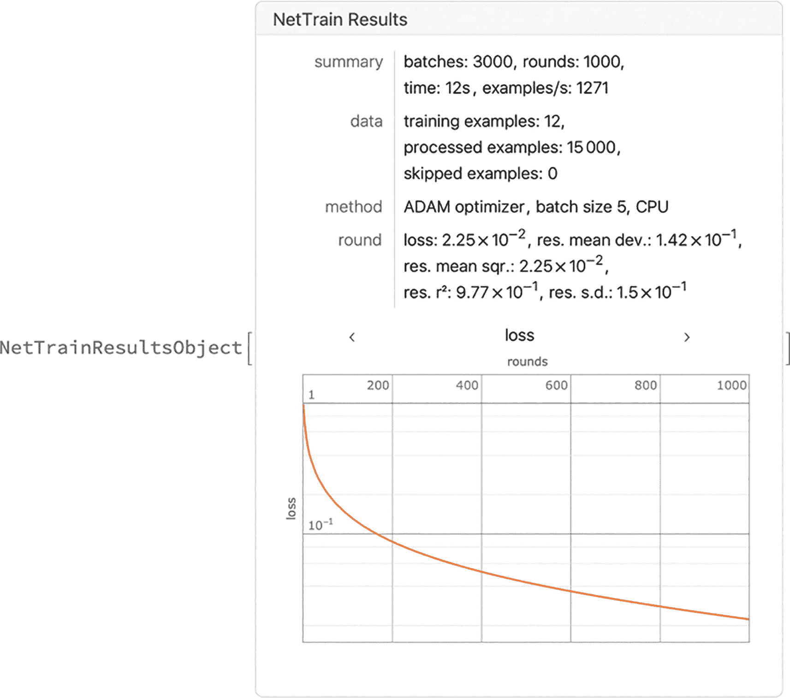

一张针对新衡量指标的损失图网络训练结果图。它包含一个摘要、数据、方法、轮次以及一张损失图。轮次范围从 200 到 1000，损失值为 10 的负一次方。它呈现出下降趋势。数值为估计值。

**图 10-9** 添加了新衡量指标的网络结果

```
In[16]:= net3 = NetTrain[ NetChain[{LinearLayer[1, "Input" -> 2], ElementwiseLayer["SoftSign"]}], trainData, All, LearningRate -> 0.01, PerformanceGoal -> "TrainingSpeed", TrainingProgressReporting -> "Panel", TargetDevice -> "CPU", RandomSeeding -> 88888, WorkingPrecision -> "Real64", Method -> "ADAM", LossFunction -> MeanSquaredLossLayer[], BatchSize -> 5, MaxTrainingRounds -> 1000, TrainingProgressMeasurements -> {"MeanDeviation", "MeanSquare", "RSquared", "StandardDeviation"}]
Out[16]=
```

### 模型评估

要访问所选衡量指标的值，请使用 `NetResultsObject`。对于训练集的值，可以在 `RoundLoss`（给出损失的平均值）、`RoundLossList`（返回训练期间损失的平均值）、`RoundMeasurements`（最后一轮训练的衡量指标）和 `RoundMeasurementsLists`（每一轮指定的衡量指标）的属性中找到。此结果如图 10-10 所示。

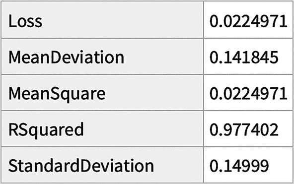

一个包含 5 行 2 列的表格，展示了新衡量指标的数据集。它列出了损失、平均偏差、均方、R 平方和标准差及其各自的衡量指标值。

**图 10-10** 包含新衡量指标的数据集

```
In[17]:= net3[#]&/@{"RoundMeasurements"}//Dataset[#]&
Out[17]=
```

要获取所有图表，请使用 `FinalPlots` 选项。

```
In[18]:= net3["FinalPlots"]//Dataset;
```

要复制衡量指标的图表，请使用 `RoundMeasurementsLists` 提取每一轮的衡量指标值。

```
In[19]:= measures=net3[#]&/@{"RoundMeasurementsLists"};
Keys[measures]
Out[20]= {{Loss,MeanDeviation,MeanSquare,RSquared,StandardDeviation}}
```

让我们绘制每一轮的值，从 `Loss` 开始，到 `StandardDeviation` 结束。你还可以看到网络模型如何划分分类边界（见图 10-11）。

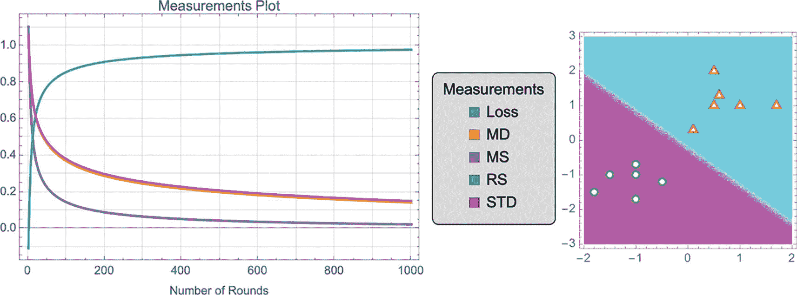

两部分。左图：一张多线图绘制了衡量指标随轮次变化的图。Y 轴范围从 0 到 1。X 轴范围从 0 到 1000。损失呈现上升趋势，而 MD、MS、RS 和 STD 呈现下降趋势。右图：一张颜色编码的密度散点图绘制了轮次衡量指标的密度。数值为近似值。

**图 10-11** 轮次衡量指标图与密度图

```
In[21]:= trainedNet3 =
net3["TrainedNet"]; Grid[{{ListLinePlot[{measures[[1, 1]](*Loss*), measures[[1, 2]] (*MeanDeviation*), measures[[1, 3]](*MeanSquare*), measures[[1, 4]] (*RSquared*), measures[[1, 5]](*StandardDeviation*)},  PlotStyle -> Table[ColorData[101, i], {i, 1, 5}], Frame -> True, FrameLabel -> {"Number of Rounds", None}, PlotLabel -> "Measurements Plot", GridLines -> All, PlotLegends -> SwatchLegend[{Style["Loss", #], Style["MD", #], Style["MS", #], Style["RS", #], Style["STD", #]}, LegendLabel -> Style["Measurements", #], LegendFunction -> (Framed[#, RoundingRadius -> 5, Background -> LightGray] &)], ImageSize -> Medium] &[Black], Show[DensityPlot[trainedNet3[{x, y}], {x, -2, 2}, {y, -3, 3}, PlotPoints -> 50, ColorFunction -> (RGBColor[1 - #, 2*#, 1] &)], plt, ImageSize -> 200]}}]
Out[21]=
```

`Loss` 和 `MeanSquared` 具有相同的值（因为损失函数是均方误差损失函数），这就是两条图形重叠的原因。平均偏差和标准差具有相似但不相同的值。构建了三个模型，每个过程中的激活函数都不同。查看这些图，你可以看到每个函数如何改变神经网络模型从训练数据中学习的方式。在前面的示例中，图形是训练过程的损失图以及与均方损失层相关的其他衡量指标。请务必查阅文档以确认衡量指标的名称；请记住，并非所有衡量指标都适用于所有损失函数。

在下一节中，你将看到如何在训练阶段生成损失图和验证图，以验证 LeNet 模型在训练期间是否在学习，以及模型在从未见过的数据（验证集）上的表现如何。

### 导出神经网络

一旦网络模型训练完成，你可以将此训练好的网络导出为 `WLNet` 格式，以便将来无需训练即可使用该网络。导出方法也适用于未初始化的网络架构。

```
In[22]:= Export["/Users/macosx/Desktop/TrainedNet3.wlnet",net3["TrainedNet"]]
Out[22]= /Users/macosx/Desktop/TrainedNet3.wlnet
```

导入它们的方式与导入任何其他文件完全相同，但可以指定导入的元素。`Net` 导入网络模型和所有已初始化的数组；`UninitializedNet` 和 `ArrayList` 用于导入线性层的数值数组对象；`ArrayAssociation` 用于以关联形式导入数值数组；`WLVersion` 用于查看构建网络所使用的 Wolfram 语言版本。以下数据集显示了所有选项（见图 10-12）。

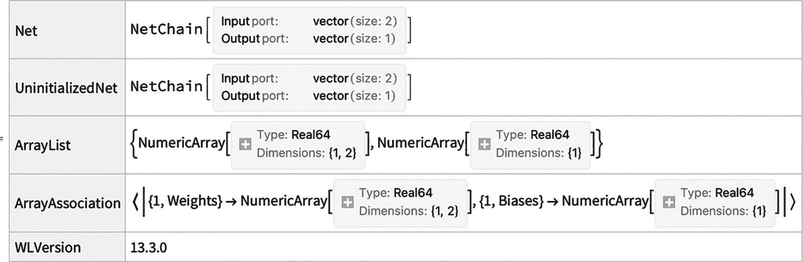

一个关于可用导入选项的数据集。它包括 `Net`、`Uninitialized Net`、`Array List`、`Array Association` 和 `W L Version`。

**图 10-12** 包含可用导入选项的数据集

```
In[23]:=Dataset@AssociationMap[Import["/Users/macosx/Desktop/TrainedNet3.wlnet",#]&,{"Net","UninitializedNet","ArrayList","ArrayAssociation","WLVersion"}]
Out[23]=
```


## Wolfram 神经网络库

Wolfram 神经网络库是一个免费访问的网站，其中包含各种预训练神经网络模型的集合。这些模型根据输入和数据类型（无论是音频、图像、数值数组还是文本）进行分类。此外，它们还根据所执行的任务类型进行分类，从音频分析或回归到分类。网站的主页如图 10-13 所示。

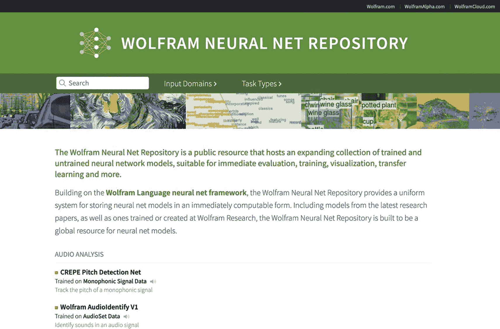

Wolfram 神经网络库主页的截图。它列出了搜索、输入域和任务类型，并带有音频分析。

图 10-13: Wolfram 神经网络库主页

在您常用的浏览器中输入 `https://resources.wolframcloud.com/NeuralNetRepository/` 即可访问该网页，或者从 Mathematica 中运行 `SystemOpen`，它将在系统的默认浏览器中打开该网页。

加载网站后，可以按输入或任务浏览网络模型。该库中的模型使用 Wolfram 语言构建，允许您在 Mathematica 中使用它们。这使得模型以可从 Mathematica 或 Wolfram Cloud 访问的形式呈现，以便快速执行。向下滚动，您会看到模型按名称和用于训练的数据以及简短描述进行组织。例如，Wolfram AudioIdentify V1 网络就是这种情况，它使用 AudioSet 数据进行训练，用于识别音频信号中的声音。要浏览类别，您可以从菜单中选择类别。图 10-14 显示了选择输入类别后网站的外观；在本例中，是接收图像作为输入的神经网络。

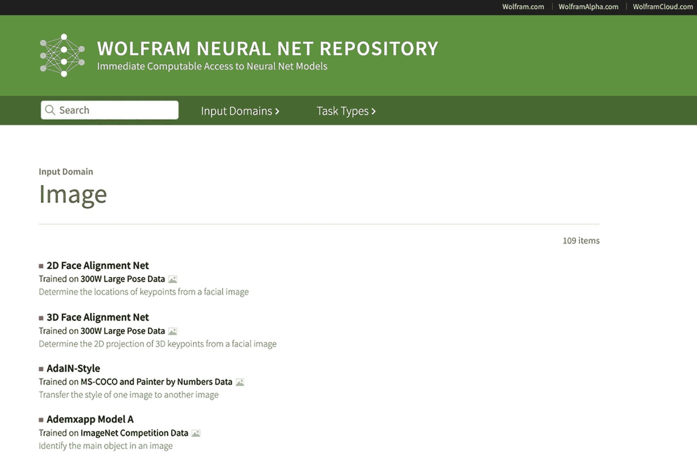

Wolfram 神经网络库类别网站的截图，列出了输入域图像。它包括 2D 人脸对齐网络、3D 人脸对齐网络、Ada IN 风格和 Ademxapp Model A。

图 10-14: 基于输入图像的类别网站

### 选择神经网络模型

选择类别后，它会显示所有与所选输入类别相关的网络模型。与 Wolfram 数据仓库类似，选择模型后，它会显示相关信息，如图 10-15 所示，其中选定的网络模型是神经网络 Wolfram ImageIdentify Net V1。

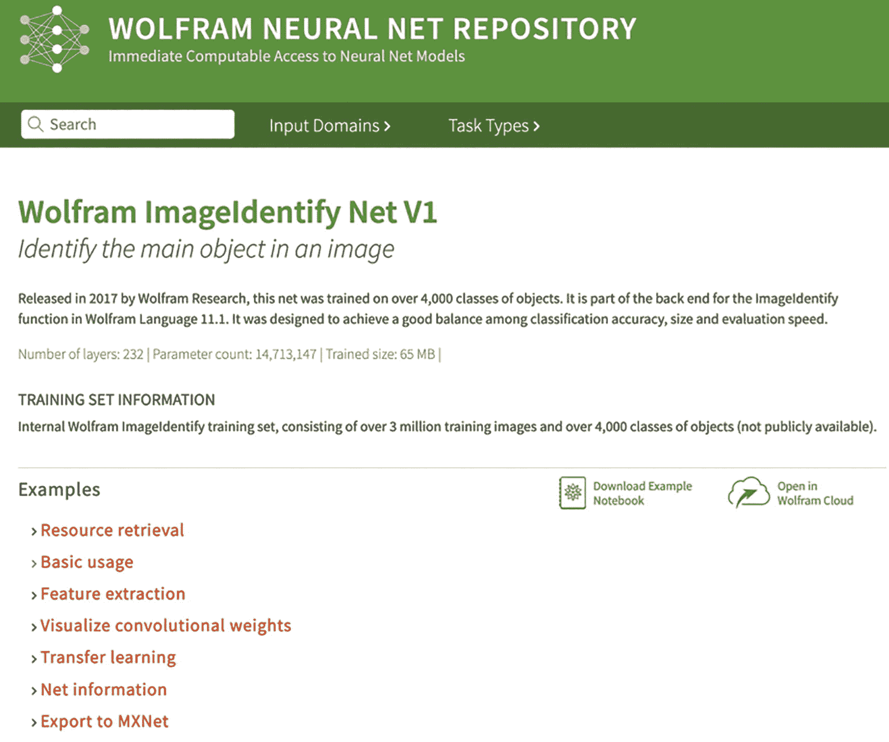

Wolfram 神经网络库类别网站的截图，列出了 ImageIdentify Net V1 及其训练集信息和示例。它包括资源材料、基本用法、特征提取、可视化卷积权重、迁移学习、网络信息以及导出到 M X Net。

图 10-15: Wolfram ImageIdentify Net V1

可以从网站导航并下载包含网络模型的笔记本，但也可以从 Mathematica 中操作。换句话说，通过 `ResourceSearch` 搜索网络模型。下面的示例展示了如果您想了解包含单词“image”的网络模型时的搜索情况（见图 10-16）。

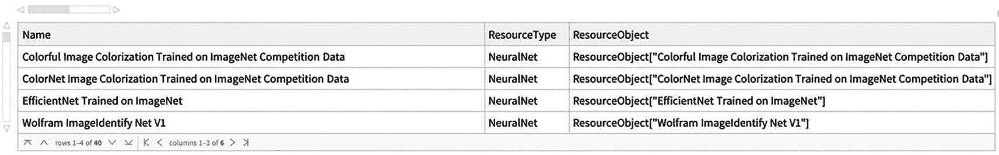

一个包含 3 列 5 行的资源数据集表格。列列出了名称、资源类型和资源对象。行包括 Colorful Image Colorization、Efficient Net 和 Wolfram ImageIdentify Net V1。

图 10-16: 资源数据集

```
In[24]:= ResourceSearch[{"Name"->"Image","ResourceType"-> "NeuralNet"}]//Dataset[#,MaxItems->{4,3}]&
Out[24]=
```

图 10-16 中显示的数据集仅包含三列用于显示目的，但您可以使用滑块浏览整个数据集。图像中未显示的列是 Description、Location 和 DocumentationLink。最后一列提供了指向网络模型页面的链接。

### 在 Mathematica 内部访问

要访问模型架构，请添加对象参数；例如，对 Wolfram ImageIdentify Net V1 网络执行以下操作（见图 10-17）。

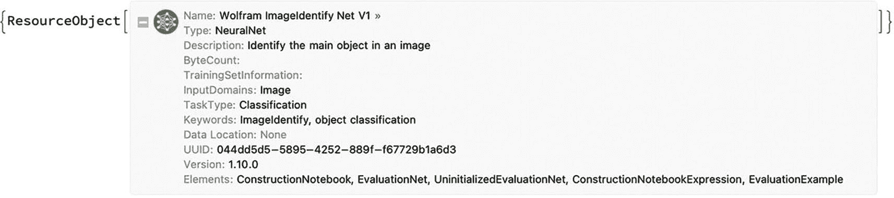

一个 Wolfram ImageIdentify Net V1 数据集。它展示了名称、类型、描述、字节数、训练集信息、输入域、任务类型、关键词、数据位置、UUID、版本和元素。

图 10-17: Wolfram ImageIdentify Net V1 资源

```
In[25]:= ResourceSearch[{"Name"->"Wolfram ImageIdentify","ResourceType"-> "NeuralNet"},"Object"]
Out[25]=
```

**注意：** 为避免从 Mathematica 访问 Wolfram 神经网络库时出现问题，请确保您已登录 Wolfram Cloud 或您的 Wolfram 账户。

以下代码在此处被抑制以访问预训练模型，但移除分号将返回预训练神经网络的 `NetChain` 对象。

```
In[26]:= ResourceSearch[{"Name"->"Wolfram ImageIdentify","ResourceType"-> "NeuralNet"},"Object"][[1]]//ResourceData;
Out[26]=
```

### 检索相关信息

关于模型的信息通过 `ResourceObject` 访问。以下是来自 ImageIdentify 模型的相关信息，以数据集形式呈现（见图 10-18）。要以数据集格式查看所有信息，请键入 `ResourceObject["Wolfram ImageIdentify Net V1"][All]//Dataset[#]&`。

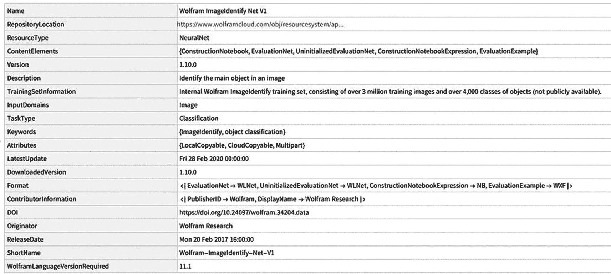

一个包含 20 行 2 列的表格，表示数据集属性。它包括名称、仓库位置、资源类型、内容元素、版本、描述、训练集信息、输入域、任务类型、关键词、属性、最新更新、下载版本、格式、发起者、发布日期和短名称。

图 10-18: Wolfram ImageIdentify Net V1 部分属性的数据集

```
In[27]:= Dataset[AssociationMap[ResourceObject["Wolfram ImageIdentify Net V1"],{"Name","RepositoryLocation","ResourceType","ContentElements","Version","Description","TrainingSetInformation","InputDomains","TaskType","Keywords","Attributes","LatestUpdate","DownloadedVersion","Format","ContributorInformation","DOI","Originator","ReleaseDate","ShortName","WolframLanguageVersionRequired"}]]
Out[27]=
```

这里，通过几个步骤，介绍了访问训练好的神经网络以及与之相关的许多相关信息的方法。需要注意的是，该过程也用于查找 Wolfram Cloud 中的其他资源或本地资源，而不仅仅是神经网络，因为通常 `ResourceSearch` 会在 Wolfram 资源系统中查找对象。Wolfram 神经网络库中的神经网络模型就是这种情况。

## LeNet 神经网络

下面的示例研究了一个名为 LeNet 的神经网络模型。尽管可以像之前看到的那样从 Wolfram 资源访问该模型，但也可以使用 `NetModel` 命令对 Wolfram 神经网络库中的网络执行操作。为了更好地了解如何使用这个网络，让我们首先查看该网络的描述、名称、使用方法以及首次被提出的地方。


### LeNet 模型

神经网络 `LeNet` 是深度学习领域中的一种卷积神经网络。`LeNet` 被公认为最早推动深度学习的卷积网络之一。该网络曾用于字符识别，以识别手写数字。如今，许多架构都基于 `LeNet` 神经网络架构，但这里我们重点关注 Wolfram 神经网络库中的版本。该架构由四个关键操作组成：卷积、非线性变换、下采样（或池化）以及分类。要了解更多关于 `LeNet` 卷积神经网络的信息，请参阅 Charu C. Aggarwal 所著的 *《神经网络与深度学习：教科书》*（Springer，2018 年）。通过 `NetModel`，您可以获取已预训练的 `LeNet` 网络的相关信息。

```
In[28]:= NetModel["LeNet Trained on MNIST Data",#]&/@{"Details","ShortName","TaskType","SourceMetadata"}//Column
Out[28]= This pioneer work for image classification with convolutional neural nets was released in 1998\. It was developed by Yann LeCun and his collaborators at AT&T Labs while they experimented with a large range of machine learning solutions for classification on the MNIST dataset.
LeNet-Trained-on-MNIST-Data
{Classification} Y. LeCun, L. Bottou, Y. Bengio, P. Haffner, "Gradient-Based Learning Applied to Document Recognition," Proceedings of the IEEE, 86(11), 2278-2324 (1998),Source->http://yann.lecun.com/exdb/lenet,Date->DateObject[{1998},Year,Gregorian,-5.]|>
```

**注意**

要使用 `NetModel` 访问模型的所有属性，请将属性作为第二个参数添加——`NetModel["LeNet Trained on MNISt Data", "Properties"]`。

该模型接收的输入由尺寸为 28 x 28 的灰度图像组成，并且该模型在 MNIST 数据集上的性能达到 98.5%。

```
In[29]:= NetModel["LeNet Trained on MNIST Data",#]&/@{"TrainingSetInformation","InputDomains","Performance"}//Column
Out[29]= MNIST Database of Handwritten Digits, consisting of 60,000
training and 10,000 test grayscale images of size 28x28.
{Image}
This model achieves 98.5% accuracy on the MNIST dataset.
```

### MNIST 数据集

该网络用于评级，正如其在 `TaskType` 中所呈现的那样。这些数字存储在一个名为 MNIST 的数据库中。MNIST 数据库是一个广泛的手写数字数据库（见图 10-19），包含 60,000 张训练图像和 10,000 张测试图像，后者用于最终评估神经网络模型的效果。要观察完整的数据集，您可以从 Wolfram 数据仓库中通过 `ResourceData` 和 `ImageDimensions` 加载数据，以验证图片尺寸是否为 28 x 28 像素。

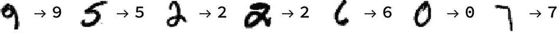

一个随机样本显示为 9 → 9、5 → 5、2 → 2、6 → 6、0 → 0 和 7 → 7。

**图 10-19**  
MNIST 训练集的随机样本

```
In[30]:= (*This is for seven elements randomly sampled, but you can check the whole data set.*)
TableForm[
SeedRandom[900];
RandomSample[ResourceData["MNIST", "TrainingData"], 7],
TableDirections -> Row]
Map[ImageDimensions, %[[1 ;; 7, 1]]]
(*Test set : ResourceData["MNIST","TestData"] *)
Out[30]//TableForm=
```

```
Out[31]= {{28,28},{28,28},{28,28},{28,28},{28,28},{28,28},{28,28}}
```

图 10-19 展示了数字图像、它们所属的类别以及每张图像的尺寸。您可以提取训练集和测试集，以便后续使用。

```
In[32]:= {trainData,testData}={ResourceData["MNIST","TrainingData"], ResourceData["MNIST","TestData"] };
```

## LeNet 架构

首先，通过 `NetModel` 命令下载神经网络，该命令从 Wolfram 神经网络库中提取模型。接下来的练习将加载未经训练的模型，因为您将自行进行训练和验证过程。需要注意的是，Wolfram 语言中的 `LeNet` 模型是原始架构的一个变体（见图 10-20）。

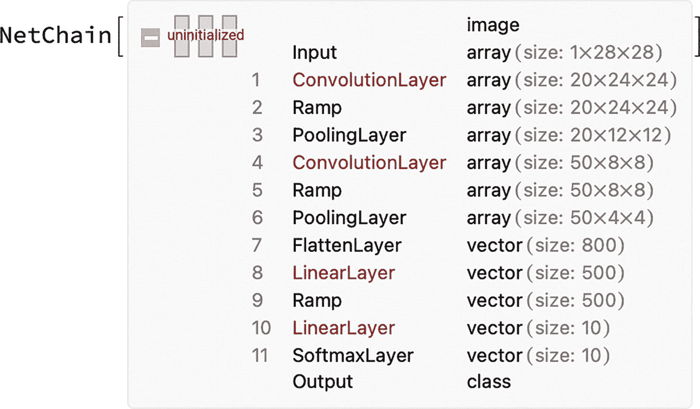

一个 11 层代码展示了 `LeNet` 架构。它包括输入卷积层、斜坡函数层、池化层、卷积层、斜坡函数层、池化层、展平层、线性层、斜坡函数层、线性层、Softmax 层和输出层。

**图 10-20**  
LeNet 架构

```
In[33]:= uninitLeNet=NetModel"LeNet Trained on MNIST Data","UninitializedEvaluationNet"
Out[33]=
```

Wolfram 神经网络库中的 `LeNet` 网络由 11 层构成。标为红色的层是包含可学习参数的层：两个卷积层和两个线性层。

## MXNet 框架

使用 MXNet 框架，我们首先通过 MXNet 操作图来可视化该网络的处理过程（见图 10-21）。

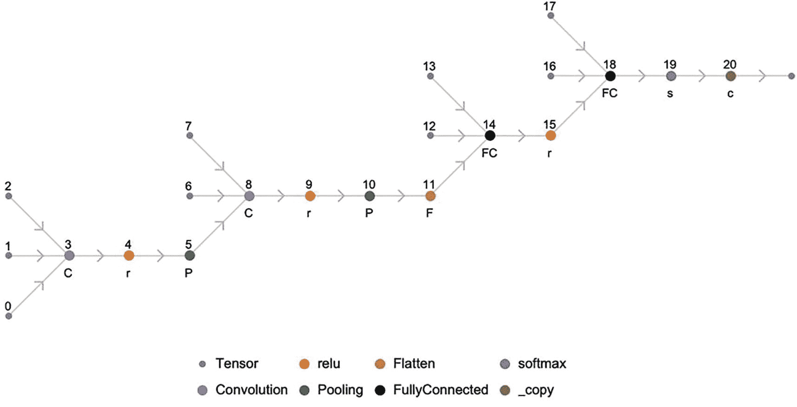

`LeNet` 架构的 MXNet 图。节点编号从 1 到 20，标签包括 C、r、P、C、r、P、F、F、C、r、F、C、s 和 c，分别代表张量、ReLU、展平、Softmax、卷积、池化、全连接和复制。

**图 10-21**  
LeNet 架构的 MXNet 图

```
In[34]:= Information[uninitLeNet,"MXNetNodeGraphPlot"]
Out[34]=
```

`LeNet` 架构从输入操作开始，该操作将图像转换为数值数组，随后是第一个操作。这个卷积操作返回一个 20 特征图，紧接着节点 3 和 4 之后是修正线性单元（ReLU）激活函数。然后，第一个最大池化操作（下采样层）在池化节点 5 中选择最大值。接着，第二个卷积操作返回一个 50 特征图，紧接着节点 8 和 9 之后是 ReLU 激活函数。最后一个卷积操作之后是另一个最大池化操作（节点 10），随后是一个展平操作（节点 11），该操作将池化操作的输出展平为单个向量。最后一个池化操作产生一个 50*4*4 的数组，展平操作返回一个 800 维向量，作为下一个操作的输入。接下来，您会看到第一个全连接层（节点 14）；第一个全连接层具有 ReLU 函数（节点 15），第二个全连接层具有 Softmax 函数（节点 19）。最后一个全连接层可以解释为一个多层感知机（MLP），它将输出归一化为概率分布，以指示每个类别的概率。最后，张量通过解码器转换为类别。节点 4、9 和 15 是非线性操作（ReLU）层，节点 19 应用 Softmax 函数进行输出分类。总结来说，架构如下：张量（输入）、卷积、ReLU、池化、卷积、ReLU、池化、展平、全连接（带 ReLU）、全连接（带 Softmax）和类别输出。


### 准备 LeNet

由于 `LeNet` 是一个用于图像分类的神经网络，因此必须使用编码器和解码器。`NetEncoder` 插入到输入 `NetPort` 中，而 `NetDecoder` 则位于输出 `NetPort` 上。查看 `NetGraph`（见图 10-22）可能有助于理解 Wolfram 语言内部的处理过程。点击输入和输出可以显示相关信息。

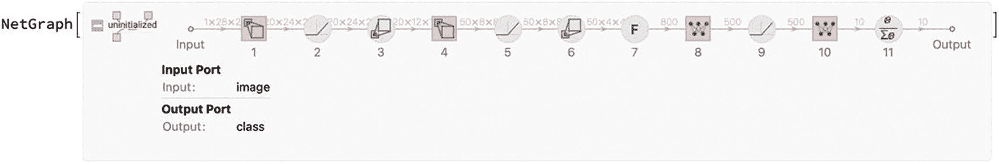

`LeNet` 模型的图。它以输入 `NetPort` 开始，输出 `NetDecoder` 是值为 1 到 11 的 `NetPort`。

**图 10-22** `LeNet` 模型的 `NetGraph`

```
In[35]:= NetGraph[uninitLeNet]
Out[35]=
```

你可以提取编码器和解码器来检查它们的内部结构。编码器接收任意颜色空间、尺寸为 28 x 28 的图像，并将图像编码为灰度颜色空间，然后返回一个大小为 1 x 28 x 28 的数组。另一方面，解码器是一个类别解码器，它接收一个大小为 10 的向量，该向量指示类别标签（0、1、2、3、4、5、6、7、8 和 9）的概率。

```
In[36]:={enc=NetExtract[uninitLeNet,"Input"],dec=NetExtract[uninitLeNet,"Output"]}//Row;
```

首先，让我们看看网络模型如何与 `NetInitialize` 配合使用；例如，使用训练集中的一张数字 0 的图像。

```
In[37]:= testNet=NetInitialize[uninitLeNet,RandomSeeding->8888];
testNet@trainData[[1,1]](*TrainData[[1,1]] 属于数字 0*)
Out[38]= 9
```

网络返回该图像属于类别 9，这意味着该图像是数字 9；显然，这是错误的。让我们再次尝试 `NetInitialize`，但使用不同的可用方法。将 `all` 作为 `NetInitialize` 的第二个参数，会覆盖网络上任何预先存在的学习参数。

```
In[39]:= {net1, net2, net3, net4} =   Table[NetInitialize[uninitLeNet, All, Method -> i,     RandomSeeding -> 8888], {i, {"Kaiming", "Xavier", "Orthogonal",      "Identity"}}]; {net1[trainData[[1, 1]]], net2[trainData[[1, 1]]], net3[trainData[[1, 1]]], net4[trainData[[1, 1]]]}
Out[40]= {9,9,7,3}
```

每个网络模型都未能将图像正确分类。这是因为神经网络尚未经过训练，而 `NetInitialize` 只是随机初始化可学习参数，并未进行适当的训练。这就是为什么使用 `NetInitialize` 时，模型无法正确分类给定图像的原因。但首先，让我们建立网络图以更好地说明模型，如图 10-23 所示。

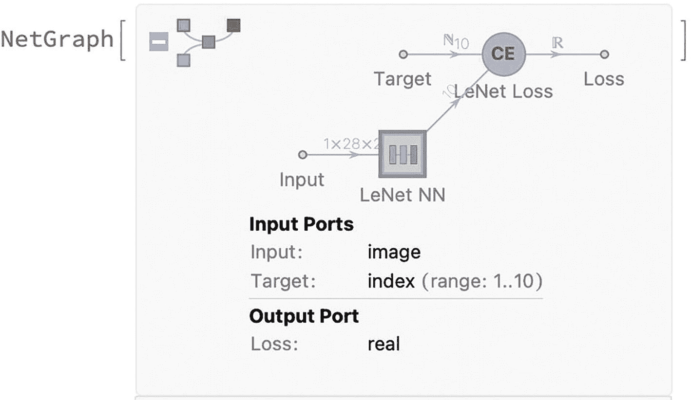

`LeNet` 就绪图示意图。它包括输入、`LeNet NN`、`LeNet loss` 以及带有输入和输出端口的目标。

**图 10-23** `LeNet` 就绪图

```
In[41]:= leNet=NetInitialize[NetGraph[ uninitLeNet,  "LeNet Loss" -> CrossEntropyLossLayer@"Index"|>, {NetPort@"Input" -> "LeNet NN", "LeNet NN" -> NetPort@{"LeNet Loss", "Input"}, NetPort@"Target" -> NetPort@{"LeNet Loss", "Target"}}], RandomSeeding -> 8888]
Out[41]=
```

在训练网络之前，必须使验证集适合目标输入中的 `CrossEntropyLossLayer`，因为类别从 0 开始到 9 结束，而 `Index` 目标从 1 开始并递增。因此，目标输入需要在 1 到 10 之间。

```
In[42]:= trainDts=Dataset@Join[AssociationThread["Input"->#]& /@Keys[trainData],AssociationThread["Target"-> #]&/@Values[trainData]+1,2];
testDts=Dataset@Join[AssociationThread["Input"->#]& /@Keys[testData],AssociationThread["Target"-> #]&/@Values[testData]+1,2];
```

训练集和验证集采用数据集的形式。图 10-24 中仅显示了四个随机样本。

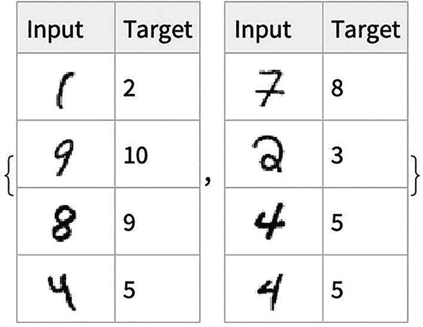

2 个表格，各有 2 列和 5 行。列标题为输入和目标。条目如下。表 1。第 1 列：1、9、8 和 4。第 2 列：2、10、9 和 5。表 2。第 1 列：7、2、4 和 4。第 2 列：8、3、5 和 5。

**图 10-24** 训练集和测试集的数据集

```
In[44]:= BlockRandom[SeedRandom[999];
{RandomSample[trainDts[[All]],4],RandomSample[testDts[[All]],4]}]
Out[44]=
```

### LeNet 训练

既然你已经掌握了这个神经网络模型的处理过程，就可以继续训练该模型了。使用 `NetTrain`，你可以逐步修改神经网络的可学习参数以降低损失。接下来的训练代码设置了上一节中看到的选项，但这里你添加了训练中也可用的新选项。第一个是 `TrainingProgressMeasurements`。`TrainingProgressMeasurements` 可以指定诸如准确率和精确率之类的度量。这些度量在训练阶段按轮次或批次进行测量。`ClassAveraging` 用于指定获取指定度量的宏平均或微平均 `<|”Measurement” -> “measurement” (Accuracy, RSquared, Recall, MeanSquared, etc.), “ClassAveraging”->”Macro”|>`。

第二个选项是 `TrainingStoppingCriterion`，用于添加提前停止以避免训练阶段过拟合，其依据是不同的标准，例如当验证损失不再改善时停止训练，测量某个度量（准确率、精确率、损失等）的绝对或相对变化，或者当损失或其他标准在特定轮数后没有改善时停止训练 `<|Criterion->”measurement” (Accuracy, Loss, Recall, etc.), “Patience”-> # of rounds|>`。

```
In[45]:= netResults =  NetTrain[leNet, trainDts, All, ValidationSet -> testDts,   MaxTrainingRounds -> 15, BatchSize -> 2096,   LearningRate -> Automatic, Method -> "ADAM", TargetDevice -> "CPU",   PerformanceGoal -> "TrainingMemory", WorkingPrecision -> "Real32",   RandomSeeding -> 99999,   TrainingProgressMeasurements -> { "Accuracy",      "ClassAveraging" -> "Macro"|>,     "Precision", "ClassAveraging" -> "Macro"|>    ,  "F1Score", "ClassAveraging" -> "Macro"|>    ,  "Recall", "ClassAveraging" -> "Macro"|>    ,  "ROCCurvePlot", "ClassAveraging" -> "Macro"|>    ,  "ConfusionMatrixPlot",      "ClassAveraging" -> "Macro"|>    }, TrainingStoppingCriterion ->  "Loss", "AbsoluteChange" -> 0.001|>]
Out[45]=
```

训练阶段的最终结果如图 10-25 所示。

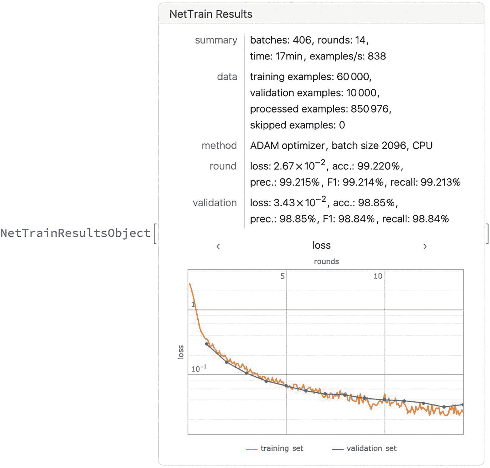

`LeNet` 训练对象在损失图轮次上的结果的多线图。它包括摘要、数据、方法、轮次和验证，训练集和验证集呈现下降趋势。

**图 10-25** `LeNet` 训练的网络结果

提取训练好的模型并附加网络编码器和解码器，是因为训练好的网络在输入和输出端口没有附带编码器和解码器。

```
In[46]:=NetExtract[netResults["TrainedNet"],"LeNet NN"];
trainedLeNet=NetReplacePart[%,{"Input"->enc,"Output"->dec}];
```


### LeNet 模型评估

下图（见图 10-26）展示了训练集的跟踪测量指标和图表。训练集的测量指标位于 `RoundMeasurements` 属性中。要获取每一轮的值列表，请使用 `RoundMeasurementsLists`。训练集的性能通过轮次测量指标进行评估，而测试集则通过验证测量指标进行评估。此外，两种情况下都展示了 ROC 曲线和混淆矩阵图。

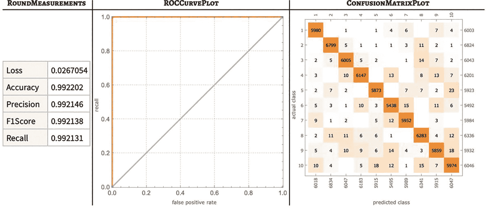

3 部分。1. 一个包含 2 列 5 行的轮次测量指标表格，列出了损失、准确率、精确率、F1 分数和召回率。2. 一个 ROC 曲线的折线图，绘制了召回率与假阳性率的关系。它呈现出一条上升趋势曲线。3. 一个实际类别与预测类别的混淆矩阵。

**图 10-26** 训练集测量指标

```
In[48]:= netResults["RoundMeasurements"][[1 ;; 5]];
Normal[netResults["RoundMeasurements"][[6 ;; 7]]];
Grid[{{Style["RoundMeasurements", #1, #2], Style[%[[1, 1]], #1, #2],
Style[%[[2, 1]], #1, #2]}, {Dataset[%%], %[[1, 2]], %[[2, 2]]}}, Dividers -> Center] &[Bold, FontFamily -> "Alegreya SC"]
Out[50]=
```

要查看模型在验证集上的表现（见图 10-27），请参阅 `ValidationMeasurements`。要获取每一轮的值列表，请使用 `ValidationMeasurementsLists`。

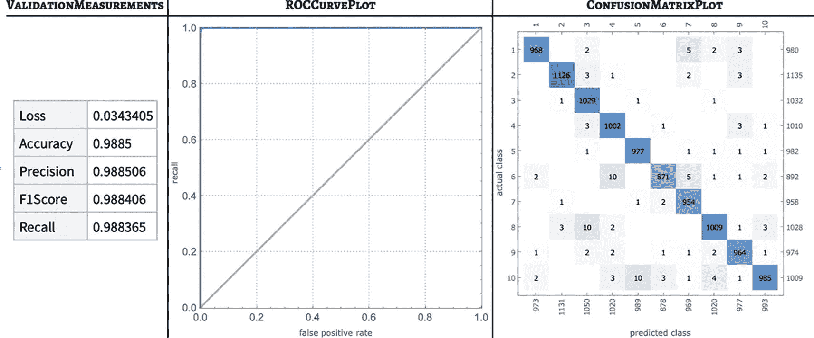

3 部分。1. 一个包含 2 列 5 行的验证测量指标表格，列出了损失、准确率、精确率、F1 分数和召回率。2. 一个 ROC 曲线的折线图，绘制了召回率与假阳性率的关系。它呈现出一条上升趋势。3. 一个混淆矩阵图，绘制了实际类别与预测类别的关系。

**图 10-27** 验证集测量指标

```
In[51]:= netResults["ValidationMeasurements"][[1 ;; 5]];
Normal[netResults["ValidationMeasurements"][[6 ;; 7]]];
Grid[{{Style["ValidationMeasurements", #1, #2],
Style[%[[1, 1]], #1, #2], Style[%[[2, 1]], #1, #2]}, {Dataset[%%], %[[1, 2]], %[[2, 2]]}}, Dividers -> Center] &[Bold, FontFamily -> "Alegreya SC"]
Out[53]=
```

### 测试 LeNet

完成训练并审查了轮次和验证测量指标后，你现在可以准备用一些困难图像来测试训练好的 LeNet 神经网络，看看它的表现如何（见图 10-28）。

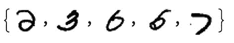

一个测试集读取为 {2, 3, 6, 6, 7}。

**图 10-28** MNIST 测试集中的困难示例

```
In[54]:= expls = Keys[{testData[[2150]], testData[[3910]], testData[[6115]], testData[[6011]], testData[[7834]]}]
Out[54]=
```

选定的图像属于数字 2、3、6、5 和 7。

```
In[55]:= trainedLeNet[expls, "TopProbabilities"]
Out[55]= {{2 -> 0.999397}, {3 -> 0.999856}, {6 -> 0.906024}, {6 -> 0.990975}, {7 -> 0.999853}}
```

使用 `TableForm` 写出所有包含最高概率的结果。

```
In[66]:= TableForm[Transpose@{trainedLeNet[expls, {"TopDecisions", 2}], trainedLeNet[expls, {"TopProbabilities", 2}]}, TableHeadings -> {Map[ToString, {2, 3, 6, 5, 7}, 1], {"Top Decisions", "Top Probabilities"}}, TableAlignments -> Center]
Out[66]//TableForm=
|Top Decisions  Top Probabilities
____|___________________________________
2   |3              3->0.000580186
|2              2->0.999397
|
3   |9              9->0.0000792077
|3              3->0.999856
|
6   |0              0->0.0904324
|6              6->0.906024
|
5   |5              5->0.00699159
|6              6->0.990975
|
7   |3              6->0.990975
|7              7->0.999853
```

训练好的网络错误分类了数字 5 的图像，因为最高决策要么是 5 要么是 6，而概率最高的是 6，这是错误的。此外，你还可以看到最高决策的概率。在测试集中评估训练好的网络的另一种形式是使用 `NetMeasurements` 来设置网络模型、测试集和感兴趣的测量指标。在本例中，感兴趣的测量指标是 `ConfusionMatrixPlot`（见图 10-29）。

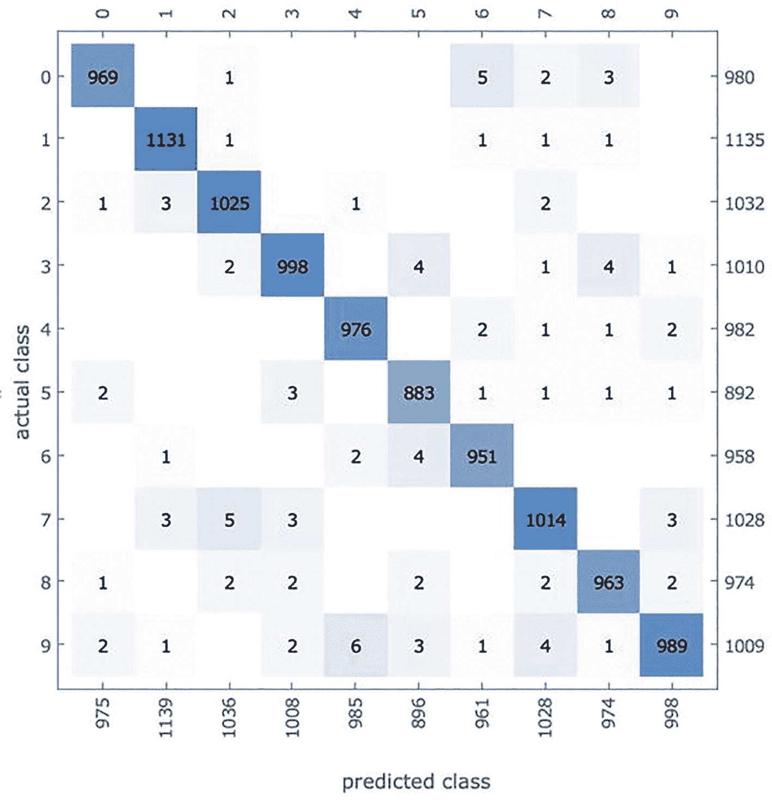

一个混淆矩阵绘制了实际类别与预测类别的关系。对角线值读取为 969、1131、1025、998、976、883、951、1014、963 和 989。这些值是估算的。

**图 10-29** 来自 `NetMeasurements` 的 `ConfusionMatrixPlot`

```
In[67]:= NetMeasurements[trainedLeNet, testData, "ConfusionMatrixPlot"]
Out[67]=
```

## GPT 与 LLM 基础

本节探讨 Wolfram 语言中可用的神经网络 GPT 模型。你将学习生成式预训练 Transformer (GPT) 的基础知识、Mathematica 内部一些 GPT 模型的架构，以及新的 LLM（大型语言模型）Mathematica 功能。

### 简要概述

GPT 是一系列 AI 模型，它使用深度学习和 Transformer 架构，通过分析前面的文本来生成类似人类的文本。LLM 是一个更广泛的类别，包含经过训练以理解和生成人类可读文本的模型。GPT 模型属于 LLM 类别，仅代表更广泛的 LLM 框架内的一种模型。

### Wolfram 语言中的 LLM

Wolfram 语言提供了几种新的基于 LLM 的功能，包括以下内容。

- **聊天笔记本**：一项新功能，能够像传统 Mathematica 笔记本一样，与 LLM（GPT-3 等）进行高效且便捷的对话
- **Wolfram 提示词仓库**：由社区创建的有用提示词集合，便于访问 LLM 范围的应用
- **LLM 函数集成**：在 Mathematica 中无缝集成 LLM 函数
- **GPT-1 和 GPT-2**：可从 Wolfram 神经网络仓库获取

**注意**

对于 Mathematica 中的 LLM 服务，需要外部 API 访问。确保你的 API 密钥有效；例如，对于 OpenAI，需要一个包含账单信息的活跃 Chat GPT 账户。请注意，API 费用与其订阅计划是分开的，并根据所使用的模型而有所不同。请务必阅读 OpenAI 文档以了解定价和账户详情。

要连接到 OpenAI GPT 服务，你首先需要建立连接。最直接的连接路径是通过设置或偏好设置部分。从那里选择 AI 设置选项，它会显示与聊天笔记本、服务、角色和工具相关的各种选项卡。默认选项卡包含角色、LLM 服务和温度（模型创造力）等通用设置。要继续，请转到“服务”选项卡，单击“身份验证”，然后单击“连接”。这会触发一个 WolframConnector 弹出窗口，请求密钥访问权限，如图 10-30 所示。

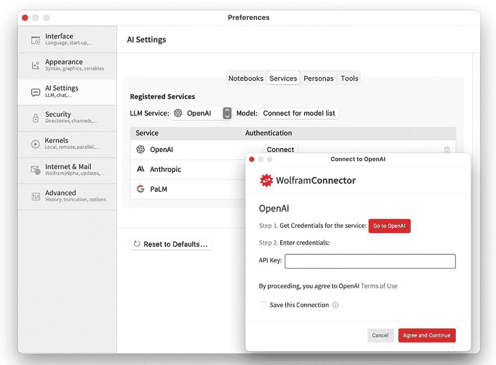

大型语言模型中偏好设置窗口的屏幕截图。已选择 AI 设置选项以及所需的 LLM 模型和 LLM 服务。Wolfram 连接器打开 OpenAI，包含 2 个步骤以及带有“同意并继续”按钮的 API 密钥。

**图 10-30** 从 Mathematica 连接 LLM 服务的 AI 设置

要开始，请输入密钥，通过单击复选框保存，并同意使用条款。一旦链接成功，身份验证下方会出现一个复选标记，如图 10-30 所示。如果未链接有效的 API，LLM 服务将无法工作。要移除密钥，请单击“断开连接”并重复之前的步骤。

**注意**

如需快速获取 API 和 LLM 支持，请访问 [`https://support.wolfram.com/`](https://support.wolfram.com/)


### 聊天笔记本

除了常规笔记本外，还开发了新型笔记本。这些笔记本专门用于大语言模型（LLM）任务，即支持聊天功能的聊天驱动型笔记本。要创建新笔记本，请前往 `文件 ➤ 新建`，然后选择 `支持聊天` 或 `聊天驱动笔记本`。默认情况下，支持聊天的笔记本使用带有 `代码助手` 角色（用于设定 LLM 的回复风格）的输入聊天单元格，而聊天驱动型单元格则使用 `PlainChat`（基础对话，不执行 Wolfram 代码），如图 10-31 所示。

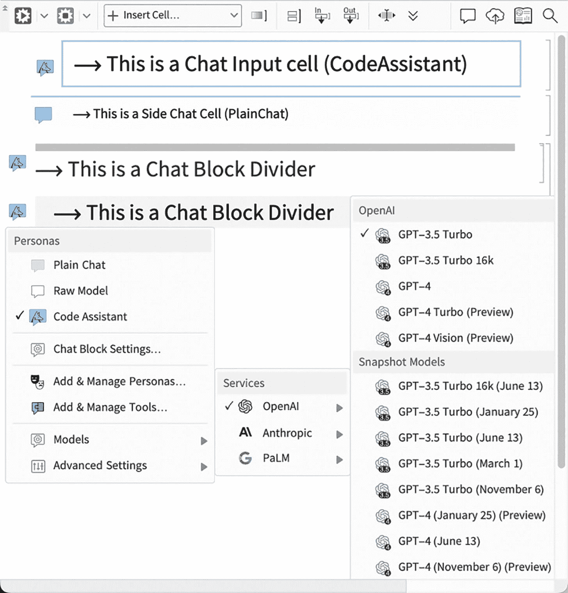

一张可用 OpenAI 模型插入单元格的截图。第一个是聊天输入单元格、侧边聊天单元格、带角色的聊天块分隔符、OpenAI、快照模型和服务。

**图 10-31** 多种聊天单元格及 OpenAI 可用模型

除了不同的单元格，图 10-31 还展示了可供使用的各种角色和 GPT 模型。您可以选择适合自己需求的模型。以下示例中使用的基础模型版本是 `GPT-3.5 Turbo`。

要创建新的聊天单元格，按一次 `` ` `` 键。按两次可创建侧边聊天，按三次可创建聊天系统输入。要在常规笔记本中启用此功能，请点击右上角的聊天单元格图标（见图 10-31）。选择“启用 AI 聊天功能”以激活。选择“自动结果分析”选项，可获取 LLM 对输出代码的提示。尝试图 10-32 所示的示例，检查一切是否正常运行。

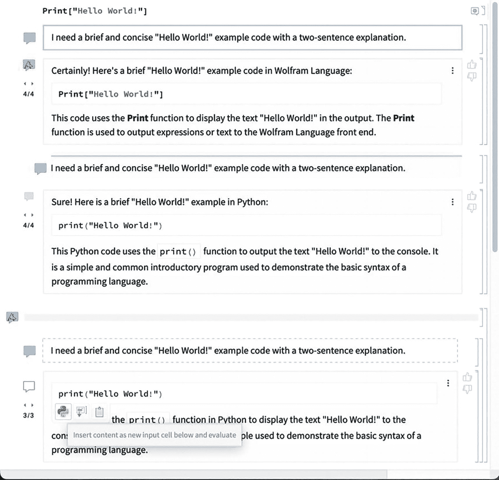

命令提示符显示 `print, Hello World`，并带有来自代码助手、普通聊天和原始模型的输出选项。

**图 10-32** `CodeAssistant`、`PlainChat` 和 `RawModel` 的示例提示与输出

在图 10-32 中，右侧单元格括号内可见一个聊天图标；此选项允许您像在 Mathematica 中使用 Wolfram 代码一样使用 LLM。聊天历史是顺序记录的，您也可以使用聊天箭头访问对话历史输出。侧边聊天单元格或块/分隔符用于分隔聊天。不同的角色会产生不同的回复；`CodeAssistant` 聊天意味着提示使用 Wolfram 代码，而 `Plain` 和 `RawChat` 则会产生输出，但并不意味着输出与 Wolfram 代码相关（除非在提示中指定），因此可能会使用 Python 代码。将鼠标悬停在代码部分上，可以选择将其作为新评估的单元格插入、直接插入或复制。

> **注意：** 请保持提示简洁；务必验证所选模型，以避免意外费用，因为不同模型基于 token 数量的成本不同。

聊天单元格可以重新运行提示并重新生成回复。但请记住，LLM 提示并非由 Mathematica 内核运行，因此历史记录保存在笔记本中。所以，关闭笔记本不会清除对话。

## Wolfram 提示仓库

Wolfram 提示仓库让您可以访问一个庞大且经过精心策划的提示库，包括 LLM 提示、角色和自定义函数。其导航方式与其他仓库类似。从可访问的部分中选择，以找到您想要的提示或角色，用于定制风格的对话。选择提示后，会提供各种选项，例如聊天示例以及如何在 Mathematica 中使用它。该平台还支持上传、下载和使用各种 LLM 组件，如图 10-33 所示。


一张 Wolfram 提示仓库的截图，包含搜索、角色、函数、修饰符和提交提示选项。在“角色”选项下的“查看全部 58 个提示”选项会打开一个位于右下角的 `MockInterviewer AI` 标签页。

**图 10-33** 显示 `MockInterviewer` 提示页面的 Wolfram 提示仓库

例如，您可以使用不同的角色来格式化输出；从下拉菜单中选择角色（见图 10-31）。要下载角色，请前往 AI 设置中的 `角色` 标签页，通过提示仓库安装（见图 10-33）或输入角色 URL。安装完成后，该角色应如图 10-34 所示可用；也可以通过 `添加和管理角色` 来完成此操作。

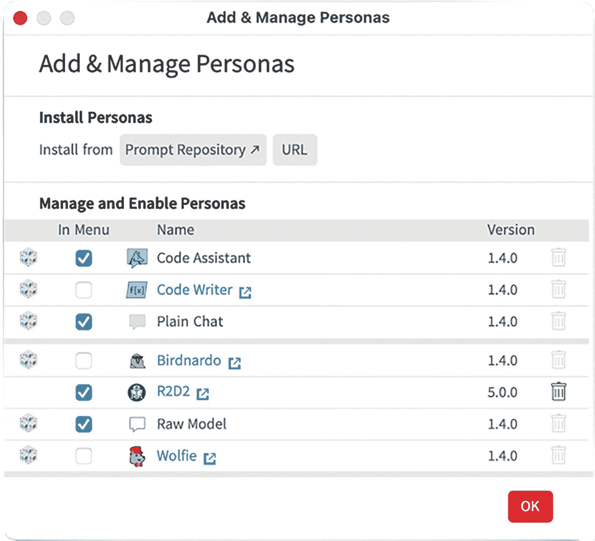

一张 `添加和管理角色` 的截图。“安装角色”选项列出了带有 URL 的提示仓库，并通过 `在菜单中`、`名称` 和 `版本` 来管理和启用角色。`代码助手`、`普通聊天`、`R2D2` 和 `原始模型` 选项已被勾选。

**图 10-34** `添加和管理角色` 界面显示已选中 `R2D2` 角色

除了角色，还可以使用提示修饰符的组合。这些修饰符作用于提示的输入或输出。因此，要调用输入角色，请使用字符 `@persona`。要调用函数输入修饰符，请使用 `!prompt`；要调用输出修饰符，请使用 `#param`；输入和输出修饰符分别放在提示的开头和结尾。要向函数修饰符插入参数，请使用竖线分隔，例如 `#prompt|param`，如图 10-35 所定义。

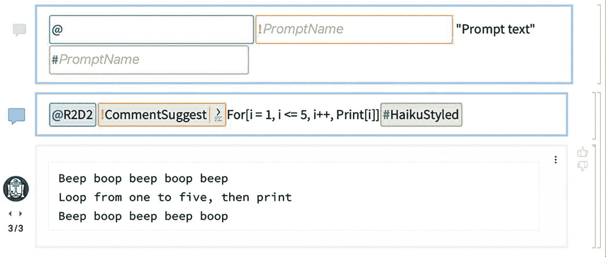

一张俳句风格代码注释的截图。它列出了提示名称 `R2D2` 和注释建议标签。

**图 10-35** 俳句风格的 `R2D2` 代码注释


### LLM 功能

`Chat` 对象与 `ChatEvaluate` 一起使用，用于在 Mathematica 中管理 LLM 对话。`Chat` 对象提供了一个便捷的接口，用于与 LLM 交互并在笔记本环境中管理对话。其内部机制是，LLM 命令作为合成函数工作，这使得 LLM 模型能够访问 Wolfram 工具（见图 10-36）。

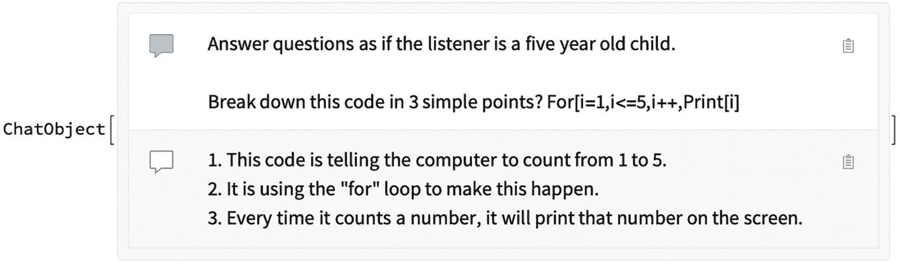

一个用于 LLM 文本提示的 `Chat` 对象截图。它列出了分解代码的 3 个简单要点。1. 代码告诉计算机从 1 数到 5。2. 它使用 `for` 循环来实现这一点。3. 每次计数时，它都会在屏幕上打印该数字。

**图 10-36** 用于 LLM 文本提示的 `Chat` 对象

```
In[68]:= ChatEvaluate[ ChatObject[], "用 3 个简单要点分解这段代码？  For[i=1,i  {LLMPrompt["ELI5"]}|>] (*像对五岁小孩解释一样*)
Out[68]=
```

要检索聊天内容和令牌，请使用 `"Messages"` 和 `"Usage"` 这两个词。

```
In[69]:=
%["Messages"]
%%["Usage"]
Out[2]= { "User", "Content" ->    "请像对五岁小孩一样回答问题。用 3 个简单要点分解这段代码？ For[i=1,i    DateObject[{2024, 2, 22, 11, 22, 5.627397}, "Instant",     "Gregorian", -6.], "Annotations" ->  "Prompt"|>|>,     "Assistant",   "Content" ->
"1. 这段代码告诉计算机从 1 数到 5。
2. 它使用\"for\"循环来实现这一点。
3. 每次计数时，它都会在屏幕上打印该数字。", "Timestamp" ->    DateObject[{2024, 2, 22, 11, 22, 6}, "Instant", "Gregorian", -6.],   "Annotations" ->  "Completion"|>|>}
Out[70]= 92 个令牌
```

与前面的示例类似，你可以使用 `LLMConfiguration` 设置具有特定配置的提示，并通过 `LLMEvaluator` 进行评估，例如基础模型、温度、停止令牌等。它还可以用于生成文本（`LLMSynthesize`）、检索文本（`LLMPrompt`）或使用模板函数（`LLMFunction`），如下面的代码所示。

```
In[70]:= llmConfig = LLMConfiguration[ LLMPrompt["ELI5"], "Model" -> "GPT-3.5-Turbo", "Temperature" -> 0.1,  "MaxTokens" -> 5|>]; LLMSynthesize["用 3 个简单要点分解这段代码？ For[i=1,i llmConfig]
Out[71]= 当然！这是一个
```

**注意：** 默认的 LLM 配置在 `$LLMEvaluator` 中，但可以被覆盖。

```
In[72]:= $LLMEvaluator=LLMConfiguration[ LLMPrompt["ELI5"], "Model"->"GPT-3.5-Turbo", "Temperature"->0.1,"MaxTokens"-> 5|>]
Out[72]= LLMConfiguration[Model: Automatic,Name->GPT-3.5-Turbo|>]
```

### GPT-1 和 GPT-2 模型

除了外部 LLM 服务，像 GPT-1 和 GPT-2 这样的开放模型也可以在 Mathematica 中访问。这些模型是近期 GPT 模型的前身。GPT-1 是在大型书籍数据集上训练的初始模型之一，而 GPT-2 是 GPT-1 的改进版本，在 WebText 数据集上训练。让我们看看关于 GPT-1 和 GPT-2 的一些信息；请注意，由于文本量较大，这里的输出已被截断。

```
In[72]:= Row[{Short[NetModel[ "GPT Transformer Trained on BookCorpus Data", #] & /@ {"Details", "ShortName"} // Column, 4],   Short[NetModel[       "GPT2 Transformer Trained on WebText Data", #] & /@ {"Details","ShortName"} // Column, 4]}]
Out[72]= 该生成式预训练 Transformer (GPT) 模型于 2018 年发布，以无监督方式在大型英文文本语料库上进行预训练。该模型可以通过额外的输出层进一步微调，以创建适用于广泛任务的高精度 NLP 模型。它使用双向因果自注意力机制，通常被称为 Transformer 解码器。
GPT-Transformer-Trained-on-BookCorpus-Data
该模型于 2019 年发布，对其前身模型进行了改进和规模扩展。它具有更丰富的词汇量，并在 UTF-8 字节序列上使用 BPE 分词，并在所有 Transformer 块的末尾进行额外的归一化。
GPT2-Transformer-Trained-on-WebText-Data
```

你可以尝试检索其他数据，就像在 LeNet 示例中那样。让我们看看模型变体和任务类型示例。

```
In[73]:= NetModel["GPT Transformer Trained on BookCorpus Data", #] & /@ {"ParametersAllowedValues", "Variants"}
NetModel["GPT2 Transformer Trained on WebText Data", #] & /@ {"ParametersAllowedValues", "Variants"}
Out[73]= {{FeatureExtraction,LanguageModeling}|>,{{GPT Transformer Trained on BookCorpus Data,Task->FeatureExtraction},{GPT Transformer Trained on BookCorpus Data,Task->LanguageModeling}}}
Out[74]= {{FeatureExtraction,LanguageModeling},Size->{117M,345M,774M}|>,
{{GPT2 Transformer Trained on WebText Data,Task->FeatureExtraction,Size->117M},
{GPT2 Transformer Trained on WebText Data,Task->FeatureExtraction,Size->345M},
{GPT2 Transformer Trained on WebText Data,Task->FeatureExtraction,Size->774M},
{GPT2 Transformer Trained on WebText Data,Task->LanguageModeling,Size->117M},
{GPT2 Transformer Trained on WebText Data,Task->LanguageModeling,Size->345M},
{GPT2 Transformer Trained on WebText Data,Task->LanguageModeling,Size->774M}}}
```

从输出中可以看出，变体具有不同的任务类型和特定的参数数量，例如 117M、345M 和 774M 百万个参数。你可以通过指定参数来选择模型，例如，选择语言训练模型并尝试基于下一个令牌的预测生成文本（见图 10-37）。

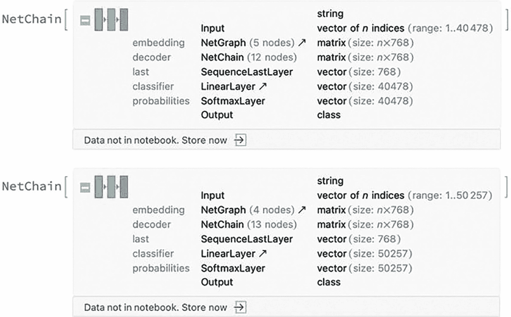

GPT-1 和 GPT-2 的 2 个嵌入式架构模型。它列出了输入、`NetGraph`、`NetChain`、`SequenceLastLayer`、`LinearLayer`、`SoftmaxLayer` 和输出及其各自字符串的嵌入、解码器、最后层、分类器和概率。

**图 10-37** GPT-1 和 GPT-2 嵌入式架构

```
In[75]:= gpt1=NetModel[{"GPT Transformer Trained on BookCorpus Data","Task"-> "LanguageModeling"}]
gpt2=NetModel[{"GPT2 Transformer Trained on WebText Data","Task"-> "LanguageModeling"}]
Out[75]=
```

对于令牌函数，输入参数是初始文本、令牌数量（默认为 10）和温度（默认为 1）。简单来说，此函数对预测进行采样。它将每个新令牌附加到固定令牌数量的原始字符串上，并返回初始文本加上生成的令牌文本。

```
In[76]:= generateText[LLmodel_][initialText_, tokenCount_ : 10,  temperature_ : 1] := Fold[StringJoin[#1,  LLmodel[#1, {"RandomSample", "Temperature" -> temperature}]] &,  initialText, Range[tokenCount]]
```

其中，令牌指的是模型读取的文本单元。它可以短至一个字符，也可以长至一个单词，例如 `"a"` 或 `"app"`。模型会逐个查看这些令牌，以理解并基于它们生成文本。因此，对于 GPT-2，BPE 分词是一种用于将单词分解为更小部分的方法。

```
In[77]:= generateText[gpt1]["艾伦·图灵是一位英国数学家、逻辑学家，被认为是计算机科学领域的先驱。",20,0.5]
Out[77]= 艾伦·图灵是一位英国数学家、逻辑学家，被认为是计算机科学领域的先驱。他是一位物理学家，也是一位非常优秀的科学家。他也是乔治·W 的朋友。
In[78]:= generateText[gpt2]["艾伦·图灵是一位英国数学家、逻辑学家，被认为是计算机科学领域的先驱。",20,1]
Out[78]= 艾伦·图灵是一位英国数学家、逻辑学家，被认为是计算机科学领域的先驱。在他独立时，他被选中撰写最早的（173）篇贡献之一
```

通过比较两个响应可以看出，仍有改进空间。GPT-1 的输出似乎不连贯，包含不相关的元素。相比之下，GPT-2 在谈论图灵的职业生涯时显示出更多上下文，但仍然缺乏清晰、完整的句子。


## 最终说明

综上所述，在 Wolfram 语言框架内，机器学习或神经网络模型的一般示意图、构建、测试和实现的路线图如图 10-38 所示。

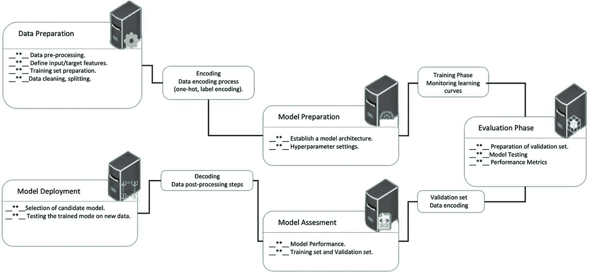

训练和测试模型的概要包括数据准备、模型部署、编码、解码、模型准备、模型评估、训练阶段、验证与数据编码以及评估阶段。

**图 10-38** 训练与测试的模型概览

该图展示了一条可以直接遵循的路线；尽管如此，路线中的每个流程之间可能存在中间节点，因为路线会根据所解决的任务或问题的类型而变化。然而，该路线图侧重于揭示使用 Wolfram 语言构建模型的重要且通用的要点。在数据准备阶段，包含一些前置流程，例如数据集成、所收集数据的类型（结构化或非结构化）、数据转换、数据模块中的清洗等。因此，在进入下一阶段之前，必须对数据进行预处理，以便准备好可供模型使用的数据。

模型准备涵盖了诸如根据学习类型选择算法或使用方法；建立或检测模型结构；以及定义特征、输入参数、所使用的数据类型（无论是文本、声音、数值数据）以及将要使用的工具等方面。所有这些都与一个称为特征工程的过程相关联，其主要目标是从数据中提取有价值的属性。这是进入下一步（即训练阶段）所必需的。

评估阶段和模型评估包括定义评估指标（这些指标根据所解决的任务或问题而变化），以及准备后续使用的验证方法。在解码阶段，模型的输出被转换回清晰、可解释的格式，为实际应用做好准备。在此需要强调的是，模型准备、训练、评估和评估可能是一个迭代过程，包括超参数调优、算法技术的调整以及模型配置（如内部模型特征）。其目的是建立能够提供足够结果的最佳模型，并最终进入模型部署阶段，该阶段定义了所选模型并在新数据上进行测试。


