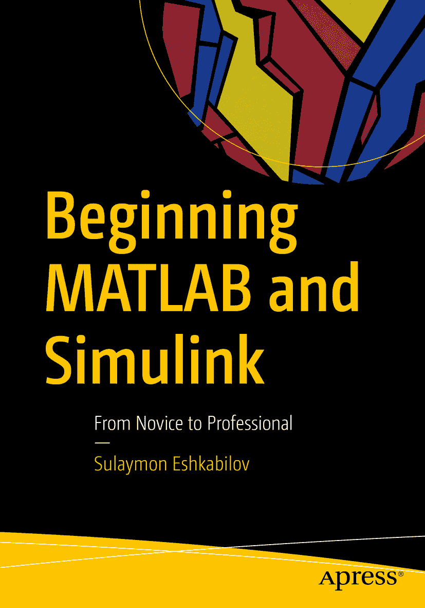

ISBN 978-1-4842-5060-0 e-ISBN 978-1-4842-5061-7 [`doi.org/10.1007/978-1-4842-5061-7`](https://doi.org/10.1007/978-1-4842-5061-7) © Sulaymon Eshkabilov 2019 本作品受版权保护。出版者保留所有权利，无论涉及材料整体还是部分，具体包括翻译、转载、插图重用、朗诵、广播、微缩胶片或其他任何物理形式的复制、传输或信息存储与检索、电子改编、计算机软件，或现在已知或未来开发的类似或不同方法。本书中可能出现商标名称、标识和图像。我们没有在每次出现商标名称、标识或图像时使用商标符号，而是仅以编辑方式使用这些名称、标识和图像，以利于商标所有者，且无意侵犯商标权。本出版物中使用商品名、商标、服务标记及类似术语（即使未明确标识为商标）不应被视为对这些术语是否受专有权利保护的表达。尽管本书中的建议和信息在出版之日被认为是真实准确的，但作者、编辑和出版者均不对可能存在的任何错误或遗漏承担法律责任。出版者对本书所含材料不作任何明示或默示的保证。本书由 Springer Science+Business Media New York 在全球图书贸易中发行，地址：233 Spring Street, 6th Floor, New York, NY 10013。电话：1-800-SPRINGER，传真：(201) 348-4505，电子邮件：orders-ny@springer-sbm.com，或访问 www.springeronline.com。Apress Media, LLC 是一家加利福尼亚有限责任公司，其唯一成员（所有者）是 Springer Science + Business Media Finance Inc (SSBM Finance Inc)。SSBM Finance Inc 是一家特拉华州公司。

*谨以此书纪念我的父亲。*

*献给我的母亲。*

*献给我的妻子尼戈拉，感谢我们共同度过的 25 年美好时光。*

## 引言

本书面向 MATLAB/Simulink 软件包的初学级学习者。它涵盖了 MATLAB 和 Simulink 软件包中必备的实践工具与函数，并通过互动示例和案例研究进行讲解。本书的主要原则是“做中学”，内容由浅入深。书中包含数十个通过 M/MLX 文件/脚本和 Simulink 模型实现的解决方案与仿真模型，可帮助您学习编程和建模的要点。此外，本书还提供了许多关于避免 MATLAB/Simulink 软件包在编程和建模方面常见陷阱的建议。

《MATLAB 与 Simulink 入门》通过对比 MATLAB 的编程工具和 Simulink 的模块，并行解释了编程和建模的各种实际应用问题。学习本书后，您将能够熟练使用 MATLAB/Simulink 软件包。您可以将书中的示例源代码和模型作为模板，应用于您自己的数据科学、数值分析、建模与仿真或工程项目中。

本书的核心学习成果包括：

- 开始使用 MATLAB 和 Simulink
- 使用 MATLAB 执行数据分析和可视化
- MATLAB 的编程要点与 Simulink 的核心建模方面，以及如何关联 MATLAB 和 Simulink 软件包的脚本与模型
- 在 MATLAB 中开发 GUI 模型和独立应用程序
- 在 MATLAB 和 Simulink 中使用积分和数值求根方法
- 在 MATLAB 和 Simulink 中求解微分方程
- 应用 MATLAB 进行数据分析与数据科学项目

本书包含八个逻辑上相互关联的章节。

- 第 1 章专门介绍 MATLAB 环境及 MATLAB 可识别的数据类型，包括数值型、元胞数组、结构体、字符型、逻辑型、函数句柄和表格。
- 第 2 章涵盖了大部分基本编程工具和函数，例如`for … end`和`while … end`循环运算符、`if…elseif…else…end`条件运算符、符号引用，以及最常见的错误和警告。本章还介绍了 MATLAB 中的 M 文件调试工具和选项。此外，本章还讲解了 MATLAB 特有的编程工具，包括函数文件、函数句柄和显示运算符，如`disp()`、`display`、`fprintf`和`sprint`。
- 第 3 章涵盖 GUI 开发以及如何编写和编辑 GUI 模型回调函数。
- 第 4 章讨论如何从现有的 M 文件开发 MEX 文件、C/C++ 代码和独立应用程序的问题。
- 第 5 章专门介绍 Simulink 建模要点。本章中的示例涵盖矩阵运算、函数值计算、建模以及求解常微分方程。此外，还讨论了如何将 Simulink 模型与 MATLAB 脚本关联的问题。
- 第 6 章致力于数据可视化问题，例如在 MATLAB 中构建 2D 和 3D 图形以及动画图形。
- 第 7 章专门介绍矩阵代数和数组操作。它通过同时在 MATLAB 和 Simulink 中求解的示例，阐述了求解线性方程组、特征值问题、矩阵分解、矩阵和向量运算，以及数组和字符串的转换。
- 第 8 章涵盖了解析求解常微分方程以及使用 MATLAB 内置函数和命令的一些基本方面。

本书中讨论的所有源代码（脚本、M/MLX/MAT 文件、Simulink 模型、SLX/MDL 文件、C 代码、MEX 文件和安装`*.exe`文件）均可通过本书在 `apress.com` 产品页面上的“下载源代码”按钮获取，也可通过位于 [`www.apress.com/9781484250600`](http://www.apress.com/9781484250600) 的“下载源代码”链接访问。

### 说明

本书中的脚本可能并非针对给定问题的最佳解决方案，但刻意为之是为了强调用于改进它们的方法。在其他一些情况下，这些方案被认定为基于作者最佳知识的最合适的解决方案。如果我发现练习有更好的替代解决方案，我将通过 MathWorks 的 MATLAB Central 用户社区文件交换（在我名下的文件交换链接）发布它们。

无论我们多么努力地校对本书，总会有一些排版错误可能漏网并出现在印刷版中。

2019 年 9 月                    Sulaymon Eshkabilov

## 致谢

我特别感谢本书的技术审校——Joseph Mueller 博士和 Karpur Shukla 先生——他们在审阅本书内容和代码时所付出的极其细致的工作。没有他们在诸多环节中的关键见解和纠正，本书就无法达到现在的质量。我还要特别感谢 Mark Powers 在整个本书项目中及时且周到的通信联络。

我衷心感谢我的母亲，感谢她无限的支持和爱。直到本书完成的最后一刻，她一直在关注我的进展。

我要感谢我的妻子 Nigora。没有她的大力支持，我无法承担撰写本书的艰巨任务。我花了大量周末时间在办公室里编写和编辑本书。此外，我要感谢我们的孩子——Anbara、Durdona 和 Dovud——他们是如此可爱的孩子，也是我撰写本书的灵感来源。

### 关于作者与技术审校

#### 作者简介

#### 技术审校简介

