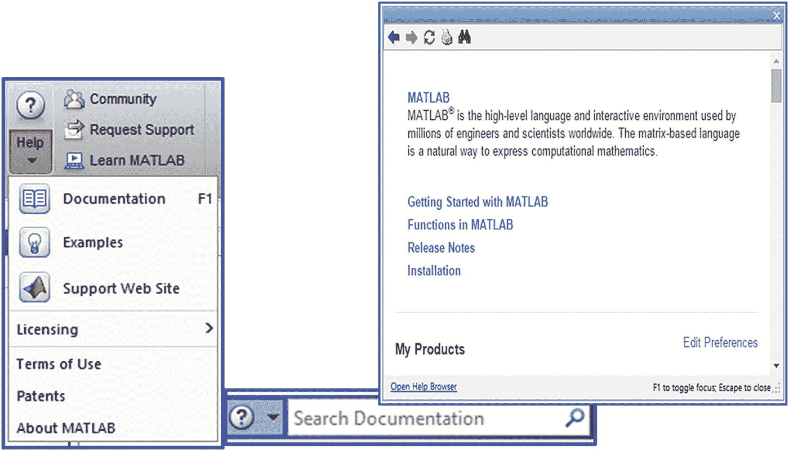

# 1. MATLAB 简介

MATLAB 软件包广泛应用于工程和科学计算领域，并与名为 Simulink 的动态系统仿真软件包相关联。该软件包具有一些优势和显著特点，例如用户友好且直观的编程语法、适用于各种数值分析的高质量数值算法、强大且易用的图形功能、执行计算的简单命令语法，以及许多作为工具箱的附加组件，还包括实数和复数向量及矩阵，其中稀疏矩阵作为基本数据类型。

该软件包有各种应用领域，例如：车辆性能等各类系统的仿真、人类基因组图谱绘制、新兴经济体的金融分析、诊断和治疗微小生物的微生物学应用、按比例缩小的实验室模型中的大型船舶动态仿真、下一代网络音频产品的仿真、用于本科生计算机编程教学并与实时实验室测试和测量相结合、以及水下考古和地质学的图像处理。

在本章中，我们将讨论 MATLAB 图形用户界面 (GUI) 的一些基本关键特性，如何使用帮助工具和库资源，如何调整格式选项及精度和准确度设置，如何创建各种变量和变量结构，以及如何使用 M/MLX 编辑器来编写和编辑脚本/程序。

## MATLAB 的菜单面板和帮助

MATLAB 应用程序可以通过从桌面窗口单击 `` 图标/快捷方式，或者选择 `开始 ➤ 所有程序 ➤ ` 来启动。MATLAB 加载时，用户上次保存的数据、文件、条目、最近 20 条命令（默认）以及带有上次首选项设置的菜单栏和工具都会显示出来。MATLAB 的图形用户界面 (GUI) 工具和窗口是可定制的。用户可以根据需要轻松地操控、定制和更改软件包的首选项。图 1-1 显示了 MATLAB 2018a 的默认主窗口。需要注意的是，为了使软件包更加用户友好、工具更加直观，多年来该软件包的 GUI 菜单和工具已经发生了变化。默认窗口具有主菜单工具、当前目录指示器，以及命令窗口、工作区窗口和命令历史记录窗口。这些窗口可以停靠/取消停靠，或在单独的窗口中打开，可以从主窗口关闭或移除，也可以从一个窗格拖到另一个窗格，并可以最大化或最小化。

此主桌面窗口如图 1-1 所示。

``

图 1-1：默认的 MATLAB 桌面窗口 (R2018b)

该软件包图形用户界面 (GUI) 工具的主要组成部分如下：

``

图 1-2：MATLAB 主菜单：HOME、PLOTS 和 APPS 选项卡 (MATLAB R2018b)

*   工具和工具栏分为三个菜单——HOME、PLOTS 和 APPs（见图 1-2）。HOME 选项卡包含所有主要工具。您可以在此创建和删除新文件及变量、导入数据、访问代码分析器、启动 Simulink、更改 MATLAB 软件包桌面布局选项、设置路径，以及访问附加组件和帮助选项。

*   默认情况下，当前目录窗口位于左侧窗格。此窗口显示目录中的所有文件和文件夹目录。

*   命令窗口位于中央窗格（默认）。所有命令和/或（小型）脚本/代码都可以直接在 `>>` 后输入。通过单击命令窗口中的 ``（见图 1-4），您可以查看所有内置函数和 MATLAB 工具箱。此选项仅从 MATLAB R2008a 版本开始可用。所有已安装的工具箱也可以通过单击 APPS 选项卡（见图 1-2）来查看或访问，该选项卡在 MATLAB 的后续版本（从 R2010a 版本开始）中可用。

*   默认桌面窗口的工作区窗格显示会话期间的当前条目和已保存的变量。这些条目会临时保存，直到 MATLAB 应用程序关闭。条目/变量的所有基本属性和特性（变量名称、值和类型）都会在工作区中显示。

该软件包最重要的优势之一是其帮助文档，其中包括帮助库和工具。可以通过 GUI 工具和命令窗口中的条目来访问它们。一个好的开始使用该软件包的方法是浏览“入门”选项，您可以通过单击命令窗口上方的“入门”超链接文本来访问。这将打开帮助库文档，如图 1-3 所示，其中包含基本的文档和帮助工具，例如示例和函数语法。

``

图 1-3：MATLAB 入门与帮助库文档


### 注意

在讨论帮助选项之前，我需要强调一个关于注释的重要点。在 MATLAB 中，用户可以将必要的提示和帮助说明作为注释写入 M/MLX 文件以及命令窗口中。注释需要以 `%` 符号开头。还有其他添加注释的方式，我将在之后编写 M/MLX 文件时讨论。

还有其他一些获取帮助的实践方式。例如，要快速获取关于 MATLAB 内置函数工具和命令（包括用户自定义函数）的帮助，用户可以在命令窗口中输入以下内容：

```
>> doc size;       % 关于命令 SIZE 的扩展帮助
>> helpwin size;   % 在单独窗口中显示关于命令 SIZE 的帮助
>> help clear      % 关于如何使用命令 CLEAR 的快速帮助
>> help matrix;    % 关于如何使用命令 ISMATRIX 的快速帮助
>> help +          % 关于 "+" 的快速帮助
>> help size;      % 关于 SIZE 的快速帮助
>> lookfor size    % 搜索包含命令 SIZE 的函数和文件列表
```

图 1-4 和图 1-5 展示了一些快速和扩展帮助的结果。此外，该应用程序还提供 GUI 工具、广泛的在线库资源、产品描述、视频教程以及 MathWorks 网站上的开放公共论坛。



图 1-5

获取帮助


图 1-4

获取帮助

你可以使用命令窗口以及 `help`、`lookfor`、`doc`、`docsearch` 和 `helpwin` 命令在 MATLAB 中搜索帮助，例如针对 `clock` 函数：

1.  可以通过命令窗口使用 `help` 命令获取快速帮助。在这种情况下，帮助内容会从 MATLAB 的内置命令/函数以及用户的函数文件中显示出来。这是一种获取帮助的快捷方式。

    ```
    >> help clock
    ```

2.  扩展（详细）帮助（包含示例）会显示在帮助库窗口中，但前提是存在此类函数文件（例如 `clock`）。

    ```
    >> doc  clock
    >> docsearch clock
    ```

3.  你可以通过使用以下帮助命令，从命令窗口访问包含某个关键字的 M 文件扩展列表。请注意，由于此选项会对关键字进行穷举搜索，因此速度比其他两个搜索选项慢得多。

    ```
    >> lookfor clock
    ```

4.  你可以使用以下命令在帮助库中查看函数文件说明，但前提是存在此类函数文件（例如 `clock`）。

    ```
    >> helpwin clock
    ```

5.  所有扩展提示、示例和命令语法都可以从帮助库（如图 1-3 所示）中查看，通过点击帮助菜单选项即可访问。

6.  你可以使用键盘上的 F1 键打开帮助库和文档。

7.  通过点击主面板上的帮助菜单，你可以访问 MathWorks 的各种帮助资源，例如其帮助库资源、网络资源、演示示例、更新、试用版等。

网上有许多实用的帮助资源，包括 MathWorks 网站学术版、用户社区发布的脚本和文件交换[1]、以及 MATLAB 答案论坛[2]。学习者/用户/开发者可以在这些地方发布问题并寻求答案，或者反过来发布他们对已提出问题的答案。此外，这些资源还包括函数文件、Simulink 模型、在线论坛、众多大学的教程[3]以及教授和研究人员的个人网页[4]等等，此处仅列举一二。

## MATLAB 环境

让我们开始使用 MATLAB 环境，通过其 GUI 工具（例如位于“主页”选项卡上的“布局”、“预设”和“设置路径”）对其布局进行一些更改。若要更改布局（见图 1-6），从“主页”选项卡的主菜单中，你必须点击“布局”下拉菜单（1）。有许多选项和不同的窗口可供选择。如果“桌面”窗口名称前有勾选标记，则该窗口由命令窗口、命令历史记录、当前文件夹和工作区窗口组成。你可以通过点击标题栏并将窗口拖动到新位置来分离或拖动其中任何一个窗口。


图 1-6

布局（1）和预设（2）的更改

要更改“预设”窗口，你可以点击主菜单中的 ，或者在命令窗口中输入以下内容并按回车键：

```
>> preferences
```

将弹出如图 1-6 所示的“预设”窗口。当前文件夹的目录/路径也可以更改，并且可以添加新路径，如图 1-7 所示。

你可以从“预设”窗口修改许多选项/工具，包括 GUI 快速访问工具以及编辑器/命令窗口的显示。例如，要在编辑器窗口中显示提示并高亮显示当前行，你可以选择“预设” ➤ “编辑器/调试器” ➤ “显示”，然后勾选“在编辑模式下启用数据提示”。许多工具可以作为快捷方式添加到主菜单中。预设中的一些关键自定义设置也可以通过从命令窗口发出命令来实现。


图 1-7

设置路径（3）、添加文件夹和删除路径


