# 1. MATLAB 简介

MATLAB 软件包广泛应用于工程和科学计算领域，并与名为 Simulink 的动态系统仿真软件包相关联。该软件包具有一些优势和显著特点，例如用户友好且直观的编程语法、适用于各种数值分析的高质量数值算法、强大且易用的图形功能、执行计算的简单命令语法，以及许多作为工具箱的附加组件，还包括实数和复数向量及矩阵，其中稀疏矩阵作为基本数据类型。

该软件包有各种应用领域，例如：车辆性能等各类系统的仿真、人类基因组图谱绘制、新兴经济体的金融分析、诊断和治疗微小生物的微生物学应用、按比例缩小的实验室模型中的大型船舶动态仿真、下一代网络音频产品的仿真、用于本科生计算机编程教学并与实时实验室测试和测量相结合、以及水下考古和地质学的图像处理。

在本章中，我们将讨论 MATLAB 图形用户界面 (`GUI`) 的一些基本关键特性，如何使用帮助工具和库资源，如何调整格式选项及精度和准确度设置，如何创建各种变量和变量结构，以及如何使用 `M/MLX` 编辑器来编写和编辑脚本/程序。

## MATLAB 的菜单面板和帮助

MATLAB 应用程序可以通过从桌面窗口单击 `` 图标/快捷方式，或者选择 `开始 ➤ 所有程序 ➤ ` 来启动。MATLAB 加载时，用户上次保存的数据、文件、条目、最近 20 条命令（默认）以及带有上次首选项设置的菜单栏和工具都会显示出来。MATLAB 的图形用户界面 (`GUI`) 工具和窗口是可定制的。用户可以根据需要轻松地操控、定制和更改软件包的首选项。图 1-1 显示了 MATLAB 2018a 的默认主窗口。需要注意的是，为了使软件包更加用户友好、工具更加直观，多年来该软件包的 `GUI` 菜单和工具已经发生了变化。默认窗口具有主菜单工具、当前目录指示器，以及命令窗口、工作区窗口和命令历史记录窗口。这些窗口可以停靠/取消停靠，或在单独的窗口中打开，可以从主窗口关闭或移除，也可以从一个窗格拖到另一个窗格，并可以最大化或最小化。

此主桌面窗口如图 1-1 所示。

``

图 1-1：默认的 MATLAB 桌面窗口 (`R2018b`)

该软件包图形用户界面 (`GUI`) 工具的主要组成部分如下：

``

图 1-2：MATLAB 主菜单：`HOME`、`PLOTS` 和 `APPS` 选项卡 (`MATLAB R2018b`)

*   工具和工具栏分为三个菜单——`HOME`、`PLOTS` 和 `APPs`（见图 1-2）。`HOME` 选项卡包含所有主要工具。您可以在此创建和删除新文件及变量、导入数据、访问代码分析器、启动 `Simulink`、更改 MATLAB 软件包桌面布局选项、设置路径，以及访问附加组件和帮助选项。

*   默认情况下，当前目录窗口位于左侧窗格。此窗口显示目录中的所有文件和文件夹目录。

*   命令窗口位于中央窗格（默认）。所有命令和/或（小型）脚本/代码都可以直接在 `>>` 后输入。通过单击命令窗口中的 ``（见图 1-4），您可以查看所有内置函数和 MATLAB 工具箱。此选项仅从 MATLAB `R2008a` 版本开始可用。所有已安装的工具箱也可以通过单击 `APPS` 选项卡（见图 1-2）来查看或访问，该选项卡在 MATLAB 的后续版本（从 `R2010a` 版本开始）中可用。

*   默认桌面窗口的工作区窗格显示会话期间的当前条目和已保存的变量。这些条目会临时保存，直到 MATLAB 应用程序关闭。条目/变量的所有基本属性和特性（变量名称、值和类型）都会在工作区中显示。

该软件包最重要的优势之一是其帮助文档，其中包括帮助库和工具。可以通过 `GUI` 工具和命令窗口中的条目来访问它们。一个好的开始使用该软件包的方法是浏览“入门”选项，您可以通过单击命令窗口上方的“入门”超链接文本来访问。这将打开帮助库文档，如图 1-3 所示，其中包含基本的文档和帮助工具，例如示例和函数语法。

``

图 1-3：MATLAB 入门与帮助库文档

### 注意

在讨论帮助选项之前，我需要强调一个关于注释的重要点。在 MATLAB 中，用户可以将必要的提示和帮助说明作为注释写入 `M/MLX` 文件以及命令窗口中。注释需要以 `%` 符号开头。还有其他添加注释的方式，我将在之后编写 `M/MLX` 文件时讨论。

还有其他一些获取帮助的实践方式。例如，要快速获取关于 MATLAB 内置函数工具和命令（包括用户自定义函数）的帮助，用户可以在命令窗口中输入以下内容：

```
>> doc size;       % 关于命令 SIZE 的扩展帮助
>> helpwin size;   % 在单独窗口中显示关于命令 SIZE 的帮助
>> help clear      % 关于如何使用命令 CLEAR 的快速帮助
>> help matrix;    % 关于如何使用命令 ISMATRIX 的快速帮助
>> help +          % 关于 "+" 的快速帮助
>> help size;      % 关于 SIZE 的快速帮助
>> lookfor size    % 搜索包含命令 SIZE 的函数和文件列表
```

图 1-4 和图 1-5 展示了一些快速和扩展帮助的结果。此外，该应用程序还提供 `GUI` 工具、广泛的在线库资源、产品描述、视频教程以及 MathWorks 网站上的开放公共论坛。


图 1-5

获取帮助

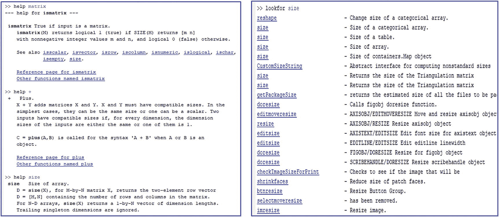

图 1-4

获取帮助

你可以使用命令窗口以及 `help`、`lookfor`、`doc`、`docsearch` 和 `helpwin` 命令在 MATLAB 中搜索帮助，例如针对 `clock` 函数：

1.  可以通过命令窗口使用 `help` 命令获取快速帮助。在这种情况下，帮助内容会从 MATLAB 的内置命令/函数以及用户的函数文件中显示出来。这是一种获取帮助的快捷方式。

```
    >> help clock
    ```

2.  扩展（详细）帮助（包含示例）会显示在帮助库窗口中，但前提是存在此类函数文件（例如 `clock`）。

```
    >> doc  clock
    >> docsearch clock
    ```

3.  你可以通过使用以下帮助命令，从命令窗口访问包含某个关键字的 `M` 文件扩展列表。请注意，由于此选项会对关键字进行穷举搜索，因此速度比其他两个搜索选项慢得多。

```
    >> lookfor clock
    ```

4.  你可以使用以下命令在帮助库中查看函数文件说明，但前提是存在此类函数文件（例如 `clock`）。

```
    >> helpwin clock
    ```

5.  所有扩展提示、示例和命令语法都可以从帮助库（如图 1-3 所示）中查看，通过点击帮助菜单选项即可访问。

6.  你可以使用键盘上的 `F1` 键打开帮助库和文档。

7.  通过点击主面板上的帮助菜单，你可以访问 MathWorks 的各种帮助资源，例如其帮助库资源、网络资源、演示示例、更新、试用版等。

网上有许多实用的帮助资源，包括 MathWorks 网站学术版、用户社区发布的脚本和文件交换[1]、以及 MATLAB 答案论坛[2]。学习者/用户/开发者可以在这些地方发布问题并寻求答案，或者反过来发布他们对已提出问题的答案。此外，这些资源还包括函数文件、`Simulink` 模型、在线论坛、众多大学的教程[3]以及教授和研究人员的个人网页[4]等等，此处仅列举一二。

## MATLAB 环境

让我们开始使用 MATLAB 环境，通过其 `GUI` 工具（例如位于“主页”选项卡上的“布局”、“预设”和“设置路径”）对其布局进行一些更改。若要更改布局（见图 1-6），从“主页”选项卡的主菜单中，你必须点击“布局”下拉菜单（1）。有许多选项和不同的窗口可供选择。如果“桌面”窗口名称前有勾选标记，则该窗口由命令窗口、命令历史记录、当前文件夹和工作区窗口组成。你可以通过点击标题栏并将窗口拖动到新位置来分离或拖动其中任何一个窗口。

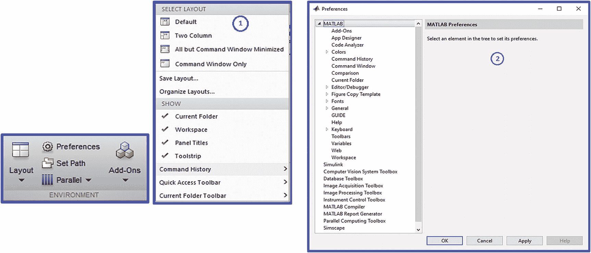

图 1-6

布局（1）和预设（2）的更改

要更改“预设”窗口，你可以点击主菜单中的 ``，或者在命令窗口中输入以下内容并按回车键：

```
>> preferences
```

将弹出如图 1-6 所示的“预设”窗口。当前文件夹的目录/路径也可以更改，并且可以添加新路径，如图 1-7 所示。

你可以从“预设”窗口修改许多选项/工具，包括 `GUI` 快速访问工具以及编辑器/命令窗口的显示。例如，要在编辑器窗口中显示提示并高亮显示当前行，你可以选择“预设” ➤ “编辑器/调试器” ➤ “显示”，然后勾选“在编辑模式下启用数据提示”。许多工具可以作为快捷方式添加到主菜单中。预设中的一些关键自定义设置也可以通过从命令窗口发出命令来实现。

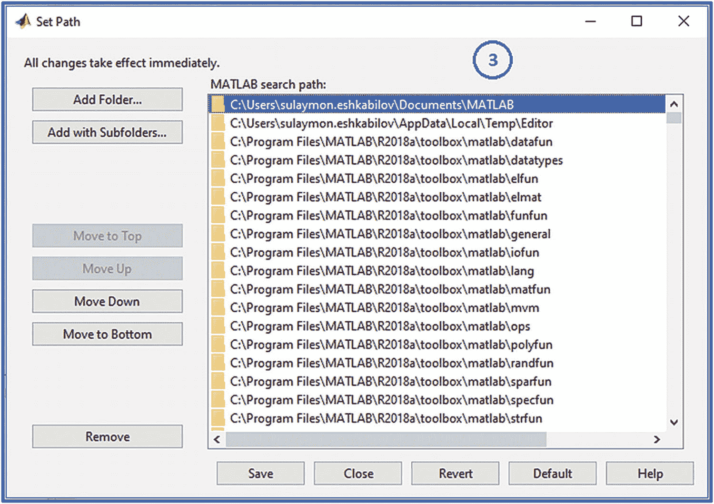

图 1-7

设置路径（3）、添加文件夹和删除路径

# 在命令窗口中工作

在 MATLAB 中，工作通常始于命令窗口，但在输入任何命令之前，有必要留意一下当前目录。当前目录地址可以直接在主窗口中查看（见图 1-8），或者在命令窗口中输入以下命令查看：

```matlab
>> pwd
```

如有需要，你可以使用 `cd` 命令，或者用鼠标左键点击路径目录（见图 1-8）并输入目录地址（`C:\Users\David\Documents\MATLAB\`）来更改当前目录。

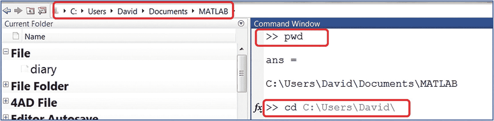
**图 1-8** 查看和更改当前工作目录

此外，你可以添加一些新路径到工作目录中。例如，要向一个已有文件夹添加路径，请使用以下命令：

```matlab
>> addpath('C:\Users\David\Documents\MATLAB');
```

`addpath()` 命令在脚本中也很有用，可用于从特定文件夹或目录读取或加载数据。对于简短命令和计算，以及查看当前目录中可用变量的属性，请使用命令窗口。但对于一系列命令和较长的脚本，使用脚本编辑器（例如 M 文件和 MLX 文件编辑器）则效率更高。

MATLAB 应用程序中有几种可通过其扩展名识别的文件类型。它们分别是 `.M`、`.MLX`、`.MAT`、`.BI` 和 `.FIG`。M 文件用于编写程序/脚本/函数文件。MLX 文件（即 Live M 文件）用于编写程序/脚本/函数文件，并可在 MLX 文件编辑器窗口中查看计算结果。MAT 文件用于保存工作区中所有类型的变量，并且可以轻松地从 M/MLX 文件和命令窗口访问。在这些文件中，`.BI` 文件用于 MATLAB 的内置文件，`.FIG` 文件用于保存 MATLAB 中的图形窗口。此外，Simulink 应用有三种文件类型——`mdl`、`.slx` 和 `.slxc`。它们用于构建和仿真 Simulink 模型，也可以在不打开的情况下从 MATLAB 中调用/仿真。我将在本书后面章节中讨论这些文件的基本功能以及如何使用它们。

虽然使用命令窗口进行简单计算、数据生成和处理已经足够，但可以使用键盘的上箭头键来避免重新输入之前输入过的命令和条目。例如，如果你在命令窗口中输入了 `A1 = [1, 2, 4, -5, 6]; B = A+2`，然后需要对这些条目进行修改，你可以在输入 `A` 后使用上箭头键。MATLAB 会自动调用你之前的输入。

## 命令窗口与变量

MATLAB 是区分大小写的，并且其所有内置命令都是小写。当你执行计算时，会为计算结果指定一个名称。这个指定的名称就是变量名。计算结果会以给定的变量名保存在 MATLAB 工作区中。例如，`A = 13; B = A*2` 表示名为 `A` 的变量等于 `13`，名为 `B` 的变量等于 `2` 乘以 `A`。

### 使用变量

变量名必须以字母开头，并且可以包含任意整数（如 0、1、2……9）和下划线（`_`）。变量名中不能使用其他符号。变量名的最大长度为 63 个字符。由于 ANSI/ASCII 符号转换，MATLAB 将名为 `a` 和 `A` 的变量视为两个不同的变量。现在，让我们开始在命令窗口中工作：输入并指定变量名，执行一些基本的算术运算，并对输出数据格式进行更改。

```matlab
>> A=3; B=-2; C=1/2; D = -1.5; ABCD=A²+B/C+D;
>> ABCD              % 缺少 ";"，因此显示了变量 ABCD 的内容
ABCD =
3.5000
>> sqrt(ABCD)  % 如果未指定变量名，则 "ans" 是 MATLAB 的默认名称
ans =
1.8708
>> ans+1  % 如果未指定变量名，"ans" 将替代之前的 "ans"。
ans =
2.8708
```

用户输入的结果显示在命令窗口中，并可以使用以下显示格式选项进行更改：`format long`、`format short`、`format long eng`、`format bank`、`format hexadecimal`、`format rational` 等。以下是格式选项的一些示例。当你更改显示格式类型时，实际的变量值不会改变。

```matlab
>> A=3; B=-2; C=1/2; D = -1.5;
>> ABCD=A²+B/C+D;
>> format bank
>> ABCD
ABCD =
3.50
>> format long eng
>> ABCD
ABCD =
3.50000000000000e+000
>> sqrt(ABCD)
ans =
1.87082869338697e+000
>> format short
>> sqrt(ABCD)
ans =
1.8708
>> format bank
>> sqrt(ABCD)
ans =
1.87
>> format long eng
>> sqrt(ABCD)
ans =
1.87082869338697e+000
>> format compact
>> sqrt(ABCD)
ans =
1.87082869338697e+000
>> format rat
>> sqrt(ABCD)
ans =
1738/929
>> format hex
>> sqrt(ABCD)
ans =
3ffdeeea11683f49
```

### 注意

MATLAB 是区分大小写的，因此它将变量 `a` 和 `A` 视为两个不同的变量。

在命令窗口中输入变量名或内置命令/函数名的前几个字母后，可以使用 TAB 键访问匹配的命令/函数，包括您开发的函数文件。例如，如果您键入 `AB` 然后按下 TAB 键，`ABCD` 变量计算表达式的其余部分将显示为一个选项。

命令窗口的另一个有用功能是使用键盘的上箭头 (↑) 来重新调用之前键入的变量或命令。您只需键入之前键入的任何命令或函数名的前几个字母，然后按上箭头 (↑)。例如，`f`↑ 会重新调用之前键入的命令 `format long`。此外，上箭头 (↑) 还可以与 TAB 键配合使用，以在命令窗口中重新调用之前输入的命令。

在命令窗口中输入的所有变量的值和属性都将保存在工作区中，直到您通过使用 `clear`、`clearvars` 或 `clear all` 命令删除变量，或使用鼠标左右键选项选择并删除它们来清理工作区为止。此外，所有变量及其属性都会保存在工作区中，直到 MATLAB 程序包关闭为止。

MATLAB 中最常用的三个整理命令是：
- `clc` — 用于清理命令窗口，并从一个空白命令窗口开始
- `clear` 和 `clearvars` — 用于移除工作区中保存的所有变量
- `clear all` — 用于移除所有变量以及临时编译并保存的 M 文件机器码、断点和调试设置

所有这些命令也可以与 M 文件和 MLX 文件一起使用。必须注意，不推荐将 `clear all` 命令与 M 文件和 MLX 文件一起使用，因为它会降低代码/脚本的效率，并在您声明 `clear global` 命令时产生意外行为。让我们来看一些有效使用这些命令的方法。

```matlab
>> A=3; B=-2; C=1/2; D = -1.5; ABCD=A²+B/C+D;
>> clear         % 移除工作区中的所有条目，工作区变为空白
>> clearvars       % 等同于 "clear"
>> clear variables % 等同于 "clearvars"
>> clear all % 等同于 "clear"，并且还会移除已编译的代码
>> clear  A B C D  % 移除变量：A B C D，保留 ABCD 不变
>> A=3; B=-2; C=1/2; D = -1.5; ABCD=A²+B/C+D;
>> clearvars  –except A B C   % 移除除 A B C 之外的所有变量
```

MATLAB 可以对变量和文件名使用通配符 `*` 星号。例如，要移除所有名称以字母“A”开头的变量，您可以使用以下命令。

```matlab
>> A=3; B=-2; C=1/2; D = -1.5; ABCD=A²+B/C+D; ABC=A²+B*C;
>> clear  A*    % 移除所有以 A 开头的变量，即 A、ABCD 和 ABC 被移除
>> clearvars A*  % 等同于：clear A*
```

所有输入和保存的变量都可以通过在命令窗口中键入 `who` 或 `whos` 命令，从工作区窗口中查看。例如：

```matlab
>> A=3; B=-2; C=1/2; D = -1.5; ABCD=A²+B/C+D; ABC=A²+B*C;
>> who

A  B  C  D  ABCD  ABC

>> whos

  Name      Size            Bytes  Class     Attributes
  A       1x1                 8  double
  ABC     1x1                 8  double
  ABCD    1x1                 8  double
  B       1x1                 8  double
  C       1x1                 8  double
  D       1x1                 8  double
```

从这些例子可以清楚地看出，MATLAB 将每个条目都读取为一个数组/矩阵。例如，一个标量被 MATLAB 读取为大小为 1×1 的数组。MATLAB 的这个属性在逻辑上与其名称“矩阵实验室”（`MATrix LABoratory`）相关联。MATLAB 的默认存储（内存分配）是 `double`，这是可分配的最大可用空间。然而，为了提高内存效率和更快的计算速度，也可以使用其他存储格式。MATLAB 支持单精度或整数类型以及 `int8` … `int64`、`uint8` … `uint64` 存储格式类型。表 1-1 展示了数据如何保存在每种存储类类型中，以及 MATLAB 中每种类型使用的转换函数。

### 注意

MATLAB 的默认存储类型是 `double`。然而，这可以通过指定或转换变量/数据的值，更改为单精度或整数类型 — `int8` … `int64`、`uint8` … `uint64`。

**表 1-1** MATLAB 中的数据存储格式类型

| 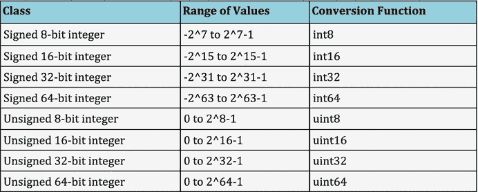 |

当您拥有数值数据和浮点格式时，双精度存储为您提供了最大的存储空间以获得更高精度。双精度最多可以保存 16 位十进制数字。对于浮点格式的数据，单精度存储比双精度（MATLAB 中的默认存储格式）内存效率更高，但精度较低。如果在计算和数据处理中仅使用整数，根据数据的最大值，使用 `int8` … `int64` 或 `uint8` … `uint64` 更为合适。以下是如何在保存声明变量的值时指定存储类型的一些示例。

```matlab
>> F01=127;Fint_08=int8(F01), Fnew1 = Fint_08+1

Fint_08 =

  int8

Fnew1 =

  int8

>> F16=65535; Fint_16=uint16(F16), Fnew2 = Fint_16+1

Fint_16 =

  uint16

Fnew2 =

  uint16
```

在根据 `int8` 和 `uint16` 格式的变量值计算 `Fnew1` 和 `Fnew2` 变量时，分配的存储空间无法容纳更多值（即，对于 `int8`，最大分配存储空间为 127 = 2⁷ − 1；对于 `uint16`，最大为 65535 = 2¹⁶ − 1）。因此，计算中发生了错误。请注意，在这种情况下，MATLAB 不会显示错误。图 1-9 展示了 MATLAB 中支持的所有数据存储类型和数据格式。

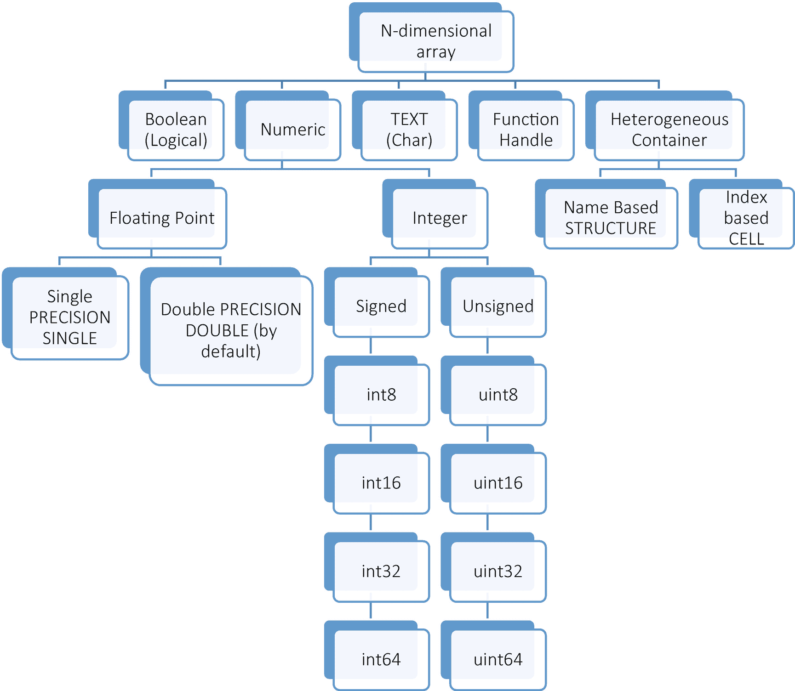
**图 1-9** MATLAB 中支持的不同类型的数据存储选项

命令窗口的历史记录窗格是查看所有条目（除非您删除它们，否则这些条目会被保留）的好方法。您也可以更改“首选项”窗口中的设置，以便在结束会话后清除条目历史记录。

最后，要退出 MATLAB 或结束一个工作会话，请在命令窗口中发出以下命令之一：

```matlab
>> exit
>> quit
```

或者使用键盘上的 `Ctrl+Q` 退出。

另一种退出方式是点击主窗口右上角的关闭按钮（**x**）。这将关闭整个程序包。

# 何时使用命令窗口

在以下情况下使用命令窗口：

- 执行简短计算
- 查看命令或/及在执行`M`文件、`MLX`文件以及`SLX/MDL` `Simulink`模型后产生的错误和警告信息
- 查看工作区中保存的变量属性以及当前目录中的文件
- 查看`MATLAB`兼容文件的内容
- 执行`MATLAB`文件，例如`M`文件、`MLX`文件、`SLX/MDL`文件和`MAT`文件
- 获取关于`MATLAB`命令/函数和用户创建函数文件的实用快速帮助
- 调整数值数据的显示格式
- 添加/删除路径/目录
- 创建/删除/保存变量和文件

让我们看几个示例来展示您可以在命令窗口中执行的其他操作。

1.  查看和分析常见错误并解释错误消息：

```
>> F16=65535; Fint_16=uint16(F16); Fnew2 = Fint_16+1;
>> Fnew+2 % 变量 Fnew 在工作区中不存在
未定义函数或变量 'Fnew'。
>> clar F16 % 拼写错误："clar" 而不是 "clear"
未定义函数或变量 'clar'。
>> CLear % 拼写错误："CLear" 而不是 "clear"。注意：MATLAB 区分大小写
未定义函数或变量 'CLear'。
您是不是想找：
>> clear % MATLAB 自动建议最接近命令的正确语法
>> B=-2; C=1/2; BC=B/.C; % 非法操作：B/.C 而不是 B/C；
B=-2; C=1/2; BC=B/.C;
↑
错误：意外的 MATLAB 运算符。
>> B=-2; C=1/2; BC=B /*C; % 非法操作：B/*C 而不是 B/C；
B=-2; C=1/2; BC=B /*C;
↑
错误：无效的运算符使用。
>> % 让我们创建一个包含两个元素的两行矩阵，即第一行中的 B, C 和第二行中的 F16。
>> BCF = [B, C; F16] % 第 1 行的元素数量与第 2 行的元素数量不匹配
使用 vertcat 时出错
要连接的数组的维度不一致。
>> % 让我们尝试创建一个元素之间用 ","、空格和 "." 分隔的行矩阵
>> BCF = [B, C. F16] % 错误是错误使用了 "." 而不是 ","，但不属于所示的点索引
此类型的变量不支持点索引。
>> BCF = [B, C, F16] % 这是预期的正确命令。
```

2.  将工作区中保存的变量保存到`*.mat`文件中：

```
>> save MYdata.mat % 将工作区中的所有变量保存到 MYdata.mat 文件中
>> save('MYdata.mat') % 同上
>> save MYdata.mat F16 Fnew2 % 将变量 F16、Fnew2 保存到 MYdata.mat 文件中
>> save('MYdata.mat', 'F16 ', 'Fnew2 ') % 同上
>> save MYdata.mat F* % 保存所有名称以 F 开头的变量（在工作区中）
```

3.  获取快速帮助：

```
>> help format
format 设置输出格式。
不带输入的 format 将输出格式设置为变量类别的默认格式。
对于浮点变量，默认值为
format SHORT。...
>> help dir
dir 列出目录。
dir directory_name 列出目录中的文件。可以使用路径名和
星号通配符。路径名中只能使用一个星号
>> help what
what 列出目录中 MATLAB 特定的文件。
命令 what 本身会列出找到的 MATLAB 特定文件 ...
>> help which
--- help for which ---
which 定位函数和文件。
which ITEM 显示 ITEM 的完整路径。ITEM 可以包含部分
路径、完整路径、相对路径或不包含路径。如果 ITEM 包含
部分路径或不包含路径，...
```

4.  查看`MATLAB`兼容文件：

```
>> type QQQ.txt % 注意：文件 QQQ.txt 位于当前目录中
CY     bBb    88
AH     AAAA+  98
CWW    AAAA+  98
...
>> type MYfile.mlx % 注意：文件 MYfile.mlx 位于当前目录中
N=13;
M=randi(N,9);
stairs(M, 'bd-')
>> type myfun.m % 注意：文件 myfun.m 位于当前目录中
function f=myfun(x)
f=[2*x(1)-x(2)-exp(-x(1));
-x(1)+2*x(2)-exp(-x(2))];
结束
```

5.  创建、打开和执行`MATLAB`文件（`M`文件、`MLX`文件、`MDL/MLX`文件和`MAT`文件）：

```
>> edit TRY1.m % 创建一个名为 TRY1.mlx 的新 M 文件
>> edit MYfile.mlx % 创建一个名为 MYfile.mlx 的新 MLX 文件
>> open('TRY1.m') % 如果文件位于当前目录中，则打开该文件
>> run('\...\TRY1.m') % 如果文件不在当前目录中，则需要目录和文件名
>> TRY1 % 如果文件位于当前目录中，则执行该文件
>> open('MYfile.mlx') % 如果文件位于当前目录中，则打开该文件
>> MYfile % 如果文件位于当前目录中，则执行该文件
>> load MYdata.mat % 加载 MYdata.mat 的内容（位于当前目录中）
>> load('MYdata.mat') % 同上
```

6.  删除当前目录中的文件或工作区中的变量。

**警告** 使用这些`delete`命令时要小心，因为它们会删除无法恢复的文件。

```
>> delete TRY1.m % 删除位于当前目录中的文件 TRY1.m
>> delete MYfile.mlx % 删除位于当前目录中的文件 MYfile.mlx
>> delete QQQ.txt % 删除位于当前目录中的文件 QQQ.txt
>> delete *.txt % 删除当前目录中的所有 *.txt 文件
>> delete *.mlx % 删除当前目录中的所有 *.mlx 文件
>> delete DA*.txt % 删除所有名称以 DA 开头的 *.txt 文件...
>> delete *.asv % 删除当前目录中 MATLAB 的所有 *.asv 文件（自动保存）
```

7.  查看当前目录、更改目录、创建新目录以及从`MATLAB`路径中移除目录：

```
>> MD = pwd % 显示当前目录并将值赋给字符类型的变量：MD
>> cd C:\Users\sulaymon.eshkabilov\Documents\MATLAB % 更改到此目录
>> cd('C:\Users\sulaymon.eshkabilov\Documents\MATLAB') % 同上
>> mkdir MYBook % 在当前目录内创建一个新文件夹（目录）
>> mkdir('MYBook') % 同上
>> mkdir c:\Users\sulaymon.eshkabilov\BOOK % 使用完整路径的同上操作
>> addpath C:\Documents % 将此路径（C:\Documents）添加到 MATLAB 的搜索路径中
>> addpath('C:\Documents') % 同上
>> rmdir('MYtask') % 从硬盘中移除目录（文件夹：MYtask）及其内容
>> rmdir c:\Users\sulaymon.eshkabilov\TASK % 移除目录：TASK
```

### 注意

`MATLAB`支持在删除和保存当前目录及工作区中的文件和变量时使用通配符（星号`*`）。例如，`>> delete M*.mat`会删除所有名称以`M`开头的`*.mat`文件。`>> save MYdata.mat B*`命令会保存所有名称以`B`开头的变量。`>> clearvars A*`命令会清除所有名称以`A`开头的变量。

在命令窗口中执行的许多操作，例如执行计算和分析、查看变量或文件内容，也可以通过其他方式完成。例如，在命令窗口中执行的大部分操作也可以通过`GUI`工具完成。您可以创建新变量，删除它们，或打开它们。

类似地，您可以使用相应的`GUI`图标创建`MATLAB`文件，或创建`M`文件，或打开已有的`MATLAB`文件。您还可以通过鼠标右键和左键选项删除文件。您也可以使用`GUI`图标查看或更改当前目录。

命令窗口的一个重要功能是查看在执行`M`文件、`MLX`文件和`MDL/SLX`文件期间及之后获取的错误和警告信息，这是`GUI`工具难以轻松完成的。这对于良好的编程至关重要。命令窗口的另一个好处是快速获取`MATLAB`命令/函数的帮助。

## MATLAB 中的不同变量和数据集

`MATLAB`支持多种不同的数据类型——数值型、字符型、逻辑型、表型、元胞型、结构体型和函数句柄。图1-10中的流程图展示了`MATLAB`支持的所有可用于数据存储的数据类型的层次结构。请注意，函数句柄不仅可以接受标量数字，还可以接受向量（行向量或列向量）。

如前所述，`MATLAB`将每个条目（数值和字符类型）视为一个数组。如果未指定存储类型，默认存储类型始终是双精度浮点数。让我们看几个示例，了解如何生成`MATLAB`支持的各种数据类型：

*   数值数据
*   逻辑数组
*   字符数组/变量
*   表数组
*   元胞数组
*   结构体数组
*   函数句柄
*   类和图形句柄

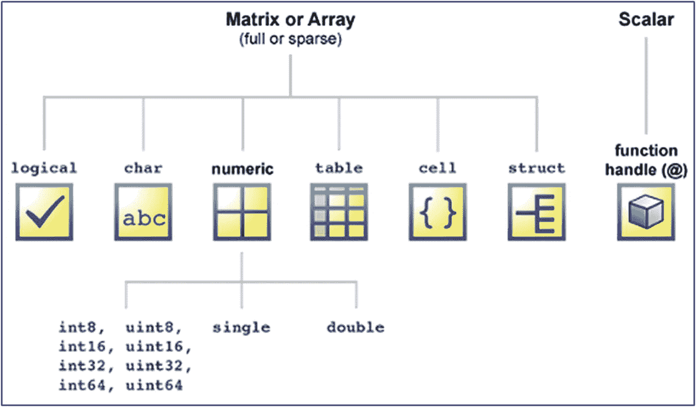

**图 1-10** `MATLAB`支持的数据（数组）集类型

在演示如何生成这些数组时，所有创建的变量/数组类型将一直保留到本节结束。因此，所有变量/数组都只创建一次，并在示例中保持。请注意，在某些生成随机矩阵的示例中，我们使用了`MATLAB`的随机数生成器，每次调用时它们都会生成不同的随机数。然而，为了使变量和数组具有固定的随机值，我们必须设置随机数生成器`rng()`的种子值。使用固定的种子值，随机数生成器（`rand()`、`randi()`、`randn()`等）每次被调用时都会生成固定的随机值。

### 数值数据/数组

创建和生成数值数组有多种不同的方法。例如，您可以在命令窗口中通过键入数组的所有数值直接输入，也可以使用内置函数和命令生成数值条目。数据可以从其他文件（`.mat`、`.txt`、`.dat`、`.xls`、`.jpeg`、`.au`等）导入，或使用`MATLAB`中已有的数据或导入的数据生成。数据也可以使用特定的数学表达式和算术/矩阵运算来计算。

```
>> format short      % 以短格式显示数组的数值元素
>> A = 2; B = -3.25; C=(A+B)²; % 输入和算术运算。
>> ABC=[A, B, C] % 使用现有数据：1×3 数组
ABC =
2.0000   -3.2500    1.5625>> Drow=[1, 2, 3, -4] % 直接输入：行数组。逗号“,”是元素分隔符。
Drow =
1     2     3    -4>> Erow=[-2 -1 0 Drow] % 输入和现有数据的使用：行数组。空格是分隔符。
Erow =
-2    -1     0     1     2     3    -4>> Fcol=[1; 2; 3; -4] % 输入：列数组。元素用“;”分隔。
Fcol =

-4>> DE = [2*Drow; (3/4)*Drow] % 使用现有数据和算术运算：2×4 数组
DE =
2.0000    4.0000    6.0000   -8.0000
0.7500    1.5000    2.2500   -3.0000
```

另一种生成数值数组/数据的方法是使用`MATLAB`内置的数组生成器函数。

```
>> Aone=ones(2, 6) % 生成一个 2×6 的数组，元素均为 1
Aone =
1     1     1     1     1     1
1     1     1     1     1     1>> Bzero=zeros(5, 6) % 生成一个 5×6 的数组，元素均为 0
Bzero =
0 0 0 0 0 0
0 0 0 0 0 0
0 0 0 0 0 0
0 0 0 0 0 0
0 0 0 0 0 0
>> Ceye=eye(6) % 生成一个 6×6 的单位矩阵
Ceye =
1.00 0 0 0 0 0
0 1.00 0 0 0 0
0 0 1.00 0 0 0
0 0 0 1.00 0 0
0 0 0 0 1.00 0
0 0 0 0 0 1.00
>> Seed = 1; rng(Seed);    % 设置随机数生成器 rng() 的种子值，以便
% 生成固定的随机数
>> Dr1 =rand(9, 5)     % 生成一个 9×5 的均匀分布随机数数组
Dr1 =
0.4170    0.5388    0.1404    0.0391    0.6865
0.7203    0.4192    0.1981    0.1698    0.8346
0.0001    0.6852    0.8007    0.8781    0.0183
0.3023    0.2045    0.9683    0.0983    0.7501
0.1468    0.8781    0.3134    0.4211    0.9889
0.0923    0.0274    0.6923    0.9579    0.7482
0.1863    0.6705    0.8764    0.5332    0.2804
0.3456    0.4173    0.8946    0.6919    0.7893
0.3968    0.5587    0.0850    0.3155    0.1032>> Dr2 =randn(4, 6) % 生成一个 4×6 的正态分布随机数数组
Dr2 =
-0.1551   -1.1714   -0.5581   -2.0187   -0.4852    0.0407
0.6121   -0.6856   -0.0285    0.1997    0.5943    0.2830
-1.0443    0.9262   -1.4763    0.4259   -0.2765    0.0636
-0.3456   -1.4817    0.2589   -1.2700   -1.8576    0.4334>> Dr3 =randi([-5, 5], 5,5) % 生成一个 5×5 的整数数组，范围在 -5 ... 5 之间
>> Dr3 =randi([-5, 5], 5,5)
Dr3 =
1    -1     2    -3     1
4    -4     4     4    -4
-4     5     1    -1     5
-4    -2     3     5    -1
3     3    -2     2     1
```

请注意，我已设置随机数生成器的种子值，以便从随机数生成器`rand()`、`randn()`和`randi()`生成固定值。

此外，`MATLAB`中还有许多其他内置的标准矩阵/数组生成器，例如`pascal()`、`krylov()`、`leslie()`、`cauchy()`、`clement()`、`lesp()`、`poisson()`、`neumann()`等。要获取这些数组生成器的帮助，请在命令窗口中键入以下内容：

```
>> help gallery
>> doc gallery
```

必须注意，所有生成的数值条目/数组都以双精度格式保存。更改这些变量的存储格式类型非常简单直接。

# 数值数据类型与数组操作

```
>> Dr3new=int8(Dr3) % Dr3new 以 int8 格式保存
Dr3new =
5×5 int8 矩阵
1   -1    2   -3    1
4   -4    4    4   -4
-4    5    1   -1    5
-4   -2    3    5   -1
3    3   -2    2    1
>> Dr2new=single(Dr3) % Dr2new 以单精度格式保存
Dr2new =
5×5 单精度矩阵
1    -1     2    -3     1
4    -4     4     4    -4
-4     5     1    -1     5
-4    -2     3     5    -1
3     3    -2     2     1
>> A1New=uint8(Aone) % A1new 以 uint8 格式保存
A1New =
2×6 uint8 矩阵
1   1   1   1   1   1
1   1   1   1   1   1
```

现在是时候检查在命令窗口中创建并保存在工作区中的数值条目的属性了。为此，你需要使用`whos`命令，如图 1-11 所示。

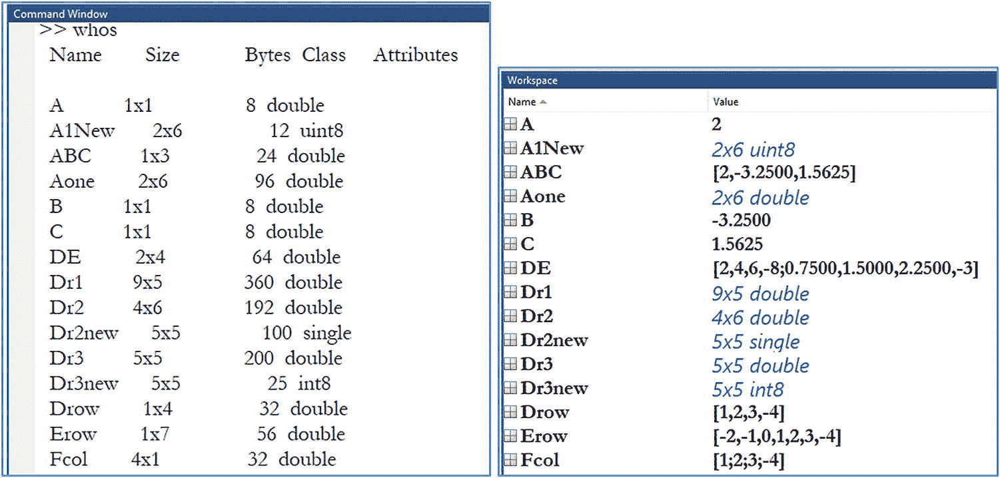

图 1-11 在工作区中创建的数值数据类型和变量

MATLAB 中最常用的数据类型是数值数组。因此，学习如何处理不同大小（多行多列）的数组至关重要。为了处理数组，你应该理解如何正确定位数组元素、行和列的地址。数组是按行和列读取的。例如，`>> DE(2, 1)` 表示我们取`DE`中位于第二行第一列的元素，即`0.7500`。同样，`>> DE(1, 4)` 表示我们选择了`DE`中位于第一行第四列的元素，即`-8`。

```
>> DE
DE =
2.0000    4.0000    6.0000   -8.0000
0.7500    1.5000    2.2500   -3.0000
>> DE(2,1)
ans =
0.7500
>> DE(1,4)
ans =
```

因此，任何数组中的元素都可以根据其行和列来确定位置。冒号运算符`:`用于选择所有行、所有列或全部元素。例如，`>> DE(1,:)` 选择位于`DE`第一行的所有元素，即`[2, 4, 6 -8]`。同样，`DE(:, 3 )` 选择位于`DE`第三列的所有元素，即`[6; 2.25]`。

```
>> DE(1,:)
ans =
2     4     6    -8
>> DE(:,3)
ans =
6.0000
2.2500
```

你可以使用冒号运算符选择矩阵或数组的所有元素。例如，`>> DE(:, :)` 等同于`DE`。`end`关键字使你能够选择直到最后一个元素。例如，`>> DE(1, 1:end)` 等同于`>> DE(1, :)`。

```
>> DE(1, 1:end)
ans =
2     4     6    -8
>> DE(1, :)
ans =
2     4     6    -8
```

作为如何选择矩阵元素的另一个示例，在`Dr3new`中，位于第二行第一列的元素是`0`。在任意给定数组中定位元素的另一种方法是按顺序计数。数组中的元素是按列计数的。例如，`Dr3new`中元素编号 2 的顺序将是`0`，`Dr3new`中元素编号 6 是`2`。请注意，我使用随机数生成器创建了`Dr3new`，因此你的`Dr3new`会有所不同。再次，让我们看几个基于`Dr3new`和`Dr1`操作数组的示例。

```
>> Dr3new
Dr3new =
5×5 int8 矩阵
3   -5    0    1   -3
3   -5    1    5    3
5   -5    4    1   -1
2   -3   -4   -5    4
-4    4   -2    3    3
>> Dr3new(2,1)
ans =
int8

>> Dr3new(2)
ans =
int8

>> Dr3new(6)
ans =
int8

>> Dr3new(2,:)=0 % 这使得第二行的所有元素变为 0
Dr3new =
5×5 int8 矩阵
3   -5    0    1   -3
0    0    0    0    0
5   -5    4    1   -1
2   -3   -4   -5    4
-4    4   -2    3    3
>> Dr3new(:,5)=1 % 这使得第五列的所有元素变为 1
Dr3new =
5×5 int8 矩阵
3   -5    0    1    1
0    0    0    0    1
5   -5    4    1    1
2   -3   -4   -5    1
-4    4   -2    3    1
>> Dr3new(end,:)=-5 % 这使得最后一行的所有元素变为-5
Dr3new =
5×5 int8 矩阵
3   -5    0    1    1
0    0    0    0    1
5   -5    4    1    1
2   -3   -4   -5    1
-5   -5   -5   -5   -5
>> Dr2new(1:5, 4:5)=2+2 % 这使得最后两列的所有元素变为 4
Dr2new =
5×5 单精度矩阵
3    -5     0     4     4
3    -5     1     4     4
5    -5     4     4     4
2    -3    -4     4     4
-4     4    -2     4     4
>> Dr1(9, :)=[] % 最后一行元素被移除
>> Dr1(9,:) =[]
Dr1 =
0.4479    0.4916    0.4142    0.1393    0.6237
0.9086    0.0534    0.0500    0.8074    0.7509
0.2936    0.5741    0.5359    0.3977    0.3489
0.2878    0.1467    0.6638    0.1654    0.2699
0.1300    0.5893    0.5149    0.9275    0.8959
0.0194    0.6998    0.9446    0.3478    0.4281
0.6788    0.1023    0.5866    0.7508    0.9648
0.2116    0.4141    0.9034    0.7260    0.6634
>> Dr1(:, 4)=[ ] % 第四列元素被移除
Dr1 =
0.4479    0.4916    0.4142    0.6237
0.9086    0.0534    0.0500    0.7509
0.2936    0.5741    0.5359    0.3489
0.2878    0.1467    0.6638    0.2699
0.1300    0.5893    0.5149    0.8959
0.0194    0.6998    0.9446    0.4281
0.6788    0.1023    0.5866    0.9648
0.2116    0.4141    0.9034    0.6634
```

此外，你还可以从现有数组的元素创建新数组：

```
>> NewDr = [Dr1(1:3,:), Dr2new(1:3, 2:4)] % 取 Dr1 和 Dr2new 的部分元素
NewDr =
3×7 单精度矩阵
第 1 到 6 列
0.4170    0.5388    0.1404    0.6865   -1.0000    2.0000
0.7203    0.4192    0.1981    0.8346   -4.0000    4.0000
0.0001    0.6852    0.8007    0.0183    5.0000    1.0000
第 7 列
4.0000
4.0000
4.0000
>> NewDr2 = [Dr3new(:,:); Dr2new(2:end, :)] % Dr3new 的全部元素和 Dr2new 的部分元素
NewDr2 =
9×5 int8 矩阵
1   -1    2   -3    1
0    0    0    0    1
-4    5    1   -1    1
-4   -2    3    5    1
-5   -5   -5   -5   -5
4   -4    4    4    4
-4    5    1    4    4
-4   -2    3    4    4
3    3   -2    4    4
```

在这些示例中请注意，冒号是管理和操作矩阵及数组元素的基本运算符之一。例如，`NewDr(2, :)` 等同于`NewDr(2, 1:end)`。两者都选择第 2 行的所有元素。同样，`NewDr(:,:)` 等于`NewDr(1:end, 1:end)`。两者都选择从第一个元素到最后一个元素的所有元素。

以上是在命令窗口中创建数组的几个示例。如前所述，数值数组可以从其他数据文件导入，例如`*.dat`、`*.txt`、`*.xls`、`*.xlsx`和`*.csv`，以及图像文件，例如`*.jpg/jpeg`、`*.tiff`、`*.png`等。

## 非数值（NaN）

在处理不同的数据集和分析实验数据时，经常会遇到非数值（NaN）。NaN 是`0/0`的结果，或者将字符串作为数值数据集导入时产生的。NaN 也是`inf - inf`（∞ - ∞）或尝试在给定范围外进行插值的结果。那么，如何处理数值数组中的 NaN 值呢？MATLAB 中有几个现成的函数/工具可以处理 NaN。让我们看看下面的例子：

```
% 假设：
A_var = [-8 10 NaN 9 4 -4 -7; 9 NaN 9 4 -10 9 0; -8 10 NaN 5 -10 -1 NaN]
A_var =
-8 10 NaN 9 4 -4 -7
9 NaN 9 4 -10 9 0
-8 10 NaN 5 -10 -1 NaN
```

如何计算给定数值数组`A_var`的总和？请注意，如果矩阵具有多行和多列，`sum()`会计算矩阵各列的总和。如果矩阵是行矩阵，它会计算所有行元素的总和。

```
>> sum(A_var)
ans =
-7 NaN NaN 18 -16 4 NaN
```

有时，您可能需要从数据中移除 NaN。例如，假设您正在分析包含一些缺失点（NaN）的测量数据。您需要从数据中移除 NaN。如何解决这个问题呢？

一种解决方案是通过将`A_var`数组中的所有 NaN 分量替换为`0`来移除它们。否则，求和将不会产生数值结果。您可以使用逐元素替换的方法，一个接一个地替换所有 NaN 分量。或者，您可以通过调用所有 NaN 分量的索引，用一条命令完成替换。

```
>> A_var(5)=0 % 逐个元素更改
A_var =
-8 10 NaN 9 4 -4 -7
9 0 9 4 -10 9 0
-8 10 NaN 5 -10 -1 NaN
>> A_var([7 9 21])=[0, 0, 0] % 一次性全部替换 或 % A_var([7 9 21])=0
A_var =
-8 10 0 9 4 -4 -7
9 0 9 4 -10 9 0
-8 10 0 5 -10 -1 0
```

现在可以执行求和运算了：

```
>> sum(A_var)
ans =
-7 20 9 18 -16 4 -7
```

这个答案是正确的。这种方法非常直接，但对于非常大的数据集，会变得繁琐、耗时，甚至可能无法实现。

> **注意**
> 您可以通过指定元素的索引（例如`A_var([7 9 21])=[0 0 0]`），一次一个或一次性全部为数组的选定元素/分量分配新值。

这是第二种解决方案。MATLAB 内置函数`nansum()`处理包含 NaN 分量（元素）的数值数组的求和。

```
>> A_var = [-8 10 NaN 9 4 -4 -7; 9 NaN 9 4 -10 9 0; -8 10 NaN 5 -10 -1 NaN]
A_var =
-8 10 NaN 9 4 -4 -7
9 NaN 9 4 -10 9 0
-8 10 NaN 5 -10 -1 NaN
>> nansum(A_var)
ans =
-7 20 9 18 -16 4 -7
```

此外，还有其他几个 MATLAB 函数可以计算包含 NaN 元素的数值数据数组的平均值、标准差、协方差等。

> **注意**
> 您可以使用以下 MATLAB 函数来计算包含 NaN 元素的数值数组的最大值、平均值、中位数、最小值、标准差和方差：`nanmax()`、`nanmean()`、`nanmedian()`、`nanmin()`、`nanstd()`和`nanvar()`。它们的原理是忽略给定数组中的所有 NaN 元素。

还有第三种方法，即使用逻辑索引。在处理大型数据集时，这种方法被广泛用于对数据进行求和、计算平均值、绘制数值以及执行其他算术矩阵/数组运算。

```
>> Index1=isnan(A_var) % 找出 A_var 中哪些元素是 NaN，并将其设为 1
Index1 =
3×7 logical array
   0   0   1   0   0   0   0
   0   1   0   0   0   0   0
   0   0   1   0   0   0   1
>> A_var(Index1)=0 % 将所有 NaN 元素赋值为 "0"
A_var =
-8  10   0   9   4  -4  -7
 9   0   9   4 -10   9   0
-8  10   0   5 -10  -1   0
>> sum(A_var)
ans =
-7  20   9  18 -16   4  -7
```

这里，`isnan()`函数识别`A_var`中哪些元素是 NaN，哪些不是。名为`Index1`的新逻辑数组包含`1`和`0`。`1`代表 NaN 元素，`0`代表所有其他数值元素。

在 MATLAB 的较新版本中，还引入了另一个替代的逻辑索引函数，称为`ismissing()`。它用于识别数值数组中的缺失数据元素。

```
Index2=ismissing(A_var) % 识别隐藏在 NaN 背后的所有缺失元素
Index2 =
3×7 logical array
   0   0   1   0   0   0   0
   0   1   0   0   0   0   0
   0   0   1   0   0   0   1
>> A_var(Index2)
ans =
   NaN
   NaN
   NaN
   NaN
>> A_var(Index2)=0
A_var =
-8  10   0   9   4  -4  -7
 9   0   9   4 -10   9   0
-8  10   0   5 -10  -1   0
```

逻辑索引方法非常高效且灵活，它也可以应用于许多其他情况。例如，您可以轻松地识别给定数据集中所有负数元素，或某个值范围内的所有元素。让我们以由`randi()`生成的以下数值数组（7 行 7 列）为例，筛选出所有大于 3 但小于 9 的元素，然后将它们全部等于 5。

```
>> B_var = randi([0, 25], 7) % 这创建了一个 7 行 7 列，在 [0, 25] 内均匀分布的整数数组
B_var =
25   1  17  21   1  11  12
18  13  13   2  10   0   8
13   2  25   3  13  25  24
12  21  16   4  10   4  23
 1  21  20  10  17   2   1
17  18  11  21  16   9  19
 1   3  11  20   7   5   6
>> IndexB = find(B_var>3 & B_var<9)
IndexB =

>> B_var(IndexB)=5
B_var =
25   1  17  21   1  11  12
18  13  13   2  10   0   5
13   2  25   3  13  25  24
12  21  16   5  10   5  23
 1  21  20  10  17   2   1
17  18  11  21  16   9  19
 1   3  11  20   5   5   5
```

> **注意**
> 逻辑索引是一个功能非常强大且高效的工具，可以根据数值数据集合/数组/矩阵中特定元素的值来识别它们，然后为其分配新值。

## 变量的字符类型

MATLAB 能够基于 ASCII/ANSI 字符符号以数值数组的形式识别字符。例如：

```
>> Ach1 = 'matlab' % 变量字符类型
Ach1 =
'matlab'
>> Bch2 = 'mathworks' % 变量字符类型
Bch2 =
'mathworks'
>> Cch3= 'matlab belongs to mathworks' % 变量字符类型
Cch3 =
'matlab belongs to mathworks'
>> Dch4 = 'www.mathworks.com' % 变量字符类型
Dch4 =
'www.mathworks.com'
```

这些是字符类型的变量，但当对这些变量执行算术运算时，它们会变成数值数组。

## 变量与 ASCII 映射

```
>> format short
>> Aa1 = Ach1+0
Aa1 =
   109    97   116   108    97    98
>> Ba2 = Bch2+0
Ba2 =
   109    97   116   104   119   111   114   107   115
>> Ca3 = Cch3+0
Ca3 =
  列 1 至 12
   109    97   116   108    97    98    32    98   101   108   111   110
  列 13 至 24
   103   115    32   116   111    32   109    97   116   104   119   111
  列 25 至 28
   114   107   115
>> Da4 = Dch4+0
Da4 =
  列 1 至 12
   119   119   119    46   109    97   116   104   119   111   114   107
  列 13 至 17
   115    46    99   111   109
```

因此，这些数字背后是根据 ASCII/ANSI 标准的字符。可以使用 MATLAB 函数 `char()` 获取新变量的字符表示形式。

```
>> char(Aa1)
ans =
'matlab'
>> char(Ba2)
ans =
'mathworks'
>> char(Ca3)
ans =
'matlab belongs to mathworks'
>> char(Da4)
ans =
'www.mathworks.com'
```

以下变量存在于工作区中：

```
A             1x1               8  double
A1New         2x6              12  uint8
ABC           1x3              24  double
Aa1           1x6              48  double
Ach1          1x6              12  char
Aone          2x6              96  double
B             1x1               8  double
Ba2           1x9              72  double
Bch2          1x9              18  char
Bzero         5x6             240  double
Ca3           1x27            216  double
Cch3          1x27             54  char
Ceye          6x6             288  double
DE            2x4              64  double
Da4           1x17            136  double
Dch4          1x17             34  char
Dr1           8x4             256  double
Dr2           4x6             192  double
Dr2new        5x5             100  single
Dr3           5x5             200  double
Dr3new        5x5              25  int8
Drow          1x4              32  double
Erow          1x7              56  double
Fcol          4x1              32  double
NewDr         3x7              84  single
NewDr1        3x7              84  single
NewDr2        9x5              45  int8
ans           1x17             34  char
```

请注意，这些变量将被保留并在后续章节中用于生成逻辑、表格、元胞和结构体类型的数组变量。

## 函数句柄

函数句柄是一种特殊的 MATLAB 数据类型，用于存储指向表达式或函数的链接。通过调用函数句柄，我们可以调用存储在该特定函数句柄中的表达式或函数。函数句柄是 MATLAB 中最有用的功能之一。例如，函数句柄用于各种仿真以及函数和数学表达式的计算，用于求解各种方程和问题，以及用于用户界面开发。它们还广泛应用于求解微分方程。其语法相当直观，有两种形式：

*   `函数句柄名 = @MYfunction`
*   `函数句柄名 = @(变量1, 变量2, ...)([表达式1, 表达式2, ...])`

让我们看几个如何创建函数句柄的示例：

```
F1 = @MY_function;
```

其中 `MY_function` 是一个函数文件、函数表达式或另一个函数句柄。

例如：

```
function x = MY_function(a, b, c)
% MY_function.m 是一个函数文件，用于求解关于用户输入的 a, b, c 的二次方程，并输出找到的解。
D= b^2-4*a*c;
x1 = (-b+sqrt(D))/(2*a);
x2 = (-b-sqrt(D))/(2*a);
x = [x1; x2];
end
```

我们可以使用以下命令测试名为 `F1` 的函数句柄：

```
>> x = F1( 1, 2, 3)
x =
-1.0000 + 1.4142i
-1.0000 - 1.4142i
```

这里，名为 `F1` 的函数句柄调用了名为 `MY_function.m` 的函数文件，并使用用户为变量 `a`、`b` 和 `c` 指定的输入数据来执行该文件。

请注意，关于函数文件（例如 `MY_function.m`）特性的更详细说明以及如何创建它们，将在第 2 章“编程基础”中找到。

*   `f(x, a[1], a[2], a[3]) = a[1]*x^2 + a[2]*x + a[3]`;

```
>> f = @(x,a1,a2,a3)(a1*x^2+a2*x+a3)
f =
function_handle with value:
@(x,a1,a2,a3)(a1*x^2+a2*x+a3)
```

此外，函数句柄可用于定义复合函数。例如，`H = 2*e^(sin(x))` 可以通过以下三种使用复合函数的方式来表示：

```
>> ff1 = @(x) sin(x); ff2 = @(ff1)exp(ff1); ff3 = @(ff2)2*ff2;    % 第 1 种方式
>> gg1 = @(x)sin(x); gg2 = @(x)exp(gg1(x)); ff3 = @(x) 2*gg2(x);   % 第 2 种方式
>> hh3 = @(x)2*exp(sin(x));                                         % 第 3 种方式
```

使用函数句柄进行计算非常直接：

```
>> ff3(ff2(ff1(pi)))
ans =
2.0000
>>  gg3(pi)
ans =
2.0000e+00
>> hh3(pi)
ans =
2.0000e+00
>> x=1.3; a1=2; a2=-3; a3=13; f (x, a1, a2, a3)
ans =
12.48
>> x=1.3; a1=[2, 3]; a2=[-3, 4]; a3=[11,13]; f2(x, a1, a2, a3)
ans =
10.4800   23.2700
>> x=1:3; a1=2; a2=-3; a3=11; f2(x, a1, a2, a3)
Error using  ^  (line 51)
Incorrect dimensions for raising a matrix to a power.
Check that the matrix is square and the power is a
scalar. To perform elementwise matrix powers, use
'.^'.
Error in @(x,a1,a2,a3)(a1*x^2+a2*x+a3)
```

在最后一部分中，`f(x,a[1],a[2],a[3])` 的表达式需要针对逐元素矩阵运算进行修正。

```
>> f = @(x,a1,a2,a3)(a1*x.^2+a2*x+a3)
f =
function_handle with value:
@(x,a1,a2,a3)(a1*x.^2+a2*x+a3)
>> x=1:3; a1=2; a2=-3; a3=11; f(x, a1, a2, a3)
ans =
10    13    20
```

函数句柄的另一种选择是 `inline` 函数。它与函数句柄类似。请注意，`inline` 函数将在 MATLAB 的未来版本中被移除。

```
>> F1=inline('a1*x^2+a2*x+a3', 'a1', 'a2', 'a3', 'x')
F =
Inline function:
F (a1,a2,a3,x) = a1*x^2+a2*x+a3
```

现在，可以使用变量 `x`、`a1`、`a2` 和 `a3` 的特定值来计算内联函数。

```
>> x=1.3; a1=2; a2=-3; a3=13; F(a1, a2, a3, x)
ans =
12.4800
```

使用函数句柄时，遵循变量的顺序非常重要。换句话说，在调用它们时，需要遵循输入变量值的顺序。例如：

```
>> x=1.3; a1=2; a2=-3; a3=13;
>> f = @(x,a1,a2,a3)(a1*x.^2+a2*x+a3);
>> f(x, a1, a2, a3)
ans =
12.4800
>> f( a1, a2, a3, x)
ans =
15.3000
```

函数句柄可以接受不同的预定义输入变量：

```
>> f = @(x,a1,a2,a3)(a1*x.^2+a2*x+a3);
>> y=1.3; b1=2; c2=-3; d3=13;
>> f(y,b1,c2,d3)
ans =
12.4800
```

图 1-12 显示了本节中创建的、位于工作区中的变量和函数句柄列表。

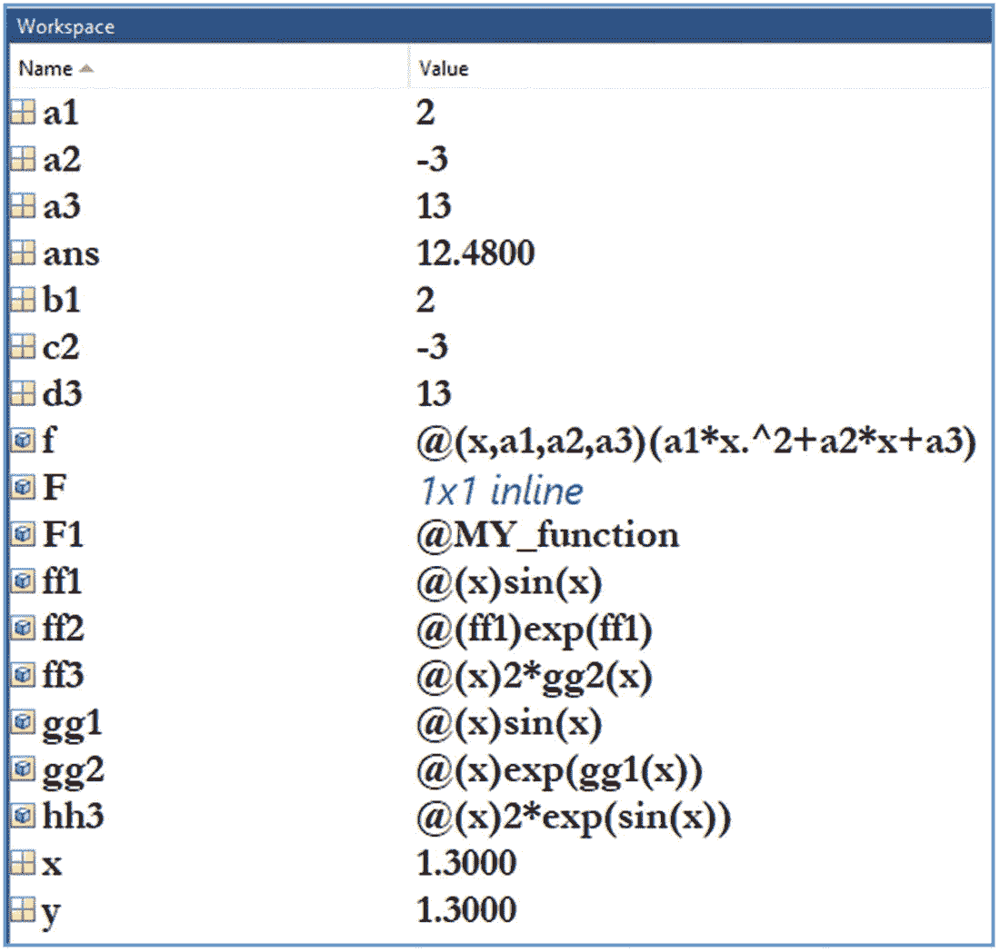

图 1-12：位于工作区中的变量

关于函数句柄更广泛的应用和用途，将在本书的其他章节中讨论——第 2 章“编程基础”和第 8 章“常微分方程”。

## 逻辑数组

逻辑数组对于编程和布尔运算非常重要。其值只有 0 和 1。0 表示语句或条件不成立，1 表示语句成立。在 MATLAB 中，有多种生成逻辑数组的方法。你可以对数值数组应用比较运算，或验证数组，或定义其类型。以下布尔逻辑数组基于前面章节中创建的现有变量。

```
>> A = 2; B = -3.25; C=(A+B)^2; ABC=[A, B, C];
>> isnumeric(A)
ans =
logical

>> Ach1 = 'matlab';
>> isstr(Ach1)
ans =
logical

>> ABC_logic=ABC>=2
ABC_logic =
1×3 logical array
1 0 0
>> Seed = 1; rng(Seed);   % 设置随机数生成器，以生成固定数值。
>> Dr1 = rand(4, 5)
>> Dr1 = rand(4, 5)
Dr1 =
0.0500    0.9446    0.1393    0.9275    0.8833
0.5359    0.5866    0.8074    0.3478    0.6237
0.6638    0.9034    0.3977    0.7508    0.7509
0.5149    0.1375    0.1654    0.7260    0.3489
>> Dr1Logic=Dr1>0.5 & Dr1<=0.71
Dr1Logic =
4×5 logical array
0   0   0   0   0
1   1   0   0   1
1   0   0   0   0
1   0   0   0   0
```

请注意，我们设置了随机数生成器 `rng()` 的种子值，以便通过均匀随机数生成器 `rand()` 生成固定元素值。

你可以使用计算得到的逻辑数组来索引数组，并找出哪些值满足设定的条件，哪些不满足。例如，在前面的例子中，`ABC_logic` 指出 `ABC` 的第一个元素满足设定条件（大于等于 2）。类似地，`Dr1Logic` 数组指出第 2 行中的三个元素和第 5 行中的一个元素大于 0.5 且小于等于 0.71。现在你可以通过索引操作来确定哪些元素满足设定条件。

```
>> Index=find(Dr1>0.5 & Dr1<=0.71)
>> Dr1(Index)                % 满足设定条件的元素
ans =
0.5359
0.6638
0.5149
0.5866
0.6237
```

寻找这些真值的另一种方法如下：

```
>> Dr1Logic.*Dr1
ans =
0         0         0         0         0
0.5359    0.5866         0         0    0.6237
0.6638         0         0         0         0
0.5149         0         0         0         0
```

再举一个例子，让我们在随机整数生成器生成的数组中查找 "0" 元素，以便在 [-2 2] 范围内生成整数，填充一个 5×5 的方阵：

```
>> Seed = 1; rng(Seed);   % 设置随机数生成器，以生成固定数值。
>> Hr=randi([-2, 2], 5)
Hr =
0    -2     0     1     2
1    -2     1     0     2
-2    -1    -1     0    -1
-1    -1     2    -2     1
-2     0    -2    -2     2
>> Ind=(~Hr)    % 定位 Hr 中等于 "0" 的元素
Ind =
5×5 logical array
1   0   1   0   0
0   0   0   1   0
0   0   0   1   0
0   0   0   0   0
0   1   0   0   0
```

在本节中，我们生成了数值矩阵、逻辑矩阵和字符串，如图 1-13 所示。

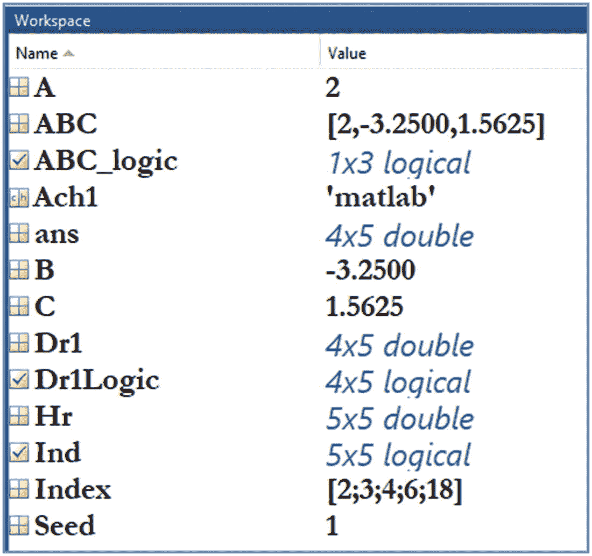

图 1-13: 工作区中的变量

关于逻辑数组和索引的更多用法/示例将在本书的其他章节讨论。

## 表格数组

表格数组是 MATLAB 中较新引入的工具，因此在较旧版本的 MATLAB 中无法生成表格数组。表格数组对于准备报告以及显示/呈现从多列多行数组（每一列或行代表特定变量）中获得的仿真/分析结果特别有用。它们用于将异构数据和元数据以表格数据格式收集到单个容器中。表格数组可以容纳不同类型、大小、单位等的变量。它们通常用于存储实验数据，其中行代表不同的观测值，列代表不同的测量变量。通过为列和行分别指定名称，它们能以信息量更丰富、更便于制表的格式显示数组。让我们通过使用前面章节中创建的现有变量，来看几个使用 `table()` 命令创建表格数组的例子。

```
>> A1new = [1 2 3; 3 4 5; 7 8 9];
>> A1Tab=table(A1new)
A1Tab =
3×1 table
    A1new  
    ________
    1    2    3
    3    4    5
    7    8    9
>> B1new = A1new/5;
>> B1Tab=table(B1new)
B1Tab =
3×1 table
        B1new       
    ________________
    0.2    0.4    0.6
    0.6    0.8      1
    1.4    1.6    1.8
```

在这些情况下，表格数组 `A1Tab` 和 `B1tab` 分别从 `A1New` 和 `B1New` 创建为列表格。也可以使用 `array2table()`、`cell2table()` 和 `struct2table()` 命令从现有数组（数组、元胞数组和结构体）中获取/创建表格：

## 元胞数组

元胞数组非常有用，它可以在一个元胞类型变量的不同元胞中容纳各种类型的数组（数值型、字符型、逻辑型、表格型和函数句柄），同时保持每个变量的所有属性不变。它们可能非常便于在一个变量中携带或传递各种数据集。元胞数组包含带索引的数据容器——这些元胞可以容纳文本列表、字符串、文本与数值数据的组合、数值数组、函数句柄、结构数组以及表格。元胞数组最基本的特性之一是，在指定元胞地址时必须使用花括号。元胞数组另一个重要特性是，MATLAB 读取的数据将以元胞数组模式呈现。

让我们看几个例子，这些例子使用不同类型的数组创建元胞数组，并生成新的元胞数组。

可以分别使用 `tabel2array()` 和 `table2cell()` 命令将表格数组转换为数组和元胞数组。理解和运用表格数组不仅对你准备报告大有裨益，而且在以下场景中也极有帮助：使用导入向导（见图 1-n）导入数据，以及将来自外部文件（例如 `.txt`、`.xls`、`.dat` 等）的各种数据集处理到 MATLAB 工作区中。


```
>> A1Tab2=array2table(A1New) % 未指定列名
>> A1Tab2=array2table(A1new)
A1tab2 =
3×3 table
A1new1    A1new2    A1new3
______    ______    ______
1         2         3
3         4         5
7         8         9
>> Ach1Tab=array2table(A1new, 'variablenames',{'a','b','c'})
Ach1Tab =
3×3 table
a    b    c
_    _    _
1    2    3
3    4    5
7    8    9
>> C1new = [A1new, B1new]
C1new =
1.0000    2.0000    3.0000    0.2000    0.4000    0.6000
3.0000    4.0000    5.0000    0.6000    0.8000    1.0000
7.0000    8.0000    9.0000    1.4000    1.6000    1.8000
>> Dr1Tab=array2table(C1new, 'variablenames', {'v1', 'v2', 'v3', 'v4', 'v5', 'v6'})
Dr1Tab =
3×6 table
v1    v2    v3    v4     v5     v6
__    __    __    ___    ___    ___
1     2     3     0.2    0.4    0.6
3     4     5     0.6    0.8      1
7     8     9     1.4    1.6    1.8
```

让我们看几个例子，这些例子使用不同类型的数组创建元胞数组，并生成新的元胞数组。

```
>> Acell = cell(5,5) % 创建一个 5×5 的空元胞数组
>> Acell = cell(3,4)
Acell =
3×4 元胞数组
{0×0 double}    {0×0 double}    {0×0 double}    {0×0 double}
{0×0 double}    {0×0 double}    {0×0 double}    {0×0 double}
{0×0 double}    {0×0 double}    {0×0 double}    {0×0 double} % 元胞数组 Acell 中的每个元胞将被填入数组
>> A0 = 13; A1new = [1 2 3; 3 4 5; 7 8 9];
>> Acell{1,1}=A0  % 元胞 (1, 1) 被填入 A0
Acell =
3×4 元胞数组
{[      13]}    {0×0 double}    {0×0 double}    {0×0 double}
{0×0 double}    {0×0 double}    {0×0 double}    {0×0 double}
{0×0 double}    {0×0 double}    {0×0 double}    {0×0 double}
>> Acell{1,2}=A1new  % 元胞 (1, 2) 被填入 A1new
Acell =
3×4 元胞数组
{[      13]}    {3×3 double}    {0×0 double}    {0×0 double}
{0×0 double}    {0×0 double}    {0×0 double}    {0×0 double}
{0×0 double}    {0×0 double}    {0×0 double}    {0×0 double}
>> Ach1Tab=array2table(A1new, 'variablenames',{'a','b','c'});
>> Acell{1,3}=Ach1Tab  % 元胞 (1, 3) 被填入 Ach1Tab
Acell =
3×4 元胞数组
{[      13]}    {3×3 double}    {3×3 table }    {0×0 double}
{0×0 double}    {0×0 double}    {0×0 double}    {0×0 double}
{0×0 double}    {0×0 double}    {0×0 double}    {0×0 double}
>> C1 = 'matlab';
>> Acell{1,4}=C1  % 元胞 (1, 4) 被填入 C1
Acell =
3×4 元胞数组
{[      13]}    {3×3 double}    {3×3 table }    {'matlab'  }
{0×0 double}    {0×0 double}    {0×0 double}    {0×0 double}
{0×0 double}    {0×0 double}    {0×0 double}    {0×0 double}
>> D1 = A1new>3 & A1new> Acell{2,2}=D1  % 元胞 (2, 2) 被填入 D1 逻辑数组
Acell =
3×4 元胞数组
{[      13]}    {3×3 double }    {3×3 table }    {'matlab'  }
{0×0 double}    {3×3 logical}    {0×0 double}    {0×0 double}
{0×0 double}    {0×0 double }    {0×0 double}    {0×0 double}
>> f=@(x, a1, a2, a3)(a1*x²+a2*x+a3);
>> Acell{2,3}=f  % 元胞 (2, 3) 被填入 f 函数句柄
Acell =
3×4 元胞数组
{[      13]}    {3×3 double }    {3×3 table      }    {'matlab'  }
{0×0 double}    {3×3 logical}    {function_handle}    {0×0 double}
{0×0 double}    {0×0 double }    {0×0 double     }    {0×0 double}
>> Acell{3,1}= 'This is a cell array' % 向元胞数组输入字符串：元胞 (3, 1)
Acell =
3×4 元胞数组
{[                13]}    {3×3 double }    {3×3 table      }       {'matlab'  }
{0×0 double          }    {3×3 logical}    {function_handle}       {0×0 double}
{'This is a cell ...'}    {0×0 double }    {0×0 double     }       {0×0 double}
>> Acell{3,2}=rand(5,6) % 向元胞数组输入数值数组：元胞 (3,2)
Acell =
3×4 元胞数组
{[               13]}    {3×3 double }    {3×3 table      }    {'matlab'  }
{0×0 double         }    {3×3 logical}    {function_handle}    {0×0 double}
{'This is a cell ...'}    {5×6 double }    {0×0 double     }    {0×0 double}
```

要访问和查看元胞数组的内容，请使用以下命令。

```
>> Acell{1,1}
ans =
13
>> Acell{1,4}
ans =
'matlab'
>> Acell{2,3}
ans =
function_handle with value:
@(x,a1,a2,a3)(a1*x²+a2*x+a3)
>> Acell{7}
ans =
3×3 表格
a    b    c
_    _    _
1    2    3
3    4    5
7    8    9
>> Acell{8}
ans =
function_handle with value:
@(x,a1,a2,a3)(a1*x²+a2*x+a3)
```

在工作区中双击元胞变量名，可以查看元胞的内容，如图 1-14 所示。

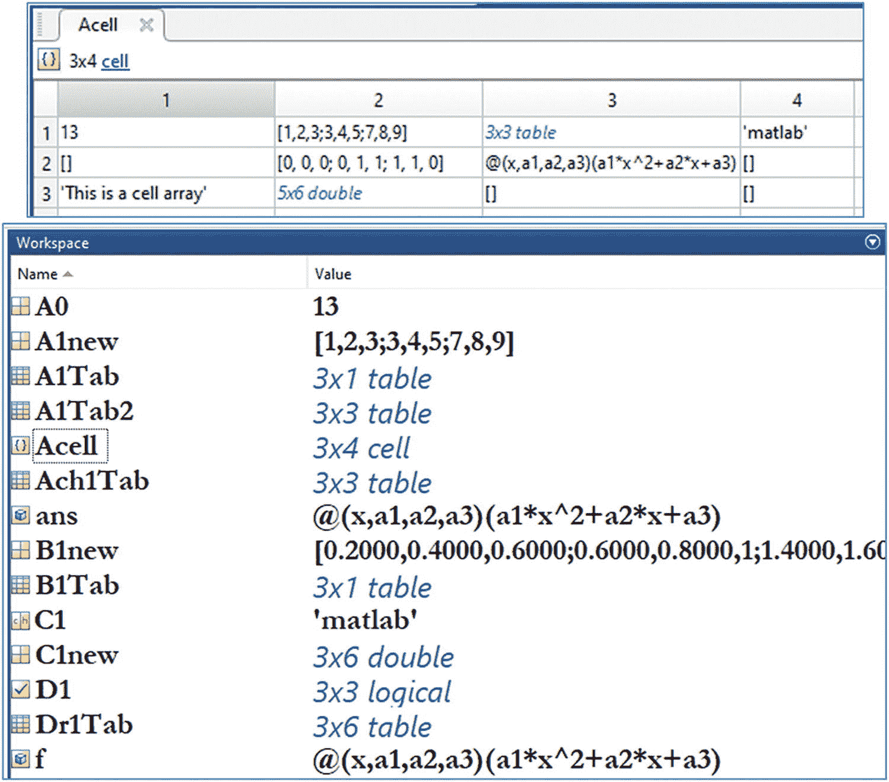

图 1-14 工作区中的变量及 `Acell` 元胞数组的内容

你可以通过双击每个元胞并输入新值来更改元胞数组的内容。

## 结构数组

结构数组可以容纳所有先前创建的数组和条目（变量）类型，即所有类型的数值、逻辑值、字符、表格、元胞数组和函数句柄。它们不仅可以存储不同类型的数据，还可以存储不同大小的数据。结构数组的一个重要方面是它们适合代码生成。此外，它们在编程、数据处理、数据采集以及从 Simulink 模型读取数据中非常有用。

结构数组将数据存储在不同的字段或字段名称中，你可以通过名称来访问这些字段。例如：

```
% 人员 1：姓名 - SE；出生日期 - 1982 年 6 月 6 日；职业 - 教授
WHO(1).Name = 'SE';
WHO(1).DOB = '06.06.1982';
WHO(1).Profession = '教授';
% 人员 2：姓名 - NE；出生日期 - 1992 年 12 月 12 日；职业 - 设计师
WHO(2).Name = 'NE';
WHO(2).DOB = '12.12.1982';
WHO(2).Profession = '设计师';
```

结构变量 `WHO` 包含两个人的信息。数据包含他们的姓名、出生日期和职业。

```
>> WHO =
1×2 struct array with fields:
    Name
    DOB
    Profession
>> WHO(1)
ans =
  struct with fields:
    Name: 'SE'
    DOB: '06.06.1982'
    Profession: '教授'
>> WHO(2)
ans =
  struct with fields:
    Name: 'NE'
    DOB: '12.12.1982'
    Profession: '设计师'
```

请注意，我们只保存了一个结构数组形式的变量。如果你想要访问所创建结构的特定字段，可以调用该字段名称以及结构名称：

```
>> WHO(1).Name   % 访问人员 1 的姓名字段
ans =
'SE'
>> WHO(1).Profession   % 访问人员 1 的职业字段
ans =
'教授'
>> WHO(2).DOB    % 访问人员 2 的出生日期字段
ans =
'12.12.1982'
```

除了这种创建结构数组的方法之外，还有几种其他设置或创建它们的方法。让我们看一些示例。另一种方法是使用 `struct()` 命令创建一个空结构。空结构将使用 `struct('FieldName', VALUE)` 命令语法填充变量。请注意，字段名称（变量名称）不能包含空格或符号，但下划线符号 `_` 除外。

```
>> Astr1 = struct()
Astr1 =
  struct with no fields.
>> % 现在我们可以在创建的空结构 Astr1 内部赋值/设置值和数据字段。
>> a = 2.1; A = [1, 2; 3, 4]; B = A> D = 'mathworks.com';
>> F = table(magic(3));
>> Astr1 = struct('Number', a, 'Matrix', A, 'Logic', B, 'F_Handle', f, 'Cell', C, 'Char', D, 'Table', F)
Astr1 =
  1×2 struct array with fields:
    Number
    Matrix
    Logic
    F_Handle
    Cell
    Char
    Table
```

创建结构数组的另一种方法是单独指定它们的字段，如开头创建结构变量 `WHO` 的示例所示。

```
>> Bstr.Number = a; Bstr.Matrix = A; Bstr.Logic = B; Bstr.F_Handle=f; Bstr.Cell=C; Bstr.Char = D;
>> Bstr.Table = F;
>> Bstr
Bstr =
  struct with fields:
    Number: 2.1000e+00
    Matrix: [2×2 double]
    Logic: [2×2 logical]
    F_Handle: @(x)(a*x²+x-a)
    Cell: {[3×3 double]  'matlab'}
    Char: 'mathworks.com'
    Table: [3×1 table]
```

现在我们可以比较我们创建结构变量 `Astr` 和 `Bstr` 的两种不同方式。创建结构数组的另一种方法是转换；换句话说，你可以使用 `cell2struct()` 和 `table2struct()` 命令将现有的元胞类型变量或表格类型变量转换为结构类型变量。

```
>> % 元胞变量 C 包含：矩阵 C 和字符串 'matlab'
>> C{1} =rand(3); C{2} = 'matlab';
>> F_Names = {'Matrix', 'Char'};    % 字段名称/标题
>> Cstr = cell2struct(C, Headers, 2) % 2 表示嵌入的两个元胞
Cstr =
  struct with fields:
    Matrix: [3×3 double]
    Char: 'matlab'
```

现在让我们看看如何使用 `table2struct()` 命令将表格数组转换为结构数组。

```
>> F = table(magic(3));
>> Dstr = table2struct(F)
Dstr =
  3×1 struct array with fields:
    Var1
```

图 1-15 显示了工作区中保存的变量列表以及 `Astr` 和 `Bstr` 结构数组的内容。

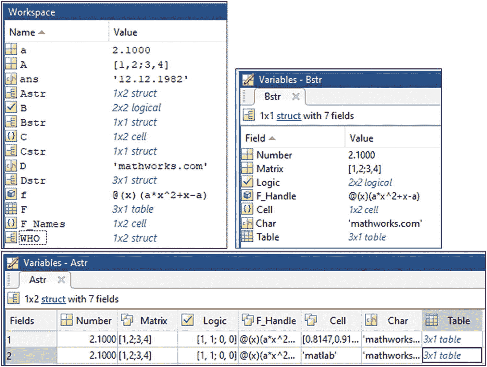

图 1-15 创建的变量以及 `Astr` 和 `Bstr` 结构数组

本节通过示例演示了如何创建七种不同类型的变量（数组）——数值数组（标量和数组类型变量）、字符串、逻辑数组、表格数组、元胞数组和结构数组以及函数句柄。你可以使用 `clear` 或 `clearvars` 命令，或使用鼠标右键选项和“删除”从工作区中移除任何已创建的变量。在命令窗口中，你可以使用以下命令从工作区中清除变量。

```
>> clearvars a A  B% 移除变量 a, A, B
>> clear ans C D % 移除变量 ans, C, D
```

根据工作区中变量的属性（参见图 1-12），你可以确定变量类型（标量、数组、逻辑值、表格、元胞、结构、字符或函数句柄）及其存储类型（`double`、`single`、`uint8` 或 `int8`）。此外，图 1-15 中显示的表示每个变量的符号展示了图 1-9 中所示的一些 MATLAB 支持的数据（数组）集。

必须注意的是，正如你在一些示例中看到的，许多这些数组可以从一种类型转换为另一种类型。例如，可以通过 `cell2table()` 函数将元胞数组转换为表格数组，类似地，可以通过 `struct2table()` 将结构数组转换为表格数组。表格数组可以分别通过 `table2cell()` 和 `table2struct()` 转换为元胞数组和表格数组。

# 复数

两个字母——`i` 和 `j` 或 `1i` 和 `1j`——被保留用于表示虚数。因此，建议不要使用这些字母来指定变量名称。赋值的另一种方法是将它们乘以 `sqrt(-1)`。

# 精度

MATLAB 的精度并非绝对。

例如：

```matlab
>> sin(pi)
ans =
   1.2246e-016
```

在 MATLAB 中，`sin(π)` 不等于 0。这是因为数字 `π` 在 MATLAB 中由双精度数表示。我们可以通过执行勾股定理 `1 = sin²(t) + cos²(t)` 的计算来演示精度问题。

```matlab
t=0:pi/50:2*pi; F=1-(sin(t).²+cos(t).²); plot(t, F)
```

在这些表达式中，`t` 是一个包含一行元素的时间向量，例如 `[0, π/50, ... 2π]`。`F` 的某些值为零，某些值非零，尽管它们是非常小的数字。其原因是所有三角函数，包括指数函数和对数函数，都由一个仅包含自变量（在此示例中为 `t`）奇次幂的 13 次多项式近似。例如，`sin(t) ≈ t − c[1]t³ + c[2]t⁵ + ... + c[6]t¹³ = p(t)`。所有这些函数的计算算法都是基于 `fdlibm` 实现的，`fdlibm` 是由 Sun Microsystems 的 K. C. Ng 等人开发的“可自由分发的数学库”（有关更多信息，请参阅 [`www.netlib.org/fdlibm`](http://www.netlib.org/fdlibm)）。

必须注意的是，MATLAB 的精度级别取决于用于保存数据的数据存储类型。例如：

```matlab
>> int8(128)*-5
ans =
```

分配的数据存储 `int8` 最多可以容纳 `2⁸ − 1` 个整数。所有 MATLAB 支持的数据存储类型如图 1-15 所示。

# M 文件与 MLX 文件编辑器

在本书中，代码、脚本和程序这些术语可互换使用，均指代扩展名为 `.m` 的 M 文件和扩展名为 `.mlx` 的 MLX 文件，包括函数文件和可执行文件。由于扩展名，这些文件被称为 M 文件和 MLX 文件。在前面的示例中，所有操作和工作均在命令窗口中完成。然而，对于编程和编写、编辑与调试而言，M 文件和 MLX 文件编辑器将大有裨益，因为它们提供了有用的工具和提示，有助于编写快速且更高效的代码/脚本/程序。

M 文件和 MLX 文件的整体功能相似，但有一个重要区别。MLX 文件编辑器窗口可以在 MLX 编辑器窗口内显示计算/仿真的输出，并在其左侧输出窗口中指示最常见的命令语法相关错误。M 文件编辑器则在 M 文件执行后，在命令窗口中显示所有错误。此外，MLX 文件编辑器可以通过公式编辑器交互式地显示所有插入的公式；插入的图像和超链接文本直接显示在同一窗口中。两个文件的输出都将显示在工作区中。这两个文件可以互换使用。下面我们开始审视 M 文件和 MLX 文件编辑器的窗口和工具。

## M 文件编辑器

M 文件编辑器窗口的菜单和 GUI 工具分为三个选项卡：编辑器、发布和视图，分别如图 1-16、1-17 和 1-18 所示。注意，有三个主要菜单子分组——主页、绘图和应用程序——属于主 MATLAB 窗口，已在前面章节中展示。

在 M 文件编辑器的主工具菜单（见图 1-16）中，有五个子部分：文件、导航、编辑、断点和运行。每个子部分中的所有工具都非常直观。例如，文件子部分拥有用于创建新文件或打开现有文件、保存当前文件、查找 M 文件、比较同名 M 文件的不同版本以及打印当前 M 文件的 GUI 工具。类似地，导航子部分工具帮助用户在当前文件中移动光标、查找关键字，并在必要时将其替换为其他词语。编辑子部分工具允许你在当前文件中插入新节、添加或删除注释行、包装注释以及添加缩进以使文件更具可读性。断点子部分使你能够调试/编辑当前 M 文件代码。最后，运行子部分拥有用于逐步运行当前 M 文件的不同单元、运行当前 M 文件并测量文件不同部分评估时间的 GUI 工具。值得注意的是，在编写 M 文件时，主要使用编辑器窗口工具。


图 1-16
M 文件编辑器的主工具菜单

图 1-17 所示的发布工具用于生成不同文件格式的报告文件，例如 HTML、DOC、PPT 等。发布窗口的 GUI 工具非常直观，与许多文档编辑软件应用程序相似。


图 1-17
M 文件编辑器的发布工具菜单

图 1-18 所示的视图工具用于在一个窗口区域内显示多个 M 文件和 MLX 文件（文档）窗口。你可以通过使用名为平铺、文档选项卡或拆分文档的 GUI 工具，并排或上下拆分视图。显示子部分中的勾选选项非常方便，可以在编辑 M 文件时显示数据提示、显示行号并高亮当前行。


图 1-18
M 文件编辑器的视图工具菜单

## MLX 文件编辑器

MLX 文件（实时编辑器）编辑器选项卡（如图 1-19、1-20 和 1-21 所示）包含许多 M 文件编辑器的工具以及若干其他不同的 GUI 工具。实时编辑器选项卡（见图 1-19）有一个与 M 文件编辑器不同的主要子部分，称为文本，它包含了 M 文件编辑器中发布工具的大部分功能。


图 1-19
MLX 文件编辑器的主工具菜单

此外，MLX 编辑器的插入选项卡（见图 1-20）拥有一些非常方便的工具，可以直接在 MLX 文件中编写/编辑公式，并插入带注释的子节。你可以在当前 MLX 文件内容中插入控制 GUI 工具，例如滑块和下拉框。


图 1-20
MLX 文件编辑器的插入菜单

MLX 编辑器的视图窗口（如图 1-21 所示）拥有一些与 M 文件编辑器视图相似的工具，以及其他一些工具，例如文档选项卡、显示、输出和布局，通过这些工具，用户可以显示脚本（代码）行号（不包括注释行）、数据提示、全屏视图、清理输出以及显示或隐藏输出。


图 1-21
MLX 文件编辑器的视图工具菜单

M 文件和 MLX 文件可以通过多种不同方式创建——使用 GUI 按钮  或  ，或在命令窗口中键入命令。

为了演示 M 文件编辑器和 MLX 文件编辑器的某些突出工具和选项，我们来看下面这个示例，通过勾股定理来演示 MATLAB 的精度并非绝对。

示例：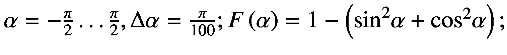

首先，这个简单示例的解决方案脚本将在 M 文件编辑器中创建，并发布结果。随后，所有仿真都将在 MLX 编辑器中进行，以展示两个编辑器的相似和不同之处。

解决此练习的算法由以下六个步骤组成。

1. 插入一些描述给定问题陈述的注释。
2. 定义输入变量：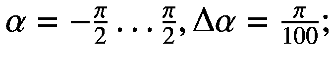。
3. 执行计算：`F(α) = 1 − (sin²α + cos²α)`。
4. 定义对于输入变量 `α` 的哪些值，函数 `F(α)` 的值等于 0。
5. 绘制仿真结果：`α` 与 `F(α)` 的关系图。
6. 发布所有获得的结果，包括整个脚本。

这是直接在 M 文件编辑器中编写的脚本。

```matlab
% 第 1 步：问题陈述
% MATLAB 的精度并非绝对。
% 勾股定理：F = 1 - (sin² (alpha) + cos²(alpha));
% 输入变量：alpha = -0.5*pi ... 0.5*pi
% 第 2 步：定义输入变量
alpha = -pi/2:pi/100:pi/2;
% 第 3 步：执行计算
F = 1-(sin(alpha).²+cos(alpha).²);
% 第 4 步：定义 F(alpha) = 0 所对应的 alpha 值
Findex=find(F==0);
F0=F(Findex);
% 第 5 步：绘制仿真结果：alpha 与 F(alpha)的关系图
plot(alpha, F, 'b-', alpha(Findex), F0, 'ro'),
legend('\alpha vs F(\alpha)', 'F(\alpha) = 0')
title('基于勾股定理的 MATLAB 精度仿真'), grid on
xlabel('\alpha'), ylabel('F(\alpha) = 1-(sin(\alpha)²+cos(\alpha)²)')
% 第 6 步：发布包括整个脚本在内的所有获得结果
```

请注意，在本脚本中，我们使用 `%` 插入注释（非可执行信息），并使用 `\` 插入和显示希腊字母。

### `%` 注释

注释不可执行，旨在为用户提供额外信息。`%` 符号用于在 M 文件和 MLX 文件中放置注释、备注或任何附加信息。注释可以单独成行，也可以放在命令语法之后，只要以 `%` 开头即可。使用双百分号（`%%`）后跟一个空格，会自动使后续的注释文本变为粗体。此外，在一行开头插入 `%%` 并留一个空格后，会在脚本中创建一个单元格模式。我们将在第 2 章中详细讨论单元格模式的选项和优势。请注意，`%` 符号还有其他几个功能。它可用于格式化写入、显示、读取时的规格说明，我们将在第 2 章中讨论。

以下内容已使用 PUBLISH 工具进行了轻微编辑，例如使用粗体（ 表示步骤 1, 2, ..6）位于“插入内联标记”和“发布”（PUBLISH）下；参见图 1-17。请注意，要使选中的注释行变为粗体，您需要先选中该行，然后按下  按钮。另请注意，在本脚本中，我们使用了 LaTEX 命令来插入希腊字母（`α`、`π`）和方程 `F = 1 − (sin²α+cos² α)`。

M/MLX 编辑器兼容大多数常见的 LaTEX 数学模式命令。兼容 LaTEX 的数学命令和符号可用于插入绘图标题、坐标轴标签、图形注释等，这些内容将在后续章节（编程、绘图和常微分方程）的示例中讨论。例如，要插入表达式：`x² + y² = R²`，请输入：`x²+y²=R²`。或者，要插入 `α`、`β`、`Ω`、`Ψ`，请键入 `\alpha`、`\beta`、`\Omega`、`\Psi`。此外，要插入带有希腊字母的方程，符号需要以 `$$` 开头并以 `$` 结尾（参见第 1 步：问题陈述和第 5 步：绘制...）。如需更多关于在 LaTEX 数学模式下编写各种数学表达式和符号的信息和帮助，请在命令窗口中输入：`>> doc latex`

另请参见[6]。请注意，开头的 `%%` 会初始化第 1 步中兼容 LaTEX 的数学命令的自动识别。

```matlab
%%
%% *% 第 1 步：问题陈述*
% MATLAB 的精度并非绝对。
% 勾股定理：F = 1 - (sin² $$\alpha$ + cos² $$\alpha$ );
% 输入变量：$$\alpha$ = -0.5* $$\pi$ ...0.5* $$\pi$
%% *% 第 2 步：定义输入变量*
alpha = -pi/2:pi/100:pi/2;
%% *% 第 3 步：执行计算*
F = 1-(sin(alpha).²+cos(alpha).²);
%% *% 第 4 步：定义$$\alpha$ 为何值时 $$F(\alpha) =0$*
Findex=find(F==0); F0=F(Findex);
%% *% 第 5 步：绘制仿真结果：$$\alpha$ 与 $$F(\alpha)$ 的关系图*
plot(alpha, F, 'b-', alpha(Findex), F0, 'ro'),
legend('\alpha vs F(\alpha)', 'F(\alpha) = 0')
title('勾股定理'), grid on
xlabel('\alpha'), ylabel('F(\alpha) = 1-(sin²(\alpha)+cos²(\alpha))')
%% *%第 6 步：发布包括整个脚本在内的所有获得结果*
```

在编辑器中编写脚本后，使用有效的文件名保存 M 文件（例如 `P1.m`）。现在，要将其发布为 HTML 格式，请在 PUBLISH 选项卡下按下“发布” 按钮（参见图 1-17）。按下该按钮后，脚本会自动执行，并生成其 HTML 格式的报告，如图 1-23 所示。


**图 1-23**

## `P1.m` 的 MATLAB 生成报告

这是名为 `P1.m` 的 M 文件的 MATLAB 生成的 HTML 格式报告。


*图 1-22：名为 `P1.m` 的 M 文件的 MATLAB 生成的 HTML 格式报告*

请注意，粗体行（图 1-19），即前面带有 `%%` 的单元模式起始行，已被 M 文件编辑器自动识别，并放入目录中并添加了超链接，例如 `% 步骤 1 ... 步骤 2 ... 步骤 6`。

现在，让我们用 MLX 文件编辑器尝试同样的过程。请注意，注释是使用 MLX 编辑器的 TEXT 选项卡工具（如图 1-19 所示）进行编辑的。脚本的各部分通过使用  以文本（注释）形式输入。步骤 1 … 步骤 2 … 步骤 3… 步骤 6 这些行通过使用  变为粗体。

```
步骤 1. 问题陈述
MATLAB 的精度并非绝对。
勾股定理：F = 1 - (sin² (alpha) + cos²(alpha));
输入变量：alpha = -0.5*pi ... 0.5*pi
步骤 2. 定义输入变量
步骤 3. 执行计算
步骤 4. 定义 F(alpha) = 0 的 alpha 值
步骤 5. 绘制仿真结果图：alpha vs. F(alpha)
步骤 6. 发布所有获得的结果，包括整个脚本
```

请注意，还有一种使选定行变为粗体的替代方法。那就是使用 `%%` 后跟一个空格，就像在 M 文件编辑器中一样。在这种情况下，此类编辑会自动被检测为脚本后续部分的标题。如果您在 MLX 编辑器的代码部分输入以下内容：

```
%% 步骤 2. 定义输入变量。
```

然后按回车键，MATLAB 会自动创建此粗体文本标题：

**步骤 2. 定义输入变量。**

现在，在步骤 2、步骤 3、步骤 5 和步骤 6 之间，通过将光标放在所需行上并按 CODE 子选项卡中的  按钮（参见图 1-19）来插入以下可执行命令。最后，获得完整的代码。

## 步骤 1. 问题陈述
MATLAB 的精度并非绝对。
勾股定理：`F = 1 - (sin² (alpha) + cos²(alpha));`
输入变量：`alpha = -0.5*pi ... 0.5*pi`

## 步骤 2. 定义输入变量
`alpha = -pi/2:pi/100:pi/2;`

## 步骤 3. 执行计算
`F = 1-(sin(alpha).²+cos(alpha).²);`

## 步骤 4. 定义 `F(alpha) = 0` 的 `alpha` 值
`Findex=find(F==0);F0=F(Findex);`

## 步骤 5. 绘制仿真结果图：`alpha` vs. `F(alpha)`
```
plot(alpha, F, 'b-', alpha(Findex), F0, 'ro'),
legend('\alpha vs F(\alpha)', 'F(\alpha) = 0')
title('The Pythagorean Theorem'), grid on
xlabel('\alpha'), ylabel('F(\alpha) = 1-(sin(alpha)²+cos(alpha)²)')
```

## 步骤 6. 发布所有获得的结果，包括整个脚本

将该文件保存为 `*.mlx` 文件（例如，`P2.mlx`）。使用 INSERT 子选项卡下的等式工具（如图 1-20 所示）并通过使用 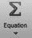 插入数学表达式。当您按下 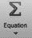 按钮时，将打开整个范围的符号、结构和矩阵，如下图所示。


现在，将光标移到要插入数学表达式的位置，并通过选择必要的符号或使用 LaTEX 表达式来插入符号。例如，`\alpha` 给出 α。输入勾股定理公式和输入变量范围，然后完成脚本。

```
步骤 1. 问题陈述
MATLAB 的精度并非绝对
勾股定理：F = 1 − (sin2α + cos2α)
输入变量：α =  − 0.5α...0.5α
步骤 2. 定义输入变量
alpha = -pi/2:pi/100:pi/2;
步骤 3. 执行计算
F = 1-(sin(alpha).²+cos(alpha).²);
步骤 4. 定义 F(α) = 0 的 α 值
Findex=find(F==0);
F0=F(Findex);
步骤 5. 绘制仿真结果图：α vs. F(α)
plot(alpha, F, 'b-', alpha(Findex), F0, 'ro'),
legend('\alpha vs F(\alpha)', 'F(\alpha) = 0')
title('The Pythagorean Theorem'), grid on
xlabel('\alpha'), ylabel('F(\alpha) = 1-(sin²(alpha) +cos²(alpha))')
步骤 6. 发布所有获得的结果，包括整个脚本
```

执行已保存的 MLX 文件（通过按图 1-19 所示的“运行”按钮）后，您将在 LAYOUT 中以“内联输出”的方式获得脚本输出。参见图 1-24 和图 1-25。

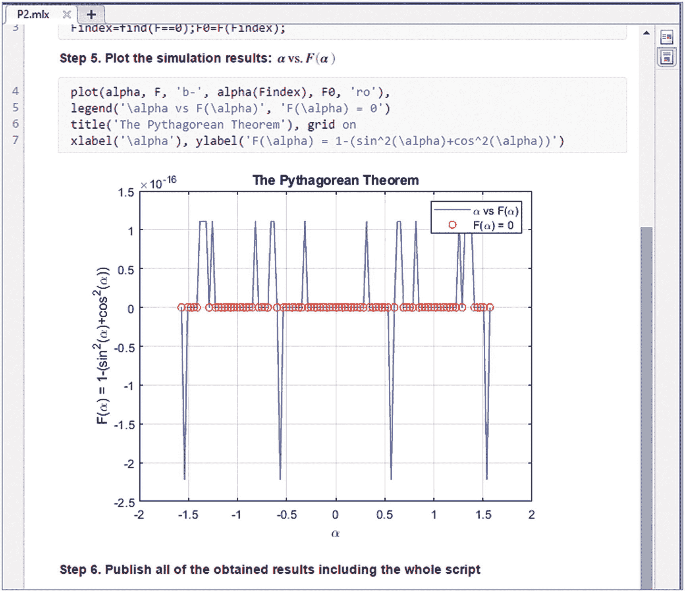

*图 1-25：`P2.mlx` 的 MLX 编辑器输出*

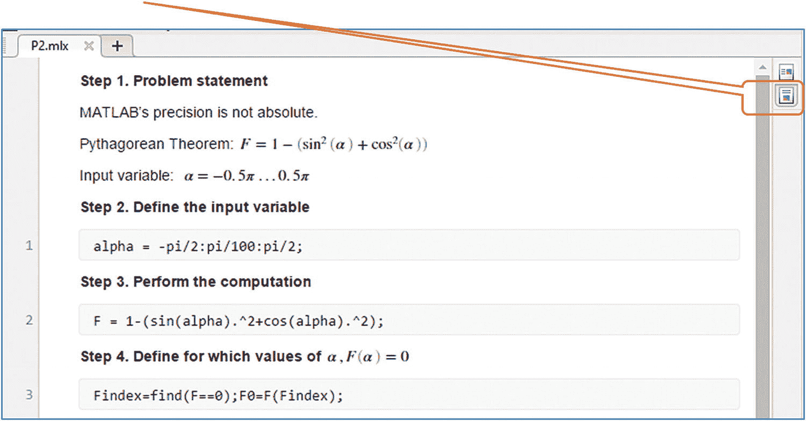

*图 1-24：`P2.mlx` 的 MLX 编辑器输出*

请注意，在 MLX 编辑器中，脚本的所有可执行和不可执行行都会被自动识别并放置在单独的部分中。关于 M/MLX 编辑器的提示、警告和错误消息，还有其他一些需要注意的问题，我们将在第 2 章中讨论。

## 关闭 MATLAB 窗口

退出 MATLAB 非常简单。有几个命令可用于完成 MATLAB 中的工作并关闭其所有窗口。您可以输入 `>> quit` 或 `>> exit`，或使用键盘快捷键 `Ctrl+Q`。您也可以单击主 MATLAB 窗口左上角的 X，或者从命令窗口调用 `>> finishdlg` 函数。

请注意，退出/关闭 MATLAB 时，工作区中的所有变量都将被清除。默认情况下，下次启动 MATLAB 时，它们将丢失且无法恢复。但是，它们可以保存到 `*.mat` 文件中，然后重新加载到工作区。输入命令的命令历史记录会自动保存，下次启动 MATLAB 时，可以访问在命令窗口中输入的所有命令。如果您有兴趣更改可通过 MATLAB 首选项调整的命令数量，请选择“首选项”➤“命令历史记录”。

## 总结

本章介绍了 MATLAB 环境，包括其设置、变量、常用命令以及 M 文件/MLX 文件 GUI 工具。您还学习了如何从命令窗口分配变量和值，以及在 M/MLX 文件编辑器窗口中工作。此外，本章探讨了数据类型、格式和结构，并涵盖了如何使用内置 MATLAB 命令和函数。特别地，它涵盖了帮助搜索选项和最常用的命令，包括 `help`、`helpwin`、`helpbrowser`、`doc`、`lookfor`、`clear`、`clear all`、`dir`、`pwd`、`cd`、`ls`、`save`、`load`、`clearvars`、`edit`、`format`、`char`、`size`、`who`、`whos`、`input`、`what` 和 `exit/quit`。

## 自测练习

### 练习 1

执行以下操作：

1.  从预装的 MATLAB 演示中找到*振动徽标*演示并运行它。提示：`membrane`。
2.  在程序包的帮助库中找到*产品概述*。
3.  更改命令窗口的字体类型和大小。

### 练习 2

请执行以下操作：

1.  使用“帮助库”确定如何添加新的搜索路径。添加一条新的搜索路径：`C:\Users\Public`。提示：`addpath`。
2.  使用 MATLAB 帮助浏览器查找如何创建一个新目录。在 `C:\Users\Public` 目录内创建一个名为 `my_new_dir` 的新目录。提示：`mkdir`。

### 练习 3

在命令窗口中使用 MATLAB 的 `exp`（指数）函数获取帮助。使用 `help`、`lookfor`、`doc` 和 `help browser` 命令，然后比较这四种帮助选项的结果。

### 练习 4

在命令窗口中，在 M 文件编辑器窗口内创建并打开一个名为 `learn.m` 的 `*.m` 文件。（提示：`>> edit ...`）。在其中插入两条命令，用于显示当前日期和时间。提示：`date`、`clock`。

### 练习 5

创建一个快捷键（一组常用命令），该快捷键能够打开一个名为 `My_Shortcut` 的新 M 文件，同时关闭所有图形窗口，并清除命令窗口和工作区中先前输入的所有数据和命令。

### 练习 6

在命令窗口中使用“首选项”窗口更改数据显示格式。将其设置为十六进制格式。提示：`format`。

### 练习 7

哪些命令用于清理工作区、命令窗口和历史记录？

### 练习 8

已知 *x* = 2.25, *y* = 3.1 和 *z* = 13.20，使用 MATLAB 计算以下表达式：

![$$ A=\sqrt[y]{ xy z-\frac{z}{xy}}+{x}²{y}^{\frac{3}{2\ }}{z}^{\frac{5}{4}};B={e}^{- xyz}\ln \left(\frac{xy}{z}\right). $$](images/471979_1_En_1_Chapter/471979_1_En_1_Chapter_TeX_Equa.png)

使用数组编辑器更改 `x`、`y` 和 `z` 的赋值，然后重新执行表达式以计算 `A` 和 `B`。

### 练习 9

创建一个脚本并将其保存为 `my_first_program.m`。

1.  你的程序应包含一个输入变量，该变量是作为可变参数的正方形边长（以米为单位）。
2.  你的程序应计算正方形的面积和立方体的体积。
3.  你的程序应通过单位换算（例如，1 *英寸* = 25.4 *毫米*），以公制（m², m³）和英制（in², in³）单位输出计算结果（面积和体积）。
4.  从命令窗口执行你的脚本（`my_first_program.m`）。
5.  从 M 文件编辑器窗口执行你的脚本（`my_first_program.m`）。

### 练习 10

执行/回答以下内容：

*   哪个命令可以显示 MATLAB 工作区中存储的内容？
*   创建 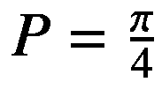 并以 `uint64` 格式保存。
*   为什么 `uint64` 格式下的 `P` 值等于 1？如何解决这个问题？

### 练习 11

将练习 9 和 10 中的所有计算结果保存在一个名为 `my_FIRSTwork.mat` 的 MAT 文件中，并清理你的 MATLAB 工作区，删除除练习 8 中的 `A` 和 `B` 之外的所有变量。

### 练习 12

给定：

```
C1 = Hello. I'm from NYC. What is your name?
D1 = I'm Dan.
C2 = Nice to meet you
D2 = Nice to meet u 2
```

使用这些条目（`C1`、`C2`、`D1` 和 `D2`），在命令窗口中创建一个以下列对话形式显示的内容：

```
'Hello.' 'I'm from NYC.'
'What is your name?' 'I'm Dan.'
'Nice to meet you.' 'Nice to meet u 2.'
```

### 练习 13

请执行以下操作：

1.  更改命令窗口的数据显示格式，并将其设置为 *long e*。
2.  MATLAB 的首选项设置保存在哪里？
3.  M 文件 `finishdlg.m` 的主要功能是什么，它包含哪些命令？

### 练习 14

请执行以下操作：

1.  在命令窗口中编写一个命令，用于创建并打开一个名为 `Ex14.m` 的 M 文件。
2.  编辑你的 M 文件 `Ex14.m`，使其包含一个更改显示格式类型的命令。
3.  编辑你的 M 文件 `Ex14.m`，使其包含一个更改当前目录的命令。
4.  编辑你的 M 文件 `Ex14.m`，使其包含一个显示当前日期和时间的命令。

### 练习 15

给定：

```
>> day_ONE="MatlabDAY"; day_DUE=day_ONE+1.0
day_DUE =
78 98 117 109 98 99 69 66 90
```

为什么 `day_DUE` 是数值型的，并且等于一个 10 元素的行矩阵？这些数字代表什么？

### 练习 16

给定：`>> A=[1,2; -12.0, 3]; mat2str(A); SNA=ans+0; char(SNA)`

变量 `SNA` 背后隐藏着什么？

### 练习 17

创建一个由元胞数组和数值数组元素组成的结构体，分别命名为 `Matlab` 和 `classes`：

1.  创建一个名为 `Matlab` 的元胞数组，它由两个子元胞组成：`{'Day#1', 'Start'}`
2.  创建一个名为 `classes` 的数值数组，其中包含元素 ![$$ \pi; 2\pi; \sqrt{\pi }+2i $$]。请注意，`i` 代表虚数单位。

### 练习 18

为以下数学表达式创建函数句柄和内联函数：
*h*(*θ*, *t*) = 1.3 * *e*^(-*tiθ*)。请注意，*i* 代表虚数单位。

### 练习 19

解析证明 *cos*2*α* = 2 cos²*α* − 1。使用 MATLAB 计算不同 *α* 值 ![$$ 0,\dots \frac{\pi }{2},\pi \dots \frac{3\pi }{2},2\pi \dots \frac{5\pi }{2},3\pi \dots 5\pi $$] 下的等式，并找出 MATLAB 计算精度无法体现等式成立的 *α* 值。

### 练习 20

以最精确的方式使用 MATLAB 计算表达式 ![$$ \sqrt[5]{1.5\ast {10}^{24}-{10}^{24}i} $$](images/471979_1_En_1_Chapter/471979_1_En_1_Chapter_TeX_IEq6.png)。注意，这是五次根。

### 练习 21

为什么以下输出看起来“奇怪”？

```
>> A=[4/5, 'matlab'+0, sin(pi)]
A =
第 1 列至第 3 列
3fe999999999999a 405b400000000000 4058400000000000
第 4 列至第 6 列
405d000000000000 405b000000000000 4058400000000000
第 7 列至第 8 列
4058800000000000 3ca1a62633145c07
```

如何解决这个问题并使结果清晰可读？

### 练习 22

使用 `randi()` 在 [1, 20] 范围内生成一个 5 行 5 列的矩阵，命名为 `A`，并将其每个元素除以 3。如下所示，以有理数形式显示 `A`。请注意，你的 `A` 的数组数值（分子部分）将与此处显示的数值不同。为什么你的答案与这里显示的不同？

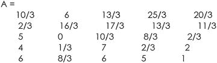

### 练习 23

以最高效的方式（至少两种不同方法）创建以下数组。注意 `A2` 元素的显示格式。

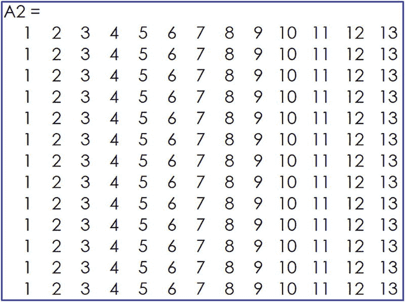

### 练习 24

使用 `randi()` 创建一个 15 行 15 列的数组，元素范围从 -125 到 127，并以其内存效率最高的方式保存，命名为 `A3`。

### 练习 25

使用 M 文件编辑器工具创建以下 HTML 报告。

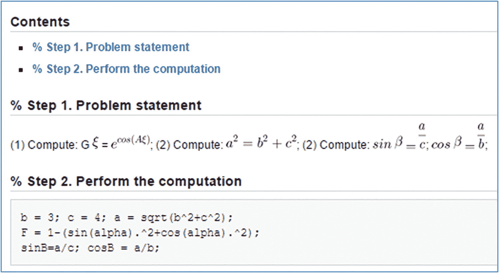

### 练习 26

给定 `A5 = [1 2 3; 4 5 6; 7, 8, 9]`。

1.  使用两种算术运算从 `A5` 得到 `B5`：`B5 = [16, 9 4; 1 0 1; 4 9 16]`。
2.  使用关系逻辑（`<`, `>`）和算术运算（`+ 13`）从 `A5` 和 `B5` 得到 `C5`。

```
C5 = [13 13 13; 14 14 14; 14 13 13];
```

### 练习 27

创建三个数值数组（行矩阵，变量分别命名为 `AJ`、`IS` 和 `LJ`），使得当你从每个数组中减去 3，然后执行一次转换操作后，分别得到 Al-Khwarizmi、Ibn Sina 和 Lennart Johansson。

### 练习 28

将你在练习 22 至 27 中创建的所有变量（`A`、`A2`、`A3`、`A4`、`A5` 和 `A6`）保存到一个 `*.mat` 文件中，文件名使用你的姓氏，例如 `Jones_HW2.mat`。

### 练习 29

创建一个名为 `A` 的元胞数组，其中包含三个变量：`a=4/5`、`b='matlab'+0` 和 `c=sin(`*π*`)`，并创建一个名为 `B` 的结构体，其中包含四个变量：`a`、`b`、`c` 和 `A`。展示如何访问存储在 `A` 和 `B` 内部的 `a`、`b` 和 `c` 变量。

### 练习 30

在 MLX 文件编辑器中创建以下变量和条目：

函数句柄 `F`: `F(ω[1], ω[2], θ) = cos(ω[1]*θ) − sin(ω[2]*θ)`

单位矩阵：`I` = ![$$ I=\left[\begin{array}{ccc}1&amp; 0&amp; 0\\ {}0&amp; 1&amp; 0\\ {}0&amp; 0&amp; 1\end{array}\right] $$](images/471979_1_En_1_Chapter/471979_1_En_1_Chapter_TeX_IEq7.png)

幻方矩阵：`M` = ![$$ M=\left[\begin{array}{ccc}8&amp; 1&amp; 6\\ {}3&amp; 5&amp; 7\\ {}4&amp; 9&amp; 2\end{array}\right] $$](images/471979_1_En_1_Chapter/471979_1_En_1_Chapter_TeX_IEq8.png)

将该矩阵乘以 2 并从 `M` 矩阵中减去它。将新矩阵命名为 `MI`：`MI` = ![$$ MI=\left[\begin{array}{ccc}6&amp; 1&amp; 6\\ {}3&amp; 3&amp; 7\\ {}4&amp; 9&amp; 0\end{array}\right] $$](images/471979_1_En_1_Chapter/471979_1_En_1_Chapter_TeX_IEq9.png)

通过定位/比较 `MI` 中大于 1 且小于 6 的元素来定位数组 `L`：`L` = ![$$ L=\left[\begin{array}{ccc}0&amp; 0&amp; 0\\ {}1&amp; 1&amp; 0\\ {}1&amp; 0&amp; 0\end{array}\right] $$](images/471979_1_En_1_Chapter/471979_1_En_1_Chapter_TeX_IEq10.png)

```
从 M 创建表数组 TM：
包含 F, I, M, MI, L, TM 的元胞数组 CA
包含 F, I, M, MI, L, TM, CA 的结构体 SA
```


