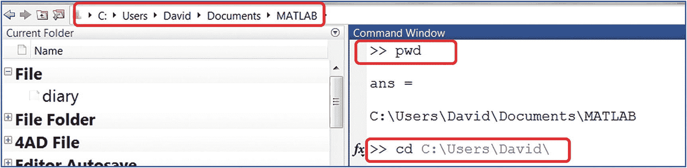
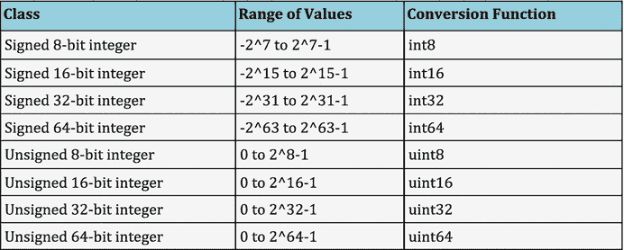

# 在命令窗口中工作

在 MATLAB 中，工作通常始于命令窗口，但在输入任何命令之前，有必要留意一下当前目录。当前目录地址可以直接在主窗口中查看（见图 1-8），或者在命令窗口中输入以下命令查看：

```
>> pwd
```

如有需要，你可以使用 `>> cd` 命令，或者用鼠标左键点击路径目录（见图 1-8）并输入目录地址（`C:` ➤ `Users` ➤ `David` ➤ `Documents` ➤ `MATLAB` ➤）来更改当前目录。



图 1-8

查看和更改当前工作目录

此外，你可以添加一些新路径到工作目录中。例如，要向一个已有文件夹添加路径，请使用以下命令。

```
>> addpath('C:\Users\David\Documents\MATLAB');
```

`addpath()` 命令在脚本中也很有用，可用于从特定文件夹或目录读取或加载数据。对于简短命令和计算，以及查看当前目录中可用变量的属性，请使用命令窗口。但对于一系列命令和较长的脚本，使用脚本编辑器（例如 M 文件和 MLX 文件编辑器）则效率更高。

MATLAB 应用程序中有几种可通过其扩展名识别的文件类型。它们分别是 `.M`、`.MLX`、`.MAT`、`.BI` 和 `.FIG`。M 文件用于编写程序/脚本/函数文件。MLX 文件（即 Live M 文件）用于编写程序/脚本/函数文件，并可在 MLX 文件编辑器窗口中查看计算结果。MAT 文件用于保存工作区中所有类型的变量，并且可以轻松地从 M/MLX 文件和命令窗口访问。在这些文件中，`.BI` 文件用于 MATLAB 的内置文件，`.FIG` 文件用于保存 MATLAB 中的图形窗口。此外，Simulink 应用有三种文件类型——`mdl`、`.slx` 和 `.slxc`。它们用于构建和仿真 Simulink 模型，也可以在不打开的情况下从 MATLAB 中调用/仿真。我将在本书后面章节中讨论这些文件的基本功能以及如何使用它们。

虽然使用命令窗口进行简单计算、数据生成和处理已经足够，但可以使用键盘的上箭头键来避免重新输入之前输入过的命令和条目。例如，如果你在命令窗口中输入了 `>> A1 = [1, 2, 4, -5, 6]; B = A+2`，然后需要对这些条目进行修改，你可以在输入 `>> A` 后使用上箭头键。MATLAB 会自动调用你之前的输入。

## 命令窗口与变量

MATLAB 是区分大小写的，并且其所有内置命令都是小写。当你执行计算时，会为计算结果指定一个名称。这个指定的名称就是变量名。计算结果会以给定的变量名保存在 MATLAB 工作区中。例如，`>> A =13`；`B = A*2` 表示名为 `A` 的变量等于 `13`，名为 `B` 的变量等于 `2` 乘以 `A`。

### 使用变量

变量名必须以字母开头，并且可以包含任意整数（如 0、1、2……9）和下划线（`_`）。变量名中不能使用其他符号。变量名的最大长度为 63 个字符。由于 ANSI/ASCII 符号转换，MATLAB 将名为 `a` 和 `A` 的变量视为两个不同的变量。现在，让我们开始在命令窗口中工作：输入并指定变量名，执行一些基本的算术运算，并对输出数据格式进行更改。

```
>> A=3; B=-2; C=1/2; D = -1.5; ABCD=A²+B/C+D;
>> ABCD              % 缺少 ";"，因此显示了变量 ABCD 的内容
ABCD =
3.5000
>> sqrt(ABCD)  % 如果未指定变量名，则 "ans" 是 MATLAB 的默认名称
ans =
1.8708
>> ans+1  % 如果未指定变量名，"ans" 将替代之前的 "ans"。
ans =
2.8708
```

用户输入的结果显示在命令窗口中，并可以使用以下显示格式选项进行更改：`format long`、`format short`、`format long eng`、`format bank`、`format hexadecimal`、`format rational` 等。以下是格式选项的一些示例。当你更改显示格式类型时，实际的变量值不会改变。

```
>> A=3; B=-2; C=1/2; D = -1.5;
>> ABCD=A²+B/C+D;
>> format bank
>> ABCD
ABCD =
3.50
>> format long eng
>> ABCD
ABCD =
3.50000000000000e+000
>> sqrt(ABCD)
ans =
1.87082869338697e+000
>> format short
>> sqrt(ABCD)
ans =
1.8708
>> format bank
>> sqrt(ABCD)
ans =
1.87
>> format long eng
>> sqrt(ABCD)
ans =
1.87082869338697e+000
>> format compact
>> sqrt(ABCD)
ans =
1.87082869338697e+000
>> format rat
>> sqrt(ABCD)
ans =
1738/929
>> format hex
>> sqrt(ABCD)
ans =
3ffdeeea11683f49
```


### 注意

MATLAB 是区分大小写的，因此它将变量 `a` 和 `A` 视为两个不同的变量。

在命令窗口中输入变量名或内置命令/函数名的前几个字母后，可以使用 TAB 键访问匹配的命令/函数，包括您开发的函数文件。例如，如果您键入`>> AB`然后按下 TAB 键，`ABCD`变量计算表达式的其余部分将显示为一个选项。

命令窗口的另一个有用功能是使用键盘的上箭头 (↑) 来重新调用之前键入的变量或命令。您只需键入之前键入的任何命令或函数名的前几个字母，然后按上箭头 (↑)。例如，`>> f`↑ 会重新调用之前键入的命令`>> format long`。此外，上箭头 (↑) 还可以与 TAB 键配合使用，以在命令窗口中重新调用之前输入的命令。

在命令窗口中输入的所有变量的值和属性都将保存在工作区中，直到您通过使用 `clear`、`clearvars` 或 `clear all` 命令删除变量，或使用鼠标左右键选项选择并删除它们来清理工作区为止。此外，所有变量及其属性都会保存在工作区中，直到 MATLAB 程序包关闭为止。

MATLAB 中最常用的三个整理命令是：

*   `clc` — 用于清理命令窗口，并从一个空白命令窗口开始
*   `clear` 和 `clearvars` — 用于移除工作区中保存的所有变量
*   `clear all` — 用于移除所有变量以及临时编译并保存的 M 文件机器码、断点和调试设置

所有这些命令也可以与 M 文件和 MLX 文件一起使用。必须注意，不推荐将 `clear all` 命令与 M 文件和 MLX 文件一起使用，因为它会降低代码/脚本的效率，并在您声明 `clear global` 命令时产生意外行为。让我们来看一些有效使用这些命令的方法。

```
>> A=3; B=-2; C=1/2; D = -1.5; ABCD=A²+B/C+D;
>> clear         % 移除工作区中的所有条目，工作区变为空白
>> clearvars       % 等同于 "clear"
>> clear variables % 等同于 "clearvars"
>> clear all % 等同于 "clear"，并且还会移除已编译的代码
>> clear  A B C D  % 移除变量：A B C D，保留 ABCD 不变
>> A=3; B=-2; C=1/2; D = -1.5; ABCD=A²+B/C+D;
>> clearvars  –except A B C   % 移除除 A B C 之外的所有变量
```

MATLAB 可以对变量和文件名使用通配符 `*` 星号。例如，要移除所有名称以字母“A”开头的变量，您可以使用以下命令。

```
>> A=3; B=-2; C=1/2; D = -1.5; ABCD=A²+B/C+D; ABC=A²+B*C;
>> clear  A*    % 移除所有以 A 开头的变量，即 A、ABCD 和 ABC 被移除
>> clearvars A*  % 等同于：clear A*
```

所有输入和保存的变量都可以通过在命令窗口中键入 `who` 或 `whos` 命令，从工作区窗口中查看。例如：

```
>> A=3; B=-2; C=1/2; D = -1.5; ABCD=A²+B/C+D; ABC=A²+B*C;
>> who

A  B  C  D  ABCD  ABC

>> whos

  Name      Size            Bytes  Class     Attributes
  A       1x1                 8  double
  ABC     1x1                 8  double
  ABCD    1x1                 8  double
  B       1x1                 8  double
  C       1x1                 8  double
  D       1x1                 8  double
```

从这些例子可以清楚地看出，MATLAB 将每个条目都读取为一个数组/矩阵。例如，一个标量被 MATLAB 读取为大小为 1×1 的数组。MATLAB 的这个属性在逻辑上与其名称“矩阵实验室”（MATrix LABoratory）相关联。MATLAB 的默认存储（内存分配）是双精度，这是可分配的最大可用空间。然而，为了提高内存效率和更快的计算速度，也可以使用其他存储格式。MATLAB 支持单精度或整数类型以及 `int8` … `int64`、`uint8` … `uint64` 存储格式类型。表 1-1 展示了数据如何保存在每种存储类类型中，以及 MATLAB 中每种类型使用的转换函数。

### 注意

MATLAB 的默认存储类型是 double。然而，这可以通过指定或转换变量/数据的值，更改为单精度或整数类型 — `int8` … `int64`、`uint8` … `uint64`。

**表 1-1** MATLAB 中的数据存储格式类型

| - |

当您拥有数值数据和浮点格式时，双精度存储为您提供了最大的存储空间以获得更高精度。双精度最多可以保存 16 位十进制数字。对于浮点格式的数据，单精度存储比双精度（MATLAB 中的默认存储格式）内存效率更高，但精度较低。如果在计算和数据处理中仅使用整数，根据数据的最大值，使用 `int8` … `int64` 或 `uint8` … `uint64` 更为合适。以下是如何在保存声明变量的值时指定存储类型的一些示例。

```
>> F01=127;Fint_08=int8(F01), Fnew1 = Fint_08+1

Fint_08 =

  int8


Fnew1 =

  int8


>> F16=65535; Fint_16=uint16(F16), Fnew2 = Fint_16+1

Fint_16 =

  uint16

Fnew2 =

  uint16

```

在根据 `int8` 和 `uint16` 格式的变量值计算 `Fnew1` 和 `Fnew2` 变量时，分配的存储空间无法容纳更多值（即，对于 `int8`，最大分配存储空间为 127 = 2⁷ − 1；对于 `uint16`，最大为 65535 = 2¹⁶ − 1）。因此，计算中发生了错误。请注意，在这种情况下，MATLAB 不会显示错误。图 1-9 展示了 MATLAB 中支持的所有数据存储类型和数据格式。


**图 1-9** MATLAB 中支持的不同类型的数据存储选项

命令窗口的历史记录窗格是查看所有条目（除非您删除它们，否则这些条目会被保留）的好方法。您也可以更改“首选项”窗口中的设置，以便在结束会话后清除条目历史记录。

最后，要退出 MATLAB 或结束一个工作会话，请在命令窗口中发出以下命令之一：

```
>> exit
>> quit
```

或者使用键盘上的 `Ctrl+Q` 退出。

另一种退出方式是点击主窗口右上角的关闭按钮（**x**）。这将关闭整个程序包。


