# 2. 编程基础

本章涵盖了 MATLAB 中最基本且最常用的编程工具、运算符和控制语句、Simulink 中的建模基础、图形用户界面开发及其工具，以及 MATLAB 可执行文件和独立应用程序的开发。

本章还包含一些简单的示例，这些示例展示了在 MATLAB/Simulink 中进行编程和建模以节省计算时间的有效方法和工具。它解释了如何创建简短紧凑的代码/脚本，并包含一些编写健壮程序和脚本的基本提示和方法。

在整本书中，关键词——脚本、代码、程序、`M` 文件、`MLX` 文件和函数文件——被频繁用于指代在 MATLAB 中编写和执行的程序。本书上下文中使用的术语——如代码、脚本和程序，例如 `M`/`MLX` 文件和函数文件——指的是用户可读的源代码，而非计算机理解的机器代码。

# 编写 M/MLX 文件

前一章通过示例讨论了数组、字符、元胞、结构体、表格和逻辑数组，并概述了 M/MLX 文件编辑器。脚本（M/MLX 文件）也可以在记事本或写字板编辑器中编写。只要文件以 `*.m` 或 `*.mlx` 扩展名命名，它们就会成为 M 文件。它们也可以使用记事本编辑器打开和编辑。

如前一章所述，M/MLX 文件编辑器拥有许多易于使用的工具和直观的选项，你可以在编写和调试脚本时使用它们。在 M/MLX 文件编辑器中，你可以使用单元模式、设置断点、评估选定的单元格或脚本行、自动检测错误（例如拼写错误的命令名称和代数运算中缺失的括号）、检测所有已使用和未使用的变量、提高脚本性能、显示关于不必要赋值变量的警告提示、在循环中设置变量值、使用性能分析器等等。

所有这些工具都有助于在编写脚本时避免语法错误。此外，还有许多其他工具可以帮助你在编写和发布 HTML（超文本）或 PDF 格式的报告时节省时间和精力。

在开始编写脚本之前，让我们先了解一些基本的准备步骤。在用任何编程语言编写实际代码之前，了解并考虑这些步骤非常重要。编写脚本/程序的过程始于纸笔。它由流程图（图 2-1）中所示的步骤组成。

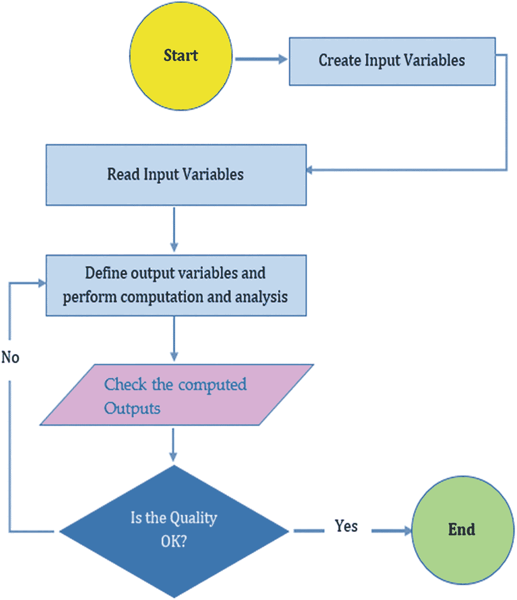

图 2-1

脚本/程序编写的一般流程

此流程图说明了以下步骤：

1. 阐明问题陈述。
2. 阐明/创建/声明输入变量，例如 `var1`、`var2`、`var3` ... `varN`。
3. 读取 `var1`、`var2`、`var3`、... `varN` 的值。
4. 定义输出变量，例如 `out1`、`out2`、`out3`、... `outN`。
5. 执行计算、评估和分析操作。
6. 检查所获结果/输出变量的质量/正确性。
7. 如果所得结果的质量/正确性不达标，则返回步骤 3。重复步骤 3-5，直到达到预期的质量/正确性。
8. 结束并报告结果。

所描述的算法是一个非常通用的过程，还可能包括考虑目标、输入/输出数据类型、数据源、评估/计算操作等。一旦算法被明确定义，你就可以开始用给定的编程语言进行编码。编写程序/脚本时，最耗时的部分是执行步骤 3-5 中的验证操作。这称为*调试*，它有助于定位步骤 4 中计算/评估和分析操作中的错误或缺陷。

---

### 练习 31

解释如何获得屏幕截图中所示的如下布局 (1)、首选项 (2) 和快速访问 (3) 窗口。注意：(2) 中的字体和颜色。

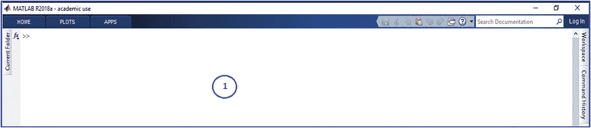

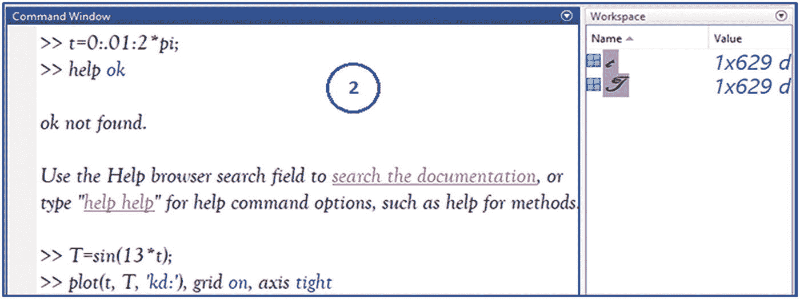


### 练习 32

创建这些文件（MLX/M 文件）并解释如何在实时编辑器中显示图中所示的结果。

注意：有四个显示 MLX 和 M 文件的窗口；方程式、希腊字母、绘图图形、超链接、数据提示以及如何插入图像。

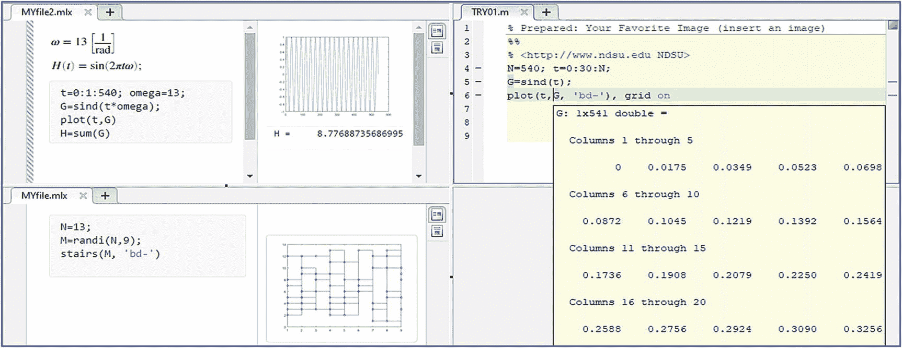

### 练习 33

回答以下问题：

1. MATLAB 的默认数值格式（`int8`、`uint8`、`int16`、`uint16`、… `single` 或 `double`）取决于安装 MATLAB 的操作系统。（正确/错误）
2. MATLAB 在哪里显示存储的变量及其关联属性的列表？
3. MATLAB 用户界面是可定制的。（正确/错误）
4. MATLAB 仅当元胞数组包含数值数据时才支持，不支持字符串。（正确/错误）
5. 可以将表数组变量放入元胞数组中。（正确/错误）
6. `A=1.1; B=[2, 3; 1 2]; C=B/A; format hex; C`
   我们通过更改显示格式来更改条目 `C` 的值。（正确/错误）
7. `>> D=uint8(255); D=255; D+1 =255; E = [12/14, 3/5; 1/3, 4/9]; format rat; E`
   我们通过更改显示格式更改了条目 `D` 和 `E` 的值。（正确/错误）

### 练习 34

回答以下与数组大小和表示相关的问题：

1. 给定一个包含 10 个元胞的元胞数组 `ABBA`，哪个命令可以调取 `ABBA` 中第 3 个元胞内的元素？
2. 给定一个名为 `A` 的 5×5 数组（矩阵），`A(4:end, 3:4)` 将生成一个什么大小的矩阵？
3. 如何创建一个线性间隔的数据数组：`a=(-13, -12, -11, ... 11, 12, 13)` 和 `b=(0, 1/13, 2/13, 3/13, ... 24/13, 25/13, 2)` 而无需键入所有元素？注意如何获取数组 `b` 的有理数格式类型。

### 练习 35

如何从数组 `a = (-5, -4, -3 ... 3, 4, 5)`（其元素是线性（等间距）的）中获取逻辑数组 `c = (1 1 1 1 1 0 0 0 0 0 0)`？

### 练习 36

在命令窗口中给出：
```
>> x=linspace(-13, 0), F(x)=2*x²+2*x-1;
```
存在错误。找出错误并修复它们。现在 `x` 和 `F` 的大小是多少？

### 练习 37

写出以下问题的答案：

1. 如何将工作目录更改为 `C:\Users\Public` 并添加此路径用于搜索？
2. 在 `C:\Users\Public` 目录内创建一个名为 `MYdir` 的新目录。
3. 如何找出 MATLAB 工作区中存储了哪些变量？

### 练习 38

回答以下关于等间距数据点的数组相关问题：

1. 将上面给出的 `D2`（`D2=zeros(9); D2(6,:)=1:9;`）的最后两列（第 8 列和第 9 列）分别更改为包含元素：`[e⁰, e¹, e², …, e⁸]` 和 `[tan(e⁰), tan(e¹), tan(e²), …, tan(e⁸)]`，并以最有效的方式完成。
2. 以两种不同的方式生成这些向量空间：`[-100, -90, -80, ... 100]`，`[-100, -99, -98, ... 100]`。
3. 如何在 [−π, π] 范围内生成 500 个等间距的数据点？

### 练习 39

回答以下关于逻辑索引和逻辑数组的问题：

1. 给定 `>> A=magic(3); C1=le(A,7), C2=A<=7`
   在每个单独的情况下，所有逻辑数组中的 `0` 和 `1` 表示什么？
2. 给定 `>> A1=12.12; C="nan"; B=[1 2; 0, 3i]; D=B/0; AA1=isfinite(A1), CC1=isnan(C), DD1=isinf(D), DD2=isnan(D)`
   在每个单独的情况下，所有逻辑数组中的 `0` 和 `1` 表示什么？
3. 给定 `>> AG=randi([-13, 25], 3, 2); BAG=(AG>0 & AG<13)`
   为什么当你运行这些命令来定义 `AG` 和 `BAG` 时，你的答案会不同？
4. 给定 `>> GAB=find(AG>0 & AG<13), AG(GAB)`
   `GAB` 后面的数字是什么，它们与 `AG` 有何关系？
5. 给定 `>> 13>10; -1.2<=7.8; -11+13>=3`
   为什么我们得到 `0` 和 `1`？
6. 给定 `>> AA=randi([-13, 13], 10, 2); AA(AA<=0); % OR >> IN=(AA<=0); AA(find(IN));`
   `IN` 相对于 `AA` 表示什么？
7. 给定 `>>B = randi([0, 13], 5); k=find(B>=3 & B<=5)`
   `k` 中的数字相对于 `B` 是哪些？

### 练习 40

创建一个名为 `ARRAY_1.m` 的 `.m` 文件并编写以下内容：

1. 编写命令以清理 MATLAB 的工作区和命令窗口，并在命令窗口中显示当前日期和时间。
2. 创建数组 `A` 并编写命令以生成数组：使用 `:` 运算符生成 `A1`（1×10），使用 `linspace()` 生成 `A2`（10×1），使用 `eye()` 生成 `A3`（2×10）。
3. 创建数组 `B` 并编写命令以创建数组：使用元素范围在 [-1, 1] 之间的 `randi()` 生成 `B1`（5×6），使用 `rand()` 生成 `B2`（5×6），使用 `randn()` 生成 `B3`（5×10）。
4. 创建数组 `C` 并编写命令以生成数组：使用 `magic()` 和 `repmat()` 生成 `C1`（5×10），使用 `eye()` 生成 `C2`（6×10），使用 `ones()` 生成 `C3`（10×10）。
5. 编写命令对 `A1`、`A2` 和 `A3` 执行所有可能的（算术数组）运算（`+`、`-`、`*`、`/`、`.*`、`./`、`^` 和 `.^`）（至少三个运算），并将新矩阵命名为：`A1new1`、`A1new2`、`A1new3`、`A2new1`、`A2new2`、`A2new3`、`A3new1`、`A3new2` 和 `A3new3`。提示：在执行算术数组运算时使用 `transpose()` 和 `rot90()`。
6. 编写命令对 `B1`、`B2` 和 `B3` 执行所有可能的（算术数组）运算（`+`、`-`、`*`、`/`、`^`、`.*`、`./`、`sum` 和 `mean`）（至少三个运算），并将新矩阵命名为：`B1new1`、`B1new2`、`B1new3`、`B2new1`、`B2new2`、`B2new3`、`B3new1`、`B3new2` 和 `B3new3`。提示：在执行算术数组运算时使用 `fliplr()`。
7. 从 `A1`、`A2`、`A3` 以及 `B1`、`B2` 和 `B3` 创建 `AB1`、`AB2` 和 `AB3` 矩阵。同时，使用部分 `A1`、`A2`、`A3` 和 `B1`、`B2`、`B3` 数组。注意，每个 `AB1`、`AB2`、`AB3`、`ABC4` 和 `ABC5` 数组都应包含来自数组 `A` 和 `B` 的一些元素。提示：在创建数组 `AB1`、`AB2` 和 `AB3` 时使用 `flipud()` 和 `repmat()`。
8. 通过组合/连接先前创建的数组：`A1`、`A2`、`A3`、`B1`、`B2`、`B3`、`C1`、`C2`、`C3` 来创建 `ABC1`、`ABC2` 和 `ABC3` 矩阵。你还应使用部分 `A1`、`A2`、`A3`、`B1`、`B2`、`B3`、`C1`、`C2`、`C3` 数组。注意，每个 `ABC1`、`ABC2`、`ABC3` 数组都应包含来自第 1、2 和 3 部分中 `A`、`B` 和 `C` 矩阵的一些元素。

### 练习 41

创建一个名为 `Ex41.mlx` 的 `*.mlx` 文件，并在其中写入以下内容：

1.  创建一个名为 `Q1`、包含六个空列单元格的元胞数组的命令。
2.  给出 `12321` 和 `987654321` 的二进制表示的命令，以及一个将这些数字及其二进制表示分别写入 `Q1` 的第 1、2、3、4 个单元格的命令。
3.  使用 MATLAB 的转换命令——`str2num()` 或 `str2double()`——将 `12321` 和 `987654321` 的二进制表示转换为数值数组的命令，以及将这两个转换后的数值数组分别写入 `Q1` 的第 5 和第 6 个单元格的命令。
4.  使用 `pascal()`（一个 MATLAB 内置矩阵函数）生成以下数组的命令：

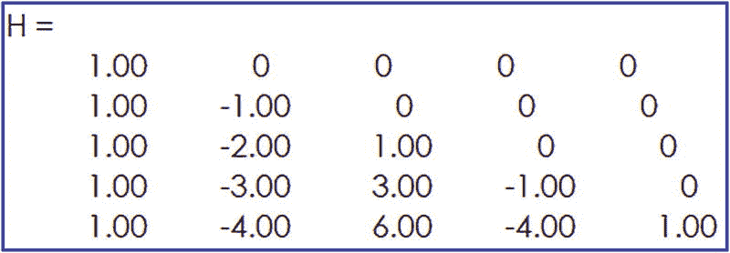

并通过应用逻辑索引（逻辑数组）和逐元素矩阵乘法运算，生成以下数组：

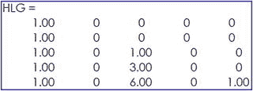

5.  创建一个名为 `S5` 的结构数组的命令，以及写入其 `Q1`、`H` 和 `HLG` 的命令。
6.  解释为何（在步骤 3 中）转换后的 `12321` 和 `987654321` 的二进制表示所对应的数值与原始的十进制数（即 `12321` 和 `987654321`）不同？

### 练习 42

创建一个 `*.mlx` 文件（名为 `Ex42.mlx`），并添加所有必要的注释，如问题、方程、解释和其他相关备注。同时写入以下命令：

1.  用两种方式生成两个包含 202 个等间距数据点的列数组：`α = −2*π*…2*π`；`β = −360⁰…360⁰`。
2.  计算以下三个方程（`α`、`β` 值取自步骤 1）：`F(α) = e^(sin(α))`；`H(β) = e^(cos(β))`；`S = 1 − (sin²α + cos² β)`。注：`β` 以度为单位而非弧度，因此别忘了将其转换为弧度。另外，请使用 `*.mlx` 的公式编辑器插入这些方程。
3.  创建一个包含五列的数组（名为 `Solution`），这些列依次为：`α`、`F(α)`、`β`、`H(β)`、`S`。
4.  创建一个数组表。该变量表应命名为 `TVall`，格式如下：

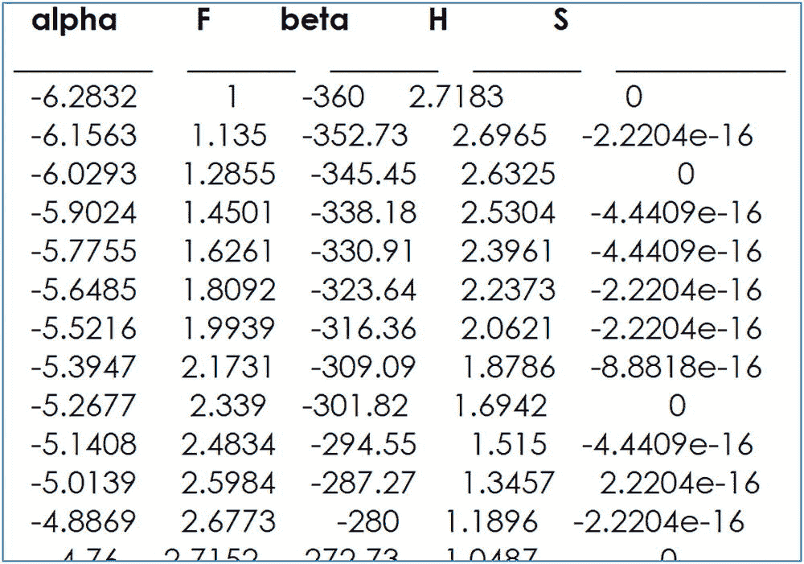

5.  找出 `F`、`S` 和 `H` 的所有正值，以及对应的 `α`、`β` 值，并将所有这些值保存到一个名为 `FSH_pos` 的元胞数组变量中。
6.  找出 `S` 的所有绝对零值以及对应的 `α`、`β` 值。将它们保存到一个名为 `ABS_0` 的数组中，该数组包含三列，分别为找到的 `S`、`α`、`β` 值。
7.  创建一个名为 `ABFSH_struct` 的结构数组，其中包含来自步骤 3、4、5 和 6 的 `SOLUTION`、`TVall`、`FSH_pos` 和 `ABS_0`。
8.  清除工作区中除了前面步骤中的 `α`、`β`、`F`、`H`、`S`、`SOLUTION`、`TVall`、`FSH_pos` 和 `ABFSH_struct` 之外的所有变量。将这些变量保存到一个名为 `Ex42.mat` 的 `*.mat` 文件中。

### 练习 43

创建一个 `*.m` 文件（名为 `Ex43.m`），执行以下操作：

1.  清除工作区和命令窗口中的所有内容。
2.  关闭所有打开的图形窗口。
3.  创建一个名为 `C:\Documents\Ex43` 的新目录。
4.  将 MATLAB 的当前目录更改为新创建的目录：`C:\Documents\Ex43`。
5.  计算 *t* = [0, 3π] 区间内，∆t = π/200 时的值，以及 f1(t)=3 sin(3t/2)、f2(t)=2 cos(2t/5)。
6.  将计算结果 (*t*, *f*1, *f*2) 保存到一个名为 `Ex43.mat` 的 `.mat` 文件中。

### 练习 44

创建一个 `*.m` 文件（名为 `Ex44.m`），执行以下操作：

1.  将 MATLAB 的当前目录更改为 MATLAB 的根目录（提示：`matlabroot`）。
2.  删除在练习 43 中创建的目录：`C:\Documents\Ex43`。
3.  在命令窗口中显示 MATLAB 的根目录。
4.  创建两个函数句柄：`r = (1/2)*a*t² + v_0*t + r_0` 和 `A = P*(1 + r/n)^(n*t)`。
5.  将当前路径和函数句柄保存到一个名为 `EX44` 的结构数组中。

# 调试概述

调试是一个过程，涉及根据编程语言纠正程序的语法，根据给定的问题陈述纠正计算/运算操作，并在需要时调整输出的精度。在许多情况下，调试并非易事，而 MATLAB 的 M/MLX 文件编辑器提供了一些有用的工具，可以检测脚本中的常见错误。同时，许多错误不通过执行和分析获得的输出是无法检测到的。没有单一的方法可以找到编写代码时所有可能的错误（缺陷和失误）。最常见的一种检查代码是否按预期运行的方法是使用已知输出的测试示例，然后验证输出。

本书将非常注重调试。必须指出，编写没有任何缺陷的代码是不可能的。因此，调试是“必须拥有”的步骤。此外，当你编写解决不同问题的代码并发现并修复你所犯的错误时，你将会磨练并构建你的编程技能。

## 注

始终从执行练习中最基本部分的简单明了的操作/命令开始编写脚本。一旦练习的基本部分完成，你就可以添加更多细节。从简单到复杂是一种良好的编程习惯。

## 如何创建 M/MLX 文件

有几种方法可以创建新脚本（在此情况下指 M/MLX 文件）。

* 在命令窗口中输入 `>> edit` 并按键盘上的回车键。
* 按键盘上的 `Ctrl+N` 键。
* 点击  创建 M 文件。
* 点击  创建 MLX 文件。
* 点击  并从下拉选项中选择  用于 M 文件， 用于 MLX 文件， 用于扩展名为 `*.m` 的函数文件，或  用于扩展名为 `*.mlx` 的函数文件。
* 通过以下命令收集在命令窗口中键入的命令：`diary on`、`diary NewFileName`、`diary off`。

## 脚本中的警告

在编写 M/MLX 文件时（包括函数文件 M 文件和 MLX（实时）文件），编辑器会自动生成警告标志，这些标志在许多情况下是有用的提示，有助于提高效率并定位缺失或被忽略的参数。它们不会阻止脚本的执行。这些警告通过带有下划线的波浪线和连字符  表示，并在 M 文件编辑器窗口右侧通过一个矩形框  显示。默认情况下，它们是橙色的。同样，MLX（实时）文件编辑器通过带有下划线的波浪线、连字符  以及编辑器窗口右侧栏上的三角形警告标志  来指示警告。

请注意，其颜色可以通过偏好设置进行调整。以下是 M/MLX 文件编辑器自动检测到的一些常见警告：

-   建议抑制命令窗口中的输出显示（仅由 M 文件编辑器检测）：
    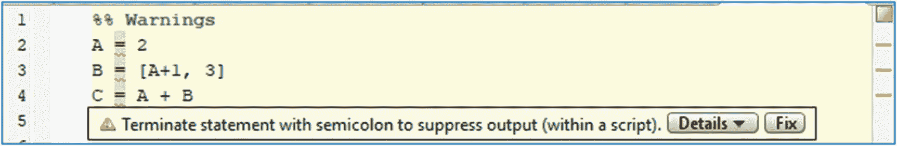
-   建议进行内存分配（例如，当变量大小在 `for ... end` 和 `while ... end` 循环迭代中变化/增加时，变量 `A` 和 `B` 会带有橙色波浪线）。
    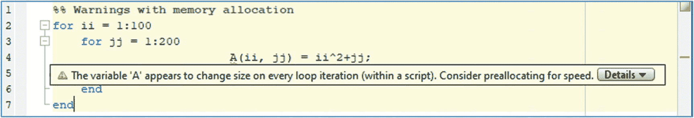  
    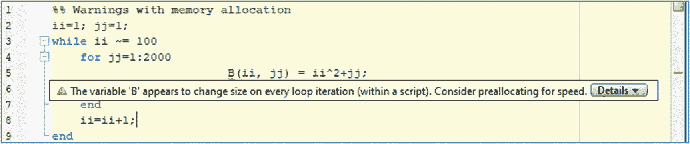
-   建议移除不必要的分号。例如，在第 1 行的末尾，`;` 是不必要的：
    
-   建议移除 `for ... end` 循环索引声明中（第 4 行）不必要的分号：
    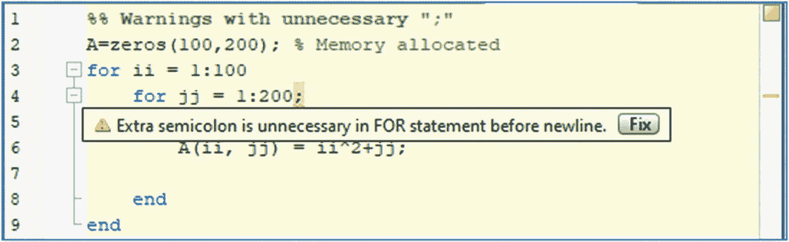
-   指示 M 文件中已赋值但未使用的变量名（第 5 行的 `G`）：
    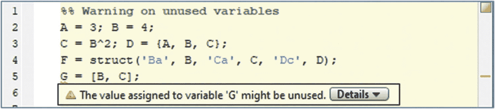
-   指示格式化 `fprintf()` 时缺少参数：
    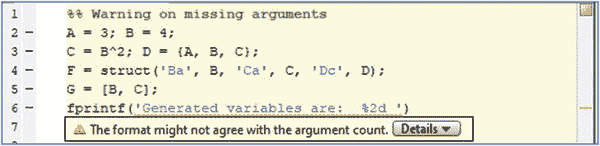
-   指示不必要的括号（第 2 行的 `a = [13]`）：
    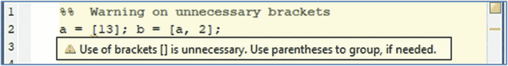

必须注意，M 编辑器检测到的某些警告标志不会被 MLX 编辑器（实时编辑器）捕捉。例如，用于抑制命令窗口输出显示的遗漏的 `;` 不适用于 MLX 编辑器（实时编辑器）。

另一方面，其他警告，如与内存分配相关的警告、不必要的分号、格式化 `fprintf()` 时缺少参数以及不必要的括号，都会被 MLX 编辑器非常明确地检测并突出显示，该编辑器在编辑器窗口右侧使用 。

-   建议进行内存分配：
    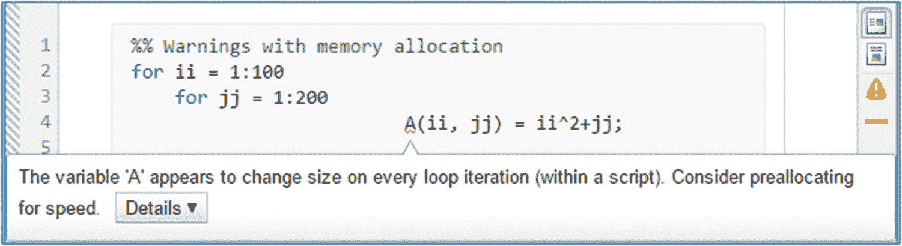
-   指示函数语句中的不必要分号：
    
-   指示为 `for ... end` 循环定义索引时的不必要分号：
    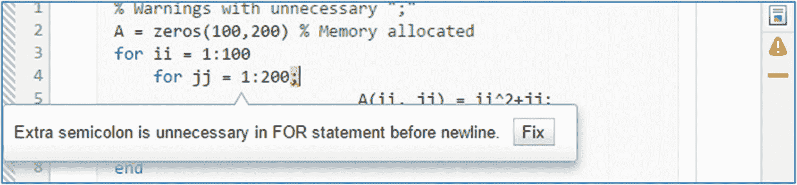
-   指示 `fprintf()` 中缺少参数：
    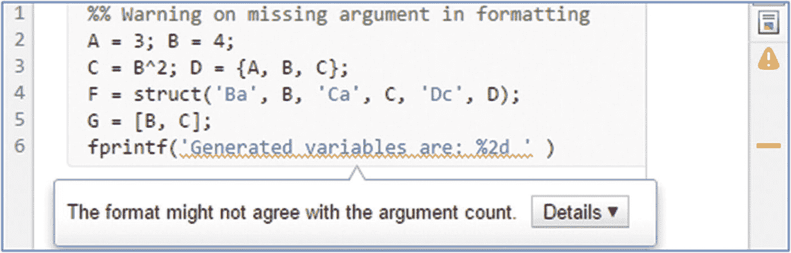
-   指示不必要的括号：
    

## 脚本中的错误

在 MATLAB 中，脚本可以包含执行各种计算和分析以及定义函数的代码。让我们看几个在 M 文件和 MLX 文件编辑器中编写脚本的简单示例，了解如何定位和修复编写脚本时出现的常见错误。

### 示例 1

求解以下列一般形式表示的二次方程：`ax² + bx + c = 0`。首先，打开一个 M 文件编辑器，并输入以下命令。

```
a=input('请输入 a = ');
b=input('请输入 b = ');
c=input('请输入 c = ');
D=b²-4*a*c;
disp(['该方程的判别式为：' num2str(D)])
```

文件以扩展名 `*.m` 保存后即可执行。执行时，代码会提示用户输入三个值（`input()`），并使用用户输入的 `a`、`b` 和 `c` 计算二次方程的判别式，然后在命令窗口中显示结果。需要注意的是，第 5 行的 `disp()` 命令是可选的。它用于在命令窗口中显示计算结果并附带一些注释。`disp()` 命令不会对输出结果产生任何影响。

这段代码还剩下两个步骤——计算二次方程的两个根。剩余的步骤可以插入到第 5 行之后。如果在编写脚本时发生非法操作/错误，M/MLX 文件编辑器会自动检测到它们，并用红色波浪线标出：

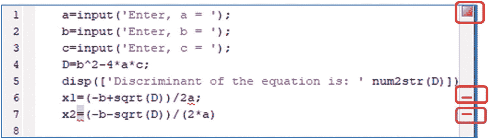

第 6 行有一个错误（`a` 下方的红色波浪线），其中缺少了乘法 `*` 号；第 7 行的 `=` 号下方有一条橙色波浪线，表示一个警告，建议添加分号以抑制该行输出的显示。

此类错误和警告信息会显示在编辑器滚动条的右侧边缘。如果红色波浪线表示存在错误，则该脚本（M/MLX 文件）无法执行。如果存在任何橙色波浪线表示的警告标志，该脚本可以正常执行。M/MLX 编辑器会自动检测几种不同类型的拼写错误和非法操作，但无法自动修复它们。因此，您必须理解并解决此类问题。

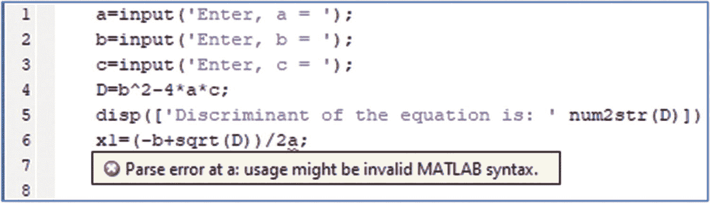

第 7 行的警告信息可以通过在光标位置添加分号或单击修复按钮来解决。

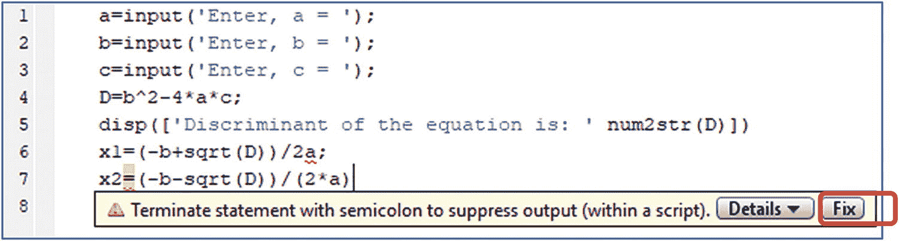

最后，这是修复后的脚本。右上角的绿色按钮表示语法正确，脚本已准备好执行。

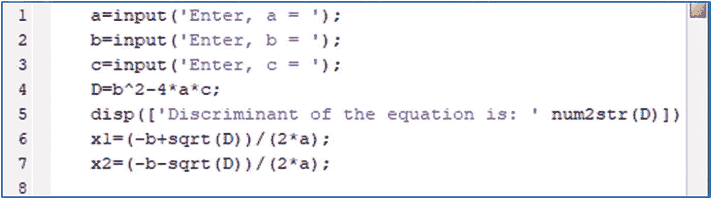

将此脚本保存为 `Eqn.m` 后，您可以通过单击编辑器主菜单中的 GUI 按钮、按键盘上的 `Ctrl+Enter`，或者直接在命令窗口中通过脚本名称调用（`>> run('Eqn')`）来执行它。执行后，它会在命令窗口中提示输入。然后，您可以分别输入 1、2、3 作为 `a`、`b` 和 `c` 的值。

```
请输入 a = 1
请输入 b = 2
请输入 c = 3
该方程的判别式为：-8
```

这样整个计算就完成了，这就是在命令窗口中得到的输出。工作区中也保存了一些其他变量，如下所示。

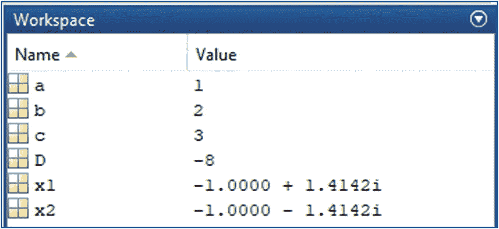

来自脚本和 M/MLX 文件的所有输入及处理/计算的输出都会自动保存到工作区中。除非执行函数文件，否则除了函数文件中指定的输出变量外，并非所有结果都会保存到工作区。此问题将在本章后面的函数文件部分讨论。

### 示例 2

通过编写一个 M 文件（脚本）计算以下表达式：`ab ∛((ax - by)² / (cd - f))`，其中 `x = [1/5, 2/5, 3/5, 4/5]; y = [1/3, 2/3, 1, 4/3]; c = 2; d = 2.5; f = 2`，而值 `a`、`b` 由用户输入（标量）。根据给定的变量值，`x` 和 `y` 是行数组，其他变量——`a`、`b`、`c`、`d` 和 `f`——是标量。

如同二次方程示例一样，输入提示也包含在脚本中。

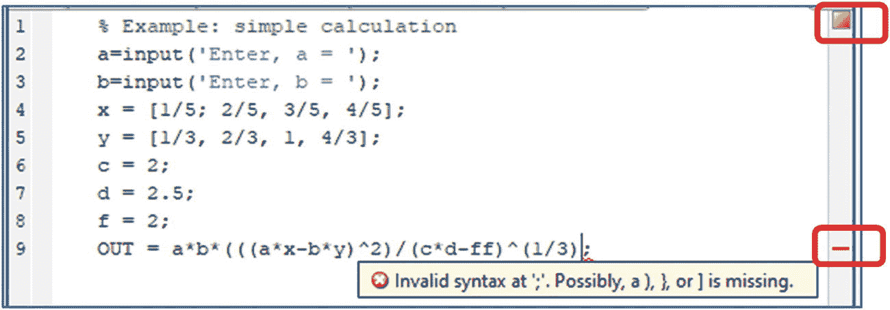

这是创建的用于计算给定任务的简短脚本。快速浏览此脚本，可以发现 MATLAB 编辑器检测到一个错误。这是与第 9 行末尾缺少括号相关的无效语法。缺失的括号位于第一个 `^` 乘幂符号之前。以下是修复后的代码，右上角带有绿色按钮。

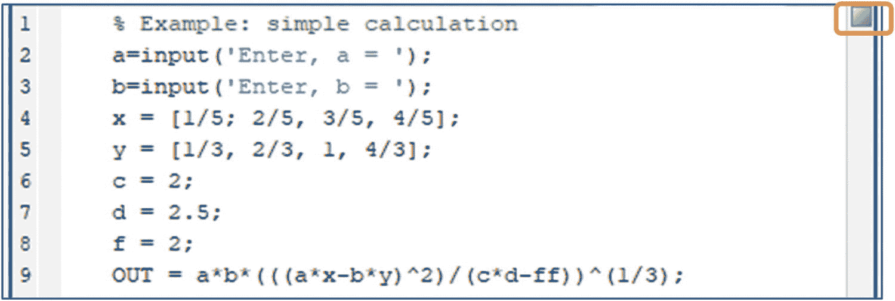

根据编辑器的语法检查，现在一切似乎都正确。然而，仍然存在几个错误：

- 在第 4 行定义 `x` 的元素时，使用了分号作为元素分隔符，但必须使用逗号或空格。
- 变量 `f` 在第 8 行定义，但在第 9 行的表达式中，却使用了 `ff`。
- 第 9 行的计算表达式使用了变量 `a`、`b`、`c`、`d` 和 `f`（这些是标量），以及变量 `x` 和 `y`（这些是行数组）。这是不正确的。该行必须对行数组变量 `x` 和 `y` 进行逐元素运算。

修复这些错误后，脚本将如下所示。

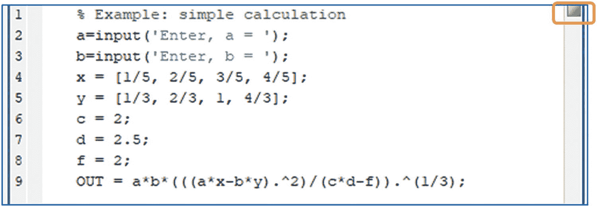

现在，无需保存即可通过按键盘上的 `Ctrl+Enter` 执行脚本，或者在保存后单击 GUI 按钮执行。以下是结果（来自命令窗口的输入）：

```
请输入 a = 1
请输入 b = 2
```

以下是工作区中的变量：

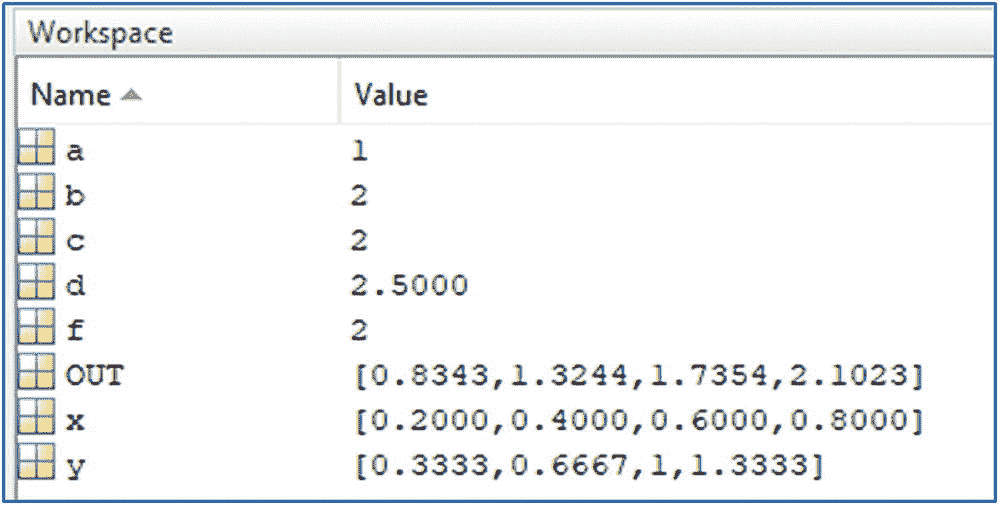

### 示例 3

使用 MLX 文件编辑器并创建一个 MLX 文件来计算数学表达式的值并绘图。已知：*H*(*t*) = sin(ω*t*)；ω = 3；*t* = [0°, 450°]，步长 ∆*t* = 1°。

注意，给定的自变量 `t` 的值是角度制，而非弧度制。在 MATLAB 中，有两个函数——`sin()` 和 `sind()`——分别用于计算弧度和角度下的正弦值。因此，在这种情况下有两种处理方法——始终使用正确的 MATLAB 函数，或者采用从角度换算到弧度的转换函数 `deg2rad()`，反之则使用 `rad2deg()`。

现在，在实时编辑器中创建了考虑输入参数 `t` 的 MLX 文件（脚本）：

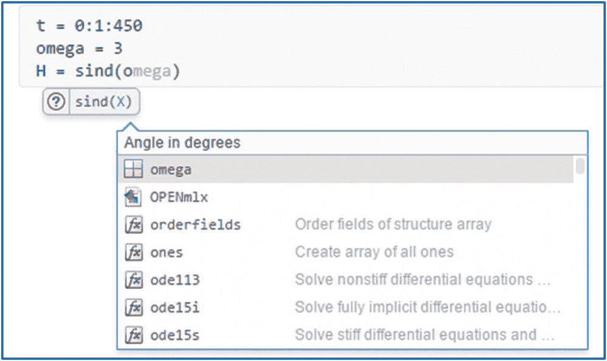

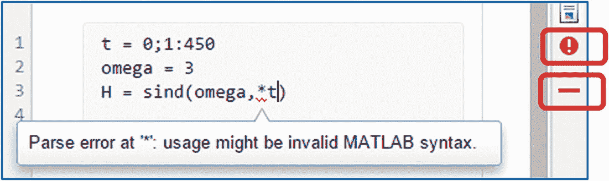

注意，错误会以波浪下划线显示，并且  和  会以红色形式出现在 MLX 编辑器的右侧。修复错误（去掉 `*` 前的逗号）后，修正后的代码如下所示。

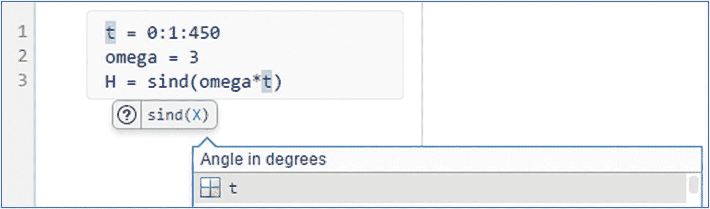

M 文件编辑器和 MLX 文件编辑器之间存在几个关键区别。其中之一是，在输入变量名称的首字母后，MLX 编辑器能自动检测已定义的变量。额外的提示会显示参数类型（例如，角度制下的 `ω` 和 `t`）。MLX 文件编辑器的另一个特性是，如果赋值变量的命令末尾未加分号，它不会显示警告信息。例如，`t = 0:1:450`，这一情况我们在使用 M 文件编辑器时就曾见过。MLX 文件编辑器将输出显示在 MLX 编辑器的右侧窗口中，而非命令窗口中。同时，执行 MLX 文件后，所有变量和已计算的表达式都会像 M 文件一样保存在工作区中。MLX 文件的执行方式与 M 文件类似，可以通过键盘按下 `Ctrl+Enter` 或点击 GUI 按钮来完成。以下是包含 `plot()` 命令及其计算结果在内的最终脚本。

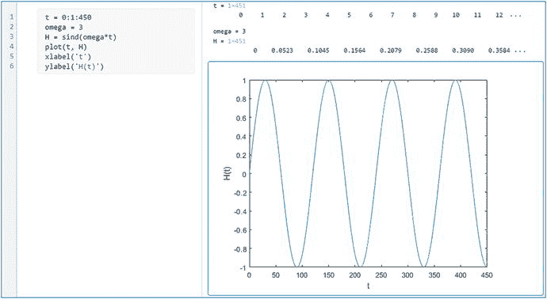

## 示例 4

编写一个 MLX 文件，用于分析和计算以下跳伞运动员的加速度方程 *a*(*v*)（加速度作为速度的函数）：

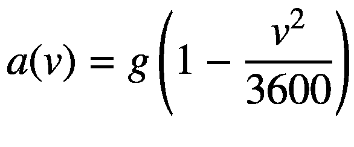

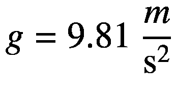

1.  绘制 *a* 与 *v* 的关系图。
2.  计算当 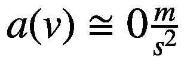 时跳伞运动员的终端速度。
3.  将垂直速度 *v* 视为自变量，在 ![$$ \left[0,\kern0.5em 100\frac{m}{s}\right] $$](images/471979_1_En_2_Chapter/471979_1_En_2_Chapter_TeX_IEq5.png) 范围内，步长设为 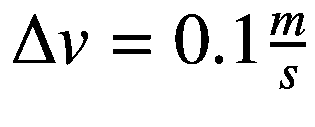。
4.  使用性能剖析器分析代码。
5.  在图上显示终端速度值。

以下是初始代码，其中包含一个错误（变量名拼写错误——应为 `Tt` 而非 `Ttt`）。该错误在第 8 行由感叹号标出。这类错误（变量名拼写错误）只有在执行脚本后才能在实时编辑器中检测到。

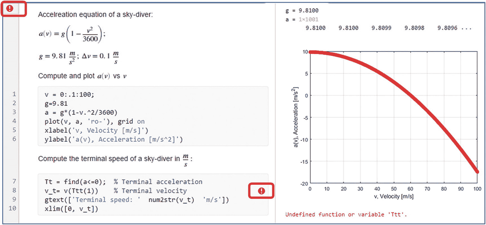

请注意，变量名拼写错误（`Ttt` 而非 `Tt`）是在执行 MLX 编辑器后才显现出来的。与 M 文件编辑器不同，MLX 编辑器的计算结果不会显示在命令窗口中。因此，建议在 MLX 编辑器中编写和编辑脚本时，频繁执行实时脚本，以便捕捉任何缺陷和错误。

以下是 MLX 编辑器中本练习修正并最终确定的解决方案脚本：

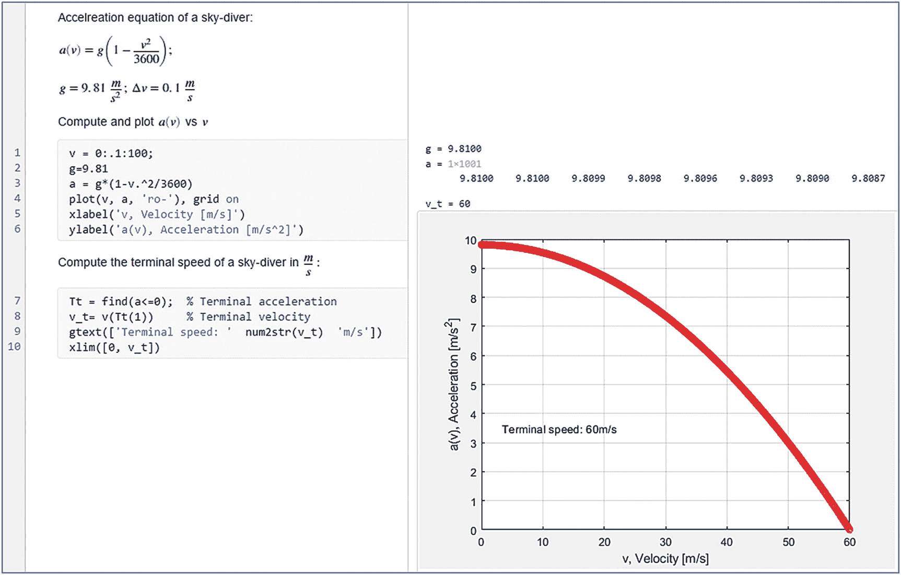

输出结果（包括绘制的图形）会显示在右侧的同一窗口中。在本练习中，包含了几行文本（不可执行代码）和注释。方程是通过 MLX 编辑器方程编辑器 GUI 工具中的和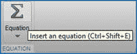按钮添加到可执行命令之间的。这些工具在 M 文件编辑器中不可用。

## 示例 5

可以在一个 M 文件中调用另一个 M/MLX 文件。让我们来看一个示例，该示例编写 M 文件和 MLX 文件来计算以下表达式。您还将通过调用/执行另一个 M/MLX 文件来获取它们的计算结果。这演示了如何链接/连接多个脚本（M/MLX 文件）。换句话说，您将执行多个脚本，获取它们的仿真结果，然后在单个脚本中使用它们。

1.  计算 `F(α) = e^(sin(α))`、`H(β) = e^(cos(β))`、`S = 1 − (sin²α + cos² β)`，其中 `α = − 2π...2π`，`β = − 360°...360°`，通过编写一个 MLX 文件来实现。

2.  计算 `g(a, b, t) = cos(at) − sin(bt)`，其中 `a = 3`、`b = 2`、`−13 ≤ t ≤ −3`，且 `∆t = π/50`，通过编写一个 M 文件来实现。

3.  计算 `f(t) = cos(20t) − sin(10t)`，其中 `t ∈ [−π, π]`，`∆t = π/50`，并绘制 `t` 相对于 `f(t)` 的计算结果图，通过编写一个 M 文件来实现。

4.  计算 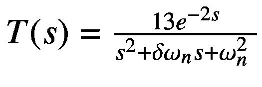，其中 `δ = [0, 0.5, 1, 1.5, 2]` 且 ![$$ {\omega}_n=3\left[\frac{rad}{\mathit{\sec}}\right];s=\left[0,25\right],\Delta s=5\ast {10}^{-2} $$](images/471979_1_En_2_Chapter/471979_1_En_2_Chapter_TeX_IEq7.png)，通过编写一个 MLX 文件来实现。

5.  编写一个 M 文件，该文件执行前面所有任务中的 M 和 MLX 文件，并按如下方式保存所有计算结果：在一个名为 `A1` 的单一数组（用于步骤 1）、一个名为 `Btab2` 的表格数组（用于步骤 2）、一个名为 `Ccell3` 的元胞数组（用于步骤 3）和一个名为 `Dstruct4` 的结构体数组（用于步骤 4）中。

以下是这五个任务在 M/MLX 文件中的解决方案脚本。

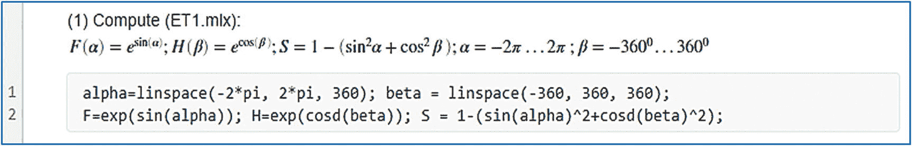

此脚本看起来没有错误，并且 MLX 编辑器没有显示任何问题。但是，在计算 `S` 的第 2 行存在两个错误（数组幂运算），只有在执行脚本后编辑器才会检测到它们。

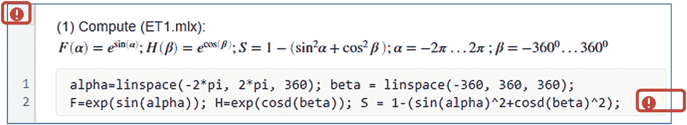


以下是修正后的脚本。

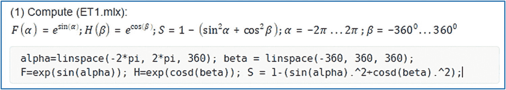

以下是解决任务 2 的初始版本脚本：

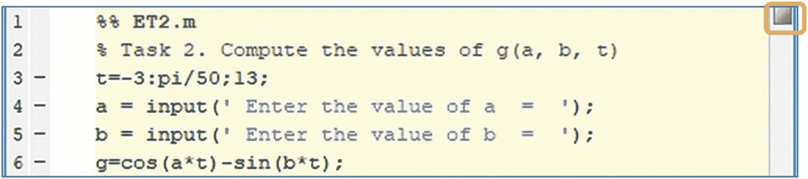

快速浏览这段代码可以发现，它输入正确，可以执行。编辑器窗口右侧的绿色框可以验证这一点。即使执行了脚本，命令窗口中也不会显示任何错误。然而，`g` 的结果显示，结果中缺少了许多预期的数据点。错误在第 3 行。在创建数组 `t` 时，使用了一个分号而不是冒号 `:` 运算符。以下是修正后的代码。

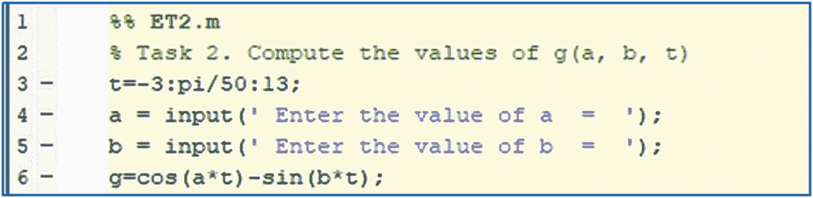

以下是任务 3 的初始版本答案脚本：

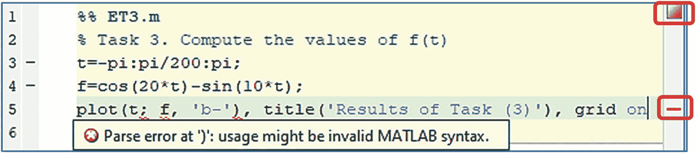

在此脚本中，编辑器在第 5 行检测到两个错误和一个警告。脚本可以执行到第 5 行，此时命令窗口中会显示以下错误消息。

```
Error: File: ET3.m Line: 5 Column: 7
Invalid expression. When calling a function or indexing a variable, use parentheses. Otherwise, check for mismatched delimiters.
```

实际上，有一个错误：在第 5 行的 `plot()` 命令中，用分号错误地替换了逗号：`plot( t; f,'b-')`。在 MATLAB 中，分号最常见的两种用途是终止表达式和作为数组行末尾的元素。因此，在本例中，`plot()` 内的分号使用不当。以下是修正后的脚本。

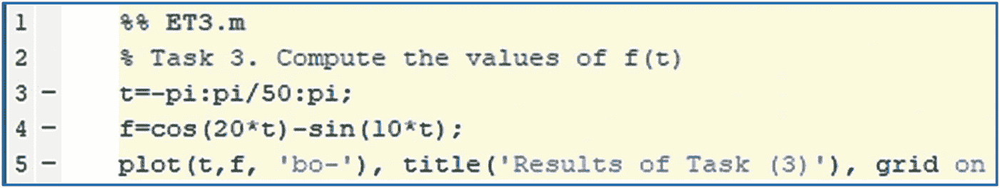

以下是任务 4 的初始解决方案脚本：

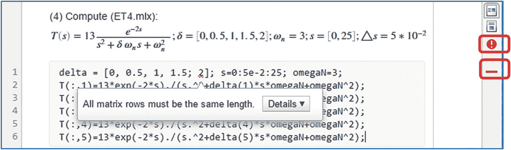

它自动检测到一个错误——错误地将分号而不是逗号作为数组的元素分隔符。由于此错误，脚本无法执行。

以下是脚本的修正版本。

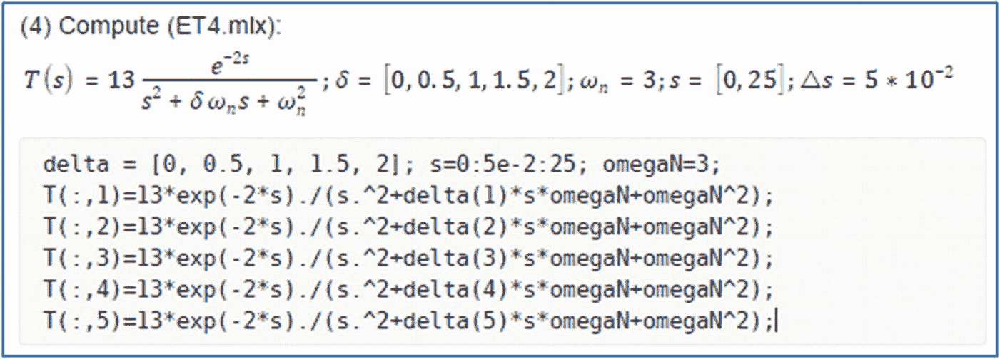

以下是任务 5 的脚本。它调用了任务 1 到 4 中的脚本。

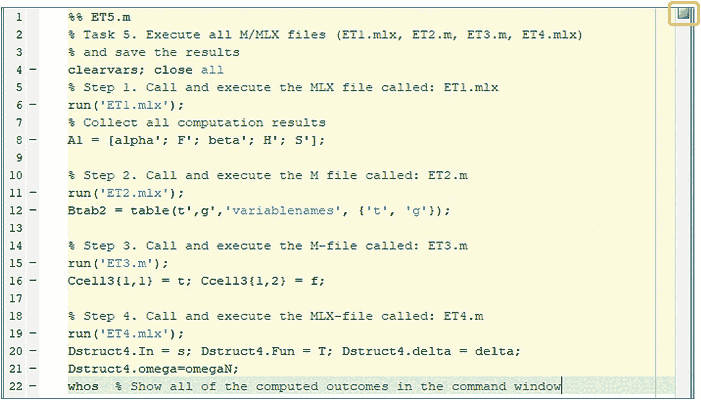

脚本编辑器没有显示任何问题。但是，当它被执行时，命令窗口中会弹出以下错误消息：

```
Error using run (line 87)
RUN cannot execute the file 'ET2.mlx'. RUN requires a valid MATLAB script
Error in ET5 (line 11)
run('ET2.mlx');
```

此错误消息表明识别文件时存在问题。这意味着文件名 `ET2.mlx` 不正确（文件扩展名错误）；它应该是 `ET2.m`。

以下是任务 5 修正后的脚本。

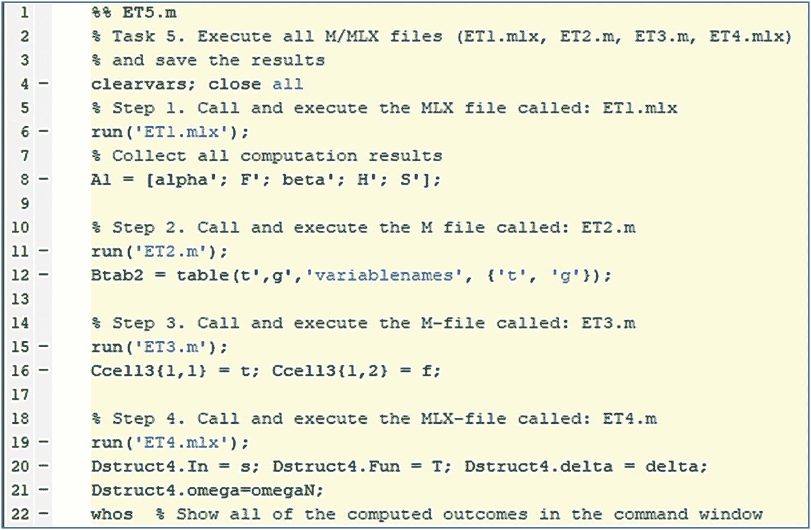

通过执行最后一个文件 (`ET5.m`)，其他四个脚本也会被依次调用和执行。以下是命令窗口中所有脚本的计算结果：

```
Enter the value of a  =  2
Enter the value of b  =  3
Name             Size             Bytes  Class     Attributes
A1            1800x1              14400  double
Btab2          255x2               5162  table
Ccell3           1x2               1840  cell
Dstruct4         1x1              24800  struct
F                1x360             2880  double
H                1x360             2880  double
S                1x360             2880  double
T              501x5              20040  double
a                1x1                  8  double
alpha            1x360             2880  double
b                1x1                  8  double
beta             1x360             2880  double
delta            1x5                 40  double
f                1x101              808  double
g                1x255             2040  double
omegaN           1x1                  8  double
s                1x501             4008  double
t                1x101              808  double
```

此外，还有一个来自任务 3 (`ET3.m`) 的图表（此处未显示）。

请注意，在编写脚本时还会出现许多其他常见错误，这些错误将在本书中重点介绍。此外，在创建函数文件时也会有一些常见错误，所有这些错误都将在专门讨论函数文件的部分中重点介绍。

通过简单的示例，您已经了解了在编写脚本时如何使用 M 和 MLX（实时）编辑器来自动检测常见错误。还有一些其他错误无法由 M/MLX 编辑器自动检测到，只能在执行脚本后才能发现。这些错误包括各种操作（算术、矩阵和数组）中变量大小不匹配，或 MATLAB 命令拼写错误。

## 注意

发现并修复你在编写代码时犯的错误是学习如何编写优秀程序的良好练习。

## 单元模式

在 M/MLX 编辑器中，有一个非常方便的工具可以用来编写结构良好的代码/脚本，称为单元模式选项。在单元模式下工作简单易行，只需输入 `%%` 即可实现。默认情况下，输入 `%%` 后加一个空格即可创建一个新单元。将长脚本按每个独立操作分隔到单元中编写，有助于你逐个单元地执行代码，并发现错误所在。它还有助于在视觉上将代码划分为不同的块，每次可以高亮显示一个块，这有助于提高可读性。让我们来看以下示例。

已知在笛卡尔坐标系 (x, y) 的原点处的一个椭圆的方程为 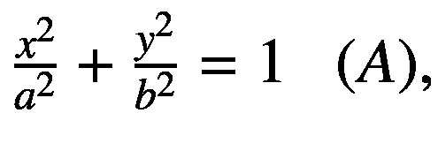，其中 *a* 和 *b* 是决定椭圆形状的常数，变量 *x*、*y* 由  定义，且  ，其中 0 ≤ *t* ≤ 2*π*

1.  计算方程 (A) 中 *a = 1.5* 且 *b = 3.5* 时所给出的椭圆并绘制它。
2.  绘制并显示由  和  所描述的两个椭圆的交点。
3.  针对以下情况：*a = [1, 2, 3]，b = [3.5, 1, 2]*，将 (A) 中定义的三个椭圆计算为一个三列数组。

以下是分别代表练习题每个子部分答案的、以三种单元模式创建的解决方案脚本。每个单元都包含了给定练习中相应部分的答案脚本。单元 1（第 1 部分），由第 2–9 行组成，计算关于 *a* 和 *b* 值的椭圆 (A)。单元 2（第 2 部分），由第 10–27 行组成，计算两个椭圆并绘制它们的值，随后显示两个椭圆的交点。单元 3（第 3 部分）计算关于 *a* 和 *b* 值的三个椭圆并绘制计算出的椭圆。


# 单元模式执行

以单元模式编写代码后，你可以单独执行每个单元：当光标位于待执行的单元内时，使用键盘上的 `Ctrl+Enter`，或者从 M 文件编辑器中点击  和  或 。使用单元模式的好处在于，你可以单独执行和测试每个单元。如果存在任何错误，你可以在不干扰其他单元的情况下进行修复。在调试和修正长脚本时，这可以节省大量的时间和精力。

### 注意

当编写冗长的扩展脚本并进行调试时，使用单元模式效率更高。

如上所示，M/MLX 文件编辑器包含许多有用的工具。例如，它们会自动检测常见的排印错误。例如，它们会检测并警告用户以下情况：

*   拼写错误的 MATLAB 内置函数/命令名称
*   未闭合的含括号数学表达式，例如 `()`、`{}` 和 `[]`
*   使用不当/错误使用或遗漏的数学运算式，例如 `+-*/\` ... `()`、`{}` 和 `[]`
*   无效语法
*   未使用的变量名
*   抑制（冗长）输出的显示
*   识别哪些条目是数值数据，哪些条目是字符或文本消息，以及哪些条目是注释
*   提供警告消息，告知如何提高脚本的计算效率

此外，M/MLX 文件编辑器还具有以下工具：

*   调试模式，例如设置/清除断点、设置/修改条件断点、启用/禁用断点、在出错/警告时停止...
*   在单元模式下工作
*   文本下的文本编辑选项
*   带有保存和发布选项的报告编写

### 调试模式

`dbstop` 函数用于临时暂停脚本的执行，并为用户提供检查本地工作区的机会。在调试脚本时，你可以通过在编辑器窗口中点击左侧装订线上的特定行来在该行设置断点。`dbstop` 函数有十多种用法：

```
(1)  dbstop in FILE at LINENO
(2)  dbstop in FILE at LINENO@
(3)  dbstop in FILE at LINENO@N
(4)  dbstop in FILE at SUBFUN
(5)  dbstop in FILE
(6)  dbstop in FILE at LINENO if EXPRESSION
(7)  dbstop in FILE at LINENO@ if EXPRESSION
(8)  dbstop in FILE at LINENO@N if EXPRESSION
(9)  dbstop in FILE at SUBFUN if EXPRESSION
(10) dbstop in FILE if EXPRESSION
(11) dbstop if error
(12) dbstop if caught error
(13) dbstop if warning
(14) dbstop if naninf  or  dbstop if infnan
(15) dbstop if error IDENTIFIER
(16) dbstop if caught error IDENTIFIER
(17) dbstop if warning IDENTIFIER
```

名称 `FILE` 是你想要执行调试操作的文件名。它必须指定为一个字符串标量的字符向量。`FILE` 还可以包含文件目录的完整或部分路径。`LINENO` 是 `FILE`（正在执行调试操作的脚本）中的行号，而 `N` 是一个整数，用于指定该行的第 N 个匿名函数。`SUBFUN` 是 `FILE` 内的子函数名称。`EXPRESSION` 是一个可执行的条件表达式，指定为字符向量或字符串标量。`IDENTIFIER` 是一个 MATLAB 消息标识符（有关消息标识符的描述，请参见 `ERROR` 的帮助）。`AT` 和 `IN` 关键字是可选的。

### M-Lint 代码检查

`mlint()` 命令用于检查 MATLAB 代码文件是否存在潜在问题。当你从 M 文件编辑器窗口中运行 M-Lint 代码检查时（通过选择“工具” ➤ “M-Lint” ➤ “显示 M-Lint 报告”），它将提示一份（关于该 M 文件的）完整警告消息报告。例如，哪个变量未使用、哪个变量的大小在每次循环迭代中发生变化、哪些地方有改进空间、所使用的 MATLAB 内置函数中哪一个已被弃用，等等。`mlint()` 的一般命令语法是 `>> mlint('filename')`。从 MATLAB 2019a 开始，不推荐使用 `mlint()`，建议改用 `checkcode()` 命令。

### 代码分析

代码分析用于衡量程序在何处耗时以及问题/错误所在位置。通过识别程序的性能，可以对其进行改进。可以从 M 文件编辑器窗口中，点击“工具”->“打开分析器”来调用代码分析功能。代码分析（Profiler）窗口会弹出。分析报告包含脚本（M 文件）的完整基准测试报告，其中包括每条命令的详细信息以及 CPU（中央处理单元）的时间消耗情况。通过研究脚本的分析报告，你可以学习如何提高仿真时间的效率。分析模式默认关闭；可以使用 `>> profile on` 命令将其开启。任何 M 文件或 Simulink 模型的分析摘要报告都可以使用通用语法生成并查看，例如：

```
profile on
% 脚本 – M 文件从此处开始：
clc; close all; clearvars
M=magic(55); plot(M);
Minv=inv(M); Mans=M*Minv; MANS=M.*Minv;
% 脚本 - M 文件在此处结束：
profile viewer
```

或者

```
>> profile on; My_function; profile viewer
```

或者对于 Simulink 模型：

```
>> profile on; sim('My_Model'); profile viewer
```

注意，你可以在两个命令之间插入任何 M 文件名（例如 `My_function.m`）或函数文件名（例如 `My_function.m`）或 Simulink 模型名（例如 `My_Model.mdl`）：

```
profile on; profile viewer
```

### 依赖关系报告

依赖关系报告可识别程序中调用/使用的所有函数、脚本和外部程序（应用程序）。此报告可查找当前文件夹中脚本所依赖的文件和工具的信息。在与其他可能没有你拥有的所有 M 文件、函数文件和工具箱的用户共享工作之前，此报告非常有帮助。依赖关系报告显示目录中 MATLAB 文件之间的依赖关系，可以通过以下步骤调用：

1.  选择“桌面” -> “当前目录”，并导航到包含相应 MATLAB 文件的目录。
2.  右键单击“当前文件夹”选项卡。从右键菜单选项中，点击“报告”，然后选择“依赖关系报告”。
3.  所有 MATLAB 文件的依赖关系报告将自动创建。

### P 代码

在 MATLAB 和 Simulink 中，还有另一种重要的文件类型，称为 P 代码，文件扩展名为 `*.p`。在某些特定情况下，创建 P 代码非常方便且推荐使用。从 M 文件创建 P 代码文件的主要原因是防止有价值的文件被意外编辑，并加快脚本的仿真时间。

以下是创建 P 代码的充分理由：

*   加速 MATLAB 中的仿真过程。
*   保护有价值的 M 文件的安全。但是，不应将 P 代码视为安全加密的替代品。
*   隐藏专有算法。
*   当你调用 M 文件函数时，MATLAB 会解析 M 代码，并将指令作为 P 代码存储在高速缓冲存储器中。除非使用 `clear` 命令清除或退出 MATLAB，否则 P 代码会一直保留在内存中。
*   它是针对虚拟 MATLAB 机器的平台无关的伪代码。
*   由于 P 文件是二进制格式，因此其源代码是隐藏的。

如何创建 P 代码：

*   要从给定的 M 文件（例如本例中的 `My_fileM.m`）创建 P 代码，请在命令窗口中输入以下内容：

```
>> pcode My_fileM.m
```

运行该命令后，将在相同文件名下创建 M 文件 `My_fileM.m` 的 P 代码，但扩展名为 `*.p` 而不是 `*.m`。

*   要执行名为 `My_fileM.p` 的 P 代码，请在命令窗口中输入以下内容：

```
>> My_fileM.p
```

*   或者在命令窗口中输入：

```
>> run My_fileM
```

即使当前目录中有名为 `My_fileM.m` 的原始 M 文件，这也会执行所创建的 P 代码。

### 关于脚本/M/MLX 文件的一些说明

*   通常，MATLAB 命令可以从脚本或命令窗口中执行。哪种方法最佳取决于需要执行的任务/计算。如果是由一步过程组成且无需重复的简单计算，则无需创建 M/MLX 文件或脚本。另一方面，当需要包含循环迭代和条件语句的不同操作的大规模计算时，编写 M/MLX 文件是最佳选择。
*   错误和警告消息不仅会帮助你定位脚本和模型中的错误，还会提供有关错误原因以及如何消除错误的提示。实际上，警告消息使你的程序更健壮，并告知你在计算/绘制输出中被忽略的数据。
*   要编写脚本和 M 文件，必须使用 M/MLX 文件编辑器，因为它们包含许多非常有用的工具。例如，它们会自动检测未使用的变量、数据集显示和未闭合的循环。它们还使你能够在单元格和调试模式下工作，帮助你检测错误、建议内存分配选项等等。

## 显示与打印操作符：`disp`， `display`， `sprintf`， 和 `fprintf`

有几个命令和操作符（内置函数）可以在命令窗口中显示计算结果，或将它们导出到与 MATLAB 兼容的外部文件中。它们是 `disp()`、`display()`、`sprintf()` 和 `fprintf()`。在这些命令中，`disp()` 和 `display()` 是在命令窗口中显示注释、字符串或数值的直接方法，无需任何额外的格式化工具或字符。它们不够健壮，无法以各种格式显示注释/字符串和数值。它们不能将数据写入外部文件。另一方面，`sprintf()` 和 `fprintf()` 可以替代 `disp()` 和 `display()` 的所有功能。通过使用格式化操作符和字符，它们可用于在命令窗口中打印各种数据类型。此外，它们可以将文本和数值数据打印到外部文件中。让我们看几个示例，以说明如何使用这些显示和打印命令。

### 示例 1

已知 ![$$ f(t)=\mathit{\sin}(t),t=\left[0,\frac{\pi }{4},\frac{\pi }{2},\frac{3\pi }{4},\pi \right] $$](images/471979_1_En_2_Chapter/471979_1_En_2_Chapter_TeX_IEq13.png)，在命令窗口中显示函数 *f*(*t*) 及其自变量 *t* 的计算结果，并附上简短的解释性注释。使用 `disp()` 和 `display()` 可以轻松实现。

```
t=[0, pi/4, pi/2, 3*pi/4, pi];
disp(['Sine @', num2str(t(1)),' is equal to: ', num2str(sin(t(1))) ])
disp(['Sine @', num2str(t(2)),' is equal to: ', num2str(sin(t(2))) ])
disp(['Sine @', num2str(t(3)),' is equal to: ', num2str(sin(t(3))) ])
disp(['Sine @', num2str(t(4)),' is equal to: ', num2str(sin(t(4))) ])
disp(['Sine @', num2str(t(5)),' is equal to: ', num2str(sin(t(5))) ])
```

这些命令在命令窗口中显示以下内容：

```
Sine @ 0 is equal to: 0
Sine @ 0.7854 is equal to: 0.70711
Sine @ 1.5708 is equal to: 1
Sine @ 2.3562 is equal to: 0.70711
Sine @ 3.1416 is equal to: 1.2246e-016
```

结果正确且可读，但演示的过程很繁琐。注意，`disp()` 和 `display()` 的输出存在差异。`disp()` 命令仅显示输出，不显示变量名。另一方面，`display()` 会显示变量名及其值，作为一个简单计算，末尾没有分号。例如：

```
>> D1=sind(90);
>> display(D1)
D1 =

>> disp(D1)

>> D1
D1 =

>> D1=sind(90)
D1 =

```

好的，作为一名高级文档工程师和翻译员，我已遵循您的所有注意事项，将英文文本翻译为符合格式要求的中文。

### 示例 2

`clock` 命令是一个内置命令，用于根据用户计算机的时钟，以行矩阵格式查看当前的年/月/日/时间。让我们通过一些解释，以一种更明确的方式显示当前时间。如何使用 `disp()` 和 `display()` 命令来做到这一点？

```
>> format short G
>> TT=clock
TT =
Columns 1 through 5
2013           11            9            4            5
Column 6
37.261
>> display('This year is: '); disp(TT(1))
This year is:

>> display('This month is: '); disp(TT(2));
This month is:

>> display('Day of this month: '); disp(TT(3));
Day of this month:

>> disp('Current time is '); display(['hour: ', num2str(TT(4))]); display(['minutes: ', num2str(TT(5))])
Current time is
hour: 4
minutes: 5
```

输出结果清晰明了，但从编程角度来看，命令过于冗长且效率低下。

### `fprintf()`

对于前面的两个示例，使用 `fprintf()` 命令可以更简单地实现。该命令的通用语法如下：

```
fprintf(format, A, ...)
```

对于示例 1，显示正弦函数值，`fprintf()` 提供了一个更简单的解决方案：

```
fprintf('Sine @ %1.5f is equal to: %2.5f\n', t, sin(t));
```

以下是 `fprintf()` 命令的输出：

```
Sine @ 0.00000 is equal to: 0.78540
Sine @ 1.57080 is equal to: 2.35619
Sine @ 3.14159 is equal to: 0.00000
Sine @ 0.70711 is equal to: 1.00000
Sine @ 0.70711 is equal to: 0.00000
```

此示例中使用的格式说明符（`%1.5f`、`%2.5f` 和 `\n`）定义了浮点数格式（`%1.5f`、`%2.5f`）的字段宽度和精度以及换行符（`\n`）。有关格式说明符的更多详细信息将在本节后面提供。

这是一种更简单、更省力的方法；它只包含一行代码。

对于示例 2，显示时间和日期，可以再次使用 `fprintf()`，如下所示：

```
>> TT=clock;
fprintf('Year:%g; Month: %g; Day: %g; Hour: %g; Min passed: %g\n',... TT(1), TT(2), TT(3), TT(4), TT(5))
Year: 2013; Month: 11; Day: 9; Hour: 4; Min passed: 5
```

对于此类情况，`sprintf()` 也是一个选项。`sprintf()` 命令的通用语法是：

```
str = sprintf(format, A, ...)
[str, errmsg] = sprintf(format, A, ...)
```

请注意，为了显示 `sprintf()` 的输出（`str` 字符串消息），您需要再次使用 `disp()` 或 `display()` 命令。`sprintf()` 的灵活性不如 `fprintf()`。请注意，`sprintf()` 总是返回一个字符串。为了更明确地演示如何使用 `sprintf()` 并改进为求解二次方程而创建的脚本，让我们使用 `sprintf()` 命令在命令窗口中显示计算结果以及一些附加信息。让我们计算一个二次方程的根，并在命令窗口中显示信息。以下是脚本（名为 `QuadEq1.m`）。

# 使用 `sprintf()` 和 `fprintf()` 进行数据格式化与导出

我们通过执行 M 文件（`QuadEq1.m`）并在命令窗口中输入以下数据（`a=11`，`b=11`，`c=13`）来测试它：

```
Solve: ax²+bx+c=0
Enter value of a: 11
Enter value of b: 12
Enter value of c: 13
Discriminant of the equation is: -428
Root1 of the equation is x1= -0.545455
x1 =
-0.5455 + 0.9404i
Root2 of the equation is x2= -0.545455
x2 =
-0.5455 - 0.9404i
```

注意，在 `sprintf()` 内部，数值数据由 `%` 符号后跟一个格式符号/字母 `g` 定义，这被称为转换说明符。以下是使用 `sprintf()` 和 `fprintf()` 声明数据格式的命令语法。

```
[S, Errm]=sprintf('Discriminant of the equation is: %g', D);
```

转换规范以 `%` 字符开头，并包含以下元素：
*   标志（可选）
*   宽度和精度字段（可选）
*   子类型说明符（可选）
*   转换字符（必需）

这些元素按以下顺序使用：


标记用于控制输出的对齐方式，例如，`-`符号表示左对齐输出，`+`符号表示右对齐输出，空格字符表示在数值前添加一个空格，而`'0'`表示在输出前填充 0（零）。字段宽度用一个非负整数定义，它指定输出中数字或字符的位数，而精度中的数字则指定输出中小数点后的位数。例如，`%12.0`表示小数点后不产生任何十进制数字，而`%12.13`则表示小数点后产生 13 个十进制数字。表 2-1 列出了转换字符，表 2-2 列出了用于指定非打印字符的转义字符。^(¹)

**表 2-2** 转义格式化字符

| 符号 | 描述 |
| --- | --- |
| `\b` | 退格 |
| `\f` | 换页 |
| `\n` | 换行 |
| `\r` | 回车 |
| `\t` | 水平制表符 |
| `\\` | 反斜杠 |
| `'` 或 `' (单引号)` | 单引号 |
| `%` | 百分号 |

**表 2-1** 转换字符

| 说明符 | 描述 |
| --- | --- |
| `%c` | 单个字符 |
| `%d` | 十进制记数法（有符号） |
| `%e` | 浮点数的指数记数法（使用小写 e，如 3.1415e+00） |
| `%E` | 浮点数的指数记数法（使用大写 E，如 3.1415E+00） |
| `%f` | 浮点数的定点记数法 |
| `%g` | `%e`或`%f`中更紧凑的格式，如`[*]`中所定义。对于浮点数，不打印无意义的零 |
| `%G` | 同`%g`，但用于浮点数时使用大写 G |
| `%i` | 有符号整数的十进制值 |
| `%o` | 八进制记数法（无符号） |
| `%s` | 字符串 |
| `%u` | 十进制整数（无符号） |
| `%x` | 十六进制记数法（使用小写字母 a–f） |
| `%X` | 十六进制记数法（使用大写字母 A–F） |

最常用的转义格式化命令之一是`\n`。它用于将后续数据写入新的一行。请注意，之前的示例（示例 1 和示例 2）在`fprintf()`命令中使用了`\n`。

我们来看之前二次方程的示例，以显示并写入其实根和复根。请注意，此练习是特意设计的，旨在演示如何使用`sprintf()`和`fprintf()`。

有几种方法可以以`R + I*i`的形式显式显示复数（例如，二次方程的复根），并附带额外注释，然后将其写入/导出到外部文件。你可以结合注释使用数值转换，或者使用字符串转换字符`s`。

让我们从第一种方法开始。这需要你添加表 2-1 和表 2-2 中的几个格式化项，以便正确显示复数。现有的 M 文件（`QuadEq1.m`）将使用以下内容进行更新，该内容使用`num2str()`转换函数将复根转换为字符串。无需分离方程复根的实部和虚部。

```
[xr1, Errm1]=sprintf('方程的根 1 为 x1= %10s', num2str(x1));
disp(xr1); display(x1)
[xr2, Errm2]=sprintf('方程的根 2 为 x2= %10s', num2str(x2));
disp(xr2); display(x2)
% 或者一种替代方法：
disp(sprintf('方程的根 1 为 x1= %10s', num2str(x1)))
disp(sprintf('方程的根 2 为 x2= %10s', num2str(x2)))
```

执行更新后的脚本（`QuadEq1.m`）后，你将看到三个输入提示，要求依次输入`a`、`b`和`c`的值。输入条目（`a =11`，`b=12`，`c=13`）后，你将得到给定方程复根的以下结果。

```
求解: ax²+bx+c=0
输入 a 的值: 11
输入 b 的值: 12
输入 c 的值: 13
方程的判别式为: -428
方程的根 1 为 x1= -0.54545+0.94037i
x1 =
-0.54545 +    0.94037i
方程的根 2 为 x2= -0.54545-0.94037i
x2 =
-0.54545 -    0.94037i
```

请注意，在此脚本中，可以类似地使用`fprintf()`替代`sprintf()`。这将使代码更简单。因此，让我们使用`fprintf()`来显示二次方程的复根，并将二次方程的计算结果写入外部文件。

使用`fprintf()`将数据写入外部文件的一般语法如下：

```
FileID=fopen('filename.extension', 'permission')
fprintf(FileID, 'format', data);
...
fclose(FileID)
```

请注意，`'permission'`可以是`'w'`表示写入权限；`'r'`表示读取权限；`'r+'`表示读取和写入权限；或`'a'`表示追加权限。MATLAB 支持几种常见的数据文件类型——`*.txt`、`*.dat`、`*.xls`、`*.csv`、`*.jpeg` 等。数据类型在`'format'`中定义。`fprintf()`中的`'format'`的定义方式与`sprintf()`中相同。使用将数据（现有数据是判别式，二次方程的根保存在工作区中）写入/导出到外部文件的一般语法，以下短脚本（`DataWrite.m`）将计算出的数据（工作区中保存的数据）写入名为`DataWrite.txt`的文件。

```
% DataWrite.m - 将计算数据写入外部文件
fid1=fopen('Results_QE.txt', 'w');
fprintf(fid1,'方程的判别式为: %g\n', D)
fprintf(fid1,'方程的根 1 为 x1= %10s\n', num2str(x1))
fprintf(fid1,'方程的根 2 为 x2= %10s\n', num2str(x2))
fclose(fid1); open('Results_QE.txt')
```

请注意，此脚本首先创建一个名为`Results_QE.txt`的新外部文件，并具有写入权限。此外部文件（`Results_QE.txt`）的文件 ID 为`fid1`（请注意，文件 ID 可以自由命名），通过该 ID 可以调用它来写入分配的数据`D`以及根`x1`和`x2`。

在`fprintf()`命令中，转义字符`\n`用于将后续数据写入新的一行。最后，数据写入过程以文件关闭命令`fclose(fid1)`结束。这是将任意大小和任意格式的数据导出到外部文件的标准方法。本书其他章节通过不同示例更广泛地介绍了这种数据导出过程。执行脚本后，以下`*.txt`文件内容将显示在 M 文件编辑器窗口中。

```
方程的判别式为: -428
方程的根 1 为 x1= -0.54545+0.94037i
方程的根 2 为 x2= -0.54545-0.94037i
```

有许多格式化工具可以显示数据并将其写入外部文件。所演示的脚本可以进一步改进，包括数据输入以及显示/写入计算数据。这些将在下一节中结合控制语句进一步讨论。

# `if`、`else`、`elseif`、`end` 以及 `switch`、`case`、`end` 控制语句

控制语句 `if ... else if ... else ... end` 也被称为条件语句或布尔运算符。它们用于根据给定信息，在运行整个脚本时逻辑地选择执行哪一段代码。它们是至关重要的编程运算符。这些运算符用于构建程序的分支结构。这些控制语句的一般结构如下：

```
if 
执行 X 操作
elseif 
执行 Y 操作
...
else
执行 W 操作
end
```

这表明，如果逻辑语句 `A` 为真，则将执行 `X` 操作。如果逻辑语句 `B` 为真，则将执行 `Y` 操作。如果所有逻辑语句都不为真，则将执行 `W` 操作。

条件运算可以通过两种方式表示——运算形式或 M/MLX 文件形式。表 2-3 中的条件和逻辑语句适用于 M/MLX 文件/脚本中使用的所有逻辑运算和条件语句。

**表 2-3** 控制逻辑运算符及其描述

| 操作 | M/MLX 文件 | 描述 |
| --- | --- | --- |
| `A<B` | `LT(A,B)` | 小于 |
| `A>B` | `GT(A,B)` | 大于 |
| `A<=B` | `LE(A,B)` | 小于或等于 |
| `A>=B` | `GE(A,B)` | 大于或等于 |
| `A~=B*` | `NE(A,B)` | 不等于 |
| `A==B` | `EQ(A,B)` | 等于 |
| `A&B` | `AND(A,B)` | 逻辑与 |
| `A&#124;B` | `OR(A,B)` | 逻辑或 |

*`~` 波浪号后跟 `=` 表示“不等于”。

### 备注

`<` 与 `lt()`、`>` 与 `gt()`、`<=` 与 `le()`、`>=` 与 `ne()`、`~=` 与 `ne()`、`==` 与 `eq()`、`&` 与 `and()`、`|` 与 `or()` 运算符可以互换使用，不会导致代码性能差异。

在各个示例中，我们互换使用这些运算符。让我们看几个示例，演示如何使用表 2-3 中给出的控制语句。

### 示例 1

`clock` 命令以行矩阵形式显示用户计算机的当前年/日期/时间。让我们以可读的格式显示数据，并附加一些文本信息。以下是解决该问题并使用 `clock` 命令的一个可能脚本 (`TimeDisp.m`)。

```
% TimeDisp.m 时间显示
display(clock);
NOW=fix(clock);% 四舍五入到最接近的整数
fprintf('今年是： %g \n', NOW(1));
if NOW(2)==1
display(['日期是 一月 ' num2str(NOW(2))]);
elseif NOW(2)==2
display(['日期是 二月 ' num2str(NOW(2))]);
elseif NOW(2)==3
display(['日期是 三月 ' num2str(NOW(2))]);
elseif NOW(2)==4
display(['日期是 四月 ' num2str(NOW(2))]);
elseif NOW(2)==5
display(['日期是 五月 ' num2str(NOW(2))]);
elseif eq(NOW(2),6)
display(['日期是 六月 ' num2str(NOW(2))]);
elseif eq(NOW(2),7)            % eq() 与 == 没有区别
display(['日期是 七月 ' num2str(NOW(2))]);
elseif eq(NOW(2),8)
display(['日期是 八月 ' num2str(NOW(2))]);
elseif eq(NOW(2),9)
display(['日期是 九月 ' num2str(NOW(2))]);
elseif eq(NOW(2),10)
display(['日期是 十月 ' num2str(NOW(2))]);
elseif eq(NOW(2),11)
display(['日期是 十一月 ' num2str(NOW(2))]);
else
display(['日期是 十二月 ' num2str(NOW(2))]);
end
if NOW(4)>=12
fprintf('当前时间： %g 下午 - %g 分 - %g 秒\n', ...
NOW(4), NOW(5), NOW(6))
else
fprintf('当前时间： %g 上午 - %g 分 - %g 秒\n', ...
NOW(4), NOW(5), NOW(6))
end
```

运行该脚本，在命令窗口中会显示以下输出：

```
ans =
列 1 到 5
2018           11            1            4           51
列 6
34.932
今年是： 2018
日期是 十一月 1
当前时间： 4 上午 - 51 分 - 34 秒
```

现在让我们回顾一下之前关于二次方程的示例，并使用 `disp`、`sprintf`、`fprintf`、`if`、`elseif` 和 `else` 来修正计算根的显示，以演示如何使用这些编程运算符。

### 示例 2

以下是计算并显示二次方程根的一个可能脚本 (`Quad_Eq2.m`)，并附有额外注释。

```
% Quad_Eq2.m
% 基于系数 a、b、c 求解二次方程
a=input('输入 a 的值： ');
b=input('输入 b 的值： ');
c=input('输入 c 的值： ');
fprintf('求解： (%3g)x²+(%3g)x+(%3g)=0\n', a,b,c)
D=b²-4*a*c;
% 根
x1=(-b+sqrt(D))/(2*a); x2=(-b-sqrt(D))/(2*a);
if lt(D,0)
disp('该方程没有实数值根！');
Dm=sprintf('因为判别式为负。 D = %g', D); disp(Dm)
fid1=fopen('Results_QE.txt', 'w');
fprintf(fid1, '该方程没有实数值 \n');
fprintf(fid1, '根！\n');
fprintf(fid1,'因为判别式为负。 D = %g\n', D);
fprintf(fid1,'复数根 1： x1= %10s\n', num2str(x1));
fprintf(fid1,'复数根 2； x2= %10s\n', num2str(x2));
fclose(fid1); open('Results_QE.txt');
elseif eq(D,0)
disp('该方程有一个唯一根！ ');
disp('因为判别式为零： D = 0 ');
fid1=fopen('Results_QE.txt', 'w');
fprintf('该方程有一个唯一根！ \n');
fprintf(fid1,'因为判别式为零： D = 0 \n');
fprintf(fid1,'唯一根： x = %g \n', x1);
fclose(fid1); open('Results_QE.txt');
else
disp('该方程有两个根！ ');
Dm =sprintf('因为判别式为： D = %g ', D); disp(Dm);
fid1=fopen('Results_QE.txt', 'w');
fprintf(fid1,'该方程有两个根 \n');
fprintf(fid1,'因为判别式为： D = %g \n', D);
fprintf(fid1,'实数根 1 为： x1= %g \n', x1);
fprintf(fid1,'实数根 2 为： x2= %g \n', x2);
fclose(fid1); open('Results_QE.txt');
end
```

该脚本使用了几种 `if`、`elseif`、`else`、`end` 条件语句的组合来提供清晰的输出。此外，还使用了 `≤`、`≥`、`<`、`>`、`=` 逻辑运算符的文本形式（`gt`、`lt` 和 `eq`）。然而，脚本的健壮性仍然不足。例如，用户可能会错误地输入系数（比如将 `c` 的值输成 `b` 或 `a`，反之亦然），或者用户可能会跳过输入任何系数。结果，脚本会产生错误的输出。为了使脚本针对不同的场景和用户输入（包括用户输入的错误）达到完全的健壮性，将使用 `while ... end` 循环控制语句。我们将在下一节讨论它。

### 示例 3

# 驾驶速度警告示例

根据驾驶位置（例如在学校区域、住宅/商业区、城镇未铺砌道路、双车道及多车道高速公路以及州际公路）向驾驶员发出超速警告。本示例使用了美国北达科他州的限速标准。

```
% Drive_Safe.m 提供警告标志，显示特定道路、高速公路、快速路等区域的限速及驾驶建议。
% 例如，CS 是唯一的输入变量
% 限速 [1] 学校区域：20 [英里/小时]
% 限速 [2] 住宅和商业区域：25 [英里/小时]
% 限速 [3] 城镇砾石路：55 [英里/小时]
% 限速 [4] 双车道高速公路：65 [英里/小时]
% 限速 [5] 多车道高速公路：70 [英里/小时]
% 限速 [6] 分隔式州际公路：75 [英里/小时]
CS = input('请输入您汽车的当前速度 [英里/小时]:    ');
disp('选择您的驾驶位置：')
disp('[1] 学校区域；[2] 住宅和商业区域；')
disp('[3] 城镇砾石路；[4] 双车道高速公路；')
disp('[5] 多车道高速公路；[6] 分隔式州际公路；')
DZone = input('请输入您的驾驶区域，例如 1, 2, 3, ... 6:  ');
if isempty(DZone) || DZone >7 || DZone <1
warndlg('您输入的驾驶区域无效或超出范围！')
elseif isempty(CS) || CS <0
warndlg('您输入的汽车速度无效或为负值！')
elseif CS ==0
warndlg('您的汽车没有移动！')
else
if DZone >0 && DZone <7
if CS >0 && CS <20
fprintf('您的汽车速度 = %g [英里/小时] 过慢 \n', CS)
fprintf('即使在学生上下学期间也是如此 \n')
warndlg('您可以在学校区域适当加速！')
elseif DZone ==1 && CS >10 && CS <20
fprintf('您的速度 = %g [英里/小时] 适合学校区域 \n', CS)
warndlg('您驾驶安全！')
elseif DZone ==1 && CS >20
fprintf('您的速度 = %g [英里/小时] 在学校区域过快 \n', CS)
warndlg('危险！减速至 20 英里/小时！')
elseif DZone ==2 && CS > 15 && CS <25
fprintf('您的速度 = %g [英里/小时] 适合住宅区域 \n', CS)
warndlg('您驾驶安全！')
elseif DZone ==2 && CS >20 && CS <28
fprintf('您的速度 = %g [英里/小时] 对住宅区域而言偏高！\n', CS)
warndlg('危险！减速，不要超过 25 英里/小时！')
elseif DZone == 3 && CS <25
fprintf('您的速度 = %g [英里/小时] 对城镇砾石路而言偏慢！\n', CS)
warndlg('加速至 55 英里/小时！')
elseif DZone == 3 && CS > 48  && CS <58
fprintf('您的速度 = %g [英里/小时] 适合砾石路 \n', CS)
warndlg('随车流行驶！')
elseif DZone == 3 && CS >58
fprintf('您的汽车速度 = %g [英里/小时] 超出了 \n', CS)
fprintf('城镇砾石路的限速！\n')
warndlg('危险！减速至 55 英里/小时！')
elseif DZone == 4 && CS > 55  && CS <60
fprintf('您的速度 = %g [英里/小时] 适合双车道高速公路 \n', CS)
warndlg('您在限速范围内！')
elseif DZone == 4 && CS >60  && CS <68
fprintf('您的速度 = %g [英里/小时] 对双车道高速公路而言 \n', CS)
fprintf('稍高！\n')
warndlg('谨慎行驶！')
elseif DZone == 4 && CS >68
fprintf('您的速度 = %g [英里/小时] 超出了 \n', CS)
fprintf('双车道高速公路的限速！\n')
warndlg('危险！减速至 65 英里/小时！')
elseif DZone == 5 && CS > 55  && CS <65
fprintf('您的速度 = %g [英里/小时] 适合多车道高速公路 \n', CS)
warndlg('您在限速范围内！')
elseif DZone == 5 && CS >65  && CS <75
fprintf('您的速度 = %g [英里/小时] 对多车道高速公路而言稍高 \n', CS)
warndlg('谨慎行驶！')
elseif DZone == 5 && CS >75
fprintf('您的速度 = %g [英里/小时] 超出了 \n', CS)
frintf('多车道高速公路的限速！\n')
warndlg('危险！减速至 70 英里/小时！')
elseif DZone == 6 && CS > 60  && CS <70
fprintf('您的速度 = %g [英里/小时] 适合分隔式州际公路 \n', CS)
warndlg('您在限速范围内！')
elseif DZone == 6 && CS >70 && CS <78
fprintf('您的速度 = %g [英里/小时] 在北达科他州 \n', CS)
fprintf('分隔式州际公路的限速范围内！\n')
warndlg('请将速度保持在 75 英里/小时左右！')
else
fprintf('您的速度 = %g [英里/小时] 超出了 \n', CS)
fprintf('北达科他州分隔式州际公路的限速！\n')
warndlg('危险！减速至 75 英里/小时！')
end
end
```

在此答案脚本中，条件语句和布尔运算符`if ... elseif ... else ... end`被使用了两次。第一个`if... elseif ...elseif... else ...`用于判断用户是否指定了其驾驶地点（`DZone`）和速度（`CS`）。第二个`if... elseif ... ... else ... end`仅在第一个`if...elseif ...`条件满足时才开始执行。换句话说，仅在用户输入了其驾驶速度和区域时才会执行。

如果用户信息对预定义的六个驾驶区域有效，则在`elseif CS ==0`下，它会验证给定的汽车是否在移动。如果汽车在移动，`elseif CS<0`表示移动方向（负速度值表示倒车）。最后一个`else`则评估速度的正值。

超出这第一个`else`后，所有正值（汽车前进方向）以及第二个`if ... elseif ... ... else ... end`循环都会执行。它们用于定义超速级别，并根据驾驶位置（区域和道路）和速度向驾驶员提供警告信号。

让我们用不同的输入速度值和不同的驾驶区域来测试此脚本。

## 案例 1

给定汽车在学校区域内以 9 英里/小时的速度行驶。

```
请输入您汽车的当前速度 [英里/小时]:    9
选择您的驾驶位置：
[1] 学校区域；[2] 住宅和商业区域；
[3] 城镇砾石路；[4] 双车道高速公路；
[5] 多车道高速公路；[6] 分隔式州际公路；
请输入您的驾驶区域，例如 1, 2, 3, ... 6:  1
您的汽车速度 = 9 [英里/小时] 过慢
即使在学生上下学期间也是如此
```

将显示以下警告对话框。


## 案例 2

给定汽车在双车道高速公路上以 72 英里/小时的速度行驶。

```
请输入您汽车的当前速度 [英里/小时]:    72
选择您的驾驶位置：
[1] 学校区域；[2] 住宅和商业区域；
[3] 城镇砾石路；[4] 双车道高速公路；
[5] 多车道高速公路；[6] 分隔式州际公路；
请输入您的驾驶区域，例如 1, 2, 3, ... 6:  4
您的汽车速度 = 72 [英里/小时] 超出了
双车道高速公路的限速！
```

将显示以下警告对话框。


## 案例 3

给定汽车在分隔式州际高速公路上以 77 英里/小时的速度行驶。

```
请输入您汽车的当前速度 [英里/小时]:    77
选择您的驾驶位置：
[1] 学校区域；[2] 住宅和商业区域；
[3] 城镇砾石路；[4] 双车道高速公路；
[5] 多车道高速公路；[6] 分隔式州际公路；
请输入您的驾驶区域，例如 1, 2, 3, ... 6:  6
您的汽车速度 = 77 [英里/小时] 在
北达科他州分隔式州际公路的限速范围内！
```

将显示以下警告对话框。


另一组控制语句是`switch`、`case`、`otherwise`和`end`。这些语句相对于`if`、`else`、`elseif`和`end`有一个显著优势。它们能够处理多种情况并简化代码。它们具有以下通用语法结构：

```
switch 标量或字符串表达式（变量）
case 变量值 1
A 语句
case 变量值 2
B 语句
case 变量值 3
C 语句
...
otherwise
X, ... W 语句
end
```

让我们看一个简单的示例，了解这些条件语句——`switch`、`case`、`otherwise`和`end`——是如何运作的。

### 示例 4

判断用户输入的整数（从 1 到 50）是奇数、偶数还是质数。以下脚本（称为`Num50Type.m`）定义了 1 到 50 范围内整数的类型。

```
% Num50Type.m - 定义输入的整数类型
clear all; clearvars; clc
N=input('请输入 1 到 50 之间的任意整数:  ');
if N<=50
fprintf('您输入的是: %d \n', N)
switch N
case {2 4 6 8 10 12 14 16 18 20 22 24 26 28 30 32, 34 36 38 40 43 44 46 48 50}
fprintf('您输入了 %g，这是一个偶数 \n', N)
case {9,15,21,25,27,33,35,39,45,49}
fprintf('您输入了 %g，这是一个奇数但不是质数\n', N)
otherwise %N=[3,5,7,11,13,17,19,23,29,31,37,41,43,47]
fprintf('您输入了 %g，这是一个质数 \n ', N)
end
else
disp('此代码仅适用于 1 到 50 之间的整数，用于判断它们是偶数、奇数还是质数！')
end
```

如果您输入整数 23，您将在命令窗口中得到以下输出。

```
请输入 1 到 50 之间的任意整数:  23
您输入了 23，这是一个质数
```

此脚本能正确判断所有输入的小于等于 50 的数值。但是，您可以通过添加条件语句和`while`循环来验证整数是否在 1 到 50 的范围内，从而提高其鲁棒性。

使用控制分支语句`if, elseif, else, end`的脚本，可以通过在循环语句（例如`while ... end`和`for ... end`）中使用它们来提高其鲁棒性。下一节将通过示例对此进行讨论。

# 循环控制语句：`while`、`for`、`continue`、`break`和`end`

控制语句有两种类型——`while...end`和`for...end`。第一种循环控制语句是`while...end`，其通用语法如下：

```
while 表达式不成立时
执行 A, B, C,..., W 操作
end
```

与`if ... elseif ... else ... end`语句不同，`while...end`循环会持续执行操作，直到`while`运算符后面的表达式变为有效。一旦表达式变为真/有效，执行过程就会停止。

## 示例 1

使用`while ... end`循环控制计算从 1 到 100 的所有奇数的和（称为`Sum100.m`）。

```
% Sum100.m 使用 while 循环计算所有奇数的和
Sum=0; N=1;
while ne(N, 100)
if ne(mod(N,2),0) % 验证是否将所有奇数都加上了。
Sum=Sum + N;
else              % 验证数字是否为偶数，不求和。
end
N=N+1;
end
disp(['1 到 100 所有奇数的和为： ', num2str(Sum)]);
```

这个基于循环的脚本（`Sum100.m`）将持续运行，直到迭代过程达到最终值 100。`if ... else ... end`条件语句借助`mod()`来验证数字是奇数还是偶数。它用于计算`N/2`的余数。如果数字是奇数，则进行求和；否则，将被忽略。

## 注意

在许多使用`while ... end`和`for ... end`迭代循环的求和类练习中，用户难以理解计算算法并编写代码来执行求和过程。对于许多编程初学者来说，求和算法并不直观。困难之处在于他们忽略了在求和过程的初始步骤中将`0`（值）赋给求和变量的必要性。这意味着将任何数字加到`0`上都会得到相同的数字。随后，在`for ... end`或`while ... end`循环内部，这个求和变量将在每次迭代中获得一个新值。例如，在前面的示例中：

第 1 步. `Sum(1) = 0`

第 2 步. `Sum(2) = Sum(1)+N(1) = 0+1=1`；当`N(1)= 1`且`ne(mod(N(1),2), 0)`有效时

第 3 步. `Sum(3)=Sum(2)=1`；当`N(2)= N(1)+1=2`时，因为`N(2)/2 = 1`余数为`0` ← `ne(mod(N,2), 0)`不成立

第 4 步. `Sum(4)=Sum(3)+N(3)=1+3 =4`；当`N(3)=N(2)+1=2+1=3`且`ne(mod(N(3),2), 0)`有效时

第 5 步. `Sum(5)=Sum(4)=4`；当`N(4)=N(3)+1=3+1=4`时；因为`N(4)/2 = 2`余数为`0` ← `ne(mod(N(4),2), 0)`不成立

第 6 步. `Sum(6)= Sum(5)+N(5)=4+5=9`；当`N(5)=N(4)+1=4+1=5`且`ne(mod(N(5),2), 0)`有效时

依此类推。迭代过程一直持续，直到`N`等于 100。

该脚本在命令窗口中的最终输出为：

```
1 到 100 所有奇数的和为： 2500
```

## 示例 2

为了更好地理解如何使用循环控制语句`while ... end`，我们以求解二次方程为例：*ax*² + *bx* + *c* = 0

问题：用户可能会以错误的顺序输入*a*、*b*和*c*的值，或者输错它们的值，或者输入错误的数字。

为了使程序更健壮并解决任何错误输入问题，条件运算符`if ... elseif ... else ...end`与`while ... end`循环迭代运算符一起使用。

以下是该问题的一种可能解决方案。该脚本（名为`Quad_Eqn.m`）非常健壮。它接受不同的输入，计算所有可能的根（实根和复根），然后在命令窗口中正确显示它们。它解决了许多可能的错误输入问题，例如错误的值、错误的数据大小或*a*、*b*和*c*的值混淆。请注意，第一个`while`循环语句验证包含*a*、*b*和*c*值的输入行数组的大小，第二个带有条件运算符`if ... else ... end`的循环语句验证*a*、*b*和*c*输入的顺序。

# MATLAB 循环控制语句详解

## 示例 3：二次方程求解脚本的健壮性

以下 MATLAB 脚本 `Quad_Eqn.m` 演示了如何根据用户输入求解二次方程，并对其输入进行了健壮性测试。

```matlab
% Quad_Eqn.m 根据用户输入的 a, b, c 求解二次方程
clearvars; clc
SIZE_chk = 0;
while SIZE_chk ~=1
disp('求解：ax²+bx+c=0')
abc=input('请输入数值 [a, b, c]:   ');
SIZE_abc=numel(abc);
if SIZE_abc ==3
SIZE_chk=1;
a=abc(1);
b=abc(2);
c=abc(3);
CorrectEntry=0;
while CorrectEntry~=1
if SIZE_abc == 3
CorrectEntry=1; CorrectABC=0;
% 检查 a, b, c 的顺序
while CorrectABC~=1
disp('这是您想要求根的方程吗？')
disp('   ')
Eqn=sprintf(' %g*x²+(%g)*x + (%g)=0', a, b, c);
disp('   ')
disp(Eqn);
CorrectABC=input('如果是，请输入 1，否则输入任意整数！  ');
disp('   ')
if CorrectABC~=1
abc=input('请输入数值 [a, b, c]:   ');
a=abc(1); b=abc(2); c=abc(3);
end
end
D=b²-4*a*c;
% 求根
x1=(-b+sqrt(D))/(2*a); x2=(-b-sqrt(D))/(2*a);
if lt(D,0)
disp('该方程没有实根！');
Dm=sprintf('因为判别式 <0\. D = %g ', D); disp(Dm);
fprintf(' %g*x²+(%g)*x + (%g)=0\n', a, b, c);
fprintf('它有两个实根 \n');
fprintf('因为判别式 >0\. D = %g\n', D);
fprintf('方程的根为 x1= %g; x2= %g \n', x1, x2);
end
else
CorrectEntry=0;
disp(' a, b, c 不能包含超过一个元素（值）');
disp('请重新输入 a, b, c 的值');
disp('    ')
abc=input('请输入数值 [a, b, c]:   ');
a=abc(a); b=abc(2); c=abc(3);
sa=numel(1); sb=numel(b); sc=numel(c);
end
end
else
fprintf('您的输入有误 \n')
fprintf('请以行向量形式在 [ ] 中输入 [a, b, c] 的正确值： ')
end
end
```

该脚本针对 `a`、`b` 和 `c` 的故意错误输入进行了健壮性测试，如以下案例所示。

```
求解：ax²+bx+c=0
请输入数值 [a, b, c]:   [12 1 1 1 ]
您的输入有误
请以行向量形式在 [ ] 中输入 [a, b, c] 的正确值：  求解：ax²+bx+c=0
请输入数值 [a, b, c]:   [12 1 1 1 ]
您的输入有误
请以行向量形式在 [ ] 中输入 [a, b, c] 的正确值：  求解：ax²+bx+c=0
请输入数值 [a, b, c]:   [1 2 1 1 ]
您的输入有误
请以行向量形式在 [ ] 中输入 [a, b, c] 的正确值：  求解：ax²+bx+c=0
请输入数值 [a, b, c]:   [1 2 1  ]
这是您想要求根的方程吗？
1*x²+(2)*x + (1)=0
如果是，请输入 1，否则输入任意整数！  0
请输入数值 [a, b, c]:   [1 1 2]
这是您想要求根的方程吗？
1*x²+(1)*x + (2)=0
如果是，请输入 1，否则输入任意整数！  1
该方程没有实根！
因为判别式 <0\. D = -7
1*x²+(1)*x + (2)=0
它没有实根！
因为其判别式 <0\. D=-7
复根为： x1=-0.5+1.3229i;   x2=-0.5-1.3229i
```

从这个简单的例子可以清楚地看出，`while ... end` 循环操作在增强脚本健壮性方面比 `if ... elseif ... else ... end` 运算符更强大。

### for ... end 循环语法

第二种循环控制语句是 `for ... end`，其通用语法如下：

```
for i=起始值:步长:结束值
迭代 1
迭代 2
...
迭代 N
end
```

`for ... end` 循环控制语句的工作方式如下。它从 `起始值` 开始，以 `步长` 为步长，执行 `1, 2, ..., N` 中的每个语句，直到循环迭代达到 `结束值`，这对应于 `N` 次迭代。

> **注意**：如果在 `for ... end` 循环中分配向量空间或索引范围时未指定步长，则默认步长为 1。

## 示例 4：计算奇数之和

使用 `for ... end` 循环（名为 `Sum20odd.m`）计算 `[1, 20]` 范围内所有奇数的和。

```matlab
% Sum20odd.m 使用 for 循环求 0...20 范围内奇数的和
clearvars;
S=0;
for N=1:20;
if rem(N,2)==0 %判断数字是否为偶数，是则不加。
S=S;
else           %所有奇数进行相加：
S=S+N;
end
end
fprintf('1 到 %g 内所有奇数的和等于 %g \n', N, S)
```

`if ... else ... end` 条件语句用于判断数字是否为奇数。如果数字是奇数，则将其加到求和变量（`S`）中；否则，变量不加任何值。此脚本背后的算法与示例 3 相同，这个简短的脚本是示例 3 的另一种解决方案。唯一的区别在于，这里的奇数数量上限为 20。

以下是本例使用 `for ... end` 和 `while ... end` 的另外两种更简单的解决方案：

```matlab
% Sum20odd_alt.m 使用 [for ... end] 循环求 0...20 范围内奇数的和
clearvars;
S=0;
for N=1:2:20
S=S+N;
end
fprintf('1 到 20 内所有奇数的和等于 %g \n', S)
% 使用 [while ... end] 循环求 0...20 范围内奇数的和
clearvars;
S=0; jj=1;
while le(jj,20)
S=S+jj; jj=jj+2;
end
fprintf('1 到 20 内所有奇数的和等于 %g \n', S)
```

此脚本中 `for ... end` 的计算算法如下：

1. `S(1) = 0`
2. 当 `N(1)=1` 时，`S(2)=S(1)+N(1)=0+1=1`
3. 当 `N(2)=3` 时，因为步长为 `2`（即 `N(2)=N(1)+2=1+2=3`），所以 `S(3)=S(2)+N(2)=1+3=4`
4. 当 `N(3)=5` 时，因为 `N(3)=N(2)+2=3+2=5`，所以 `S(4)=S(3)+N(3)=4+5=9`
5. 以此类推……迭代循环运行直到 `N=20`。实际上，在此例中，`N` 不可能等于 20，因为步长为 2。所以 `N` 的最大值为 19。

最后，这些脚本的输出完全相同：

```
1 到 20 内所有奇数的和等于 100
```

正如所示，`for ... end` 可以很容易地被 `while ... end` 循环替代，反之亦然；它们的效率相似。然而，在某些特定示例（如示例 3）中，使用 `while ... end` 循环获得的鲁棒性是 `for ... end` 无法实现的。理论上，在某些问题（如示例 3）中，当迭代次数未知时，`while ... end` 可以被 `for ... end` 替代。

> **注意**：在许多基于循环迭代的计算问题中，`for ... end` 可以很容易地替换 `while ... end` 循环，反之亦然。它们的计算效率相似。然而，有许多特定情况下，会采用 `while ... end` 操作来获得脚本的高鲁棒性，而 `for ... end` 无法提供同等的鲁棒性和灵活性。本节中的示例 3 就说明了这一点。建议在循环迭代中使用 `ii` 或 `jj` 作为索引，以避免与虚数混淆，因为 MATLAB 默认保留 `i` 和 `j` 用于虚数。如果将这些字母（`i` 和 `j`）用作索引，则可以使用 `sqrt(-1)` 表示虚数，或者从工作区中清除这些变量。

## 示例 5：计算平方与立方

使用循环控制语句 `for, end` 计算偶数的平方和立方。

以下是其中一个可能的解决方案脚本（名为 `SqCube10.m`）。请注意，在本示例中，`startloop=2`，`stepsize=2`，`endloop=10`：

```matlab
% SqCube10.m 计算 2...10 范围内数字的平方和立方
%%  [for  ... end]
for k=2:2:10
Square = k²;
Cube   = k³;
fprintf('%g 的平方是 %g \n', k, Square);
fprintf('%g 的立方是 %g \n'  , k, Cube);
end
%% 另一种方式：[while ... end]
jj =2;
while le(jj, 10)
Square = jj²;
Cube   = jj³;
fprintf('%g 的平方是 %g \n', jj, Square);
fprintf('%g 的立方是 %g \n'  , jj, Cube);
jj =jj+2;
end
```

当脚本执行时，命令窗口中会显示以下内容：

```
2 的平方是 4
2 的立方是 8
4 的平方是 16
4 的立方是 64
6 的平方是 36
6 的立方是 216
8 的平方是 64
8 的立方是 512
10 的平方是 100
10 的立方是 1000
```

## 示例 6：计算级数之和

使用 `for ... end` 和 `while ... end` 计算级数 $$ 1-\frac{1}{2}+\frac{1}{3}-\frac{1}{4}+\frac{1}{5}-\frac{1}{6}+\frac{1}{7}\dots $$。

以下是针对给定练习的四个可能的解决方案脚本，它们集中在一个名为 `SumSeries.m` 的脚本中。

```matlab
% SumSeries.m 计算一个级数的和：
%% 版本 A. [for ... end]
clearvars
sign=1; sum_ser=0;
n=input('输入要计算的级数项数：  ');
for N=1:n
sum_ser=sum_ser+sign/N; sign=-sign;
end
fprintf('%g 项级数的和等于 %2.5f \n', n, sum_ser)
%% 版本 B. [while ... end]
clearvars
S=0;
N=input('输入要计算的级数项数：  ');
ii=1;
while ii~=N+1
if mod(ii,2)==0
S=S-1/ii;
else
S=S+1/ii;
end
ii=ii+1;
end
fprintf('%g 项级数的和等于 %2.5f \n', ii, S)
%% 版本 C. [for ... end]
clearvars
Sum=1;
n = input('输入要计算的级数项数：  ');
for k=2:n
if eq(mod(k,2), 0)
Sum=Sum-1/k;
else
Sum=Sum+1/k;
end
end
fprintf('%g 项级数的和等于 %2.5f  \n', k, Sum)
```

所有这些使用 `for ... end` 和 `while ... end` 的解法都会得到相同的结果。必须注意，MATLAB 函数 `mod(N, 2)` 用于判断数字是偶数还是奇数。在此脚本中，它用于分离 `ii` 和 `k` 的偶数和奇数部分。

在所有这些示例中，迭代过程的最终值都被保存了下来。那么如何保存所有迭代步骤中的全部值呢？

```matlab
%% 版本 A. [for ... end]
clearvars
Sum=1;
n = input('输入要计算的级数项数：  ');
k=2:1:n;
for jj=1:numel(k)
if eq(mod(k(jj),2), 0)
Sum(jj+1)=Sum(jj)-1/k(jj);
else
Sum(jj+1)=Sum(jj)+1/k(jj);
end
fprintf('%g 项级数的和等于 %2.5f  \n', k(jj), Sum(jj+1))
end
disp('         ')
fprintf('%g 项级数的和等于 %2.5f \n', k(end), Sum(end))
%% 版本 B. [for ... end]
clearvars
sign=1; sum_ser=0;
n=input('输入要计算的级数项数：  ');
for N=1:n
sum_ser=sum_ser+sign/N; sign=-sign;
S(N)=sum_ser;
fprintf('%g 项级数的和等于 %2.5f \n', n, sum_ser)
end
%% 版本 C. [while ... end]
clearvars
S=0;
N=input('输入要计算的级数项数：  ');
ii=1;
while ii~=N+1
if mod(ii,2)==0
S(ii+1)=S(ii)-1/ii;
else
S(ii+1)=S(ii)+1/ii;
end
fprintf('%g 项级数的和等于 %2.5f \n', ii, S(ii+1))
ii=ii+1;
end
%% 版本 D. [while ... end]
clearvars
S=0;
N=input('输入要计算的级数项数：  ');
ii=1;
while ii~=N+1
if mod(ii,2)==0
S=S-1/ii;
Ss(ii)=S;
else
S=S+1/ii;
Ss(ii)=S;
end
fprintf('%g 项级数的和等于 %2.5f \n', ii, Ss(ii))
ii=ii+1;
end
```

保留所有迭代中所有值的最简单直接的方法之一是启动一系列新变量，例如 `Sum(jj)`、`S(N)` 和 `Ss(ii)`。在循环内保存所有计算输出值时，正确理解 `Sum(jj+1)`、`Sum(jj)`、`S(ii+1)` 和 `S(ii)` 至关重要。例如，`Sum(jj)` 取 `Sum=1` 的值，`Sum(1+1) = Sum(1)-1/k(1)` 等于 `Sum(2) = 1-1/2 =` ½。在下一步（步骤 2）中，`Sum(3)=Sum(2) +1/k(2)` 等于 `Sum(3) =1/2+1/3 =5/6`，依此类推。在版本 B 中，`S(N)` 保存了在 `1:n` 范围内每一次迭代中 `S` 的每个值。

## 示例 7：计算向量函数值并保留所有结果

使用 `for ... end` 和 `while ... end` 循环迭代算子计算表达式 `f(t) = exp(sin(3*t))`，其中 `t = 0 : 0.001 : 6.28`，并保留所有迭代中的所有值。每次迭代中，对应于每个 `t` 值，保存一个 `f(t)` 值。

```matlab
%% Ex6_FOR_WHILE.m
clearvars
% 版本 1
ii =1;
for t=0:.001:6.28
f(ii)=exp(sin(t));
ii=ii+1;
end
% 版本 2
t=0:.001:6.28;
for k=1:numel(t)
f(k)=exp(sin(t(k)));
end
%% 版本 3
jj=0;
while jj~=numel(t)
f(jj+1)=exp(sin(t(jj+1)));
jj=jj+1;
end
% 版本 4
m=1;
while m~=numel(t)+1
f(m)=exp(sin(t(m)));
m=m+1;
end
```

> **注意**：在 `for ... end` 和 `while ... end` 循环中计算 `f(t)` 时，务必使用 `f(ii)`、`f(k)`、`f(jj+1)` 或 `f(m)`。这样可以保留迭代过程中关于不同 `t` 值的所有 `f(t)` 结果。如果只用 `f` 而非带索引的形式，则只会保存 `f(t)` 的最后一个值。

用户在使用循环控制语句（`for ... end` 和 `while ... end`）时，最容易犯的错误之一是在主变量之后忽略了索引 `(ii)`、`(k)`、`(jj)` 或 `(m)`。例如，前一个例子中的 `f(ii)`、`f(k)`、`f(jj+1)` 和 `f(m)`，其目的是收集整个迭代过程中的所有值。

用户在使用循环控制语句时另一个常见错误是给 `(ii)` 和 `(jj)` 分配了错误的索引值。例如，分配负值、以 `0` 开头，或使用非整数值或尺寸不匹配的值。在前一个示例的版本 3 中，我们忽略了在 `while` 之前给 `jj` 赋值 `0`，或者赋值了 `jj=0` 的同时又使用 `f(jj)`。因为 `f(0)` 是没有意义的，变量不能有索引 `0`。索引可以是 1, 2, 3, ... 10¹², ... 10²⁵ + 1，但不能是 ..., -3, -2, -1, 0 或 0.12, 2.1, 3.35, 5.5, 7/8, 100/899 等。

有一种很好的替代方法可以收集循环中每次计算的所有值，即为一个新变量分配索引。例如，这可以通过以下方式实现：

# Ex6_FOR_WHILE.m

```matlab
%% Ex6_FOR_WHILE.m
clearvars
% Ver 1
ii =1;
for t=0:.001:6.28
f=exp(sin(t));
F1(ii)=f;
ii=ii+1;
end
% Ver 2
t=0:.001:6.28;
for ii=1:numel(t)
f=exp(sin(t(ii)));
F2(ii)=f;
end
%% Ver 3
jj=0;
while jj~=numel(t)
f=exp(sin(t(jj+1)));
F3(jj+1)=f;
jj=jj+1;
end
% Ver 4
jj=1;
while jj~=numel(t)+1
f=exp(sin(t(jj)));
F4(jj)=f;
jj=jj+1;
end
```

注意，在此示例中，最佳且最高效的计算方法是向量化，如下所示。

```matlab
t=0:.001:6.28
f=exp(sin(t));
```

## 注意

为了提高计算过程的效率并改进代码，建议尽可能避免使用 `for ... end` 和 `while ... end` 循环控制语句。与其使用这些循环迭代，不如采用示例 6 中所示的向量化代码方法。

## 示例 7

让我们在这个例子中使用著名的“小麦与棋盘”的故事。问题定义如下：按照顺序在棋盘的每个格子里放置麦粒，第一个格子放一粒，第二个格子放两粒，第三个格子放四粒，第四个格子放八粒，第五个格子放十六粒，第六个格子放三十二粒，以此类推，每向后一个格子，麦粒数量翻倍。

要放在棋盘上的所有麦粒的总数为 1+2+4+8+16+32 ... 以此类推。这也可以表示为 2 的幂的和：`2⁰ + 2¹ + 2² + 2³ + 2⁴ + 2⁵ + ... + 2⁶³`，等于 `2⁶⁴ − 1 = 18,446,744,073,709,551,615`。这确实是一个巨大的麦粒数量。简单计算一下，如果一粒麦粒重 `0.025` 克，那么总重量将超过 4610 亿吨。那将是一座比珠穆朗玛峰还高的麦粒山。让我们使用 `for ... end` 和 `while ... end` 循环来计算麦粒的数量。

```matlab
% ChessInventorReward.m
% 示例：棋盘上的麦粒
%% 版本 A. [while ... end] 循环
clearvars
S=1; Ncell=64; jj=1;
while jj~=Ncell
S=S+2^jj; jj=jj+1;
end
display(['格子数量: ', num2str(Ncell)])
display('& 麦粒总数为: '), disp(uint64(S))
% 现在用简单解法测试我们的结果：2⁶⁴-1;
Error=S-2⁶⁴ %#ok
%% 版本 B. [for ... end] 循环
clearvars
S=0; Ncell=64;
for ii=0:Ncell-1
S=S+2^ii;
end
display(['格子数量: ', num2str(Ncell)])
display('& 麦粒总数为: '), disp(uint64(S))
% 现在用简单解法测试我们的结果：2⁶⁴-1;
Error=S-2⁶⁴ %#ok
```

两个解决方案脚本输出的麦粒数量相同，均为 `18,446,744,073,709,551,615`，且误差为 `0`。注意，`18,446,744,073,709,551,615 = 2⁶⁴ − 1` 是在 64 位计算机上安装的 MATLAB 64 位版本中能正确显示的最大整数长度。

## 示例 8

证明 $${\sum}_{k=1}^{\infty}\frac{1}{k²}=\frac{\pi²}{6}$$。使用 `for ... end` 和 `while ... end` 循环计算此求和。

```matlab
% SumPi6.m
%% 示例：sum(1/k²)=pi²/6
% 版本 A. [while...end] 循环
clearvars
S=0; jj=1; k=input('输入计算的迭代次数: ');
while le(jj, k)
S=S+1/jj²; jj=jj+1;
end
display(['单元格数量: ', num2str(Ncell)])
display('& 总麦粒数为: '), disp(uint64(S))
Error = (pi²/6)-S; display(Error)
% 示例：sum(1/k²)=pi²/6
% 版本 B. [for ... end] 循环
clearvars –except k
S=0;
for jj=1:k
S=S+1/jj²;
end
display(['单元格数量: ', num2str(Ncell)])
display('& 总麦粒数为: '), disp(uint64(S))
Error = (pi²/6)-S; display(Error)
```

## 内存分配

当需要保存所有迭代的所有值时，建议采用内存分配方法，以提高计算效率。让我们分析内存分配方法如何增强计算效率。使用内存分配技术，会以用户指定的大小为计算变量分配指定的内存，在循环计算过程中，所有变量的值都会被记录到预先指定的内存中。这能显著加快计算过程。使用内存分配技术，在循环迭代之前，通过标准的矩阵/数组生成函数（例如 `ones()` 或 `zeros()`）创建变量的确切大小。

内存分配的一般语法/伪代码如下：

```matlab
% [FOR ... END]
M = zeros(1, n);
for ii = 1:n
M(ii) = [计算];
end
% [WHILE ... END]
MM = zeros(1, k); jj=1;
while jj ~=k
MM(jj) = [计算];
jj=jj+1;
end
```

此语法也可应用于嵌套循环。让我们在以下示例中考虑内存分配技术。

## 注意

在使用 `for ... end` 和 `while ... end` 循环进行大量计算时，应用内存分配技术非常重要。这将减少计算时间并节省计算资源。

## 示例 9

在 17 世纪，莱布尼茨使用 `arctan(x)` 的级数展开来确定 `π` 的近似值。利用麦克劳林级数公式，可以写成：

$$\mathit{\arctan}(x)\approx 0+(1)x+\frac{0}{2}{x}²-\frac{2}{3!}{x}³+\frac{0}{4!}{x}⁴+\frac{0}{5!}{x}⁵\dots =x-\frac{x³}{3}+\frac{x⁵}{5}-\frac{x⁷}{7}+\frac{x⁹}{9}\dots$$

考虑到 $$(1)=\frac{\pi }{4}$$，你可以将 `x = 1` 代入表达式，这将得到以下表达式：

$$\frac{\pi }{4}=1-\frac{1}{3}+\frac{1}{5}-\frac{1}{7}+\frac{1}{9}-\dots$$

也可以写成 `N` 项的形式：

$$\frac{\pi }{4}\cong {\sum}_{k=0}^N\frac{{\left(-1\right)}^k}{2k+1}={S}_N$$

任务在于编写一个脚本，用于计算 `N` 项的和 (`S[N]`) 以及 $\frac{\pi }{4}$ 的近似值，然后通过计算差值（误差）$$Error=\frac{\pi }{4}-{S}_N$$ 来绘制迭代过程，分别使用 `for ... end` 和 `while ... end` 循环。

以下是可能的解决方案脚本，它们被收集在一个名为 `LeibnitzSeries.m` 的文件中，用于计算莱布尼茨级数以近似 $\frac{\pi }{4}$：

```matlab
%% LeibnitzSeries.m
% 版本 A.
clearvars
N=input('输入近似 pi/4 的项数:  ');
S=0;                        % 求和初始值
Err=zeros(1, N);   % 内存分配
for k=0:N-1
p=(-1)^k;
S=S+p/(2*k+1);
Err(k)=pi/4-S;  % 累积所有迭代的误差
end
plot(1:N, Err), grid on
title(['使用 ', num2str(N), ' 项近似 \pi/4'])
ylabel('误差'), xlabel('项数')
%% 莱布尼茨级数
% 版本 B
clearvars
n=input('输入近似 pi/4 的项数:  ');
S=0;  % 求和初始值
Error=zeros(1, n);  % 内存分配
k=0;
while k<=n-1
p=(-1)^k;
S=S+p/(2*k+1);
Error(k+1)=pi/4-S; % 累积所有迭代的误差
k=k+1;
end
plot(1:n, Error), grid on
title(['使用 ', num2str(n), ' 项近似 \pi/4'])
ylabel('误差'), xlabel('项数')
```

如果执行 `N=200` 项的脚本，你将得到如图 2-2 所示的图，该图显示了级数近似的结果：


**图 2-2** – 用 200 项莱布尼茨级数近似 $\frac{\uppi}{4}$

也可以在循环内部嵌套另一个循环。让我们看几个使用 `for ... end` 和 `while ... end` 生成循环嵌套的示例。

## 注意

也可以创建多个嵌套的 `for ... end` 循环。

## 示例 10

创建包含 1 到 10 的伪随机整数的 5 行 7 列矩阵元素。以下是解决方案脚本 `PseudoRandi.m`：

```matlab
% PseudoRandi.m
for k=1:5
for n=1:7
AB(k,n)=randi(10,1);
end
end
display(AB)
```

执行脚本后，得到以下结果：

```
AB =
3     5     3     6     4     8     6
2     1     5     6     7     2     9
9     6     8     1     9     4     9
4     9     9     4     7     3     3
3     7     2     8     8    10     8
```

请注意，每次执行脚本时，都会生成范围在 [1, 10] 之间的不同伪随机整数。如所示，对于许多问题，`for...end` 和 `while...end` 循环控制语句可以互换使用。

## 示例 11

通过使用 `for ... end` 和 `while ... end` 循环迭代计算以下级数的和：

`f(b[n], x) =` $${\sum}_{n=1}^{\infty}\frac{b_n\mathit{\sin}\left(\left(2n-1\right)\pi x\right)}{2L}$$ 使用 `for...end` 循环控制语句。取 `n = 1 : 11`，`b[n] = [-5...5]`，`x = [0...L]`，且 `L = 10`。对于 `x`，取步长 $$\Delta x=\frac{L}{2000}$$。绘制所有计算结果。

以下是使用 `for ... end` 循环的解决方案脚本（名为 `Ex11_sine_series.m`）：

```matlab
%% 版本 A. [FOR ... END]
clearvars, close all
n=11; b = -5:5;x=0:.01:10; f=0; L=10;
f = zeros(n, numel(x)); % 内存分配
for k=1:n
f=f+(b(k)*sin((2*k-1)*pi*x(:))/(2*L));
Fun(k,:)=f;
plot(x(:), Fun(k,:)), label{k}=(['迭代: ' num2str(k)]);
legend(label{:}), hold all,
end
grid on, title('级数的和'), xlabel('x'), ylabel('f(b_n, x)')
%% 版本 B.
clearvars
n=11; b = -5:5;x=0:.01:10; L=10;
f = zeros(n, numel(x)); % 内存分配
for k=1:n
f(k, :)=(b(k)*sin((2*k-1)*pi*x(:))/(2*L));
end
Fun = sum(f(:,:));  % 获取最终值（所有项的总和）。
```

以下是使用 `while ... end` 循环的替代解决方案脚本（见图 2-3）：


**图 2-3** – 级数 `f(b[n], x) =` $${\sum}_{n=1}^{\infty}\frac{b_n\mathit{\sin}\left(\left(2n-1\right)\pi x\right)}{2L}$$ 的和

```matlab
%% 版本 C. [WHILE...END]
clearvars, close all
n=11; b = -5:5;x=0:.01:10; f=0; L=10; k=1;
Fun = zeros(n, numel(x)); % 内存分配
while k<n+1
f=f+(b(k)*sin((2*k-1)*pi*x(:))/(2*L));
Fun(k,:)=f;
plot(x(:), Fun(k,:)), label{k}=(['迭代: ' num2str(k)]);
legend(label{:}), hold all
k=k+1;
end
grid on, title('级数的和'), xlabel('x'), ylabel('f(b_n, x)')
```

请注意，与图形构建相关的命令——例如 `plot()`、`label{}` 和 `legend()`——不会影响计算的准确性，但会显著降低计算过程的速度。因此，如有可能，建议避免在循环内绘制计算数据。

## 示例 12

使用 `for ... end` 和 `while ... end` 循环运算符，计算函数 $$F\left(\mu, t\right)=\sin (2t)\ast \sqrt{\sin \left(\mu t\sqrt{t+{t}²+{t}³}\right)}$$ 在 `t`=0...π（`Δt`=π/1000）且 `μ`=1...7 时的取值。

以下是包含两个循环运算符的普通脚本（名为 `Ex12_FS.m`）。

```matlab
% [FOR ... END]
mu=1:7; t=0:pi/1e3:pi;
F=zeros(numel(mu), numel(t)); % 内存分配
for mu=1:7
for ii=1:numel(t)
F(mu, ii)=sin(2*t(ii))*sqrt(sin(mu*t(ii)*sqrt(t(ii)+t(ii)²+t(ii)³)));
end
plot(t, F(mu,:)), hold all
end
xlabel('t'), ylabel('F'), title('正弦波'), grid on
%% [WHILE ... END]
mu=1:7; t=0:pi/1e3:pi;
F=zeros(numel(mu), numel(t)); % 内存分配
MU = 1;
while ne(MU, 8)
ii=1;
while ii~=numel(t)+1
F(MU, ii)=sin(2*t(ii))*sqrt(sin(MU*t(ii)*sqrt(t(ii)+t(ii)²+t(ii)³)));
ii=ii+1;
end
plot(t, F(MU,:)), hold all
MU=MU+1;
end
xlabel('t'), ylabel('F'), title('正弦波'), grid on
```

两种迭代循环产生相同的解和图形。在执行此脚本时，负数平方根也会产生复数输出。因此，命令窗口中将显示警告消息，提示在图 2-4 的绘图中已省略/忽略了虚部。


图 2-4

 在 `t`=0...π（`Δt`=π/1000）、`μ`=1...7 时的绘图

### 示例 13

计算  函数在 `t`=0...5 区间内，时间步长分别为 `Δt`=10^(−6) 和 `Δt`=10^(−3) 时的取值，并将计算出的函数值相对于时间值进行绘图。采用非常小的时间步长 `Δt`=10^(−6) 是为了展示内存分配和循环迭代相对于向量化计算的重要性，而采用 `Δt`=10^(−3) 则是为了展示在使用 `for ... end` 和 `while ... end` 循环迭代时，`plot()` 命令放置位置的重要性。

这里有四种不同的方法（合并到一个名为 `Ex13_CF.m` 的脚本中）可使用 `for, end` 和 `while, end` 循环控制语句来解决给定练习。所有这些方法产生的结果相同，但其计算（运行）时间差异显著。请注意，在本练习中，`for, end` 和 `while, end` 循环控制语句仅用于演示目的，旨在说明如何使用循环语句并提高其效率。对于此类练习或任何其他向量计算，直接计算 `f(t)` 的向量值比使用循环语句效率高得多。

```
% Ex13_CF.m 计算 Exp(-3t/7) 数学函数
% 解法 1
clc; clear all; close all
tic
t=0:1e-6:5;
m_num=length(t);
for m=1:m_num
f(m)=exp(-3*t(m)/7);
end
Tfor=toc; fprintf('[1] FOR 循环计算时间: %g \n', Tfor)
plot(t, f, 'ro'), xlabel('t'), ylabel('f(t)'), title('t 与 f(t)')
% % 解法 2
clearvars, close all
tic
t=0:1e-3:5;
m_num=length(t);
for m=1:m_num
f(m)=exp(-3*t(m)/7); plot(t(m), f(m), 'ro')
end
TforP=toc;
xlabel('t'), ylabel('f(t)'), title('t 与 f(t)')
fprintf('[2] 包含 plot() 的 FOR 循环计算时间: %g \n', TforP)
% 解法 3
clearvars, close all
tic
t=0:1e-3:5;
m_num=length(t); m=1;
while m<=m_num
f(m)=exp(-3*t(m)/7); plot(t(m), f(m), 'ro')
m=m+1;
end
Twhile=toc;
xlabel('t'), ylabel('f(t)'), title('t 与 f(t)')
fprintf('[3] 包含 plot() 的 WHILE 循环计算时间: %g \n', Twhile)
% 解法 4. 通过内存分配改进。
clearvars, close all
tic
t=0:1e-6:5;
m_num=length(t); f=zeros(1,m_num-1);
for m=1:m_num
f(m)=exp(-3*t(m)/7);
end
plot(t,f, 'bo'); TforIm=toc;
xlabel('t'), ylabel('f(t)'), title('t 与 f(t)')
fprintf('[4] 改进后的 FOR 循环（含内存分配）时间: %g\n', TforIm)
% 解法 5. 向量化方法
clearvars, close all
t=0:1e-6:5;
tic
f=exp(-3*t/7);
Tvec=toc; plot(t, f, 'bo')
xlabel('t'), ylabel('f(t)'), title('t 与 f(t)')
fprintf('[5] 推荐的向量化方法时间: %g\n', Tvec)
```

如果在个人计算机（处理器：Intel COREi5，内存：4GB，操作系统：Windows 7，MATLAB 7.9.0）上执行 `Ex13_CF.m` 脚本，命令窗口中将得到以下计算时间结果。请注意，此处未显示绘图图形。

```
[1] FOR 循环计算时间: 0.532263
[2] 包含 plot() 的 FOR 循环计算时间: 9.43334
[3] 包含 plot() 的 WHILE 循环计算时间: 9.30924
[4] 改进后的 FOR 循环（含内存分配）时间: 0.205544
[5] 推荐的向量化方法时间: 0.0335956
```

仿真结果再次证明了 `plot()` 命令在 `for, end` 和 `while, end` 控制循环内对计算时间的影响。在这个简单示例中，可以清楚地看到，与方法 1 和 4 相比，使用方法 2 和 3 绘制计算数据所消耗的 CPU 时间要多得多（约 17.5 倍），尽管所选的方法 2 和 3 的步长 `Δt` = 10^(−3) 比其他三种方法使用的步长（`Δt` = 10^(−6)）大了 10³ 倍。

### 注意

如果可能，应避免在 `for...end` 和 `while...end` 循环中使用 `plot()` 命令，以提高计算/仿真效率。

当必须使用 `for, end` 和 `while, end` 循环控制语句时，内存分配是必要的。通过使用内存分配，可以显著提高循环控制语句的时间效率。在前面的简单示例中，使用内存分配技术（方法 1 与方法 4 对比）使计算时间提高了超过 2.5 倍。

请注意，只有当迭代次数相当大（例如几千次或更多）时，才能观察到内存分配技术带来的时间效率提升。向量化方法确实更为优越。当将带有内存分配的方法 4 与向量化方法（方法 5）进行比较时，向量化比内存分配方法快六倍以上。

### 注意

如果计算/仿真问题需要使用`for...end`和`while...end`循环，请采用内存分配技术以提高计算/仿真的时间效率。

为了计算已用（计算）时间，建议使用秒表计时器和`tic...toc`操作符来跟踪脚本的计算时间。实际上，在 MATLAB 中还有几种备选操作符可以计算脚本或函数文件的已用（计算）时间，它们是`cputime`、`clock`和`etime`。这些操作符可以在 M 文件中按如下方式使用。这是对比分析脚本（`Ex13_CT.m`），它将上述操作符与前一个示例配合使用，计算`f(t)=e^{\frac{-3t}{7}}`函数在*t* = 0...5、时间步长*∆t* = 0.0001 时的取值。

```
% Ex13_CT.m
%% [tic ... toc]
clc; clear all, close all
T1=tic;
t=0:1e-4:5; m_num=length(t);
for m=1:m_num
f(m)=exp(-3*t(m)/7);
end
Tfor1=toc(T1);
fprintf('FOR 循环时间 [tic...toc]: %g \n', Tfor1)
%% [cputime ... cputime-Time]
clear all, close all
TT=cputime;
t=0:1e-4:5; m_num=length(t);
for m=1:m_num
f(m)=exp(-3*t(m)/7);
end
Tfor2=cputime-TT;
fprintf('FOR 循环时间 [cputime]: %g \n', Tfor2)
%% [clock ... etime()]
clear all, close all
TT=clock; t=0:1e-4:5; m_num=length(t);
for m=1:m_num
f(m)=exp(-3*t(m)/7);
end
Tfor3=etime(clock, TT);
fprintf('FOR 循环时间 [clock...etime]: %g \n', Tfor3)
```

执行此脚本后，在命令窗口中会得到以下结果：

```
FOR 循环时间 [tic...toc]: 2.49076
FOR 循环时间 [cputime]: 2.46482
FOR 循环时间 [clock...etime]: 2.494
```

结果显示，这些操作符工作方式相似，产生的数值结果非常接近。除了这些操作符之外，还有一个名为`timeit`的操作符，也可用于计算函数文件所有仿真过程所花费的总计算时间。该操作符是在较新版本的 MATLAB 包（R2014b）中引入的。

`break`命令是一个功能强大且方便的操作符，主要用于`while...end`和`for...end`循环控制语句中，以便在满足特定条件时停止求值过程。这是另一种提高迭代时间效率的技巧。我们在下面的示例中来看`break`命令的实现。

### 示例 14

计算斐波那契数。斐波那契数列由以下表达式定义：*f*[1] = 1, *f*[2] = 1, *f*[3] = *f*[1] + *f*[2], ..., *f*[*n*] = *f*[*n* − 2] + *f*[*n* − 1]

因此，如果*f*[1] = 1, *f*[2] = 1, *f*[3] = 3, *f*[4] = 3 + 1, *f*[5] = 4 + 3, ...：

1. 展示斐波那契数列的前 13 个元素。

2. 计算斐波那契数列的前 111 个元素，或者当数列达到 123456789 时停止迭代。

以下是解决方案脚本（名为`Ex14_FN.m`）。它使用`for...end`和`while...end`计算前 13 个元素（序列），并使用`while...end`计算数列的前 111 个元素（序列），如果数列达到 123456789，则通过使用`break`操作符停止计算。

```
% Ver 1\. 计算斐波那契数列的 13 个元素：[for ... end]
clearvars
f(1) = 1; f(2)=1;
f = [f(1), f(2), zeros(1, 11)]; % 内存分配
fprintf('元素: %.0f  斐波那契数: %.0f \n', 1, f(1));
fprintf('元素: %.0f  斐波那契数: %.0f \n', 2, f(2));
for jj=3:13
f(jj)=f(jj-2)+f(jj-1);
fprintf('元素: %.0f  斐波那契数: %.0f \n', jj, f(jj));
end
%% Ver 2\. 计算斐波那契数列的 13 个元素：[while...end]
clearvars
f(1) = 1; f(2)=1; jj=3;
f = [f(1), f(2), zeros(1, 11)]; % 内存分配
fprintf('元素: %.0f  斐波那契数: %.0f \n', 1, f(1));
fprintf('元素: %.0f  斐波那契数: %.0f \n', 2, f(2));
while jj<14
f(jj)=f(jj-2)+f(jj-1);
fprintf('元素: %.0f  斐波那契数: %.0f \n', jj, f(jj));
jj=jj+1;
end
%% Ver 3\. 计算前 111 个元素或在达到 123456789 时停止
clearvars
F(1)=1; F(2)=1; jj=3;
F = [F(1), F(2), zeros(1, 40)];
fprintf('元素: %.0f  斐波那契数: %.0f \n', 1, F(1));
fprintf('元素: %.0f  斐波那契数: %.0f \n', 2, F(2));
while jj<112
F(jj)=F(jj-2)+F(jj-1);
if F(jj)>=123456789
fprintf('迭代已停止，因为 \n ')
fprintf('最后一个计算值大于 123456789 \n')
break
else
continue
end
end
```

此脚本在命令窗口中产生以下输出：

```
元素: 1  斐波那契数: 1
元素: 2  斐波那契数: 1
元素: 3  斐波那契数: 2
元素: 4  斐波那契数: 3
元素: 5  斐波那契数: 5
元素: 6  斐波那契数: 8
元素: 7  斐波那契数: 13
元素: 8  斐波那契数: 21
元素: 9  斐波那契数: 34
元素: 10  斐波那契数: 55
元素: 11  斐波那契数: 89
元素: 12  斐波那契数: 144
元素: 13  斐波那契数: 233
```

Ver 2 的结果与 Ver 1 完全相同，因此此处未显示。以下是使用`break`操作符的最后一个部分的结果。

```
元素: 1  斐波那契数: 1
元素: 2  斐波那契数: 1
元素: 3  斐波那契数: 2
元素: 4  斐波那契数: 3
元素: 5  斐波那契数: 5
元素: 6  斐波那契数: 8
元素: 7  斐波那契数: 13
元素: 8  斐波那契数: 21
元素: 9  斐波那契数: 34
元素: 10  斐波那契数: 55
元素: 11  斐波那契数: 89
元素: 12  斐波那契数: 144
元素: 13  斐波那契数: 233
...
元素: 25  斐波那契数: 75025
元素: 26  斐波那契数: 121393
元素: 27  斐波那契数: 196418
...
元素: 39  斐波那契数: 63245986
元素: 40  斐波那契数: 102334155
元素: 41  斐波那契数: 165580141
迭代已停止，因为
最后一个计算值大于 123456789
```

请注意，在使用`break`操作符的最后一个部分中，内存分配操作`F = [F(1), F(2), zeros(1, 40)]`创建了[1, 1, 40 个“0”元素]。因此，经过 41 次迭代后，`F`的最后一个元素（第 42 个元素）仍为 0。

### 示例 15

计算正弦函数*h*(*θ*) = *sin*(*θ*)在*θ* = 0...2*π*范围内，以 1000 个递增步长进行取值，并在函数值*h*(*θ*) ≈ 0.9999 时停止计算。

正弦函数在*θ* = 0...2*π*范围内在 0...1、1...0、0...-1、-1...0 之间波动；因此，当函数值达到 0.9999 时，应停止计算循环。以下是解决方案脚本（`Ex15_SINE.m`），它使用`break`语句在满足预设条件时计算并停止计算过程。

```
% Ex15_SINE.m 计算 sin(theta)
clearvars
theta=linspace(0, 2*pi, 1000); k=length(theta); h=ones(1,k-1);
for ii=1:k
h(ii)=sin(theta(ii));
data(ii,:)=[theta(ii);h(ii)];
if abs(h(ii))>=0.9999
fprintf('经过 %g 次迭代后计算停止\n', ii);
fprintf('函数值为: %1.5f \n', h(ii))
fprintf('当 theta 等于 % 1.5f 度时\n', theta(ii)*180/pi)
break
else
continue
end
end
plot(data(:,1), data(:,2), 'bd'), hold on
plot(data(ii,1),data(ii,2), 'p', 'markerfacecolor','c',  'markersize', 18)
grid on
```

当执行脚本（`Ex15_SINE.m`）时，命令窗口中会显示以下输出。

```
经过 249 次迭代后计算停止
函数值为: 0.99994
当 theta 等于  89.36937 度时
```

下一张绘制的图如图 2-5 所示。


图 2-5

*h*(*θ*) = sin(*θ*)在*θ* = 0…*π*/2 范围内的图形，且计算在*h*(*θ*)=0.9999 时停止

此解决方案脚本也可以用`while...end`以非常相似的方式进行编辑或重写。这留给读者自行尝试，用于自测。

### 示例 16

编写一个包含 `for ... end` 循环和条件语句 `if, elseif, else, end` 的脚本文件，用于计算函数值。然后绘制计算得到的值：

 

对于 *t* ∈ [−4*π*, 3*π*] 的值。取 *∆t* = 0.0001，以下是解决方案脚本（名为 `Ex16_FNs.m`）。

# MATLAB符号与函数文件

## 示例脚本 `Ex16_FNs.m`
```matlab
%% Ex16_FNs.m
clc, clearvars
t=-4*pi:.0001:3*pi;  % Whole t series
F=ones(size(t));     % Memory allocation
tic;
for ii = 1:numel(t)
if t(ii)-2*pi && t(ii)pi && t(ii)<=2*pi
F(ii)=exp(sin(100*t(ii)))+exp(cos(2*t(ii)));
else
F(ii)=1;
end
end
Tma=toc;
plot(t, F), grid on;
plot(t, F), grid on, xlabel('\it t'), ylabel('\it F(t)'),
title('Plot of function values w.r.t value ranges of t'), shg
fprintf('Computation Time with memory allocation:  %2.6g \n', Tma)
```

以下是命令窗口中的输出（名为`Ex16_FNs.m`）。图 2-6 显示了脚本的绘图结果。


图 2-6

函数图像  

```
Computation Time with memory allocation:  0.0286769
```

本例中的一个棘手步骤是根据问题描述分离出`t`的四个取值范围，然后计算四个独立的函数值。条件语句`if... elseif... elseif... elseif ... else ... end`之前的循环操作`for ... end`根据`t`的索引执行整个计算。而`if... elseif... elseif... elseif ... else ... end`则通过根据给定条件比较每个`t(ii)`的值来分离`t`的值。在这种情况下，索引`(ii)`是必需的。

## 星号

通常，`*`符号用作乘法运算符，但在其他情况下，它可以用作文件名识别的通配符。例如，如果需要删除所有扩展名为`*.asv`的文件，以下命令可执行此任务：

```
>> delete *.asv
```

这样，您就可以删除MATLAB当前目录下所有扩展名为`*.asv`的文件。另一个例子是，如果需要定位一个名为`midpoint_rule.m`的M文件，您可以输入部分文件名，如下所示：

```
>>  dir('midp*.m')
midpoint_rule.m
```

此外，您还可以使用`*`通过输入变量的部分名称来获取工作区中变量的信息，或通过输入部分名称来删除它们：

```
>> whos
>> who
Your variables are:
H    N    NaH
>> clear N*
>> whos
Name      Size            Bytes  Class     Attributes
H         5x1              3525  struct
```

## At（`@`）符号

`@`符号/运算符主要用于构造函数句柄。例如：

```
F=@(argument lists)expression
```

此外，`@`运算符用于指定新的MATLAB类目录标识符，以覆盖MATLAB文件。例如：

```
\@myclass\myfun.m
```

请注意，MATLAB类可用于定义面向对象的设计，本书不对此进行讨论。

## 冒号

`:`运算符用于生成数字序列或数组元素序列，或分配索引。例如：

```
>>M=1:3:300;
>>N=1:200;
>>K=[N(1:10); M(1:10)];
>>Knew=K(1,:)
Knew =
1     2     3     4     5     6     7     8     9    10
```

请注意，当您使用冒号`:`运算符通过指定步长生成数字序列时，生成的最后一个元素可能与指定的最后一个元素不匹配。例如，`A = 1:3:20`生成`A = [1 4 7 10 13 16 19]`，而`B = 1:3:21`生成`B = [1 4 7 10 13 16 19]`。

## 逗号

`,`运算符用于分隔变量或数组的元素和索引、函数输入和输出参数、命令或语句。例如：

```
>> M, N,K
>> K(1,2)
>> G=@(t, x) sin(x*t)
>> for ii=1:2:20, Knewm(:)=K(1, ii)*2, end
```

## 花括号

`{ }`用于分配或构造元胞数组，以及在绘图标题和轴标签中通过LaTEX解释器编写分数、上标和下标。例如：

```
>> KnM=[{Knew}, {K}, {N},{M}];
>> title('$sin(\frac{2\phi}{5})$','interpreter', 'latex');
>> xlabel('t_{at}');
>> ylabel('F^{dot}')
```

## 美元符号

`$`用于在绘图标题和轴标签中通过LaTEX解释器表示分数。例如：

```
>> ylabel('$\Omega(\frac{2\beta}{\alpha})$', 'interpreter', 'latex')
```

## 点

`.`运算符用于向现有结构体字段添加字段和指定对象方法。它用于小数位和矩阵的逐元素运算。例如：

```
>> MH=H(1,1).bytes
>> P = [-3.1416, -1.5708, 0, 1.5708, 3.1416];
>> A = P.²;
```

## 双点号

`..`两个点运算符用于引用当前目录中的上一级目录。例如，以下命令从当前目录向上跳转一级和两级目录（如果存在的话）：

```
>>cd ..\Fax
>>cd ..\..\Desktop
```

## 三点号（省略号）

`...`三点（或省略号）运算符是行连续运算符。例如：

```
>>  KmN=[1,2; ...
3,2; ]
KmN =
1     2
3     2
>> fprintf('This is what you have entered: %f\n', ...
KmN)
This is what you have entered: 1.000000
This is what you have entered: 3.000000
This is what you have entered: 2.000000
This is what you have entered: 2.000000
```

## 圆括号

`( )`用于索引数组元素或指定传递给被调用函数的参数。例如：

```
>> K(3, 4)
>> F=@(x, y)sqrt(x.²+y.²)
>> [m, n]=myFUN(x, y, k)
```

## 百分号

`%`运算符是MATLAB编程中最常用的参考符号之一。它有五个主要用途（其中四个用于注释）：

*   在M文件中添加注释（`%`）。
*   使用双百分号（`%%`）创建单元格模式，然后留一个空格。
*   在`fprintf()`和`sprintf()`中指定转换说明符。
*   与花括号（`%{`）配合使用来定义注释块。它们在一行开始，在另一行用`%}`结束。
*   它们（`%#ok`）用于移除警告标志，以在命令窗口中显示计算结果。

让我们看几个使用`%`符号的例子。

```
% This script is used for ...
% Created by ...
%% New cell mode starts from here ...
fprintf('you have entered %g which is EVEN number \n', N)
sprintf('you have entered %g which is EVEN number \n', N)
X1=sprintf('Root2 of the equation is x1= %g*i', x1);
%{
Start comments and remarks...
This script is used for....
Created by ...
Define entered integer type
End comments and remarks...
%}
K=randi(100,3);
M=K*2.2        %#ok
```

## 注意

在脚本中使用`%`与`{ }`插入注释时，`%{`左花括号必须单独放在一行，位于开始注释之前；`%}`右花括号必须放在注释块的末尾，并且也单独成行。同一行上不应有其他内容跟在它们后面。

## 分号

`;`主要用于构造数组、抑制命令窗口中的输出显示，以及分隔在同一行输入的多个命令。例如：

```
>> K=[1 2; 3,4];
>> clear all; close all; clc
```

## 单引号

单引号（`' '`）是MATLAB最常用的引号符号之一。它们用于构造字符和字符串，以及与内联函数配合使用。例如：

```
>> a=input('请输入 a 的值： ');
>> Hurray = '今天真是个好日子！ '
>> F_1 =inline('2*x²-3*x+13')
```

注意，单引号也用作矩阵转置运算：

```
>> A = [1, 2; 3, 4]
A =
1     2
3     4
>> A'
ans =
1     3
2     4
```

## 斜杠和反斜杠

`/ \`字符用于分隔路径或目录字符串中的元素。注意，这些字符也用于除法（和矩阵左除）运算，而`\`在LaTEX格式中用于书写希腊字母。例如：

```
>> dir(['..\Circle13.m']) % 路径或目录
>> title(' \alpha(\theta) vs. \Omega(\theta)')  % LaTEX 解释
>> A = [2, 3, 4]; B=A/2;  % 除法
```

## 方括号

方括号`[ ]`用于构造、声明和拼接数组，也用于声明和捕获函数返回的值。它们还在绘图图形中指示文本和标签。例如：

```
>> K=[1 2; 3,4];
>> B=[K, K*2; rand(2,2), eye(2)];
>> [xout yout] = myfunction(z, t);
>> gtext(['终点：' num2str(yout(end)) ' [m]'], 'background', 'y');
```

## 函数文件

函数文件是MATLAB在高效代码生成与计算方面的一个显著优势。函数文件保存后，会带有``符号，而其他M文件带有``符号，MLX文件则带有``符号，以标识其文件类型。函数文件的执行方式及其模拟结果的获取方式与M文件和MLX文件有本质区别。

首先，我们来探讨为什么需要函数文件。使用函数文件的主要原因在于它们运行速度更快、计算效率更高，并且占用工作区的空间更少。此外，它们可以在任何M文件或MLX文件以及命令窗口中调用和执行。函数文件非常强大且灵活，可用于多种目的。不仅用于评估数学函数或执行计算，还可以用于评估、比较和审查作为参数输入的数据。函数文件的一般语法和结构可以表示如下：

```
function [A, B, ..., W] = FCN_name(a, b, ..., w)
% 帮助文档....
....
end
```

其中`[A, B, ..., W]`是输出变量，`(a, b, ..., w)`是输入变量，也称为输入参数。请注意，函数文件必须以关键字`function`开头，并且函数文件的文件名必须与之匹配（例如，`FCN_name`）。换句话说，上述函数文件必须命名为`FCN_name.m`。否则，你将无法执行它。只要你输入`function`这个词，MATLAB就会自动识别该函数文件，并在你第一次保存时提示函数文件名。此外，必须使用关键字`end`来结束函数文件。命名函数文件与命名任何M文件或MLX文件类似：必须以字母开头，并且不能包含任何空格或符号，下划线`_`除外。

### 注意

在调用函数文件时，最常见的错误之一就是拼错文件名。

在较新版本的MATLAB中，函数文件可以拥有不同的文件名和函数名。（也就是说，函数文件可以命名为`MY_fun`，但其脚本可以写成`function [Out1, Out2, ...] = fun(In1, In2, ...)`。）这不会导致错误。不过，仍然建议使用相同的文件名和函数名。

在较新版本的MATLAB中，函数文件语法（称为子函数/成员函数）也可以被实现/嵌入到M文件中，并作为M文件的一部分进行调用/执行。

函数文件可以为了各种目的而创建，例如执行计算或显示模拟结果。函数文件可以通过以下几种方式创建/编写：

*   第一种方式。使用M文件或MLX文件编辑器，或者使用记事本文本编辑器。
*   第二种方式。使用主菜单``，并从下拉框中选择``或``。后一个选项（实时函数）仅在MATLAB 2018b中可用。
*   第三种方式。使用符号数学工具箱的符号对象标识符`syms`。

使用第一种方式时，你需要输入函数文件内容并保存，且文件名必须与函数名精确匹配，文件扩展名为`*.m`或`*.mlx`。MATLAB会自动将其识别为函数文件。在第二和第三种方式中，编辑器会自动生成函数文件的标准语法组件。你可以在无需输入标准部分的情况下编辑文件。

让我们看几个示例，来演示如何创建函数文件以及如何使用它们。

### 示例 1

编写一个函数文件，计算  并绘制计算结果。可通过以下名为`myfunction.m`的脚本来实现。它使用了创建函数文件的第一种方式。

```matlab
function f=myfunction(t)
% 帮助：此函数文件（myfunction.m）计算表达式 f(t) = 3./exp(sind(t))+5./exp(cosd(t)) 的值，适用于
% 给定的 t 值，将计算出的 f(t) 值保存到工作区，并绘制结果。
% 注意：[t] 是输入参数，需以度为单位而非弧度，例如数值数组，如 >> t = -360:720360;
% 执行此文件：>> t = -720:10:720;  f=myfunction(t);  % 将输出值赋给变量 f     % 并显示图形。
% 执行此文件：>> t = 0:1:180;     myfunction(t);  % 将输出值赋给变量 ans % 并显示图形。
% 执行此文件：>> FF=myfunction(-180:2:360);  % 将输出值赋给变量 FF           % 并显示图形。
f=3./exp(sind(t))+5./exp(cosd(t));
plot(t, f, 'ro-', 'linewidth', 1.5), grid on
title('Plot of myfunction.m file')
end
```

在函数文件中包含注释和说明是一个好习惯和做法，这些注释应当指明函数文件的功能、输入参数的细节，以及使用示例数据等有用提示。当函数文件中存在帮助注释时，用户可以从命令窗口搜索有关该函数文件的帮助信息。他们通过使用 `help` 命令并调用函数文件名来做到这一点：

```
>> help myfunction
帮助：此函数文件（myfunction.m）计算表达式 f(t) = 3./exp(sind(t))+5./exp(cosd(t)) 的值，适用于
给定的 t 值，将计算出的 f(t) 值保存到工作区，并绘制结果。
注意：[t] 是输入参数，需以度为单位而非弧度，例如数值数组，如 >> t = -360:720360;
执行此文件：>> t = -720:10:720;  f=myfunction(t);  % 将输出值赋给变量 f     % 并显示图形。
执行此文件：>> t = 0:1:180;     myfunction(t);  % 将输出值赋给变量 ans % 并显示图形。
执行此文件：>> FF=myfunction(-180:2:360);  % 将输出值赋给变量 FF           % 并显示图形。
```

请注意，为了调用和使用函数文件，它们必须位于当前（活动）MATLAB 路径目录中。或者，你必须将函数文件的路径（目录）添加到 MATLAB 的搜索目录中。你可以使用 `addpath(' ')` 命令并在 `(' ')` 内指定目录来完成此操作。如果函数文件的目录不在当前目录中，或者未添加到 MATLAB 路径列表中，则无法调用和执行该函数文件。随后，你将收到指示未定义函数或变量的错误消息。

你可以从命令窗口或在另一个 M 文件中使用输入变量 `t` 来模拟此函数文件（名为 `myfunction.m`）：

```
>> % 如果未指定输出变量，则 "ans" 将是默认变量名。
>> % 它包含函数文件的所有 "f" 值。
>> myfunction(0:2:720);  % 输入参数 "t" 的值直接定义。
>> t=0:2:720; f=myfunction(t); % 输入和输出变量均被定义并给出。
```

创建函数文件的第二种方式是单击主菜单 `../images/471979_1_En_2_Chapter/471979_1_En_2_Figbx_HTML.jpg` 并选择 `../images/471979_1_En_2_Chapter/471979_1_En_2_Figby_HTML.jpg` 或 `../images/471979_1_En_2_Chapter/471979_1_En_2_Figbz_HTML.jpg`。将打开以下函数文件，其默认名称为 `untitled`。

此文件通过 M 文件编辑器窗口中的 `../images/471979_1_En_2_Chapter/471979_1_En_2_Figca_HTML.jpg` 按钮打开。

```
function [outputArg1,outputArg2] = untitled(inputArg1,inputArg2)
%UNTITLED6 此函数的摘要在此处
%   详细说明在此处
outputArg1 = inputArg1;
outputArg2 = inputArg2;
end
```

此文件通过 MLX 文件编辑器窗口中的 `../images/471979_1_En_2_Chapter/471979_1_En_2_Figcb_HTML.jpg` 按钮打开。

```
function z = Untitled(x, y)
z = x + y;
end
```

下面的示例说明了如何使用创建函数文件的第三种方式。

### 示例 2

给定：。

创建函数文件的第三种方式是使用符号数学^(³)工具箱的符号对象标识符 `syms`。MATLAB 工具 `matlabFunction` 会创建一个匿名函数文件，用于计算 `f(u1, u2)`，其输入参数为 `u1`, `u2`。

```
syms u1 u2         % 定义变量（输入数据名称）
% 列出给定的函数方程
f=[u2-exp(2*u1), 1.25*u1-exp(3*u2)];
% 定义函数文件名，例如 myFUN
matlabFunction(f, 'file', 'myFUN');
```

当执行这些命令时，会在当前 MATLAB 目录中创建一个名为 `myFUN.m` 的函数文件。

```
function f = myFUN(u1, u2)
%MYFUN
% F = MYFUN(U1,U2)
% 此函数由符号数学工具箱版本 5.9 生成
%    24-Apr-2013 14:20:01
f = [u2-exp(u1.*2.0),u1.*(5.0./4.0)-exp(u2.*3.0)];
```

请注意，一旦使用 `matlabFunction` 创建了函数，就不应再重复使用此函数工具来重新创建已创建的函数文件。如果尝试这样做，将会弹出错误消息。使用 `matlabFunction` 工具还有另一个重要注意事项——该工具无法生成包含带索引变量的函数文件，因此如果变量带有索引，`matlabFunction` 工具会提示错误。

某些操作、命令、计算以及多个函数文件的执行，可以在没有输入参数或输出的函数文件内进行。此类没有输入参数和输出变量的函数文件的一般语法非常简单：

```
function functionNAME
% ...
```

现在让我们来看下面的示例。

### 示例 3

创建一个函数文件，用于清除命令窗口中所有先前键入的命令，并显示计算机的基准测试结果。此 `getREADY.m` 函数文件在没有输入参数或输出数据的情况下执行指定的任务。

```
function getREADY
% 帮助. getREADY.m
% 此函数文件清理 MATLAB 的命令历史记录，并
% 针对当前日期的某些计算机配置，对所安装计算机上的几个 MATLAB 函数（LU、FFT、
% ODE 等）执行基准测试计算。
clc; close all; bench
end
```

### 注意

在两种情况下，可以通过 M/MLX 文件编辑器窗口中的“运行”按钮 `../images/471979_1_En_2_Chapter/471979_1_En_2_Figcc_HTML.jpg` 来执行函数文件。即当函数文件没有输入参数或具有可变数量的输入参数（即无输入），或者有一个、两个或更多输入参数时。

### 示例 4

让我们创建一个函数文件，该文件根据输入的标量参数 `a`、`b`、`c`，计算二次方程 `ax^2 + bx + c = 0` 的根（`x1`、`x2`）和判别式（`D`）。这个函数文件（名为 `QUAD.m`）将根据三个输入参数生成三个输出变量。

```
function [x1, x2, D]=QUAD(a, b, c)
% QUAD.m
% 根据系数 a, b, c 求解二次方程
% 注意 a, b, c 必须为标量
fprintf('求解: (%g)x²+(%g)x+(%g)=0\n', a,b,c)
D=b²-4*a*c;
% 根
x1=(-b+sqrt(D))/(2*a); x2=(-b-sqrt(D))/(2*a);
if lt(D,0)
fprintf('该方程没有实根!\n');
fprintf('因为判别式为负值。 D = %g\n', D);
fprintf('复根 1: x1= %10s\n', num2str(x1));
fprintf('复根 2: x2= %10s\n', num2str(x2));
elseif eq(D,0)
disp('该方程有唯一根! ');
disp('因为判别式为零。 D=0 ');
fprintf('该方程有唯一根! \n');
fprintf('因为判别式为零。 D=0 \n');
fprintf('唯一根: x = %g \n', x1);
else
fprintf('该方程有两个根 \n');
fprintf('因为判别式为: D = %g \n', D);
fprintf('方程的根 1 为: x1= %g \n', x1);
fprintf('方程的根 2 为: x2= %g \n', x2);
end
```

让我们用不同的输入参数测试这个函数文件，并从命令窗口获取输出变量。

```
>> a=1; b=2; c=3;
>> [x1, x2, D]=QUAD_01(a, b, c)     % 情况 1. a, b, c 的值已预定义
求解: (1)x²+(2)x+(3)=0
该方程没有实根!
因为判别式为负值。 D = -8
复根 1: x1= -1+1.4142i
复根 2: x2= -1-1.4142i
x1 =
-1.0000 + 1.4142i
x2 =
-1.0000 - 1.4142i
D =

>> [x1, x2, D]=QUAD_01(1, 2, 3)   % 情况 2. a, b, c 的值直接输入
求解: (1)x²+(2)x+(3)=0
该方程没有实根!
因为判别式为负值。 D = -8
复根 1: x1= -1+1.4142i
复根 2: x2= -1-1.4142i
x1 =
-1.0000 + 1.4142i
x2 =
-1.0000 - 1.4142i
D =

>> [x1, x2, D]=QUAD_01(b, c, a)  % 情况 3. a, b, c 的值混淆输入
求解: (2)x²+(3)x+(1)=0
该方程有两个根
因为判别式为: D = 1
方程的根 1 为: x1= -0.5
方程的根 2 为: x2= -1
x1 =
-0.5000
x2 =

D =

>> QUAD_01(b, c, a);   % 情况 4. a, b, c 的值混淆输入且未指定输出
求解: (2)x²+(3)x+(1)=0
该方程有两个根
因为判别式为: D = 1
方程的根 1 为: x1= -0.5
方程的根 2 为: x2= -1
>> a1=1; a2=5; a3=8;
>> [X, Y, Dis]=QUAD_01(a1, a2, a3) % 情况 5. 输出变量名已更改
求解: (1)x²+(5)x+(8)=0
该方程没有实根!
因为判别式为负值。 D = -7
复根 1: x1= -2.5+1.3229i
复根 2: x2= -2.5-1.3229i
X =
-2.5000 + 1.3229i
Y =
-2.5000 - 1.3229i
Dis =

```

从五次模拟中可以清楚看出，在调用和执行函数文件时，输入参数和输出变量的名称并不重要。这意味着用户可以更改输出变量并使用不同的输入参数。此外，函数文件根据输入参数的顺序进行处理（比较情况 2 与情况 3 和情况 4）。输出变量可以被省略，函数文件仍然会运行，但只会输出一个结果，该结果对应于函数文件上下文中指定的第一个输出变量。

### 函数文件最常见的错误

使用函数文件时，需要避免以下几个常见错误：

*   调用函数时拼写错误函数名
*   提供的输入参数数量与函数文件中实际定义的数量不符
*   调用的输出变量数量与函数文件中实际定义的数量不符
*   错误使用输入参数，例如尺寸不匹配、变量类型错误等
*   在函数文件中定义输入参数，并在函数文件内部为其赋值。也就是说，在没有缺失参数且不使用替代（默认）值的任何前提条件下，两次定义输入参数。

让我们以示例 1 为例，测试使用函数文件时最常见的一些错误。

```
>> t=0:2:720;
>> % 错误：函数名拼写错误，将 "m" 写成了 "M"
>> f=Myfunction(t);
无法找到精确的（区分大小写）匹配项 'Myfunction'
最接近的匹配项是：myfunction 位于
C:\ ...\Documents\MATLAB\myfunction.m
您要查找的是：
>> f=myfunction(t);   % MATLAB 自动检测到了相似的函数名
>>  t1 = [0:2:720]; t2= -720:2:0;
>> % 错误：输入了两个输入参数，而函数文件中只定义了一个
>> f=myfunction(t1, t2);
错误使用 myfunction
输入参数过多。
>>  t2= -720:2:0;   % 输入参数名称可以更改，这不是错误！
>> % 错误：请求了两个输出变量，而函数文件中只定义了一个
>> [f1, f2]=myfunction(t2);
错误使用 myfunction
输出参数过多。
>> % 错误：输入参数类型错误
>> t3 =['a', 'b', 'c', 'd', 'f', '-a'  '-b' '-c' '-d' '-f'];  % t3 是字符数组，不是数值数组
>> f=myfunction(t3);
未定义函数 'sind'，其输入参数类型为 'char'。
出错 myfunction (第 4 行)
f=3./exp(sind(t))+5./exp(cosd(t));
```

让我们分析一种情况：输入参数在函数文件内被定义，同时在执行函数文件时又被作为输入参数调用。让我们对函数文件（`myfunction.m`）做一些修改。

```
function f=myfunction(t)
% 帮助：此函数文件 (myfunction.m) 针对给定的 t 值计算表达式 f(t) = 3./exp(sind(t))+5./exp(cosd(t)) 的值，
% 将计算出的 f(t) 值保存到工作区，并绘制计算结果图。
% 注意：[t] 是输入参数，其单位必须是度而非弧度，例如输入数值数组：>> t = -360:720360;
% 要执行此文件：>> t = -720:10:720;  f=myfunction(t);  % 将输出值赋给变量 f，并显示绘图。
% 要执行此文件：>> t = 0:1:180;     myfunction(t);  % 将输出值赋给变量 ans，并显示绘图。
% 要执行此文件：>> FF=myfunction(-180:2:360);  % 将输出值赋给变量 FF
t = 0:720;  % 输入变量 t 在函数内部被赋值
f=3./exp(sind(t))+5./exp(cosd(t));
plot(t,f, 'ro-', 'linewidth', 1.5), grid on
title('myfunction.m 文件绘图')
```

在这种情况下，函数文件会接受输入参数的值，但在被调用/执行时，会忽略为 `t` 提供的输入参数。例如：

```
>> t =0:1:180; f=myfunction(t)
```

该示例会忽略指定的输入变量 `t =0:1:180`，输出 `t = 0:720` 时 `f(t)` 的计算结果。

### 可变数量的输入与输出

函数文件相较于 M 或 MLX 文件的一个显著优势在于，它们可以接受可变数量的输入参数和输出变量。这种灵活性可以通过 MATLAB 内置的几个工具/命令/函数来实现。要改变输入参数的数量，可使用 `varargin`；要改变输出变量的数量，则使用 `varargout`。为了使这些函数在解决特定问题时更具实用性，MATLAB 还提供了另外两个内置工具/命令/函数——`nargin` 和 `nargout`——用于确定执行函数文件时实际调用了多少个输入参数和输出变量。在声明函数输入参数和输出变量时，函数文件的可变输入和输出可以按几种不同的组合方式使用：

```
function [Out1, Out2] = function_name(varargin)
function varargout =  function_name(Input1, Input2, Input3)
function varargout = function_name(varargin)
```

要查找关于这些工具的更详细信息，请在命令窗口中输入以下内容：

```
>> help varargin
>> help varargout
>> help narargin
>> help narargout
>> doc varargin
>> doc varargout
```

下面我们来观看两个关于处理可变输入参数和输出变量的不同示例。

- 可变数量输入与三个输出变量
- 可变数量输入与可变数量输出变量

#### 示例 5

创建一个函数文件（`Quad_Var.m`），用于求解二次方程（`ax^2 + bx + c = 0`），该函数应能接受可变数量的输入变量（`a, b, c`），并返回三个输出值（`x1`, `x2`, `D`）。

# MATLAB可变参数函数文档排版

## Quad_Var函数说明

```
function [x1, x2, D]=Quad_Var(varargin)
% Quad_Var.m 计算二次方程的根，接受可变数量的输入参数 a, b, c。返回三个输出变量：x1, x2, D。
% 共考虑四种情况：
% 情况 1. 无输入参数：默认使用 a=1; b=2; c=3; 作为输入。
% 情况 2. 给定一个输入参数：a 由用户提供，b=2, c=3 作为默认输入。
% 情况 3. 给定两个输入参数：a 和 b 由用户提供，c=3 作为第三个输入。
% 情况 4. 给定三个输入参数：a, b, c 均由用户提供。
% 例如：
% 运行: [x1, x2, D] = Quad_Var();        % 无输入
% 运行: [x1, x2, D] = Quad_Var(1);       % 一个输入: a=1;
% 运行: [x1, x2, D] = Quad_Var(1, 2);    % 两个输入: a=1; b=2;
% 运行: [x1, x2, D] = Quad_Var(1, 2, 3); % 三个输入: a=1; b=2; c=3;
if nargin==0         % 情况 1. 无输入参数
a=1; b=2; c=3;
elseif nargin==1     % 情况 2. 仅有一个输入参数
a=varargin{1}; b=2; c=3;
elseif nargin==2     % 情况 3. 有两个输入参数
a=varargin{1}; b=varargin{2}; c=3;
else                 % 情况 4. 有三个输入参数
a=varargin{1}; b=varargin{2}; c=varargin{3};
end
D=b²-4*a*c;x1=(-b+sqrt(D))/(2*a); x2=(-b-sqrt(D))/(2*a);
end
```

在这个名为 `Quad_Var.m` 的函数文件中，MATLAB 的内置命令/工具 `nargin` 会自动统计调用该函数文件时提供了多少个输入。`varargin{1}` 代表第一个输入参数，`varargin{2}` 代表第二个输入参数，`varargin{3}` 代表第三个变量。按照此顺序，可以创建和调用任意数量（`n` 个）的函数文件。

让我们在四种场景下测试这个函数文件（名为 `Quad_Var.m`）：

- **无输入**：`a`, `b`, `c` 的值均取自函数文件内部上下文，即 `a=1, b=2`, `c=3`。
- **一个输入**：提供了 `a` 的值（例如，`a=1` 或任意标量赋值给 `a`），其余两个值（`b, c`）取自函数文件上下文：`b=2` 和 `c=3`。
- **两个输入参数**：提供了 `a` 和 `b` 的值（例如，`a=1, b=2` 或任意标量赋值给 `a` 和 `b`），一个输入 `c` 取自函数文件上下文：`c=3`。
- **三个输入参数**：提供了 `a, b`, `c` 的值（例如，`a=1, b=2, c=3` 或任意标量赋值给 `a, b, c`）。

```
>> [x1, x2, D]=Quad_Var         % 情况 1. 无输入
x1 =
-1.0000 + 1.4142i
x2 =
-1.0000 - 1.4142i
D =

>> [x1, x2, D]=Quad_Var(1)     % 情况 2. 一个输入
x1 =
-1.0000 + 1.4142i
x2 =
-1.0000 - 1.4142i
D =

>> [x1, x2, D]=Quad_Var(1,2)   % 情况 3. 两个输入
x1 =
-1.0000 + 1.4142i
x2 =
-1.0000 - 1.4142i
D =

>> [x1, x2, D]=Quad_Var(1,2, 3) % 情况 4. 三个输入
x1 =
-1.0000 + 1.4142i
x2 =
-1.0000 - 1.4142i
D =
```

## 示例6：莱布尼茨级数展开

接下来，让我们看一个分析可变数量输出和特定（非可变）输入参数（两个输入参数）的示例。

### 任务描述

编写一个函数文件，用于计算 `arctan(x)` 的莱布尼茨级数展开。利用麦克劳林级数公式的 `N` 项求和，以以下形式求 `π` 的近似值：

$$ \frac{\pi }{4}\cong {\sum}_{k=0}^N\frac{{\left(-1\right)}^k}{2k+1}={S}_N $$

编写一个脚本，计算 `N` 项的和（`S[N]`），即 $$ \frac{\pi }{4} $$ 的近似值、差值（误差）$$ Error=\frac{\pi }{4}-{S}_N $$，以及当迭代因用户指定的误差容限（`E_tol`）而停止时的 `Nhalt`。代码需分别使用 `for ... end` 和 `while ... end` 循环实现。

```
function [varargout] = Leibnitz_VarOut(varargin)
% Leibnitz_VarOut.m 计算并绘制 arctan(1) 的莱布尼茨级数展开，以求得 PI 的近似值。
%         输入参数：
%         N （项数，例如 10000）
%         E_tol （误差容限，例如 0.0001）
%         输出变量为：
%         Out1 = Error（误差）；
%         Out2 = SN （级数和）；
%         Out3 = Nhalt （模拟停止时的项数）。
if nargin==0
N =1000; E_tol = 0.001;
elseif nargin<2
E_tol = 0.001;
N = varargin{1};
else
N = varargin{1}; E_tol=varargin{2};
end
SN=0;
for ii=0:N
SN = SN+((-1)^ii)/(2*ii+1);
Error=abs(pi/4-SN);
if abs(Error)<=E_tol
Nhalt=ii;
break
else
Nhalt=ii;
continue
end
end
if nargout == 0        % 未指定输出：无输出
disp('NO Outputs!')
elseif    nargout ==1  % 一个输出：误差
varargout{1}=Error;
elseif nargout ==2     % 两个输出：误差和级数和
varargout{1}=Error; varargout{2}=SN;
else      % 三个输出：误差、级数和、迭代次数
varargout{1}=Error; varargout{2}=SN;varargout{3}= Nhalt;
end
```

如果未提供输入参数，输出将包含误差和两个输入参数。例如，迭代次数和误差容限将分别为 1000 和 0.001。如果提供一个输入，则该输入为迭代次数，误差容限将取值为 0.001。

执行此函数文件时，如果未指定输出变量，则将不会得到任何输出，并且会在命令窗口中显示一条简短提示（`NO Outputs!`）。如果调用了一个输出变量（使用任意变量名），则最后一次的误差（`Error`）值将成为该输出变量的值。如果在调用/执行函数文件时指定了两个输出变量（名称），则会输出误差（`Error`）和级数和（`S[N]`）。如果调用了三个输出变量，则将获得 `Nhalt`、`S[N]` 和 `Error` 的值。请注意，根据指定条件，如果给定的（`N` 输入）迭代次数无法达到指定的输入（`E_tol`）误差容限，则 `Nhalt`（输出变量）将等于 `N`（输入参数）。

```
[EE, SM]=Leibnitz_VarOut()
EE =
1.0000e-03
SM =
0.7844
>> [EE, SM]=Leibnitz_VarOut(10000)
EE =
1.0000e-03
SM =
0.7844
>> Leibnitz_VarOut(1e5, 1e-4)    % 未指定输出变量，因此无输出
NO Outputs!
>> E = Leibnitz_VarOut(1e5, 1e-4) % 指定了一个输出，因此显示误差
E =
1.0000e-04
>> [ Ee Ss]  = Leibnitz_VarOut(1e5, 1e-4) % 两个输出：误差和级数和
Ee =
1.0000e-04
Ss =
0.7853
>> [ Ee Ss Nn ]  = Leibnitz_VarOut(1e5, 1e-4) % 三个输出：误差、级数和、迭代次数 N
Ee =
1.0000e-04
Ss =
0.7853
Nn =
```

## 示例7：可变输入输出的复杂函数

让我们再看一个改变输入参数和输出变量数量的示例。

让我们再看一个包含一些计算的示例，以演示和分析具有可变数量输入参数和输出变量的函数文件。

### 任务描述

计算以下函数的值：

$$ f(t)=\left\{\begin{array}{c}\begin{array}{c}{e}^{-2{t}_1}+100{t}_1\\ {}\cos \left(100{t}_2\right)-\sin \left(10{t}_2\right)\end{array}\\ {}100{t}_3+{e}^{t_3}\\ {}1\end{array}\right. $$

$$ {\displaystyle \begin{array}{c}\begin{array}{c}{t}_1\le -13\\ {}-3\ge {t}_2\ge -13\end{array}\\ {}-3\le {t}_3\le 0\\ {}{t}_4>0\end{array}} $$

函数 `f(t)` 将有四个输入参数（`t[1]`、`t[2]`、`t[3]`、`t[4]`），其预设值为 `t = [t[1], t[2], t[3], t[4]] ∈ [−20, 6]`，且 `t[1] = −20: 0.001: −13`；`t[2] = −12.999: 0.001: −3`；`t[3] = −2.999: 0.001: 3`；`t[4] = 3.001: 0.001: 6`。

### 任务 1

在 `t = [t[1], t[2], t[3], t[4]]`，`t ∈ [−20, 6]` 范围内，以 `∆t = 0.001` 的步长模拟一个系统。请注意，此函数文件可能具有以下情况：

1.  无输入参数，此时采用函数文件的默认值：`t[1] = −20: 0.001: −13`；`t[2] = −12.999: 0.001: −3`；`t[3] = −2.999: 0.001: 3`；`t[4] = 3.001: 0.001: 6`。
2.  一个输入参数，该参数必须表示 `t` 作为在 `[−20, 6]` 范围内的数据点向量空间。
3.  两个或三个输入参数，这些参数将被忽略，并改为采用默认设定值：`t[1] = −20: 0.001: −13`；`t[2] = −12.999: 0.001: −3`；`t[3] = −2.999: 0.001: 3`；`t[4] = 3.001: 0.001: 6`。
4.  四个输入参数，这些参数必须按顺序表示 `t[1]`、`t[2]`、`t[3]`、`t[4]`。
5.  超过四个输入参数，这意味着所有输入都需要被忽略，并显示一条警告消息。将采用函数文件的默认设定值代替这些输入：`t[1] = −20: 0.001: −13`；`t[2] = −12.999: 0.001: −3`；`t[3] = −2.999: 0.001: 3`；`t[4] = 3.001: 0.001: 6`。

### 任务 2

函数文件（`Ex7Var.m`）需能根据其调用命令生成以下任意一种带下划线的输出：

1.  无输出，并绘制`f(t)`计算值的图形。
2.  一个输出：$$ {f}_1(t)={e}^{-2{t}_1}+100{t}_1 $$
3.  两个输出：$$ {f}_1(t)={e}^{-2{t}_1}+100{t}_1,{f}_2(t)=\cos \left(100{t}_2\right)-\sin \left(10{t}_2\right) $$
4.  三个输出：$$ {f}_1(t)={e}^{-2{t}_1}+100{t}_1,{f}_2(t)=\cos \left(100{t}_2\right)-\sin \left(10{t}_2\right) $$, $$ {f}_3(t)=100{t}_3+{e}^{t_3} $$
5.  四个输出：$$ {f}_1(t)={e}^{-2{t}_1}+100{t}_1,{f}_2(t)=\cos \left(100{t}_2\right)-\sin \left(10{t}_2\right) $$, $$ {f}_3(t)=100{t}_3+{e}^{t_3},{f}_4(t)=1 $$
6.  五个输出：$$ {f}_1(t)={e}^{-2{t}_1}+100{t}_1,{f}_2(t)=\cos \left(100{t}_2\right)-\sin \left(10{t}_2\right) $$, $$ {f}_3(t)=100{t}_3+{e}^{t_3},{f}_4(t)=1,t=t, $$
7.  六个输出：$$ {f}_1(t)={e}^{-2{t}_1}+100{t}_1,{f}_2(t)=\cos \left(100{t}_2\right)-\sin \left(10{t}_2\right) $$, $$ {f}_3(t)=100{t}_3+{e}^{t_3},{f}_4(t)=1,t=t,{t}_1 $$
8.  七个输出：$$ {f}_1(t)={e}^{-2{t}_1}+100{t}_1,{f}_2(t)=\cos \left(100{t}_2\right)-\sin \left(10{t}_2\right) $$, $$ {f}_3(t)=100{t}_3+{e}^{t_3},{f}_4(t)=1,t=t,{t}_1,{t}_2 $$
9.  八个输出：$$ {f}_1(t)={e}^{-2{t}_1}+100{t}_1,{f}_2(t)=\cos \left(100{t}_2\right)-\sin \left(10{t}_2\right) $$, $$ {f}_3(t)=100{t}_3+{e}^{t_3},{f}_4(t)=1,t=t,{t}_1,{t}_2,{t}_3 $$
10. 九个输出：$$ {f}_1(t)={e}^{-2{t}_1}+100{t}_1,{f}_2(t)=\cos \left(100{t}_2\right)-\sin \left(10{t}_2\right) $$, $$ {f}_3(t)=100{t}_3+{e}^{t_3},{f}_4(t)=1,t,{t}_1,{t}_2,{t}_3,{t}_4 $$

如果请求的输出超过九个，该函数文件将弹出一条警告消息并注明此函数文件最多可生成九个输出变量。

最终的解决方案脚本名为 `Ex7Var.m`，它整合了任务 1 和任务 2 中关于输入参数和输出变量数量变化的所有要点。

```matlab
function [f1, f2, f3, f4, t, t1, t2, t3, t4, varargout] = Ex7Var(varargin)
% 帮助信息: Ex7Var.m 是一个用于计算复杂函数的函数文件，其
% 计算函数分量根据 t 的值而变化
% 它可能包含 0 个、1 个、2 个、3 个或 4 个用于 t 的输入参数
% [f1, f2, f3, f4, t] = Ex7Var(t1, t2, t3, t4)
% [f1, f2, f3, f4, TT, t1, t2, t3, t4]=Ex7Var(linspace(-20, 6, 10000));
if eq(nargin,0)  % 无输入参数
    t1 = -20:.001:-13; t2=-12.999:.001:-3; t3=-2.999:.001:3; t4 = 3.001:1e-3:6;
    t = [t1,t2, t3, t4];
    f1=exp(sin(2*t1))+exp(cos(100*t1)); f2=cos(2*t2)+sin(100*t2);
    f3=exp(sin(100*t3))+exp(cos(2*t3))+sin(100*t3)+cos(2*t3);     f4=ones(size(t4));
elseif eq(nargin,1)&&min(varargin{1})=6 % 一个输入
    t = varargin{1};
    for ii=1:numel(t)
        if le(t(ii),-13)
            t1(ii)=t(ii);
        elseif gt(t(ii),-13) && le(t(ii),-3)
            t2(ii)=t(ii);
        elseif gt(t(ii),-3) && le(t(ii),3)
            t3(ii)=t(ii);
        else
            t4(ii)=t(ii);
        end
    end
    f1=exp(sin(2*t1))+exp(cos(100*t1));
    t2=t2(find(t2~=0)); f2=cos(2*t2)+sin(100*t2);
    t3=t3(find(t3~=0));f3=exp(sin(100*t3))+exp(cos(t3))+sin(100*t3)+cos(2*t3);
    t4=t4(find(t4~=0)); f4=ones(size(t4));
elseif gt(nargin,1) && lt(nargin,4) % 两个或三个输入
    warndlg('t 序列需要分布在四个独立的区间或一个统一区间内！！！')
    warndlg('您的输入被忽略，改为使用示例数据！！！')
    t1=-20:.001:-13; t2=-13.001:.001:-3; t3=-3.001:.001:3; t4=3.001:1e-3:6;
    t = [t1,t2, t3, t4];
    f1=exp(sin(2*t1))+exp(cos(100*t1)); f2=cos(2*t2)+sin(100*t2);
    f3=exp(sin(100*t3))+exp(cos(2*t3))+sin(100*t3)+cos(2*t3);   f4=ones(size(t4));
elseif eq(nargin, 4)               % 四个输入
    t1 = varargin{1}; t2=varargin{2}; t3=varargin{3}; t4 = varargin{4};
    t = [t1,t2, t3, t4];
    f1=exp(sin(2*t1))+exp(cos(100*t1)); f2=cos(2*t2)+sin(100*t2);
    f3=exp(sin(100*t3))+exp(cos(2*t3))+sin(100*t3)+cos(2*t3); f4=ones(size(t4));
else                               % 超过四个输入
    warndlg('请检查您的输入：'[t]'或'[t1, t2, t3, t4]'的输入参数')
    warndlg('您的输入被忽略，改为使用默认数据！！！')
    t1=-20:.001:-13;t2=-12.999:.001:-3; t3=-2.999:.001:3; t4 = 3.001:1e-3:6;
    t = [t1,t2, t3, t4];
    f1=exp(sin(2*t1))+exp(cos(100*t1)); f2=cos(2*t2)+sin(100*t2);
    f3=exp(sin(100*t3))+exp(cos(2*t3))+sin(100*t3)+cos(2*t3);    f4=ones(size(t4));
end
plot(t1, f1, 'r', t2, f2, 'b', t3, f3, 'm',t4, f4, 'go--'), grid on; shg, legend('toggle')
% 设置输出变量的数量并进行验证
MIN_outs = 0; MAX_outs=9;
if nargout>MAX_outs
    fprintf('请求了 %3g 个输出，超过了设定的输出数量！！！ \n', nargout);
    warndlg('此函数文件最多只能有 9 个输出！！！')
    fprintf('请求了 %3g 个输出，超出了设定的输出数量！！！ \n', nargout);
end
% NARGOUTCHK; 检查并在用户请求的输出数量超过 9 时提示错误
% nargoutchk(MIN_outs, MAX_outs) % 也可以使用
end
```

需要注意的是，在 `Ex7Var.m` 函数文件中，`nargin` 函数将确定在调用此函数文件进行任务 1 时指定了多少个输入参数。函数的输入参数根据在 `if... elseif... elsefif ... elseif ... else ... end` 条件运算符中验证的输入参数数量进行仿真，这些条件运算符涵盖了任务 1 中关于输入参数的所有要点。

此外，`for ... end` 循环运算符与另一个内部 `if ...elseif ... elseif...else...end` 条件运算符组合使用，该条件运算符位于第一个 (`elseif ...`) 之后，用于根据给定的习题说明，将给定的一个输入参数 (`t`) 的值分割成 `t[1]`、`t[2]`、`t[3]`、`t[4]` 四组独立的值。

配合 `~= 0` 使用的 `find()` 逻辑索引操作，用于确定应从 `t` 中（通过 `for ... end` 循环和 `if ...elseif ... elseif...else...end` 操作获取）选取 `t[2]`、`t[3]`、`t[4]` 中的哪些元素进行仿真，从而跳过重叠的点。当用户输入两个或三个输入参数时，`nargin` 和 `elseif ...` 会验证该输入。系统会弹出两个警告消息对话框，通知用户所有输入均被忽略，并将采用默认值。

在输入四个参数的情况下，所有输入参数将按照 `t[1]`、`t[2]`、`t[3]`、`t[4]` 的顺序被考虑，并执行仿真。如果输入参数的数量超过四个，同样会弹出两个警告消息对话框，通知用户所有输入均被忽略，并将采用默认值。`plot()` 命令绘制所有仿真结果。至此完成所有验证。

指定的 `MIN_outs = 0; MAX_outs=9;` 以及 `nargout` 用于验证请求的输出数量。在脚本的这个区域，也可以使用 `nargoutchk` 函数来检测请求的输出变量数量是否正确。如果请求的输出数量超过九个，命令窗口中将显示警告消息，显示绘图图形，弹出警告对话框，并且不会获得任何输出变量。与 `nargout` 配合使用的条件语句 (`if ... elseif... ... end`) 决定了哪个输出对应于哪个仿真输出。

现在，我们用不同数量的输入参数和输出变量来测试 `Ex8Var.m` 脚本。

1.  无输入且无输出：

    ```
    >> Ex7Var();
    无输出！
    ```

    除了图 2-7 中所示的图形外，没有其他计算结果。

    

    **图 2-7** 仿真结果图

2.  给定一个输入 `t` 并请求四个输出：

    ```
    >> t=linspace(-20, 6, 1000);
    >> [f1, f2, f3, f4]=Ex7Var(t);
    >> whos
      Name      Size              Bytes  Class     Attributes
      f1        1x269              2152  double
      f2        1x385              3080  double
      f3        1x230              1840  double
      f4        1x116               928  double
      t         1x1000             8000  double
    ```

    四个输出（`f1`、`f2`、`f3` 和 `f4`）保存在工作区中，并显示绘图图形（如图 2-7 所示）。

3.  无输入但请求九个输出变量：

    ```
    >> clearvars;
    >> clearvars; [f1, f2, f3, f4, t_all, t1, t2, t3, t4]=Ex7Var();
    >> whos
      Name       Size                Bytes  Class     Attributes
      f1         1x7001              56008  double
      f2         1x10000             80000  double
      f3         1x6000              48000  double
      f4         1x3000              24000  double
      t1         1x7001              56008  double
      t2         1x10000             80000  double
      t3         1x6000              48000  double
      t4         1x3000              24000  double
      t_all      1x26001            208008  double
    ```

    工作区中获得了九个输出（`f1`、`f2`、`f3`、`f4`、`t1`、`t2`、`t3`、`t4` 和 `t_all`）。

4.  请求三个输入参数且无输出变量：

    ```
    >> clearvars; t=-20:.005:6; t3=-2.999:.002:3; t4 = 3.001:1e-2:6;
    >> Ex7Var(t, t3, t4);
    无输出！
    >> whos
      Name      Size              Bytes  Class     Attributes
      t         1x5201            41608  double
      t3        1x3000            24000  double
      t4        1x300              2400  double
    ```

    工作区中除输入项（输入参数 `t`、`t3` 和 `t4`）外，没有来自仿真的输出，并显示一个绘图图形，如图 2-7 所示。此外，还会显示以下两个警告对话框，说明输入项与必要的 `t` 序列不匹配，因此输入项被忽略：

    

    

5.  请求三个输入参数和三个输出变量：

    ```
    >>clearvars; t_all=-20:.001:6; In2=-2.999:.001:3; In3 = 3.001:1e-3:6;
    >> [Out1, Out2, Out3]=Ex7Var(t_all, In2, In3);
    >> whos
      Name      Size                Bytes  Class     Attributes
      Out1      1x7001              56008  double
      Out2      1x10000             80000  double
      Out3      1x6000              48000  double
      t_all     1x26001            208008  double
      In2       1x6000              48000  double
      In3       1x3000              24000  double
    ```

    工作区中获得了来自仿真的三个输出（`Out1`、`Out2` 和 `Out3`，分别代表 `f1`、`f2` 和 `f3`）以及输入项（输入参数 `t_all`、`In2` 和 `In3`）。同时也会显示一个绘图图形。此外，还会显示两个警告对话框，与前一情况相同。

### 注意事项

在调用/执行函数文件时，输出变量名和输入参数名可以更改。这不会引起任何错误。这是函数文件相较于 M 文件的一个有用特性。

1.  需要四个代表 `t1`、`t2`、`t3` 和 `t4` 的输入参数，以及九个代表 `f1`、`f2`、`f3`、`f4`、`t_all`、`t1`、`t2`、`t3` 和 `tD4` 的输出变量。

    ```
    >> clearvars
    t1 = -20:.0025:-13; t2=-12.999:.005:-3; t3=-2.999:.002:3; t4 = 3.001:5e-3:6;
    >> [f1, f2, f3, f4, T_all, time1, time2, time3, time4]=Ex8Var(t1, t2, t3, t4);
    >> whos
      Name       Size              Bytes  Class     Attributes
      T_all      1x8401            67208  double
      f1         1x2801            22408  double
      f2         1x2000            16000  double
      f3         1x3000            24000  double
      f4         1x600              4800  double
      t1         1x2801            22408  double
      t2         1x2000            16000  double
      t3         1x3000            24000  double
      t4         1x600              4800  double
      time1      1x2801            22408  double
      time2      1x2000            16000  double
      time3      1x3000            24000  double
      time4      1x600              4800  double
    ```

    所有请求的输出变量都会出现在工作区中，同时还会显示如图第一个案例所示的图形。此外，需要注意的是，输入条目 `t1`、`t2`、`t3` 和 `t4` 分别与输出变量 `time1`、`time2`、`time3` 和 `time4` 相匹配。

1.  需要在没有任何输入参数的情况下，获取九个代表 `f1`、`f2`、`f3`、`f4`、`t_all`、`t1`、`t2`、`t3` 和 `t4` 的输出变量。

    ```
    >> clearvars
    >> [f1, f2, f3, f4, T_all, time1, time2, time3, time4]=Ex7Var();
    >> whos
      Name       Size                Bytes  Class     Attributes
      T_all      1x26001            208008  double
      f1         1x7001              56008  double
      f2         1x10000             80000  double
      f3         1x6000              48000  double
      f4         1x3000              24000  double
      time1      1x7001              56008  double
      time2      1x10000             80000  double
      time3      1x6000              48000  double
      time4      1x3000              24000  double
    ```

    在没有输入参数且只有九个输出变量的情况下，函数文件会在工作区中产生九个输出变量，并使用指定的输出变量名。这是通过使用 `t[1]`、`t[2]`、`t[3]`、`t[4]` 的默认设置值以及生成（如第一个案例所示的）图形来实现的。

1.  使用一个输入参数 `t` 和十个输出：

    ```
    [待补充或根据上下文完善]
    ```


# 函数文件的嵌套函数与子函数

函数文件可以包含一个或多个执行特定计算和分析的嵌套函数（子函数）。这类函数文件的通用语法如下：

```
function [Output1, Output2, Output3, ...] = MAIN(In1, In2, In3, ...)
% MAIN.m 包含多个嵌套的子函数
Output1 = Nest1;
Output2 = Nest2;
Output3 = Nest3;
...
function Out1Nest1()
Out1 = [执行某些操作]
end
function Out2=Nest2(In2)
Out2 = [执行某些操作]
end
function Out3=Nest3(In3)
Out3 = [执行某些操作]
end
```

我们来看几个在函数文件中使用嵌套函数的示例。

### 示例 8

本示例在三个嵌套函数中生成了三个不同的方阵（Pascal 矩阵、Cauchy 矩阵和 Krylov 矩阵），这些方阵与主函数的输入参数（仅限整数）相关。请注意，输入参数定义了输出矩阵的大小。

以下是解决方案脚本；它是一个名为`Ex8_MAIN`的函数文件：

```
function [Output1,Output2, Output3] = Ex8_MAIN(In1,In2, In3)
% Ex8_MAIN.m 在三个嵌套函数中生成三个方阵
%   输入参数: In1, In2, In3 是定义输出矩阵大小的整数。
%   Nest1 生成帕斯卡（Pascal）方阵
%   Nest2 生成柯西（Cauchy）方阵
%   Nest3 生成克雷洛夫（Krylov）方阵
disp(['这是一个 ' num2str(In1) ' 乘 ' num2str(In1) ' 的 Pascal 矩阵'])
Output1 = Nest1; disp(Output1)
disp(['这是一个 ' num2str(In2) ' 乘 ' num2str(In2) ' 的 Cauchy 矩阵'])
Output2 = Nest2; disp(Output2)
disp(['这是一个 ' num2str(In3) ' 乘 ' num2str(In3) ' 的 Krylov 矩阵'])
Output3 = Nest3; disp(Output3)
function Out1=Nest1()
%   Nest1 生成帕斯卡方阵
Out1 = pascal(In1);
end
function Out2=Nest2()
%   Nest2 生成柯西方阵
Out2 = gallery('cauchy',In2);
end
function Out3=Nest3()
%   Nest3 生成克雷洛夫方阵
Out3 = gallery('krylov',In3);
end
end
```

现在，我们来测试这个包含三个嵌套函数的函数文件。

```
>> Input1 = 2; Input2=3; Input3=4;
>> [Output1,Output2, Output3] = Ex8_MAIN(Input1,Input2, Input3);
这是一个 2 乘 2 的 Pascal 矩阵
1     1
1     2
这是一个 3 乘 3 的 Cauchy 矩阵
0.5000    0.3333    0.2500
0.3333    0.2500    0.2000
0.2500    0.2000    0.1667
这是一个 4 乘 4 的 Krylov 矩阵
1.0000    0.6731    3.8494   -2.7613
1.0000    1.7986    2.3591    4.8361
1.0000   -0.8049    1.0833   -0.5926
1.0000    1.7760   -1.1635    1.2842
>> whos
Name         Size            Bytes  Class     Attributes
Input1       1x1                 8  double
Input2       1x1                 8  double
Input3       1x1                 8  double
Output1      2x2                32  double
Output2      3x3                72  double
Output3      4x4               128  double
```

# M 文件中的函数文件

在最新版本的 MATLAB 中，函数文件（包括嵌套函数和子函数）也可以用在 M 文件中。这使得计算过程更高效，并节省了工作区中的内存空间。请看下面的示例。

### 示例 9

给定`y(x, t) = y[0] sin(kx - ωt)`，这是波动方程的解，其中`k = 2π / λ`为波数，`ω = 2πf`为角频率，`λ`为波长。

编写一个包含两个嵌套函数的 M 文件，用于计算`y(x, t)`的值，并输入`k, ω, x`和`t`四个参数。

已知：`y0 = 1/2`；`λ = 495 * 10^-9`；`k = 2π / λ`；`f = 5000`；`ω = 2πf`；`x = [0, 1]`，`t = [0, 5]`；`N = 10⁶`（`x`和`t`的数据点数）。

名为`Ex9_wFUN.m`的解决方案脚本包含两个内嵌函数，内容如下：

```
y0=1/2;         % 波的振幅
lambda=495e-9;  % 可见光波长
k=2*pi/lambda;  % 波数
f=5000;         % 频率
omega=2*pi*f;   % 角频率
x=[0, 1e-5];    % 长度
t=[0, 1e-3];    % 时间长度
N=1e5;          % 待计算与模拟的数据点数
xs=linspace(x(1), x(2), N);    % 波长的序列
time=linspace(t(1), t(2), N);  % 时间序列
y1 = F1(y0, k, xs, omega, time);
y2 = F2(y0, k, time, omega, xs); % 注意：变量的顺序（xs 与 time，以及 V5 与 V3）至关重要
plot(xs, y1, 'bo', xs, y2, 'rx-'), grid on, hold on
title('M 文件中的嵌套函数文件')
ORG0 = y0*sin(k*xs-omega*time);
plot(xs, ORG0, 'k', 'linewidth', 2)
legend('Fun1','Fun2','Original'), shg
function out1 = F1(var1, var2, var3, var4, var5)
% M 文件嵌套函数 1 名称：F1
out1=var1*sin(var2*var3-var4*var5);
end
function out2 = F2(V1, V2, V3, V4, V5)
% M 文件嵌套函数 2 名称：F2
% 注意：变量的顺序（xs 与 time，以及 V5 与 V3）至关重要
out2=V1*sin(V2*V5-V4*V3);
end
```

可以通过单击菜单面板中的`运行`按钮来执行此 M 文件，也可以从另一个 M 文件或命令窗口中调用它。如果执行该文件，将得到以下输出：

```
>> clearvars
>> Ex9_wFUN
>> whos
Name        Size                 Bytes  Class     Attributes
N           1x1                      8  double
ORG0        1x100000            800000  double
f           1x1                      8  double
k           1x1                      8  double
lambda      1x1                      8  double
omega       1x1                      8  double
t           1x2                     16  double
time        1x100000            800000  double
x           1x2                     16  double
xs          1x100000            800000  double
y0          1x1                      8  double
y1          1x100000            800000  double
y2          1x100000            800000  double
```

此外，还会生成如图 2-8 所示的图形。


图 2-8 比较 M 文件内嵌套函数获得的模拟结果

模拟结果表明，包含内嵌函数的 M 文件与其他任何 M 文件一样运行。与函数文件类似，输入参数的顺序对于 M 文件中的内嵌函数至关重要。如果顺序搞乱，由于一个变量的值将被应用于另一个变量，输出结果将不正确。

## 脚本与函数文件总结

M 文件和函数文件中包含的警告和错误信息，不仅对用户，而且对开发人员都有极大帮助。因此，在编写脚本（程序）时，添加警告和错误信息以及额外的提示（以注释形式）非常重要。

以下是如何编写健壮且高效的 M 文件和函数文件的基本提示：

- 在执行整个脚本之前，尽可能多地检查（输入和输出参数，例如大小和数据类型），以避免因耗时计算而导致的错误输出负担。
- 始终从最通用的检查（显而易见的检查）开始，然后转向更复杂和繁琐的检查。在必要或适当的地方添加警告和错误信息。例如，在调试过程中，当你有不同数量的输入参数和输出变量时，添加一个独特的示例进行显示（例如`disp('这是……')`）。这些信息不仅帮助开发人员发现错误，还能遍历代码/脚本中所有预期的场景。
- 当错误发生时，解释如何纠正（例如`warning('请对某某进行操作……', A, B, C)`）以及（例如`error('某某处出现错误……', Num(1), Den(3), u(1))`）。
- 添加警告信息标识符，以便用户可以开启或关闭警告。
- 添加数值示例，用已知的正确解来测试你的脚本。
- 使用 M 文件分析器来检查 M 文件的效率。要使用分析器，请键入`>> help profile`或`>> doc profile`。

# 内联函数

MATLAB 的`inline`命令允许用户使用输入变量开发解析表达式，并将该表达式赋值给一个变量。创建`inline`函数表达式的一般语法如下：

```
f=inline('[表达式 1; 表达式 2, ...]','参数 1','参数 2','参数 3', ...);
```

在此命令语法中，`表达式 1`、`表达式 2`等是内联函数，`参数 1`、`参数 2`、`参数 3`等是输入变量。

### 示例 1

`f(t) = sin(2t) / e^(2t)`可以通过`inline`函数表达，无需定义任何参数，因为系统会自动识别出唯一变量。

```
>> f = inline('sin(2*t)/exp(2*t)');
```

### 示例 2

`f(t, θ) = [e^(-2tθ); sin(2t)]`写成`f(t, θ)`的`inline`函数形式。必须指定参数。在本例中，有两个变量：`t`和`θ`。因此，给定的函数表达式可以通过以下`inline`函数表示：

```
>> F = inline('[exp(2*t.*theta); sin(2*t)]', 't', 'theta');
```

这可以用预定义的参数（例如`t`和`theta`）进行测试。

```
>> t=0:pi/20:pi; theta=linspace(0,1,length(t));
```

你可以通过简单地用预定义的输入参数调用`inline`函数`F`来执行计算。

```
>> fcalc=F(t, theta);
```

此外，还可以同时执行计算并绘制`inline`函数`F`的计算结果数据。

```
>> plot(t, log(F(t, theta)), 'linewidth', 1.5);
```

### 示例 3

给定一个二阶微分方程`y'' + y' + 3y = t²`，它可以用两个一阶微分方程表示：

```
y1' = y2
y2' = t² - (y2 + 3*y1)
```

这两个一阶微分方程可以使用以下`inline`函数定义：

```
f =inline('[y(2); t²-(y(2)+3*y(1))]', 't', 'y');
```

基于这些示例，你可以看到，无论是在命令窗口还是在解决各种计算问题的脚本中，使用`inline`函数工具都非常简单直接。

### 注意

`inline`命令将在 MATLAB 的未来版本中移除，因此建议使用匿名函数来代替它。

# 带函数句柄的匿名函数（`@`）

匿名函数是一种不存储在程序文件中的函数。它与一个变量相关联，并通过函数句柄（`@`）进行调用。通常，函数句柄接受输入变量并返回输出变量，这与函数文件（如前所述）类似。函数文件与匿名函数表达式的一个主要区别在于，带句柄（`@`）的匿名函数只包含一条可执行语句。带函数句柄的匿名函数的一般语法如下：

```
Fun_handle=@(arg1, arg2, arg3, ...)([expression1; expression2;...])
```

### 示例 1

$$ f(t)=\frac{\mathit{\sin}(2t)}{e^{2t}} $$给定函数`f(t)`可通过以下命令用函数句柄表示：

```
>> f_handle = @(t)(sin(2*t)./exp(2*t));
>> t=linspace(0,2*pi, 100);
>> f=f_handle(t); plot(t, f, 'o-')
```

也可以将函数句柄用于脚本的循环迭代中；例如，`Fun_handle.m`。

### 示例 2

给定`f(t, θ) = [e^(-2t*θ); sin(2*t)]`。

该给定函数`f(t, θ)`可通过一个函数句柄表示：

```
>> F_handle = @(t, theta)([exp(2*t.*theta); sin(2*t)]);
```

让我们为输入参数`t`和`theta`指定数据值。

```
>> t=0:pi/20:pi; theta=linspace(0,1,length(t));
```

为了从函数句柄`F_handle`获得计算结果，需要再次调用它，并传入输入参数`t`和`theta`。

```
>> Fvalues=F_handle(t, theta);
```

### 示例 3

给定二阶微分方程：


它可以写成状态空间形式的两个一阶微分方程：


这个由两个一阶微分方程推导出的系统可以通过以下函数句柄（`@`）定义：

```
f =@(t, y)([y(2); t²-(y(2)+3*y(1))]);
```

匿名函数的函数句柄（`@`）工具也可以像`inline`函数一样用来解决多种问题，包括微分方程。

至此，我已经演示了如何使用函数文件、`inline`函数和匿名函数工具。与函数文件相比，使用带句柄（`@`）定义的匿名函数和`inline`函数各有一些优缺点。匿名函数易于实现和设计，并且在函数名和输入参数方面发生混淆的可能性非常小。另一方面，函数文件在计算时间上效率更高、更灵活。当数值模拟空间较大时，这一点非常重要。此外，函数文件可以在 Simulink 模型中使用。

## 如何提升脚本性能

那么，如何加速仿真/计算过程呢？当处理大型数据集时，你可能会遇到内存问题。为了在 MATLAB 中防止内存问题或错误，或者仅仅是为了提高计算效率，建议遵循以下提示：

- 避免大型临时变量，将变量拆分为较小的部分，并在不再需要时清除变量（使用 `clearvars`）。
- 在不需要更高精度时，使用较低精度的数据类型。
- 通过使用标准矩阵如 `zeros()` 和 `ones()` 为固定大小的数组预分配内存，以减少内存碎片。
- 使用 `pack()` 函数整理内存碎片。
- 考虑定期将数据写入磁盘。
- 增加交换文件的大小。可以通过我的电脑 ➤ 属性 ➤ 高级 ➤ 性能设置来完成。注意，建议将交换文件大小设置为计算机 RAM 的两倍。

其他加速仿真过程的技术：

- 函数（函数文件）比脚本运行速度更快
- 当需要导入或导出数据集时，`load` 和 `save` 比文件 I/O 函数更快
- 避免大型后台进程
- 用 `try-catch` 替代参数检查
- 优先使用 `switch-case` 而非 `if–elseif-else`
- 对稀疏数据使用稀疏数组

关于基本编程问题的讨论到此结束。

