# 何时使用命令窗口

在以下情况下使用命令窗口：

- 执行简短计算
- 查看命令或/及在执行 M 文件、MLX 文件以及 SLX/MDL Simulink 模型后产生的错误和警告信息
- 查看工作区中保存的变量属性以及当前目录中的文件
- 查看 MATLAB 兼容文件的内容
- 执行 MATLAB 文件，例如 M 文件、MLX 文件、SLX/MDL 文件和 MAT 文件
- 获取关于 MATLAB 命令/函数和用户创建函数文件的实用快速帮助
- 调整数值数据的显示格式
- 添加/删除路径/目录
- 创建/删除/保存变量和文件

让我们看几个示例来展示您可以在命令窗口中执行的其他操作。

1.  查看和分析常见错误并解释错误消息：

```
>> F16=65535; Fint_16=uint16(F16); Fnew2 = Fint_16+1;
>> Fnew+2 % 变量 Fnew 在工作区中不存在
未定义函数或变量 'Fnew'。
>> clar F16 % 拼写错误："clar" 而不是 "clear"
未定义函数或变量 'clar'。
>> CLear % 拼写错误："CLear" 而不是 "clear"。注意：MATLAB 区分大小写
未定义函数或变量 'CLear'。
您是不是想找：
>> clear % MATLAB 自动建议最接近命令的正确语法
>> B=-2; C=1/2; BC=B/.C; % 非法操作：B/.C 而不是 B/C；
B=-2; C=1/2; BC=B/.C;
↑
错误：意外的 MATLAB 运算符。
>> B=-2; C=1/2; BC=B /*C; % 非法操作：B/*C 而不是 B/C；
B=-2; C=1/2; BC=B /*C;
↑
错误：无效的运算符使用。
>> % 让我们创建一个包含两个元素的两行矩阵，即第一行中的 B, C 和第二行中的 F16。
>> BCF = [B, C; F16] % 第 1 行的元素数量与第 2 行的元素数量不匹配
使用 vertcat 时出错
要连接的数组的维度不一致。
>> % 让我们尝试创建一个元素之间用 ","、空格和 "." 分隔的行矩阵
>> BCF = [B, C. F16] % 错误是错误使用了 "." 而不是 ","，但不属于所示的点索引
此类型的变量不支持点索引。
>> BCF = [B, C, F16] % 这是预期的正确命令。
```

2.  将工作区中保存的变量保存到 `*.mat` 文件中：

```
>> save MYdata.mat % 将工作区中的所有变量保存到 MYdata.mat 文件中
>> save('MYdata.mat') % 同上
>> save MYdata.mat F16 Fnew2 % 将变量 F16、Fnew2 保存到 MYdata.mat 文件中
>> save('MYdata.mat', 'F16 ', 'Fnew2 ') % 同上
>> save MYdata.mat F* % 保存所有名称以 F 开头的变量（在工作区中）
```

3.  获取快速帮助：

```
>> help format
format 设置输出格式。
不带输入的 format 将输出格式设置为变量类别的默认格式。
对于浮点变量，默认值为
format SHORT。...
>> help dir
dir 列出目录。
dir directory_name 列出目录中的文件。可以使用路径名和
星号通配符。路径名中只能使用一个星号
>> help what
what 列出目录中 MATLAB 特定的文件。
命令 what 本身会列出找到的 MATLAB 特定文件 ...
>> help which
--- help for which ---
which 定位函数和文件。
which ITEM 显示 ITEM 的完整路径。ITEM 可以包含部分
路径、完整路径、相对路径或不包含路径。如果 ITEM 包含
部分路径或不包含路径，...
```

4.  查看 MATLAB 兼容文件：

```
>> type QQQ.txt % 注意：文件 QQQ.txt 位于当前目录中
CY     bBb    88
AH     AAAA+  98
CWW    AAAA+  98
...
>> type MYfile.mlx % 注意：文件 MYfile.mlx 位于当前目录中
N=13;
M=randi(N,9);
stairs(M, 'bd-')
>> type myfun.m % 注意：文件 myfun.m 位于当前目录中
function f=myfun(x)
f=[2*x(1)-x(2)-exp(-x(1));
-x(1)+2*x(2)-exp(-x(2))];
结束
```

5.  创建、打开和执行 MATLAB 文件（M 文件、MLX 文件、MDL/MLX 文件和 MAT 文件）：

```
>> edit TRY1.m % 创建一个名为 TRY1.mlx 的新 M 文件
>> edit MYfile.mlx % 创建一个名为 MYfile.mlx 的新 MLX 文件
>> open('TRY1.m') % 如果文件位于当前目录中，则打开该文件
>> run('\...\TRY1.m') % 如果文件不在当前目录中，则需要目录和文件名
>> TRY1 % 如果文件位于当前目录中，则执行该文件
>> open('MYfile.mlx') % 如果文件位于当前目录中，则打开该文件
>> MYfile % 如果文件位于当前目录中，则执行该文件
>> load MYdata.mat % 加载 MYdata.mat 的内容（位于当前目录中）
>> load('MYdata.mat') % 同上
```

6.  删除当前目录中的文件或工作区中的变量。

**警告** 使用这些 `delete` 命令时要小心，因为它们会删除无法恢复的文件。

```
>> delete TRY1.m % 删除位于当前目录中的文件 TRY1.m
>> delete MYfile.mlx % 删除位于当前目录中的文件 MYfile.mlx
>> delete QQQ.txt % 删除位于当前目录中的文件 QQQ.txt
>> delete *.txt % 删除当前目录中的所有 *.txt 文件
>> delete *.mlx % 删除当前目录中的所有 *.mlx 文件
>> delete DA*.txt % 删除所有名称以 DA 开头的 *.txt 文件...
>> delete *.asv % 删除当前目录中 MATLAB 的所有 *.asv 文件（自动保存）
```

7.  查看当前目录、更改目录、创建新目录以及从 MATLAB 路径中移除目录：

```
>> MD = pwd % 显示当前目录并将值赋给字符类型的变量：MD
>> cd C:\Users\sulaymon.eshkabilov\Documents\MATLAB % 更改到此目录
>> cd('C:\Users\sulaymon.eshkabilov\Documents\MATLAB') % 同上
>> mkdir MYBook % 在当前目录内创建一个新文件夹（目录）
>> mkdir('MYBook') % 同上
>> mkdir c:\Users\sulaymon.eshkabilov\BOOK % 使用完整路径的同上操作
>> addpath C:\Documents % 将此路径（C:\Documents）添加到 MATLAB 的搜索路径中
>> addpath('C:\Documents') % 同上
>> rmdir('MYtask') % 从硬盘中移除目录（文件夹：MYtask）及其内容
>> rmdir c:\Users\sulaymon.eshkabilov\TASK % 移除目录：TASK
```


好的，作为高级文档工程师和翻译员，我将严格遵循您提供的注意事项和示例格式，将给定的英文文本翻译成中文。


### 注意

MATLAB 支持在删除和保存当前目录及工作区中的文件和变量时使用通配符（星号 `*`）。例如，`>> delete M*.mat` 会删除所有名称以 `M` 开头的 `*.mat` 文件。`>> save MYdata.mat B*` 命令会保存所有名称以 `B` 开头的变量。`>> clearvars A*` 命令会清除所有名称以 `A` 开头的变量。

在命令窗口中执行的许多操作，例如执行计算和分析、查看变量或文件内容，也可以通过其他方式完成。例如，在命令窗口中执行的大部分操作也可以通过 GUI 工具完成。您可以创建新变量 ，删除它们 ，或打开它们 。

类似地，您可以使用  创建 MATLAB 文件，或使用  创建 M 文件，或使用  打开已有的 MATLAB 文件。您还可以通过鼠标右键和左键选项删除文件。您也可以使用  查看或更改当前目录。

命令窗口的一个重要功能是查看在执行 M 文件、MLX 文件和 MDL/SLX 文件期间及之后获取的错误和警告信息，这是 GUI 工具难以轻松完成的。这对于良好的编程至关重要。命令窗口的另一个好处是快速获取 MATLAB 命令/函数的帮助。

## MATLAB 中的不同变量和数据集

MATLAB 支持多种不同的数据类型——数值型、字符型、逻辑型、表型、元胞型、结构体型和函数句柄。图 1-10 中的流程图展示了 MATLAB 支持的所有可用于数据存储的数据类型的层次结构。请注意，函数句柄不仅可以接受标量数字，还可以接受向量（行向量或列向量）。

如前所述，MATLAB 将每个条目（数值和字符类型）视为一个数组。如果未指定存储类型，默认存储类型始终是双精度浮点数。让我们看几个示例，了解如何生成 MATLAB 支持的各种数据类型：

*   数值数据
*   逻辑数组
*   字符数组/变量
*   表数组
*   元胞数组
*   结构体数组
*   函数句柄
*   类和图形句柄

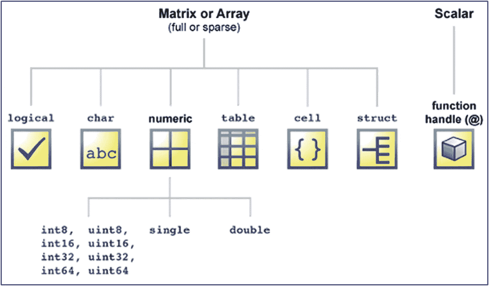

**图 1-10** MATLAB 支持的数据（数组）集类型

在演示如何生成这些数组时，所有创建的变量/数组类型将一直保留到本节结束。因此，所有变量/数组都只创建一次，并在示例中保持。请注意，在某些生成随机矩阵的示例中，我们使用了 MATLAB 的随机数生成器，每次调用时它们都会生成不同的随机数。然而，为了使变量和数组具有固定的随机值，我们必须设置随机数生成器 `rng()` 的种子值。使用固定的种子值，随机数生成器（`rand()`、`randi()`、`randn()` 等）每次被调用时都会生成固定的随机值。

### 数值数据/数组

创建和生成数值数组有多种不同的方法。例如，您可以在命令窗口中通过键入数组的所有数值直接输入，也可以使用内置函数和命令生成数值条目。数据可以从其他文件（`.mat`、`.txt`、`.dat`、`.xls`、`.jpeg`、`.au` 等）导入，或使用 MATLAB 中已有的数据或导入的数据生成。数据也可以使用特定的数学表达式和算术/矩阵运算来计算。

```
>> format short      % 以短格式显示数组的数值元素
>> A = 2; B = -3.25; C=(A+B)²; % 输入和算术运算。
>> ABC=[A, B, C] % 使用现有数据：1×3 数组
ABC =
2.0000   -3.2500    1.5625>> Drow=[1, 2, 3, -4] % 直接输入：行数组。逗号“,”是元素分隔符。
Drow =
1     2     3    -4>> Erow=[-2 -1 0 Drow] % 输入和现有数据的使用：行数组。空格是分隔符。
Erow =
-2    -1     0     1     2     3    -4>> Fcol=[1; 2; 3; -4] % 输入：列数组。元素用“;”分隔。
Fcol =

-4>> DE = [2*Drow; (3/4)*Drow] % 使用现有数据和算术运算：2×4 数组
DE =
2.0000    4.0000    6.0000   -8.0000
0.7500    1.5000    2.2500   -3.0000
```

另一种生成数值数组/数据的方法是使用 MATLAB 内置的数组生成器函数。

```
>> Aone=ones(2, 6) % 生成一个 2×6 的数组，元素均为 1
Aone =
1     1     1     1     1     1
1     1     1     1     1     1>> Bzero=zeros(5, 6) % 生成一个 5×6 的数组，元素均为 0
Bzero =
0 0 0 0 0 0
0 0 0 0 0 0
0 0 0 0 0 0
0 0 0 0 0 0
0 0 0 0 0 0
>> Ceye=eye(6) % 生成一个 6×6 的单位矩阵
Ceye =
1.00 0 0 0 0 0
0 1.00 0 0 0 0
0 0 1.00 0 0 0
0 0 0 1.00 0 0
0 0 0 0 1.00 0
0 0 0 0 0 1.00
>> Seed = 1; rng(Seed);    % 设置随机数生成器 rng() 的种子值，以便
% 生成固定的随机数
>> Dr1 =rand(9, 5)     % 生成一个 9×5 的均匀分布随机数数组
Dr1 =
0.4170    0.5388    0.1404    0.0391    0.6865
0.7203    0.4192    0.1981    0.1698    0.8346
0.0001    0.6852    0.8007    0.8781    0.0183
0.3023    0.2045    0.9683    0.0983    0.7501
0.1468    0.8781    0.3134    0.4211    0.9889
0.0923    0.0274    0.6923    0.9579    0.7482
0.1863    0.6705    0.8764    0.5332    0.2804
0.3456    0.4173    0.8946    0.6919    0.7893
0.3968    0.5587    0.0850    0.3155    0.1032>> Dr2 =randn(4, 6) % 生成一个 4×6 的正态分布随机数数组
Dr2 =
-0.1551   -1.1714   -0.5581   -2.0187   -0.4852    0.0407
0.6121   -0.6856   -0.0285    0.1997    0.5943    0.2830
-1.0443    0.9262   -1.4763    0.4259   -0.2765    0.0636
-0.3456   -1.4817    0.2589   -1.2700   -1.8576    0.4334>> Dr3 =randi([-5, 5], 5,5) % 生成一个 5×5 的整数数组，范围在 -5 ... 5 之间
>> Dr3 =randi([-5, 5], 5,5)
Dr3 =
1    -1     2    -3     1
4    -4     4     4    -4
-4     5     1    -1     5
-4    -2     3     5    -1
3     3    -2     2     1
```

请注意，我已设置随机数生成器的种子值，以便从随机数生成器 `rand()`、`randn()` 和 `randi()` 生成固定值。

此外，MATLAB 中还有许多其他内置的标准矩阵/数组生成器，例如 `pascal()`、`krylov()`、`leslie()`、`cauchy()`、`clement()`、`lesp()`、`poisson()`、`neumann()` 等。要获取这些数组生成器的帮助，请在命令窗口中键入以下内容：

```
>> help gallery
>> doc gallery
```

必须注意，所有生成的数值条目/数组都以双精度格式保存。更改这些变量的存储格式类型非常简单直接。


```
>> Dr3new=int8(Dr3) % Dr3new 以 int8 格式保存
Dr3new =
5×5 int8 矩阵
1   -1    2   -3    1
4   -4    4    4   -4
-4    5    1   -1    5
-4   -2    3    5   -1
3    3   -2    2    1
>> Dr2new=single(Dr3) % Dr2new 以单精度格式保存
Dr2new =
5×5 单精度矩阵
1    -1     2    -3     1
4    -4     4     4    -4
-4     5     1    -1     5
-4    -2     3     5    -1
3     3    -2     2     1
>> A1New=uint8(Aone) % A1new 以 uint8 格式保存
A1New =
2×6 uint8 矩阵
1   1   1   1   1   1
1   1   1   1   1   1
```

现在是时候检查在命令窗口中创建并保存在工作区中的数值条目的属性了。为此，你需要使用 `whos` 命令，如图 1-11 所示。


图 1-11

在工作区中创建的数值数据类型和变量

MATLAB 中最常用的数据类型是数值数组。因此，学习如何处理不同大小（多行多列）的数组至关重要。为了处理数组，你应该理解如何正确定位数组元素、行和列的地址。数组是按行和列读取的。例如，`>> DE(2, 1)` 表示我们取 `DE` 中位于第二行第一列的元素，即 `0.7500`。同样，`>> DE(1, 4)` 表示我们选择了 `DE` 中位于第一行第四列的元素，即 `-8`。

```
>> DE
DE =
2.0000    4.0000    6.0000   -8.0000
0.7500    1.5000    2.2500   -3.0000
>> DE(2,1)
ans =
0.7500
>> DE(1,4)
ans =
```

因此，任何数组中的元素都可以根据其行和列来确定位置。冒号运算符 `:` 用于选择所有行、所有列或全部元素。例如，`>> DE(1,:)` 选择位于 `DE` 第一行的所有元素，即 `[2, 4, 6 -8]`。同样，`DE(:, 3 )` 选择位于 `DE` 第三列的所有元素，即 `[6; 2.25]`。

```
>> DE(1,:)
ans =
2     4     6    -8
>> DE(:,3)
ans =
6.0000
2.2500
```

你可以使用冒号运算符选择矩阵或数组的所有元素。例如，`>> DE(:, :)` 等同于 `DE`。`end` 关键字使你能够选择直到最后一个元素。例如，`>> DE(1, 1:end)` 等同于 `>> DE(1, :)`。

```
>> DE(1, 1:end)
ans =
2     4     6    -8
>> DE(1, :)
ans =
2     4     6    -8
```

作为如何选择矩阵元素的另一个示例，在 `Dr3new` 中，位于第二行第一列的元素是 `0`。在任意给定数组中定位元素的另一种方法是按顺序计数。数组中的元素是按列计数的。例如，`Dr3new` 中元素编号 2 的顺序将是 `0`，`Dr3new` 中元素编号 6 是 `2`。请注意，我使用随机数生成器创建了 `Dr3new`，因此你的 `Dr3new` 会有所不同。再次，让我们看几个基于 `Dr3new` 和 `Dr1` 操作数组的示例。

```
>> Dr3new
Dr3new =
5×5 int8 矩阵
3   -5    0    1   -3
3   -5    1    5    3
5   -5    4    1   -1
2   -3   -4   -5    4
-4    4   -2    3    3
>> Dr3new(2,1)
ans =
int8
3
>> Dr3new(2)
ans =
int8
3
>> Dr3new(6)
ans =
int8
-5
>> Dr3new(2,:)=0 % 这使得第二行的所有元素变为 0
Dr3new =
5×5 int8 矩阵
3   -5    0    1   -3
0    0    0    0    0
5   -5    4    1   -1
2   -3   -4   -5    4
-4    4   -2    3    3
>> Dr3new(:,5)=1 % 这使得第五列的所有元素变为 1
Dr3new =
5×5 int8 矩阵
3   -5    0    1    1
0    0    0    0    1
5   -5    4    1    1
2   -3   -4   -5    1
-4    4   -2    3    1
>> Dr3new(end,:)=-5 % 这使得最后一行的所有元素变为-5
Dr3new =
5×5 int8 矩阵
3   -5    0    1    1
0    0    0    0    1
5   -5    4    1    1
2   -3   -4   -5    1
-5   -5   -5   -5   -5
>> Dr2new(1:5, 4:5)=2+2 % 这使得最后两列的所有元素变为 4
Dr2new =
5×5 单精度矩阵
3    -5     0     4     4
3    -5     1     4     4
5    -5     4     4     4
2    -3    -4     4     4
-4     4    -2     4     4
>> Dr1(9, :)=[] % 最后一行元素被移除
>> Dr1(9,:) =[]
Dr1 =
0.4479    0.4916    0.4142    0.1393    0.6237
0.9086    0.0534    0.0500    0.8074    0.7509
0.2936    0.5741    0.5359    0.3977    0.3489
0.2878    0.1467    0.6638    0.1654    0.2699
0.1300    0.5893    0.5149    0.9275    0.8959
0.0194    0.6998    0.9446    0.3478    0.4281
0.6788    0.1023    0.5866    0.7508    0.9648
0.2116    0.4141    0.9034    0.7260    0.6634
>> Dr1(:, 4)=[ ] % 第四列元素被移除
Dr1 =
0.4479    0.4916    0.4142    0.6237
0.9086    0.0534    0.0500    0.7509
0.2936    0.5741    0.5359    0.3489
0.2878    0.1467    0.6638    0.2699
0.1300    0.5893    0.5149    0.8959
0.0194    0.6998    0.9446    0.4281
0.6788    0.1023    0.5866    0.9648
0.2116    0.4141    0.9034    0.6634
```

此外，你还可以从现有数组的元素创建新数组：

```
>> NewDr = [Dr1(1:3,:), Dr2new(1:3, 2:4)] % 取 Dr1 和 Dr2new 的部分元素
NewDr =
3×7 单精度矩阵
第 1 到 6 列
0.4170    0.5388    0.1404    0.6865   -1.0000    2.0000
0.7203    0.4192    0.1981    0.8346   -4.0000    4.0000
0.0001    0.6852    0.8007    0.0183    5.0000    1.0000
第 7 列
4.0000
4.0000
4.0000
>> NewDr2 = [Dr3new(:,:); Dr2new(2:end, :)] % Dr3new 的全部元素和 Dr2new 的部分元素
NewDr2 =
9×5 int8 矩阵
1   -1    2   -3    1
0    0    0    0    1
-4    5    1   -1    1
-4   -2    3    5    1
-5   -5   -5   -5   -5
4   -4    4    4    4
-4    5    1    4    4
-4   -2    3    4    4
3    3   -2    4    4
```

在这些示例中请注意，冒号是管理和操作矩阵及数组元素的基本运算符之一。例如，`NewDr(2, :)` 等同于 `NewDr(2, 1:end)`。两者都选择第 2 行的所有元素。同样，`NewDr(:,:)` 等于 `NewDr(1:end, 1:end)`。两者都选择从第一个元素到最后一个元素的所有元素。

以上是在命令窗口中创建数组的几个示例。如前所述，数值数组可以从其他数据文件导入，例如 `*.dat`、`*.txt`、`*.xls`、`*.xlsx` 和 `*.csv`，以及图像文件，例如 `*.jpg/jpeg`、`*.tiff`、`*.png` 等。
```


# 非数值（NaN）

在处理不同的数据集和分析实验数据时，经常会遇到非数值（NaN）。NaN 是 `0/0` 的结果，或者将字符串作为数值数据集导入时产生的。NaN 也是 `inf - inf`（∞ - ∞）或尝试在给定范围外进行插值的结果。那么，如何处理数值数组中的 NaN 值呢？MATLAB 中有几个现成的函数/工具可以处理 NaN。让我们看看下面的例子：

```
% 假设：
A_var = [-8 10 NaN 9 4 -4 -7; 9 NaN 9 4 -10 9 0; -8 10 NaN 5 -10 -1 NaN]
A_var =
-8 10 NaN 9 4 -4 -7
9 NaN 9 4 -10 9 0
-8 10 NaN 5 -10 -1 NaN
```

如何计算给定数值数组 `A_var` 的总和？请注意，如果矩阵具有多行和多列，`sum()` 会计算矩阵各列的总和。如果矩阵是行矩阵，它会计算所有行元素的总和。

```
>> sum(A_var)
ans =
-7 NaN NaN 18 -16 4 NaN
```

有时，您可能需要从数据中移除 NaN。例如，假设您正在分析包含一些缺失点（NaN）的测量数据。您需要从数据中移除 NaN。如何解决这个问题呢？

一种解决方案是通过将 `A_var` 数组中的所有 NaN 分量替换为 `0` 来移除它们。否则，求和将不会产生数值结果。您可以使用逐元素替换的方法，一个接一个地替换所有 NaN 分量。或者，您可以通过调用所有 NaN 分量的索引，用一条命令完成替换。

```
>> A_var(5)=0 % 逐个元素更改
A_var =
-8 10 NaN 9 4 -4 -7
9 0 9 4 -10 9 0
-8 10 NaN 5 -10 -1 NaN
>> A_var([7 9 21])=[0, 0, 0] % 一次性全部替换 或 % A_var([7 9 21])=0
A_var =
-8 10 0 9 4 -4 -7
9 0 9 4 -10 9 0
-8 10 0 5 -10 -1 0
```

现在可以执行求和运算了：

```
>> sum(A_var)
ans =
-7 20 9 18 -16 4 -7
```

这个答案是正确的。这种方法非常直接，但对于非常大的数据集，会变得繁琐、耗时，甚至可能无法实现。

## 注意

您可以通过指定元素的索引（例如 `A_var([7 9 21])=[0 0 0]`），一次一个或一次性全部为数组的选定元素/分量分配新值。

这是第二种解决方案。MATLAB 内置函数 `nansum()` 处理包含 NaN 分量（元素）的数值数组的求和。

```
>> A_var = [-8 10 NaN 9 4 -4 -7; 9 NaN 9 4 -10 9 0; -8 10 NaN 5 -10 -1 NaN]
A_var =
-8 10 NaN 9 4 -4 -7
9 NaN 9 4 -10 9 0
-8 10 NaN 5 -10 -1 NaN
>> nansum(A_var)
ans =
-7 20 9 18 -16 4 -7
```

此外，还有其他几个 MATLAB 函数可以计算包含 NaN 元素的数值数据数组的平均值、标准差、协方差等。

## 注意

您可以使用以下 MATLAB 函数来计算包含 NaN 元素的数值数组的最大值、平均值、中位数、最小值、标准差和方差：`nanmax()`、`nanmean()`、`nanmedian()`、`nanmin()`、`nanstd()` 和 `nanvar()`。它们的原理是忽略给定数组中的所有 NaN 元素。

还有第三种方法，即使用逻辑索引。在处理大型数据集时，这种方法被广泛用于对数据进行求和、计算平均值、绘制数值以及执行其他算术矩阵/数组运算。

```
>> Index1=isnan(A_var) % 找出 A_var 中哪些元素是 NaN，并将其设为 1
Index1 =
3×7 logical array
   0   0   1   0   0   0   0
   0   1   0   0   0   0   0
   0   0   1   0   0   0   1
>> A_var(Index1)=0 % 将所有 NaN 元素赋值为 "0"
A_var =
-8  10   0   9   4  -4  -7
 9   0   9   4 -10   9   0
-8  10   0   5 -10  -1   0
>> sum(A_var)
ans =
-7  20   9  18 -16   4  -7
```

这里，`isnan()` 函数识别 `A_var` 中哪些元素是 NaN，哪些不是。名为 `Index` 的新逻辑数组包含 `1` 和 `0`。`1` 代表 NaN 元素，`0` 代表所有其他数值元素。

在 MATLAB 的较新版本中，还引入了另一个替代的逻辑索引函数，称为 `ismissing()`。它用于识别数值数组中的缺失数据元素。

```
Index2=ismissing(A_var) % 识别隐藏在 NaN 背后的所有缺失元素
Index2 =
3×7 logical array
   0   0   1   0   0   0   0
   0   1   0   0   0   0   0
   0   0   1   0   0   0   1
>> A_var(Index2)
ans =
   NaN
   NaN
   NaN
   NaN
>> A_var(Index2)=0
A_var =
-8  10   0   9   4  -4  -7
 9   0   9   4 -10   9   0
-8  10   0   5 -10  -1   0
```

逻辑索引方法非常高效且灵活，它也可以应用于许多其他情况。例如，您可以轻松地识别给定数据集中所有负数元素，或某个值范围内的所有元素。让我们以由 `randi()` 生成的以下数值数组（7 行 7 列）为例，筛选出所有大于 3 但小于 9 的元素，然后将它们全部等于 5。

```
>> B_var = randi([0, 25], 7) % 这创建了一个 7 行 7 列，在 [0, 25] 内均匀分布的整数数组
B_var =
25   1  17  21   1  11  12
18  13  13   2  10   0   8
13   2  25   3  13  25  24
12  21  16   4  10   4  23
 1  21  20  10  17   2   1
17  18  11  21  16   9  19
 1   3  11  20   7   5   6
>> IndexB = find(B_var>3 & B_var<9)
IndexB =
   38
   39
   40
>> B_var(IndexB)=5
B_var =
25   1  17  21   1  11  12
18  13  13   2  10   0   5
13   2  25   3  13  25  24
12  21  16   5  10   5  23
 1  21  20  10  17   2   1
17  18  11  21  16   9  19
 1   3  11  20   5   5   5
```

## 注意

逻辑索引是一个功能非常强大且高效的工具，可以根据数值数据集合/数组/矩阵中特定元素的值来识别它们，然后为其分配新值。

# 变量的字符类型

MATLAB 能够基于 ASCII/ANSI 字符符号以数值数组的形式识别字符。例如：

```
>> Ach1 = 'matlab' % 变量字符类型
Ach1 =
'matlab'
>> Bch2 = 'mathworks' % 变量字符类型
Bch2 =
'mathworks'
>> Cch3= 'matlab belongs to mathworks' % 变量字符类型
Cch3 =
'matlab belongs to mathworks'
>> Dch4 = 'www.mathworks.com' % 变量字符类型
Dch4 =
'www.mathworks.com'
```

这些是字符类型的变量，但当对这些变量执行算术运算时，它们会变成数值数组。

```
>> format short
>> Aa1 = Ach1+0
Aa1 =
   109    97   116   108    97    98
>> Ba2 = Bch2+0
Ba2 =
   109    97   116   104   119   111   114   107   115
>> Ca3 = Cch3+0
Ca3 =
  列 1 至 12
   109    97   116   108    97    98    32    98   101   108   111   110
  列 13 至 24
   103   115    32   116   111    32   109    97   116   104   119   111
  列 25 至 28
   114   107   115
>> Da4 = Dch4+0
Da4 =
  列 1 至 12
   119   119   119    46   109    97   116   104   119   111   114   107
  列 13 至 17
   115    46    99   111   109
```

因此，这些数字背后是根据 ASCII/ANSI 标准的字符。可以使用 MATLAB 函数 `char()` 获取新变量的字符表示形式。

```
>> char(Aa1)
ans =
'matlab'
>> char(Ba2)
ans =
'mathworks'
>> char(Ca3)
ans =
'matlab belongs to mathworks'
>> char(Da4)
ans =
'www.mathworks.com'
```

以下变量存在于工作区中：

```
A             1x1               8  double
A1New         2x6              12  uint8
ABC           1x3              24  double
Aa1           1x6              48  double
Ach1          1x6              12  char
Aone          2x6              96  double
B             1x1               8  double
Ba2           1x9              72  double
Bch2          1x9              18  char
Bzero         5x6             240  double
Ca3           1x27            216  double
Cch3          1x27             54  char
Ceye          6x6             288  double
DE            2x4              64  double
Da4           1x17            136  double
Dch4          1x17             34  char
Dr1           8x4             256  double
Dr2           4x6             192  double
Dr2new        5x5             100  single
Dr3           5x5             200  double
Dr3new        5x5              25  int8
Drow          1x4              32  double
Erow          1x7              56  double
Fcol          4x1              32  double
NewDr         3x7              84  single
NewDr1        3x7              84  single
NewDr2        9x5              45  int8
ans           1x17             34  char
```

请注意，这些变量将被保留并在后续章节中用于生成逻辑、表格、元胞和结构体类型的数组变量。


### 函数句柄

函数句柄是一种特殊的 MATLAB 数据类型，用于存储指向表达式或函数的链接。通过调用函数句柄，我们可以调用存储在该特定函数句柄中的表达式或函数。函数句柄是 MATLAB 中最有用的功能之一。例如，函数句柄用于各种仿真以及函数和数学表达式的计算，用于求解各种方程和问题，以及用于用户界面开发。它们还广泛应用于求解微分方程。其语法相当直观，有两种形式：

*   `函数句柄名 =@MYfunction`
*   `函数句柄名 =@(变量 1, 变量 2, ...)([表达式 1, 表达式 2, ...])`

让我们看几个如何创建函数句柄的示例：

```
F1 = @MY_function;
```

其中 `MY_function` 是一个函数文件、函数表达式或另一个函数句柄。

例如：

```
function x = MY_function(a, b, c)
% MY_function.m 是一个函数文件，用于求解关于用户输入的 a, b, c 的二次方程，并输出找到的解。
D= b²-4*a*c;
x1 = (-b+sqrt(D))/(2*a);
x2 = (-b-sqrt(D))/(2*a);
x = [x1; x2];
end
```

我们可以使用以下命令测试名为 `F1` 的函数句柄：

```
>> x = F1( 1, 2, 3)
x =
-1.0000 + 1.4142i
-1.0000 - 1.4142i
```

这里，名为 `F1` 的函数句柄调用了名为 `MY_function.m` 的函数文件，并使用用户为变量 `a`、`b` 和 `c` 指定的输入数据来执行该文件。

请注意，关于函数文件（例如 `MY_function.m`）特性的更详细说明以及如何创建它们，将在第 2 章“编程基础”中找到。

*   *f*(*x*, *a*[1], *a*[2], *a*[3]) = *a*[1]*x*² + *a*[2]*x* + *a*[3];

```
>> f =@(x,a1,a2,a3)(a1*x²+a2*x+a3)
f =
function_handle with value:
@(x,a1,a2,a3)(a1*x²+a2*x+a3)
```

此外，函数句柄可用于定义复合函数。例如，*H* = 2*e*^(sin(*x*)) 可以通过以下三种使用复合函数的方式来表示：

```
>> ff1 = @(x) sin(x); ff2 = @(ff1)exp(ff1); ff3 = @(ff2)2*ff2;    % 第 1 种方式
>> gg1 = @(x)sin(x); gg2 = @(x)exp(gg1(x)); ff3 = @(x) 2*gg2(x);   % 第 2 种方式
>> hh3=@(x)2*exp(sin(x));                                         % 第 3 种方式
```

使用函数句柄进行计算非常直接：

```
>> ff3(ff2(ff1(pi)))
ans =
2.0000
>>  gg3(pi)
ans =
2.0000e+00
>> hh3(pi)
ans =
2.0000e+00
>> x=1.3; a1=2; a2=-3; a3=13; f (x, a1, a2, a3)
ans =
12.48
>> x=1.3; a1=[2, 3]; a2=[-3, 4]; a3=[11,13]; f2(x, a1, a2, a3)
ans =
10.4800   23.2700
>> x=1:3; a1=2; a2=-3; a3=11; f2(x, a1, a2, a3)
Error using  ^  (line 51)
Incorrect dimensions for raising a matrix to a power.
Check that the matrix is square and the power is a
scalar. To perform elementwise matrix powers, use
'.^'.
Error in @(x,a1,a2,a3)(a1*x²+a2*x+a3)
```

在最后一部分中，*f*(*x*,*a*[1],*a*[2],*a*[3]) 的表达式需要针对逐元素矩阵运算进行修正。

```
>> f =@(x,a1,a2,a3)(a1*x.²+a2*x+a3)
f =
function_handle with value:
@(x,a1,a2,a3)(a1*x.²+a2*x+a3)>> x=1:3; a1=2; a2=-3; a3=11; f(x, a1, a2, a3)
ans =
10    13    20
```

函数句柄的另一种选择是 `inline` 函数。它与函数句柄类似。请注意，`inline` 函数将在 MATLAB 的未来版本中被移除。

```
>> F1=inline('a1*x²+a2*x+a3', 'a1', 'a2', 'a3', 'x')
F =
Inline function:
F (a1,a2,a3,x) = a1*x²+a2*x+a3
```

现在，可以使用变量 `x`、`a1`、`a2` 和 `a3` 的特定值来计算内联函数。

```
>> x=1.3; a1=2; a2=-3; a3=13; F(a1, a2, a3, x)
ans =
12.4800
```

使用函数句柄时，遵循变量的顺序非常重要。换句话说，在调用它们时，需要遵循输入变量值的顺序。例如：

```
>> x=1.3; a1=2; a2=-3; a3=13;
>> f =@(x,a1,a2,a3)(a1*x.²+a2*x+a3);
>> f(x, a1, a2, a3)
ans =
12.4800
>> f( a1, a2, a3, x)
ans =
15.3000
```

函数句柄可以接受不同的预定义输入变量：

```
>> f =@(x,a1,a2,a3)(a1*x.²+a2*x+a3);
>> y=1.3; b1=2; c2=-3; d3=13;
>> f(y,b1,c2,d3)
ans =
12.4800
```

图 1-12 显示了本节中创建的、位于工作区中的变量和函数句柄列表。

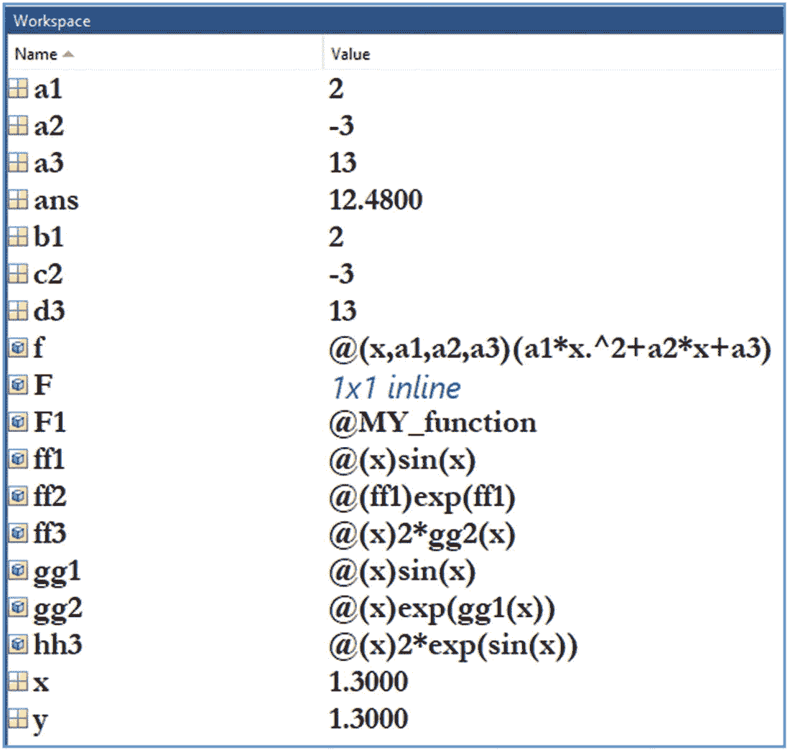

图 1-12：位于工作区中的变量

关于函数句柄更广泛的应用和用途，将在本书的其他章节中讨论——第 2 章“编程基础”和第 8 章“常微分方程”。


### 逻辑数组

逻辑数组对于编程和布尔运算非常重要。其值只有 0 和 1。0 表示语句或条件不成立，1 表示语句成立。在 MATLAB 中，有多种生成逻辑数组的方法。你可以对数值数组应用比较运算，或验证数组，或定义其类型。以下布尔逻辑数组基于前面章节中创建的现有变量。

```
>>A = 2; B = -3.25; C=(A+B)²; ABC=[A, B, C];
>> isnumeric(A)
ans =
logical

>> Ach1 = 'matlab';
>> isstr(Ach1)
ans =
logical

>> ABC_logic=ABC>=2
ABC_logic =
1×3 logical array
1 0 0
>> Seed = 1; rng(Seed);   % 设置随机数生成器，以生成固定数值。
>> Dr1 = rand(4, 5)
>> Dr1 = rand(4, 5)
Dr1 =
0.0500    0.9446    0.1393    0.9275    0.8833
0.5359    0.5866    0.8074    0.3478    0.6237
0.6638    0.9034    0.3977    0.7508    0.7509
0.5149    0.1375    0.1654    0.7260    0.3489
>> Dr1Logic=Dr1>0.5 & Dr1> Dr1Logic=Dr1>0.5 & Dr1<=0.71
Dr1Logic =
4×5 logical array
0   0   0   0   0
1   1   0   0   1
1   0   0   0   0
1   0   0   0   0
```

请注意，我们设置了随机数生成器 `rng()`的种子值，以便通过均匀随机数生成器 `rand()`生成固定元素值。

你可以使用计算得到的逻辑数组来索引数组，并找出哪些值满足设定的条件，哪些不满足。例如，在前面的例子中，`ABC_logic`指出 `ABC` 的第一个元素满足设定条件（大于等于 2）。类似地，`Dr1Logic` 数组指出第 2 行中的三个元素和第 5 行中的一个元素大于 0.5 且小于等于 0.71。现在你可以通过索引操作来确定哪些元素满足设定条件。

```
>> Index=find(Dr1>0.5 & Dr1> Index=find(Dr1>0.5 & Dr1> Dr1(Index)                % 满足设定条件的元素
ans =
0.5359
0.6638
0.5149
0.5866
0.6237
```

寻找这些真值的另一种方法如下：

```
>> Dr1Logic.*Dr1
ans =
0         0         0         0         0
0.5359    0.5866         0         0    0.6237
0.6638         0         0         0         0
0.5149         0         0         0         0
```

再举一个例子，让我们在随机整数生成器生成的数组中查找 "0" 元素，以便在 [-2 2] 范围内生成整数，填充一个 5×5 的方阵：

```
>> Seed = 1; rng(Seed);   % 设置随机数生成器，以生成固定数值。
>> Hr=randi([-2, 2], 5)
Hr =
0    -2     0     1     2
1    -2     1     0     2
-2    -1    -1     0    -1
-1    -1     2    -2     1
-2     0    -2    -2     2>> Ind=(~Hr)    % 定位 Hr 中等于 "0" 的元素
Ind =
5×5 logical array
1   0   1   0   0
0   0   0   1   0
0   0   0   1   0
0   0   0   0   0
0   1   0   0   0
```

在本节中，我们生成了数值矩阵、逻辑矩阵和字符串，如图 1-13 所示。


图 1-13: 工作区中的变量

关于逻辑数组和索引的更多用法/示例将在本书的其他章节讨论。

### 表格数组

表格数组是 MATLAB 中较新引入的工具，因此在较旧版本的 MATLAB 中无法生成表格数组。表格数组对于准备报告以及显示/呈现从多列多行数组（每一列或行代表特定变量）中获得的仿真/分析结果特别有用。它们用于将异构数据和元数据以表格数据格式收集到单个容器中。表格数组可以容纳不同类型、大小、单位等的变量。它们通常用于存储实验数据，其中行代表不同的观测值，列代表不同的测量变量。通过为列和行分别指定名称，它们能以信息量更丰富、更便于制表的格式显示数组。让我们通过使用前面章节中创建的现有变量，来看几个使用 `table()` 命令创建表格数组的例子。

```
>> A1new = [1 2 3; 3 4 5; 7 8 9];
>> A1Tab=table(A1new)
A1Tab =
3×1 table
A1new
___________
1    2    3
3    4    5
7    8    9>> B1new = A1new/5;
>> B1Tab=table(B1new)
B1Tab =
3×1 table
B1new
_________________
0.2    0.4    0.6
0.6    0.8      1
1.4    1.6    1.8
```

在这些情况下，表格数组 `A1Tab` 和 `B1tab` 分别从 `A1New` 和 `B1New` 创建为列表格。也可以使用 `array2table()`、`cell2table()` 和 `struct2table()` 命令从现有数组（数组、元胞数组和结构体）中获取/创建表格：

```
>> A1Tab2=array2table(A1New) % 未指定列名
>> A1Tab2=array2table(A1new)
A1Tab2 =
3×3 table
A1new1    A1new2    A1new3
______    ______    ______
1         2         3
3         4         5
7         8         9   >> >> Ach1Tab=array2table(A1new, 'variablenames',{'a','b','c'})
Ach1Tab =
3×3 table
a    b    c
_    _    _
1    2    3
3    4    5
7    8    9 >> C1new = [A1new, B1new]
C1new =
1.0000    2.0000    3.0000    0.2000    0.4000    0.6000
3.0000    4.0000    5.0000    0.6000    0.8000    1.0000
7.0000    8.0000    9.0000    1.4000    1.6000    1.8000
>> Dr1Tab=array2table(C1new, 'variablenames', {'v1', 'v2', 'v3', 'v4', 'v5', 'v6'})
Dr1Tab =
3×6 table
v1    v2    v3    v4     v5     v6
__    __    __    ___    ___    ___
1     2     3     0.2    0.4    0.6
3     4     5     0.6    0.8      1
7     8     9     1.4    1.6    1.8
```

也可以分别使用 `tabel2array()` 和 `table2cell()` 命令将表格数组转换为数组和元胞数组。理解和运用表格数组不仅对你准备报告大有裨益，而且在以下场景中也极有帮助：使用导入向导（见图 1-n）导入数据，以及将来自外部文件（例如 `.txt`、`.xls`、`.dat` 等）的各种数据集处理到 MATLAB 工作区中。


### 元胞数组

元胞数组非常有用，它可以在一个元胞类型变量的不同元胞中容纳各种类型的数组（数值型、字符型、逻辑型、表格型和函数句柄），同时保持每个变量的所有属性不变。它们可能非常便于在一个变量中携带或传递各种数据集。元胞数组包含带索引的数据容器——这些元胞可以容纳文本列表、字符串、文本与数值数据的组合、数值数组、函数句柄、结构数组以及表格。元胞数组最基本的特性之一是，在指定元胞地址时必须使用花括号。元胞数组另一个重要特性是，MATLAB 读取的数据将以元胞数组模式呈现。

让我们看几个例子，这些例子使用不同类型的数组创建元胞数组，并生成新的元胞数组。

```
>> Acell = cell(5,5) % 创建一个 5×5 的空元胞数组
>> Acell = cell(3,4)
Acell =
3×4 元胞数组
{0×0 double}    {0×0 double}    {0×0 double}    {0×0 double}
{0×0 double}    {0×0 double}    {0×0 double}    {0×0 double}
{0×0 double}    {0×0 double}    {0×0 double}    {0×0 double} % 元胞数组 Acell 中的每个元胞将被填入数组
>> A0 = 13; A1new = [1 2 3; 3 4 5; 7 8 9];
>> Acell{1,1}=A0  % 元胞 (1, 1) 被填入 A0
Acell =
3×4 元胞数组
{[      13]}    {0×0 double}    {0×0 double}    {0×0 double}
{0×0 double}    {0×0 double}    {0×0 double}    {0×0 double}
{0×0 double}    {0×0 double}    {0×0 double}    {0×0 double}
>> Acell{1,2}=A1new  % 元胞 (1, 2) 被填入 A1new
Acell =
3×4 元胞数组
{[      13]}    {3×3 double}    {0×0 double}    {0×0 double}
{0×0 double}    {0×0 double}    {0×0 double}    {0×0 double}
{0×0 double}    {0×0 double}    {0×0 double}    {0×0 double}
>> Ach1Tab=array2table(A1new, 'variablenames',{'a','b','c'});
>> Acell{1,3}=Ach1Tab  % 元胞 (1, 3) 被填入 Ach1Tab
Acell =
3×4 元胞数组
{[      13]}    {3×3 double}    {3×3 table }    {0×0 double}
{0×0 double}    {0×0 double}    {0×0 double}    {0×0 double}
{0×0 double}    {0×0 double}    {0×0 double}    {0×0 double}
>> C1 = 'matlab';
>> Acell{1,4}=C1  % 元胞 (1, 4) 被填入 C1
Acell =
3×4 元胞数组
{[      13]}    {3×3 double}    {3×3 table }    {'matlab'  }
{0×0 double}    {0×0 double}    {0×0 double}    {0×0 double}
{0×0 double}    {0×0 double}    {0×0 double}    {0×0 double}
>> D1 = A1new>3 & A1new> Acell{2,2}=D1  % 元胞 (2, 2) 被填入 D1 逻辑数组
Acell =
3×4 元胞数组
{[      13]}    {3×3 double }    {3×3 table }    {'matlab'  }
{0×0 double}    {3×3 logical}    {0×0 double}    {0×0 double}
{0×0 double}    {0×0 double }    {0×0 double}    {0×0 double}
>> f=@(x, a1, a2, a3)(a1*x²+a2*x+a3);
>> Acell{2,3}=f  % 元胞 (2, 3) 被填入 f 函数句柄
Acell =
3×4 元胞数组
{[      13]}    {3×3 double }    {3×3 table      }    {'matlab'  }
{0×0 double}    {3×3 logical}    {function_handle}    {0×0 double}
{0×0 double}    {0×0 double }    {0×0 double     }    {0×0 double}
>> Acell{3,1}= 'This is a cell array' % 向元胞数组输入字符串：元胞 (3, 1)
Acell =
3×4 元胞数组
{[                13]}    {3×3 double }    {3×3 table      }       {'matlab'  }
{0×0 double          }    {3×3 logical}    {function_handle}       {0×0 double}
{'This is a cell ...'}    {0×0 double }    {0×0 double     }       {0×0 double}
>> Acell{3,2}=rand(5,6) % 向元胞数组输入数值数组：元胞 (3,2)
Acell =
3×4 元胞数组
{[               13]}    {3×3 double }    {3×3 table      }    {'matlab'  }
{0×0 double         }    {3×3 logical}    {function_handle}    {0×0 double}
{'This is a cell ...'}    {5×6 double }    {0×0 double     }    {0×0 double}
```

要访问和查看元胞数组的内容，请使用以下命令。

```
>> Acell{1,1}
ans =
13>> Acell{1,4}
ans =
'matlab'
>> Acell{2,3}
ans =
function_handle with value:
@(x,a1,a2,a3)(a1*x²+a2*x+a3)>> Acell{7}
ans =
3×3 表格
a    b    c
_    _    _
1    2    3
3    4    5
7    8    9
>> Acell{8}
ans =
function_handle with value:
@(x,a1,a2,a3)(a1*x²+a2*x+a3)
```

在工作区中双击元胞变量名，可以查看元胞的内容，如图 1-14 所示。

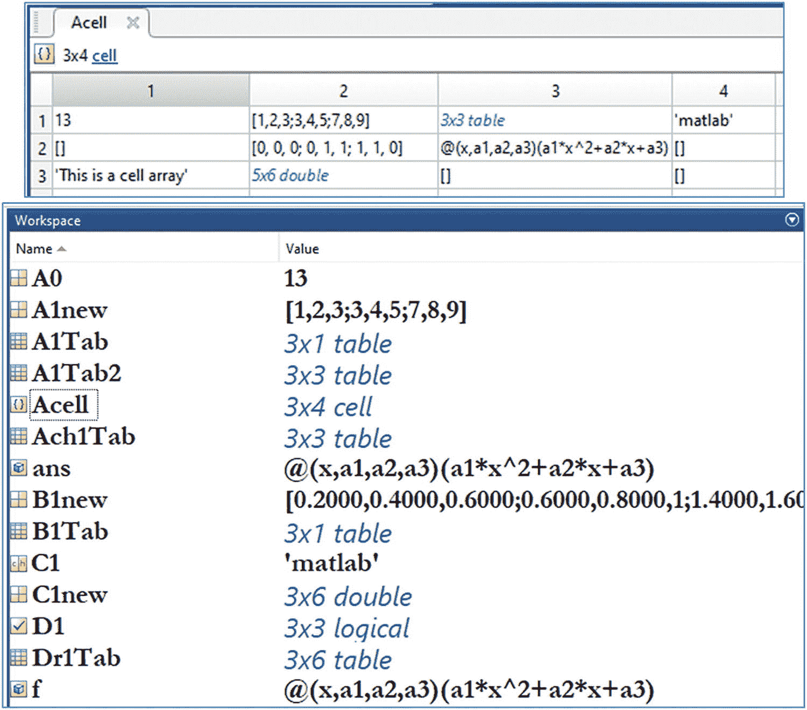

**图 1-14** 工作区中的变量及 `Acell` 元胞数组的内容

你可以通过双击每个元胞并输入新值来更改元胞数组的内容。


# 结构数组

结构数组可以容纳所有先前创建的数组和条目（变量）类型，即所有类型的数值、逻辑值、字符、表格、元胞数组和函数句柄。它们不仅可以存储不同类型的数据，还可以存储不同大小的数据。结构数组的一个重要方面是它们适合代码生成。此外，它们在编程、数据处理、数据采集以及从 Simulink 模型读取数据中非常有用。

结构数组将数据存储在不同的字段或字段名称中，你可以通过名称来访问这些字段。例如：

```
% 人员 1：姓名 - SE；出生日期 - 1982 年 6 月 6 日；职业 - 教授
WHO(1).Name = 'SE';
WHO(1).DOB = '06.06.1982';
WHO(1).Profession = '教授';
% 人员 2：姓名 - NE；出生日期 - 1992 年 12 月 12 日；职业 - 设计师
WHO(2).Name = 'NE';
WHO(2).DOB = '12.12.1982';
WHO(2).Profession = '设计师';
```

结构变量 `WHO` 包含两个人的信息。数据包含他们的姓名、出生日期和职业。

```
>>WHO =
1×2 struct array with fields:
    Name
    DOB
    Profession
>> WHO(1)
ans =
  struct with fields:
    Name: 'SE'
    DOB: '06.06.1982'
    Profession: '教授'
>> WHO(2)
ans =
  struct with fields:
    Name: 'NE'
    DOB: '12.12.1982'
    Profession: '设计师'
```

请注意，我们只保存了一个结构数组形式的变量。如果你想要访问所创建结构的特定字段，可以调用该字段名称以及结构名称：

```
>> WHO(1).Name   % 访问人员 1 的姓名字段
ans =
'SE'
>> WHO(1).Profession   % 访问人员 1 的职业字段
ans =
'教授'
>> WHO(2).DOB    % 访问人员 2 的出生日期字段
ans =
'12.12.1982'
```

除了这种创建结构数组的方法之外，还有几种其他设置或创建它们的方法。让我们看一些示例。另一种方法是使用 `struct()` 命令创建一个空结构。空结构将使用 `struct('FieldName', VALUE)` 命令语法填充变量。请注意，字段名称（变量名称）不能包含空格或符号，但下划线符号 `_` 除外。

```
>>  Astr1 = struct()
Astr1 =
  struct with no fields.
>> % 现在我们可以在创建的空结构 Astr1 内部赋值/设置值和数据字段。
>> a = 2.1; A = [1, 2; 3, 4]; B = A> D = 'mathworks.com';
>> F = table(magic(3));
>>  Astr1 = struct('Number', a, 'Matrix', A, 'Logic', B, 'F_Handle', f, 'Cell', C, 'Char', D, 'Table', F)
Astr1 =
  1×2 struct array with fields:
    Number
    Matrix
    Logic
    F_Handle
    Cell
    Char
    Table
```

创建结构数组的另一种方法是单独指定它们的字段，如开头创建结构变量 `WHO` 的示例所示。

```
>> Bstr.Number = a; Bstr.Matrix = A; Bstr.Logic = B; Bstr.F_Handle=f; Bstr.Cell=C; Bstr.Char = D;
>> Bstr.Table = F;
>> Bstr
Bstr =
  struct with fields:
    Number: 2.1000e+00
    Matrix: [2×2 double]
    Logic: [2×2 logical]
    F_Handle: @(x)(a*x²+x-a)
    Cell: {[3×3 double]  'matlab'}
    Char: 'mathworks.com'
    Table: [3×1 table]
```

现在我们可以比较我们创建结构变量 `Astr` 和 `Bstr` 的两种不同方式。创建结构数组的另一种方法是转换；换句话说，你可以使用 `cell2struct()` 和 `table2struct()` 命令将现有的元胞类型变量或表格类型变量转换为结构类型变量。

```
>> % 元胞变量 C 包含：矩阵 C 和字符串 'matlab'
>> C{1} =rand(3); C{2} = 'matlab';
>> F_Names = {'Matrix', 'Char'};    % 字段名称/标题
>> Cstr = cell2struct(C, Headers, 2) % 2 表示嵌入的两个元胞
Cstr =
  struct with fields:
    Matrix: [3×3 double]
    Char: 'matlab'
```

现在让我们看看如何使用 `table2struct()` 命令将表格数组转换为结构数组。

```
>> F = table(magic(3));
>> Dstr = table2struct(F)
Dstr =
  3×1 struct array with fields:
    Var1
```

图 1-15 显示了工作区中保存的变量列表以及 `Astr` 和 `Bstr` 结构数组的内容。

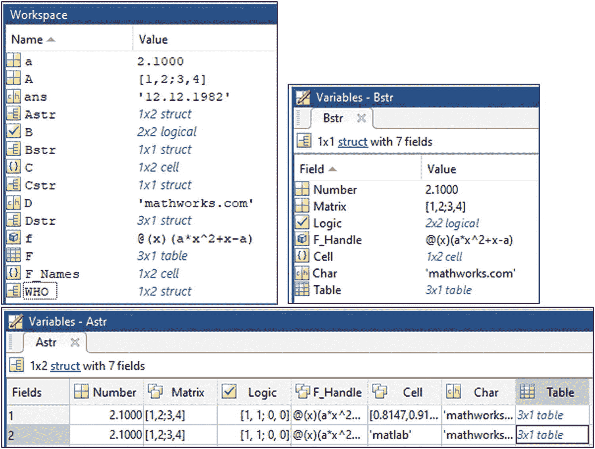

**图 1-15**

创建的变量以及 `Astr` 和 `Bstr` 结构数组

本节通过示例演示了如何创建七种不同类型的变量（数组）——数值数组（标量和数组类型变量）、字符串、逻辑数组、表格数组、元胞数组和结构数组以及函数句柄。你可以使用 `clear` 或 `clearvars` 命令，或使用鼠标右键选项和“删除”从工作区中移除任何已创建的变量。在命令窗口中，你可以使用以下命令从工作区中清除变量。

```
>> clearvars a A  B% 移除变量 a, A, B
>> clear ans C D % 移除变量 ans, C, D
```

根据工作区中变量的属性（参见图 1-12），你可以确定变量类型（标量、数组、逻辑值、表格、元胞、结构、字符或函数句柄）及其存储类型（`double`、`single`、`uint8` 或 `int8`）。此外，图 1-15 中显示的表示每个变量的符号展示了图 1-9 中所示的一些 MATLAB 支持的数据（数组）集。

必须注意的是，正如你在一些示例中看到的，许多这些数组可以从一种类型转换为另一种类型。例如，可以通过 `cell2table()` 函数将元胞数组转换为表格数组，类似地，可以通过 `struct2table()` 将结构数组转换为表格数组。表格数组可以分别通过 `table2cell()` 和 `table2struct()` 转换为元胞数组和表格数组。

# 复数

两个字母——`i` 和 `j` 或 `1i` 和 `1j`——被保留用于表示虚数。因此，建议不要使用这些字母来指定变量名称。赋值的另一种方法是将它们乘以 `sqrt(-1)`。

# 精度

MATLAB 的精度并非绝对。

例如：

```
>> sin(pi)
ans =
   1.2246e-016
```

在 MATLAB 中，`sin(π)` 不等于 0。这是因为数字 `π` 在 MATLAB 中由双精度数表示。我们可以通过执行勾股定理 `1 = sin²(t) + cos²(t)` 的计算来演示精度问题。

```
t=0:pi/50:2*pi; F=1-(sin(t).²+cos(t).²); plot(t, F)
```

在这些表达式中，`t` 是一个包含一行元素的时间向量，例如 `[0, π/50, ... 2π]`。`F` 的某些值为零，某些值非零，尽管它们是非常小的数字。其原因是所有三角函数，包括指数函数和对数函数，都由一个仅包含自变量（在此示例中为 `t`）奇次幂的 13 次多项式近似。例如，`sin(t) ≈ t − c[1]t³ + c[2]t⁵ + ... + c[6]t¹³ = p(t)`。所有这些函数的计算算法都是基于 `fdlibm` 实现的，`fdlibm` 是由 Sun Microsystems 的 K. C. Ng 等人开发的“可自由分发的数学库”（有关更多信息，请参阅 [`www.netlib.org/fdlibm`](http://www.netlib.org/fdlibm)）。

必须注意的是，MATLAB 的精度级别取决于用于保存数据的数据存储类型。例如：

```
>> int8(128)*-5
ans =

```

分配的数据存储 `int8` 最多可以容纳 `2⁸ − 1` 个整数。所有 MATLAB 支持的数据存储类型如图 1-15 所示。


# M 文件与 MLX 文件编辑器

在本书中，代码、脚本和程序这些术语可互换使用，均指代扩展名为 `.m` 的 M 文件和扩展名为 `.mlx` 的 MLX 文件，包括函数文件和可执行文件。由于扩展名，这些文件被称为 M 文件和 MLX 文件。在前面的示例中，所有操作和工作均在命令窗口中完成。然而，对于编程和编写、编辑与调试而言，M 文件和 MLX 文件编辑器将大有裨益，因为它们提供了有用的工具和提示，有助于编写快速且更高效的代码/脚本/程序。

M 文件和 MLX 文件的整体功能相似，但有一个重要区别。MLX 文件编辑器窗口可以在 MLX 编辑器窗口内显示计算/仿真的输出，并在其左侧输出窗口中指示最常见的命令语法相关错误。M 文件编辑器则在 M 文件执行后，在命令窗口中显示所有错误。此外，MLX 文件编辑器可以通过公式编辑器交互式地显示所有插入的公式；插入的图像和超链接文本直接显示在同一窗口中。两个文件的输出都将显示在工作区中。这两个文件可以互换使用。下面我们开始审视 M 文件和 MLX 文件编辑器的窗口和工具。

## M 文件编辑器

M 文件编辑器窗口的菜单和 GUI 工具分为三个选项卡：编辑器、发布和视图，分别如图 1-16、1-17 和 1-18 所示。注意，有三个主要菜单子分组——主页、绘图和应用程序——属于主 MATLAB 窗口，已在前面章节中展示。

在 M 文件编辑器的主工具菜单（见图 1-16）中，有五个子部分：文件、导航、编辑、断点和运行。每个子部分中的所有工具都非常直观。例如，文件子部分拥有用于创建新文件或打开现有文件、保存当前文件、查找 M 文件、比较同名 M 文件的不同版本以及打印当前 M 文件的 GUI 工具。类似地，导航子部分工具帮助用户在当前文件中移动光标、查找关键字，并在必要时将其替换为其他词语。编辑子部分工具允许你在当前文件中插入新节、添加或删除注释行、包装注释以及添加缩进以使文件更具可读性。断点子部分使你能够调试/编辑当前 M 文件代码。最后，运行子部分拥有用于逐步运行当前 M 文件的不同单元、运行当前 M 文件并测量文件不同部分评估时间的 GUI 工具。值得注意的是，在编写 M 文件时，主要使用编辑器窗口工具。


图 1-16
M 文件编辑器的主工具菜单

图 1-17 所示的发布工具用于生成不同文件格式的报告文件，例如 HTML、DOC、PPT 等。发布窗口的 GUI 工具非常直观，与许多文档编辑软件应用程序相似。


图 1-17
M 文件编辑器的发布工具菜单

图 1-18 所示的视图工具用于在一个窗口区域内显示多个 M 文件和 MLX 文件（文档）窗口。你可以通过使用名为平铺、文档选项卡或拆分文档的 GUI 工具，并排或上下拆分视图。显示子部分中的勾选选项非常方便，可以在编辑 M 文件时显示数据提示、显示行号并高亮当前行。


图 1-18
M 文件编辑器的视图工具菜单

## MLX 文件编辑器

MLX 文件（实时编辑器）编辑器选项卡（如图 1-19、1-20 和 1-21 所示）包含许多 M 文件编辑器的工具以及若干其他不同的 GUI 工具。实时编辑器选项卡（见图 1-19）有一个与 M 文件编辑器不同的主要子部分，称为文本，它包含了 M 文件编辑器中发布工具的大部分功能。


图 1-19
MLX 文件编辑器的主工具菜单

此外，MLX 编辑器的插入选项卡（见图 1-20）拥有一些非常方便的工具，可以直接在 MLX 文件中编写/编辑公式，并插入带注释的子节。你可以在当前 MLX 文件内容中插入控制 GUI 工具，例如滑块和下拉框。


图 1-20
MLX 文件编辑器的插入菜单

MLX 编辑器的视图窗口（如图 1-21 所示）拥有一些与 M 文件编辑器视图相似的工具，以及其他一些工具，例如文档选项卡、显示、输出和布局，通过这些工具，用户可以显示脚本（代码）行号（不包括注释行）、数据提示、全屏视图、清理输出以及显示或隐藏输出。


图 1-21
MLX 文件编辑器的视图工具菜单

M 文件和 MLX 文件可以通过多种不同方式创建——使用 GUI 按钮  或  ，或在命令窗口中键入命令。

为了演示 M 文件编辑器和 MLX 文件编辑器的某些突出工具和选项，我们来看下面这个示例，通过勾股定理来演示 MATLAB 的精度并非绝对。

示例：

首先，这个简单示例的解决方案脚本将在 M 文件编辑器中创建，并发布结果。随后，所有仿真都将在 MLX 编辑器中进行，以展示两个编辑器的相似和不同之处。

解决此练习的算法由以下六个步骤组成。

1.  插入一些描述给定问题陈述的注释。

2.  定义输入变量：。

3.  执行计算：`F(α) = 1 − (sin²α + cos²α)`。

4.  定义对于输入变量 `α` 的哪些值，函数 `F(α)` 的值等于 0。

5.  绘制仿真结果：`α` 与 `F(α)` 的关系图。

6.  发布所有获得的结果，包括整个脚本。

这是直接在 M 文件编辑器中编写的脚本。


```matlab
% 第 1 步：问题陈述
% MATLAB 的精度并非绝对。
% 勾股定理：F = 1 - (sin² (alpha) + cos²(alpha));
% 输入变量：alpha = -0.5*pi ... 0.5*pi
% 第 2 步：定义输入变量
alpha = -pi/2:pi/100:pi/2;
% 第 3 步：执行计算
F = 1-(sin(alpha).²+cos(alpha).²);
% 第 4 步：定义 F(alpha) = 0 所对应的 alpha 值
Findex=find(F==0);
F0=F(Findex);
% 第 5 步：绘制仿真结果：alpha 与 F(alpha)的关系图
plot(alpha, F, 'b-', alpha(Findex), F0, 'ro'),
legend('\alpha vs F(\alpha)', 'F(\alpha) = 0')
title('基于勾股定理的 MATLAB 精度仿真'), grid on
xlabel('\alpha'), ylabel('F(\alpha) = 1-(sin(\alpha)²+cos(\alpha)²)')
% 第 6 步：发布包括整个脚本在内的所有获得结果
```

请注意，在本脚本中，我们使用 `%` 插入注释（非可执行信息），并使用 `\` 插入和显示希腊字母。

### % 注释

注释不可执行，旨在为用户提供额外信息。`%` 符号用于在 M 文件和 MLX 文件中放置注释、备注或任何附加信息。注释可以单独成行，也可以放在命令语法之后，只要以 `%` 开头即可。使用双百分号（`%%`）后跟一个空格，会自动使后续的注释文本变为粗体。此外，在一行开头插入 `%%` 并留一个空格后，会在脚本中创建一个单元格模式。我们将在第 2 章中详细讨论单元格模式的选项和优势。请注意，`%` 符号还有其他几个功能。它可用于格式化写入、显示、读取时的规格说明，我们将在第 2 章中讨论。

以下内容已使用 PUBLISH 工具进行了轻微编辑，例如使用粗体（ 表示步骤 1, 2, ..6）位于“插入内联标记”和“发布”（PUBLISH）下；参见图 1-17。请注意，要使选中的注释行变为粗体，您需要先选中该行，然后按下  按钮。另请注意，在本脚本中，我们使用了 LaTEX 命令来插入希腊字母（`α`、`π`）和方程 `F = 1 − (sin²α+cos² α)`。

M/MLX 编辑器兼容大多数常见的 LaTEX 数学模式命令。兼容 LaTEX 的数学命令和符号可用于插入绘图标题、坐标轴标签、图形注释等，这些内容将在后续章节（编程、绘图和常微分方程）的示例中讨论。例如，要插入表达式：`x² + y² = R²`，请输入：`x²+y²=R²`。或者，要插入 `α`、`β`、`Ω`、`Ψ`，请键入 `\alpha`、`\beta`、`\Omega`、`\Psi`。此外，要插入带有希腊字母的方程，符号需要以 `$$` 开头并以 `$` 结尾（参见第 1 步：问题陈述和第 5 步：绘制...）。如需更多关于在 LaTEX 数学模式下编写各种数学表达式和符号的信息和帮助，请在命令窗口中输入：`>> doc latex`

另请参见[6]。请注意，开头的 `%%` 会初始化第 1 步中兼容 LaTEX 的数学命令的自动识别。

```matlab
%%
%% *% 第 1 步：问题陈述*
% MATLAB 的精度并非绝对。
% 勾股定理：F = 1 - (sin² $$\alpha$ + cos² $$\alpha$ );
% 输入变量：$$\alpha$ = -0.5* $$\pi$ ...0.5* $$\pi$
%% *% 第 2 步：定义输入变量*
alpha = -pi/2:pi/100:pi/2;
%% *% 第 3 步：执行计算*
F = 1-(sin(alpha).²+cos(alpha).²);
%% *% 第 4 步：定义$$\alpha$ 为何值时 $$F(\alpha) =0$*
Findex=find(F==0); F0=F(Findex);
%% *% 第 5 步：绘制仿真结果：$$\alpha$ 与 $$F(\alpha)$ 的关系图*
plot(alpha, F, 'b-', alpha(Findex), F0, 'ro'),
legend('\alpha vs F(\alpha)', 'F(\alpha) = 0')
title('勾股定理'), grid on
xlabel('\alpha'), ylabel('F(\alpha) = 1-(sin²(\alpha)+cos²(\alpha))')
%% *%第 6 步：发布包括整个脚本在内的所有获得结果*
```

在编辑器中编写脚本后，使用有效的文件名保存 M 文件（例如 `P1.m`）。现在，要将其发布为 HTML 格式，请在 PUBLISH 选项卡下按下“发布” 按钮（参见图 1-17）。按下该按钮后，脚本会自动执行，并生成其 HTML 格式的报告，如图 1-19 所示。22 3

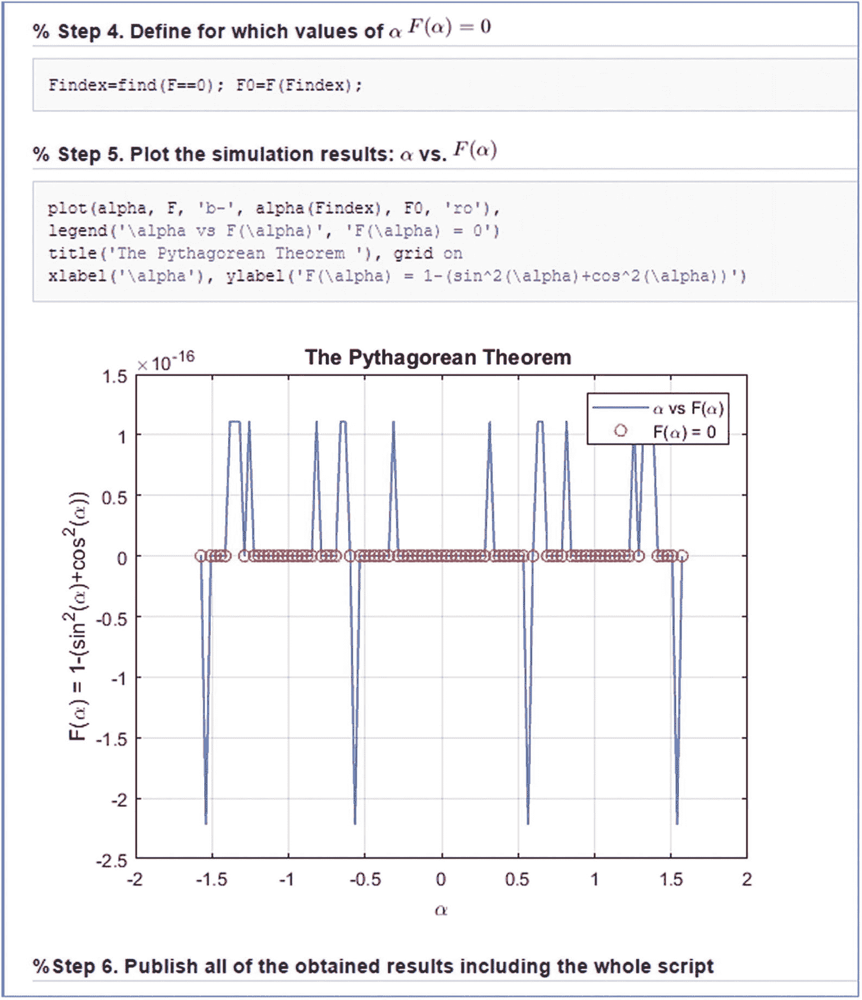

**图 1-23**


# `P1.m` 的 MATLAB 生成报告

这是名为 `P1.m` 的 M 文件的 MATLAB 生成的 HTML 格式报告。


*图 1-22：名为 `P1.m` 的 M 文件的 MATLAB 生成的 HTML 格式报告*

请注意，粗体行（图 1-19），即前面带有 `%%` 的单元模式起始行，已被 M 文件编辑器自动识别，并放入目录中并添加了超链接，例如 `% 步骤 1 ... 步骤 2 ... 步骤 6`。

现在，让我们用 MLX 文件编辑器尝试同样的过程。请注意，注释是使用 MLX 编辑器的 TEXT 选项卡工具（如图 1-19 所示）进行编辑的。脚本的各部分通过使用  以文本（注释）形式输入。步骤 1 … 步骤 2 … 步骤 3… 步骤 6 这些行通过使用  变为粗体。

```
步骤 1. 问题陈述
MATLAB 的精度并非绝对。
勾股定理：F = 1 - (sin² (alpha) + cos²(alpha));
输入变量：alpha = -0.5*pi ... 0.5*pi
步骤 2. 定义输入变量
步骤 3. 执行计算
步骤 4. 定义 F(alpha) = 0 的 alpha 值
步骤 5. 绘制仿真结果图：alpha vs. F(alpha)
步骤 6. 发布所有获得的结果，包括整个脚本
```

请注意，还有一种使选定行变为粗体的替代方法。那就是使用 `%%` 后跟一个空格，就像在 M 文件编辑器中一样。在这种情况下，此类编辑会自动被检测为脚本后续部分的标题。如果您在 MLX 编辑器的代码部分输入以下内容：

```
%% 步骤 2. 定义输入变量。
```

然后按回车键，MATLAB 会自动创建此粗体文本标题：

**步骤 2\. 定义输入变量。**

现在，在步骤 2、步骤 3、步骤 5 和步骤 6 之间，通过将光标放在所需行上并按 CODE 子选项卡中的  按钮（参见图 1-19）来插入以下可执行命令。最后，获得完整的代码。

```
步骤 1. 问题陈述
MATLAB 的精度并非绝对。
勾股定理：F = 1 - (sin² (alpha) + cos²(alpha));
输入变量：alpha = -0.5*pi ... 0.5*pi
步骤 2. 定义输入变量
alpha = -pi/2:pi/100:pi/2;
步骤 3. 执行计算
F = 1-(sin(alpha).²+cos(alpha).²);
步骤 4. 定义 F(alpha) = 0 的 alpha 值
Findex=find(F==0);F0=F(Findex);
步骤 5. 绘制仿真结果图：alpha vs. F(alpha)
plot(alpha, F, 'b-', alpha(Findex), F0, 'ro'),
legend('\alpha vs F(\alpha)', 'F(\alpha) = 0')
title('The Pythagorean Theorem'), grid on
xlabel('\alpha'), ylabel('F(\alpha) = 1-(sin(alpha)²+cos(alpha)²)')
步骤 6. 发布所有获得的结果，包括整个脚本
```

将该文件保存为 `*.mlx` 文件（例如，`P2.mlx`）。使用 INSERT 子选项卡下的等式工具（如图 1-20 所示）并通过使用 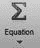 插入数学表达式。当您按下  按钮时，将打开整个范围的符号、结构和矩阵，如下图所示。


现在，将光标移到要插入数学表达式的位置，并通过选择必要的符号或使用 LaTEX 表达式来插入符号。例如，`\alpha` 给出 α。输入勾股定理公式和输入变量范围，然后完成脚本。

```
步骤 1. 问题陈述
MATLAB 的精度并非绝对
勾股定理：F = 1 − (sin2α + cos2α)
输入变量：α =  − 0.5α...0.5α
步骤 2. 定义输入变量
alpha = -pi/2:pi/100:pi/2;
步骤 3. 执行计算
F = 1-(sin(alpha).²+cos(alpha).²);
步骤 4. 定义 F(α) = 0 的 α 值
Findex=find(F==0);
F0=F(Findex);
步骤 5. 绘制仿真结果图：α vs. F(α)
plot(alpha, F, 'b-', alpha(Findex), F0, 'ro'),
legend('\alpha vs F(\alpha)', 'F(\alpha) = 0')
title('The Pythagorean Theorem'), grid on
xlabel('\alpha'), ylabel('F(\alpha) = 1-(sin²(alpha) +cos²(alpha))')
步骤 6. 发布所有获得的结果，包括整个脚本
```

执行已保存的 MLX 文件（通过按图 1-19 所示的“运行”按钮）后，您将在 LAYOUT 中以“内联输出”的方式获得脚本输出。参见图 1-24 和图 1-25。

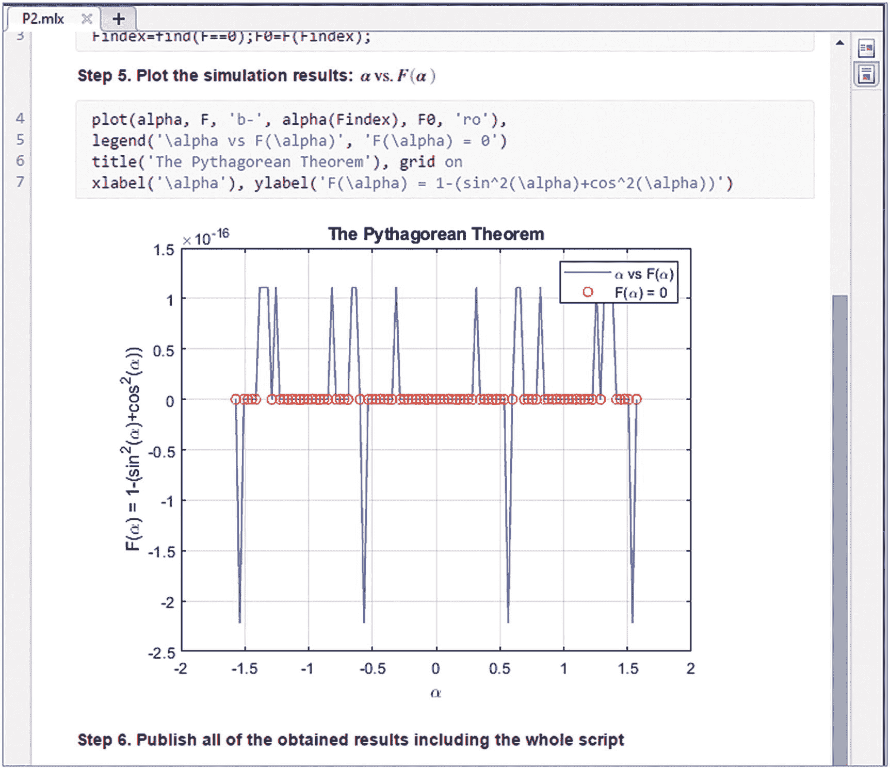

*图 1-25：`P2.mlx` 的 MLX 编辑器输出*

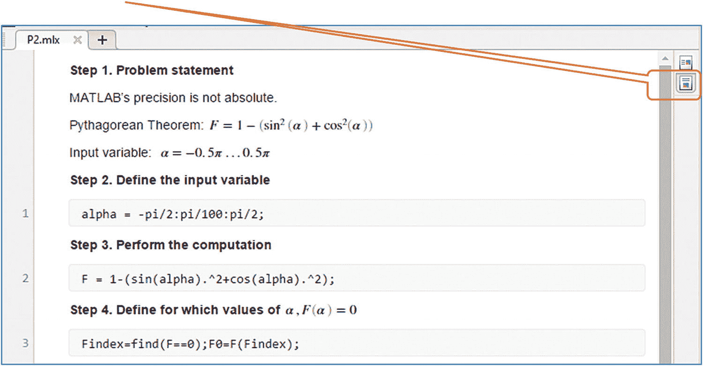

*图 1-24：`P2.mlx` 的 MLX 编辑器输出*

请注意，在 MLX 编辑器中，脚本的所有可执行和不可执行行都会被自动识别并放置在单独的部分中。关于 M/MLX 编辑器的提示、警告和错误消息，还有其他一些需要注意的问题，我们将在第 2 章中讨论。

## 关闭 MATLAB 窗口

退出 MATLAB 非常简单。有几个命令可用于完成 MATLAB 中的工作并关闭其所有窗口。您可以输入 `>> quit` 或 `>> exit`，或使用键盘快捷键 `Ctrl+Q`。您也可以单击主 MATLAB 窗口左上角的 X，或者从命令窗口调用 `>> finishdlg` 函数。

请注意，退出/关闭 MATLAB 时，工作区中的所有变量都将被清除。默认情况下，下次启动 MATLAB 时，它们将丢失且无法恢复。但是，它们可以保存到 `*.mat` 文件中，然后重新加载到工作区。输入命令的命令历史记录会自动保存，下次启动 MATLAB 时，可以访问在命令窗口中输入的所有命令。如果您有兴趣更改可通过 MATLAB 首选项调整的命令数量，请选择“首选项”➤“命令历史记录”。

## 总结

本章介绍了 MATLAB 环境，包括其设置、变量、常用命令以及 M 文件/MLX 文件 GUI 工具。您还学习了如何从命令窗口分配变量和值，以及在 M/MLX 文件编辑器窗口中工作。此外，本章探讨了数据类型、格式和结构，并涵盖了如何使用内置 MATLAB 命令和函数。特别地，它涵盖了帮助搜索选项和最常用的命令，包括 `help`、`helpwin`、`helpbrowser`、`doc`、`lookfor`、`clear`、`clear all`、`dir`、`pwd`、`cd`、`ls`、`save`、`load`、`clearvars`、`edit`、`format`、`char`、`size`、`who`、`whos`、`input`、`what` 和 `exit/quit`。

## 自测练习

### 练习 1

执行以下操作：

1. 从预装的 MATLAB 演示中找到*振动徽标*演示并运行它。提示：`membrane`。

2. 在程序包的帮助库中找到*产品概述*。

3. 更改命令窗口的字体类型和大小。


### 练习 2

请执行以下操作：

1.  使用“帮助库”确定如何添加新的搜索路径。添加一条新的搜索路径：`C:\Users\Public`。提示：`addpath`。
2.  使用 MATLAB 帮助浏览器查找如何创建一个新目录。在 `C:\Users\Public` 目录内创建一个名为 `my_new_dir` 的新目录。提示：`mkdir`。

### 练习 3

在命令窗口中使用 MATLAB 的 `exp`（指数）函数获取帮助。使用 `help`、`lookfor`、`doc` 和 `help browser` 命令，然后比较这四种帮助选项的结果。

### 练习 4

在命令窗口中，在 M 文件编辑器窗口内创建并打开一个名为 `learn.m` 的 `*.m` 文件。（提示：`>> edit ...`）。在其中插入两条命令，用于显示当前日期和时间。提示：`date`、`clock`。

### 练习 5

创建一个快捷键（一组常用命令），该快捷键能够打开一个名为 `My_Shortcut` 的新 M 文件，同时关闭所有图形窗口，并清除命令窗口和工作区中先前输入的所有数据和命令。

### 练习 6

在命令窗口中使用“首选项”窗口更改数据显示格式。将其设置为十六进制格式。提示：`format`。

### 练习 7

哪些命令用于清理工作区、命令窗口和历史记录？

### 练习 8

已知 *x* = 2.25, *y* = 3.1 和 *z* = 13.20，使用 MATLAB 计算以下表达式：

![$$ A=\sqrt[y]{ xy z-\frac{z}{xy}}+{x}²{y}^{\frac{3}{2\ }}{z}^{\frac{5}{4}};B={e}^{- xyz}\ln \left(\frac{xy}{z}\right). $$](images/471979_1_En_1_Chapter/471979_1_En_1_Chapter_TeX_Equa.png)

使用数组编辑器更改 `x`、`y` 和 `z` 的赋值，然后重新执行表达式以计算 `A` 和 `B`。

### 练习 9

创建一个脚本并将其保存为 `my_first_program.m`。

1.  你的程序应包含一个输入变量，该变量是作为可变参数的正方形边长（以米为单位）。
2.  你的程序应计算正方形的面积和立方体的体积。
3.  你的程序应通过单位换算（例如，1 *英寸* = 25.4 *毫米*），以公制（m², m³）和英制（in², in³）单位输出计算结果（面积和体积）。
4.  从命令窗口执行你的脚本（`my_first_program.m`）。
5.  从 M 文件编辑器窗口执行你的脚本（`my_first_program.m`）。

### 练习 10

执行/回答以下内容：

*   哪个命令可以显示 MATLAB 工作区中存储的内容？
*   创建 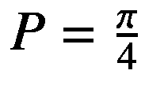 并以 `uint64` 格式保存。
*   为什么 `uint64` 格式下的 `P` 值等于 1？如何解决这个问题？

### 练习 11

将练习 9 和 10 中的所有计算结果保存在一个名为 `my_FIRSTwork.mat` 的 MAT 文件中，并清理你的 MATLAB 工作区，删除除练习 8 中的 `A` 和 `B` 之外的所有变量。

### 练习 12

给定：

```
C1 = Hello. I'm from NYC. What is your name?
D1 = I'm Dan.
C2 = Nice to meet you
D2 = Nice to meet u 2
```

使用这些条目（`C1`、`C2`、`D1` 和 `D2`），在命令窗口中创建一个以下列对话形式显示的内容：

```
'Hello.' 'I'm from NYC.'
'What is your name?' 'I'm Dan.'
'Nice to meet you.' 'Nice to meet u 2.'
```

### 练习 13

请执行以下操作：

1.  更改命令窗口的数据显示格式，并将其设置为 *long e*。
2.  MATLAB 的首选项设置保存在哪里？
3.  M 文件 `finishdlg.m` 的主要功能是什么，它包含哪些命令？

### 练习 14

请执行以下操作：

1.  在命令窗口中编写一个命令，用于创建并打开一个名为 `Ex14.m` 的 M 文件。
2.  编辑你的 M 文件 `Ex14.m`，使其包含一个更改显示格式类型的命令。
3.  编辑你的 M 文件 `Ex14.m`，使其包含一个更改当前目录的命令。
4.  编辑你的 M 文件 `Ex14.m`，使其包含一个显示当前日期和时间的命令。

### 练习 15

给定：

```
>> day_ONE="MatlabDAY"; day_DUE=day_ONE+1.0
day_DUE =
78 98 117 109 98 99 69 66 90
```

为什么 `day_DUE` 是数值型的，并且等于一个 10 元素的行矩阵？这些数字代表什么？

### 练习 16

给定：`>> A=[1,2; -12.0, 3]; mat2str(A); SNA=ans+0; char(SNA)`

变量 `SNA` 背后隐藏着什么？

### 练习 17

创建一个由元胞数组和数值数组元素组成的结构体，分别命名为 `Matlab` 和 `classes`：

1.  创建一个名为 `Matlab` 的元胞数组，它由两个子元胞组成：`{'Day#1', 'Start'}`
2.  创建一个名为 `classes` 的数值数组，其中包含元素 ![$$ \pi; 2\pi; \sqrt{\pi }+2i $$]。请注意，`i` 代表虚数单位。

### 练习 18

为以下数学表达式创建函数句柄和内联函数：
*h*(*θ*, *t*) = 1.3 * *e*^(-*tiθ*)。请注意，*i* 代表虚数单位。

### 练习 19

解析证明 *cos*2*α* = 2 cos²*α* − 1。使用 MATLAB 计算不同 *α* 值 ![$$ 0,\dots \frac{\pi }{2},\pi \dots \frac{3\pi }{2},2\pi \dots \frac{5\pi }{2},3\pi \dots 5\pi $$] 下的等式，并找出 MATLAB 计算精度无法体现等式成立的 *α* 值。

### 练习 20

以最精确的方式使用 MATLAB 计算表达式 ![$$ \sqrt[5]{1.5\ast {10}^{24}-{10}^{24}i} $$](images/471979_1_En_1_Chapter/471979_1_En_1_Chapter_TeX_IEq6.png)。注意，这是五次根。

### 练习 21

为什么以下输出看起来“奇怪”？

```
>> A=[4/5, 'matlab'+0, sin(pi)]
A =
第 1 列至第 3 列
3fe999999999999a 405b400000000000 4058400000000000
第 4 列至第 6 列
405d000000000000 405b000000000000 4058400000000000
第 7 列至第 8 列
4058800000000000 3ca1a62633145c07
```

如何解决这个问题并使结果清晰可读？

### 练习 22

使用 `randi()` 在 [1, 20] 范围内生成一个 5 行 5 列的矩阵，命名为 `A`，并将其每个元素除以 3。如下所示，以有理数形式显示 `A`。请注意，你的 `A` 的数组数值（分子部分）将与此处显示的数值不同。为什么你的答案与这里显示的不同？


### 练习 23

以最高效的方式（至少两种不同方法）创建以下数组。注意 `A2` 元素的显示格式。


### 练习 24

使用 `randi()` 创建一个 15 行 15 列的数组，元素范围从 -125 到 127，并以其内存效率最高的方式保存，命名为 `A3`。

### 练习 25

使用 M 文件编辑器工具创建以下 HTML 报告。


### 练习 26

给定 `A5 = [1 2 3; 4 5 6; 7, 8, 9]`。

1.  使用两种算术运算从 `A5` 得到 `B5`：`B5 = [16, 9 4; 1 0 1; 4 9 16]`。
2.  使用关系逻辑（`<`, `>`）和算术运算（`+ 13`）从 `A5` 和 `B5` 得到 `C5`。

```
C5 = [13 13 13; 14 14 14; 14 13 13];
```

### 练习 27

创建三个数值数组（行矩阵，变量分别命名为 `AJ`、`IS` 和 `LJ`），使得当你从每个数组中减去 3，然后执行一次转换操作后，分别得到 Al-Khwarizmi、Ibn Sina 和 Lennart Johansson。

### 练习 28

将你在练习 22 至 27 中创建的所有变量（`A`、`A2`、`A3`、`A4`、`A5` 和 `A6`）保存到一个 `*.mat` 文件中，文件名使用你的姓氏，例如 `Jones_HW2.mat`。

### 练习 29

创建一个名为 `A` 的元胞数组，其中包含三个变量：`a=4/5`、`b='matlab'+0` 和 `c=sin(`*π*`)`，并创建一个名为 `B` 的结构体，其中包含四个变量：`a`、`b`、`c` 和 `A`。展示如何访问存储在 `A` 和 `B` 内部的 `a`、`b` 和 `c` 变量。


### 练习 30

在 MLX 文件编辑器中创建以下变量和条目：

函数句柄 `F`: `F(ω[1], ω[2], θ) = cos(ω[1]*θ) − sin(ω[2]*θ)`

单位矩阵：`I` = ![$$ I=\left[\begin{array}{ccc}1&amp; 0&amp; 0\\ {}0&amp; 1&amp; 0\\ {}0&amp; 0&amp; 1\end{array}\right] $$](images/471979_1_En_1_Chapter/471979_1_En_1_Chapter_TeX_IEq7.png)

幻方矩阵：`M` = ![$$ M=\left[\begin{array}{ccc}8&amp; 1&amp; 6\\ {}3&amp; 5&amp; 7\\ {}4&amp; 9&amp; 2\end{array}\right] $$](images/471979_1_En_1_Chapter/471979_1_En_1_Chapter_TeX_IEq8.png)

将该矩阵乘以 2 并从 `M` 矩阵中减去它。将新矩阵命名为 `MI`：`MI` = ![$$ MI=\left[\begin{array}{ccc}6&amp; 1&amp; 6\\ {}3&amp; 3&amp; 7\\ {}4&amp; 9&amp; 0\end{array}\right] $$](images/471979_1_En_1_Chapter/471979_1_En_1_Chapter_TeX_IEq9.png)

通过定位/比较 `MI` 中大于 1 且小于 6 的元素来定位数组 `L`：`L` = ![$$ L=\left[\begin{array}{ccc}0&amp; 0&amp; 0\\ {}1&amp; 1&amp; 0\\ {}1&amp; 0&amp; 0\end{array}\right] $$](images/471979_1_En_1_Chapter/471979_1_En_1_Chapter_TeX_IEq10.png)

```
从 M 创建表数组 TM：
包含 F, I, M, MI, L, TM 的元胞数组 CA
包含 F, I, M, MI, L, TM, CA 的结构体 SA
```

### 练习 31

解释如何获得屏幕截图中所示的如下布局 (1)、首选项 (2) 和快速访问 (3) 窗口。注意：(2) 中的字体和颜色。


### 练习 32

创建这些文件（MLX/M 文件）并解释如何在实时编辑器中显示图中所示的结果。

注意：有四个显示 MLX 和 M 文件的窗口；方程式、希腊字母、绘图图形、超链接、数据提示以及如何插入图像。


### 练习 33

回答以下问题：

1. MATLAB 的默认数值格式（`int8`、`uint8`、`int16`、`uint16`、… `single` 或 `double`）取决于安装 MATLAB 的操作系统。（正确/错误）
2. MATLAB 在哪里显示存储的变量及其关联属性的列表？
3. MATLAB 用户界面是可定制的。（正确/错误）
4. MATLAB 仅当元胞数组包含数值数据时才支持，不支持字符串。（正确/错误）
5. 可以将表数组变量放入元胞数组中。（正确/错误）
6. `A=1.1; B=[2, 3; 1 2]; C=B/A; format hex; C`
   我们通过更改显示格式来更改条目 `C` 的值。（正确/错误）
7. `>> D=uint8(255); D=255; D+1 =255; E = [12/14, 3/5; 1/3, 4/9]; format rat; E`
   我们通过更改显示格式更改了条目 `D` 和 `E` 的值。（正确/错误）

### 练习 34

回答以下与数组大小和表示相关的问题：

1. 给定一个包含 10 个元胞的元胞数组 `ABBA`，哪个命令可以调取 `ABBA` 中第 3 个元胞内的元素？
2. 给定一个名为 `A` 的 5×5 数组（矩阵），`A(4:end, 3:4)` 将生成一个什么大小的矩阵？
3. 如何创建一个线性间隔的数据数组：`a=(-13, -12, -11, ... 11, 12, 13)` 和 `b=(0, 1/13, 2/13, 3/13, ... 24/13, 25/13, 2)` 而无需键入所有元素？注意如何获取数组 `b` 的有理数格式类型。

### 练习 35

如何从数组 `a = (-5, -4, -3 ... 3, 4, 5)`（其元素是线性（等间距）的）中获取逻辑数组 `c = (1 1 1 1 1 0 0 0 0 0 0)`？

### 练习 36

在命令窗口中给出：
```
>> x=linspace(-13, 0), F(x)=2*x²+2*x-1;
```
存在错误。找出错误并修复它们。现在 `x` 和 `F` 的大小是多少？

### 练习 37

写出以下问题的答案：

1. 如何将工作目录更改为 `C:\Users\Public` 并添加此路径用于搜索？
2. 在 `C:\Users\Public` 目录内创建一个名为 `MYdir` 的新目录。
3. 如何找出 MATLAB 工作区中存储了哪些变量？

### 练习 38

回答以下关于等间距数据点的数组相关问题：

1. 将上面给出的 `D2`（`D2=zeros(9); D2(6,:)=1:9;`）的最后两列（第 8 列和第 9 列）分别更改为包含元素：[e⁰, e¹, e², …, e⁸] 和 [tan(e⁰), tan(e¹), tan(e²), …, tan(e⁸)]，并以最有效的方式完成。
2. 以两种不同的方式生成这些向量空间：`[-100, -90, -80, ... 100]`，`[-100, -99, -98, ... 100]`。
3. 如何在 [−π, π] 范围内生成 500 个等间距的数据点？

### 练习 39

回答以下关于逻辑索引和逻辑数组的问题：

1. 给定 `>> A=magic(3); C1=le(A,7), C2=A<=7`
   在每个单独的情况下，所有逻辑数组中的 `0` 和 `1` 表示什么？
2. 给定 `>> A1=12.12; C="nan"; B=[1 2; 0, 3i]; D=B/0; AA1=isfinite(A1), CC1=isnan©, DD1=isinf(D), DD2=isnan(D)`
   在每个单独的情况下，所有逻辑数组中的 `0` 和 `1` 表示什么？
3. 给定 `>> AG=randi([-13, 25], 3, 2); BAG=(AG>0 & AG<13)`
   为什么当你运行这些命令来定义 `AG` 和 `BAG` 时，你的答案会不同？
4. 给定 `>> GAB=find(AG>0 & AG<13), AG(GAB)`
   `GAB` 后面的数字是什么，它们与 `AG` 有何关系？
5. 给定 `>> 13>10; -1.2<=7.8; -11+13>=3`
   为什么我们得到 `0` 和 `1`？
6. 给定 `>> AA=randi([-13, 13], 10, 2); AA(AA<=0); % OR >> IN=(AA<=0); AA(find(IN));`
   `IN` 相对于 `AA` 表示什么？
7. 给定 `>>B = randi([0, 13], 5); k=find(B>=3 & B<=5)`
   `k` 中的数字相对于 `B` 是哪些？

### 练习 40

创建一个名为 `ARRAY_1.m` 的 `.m` 文件并编写以下内容：

1. 编写命令以清理 MATLAB 的工作区和命令窗口，并在命令窗口中显示当前日期和时间。
2. 创建数组 `A` 并编写命令以生成数组：使用 `:` 运算符生成 `A1`（1×10），使用 `linspace()` 生成 `A2`（10×1），使用 `eye()` 生成 `A3`（2×10）。
3. 创建数组 `B` 并编写命令以创建数组：使用元素范围在 [-1, 1] 之间的 `randi()` 生成 `B1`（5×6），使用 `rand()` 生成 `B2`（5×6），使用 `randn()` 生成 `B3`（5×10）。
4. 创建数组 `C` 并编写命令以生成数组：使用 `magic()` 和 `repmat()` 生成 `C1`（5×10），使用 `eye()` 生成 `C2`（6×10），使用 `ones()` 生成 `C3`（10×10）。
5. 编写命令对 `A1`、`A2` 和 `A3` 执行所有可能的（算术数组）运算（`+`、`-`、`*`、`/`、`.*`、`./`、`^` 和 `.^`）（至少三个运算），并将新矩阵命名为：`A1new1`、`A1new2`、`A1new3`、`A2new1`、`A2new2`、`A2new3`、`A3new1`、`A3new2` 和 `A3new3`。提示：在执行算术数组运算时使用 `transpose()` 和 `rot90()`。
6. 编写命令对 `B1`、`B2` 和 `B3` 执行所有可能的（算术数组）运算（`+`、`-`、`*`、`/`、`^`、`.*`、`./`、`sum` 和 `mean`）（至少三个运算），并将新矩阵命名为：`B1new1`、`B1new2`、`B1new3`、`B2new1`、`B2new2`、`B2new3`、`B3new1`、`B3new2` 和 `B3new3`。提示：在执行算术数组运算时使用 `fliplr()`。
7. 从 `A1`、`A2`、`A3` 以及 `B1`、`B2` 和 `B3` 创建 `AB1`、`AB2` 和 `AB3` 矩阵。同时，使用部分 `A1`、`A2`、`A3` 和 `B1`、`B2`、`B3` 数组。注意，每个 `AB1`、`AB2`、`AB3`、`ABC4` 和 `ABC5` 数组都应包含来自数组 `A` 和 `B` 的一些元素。提示：在创建数组 `AB1`、`AB2` 和 `AB3` 时使用 `flipud()` 和 `repmat()`。
8. 通过组合/连接先前创建的数组：`A1`、`A2`、`A3`、`B1`、`B2`、`B3`、`C1`、`C2`、`C3` 来创建 `ABC1`、`ABC2` 和 `ABC3` 矩阵。你还应使用部分 `A1`、`A2`、`A3`、`B1`、`B2`、`B3`、`C1`、`C2`、`C3` 数组。注意，每个 `ABC1`、`ABC2`、`ABC3` 数组都应包含来自第 1、2 和 3 部分中 `A`、`B` 和 `C` 矩阵的一些元素。


### 练习 41

创建一个名为 `Ex41.mlx` 的 `*.mlx` 文件，并在其中写入以下内容：

1.  创建一个名为 `Q1`、包含六个空列单元格的元胞数组的命令。
2.  给出 `12321` 和 `987654321` 的二进制表示的命令，以及一个将这些数字及其二进制表示分别写入 `Q1` 的第 1、2、3、4 个单元格的命令。
3.  使用 MATLAB 的转换命令——`str2num()` 或 `str2double()`——将 `12321` 和 `987654321` 的二进制表示转换为数值数组的命令，以及将这两个转换后的数值数组分别写入 `Q1` 的第 5 和第 6 个单元格的命令。
4.  使用 `pascal()`（一个 MATLAB 内置矩阵函数）生成以下数组的命令：


并通过应用逻辑索引（逻辑数组）和逐元素矩阵乘法运算，生成以下数组：

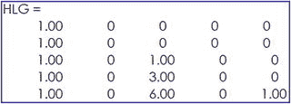

5.  创建一个名为 `S5` 的结构数组的命令，以及写入其 `Q1`、`H` 和 `HLG` 的命令。
6.  解释为何（在步骤 3 中）转换后的 `12321` 和 `987654321` 的二进制表示所对应的数值与原始的十进制数（即 `12321` 和 `987654321`）不同？

### 练习 42

创建一个 `*.mlx` 文件（名为 `Ex42.mlx`），并添加所有必要的注释，如问题、方程、解释和其他相关备注。同时写入以下命令：

1.  用两种方式生成两个包含 202 个等间距数据点的列数组：= −2*π*…2*π*；*β* = −360⁰…360⁰。
2.  计算以下三个方程（*α*、*β* 值取自步骤 1）：*F*(*α*) = *e*^(sin(*α*))；*H*(*β*) = *e*^(cos(*β*))；*S* = 1 − (*sin*²*α* + *cos*² *β*)。注：*β* 以度为单位而非弧度，因此别忘了将其转换为弧度。另外，请使用 `*.mlx` 的公式编辑器插入这些方程。
3.  创建一个包含五列的数组（名为 `Solution`），这些列依次为：*α*、*F*(*α*)、*β*、*H*(*β*)、*S*。
4.  创建一个数组表。该变量表应命名为 `TVall`，格式如下：


5.  找出 `F`、`S` 和 `H` 的所有正值，以及对应的 *α*、*β* 值，并将所有这些值保存到一个名为 `FSH_pos` 的元胞数组变量中。
6.  找出 `S` 的所有绝对零值以及对应的 *α*、*β* 值。将它们保存到一个名为 `ABS_0` 的数组中，该数组包含三列，分别为找到的 `S`、*α*、*β* 值。
7.  创建一个名为 `ABFSH_struct` 的结构数组，其中包含来自步骤 3、4、5 和 6 的 `SOLUTION`、`TVall`、`FSH_pos` 和 `ABS_0`。
8.  清除工作区中除了前面步骤中的 *α*、*β*、`F`、`H`、`S`、`SOLUTION`、`TVall`、`FSH_pos` 和 `ABFSH_struct` 之外的所有变量。将这些变量保存到一个名为 `Ex42.mat` 的 `*.mat` 文件中。

### 练习 43

创建一个 `*.m` 文件（名为 `Ex43.m`），执行以下操作：

1.  清除工作区和命令窗口中的所有内容。
2.  关闭所有打开的图形窗口。
3.  创建一个名为 `C:\Documents\Ex43` 的新目录。
4.  将 MATLAB 的当前目录更改为新创建的目录：`C:\Documents\Ex43`。
5.  计算 *t* = [0, 3*π*] 区间内，∆t = π/200 时的值，以及 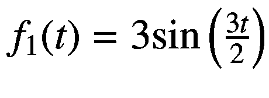、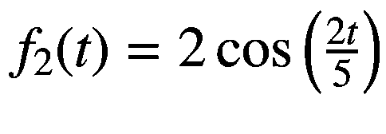。
6.  将计算结果 (*t*, *f*1, *f*2) 保存到一个名为 `Ex43.mat` 的 `.mat` 文件中。

### 练习 44

创建一个 `*.m` 文件（名为 `Ex44.m`），执行以下操作：

1.  将 MATLAB 的当前目录更改为 MATLAB 的根目录（提示：`matlabroot`）。
2.  删除在练习 43 中创建的目录：`C:\Documents\Ex43`。
3.  在命令窗口中显示 MATLAB 的根目录。
4.  创建两个函数句柄：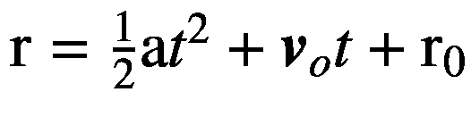 和 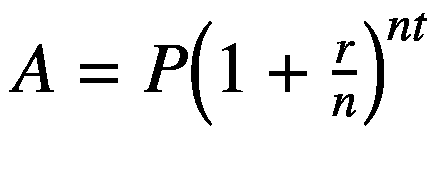。
5.  将当前路径和函数句柄保存到一个名为 `EX44` 的结构数组中。

# 2. 编程基础

本章涵盖了 MATLAB 中最基本且最常用的编程工具、运算符和控制语句、Simulink 中的建模基础、图形用户界面开发及其工具，以及 MATLAB 可执行文件和独立应用程序的开发。

本章还包含一些简单的示例，这些示例展示了在 MATLAB/Simulink 中进行编程和建模以节省计算时间的有效方法和工具。它解释了如何创建简短紧凑的代码/脚本，并包含一些编写健壮程序和脚本的基本提示和方法。

在整本书中，关键词——脚本、代码、程序、`M` 文件、`MLX` 文件和函数文件——被频繁用于指代在 MATLAB 中编写和执行的程序。本书上下文中使用的术语——如代码、脚本和程序，例如 `M`/`MLX` 文件和函数文件——指的是用户可读的源代码，而非计算机理解的机器代码。


# 编写 M/MLX 文件

前一章通过示例讨论了数组、字符、元胞、结构体、表格和逻辑数组，并概述了 M/MLX 文件编辑器。脚本（M/MLX 文件）也可以在记事本或写字板编辑器中编写。只要文件以 `*.m` 或 `*.mlx` 扩展名命名，它们就会成为 M 文件。它们也可以使用记事本编辑器打开和编辑。

如前一章所述，M/MLX 文件编辑器拥有许多易于使用的工具和直观的选项，你可以在编写和调试脚本时使用它们。在 M/MLX 文件编辑器中，你可以使用单元模式、设置断点、评估选定的单元格或脚本行、自动检测错误（例如拼写错误的命令名称和代数运算中缺失的括号）、检测所有已使用和未使用的变量、提高脚本性能、显示关于不必要赋值变量的警告提示、在循环中设置变量值、使用性能分析器等等。

所有这些工具都有助于在编写脚本时避免语法错误。此外，还有许多其他工具可以帮助你在编写和发布 HTML（超文本）或 PDF 格式的报告时节省时间和精力。

在开始编写脚本之前，让我们先了解一些基本的准备步骤。在用任何编程语言编写实际代码之前，了解并考虑这些步骤非常重要。编写脚本/程序的过程始于纸笔。它由流程图（图 2-1）中所示的步骤组成。

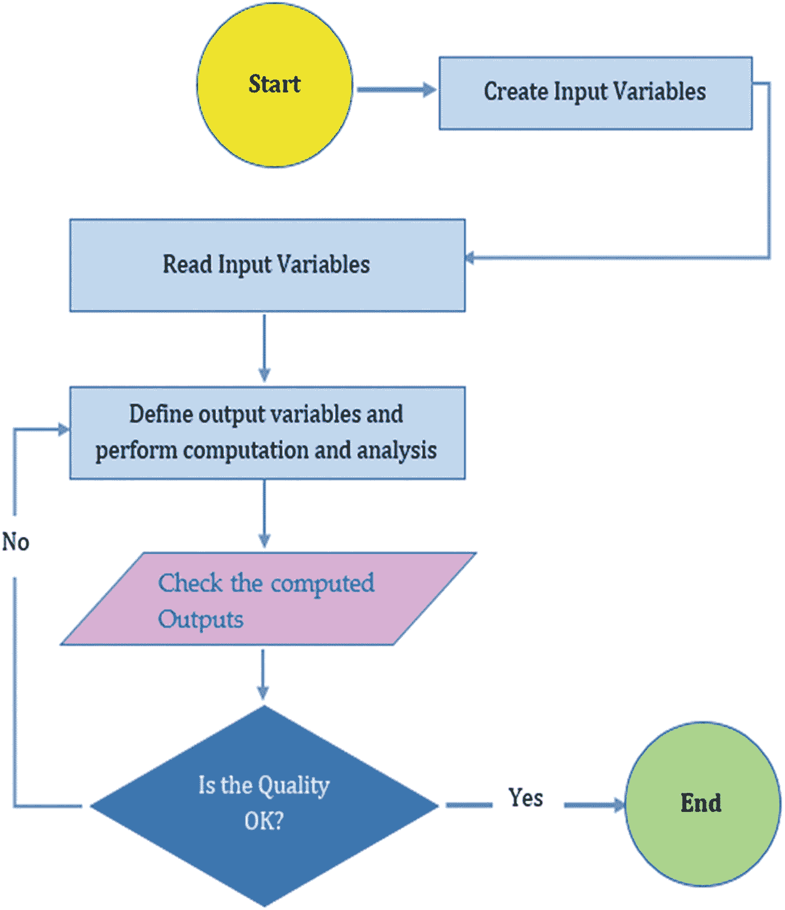

图 2-1

脚本/程序编写的一般流程

此流程图说明了以下步骤：

1. 阐明问题陈述。
2. 阐明/创建/声明输入变量，例如 `var1`、`var2`、`var3` ... `varN`。
3. 读取 `var1`、`var2`、`var3`、... `varN` 的值。
4. 定义输出变量，例如 `out1`、`out2`、`out3`、... `outN`。
5. 执行计算、评估和分析操作。
6. 检查所获结果/输出变量的质量/正确性。
7. 如果所得结果的质量/正确性不达标，则返回步骤 3。重复步骤 3-5，直到达到预期的质量/正确性。
8. 结束并报告结果。

所描述的算法是一个非常通用的过程，还可能包括考虑目标、输入/输出数据类型、数据源、评估/计算操作等。一旦算法被明确定义，你就可以开始用给定的编程语言进行编码。编写程序/脚本时，最耗时的部分是执行步骤 3-5 中的验证操作。这称为*调试*，它有助于定位步骤 4 中计算/评估和分析操作中的错误或缺陷。

调试是一个过程，涉及根据编程语言纠正程序的语法，根据给定的问题陈述纠正计算/运算操作，并在需要时调整输出的精度。在许多情况下，调试并非易事，而 MATLAB 的 M/MLX 文件编辑器提供了一些有用的工具，可以检测脚本中的常见错误。同时，许多错误不通过执行和分析获得的输出是无法检测到的。没有单一的方法可以找到编写代码时所有可能的错误（缺陷和失误）。最常见的一种检查代码是否按预期运行的方法是使用已知输出的测试示例，然后验证输出。

本书将非常注重调试。必须指出，编写没有任何缺陷的代码是不可能的。因此，调试是“必须拥有”的步骤。此外，当你编写解决不同问题的代码并发现并修复你所犯的错误时，你将会磨练并构建你的编程技能。

### 注

始终从执行练习中最基本部分的简单明了的操作/命令开始编写脚本。一旦练习的基本部分完成，你就可以添加更多细节。从简单到复杂是一种良好的编程习惯。

### 如何创建 M/MLX 文件

有几种方法可以创建新脚本（在此情况下指 M/MLX 文件）。

* 在命令窗口中输入 `>> edit` 并按键盘上的回车键。
* 按键盘上的 `Ctrl+N` 键。
* 点击  创建 M 文件。
* 点击  创建 MLX 文件。
* 点击  并从下拉选项中选择  用于 M 文件， 用于 MLX 文件， 用于扩展名为 `*.m` 的函数文件，或  用于扩展名为 `*.mlx` 的函数文件。
* 通过以下命令收集在命令窗口中键入的命令：`diary on`、`diary NewFileName`、`diary off`。


### 脚本中的警告

在编写 M/MLX 文件时（包括函数文件 M 文件和 MLX（实时）文件），编辑器会自动生成警告标志，这些标志在许多情况下是有用的提示，有助于提高效率并定位缺失或被忽略的参数。它们不会阻止脚本的执行。这些警告通过带有下划线的波浪线和连字符  表示，并在 M 文件编辑器窗口右侧通过一个矩形框  显示。默认情况下，它们是橙色的。同样，MLX（实时）文件编辑器通过带有下划线的波浪线、连字符  以及编辑器窗口右侧栏上的三角形警告标志  来指示警告。

请注意，其颜色可以通过偏好设置进行调整。以下是 M/MLX 文件编辑器自动检测到的一些常见警告：

-   建议抑制命令窗口中的输出显示（仅由 M 文件编辑器检测）：

  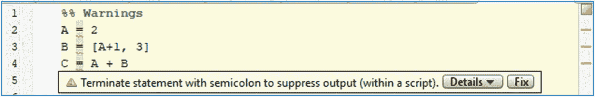

-   建议进行内存分配（例如，当变量大小在 `for ... end` 和 `while ... end` 循环迭代中变化/增加时，变量 `A` 和 `B` 会带有橙色波浪线）。

  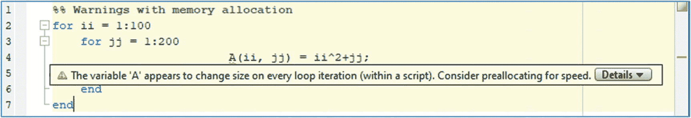  
  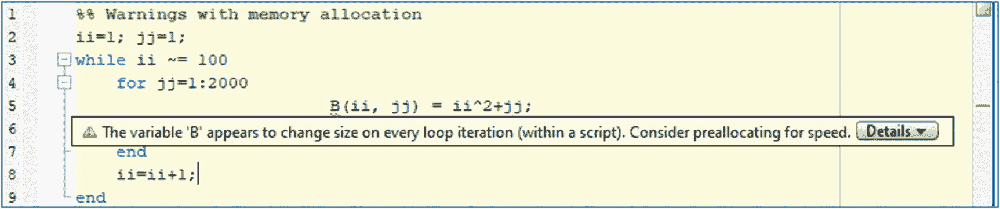

-   建议移除不必要的分号。例如，在第 1 行的末尾，`;` 是不必要的：

  

-   建议移除 `for ... end` 循环索引声明中（第 4 行）不必要的分号：

  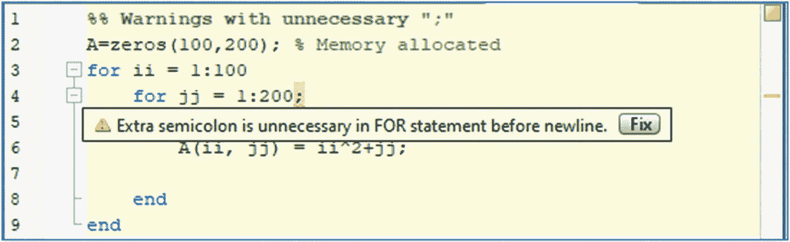

-   指示 M 文件中已赋值但未使用的变量名（第 5 行的 `G`）：

  

-   指示格式化 `fprintf()` 时缺少参数：

  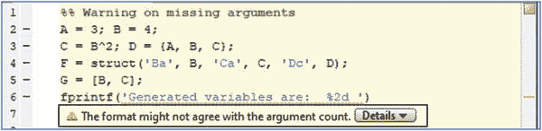

-   指示不必要的括号（第 2 行的 `a = [13]`）：

  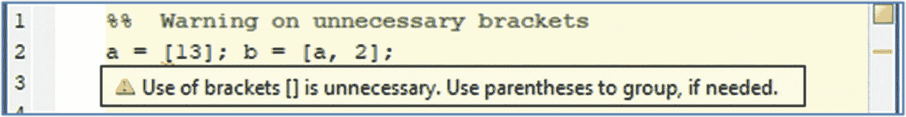

必须注意，M 编辑器检测到的某些警告标志不会被 MLX 编辑器（实时编辑器）捕捉。例如，用于抑制命令窗口输出显示的遗漏的 `;` 不适用于 MLX 编辑器（实时编辑器）。

另一方面，其他警告，如与内存分配相关的警告、不必要的分号、格式化 `fprintf()` 时缺少参数以及不必要的括号，都会被 MLX 编辑器非常明确地检测并突出显示，该编辑器在编辑器窗口右侧使用 。

-   建议进行内存分配：

  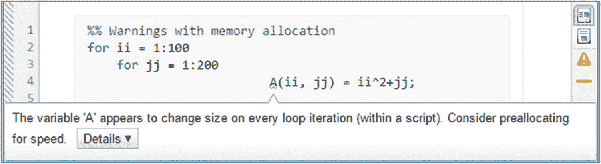

-   指示函数语句中的不必要分号：

  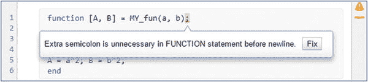

-   指示为 `for ... end` 循环定义索引时的不必要分号：

  

-   指示 `fprintf()` 中缺少参数：

  

-   指示不必要的括号：

  

### 脚本中的错误

在 MATLAB 中，脚本可以包含执行各种计算和分析以及定义函数的代码。让我们看几个在 M 文件和 MLX 文件编辑器中编写脚本的简单示例，了解如何定位和修复编写脚本时出现的常见错误。


### 示例 1

求解以下列一般形式表示的二次方程：`ax² + bx + c = 0`。首先，打开一个 M 文件编辑器，并输入以下命令。

```
a=input('请输入 a = ');
b=input('请输入 b = ');
c=input('请输入 c = ');
D=b²-4*a*c;
disp(['该方程的判别式为：' num2str(D)])
```

文件以扩展名 `*.m` 保存后即可执行。执行时，代码会提示用户输入三个值（`input()`），并使用用户输入的 `a`、`b` 和 `c` 计算二次方程的判别式，然后在命令窗口中显示结果。需要注意的是，第 5 行的 `disp()` 命令是可选的。它用于在命令窗口中显示计算结果并附带一些注释。`disp()` 命令不会对输出结果产生任何影响。

这段代码还剩下两个步骤——计算二次方程的两个根。剩余的步骤可以插入到第 5 行之后。如果在编写脚本时发生非法操作/错误，M/MLX 文件编辑器会自动检测到它们，并用红色波浪线标出：

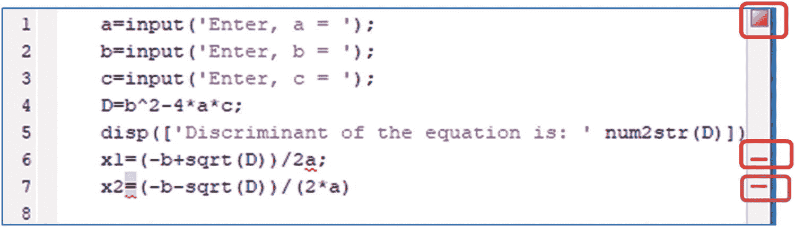

第 6 行有一个错误（`a` 下方的红色波浪线），其中缺少了乘法 `*` 号；第 7 行的 `=` 号下方有一条橙色波浪线，表示一个警告，建议添加分号以抑制该行输出的显示。

此类错误和警告信息会显示在编辑器滚动条的右侧边缘。如果红色波浪线表示存在错误，则该脚本（M/MLX 文件）无法执行。如果存在任何橙色波浪线表示的警告标志，该脚本可以正常执行。M/MLX 编辑器会自动检测几种不同类型的拼写错误和非法操作，但无法自动修复它们。因此，您必须理解并解决此类问题。

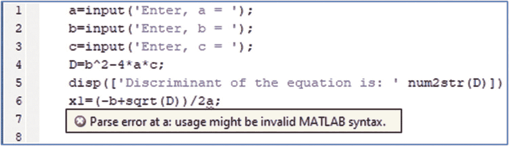

第 7 行的警告信息可以通过在光标位置添加分号或单击修复按钮来解决。


最后，这是修复后的脚本。右上角的绿色按钮表示语法正确，脚本已准备好执行。


将此脚本保存为 `Eqn.m` 后，您可以通过单击编辑器主菜单中的 GUI 按钮、按键盘上的 `Ctrl+Enter`，或者直接在命令窗口中通过脚本名称调用（`>> run('Eqn')`）来执行它。执行后，它会在命令窗口中提示输入。然后，您可以分别输入 1、2、3 作为 `a`、`b` 和 `c` 的值。

```
请输入 a = 1
请输入 b = 2
请输入 c = 3
该方程的判别式为：-8
```

这样整个计算就完成了，这就是在命令窗口中得到的输出。工作区中也保存了一些其他变量，如下所示。

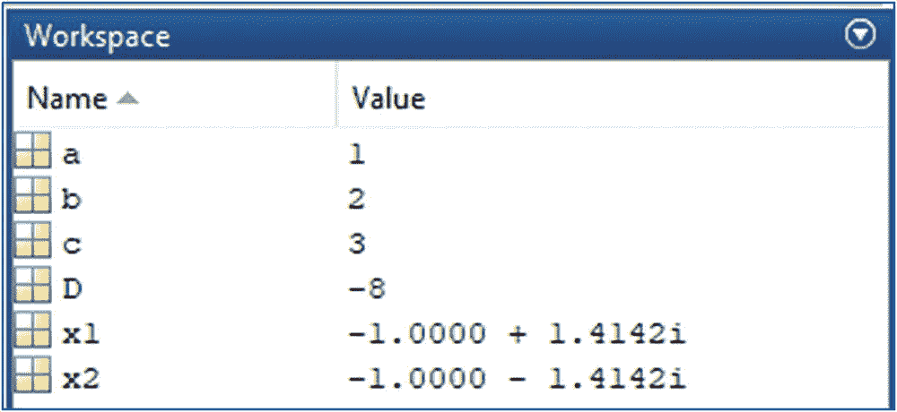

来自脚本和 M/MLX 文件的所有输入及处理/计算的输出都会自动保存到工作区中。除非执行函数文件，否则除了函数文件中指定的输出变量外，并非所有结果都会保存到工作区。此问题将在本章后面的函数文件部分讨论。

### 示例 2

通过编写一个 M 文件（脚本）计算以下表达式：`ab ∛((ax - by)² / (cd - f))`，其中 `x = [1/5, 2/5, 3/5, 4/5]; y = [1/3, 2/3, 1, 4/3]; c = 2; d = 2.5; f = 2`，而值 `a`、`b` 由用户输入（标量）。根据给定的变量值，`x` 和 `y` 是行数组，其他变量——`a`、`b`、`c`、`d` 和 `f`——是标量。

如同二次方程示例一样，输入提示也包含在脚本中。


这是创建的用于计算给定任务的简短脚本。快速浏览此脚本，可以发现 MATLAB 编辑器检测到一个错误。这是与第 9 行末尾缺少括号相关的无效语法。缺失的括号位于第一个 `^` 乘幂符号之前。以下是修复后的代码，右上角带有绿色按钮。

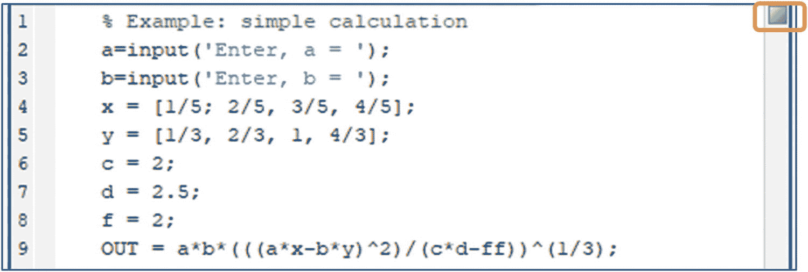

根据编辑器的语法检查，现在一切似乎都正确。然而，仍然存在几个错误：

- 在第 4 行定义 `x` 的元素时，使用了分号作为元素分隔符，但必须使用逗号或空格。
- 变量 `f` 在第 8 行定义，但在第 9 行的表达式中，却使用了 `ff`。
- 第 9 行的计算表达式使用了变量 `a`、`b`、`c`、`d` 和 `f`（这些是标量），以及变量 `x` 和 `y`（这些是行数组）。这是不正确的。该行必须对行数组变量 `x` 和 `y` 进行逐元素运算。修复这些错误后，脚本将如下所示。


现在，无需保存即可通过按键盘上的 `Ctrl+Enter` 执行脚本，或者在保存后单击 GUI 按钮执行。以下是结果（来自命令窗口的输入）：

```
请输入 a = 1
请输入 b = 2
```

以下是工作区中的变量：

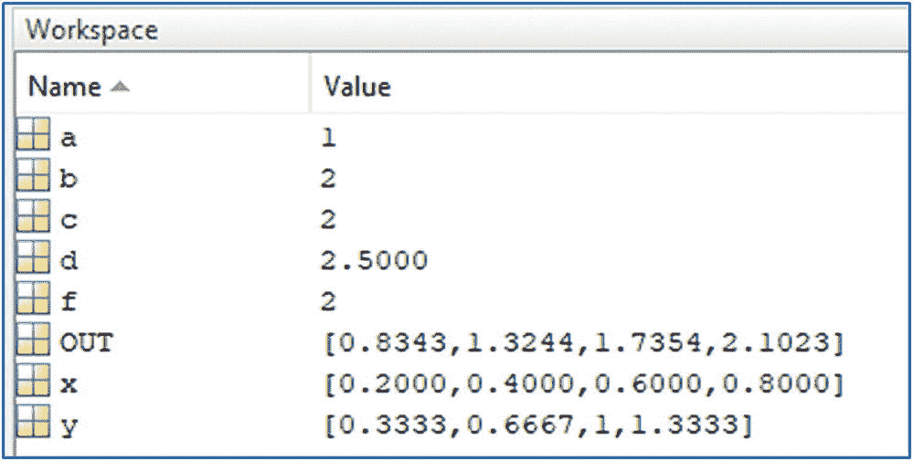


### 示例 3

使用 MLX 文件编辑器并创建一个 MLX 文件来计算数学表达式的值并绘图。已知：*H*(*t*) = sin(ω*t*)；ω = 3；*t* = [0°, 450°]，步长 ∆*t* = 1°。

注意，给定的自变量 `t` 的值是角度制，而非弧度制。在 MATLAB 中，有两个函数——`sin()` 和 `sind()`——分别用于计算弧度和角度下的正弦值。因此，在这种情况下有两种处理方法——始终使用正确的 MATLAB 函数，或者采用从角度换算到弧度的转换函数 `deg2rad()`，反之则使用 `rad2deg()`。

现在，在实时编辑器中创建了考虑输入参数 `t` 的 MLX 文件（脚本）：


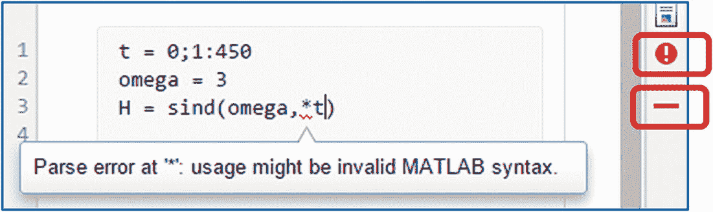

注意，错误会以波浪下划线显示，并且  和  会以红色形式出现在 MLX 编辑器的右侧。修复错误（去掉 `*` 前的逗号）后，修正后的代码如下所示。


M 文件编辑器和 MLX 文件编辑器之间存在几个关键区别。其中之一是，在输入变量名称的首字母后，MLX 编辑器能自动检测已定义的变量。额外的提示会显示参数类型（例如，角度制下的 *ω* 和 `t`）。MLX 文件编辑器的另一个特性是，如果赋值变量的命令末尾未加分号，它不会显示警告信息。例如，`t = 0:1:450`，这一情况我们在使用 M 文件编辑器时就曾见过。MLX 文件编辑器将输出显示在 MLX 编辑器的右侧窗口中，而非命令窗口中。同时，执行 MLX 文件后，所有变量和已计算的表达式都会像 M 文件一样保存在工作区中。MLX 文件的执行方式与 M 文件类似，可以通过键盘按下 `Ctrl+Enter` 或点击  GUI 按钮来完成。以下是包含 `plot()` 命令及其计算结果在内的最终脚本。

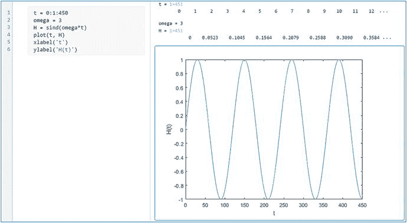

### 示例 4

编写一个 MLX 文件，用于分析和计算以下跳伞运动员的加速度方程 *a*(*v*)（加速度作为速度的函数）：

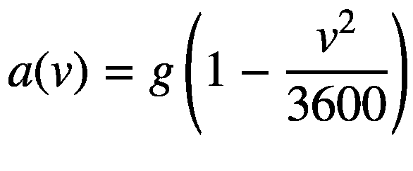

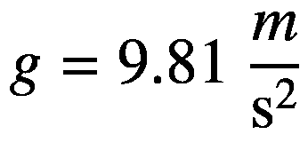

1.  绘制 *a* 与 *v* 的关系图。
2.  计算当  时跳伞运动员的终端速度。
3.  将垂直速度 *v* 视为自变量，在 ![$$ \left[0,\kern0.5em 100\frac{m}{s}\right] $$](images/471979_1_En_2_Chapter/471979_1_En_2_Chapter_TeX_IEq5.png) 范围内，步长设为 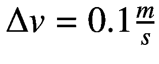。
4.  使用性能剖析器分析代码。
5.  在图上显示终端速度值。

以下是初始代码，其中包含一个错误（变量名拼写错误——应为 *Tt* 而非 *Ttt*）。该错误在第 8 行由感叹号  标出。这类错误（变量名拼写错误）只有在执行脚本后才能在实时编辑器中检测到。

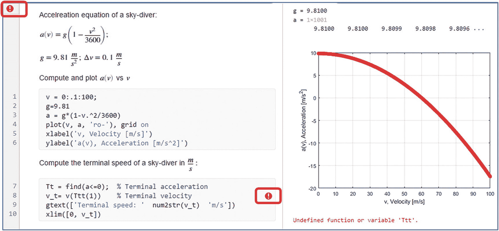

请注意，变量名拼写错误（*Ttt* 而非 *Tt*）是在执行 MLX 编辑器后才显现出来的。与 M 文件编辑器不同，MLX 编辑器的计算结果不会显示在命令窗口中。因此，建议在 MLX 编辑器中编写和编辑脚本时，频繁执行实时脚本，以便捕捉任何缺陷和错误。

以下是 MLX 编辑器中本练习修正并最终确定的解决方案脚本：

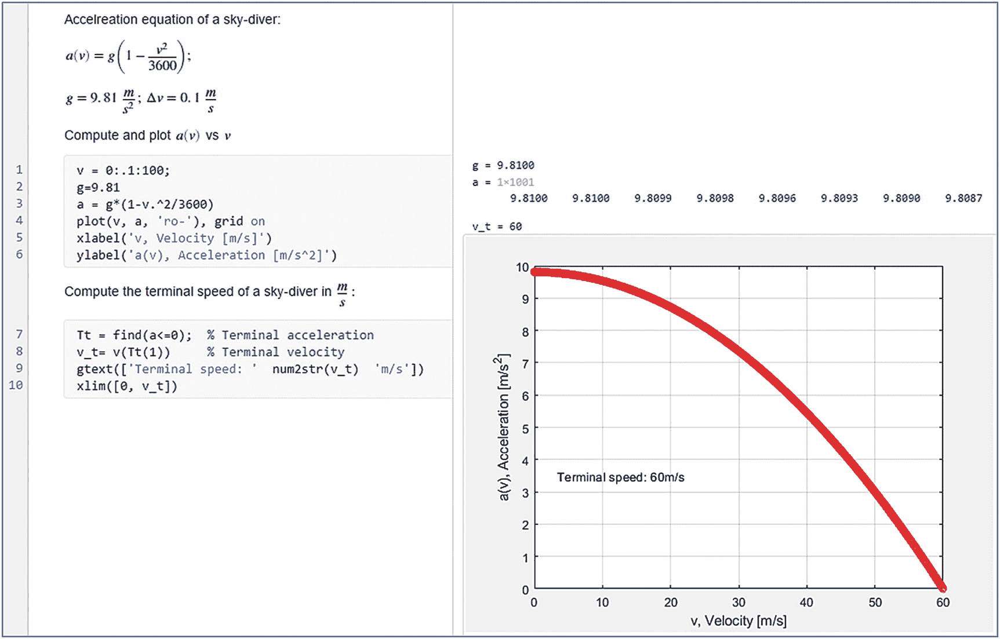

输出结果（包括绘制的图形）会显示在右侧的同一窗口中。在本练习中，包含了几行文本（不可执行代码）和注释。方程是通过 MLX 编辑器方程编辑器 GUI 工具中的  和 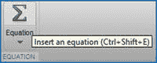 按钮添加到可执行命令之间的。这些工具在 M 文件编辑器中不可用。


### 示例 5  

可以在一个 M 文件中调用另一个 M/MLX 文件。让我们来看一个示例，该示例编写 M 文件和 MLX 文件来计算以下表达式。您还将通过调用/执行另一个 M/MLX 文件来获取它们的计算结果。这演示了如何链接/连接多个脚本（M/MLX 文件）。换句话说，您将执行多个脚本，获取它们的仿真结果，然后在单个脚本中使用它们。  

1. 计算 *F*(*α*) = *e*^(sin(*α*))、*H*(*β*) = *e*^(cos(*β*))、*S* = 1 − (*sin*²*α* + *cos*² *β*)，其中 *α* = − 2*π*...2*π*，*β* = − 360°...360°，通过编写一个 MLX 文件来实现。  

2. 计算 *g*(*a*, *b*, *t*) = cos(*at*) − sin(*b*t*)，其中 *a* = 3、*b* = 2、−13 ≤ *t* ≤ −3，且 *∆t* = *π*/50，通过编写一个 M 文件来实现。  

3. 计算 *f*(*t*) = cos(20*t*) − sin(10*t*)，其中 *t* ∈ [−*π*, *π*]，*∆t* = *π*/50，并绘制 *t* 相对于 *f*(*t*) 的计算结果图，通过编写一个 M 文件来实现。  

4. 计算 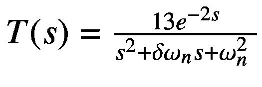，其中 *δ* = [0, 0.5, 1, 1.5, 2] 且 ![$$ {\omega}_n=3\left[\frac{rad}{\mathit{\sec}}\right];s=\left[0,25\right],\Delta s=5\ast {10}^{-2} $$](images/471979_1_En_2_Chapter/471979_1_En_2_Chapter_TeX_IEq7.png)，通过编写一个 MLX 文件来实现。  

5. 编写一个 M 文件，该文件执行前面所有任务中的 M 和 MLX 文件，并按如下方式保存所有计算结果：在一个名为 `A1` 的单一数组（用于步骤 1）、一个名为 `Btab2` 的表格数组（用于步骤 2）、一个名为 `Ccell3` 的元胞数组（用于步骤 3）和一个名为 `Dstruct4` 的结构体数组（用于步骤 4）中。  

以下是这五个任务在 M/MLX 文件中的解决方案脚本。  

  

此脚本看起来没有错误，并且 MLX 编辑器没有显示任何问题。但是，在计算 `S` 的第 2 行存在两个错误（数组幂运算），只有在执行脚本后编辑器才会检测到它们。  

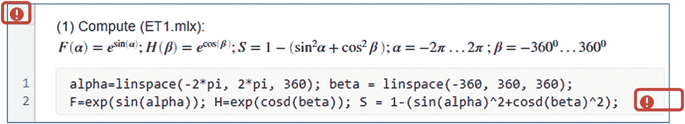  

  

以下是修正后的脚本。  

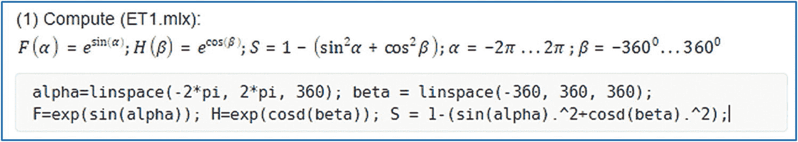  

以下是解决任务 2 的初始版本脚本：  

  

快速浏览这段代码可以发现，它输入正确，可以执行。编辑器窗口右侧的绿色框  可以验证这一点。即使执行了脚本，命令窗口中也不会显示任何错误。然而，`g` 的结果显示，结果中缺少了许多预期的数据点。错误在第 3 行。在创建数组 `t` 时，使用了一个分号而不是冒号 `:` 运算符。以下是修正后的代码。  

  

以下是任务 3 的初始版本答案脚本：  

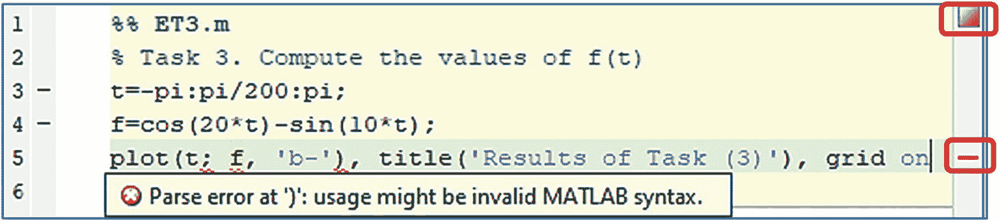  

在此脚本中，编辑器在第 5 行检测到两个错误和一个警告。脚本可以执行到第 5 行，此时命令窗口中会显示以下错误消息。  

```
Error: File: ET3.m Line: 5 Column: 7
Invalid expression. When calling a function or indexing a variable, use parentheses. Otherwise, check for mismatched delimiters.
```

实际上，有一个错误：在第 5 行的 `plot()` 命令中，用分号错误地替换了逗号：`plot( t; f,'b-')`。在 MATLAB 中，分号最常见的两种用途是终止表达式和作为数组行末尾的元素。因此，在本例中，`plot()` 内的分号使用不当。以下是修正后的脚本。  

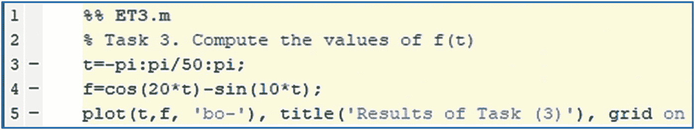  

以下是任务 4 的初始解决方案脚本：  

  

它自动检测到一个错误——错误地将分号而不是逗号作为数组的元素分隔符。由于此错误，脚本无法执行。  

以下是脚本的修正版本。  

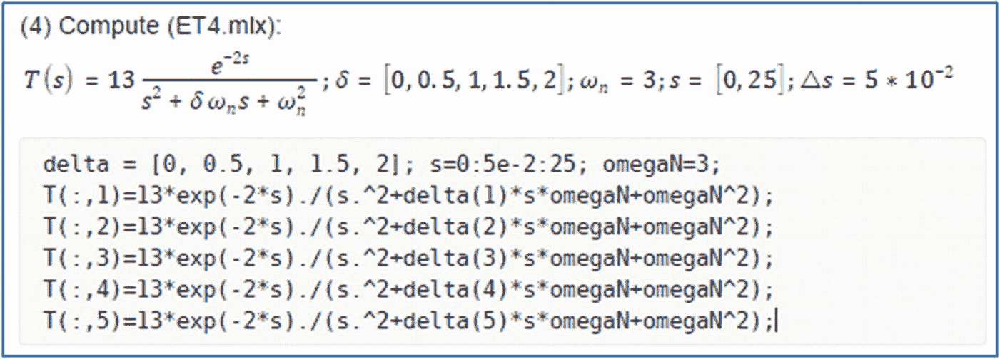  

以下是任务 5 的脚本。它调用了任务 1 到 4 中的脚本。  

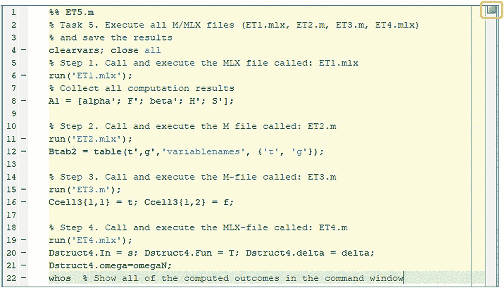  

脚本编辑器没有显示任何问题。但是，当它被执行时，命令窗口中会弹出以下错误消息：  

```
Error using run (line 87)
RUN cannot execute the file 'ET2.mlx'. RUN requires a valid MATLAB script
Error in ET5 (line 11)
run('ET2.mlx');
```

此错误消息表明识别文件时存在问题。这意味着文件名 `ET2.mlx` 不正确（文件扩展名错误）；它应该是 `ET2.m`。  

以下是任务 5 修正后的脚本。  

  

通过执行最后一个文件 (`ET5.m`)，其他四个脚本也会被依次调用和执行。以下是命令窗口中所有脚本的计算结果：  

```
Enter the value of a  =  2
Enter the value of b  =  3
Name             Size             Bytes  Class     Attributes
A1            1800x1              14400  double
Btab2          255x2               5162  table
Ccell3           1x2               1840  cell
Dstruct4         1x1              24800  struct
F                1x360             2880  double
H                1x360             2880  double
S                1x360             2880  double
T              501x5              20040  double
a                1x1                  8  double
alpha            1x360             2880  double
b                1x1                  8  double
beta             1x360             2880  double
delta            1x5                 40  double
f                1x101              808  double
g                1x255             2040  double
omegaN           1x1                  8  double
s                1x501             4008  double
t                1x101              808  double
```

此外，还有一个来自任务 3 (`ET3.m`) 的图表（此处未显示）。  

请注意，在编写脚本时还会出现许多其他常见错误，这些错误将在本书中重点介绍。此外，在创建函数文件时也会有一些常见错误，所有这些错误都将在专门讨论函数文件的部分中重点介绍。  

通过简单的示例，您已经了解了在编写脚本时如何使用 M 和 MLX（实时）编辑器来自动检测常见错误。还有一些其他错误无法由 M/MLX 编辑器自动检测到，只能在执行脚本后才能发现。这些错误包括各种操作（算术、矩阵和数组）中变量大小不匹配，或 MATLAB 命令拼写错误。  

### 注意  

发现并修复你在编写代码时犯的错误是学习如何编写优秀程序的良好练习。


### 单元模式

在 M/MLX 编辑器中，有一个非常方便的工具可以用来编写结构良好的代码/脚本，称为单元模式选项。在单元模式下工作简单易行，只需输入 `%%` 即可实现。默认情况下，输入 `%%` 后加一个空格即可创建一个新单元。将长脚本按每个独立操作分隔到单元中编写，有助于你逐个单元地执行代码，并发现错误所在。它还有助于在视觉上将代码划分为不同的块，每次可以高亮显示一个块，这有助于提高可读性。让我们来看以下示例。

已知在笛卡尔坐标系 (x, y) 的原点处的一个椭圆的方程为 ，其中 *a* 和 *b* 是决定椭圆形状的常数，变量 *x*、*y* 由  定义，且  ，其中 0 ≤ *t* ≤ 2*π*

1.  计算方程 (A) 中 *a = 1.5* 且 *b = 3.5* 时所给出的椭圆并绘制它。
2.  绘制并显示由 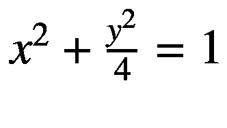 和 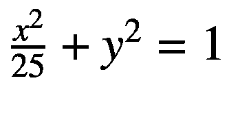 所描述的两个椭圆的交点。
3.  针对以下情况：*a = [1, 2, 3]，b = [3.5, 1, 2]*，将 (A) 中定义的三个椭圆计算为一个三列数组。

以下是分别代表练习题每个子部分答案的、以三种单元模式创建的解决方案脚本。每个单元都包含了给定练习中相应部分的答案脚本。单元 1（第 1 部分），由第 2–9 行组成，计算关于 *a* 和 *b* 值的椭圆 (A)。单元 2（第 2 部分），由第 10–27 行组成，计算两个椭圆并绘制它们的值，随后显示两个椭圆的交点。单元 3（第 3 部分）计算关于 *a* 和 *b* 值的三个椭圆并绘制计算出的椭圆。


以单元模式编写代码后，你可以单独执行每个单元：当光标位于待执行的单元内时，使用键盘上的 `Ctrl+Enter`，或者从 M 文件编辑器中点击  和  或 。使用单元模式的好处在于，你可以单独执行和测试每个单元。如果存在任何错误，你可以在不干扰其他单元的情况下进行修复。在调试和修正长脚本时，这可以节省大量的时间和精力。

### 注意

当编写冗长的扩展脚本并进行调试时，使用单元模式效率更高。

如上所示，M/MLX 文件编辑器包含许多有用的工具。例如，它们会自动检测常见的排印错误。例如，它们会检测并警告用户以下情况：

*   拼写错误的 MATLAB 内置函数/命令名称
*   未闭合的含括号数学表达式，例如 `()`、`{}` 和 `[]`
*   使用不当/错误使用或遗漏的数学运算符，例如 `+-*/\` ... `( )`、`{}` 和 `[]`
*   无效语法
*   未使用的变量名
*   抑制（冗长）输出的显示
*   识别哪些条目是数值数据，哪些条目是字符或文本消息，以及哪些条目是注释
*   提供警告消息，告知如何提高脚本的计算效率

此外，M/MLX 文件编辑器还具有以下工具：

*   调试模式，例如设置/清除断点、设置/修改条件断点、启用/禁用断点、在出错/警告时停止...
*   在单元模式下工作
*   文本下的文本编辑选项
*   带有保存和发布选项的报告编写

### 调试模式

`dbstop` 函数用于临时暂停脚本的执行，并为用户提供检查本地工作区的机会。在调试脚本时，你可以通过在编辑器窗口中点击左侧装订线上的特定行来在该行设置断点。`dbstop` 函数有十多种用法：

```
(1)  dbstop in FILE at LINENO
(2)  dbstop in FILE at LINENO@
(3)  dbstop in FILE at LINENO@N
(4)  dbstop in FILE at SUBFUN
(5)  dbstop in FILE
(6)  dbstop in FILE at LINENO if EXPRESSION
(7)  dbstop in FILE at LINENO@ if EXPRESSION
(8)  dbstop in FILE at LINENO@N if EXPRESSION
(9)  dbstop in FILE at SUBFUN if EXPRESSION
(10) dbstop in FILE if EXPRESSION
(11) dbstop if error
(12) dbstop if caught error
(13) dbstop if warning
(14) dbstop if naninf  or  dbstop if infnan
(15) dbstop if error IDENTIFIER
(16) dbstop if caught error IDENTIFIER
(17) dbstop if warning IDENTIFIER
```

名称 `FILE` 是你想要执行调试操作的文件名。它必须指定为一个字符串标量的字符向量。`FILE` 还可以包含文件目录的完整或部分路径。`LINENO` 是 `FILE`（正在执行调试操作的脚本）中的行号，而 `N` 是一个整数，用于指定该行的第 N 个匿名函数。`SUBFUN` 是 `FILE` 内的子函数名称。`EXPRESSION` 是一个可执行的条件表达式，指定为字符向量或字符串标量。`IDENTIFIER` 是一个 MATLAB 消息标识符（有关消息标识符的描述，请参见 `ERROR` 的帮助）。`AT` 和 `IN` 关键字是可选的。

### M-Lint 代码检查

`mlint()` 命令用于检查 MATLAB 代码文件是否存在潜在问题。当你从 M 文件编辑器窗口中运行 M-Lint 代码检查时（通过选择“工具” ➤ “M-Lint” ➤ “显示 M-Lint 报告”），它将提示一份（关于该 M 文件的）完整警告消息报告。例如，哪个变量未使用、哪个变量的大小在每次循环迭代中发生变化、哪些地方有改进空间、所使用的 MATLAB 内置函数中哪一个已被弃用，等等。`mlint()` 的一般命令语法是 `>> mlint('filename')`。从 MATLAB 2019a 开始，不推荐使用 `mlint()`，建议改用 `checkcode()` 命令。


### 代码分析

代码分析用于衡量程序在何处耗时以及问题/错误所在位置。通过识别程序的性能，可以对其进行改进。可以从 M 文件编辑器窗口中，点击“工具”->“打开分析器”来调用代码分析功能。代码分析（Profiler）窗口会弹出。分析报告包含脚本（M 文件）的完整基准测试报告，其中包括每条命令的详细信息以及 CPU（中央处理单元）的时间消耗情况。通过研究脚本的分析报告，你可以学习如何提高仿真时间的效率。分析模式默认关闭；可以使用`>> profile on`命令将其开启。任何 M 文件或 Simulink 模型的分析摘要报告都可以使用通用语法生成并查看，例如：

```
profile on
% 脚本 – M 文件从此处开始：
clc; close all; clearvars
M=magic(55); plot(M);
Minv=inv(M); Mans=M*Minv; MANS=M.*Minv;
% 脚本 - M 文件在此处结束：
profile viewer
```

或者

```
>> profile on; My_function; profile viewer
```

或者对于 Simulink 模型：

```
>> profile on; sim('My_Model'); profile viewer
```

注意，你可以在两个命令之间插入任何 M 文件名（例如`My_function.m`）或函数文件名（例如`My_function.m`）或 Simulink 模型名（例如`My_Model.mdl`）：

```
profile on; profile viewer
```

### 依赖关系报告

依赖关系报告可识别程序中调用/使用的所有函数、脚本和外部程序（应用程序）。此报告可查找当前文件夹中脚本所依赖的文件和工具的信息。在与其他可能没有你拥有的所有 M 文件、函数文件和工具箱的用户共享工作之前，此报告非常有帮助。依赖关系报告显示目录中 MATLAB 文件之间的依赖关系，可以通过以下步骤调用：

1. 选择“桌面” -> “当前目录”，并导航到包含相应 MATLAB 文件的目录。
2. 右键单击“当前文件夹”选项卡。从右键菜单选项中，点击“报告”，然后选择“依赖关系报告”。
3. 所有 MATLAB 文件的依赖关系报告将自动创建。

### P 代码

在 MATLAB 和 Simulink 中，还有另一种重要的文件类型，称为 P 代码，文件扩展名为`*.p`。在某些特定情况下，创建 P 代码非常方便且推荐使用。从 M 文件创建 P 代码文件的主要原因是防止有价值的文件被意外编辑，并加快脚本的仿真时间。

以下是创建 P 代码的充分理由：

- 加速 MATLAB 中的仿真过程。
- 保护有价值的 M 文件的安全。但是，不应将 P 代码视为安全加密的替代品。
- 隐藏专有算法。
- 当你调用 M 文件函数时，MATLAB 会解析 M 代码，并将指令作为 P 代码存储在高速缓冲存储器中。除非使用`clear`命令清除或退出 MATLAB，否则 P 代码会一直保留在内存中。
- 它是针对虚拟 MATLAB 机器的平台无关的伪代码。
- 由于 P 文件是二进制格式，因此其源代码是隐藏的。

如何创建 P 代码：

- 要从给定的 M 文件（例如本例中的`My_fileM.m`）创建 P 代码，请在命令窗口中输入以下内容：

```
>> pcode My_fileM.m
```

运行该命令后，将在相同文件名下创建 M 文件`My_fileM.m`的 P 代码，但扩展名为`*.p`而不是`*.m`。

- 要执行名为`My_fileM.p`的 P 代码，请在命令窗口中输入以下内容：

```
>> My_fileM.p
```

- 或者在命令窗口中输入：

```
>> run My_fileM
```

即使当前目录中有名为`My_fileM.m`的原始 M 文件，这也会执行所创建的 P 代码。

### 关于脚本/M/MLX 文件的一些说明

- 通常，MATLAB 命令可以从脚本或命令窗口中执行。哪种方法最佳取决于需要执行的任务/计算。如果是由一步过程组成且无需重复的简单计算，则无需创建 M/MLX 文件或脚本。另一方面，当需要包含循环迭代和条件语句的不同操作的大规模计算时，编写 M/MLX 文件是最佳选择。
- 错误和警告消息不仅会帮助你定位脚本和模型中的错误，还会提供有关错误原因以及如何消除错误的提示。实际上，警告消息使你的程序更健壮，并告知你在计算/绘制输出中被忽略的数据。
- 要编写脚本和 M 文件，必须使用 M/MLX 文件编辑器，因为它们包含许多非常有用的工具。例如，它们会自动检测未使用的变量、数据集显示和未闭合的循环。它们还使你能够在单元格和调试模式下工作，帮助你检测错误、建议内存分配选项等等。

## 显示与打印操作符：display, sprintf, 和 fprintf

有几个命令和操作符（内置函数）可以在命令窗口中显示计算结果，或将它们导出到与 MATLAB 兼容的外部文件中。它们是`disp()`、`display()`、`sprintf()`和`fprintf()`。在这些命令中，`disp()`和`display()`是在命令窗口中显示注释、字符串或数值的直接方法，无需任何额外的格式化工具或字符。它们不够健壮，无法以各种格式显示注释/字符串和数值。它们不能将数据写入外部文件。另一方面，`sprintf()`和`fprintf()`可以替代`disp()`和`display()`的所有功能。通过使用格式化操作符和字符，它们可用于在命令窗口中打印各种数据类型。此外，它们可以将文本和数值数据打印到外部文件中。让我们看几个示例，以说明如何使用这些显示和打印命令。

### 示例 1

已知 ![$$ f(t)=\mathit{\sin}(t),t=\left[0,\frac{\pi }{4},\frac{\pi }{2},\frac{3\pi }{4},\pi \right] $$](images/471979_1_En_2_Chapter/471979_1_En_2_Chapter_TeX_IEq13.png)，在命令窗口中显示函数 *f*(*t*) 及其自变量 *t* 的计算结果，并附上简短的解释性注释。使用`disp()`和`display()`可以轻松实现。

```
t=[0, pi/4, pi/2, 3*pi/4, pi];
disp(['Sine @', num2str(t(1)),' is equal to: ', num2str(sin(t(1))) ])
disp(['Sine @', num2str(t(2)),' is equal to: ', num2str(sin(t(2))) ])
disp(['Sine @', num2str(t(3)),' is equal to: ', num2str(sin(t(3))) ])
disp(['Sine @', num2str(t(4)),' is equal to: ', num2str(sin(t(4))) ])
disp(['Sine @', num2str(t(5)),' is equal to: ', num2str(sin(t(5))) ])
```

这些命令在命令窗口中显示以下内容：

```
Sine @ 0 is equal to: 0
Sine @ 0.7854 is equal to: 0.70711
Sine @ 1.5708 is equal to: 1
Sine @ 2.3562 is equal to: 0.70711
Sine @ 3.1416 is equal to: 1.2246e-016
```

结果正确且可读，但演示的过程很繁琐。注意，`disp()`和`display()`的输出存在差异。`disp()`命令仅显示输出，不显示变量名。另一方面，`display()`会显示变量名及其值，作为一个简单计算，末尾没有分号。例如：

```
>> D1=sind(90);
>> display(D1)
D1 =

>> disp(D1)

>> D1
D1 =

>> D1=sind(90)
D1 =

```


好的，作为一名高级文档工程师和翻译员，我已遵循您的所有注意事项，将英文文本翻译为符合格式要求的中文。


### 示例 2

`clock` 命令是一个内置命令，用于根据用户计算机的时钟，以行矩阵格式查看当前的年/月/日/时间。让我们通过一些解释，以一种更明确的方式显示当前时间。如何使用 `disp()` 和 `display()` 命令来做到这一点？

```
>> format short G
>> TT=clock
TT =
Columns 1 through 5
2013           11            9            4            5
Column 6
37.261
>> display('This year is: '); disp(TT(1))
This year is:

>> display('This month is: '); disp(TT(2));
This month is:

>> display('Day of this month: '); disp(TT(3));
Day of this month:

>> disp('Current time is '); display(['hour: ', num2str(TT(4))]); display(['minutes: ', num2str(TT(5))])
Current time is
hour: 4
minutes: 5
```

输出结果清晰明了，但从编程角度来看，命令过于冗长且效率低下。

### `fprintf()`

对于前面的两个示例，使用 `fprintf()` 命令可以更简单地实现。该命令的通用语法如下：

```
fprintf(format, A, ...)
```

对于示例 1，显示正弦函数值，`fprintf()` 提供了一个更简单的解决方案：

```
fprintf('Sine @ %1.5f is equal to: %2.5f\n', t, sin(t));
```

以下是 `fprintf()` 命令的输出：

```
Sine @ 0.00000 is equal to: 0.78540
Sine @ 1.57080 is equal to: 2.35619
Sine @ 3.14159 is equal to: 0.00000
Sine @ 0.70711 is equal to: 1.00000
Sine @ 0.70711 is equal to: 0.00000
```

此示例中使用的格式说明符（`%1.5f`、`%2.5f` 和 `\n`）定义了浮点数格式（`%1.5f`、`%2.5f`）的字段宽度和精度以及换行符（`\n`）。有关格式说明符的更多详细信息将在本节后面提供。

这是一种更简单、更省力的方法；它只包含一行代码。

对于示例 2，显示时间和日期，可以再次使用 `fprintf()`，如下所示：

```
>> TT=clock;
fprintf('Year:%g; Month: %g; Day: %g; Hour: %g; Min passed: %g\n',... TT(1), TT(2), TT(3), TT(4), TT(5))
Year: 2013; Month: 11; Day: 9; Hour: 4; Min passed: 5
```

对于此类情况，`sprintf()` 也是一个选项。`sprintf()` 命令的通用语法是：

```
str = sprintf(format, A, ...)
[str, errmsg] = sprintf(format, A, ...)
```

请注意，为了显示 `sprintf()` 的输出（`str` 字符串消息），您需要再次使用 `disp()` 或 `display()` 命令。`sprintf()` 的灵活性不如 `fprintf()`。请注意，`sprintf()` 总是返回一个字符串。为了更明确地演示如何使用 `sprintf()` 并改进为求解二次方程而创建的脚本，让我们使用 `sprintf()` 命令在命令窗口中显示计算结果以及一些附加信息。让我们计算一个二次方程的根，并在命令窗口中显示信息。以下是脚本（名为 `QuadEq1.m`）。

```
% QuadEq1.m
% Solve quadratic equations based on coefficients of: a, b, & c
disp('Solve: ax²+bx+c=0')
a=input('Enter value of a: ');
b=input('Enter value of b: ');
c=input('Enter value of c: ');
D=b²-4*a*c;
[S, Errm]=sprintf('Discriminant of the equation is: %g', D); disp(S)
% Roots
x1=(-b+sqrt(D))/(2*a); x2=(-b-sqrt(D))/(2*a);
% Display roots in the command window
[xr1, Errm1]=sprintf('Root1 of the equation is x1= %g', x1);
disp(xr1); display(x1)
[xr2, Errm2]=sprintf('Root2 of the equation is x2= %g', x2);
disp(xr2); display(x2)
```

让我们通过执行 M 文件（`QuadEq1.m`）并在命令窗口中输入以下数据（`a=11`，`b=11`，`c=13`）来测试它：

```
Solve: ax²+bx+c=0
Enter value of a: 11
Enter value of b: 12
Enter value of c: 13
Discriminant of the equation is: -428
Root1 of the equation is x1= -0.545455
x1 =
-0.5455 + 0.9404i
Root2 of the equation is x2= -0.545455
x2 =
-0.5455 - 0.9404i
```

注意，在 `sprintf()` 内部，数值数据由 `%` 符号后跟一个格式符号/字母 `g` 定义，这被称为转换说明符。以下是使用 `sprintf()` 和 `fprintf()` 声明数据格式的命令语法。

```
[S, Errm]=sprintf('Discriminant of the equation is: %g', D);
```

转换规范以 `%` 字符开头，并包含以下元素：

*   标志（可选）
*   宽度和精度字段（可选）
*   子类型说明符（可选）
*   转换字符（必需）

这些元素按以下顺序使用：


标记用于控制输出的对齐方式，例如，`-`符号表示左对齐输出，`+`符号表示右对齐输出，空格字符表示在数值前添加一个空格，而`'0'`表示在输出前填充 0（零）。字段宽度用一个非负整数定义，它指定输出中数字或字符的位数，而精度中的数字则指定输出中小数点后的位数。例如，`%12.0`表示小数点后不产生任何十进制数字，而`%12.13`则表示小数点后产生 13 个十进制数字。表 2-1 列出了转换字符，表 2-2 列出了用于指定非打印字符的转义字符。^(¹)

**表 2-2** 转义格式化字符

| 符号 | 描述 |
| --- | --- |
| `\b` | 退格 |
| `\f` | 换页 |
| `\n` | 换行 |
| `\r` | 回车 |
| `\t` | 水平制表符 |
| `\\` | 反斜杠 |
| `'` 或 `' (单引号)` | 单引号 |
| `%` | 百分号 |

**表 2-1** 转换字符

| 说明符 | 描述 |
| --- | --- |
| `%c` | 单个字符 |
| `%d` | 十进制记数法（有符号） |
| `%e` | 浮点数的指数记数法（使用小写 e，如 3.1415e+00） |
| `%E` | 浮点数的指数记数法（使用大写 E，如 3.1415E+00） |
| `%f` | 浮点数的定点记数法 |
| `%g` | `%e`或`%f`中更紧凑的格式，如`[*]`中所定义。对于浮点数，不打印无意义的零 |
| `%G` | 同`%g`，但用于浮点数时使用大写 G |
| `%i` | 有符号整数的十进制值 |
| `%o` | 八进制记数法（无符号） |
| `%s` | 字符串 |
| `%u` | 十进制整数（无符号） |
| `%x` | 十六进制记数法（使用小写字母 a–f） |
| `%X` | 十六进制记数法（使用大写字母 A–F） |

最常用的转义格式化命令之一是`\n`。它用于将后续数据写入新的一行。请注意，之前的示例（示例 1 和示例 2）在`fprintf()`命令中使用了`\n`。

我们来看之前二次方程的示例，以显示并写入其实根和复根。请注意，此练习是特意设计的，旨在演示如何使用`sprintf()`和`fprintf()`。

有几种方法可以以`R + I*i`的形式显式显示复数（例如，二次方程的复根），并附带额外注释，然后将其写入/导出到外部文件。你可以结合注释使用数值转换，或者使用字符串转换字符`s`。

让我们从第一种方法开始。这需要你添加表 2-1 和表 2-2 中的几个格式化项，以便正确显示复数。现有的 M 文件（`QuadEq1.m`）将使用以下内容进行更新，该内容使用`num2str()`转换函数将复根转换为字符串。无需分离方程复根的实部和虚部。

```
[xr1, Errm1]=sprintf('方程的根 1 为 x1= %10s', num2str(x1));
disp(xr1); display(x1)
[xr2, Errm2]=sprintf('方程的根 2 为 x2= %10s', num2str(x2));
disp(xr2); display(x2)
% 或者一种替代方法：
disp(sprintf('方程的根 1 为 x1= %10s', num2str(x1)))
disp(sprintf('方程的根 2 为 x2= %10s', num2str(x2)))
```

执行更新后的脚本（`QuadEq1.m`）后，你将看到三个输入提示，要求依次输入`a`、`b`和`c`的值。输入条目（`a =11`，`b=12`，`c=13`）后，你将得到给定方程复根的以下结果。

```
求解: ax²+bx+c=0
输入 a 的值: 11
输入 b 的值: 12
输入 c 的值: 13
方程的判别式为: -428
方程的根 1 为 x1= -0.54545+0.94037i
x1 =
-0.54545 +    0.94037i
方程的根 2 为 x2= -0.54545-0.94037i
x2 =
-0.54545 -    0.94037i
```

请注意，在此脚本中，可以类似地使用`fprintf()`替代`sprintf()`。这将使代码更简单。因此，让我们使用`fprintf()`来显示二次方程的复根，并将二次方程的计算结果写入外部文件。

使用`fprintf()`将数据写入外部文件的一般语法如下：

```
FileID=fopen('filename.extension', 'permission')
fprintf(FileID, 'format', data);
...
fclose(FileID)
```

请注意，`'permission'`可以是`'w'`表示写入权限；`'r'`表示读取权限；`'r+'`表示读取和写入权限；或`'a'`表示追加权限。MATLAB 支持几种常见的数据文件类型——`*.txt`、`*.dat`、`*.xls`、`*.csv`、`*.jpeg` 等。数据类型在`'format'`中定义。`fprintf()`中的`'format'`的定义方式与`sprintf()`中相同。使用将数据（现有数据是判别式，二次方程的根保存在工作区中）写入/导出到外部文件的一般语法，以下短脚本（`DataWrite.m`）将计算出的数据（工作区中保存的数据）写入名为`DataWrite.txt`的文件。

```
% DataWrite.m - 将计算数据写入外部文件
fid1=fopen('Results_QE.txt', 'w');
fprintf(fid1,'方程的判别式为: %g\n', D)
fprintf(fid1,'方程的根 1 为 x1= %10s\n', num2str(x1))
fprintf(fid1,'方程的根 2 为 x2= %10s\n', num2str(x2))
fclose(fid1); open('Results_QE.txt')
```

请注意，此脚本首先创建一个名为`Results_QE.txt`的新外部文件，并具有写入权限。此外部文件（`Results_QE.txt`）的文件 ID 为`fid1`（请注意，文件 ID 可以自由命名），通过该 ID 可以调用它来写入分配的数据`D`以及根`x1`和`x2`。

在`fprintf()`命令中，转义字符`\n`用于将后续数据写入新的一行。最后，数据写入过程以文件关闭命令`fclose(fid1)`结束。这是将任意大小和任意格式的数据导出到外部文件的标准方法。本书其他章节通过不同示例更广泛地介绍了这种数据导出过程。执行脚本后，以下`*.txt`文件内容将显示在 M 文件编辑器窗口中。

```
方程的判别式为: -428
方程的根 1 为 x1= -0.54545+0.94037i
方程的根 2 为 x2= -0.54545-0.94037i
```

有许多格式化工具可以显示数据并将其写入外部文件。所演示的脚本可以进一步改进，包括数据输入以及显示/写入计算数据。这些将在下一节中结合控制语句进一步讨论。


# `if`、`else`、`elseif`、`end` 以及 `switch`、`case`、`end` 控制语句

控制语句 `if ... else if ... else ... end` 也被称为条件语句或布尔运算符。它们用于根据给定信息，在运行整个脚本时逻辑地选择执行哪一段代码。它们是至关重要的编程运算符。这些运算符用于构建程序的分支结构。这些控制语句的一般结构如下：

```
if 
执行 X 操作
elseif 
执行 Y 操作
...
else
执行 W 操作
end
```

这表明，如果逻辑语句 `A` 为真，则将执行 `X` 操作。如果逻辑语句 `B` 为真，则将执行 `Y` 操作。如果所有逻辑语句都不为真，则将执行 `W` 操作。

条件运算可以通过两种方式表示——运算形式或 M/MLX 文件形式。表 2-3 中的条件和逻辑语句适用于 M/MLX 文件/脚本中使用的所有逻辑运算和条件语句。

**表 2-3** 控制逻辑运算符及其描述

| 操作 | M/MLX 文件 | 描述 |
| --- | --- | --- |
| `A<B` | `LT(A,B)` | 小于 |
| `A>B` | `GT(A,B)` | 大于 |
| `A<=B` | `LE(A,B)` | 小于或等于 |
| `A>=B` | `GE(A,B)` | 大于或等于 |
| `A~=B*` | `NE(A,B)` | 不等于 |
| `A==B` | `EQ(A,B)` | 等于 |
| `A&B` | `AND(A,B)` | 逻辑与 |
| `A&#124;B` | `OR(A,B)` | 逻辑或 |

*`~` 波浪号后跟 `=` 表示“不等于”。

### 备注

`<` 与 `lt()`、`>` 与 `gt()`、`<=` 与 `le()`、`>=` 与 `ne()`、`~=` 与 `ne()`、`==` 与 `eq()`、`&` 与 `and()`、`|` 与 `or()` 运算符可以互换使用，不会导致代码性能差异。

在各个示例中，我们互换使用这些运算符。让我们看几个示例，演示如何使用表 2-3 中给出的控制语句。

### 示例 1

`clock` 命令以行矩阵形式显示用户计算机的当前年/日期/时间。让我们以可读的格式显示数据，并附加一些文本信息。以下是解决该问题并使用 `clock` 命令的一个可能脚本 (`TimeDisp.m`)。

```
% TimeDisp.m 时间显示
display(clock);
NOW=fix(clock);% 四舍五入到最接近的整数
fprintf('今年是： %g \n', NOW(1));
if NOW(2)==1
display(['日期是 一月 ' num2str(NOW(2))]);
elseif NOW(2)==2
display(['日期是 二月 ' num2str(NOW(2))]);
elseif NOW(2)==3
display(['日期是 三月 ' num2str(NOW(2))]);
elseif NOW(2)==4
display(['日期是 四月 ' num2str(NOW(2))]);
elseif NOW(2)==5
display(['日期是 五月 ' num2str(NOW(2))]);
elseif eq(NOW(2),6)
display(['日期是 六月 ' num2str(NOW(2))]);
elseif eq(NOW(2),7)            % eq() 与 == 没有区别
display(['日期是 七月 ' num2str(NOW(2))]);
elseif eq(NOW(2),8)
display(['日期是 八月 ' num2str(NOW(2))]);
elseif eq(NOW(2),9)
display(['日期是 九月 ' num2str(NOW(2))]);
elseif eq(NOW(2),10)
display(['日期是 十月 ' num2str(NOW(2))]);
elseif eq(NOW(2),11)
display(['日期是 十一月 ' num2str(NOW(2))]);
else
display(['日期是 十二月 ' num2str(NOW(2))]);
end
if NOW(4)>=12
fprintf('当前时间： %g 下午 - %g 分 - %g 秒\n', ...
NOW(4), NOW(5), NOW(6))
else
fprintf('当前时间： %g 上午 - %g 分 - %g 秒\n', ...
NOW(4), NOW(5), NOW(6))
end
```

运行该脚本，在命令窗口中会显示以下输出：

```
ans =
列 1 到 5
2018           11            1            4           51
列 6
34.932
今年是： 2018
日期是 十一月 1
当前时间： 4 上午 - 51 分 - 34 秒
```

现在让我们回顾一下之前关于二次方程的示例，并使用 `disp`、`sprintf`、`fprintf`、`if`、`elseif` 和 `else` 来修正计算根的显示，以演示如何使用这些编程运算符。

### 示例 2

以下是计算并显示二次方程根的一个可能脚本 (`Quad_Eq2.m`)，并附有额外注释。

```
% Quad_Eq2.m
% 基于系数 a、b、c 求解二次方程
a=input('输入 a 的值： ');
b=input('输入 b 的值： ');
c=input('输入 c 的值： ');
fprintf('求解： (%3g)x²+(%3g)x+(%3g)=0\n', a,b,c)
D=b²-4*a*c;
% 根
x1=(-b+sqrt(D))/(2*a); x2=(-b-sqrt(D))/(2*a);
if lt(D,0)
disp('该方程没有实数值根！');
Dm=sprintf('因为判别式为负。 D = %g', D); disp(Dm)
fid1=fopen('Results_QE.txt', 'w');
fprintf(fid1, '该方程没有实数值 \n');
fprintf(fid1, '根！\n');
fprintf(fid1,'因为判别式为负。 D = %g\n', D);
fprintf(fid1,'复数根 1： x1= %10s\n', num2str(x1));
fprintf(fid1,'复数根 2； x2= %10s\n', num2str(x2));
fclose(fid1); open('Results_QE.txt');
elseif eq(D,0)
disp('该方程有一个唯一根！ ');
disp('因为判别式为零： D = 0 ');
fid1=fopen('Results_QE.txt', 'w');
fprintf('该方程有一个唯一根！ \n');
fprintf(fid1,'因为判别式为零： D = 0 \n');
fprintf(fid1,'唯一根： x = %g \n', x1);
fclose(fid1); open('Results_QE.txt');
else
disp('该方程有两个根！ ');
Dm =sprintf('因为判别式为： D = %g ', D); disp(Dm);
fid1=fopen('Results_QE.txt', 'w');
fprintf(fid1,'该方程有两个根 \n');
fprintf(fid1,'因为判别式为： D = %g \n', D);
fprintf(fid1,'实数根 1 为： x1= %g \n', x1);
fprintf(fid1,'实数根 2 为： x2= %g \n', x2);
fclose(fid1); open('Results_QE.txt');
end
```

该脚本使用了几种 `if`、`elseif`、`else`、`end` 条件语句的组合来提供清晰的输出。此外，还使用了 `≤`、`≥`、`<`、`>`、`=` 逻辑运算符的文本形式（`gt`、`lt` 和 `eq`）。然而，脚本的健壮性仍然不足。例如，用户可能会错误地输入系数（比如将 `c` 的值输成 `b` 或 `a`，反之亦然），或者用户可能会跳过输入任何系数。结果，脚本会产生错误的输出。为了使脚本针对不同的场景和用户输入（包括用户输入的错误）达到完全的健壮性，将使用 `while ... end` 循环控制语句。我们将在下一节讨论它。


### 示例 3

根据驾驶位置（例如在学校区域、住宅/商业区、城镇未铺砌道路、双车道及多车道高速公路以及州际公路）向驾驶员发出超速警告。本示例使用了美国北达科他州的限速标准。

```
% Drive_Safe.m 提供警告标志，显示特定道路、高速公路、快速路等区域的限速及驾驶建议。
% 例如，CS 是唯一的输入变量
% 限速 [1] 学校区域：20 [英里/小时]
% 限速 [2] 住宅和商业区域：25 [英里/小时]
% 限速 [3] 城镇砾石路：55 [英里/小时]
% 限速 [4] 双车道高速公路：65 [英里/小时]
% 限速 [5] 多车道高速公路：70 [英里/小时]
% 限速 [6] 分隔式州际公路：75 [英里/小时]
CS = input('请输入您汽车的当前速度 [英里/小时]:    ');
disp('选择您的驾驶位置：')
disp('[1] 学校区域；[2] 住宅和商业区域；')
disp('[3] 城镇砾石路；[4] 双车道高速公路；')
disp('[5] 多车道高速公路；[6] 分隔式州际公路；')
DZone = input('请输入您的驾驶区域，例如 1, 2, 3, ... 6:  ');
if isempty(DZone) || DZone >7 || DZone <1
warndlg('您输入的驾驶区域无效或超出范围！')
elseif isempty(CS) || CS <0
warndlg('您输入的汽车速度无效或为负值！')
elseif CS ==0
warndlg('您的汽车没有移动！')
else
if DZone >0 && DZone <7
if CS >0 && CS <20
fprintf('您的汽车速度 = %g [英里/小时] 过慢 \n', CS)
fprintf('即使在学生上下学期间也是如此 \n')
warndlg('您可以在学校区域适当加速！')
elseif DZone ==1 && CS >10 && CS <20
fprintf('您的速度 = %g [英里/小时] 适合学校区域 \n', CS)
warndlg('您驾驶安全！')
elseif DZone ==1 && CS >20
fprintf('您的速度 = %g [英里/小时] 在学校区域过快 \n', CS)
warndlg('危险！减速至 20 英里/小时！')
elseif DZone ==2 && CS > 15 && CS <25
fprintf('您的速度 = %g [英里/小时] 适合住宅区域 \n', CS)
warndlg('您驾驶安全！')
elseif DZone ==2 && CS >20 && CS <28
fprintf('您的速度 = %g [英里/小时] 对住宅区域而言偏高！\n', CS)
warndlg('危险！减速，不要超过 25 英里/小时！')
elseif DZone == 3 && CS <25
fprintf('您的速度 = %g [英里/小时] 对城镇砾石路而言偏慢！\n', CS)
warndlg('加速至 55 英里/小时！')
elseif DZone == 3 && CS > 48  && CS <58
fprintf('您的速度 = %g [英里/小时] 适合砾石路 \n', CS)
warndlg('随车流行驶！')
elseif DZone == 3 && CS >58
fprintf('您的汽车速度 = %g [英里/小时] 超出了 \n', CS)
fprintf('城镇砾石路的限速！\n')
warndlg('危险！减速至 55 英里/小时！')
elseif DZone == 4 && CS > 55  && CS <60
fprintf('您的速度 = %g [英里/小时] 适合双车道高速公路 \n', CS)
warndlg('您在限速范围内！')
elseif DZone == 4 && CS >60  && CS <68
fprintf('您的速度 = %g [英里/小时] 对双车道高速公路而言 \n', CS)
fprintf('稍高！\n')
warndlg('谨慎行驶！')
elseif DZone == 4 && CS >68
fprintf('您的速度 = %g [英里/小时] 超出了 \n', CS)
fprintf('双车道高速公路的限速！\n')
warndlg('危险！减速至 65 英里/小时！')
elseif DZone == 5 && CS > 55  && CS <65
fprintf('您的速度 = %g [英里/小时] 适合多车道高速公路 \n', CS)
warndlg('您在限速范围内！')
elseif DZone == 5 && CS >65  && CS <75
fprintf('您的速度 = %g [英里/小时] 对多车道高速公路而言稍高 \n', CS)
warndlg('谨慎行驶！')
elseif DZone == 5 && CS >75
fprintf('您的速度 = %g [英里/小时] 超出了 \n', CS)
frintf('多车道高速公路的限速！\n')
warndlg('危险！减速至 70 英里/小时！')
elseif DZone == 6 && CS > 60  && CS <70
fprintf('您的速度 = %g [英里/小时] 适合分隔式州际公路 \n', CS)
warndlg('您在限速范围内！')
elseif DZone == 6 && CS >70 && CS <78
fprintf('您的速度 = %g [英里/小时] 在北达科他州 \n', CS)
fprintf('分隔式州际公路的限速范围内！\n')
warndlg('请将速度保持在 75 英里/小时左右！')
else
fprintf('您的速度 = %g [英里/小时] 超出了 \n', CS)
fprintf('北达科他州分隔式州际公路的限速！\n')
warndlg('危险！减速至 75 英里/小时！')
end
end
```

在此答案脚本中，条件语句和布尔运算符 `if ... elseif ... else ... end` 被使用了两次。第一个 `if... elseif ...elseif... else ...` 用于判断用户是否指定了其驾驶地点（`DZone`）和速度（`CS`）。第二个 `if... elseif ... ... else ... end` 仅在第一个 `if...elseif ...` 条件满足时才开始执行。换句话说，仅在用户输入了其驾驶速度和区域时才会执行。

如果用户信息对预定义的六个驾驶区域有效，则在 `elseif CS ==0` 下，它会验证给定的汽车是否在移动。如果汽车在移动，`elseif CS<0` 表示移动方向（负速度值表示倒车）。最后一个 `else` 则评估速度的正值。

超出这第一个 `else` 后，所有正值（汽车前进方向）以及第二个 `if ... elseif ... ... else ... end` 循环都会执行。它们用于定义超速级别，并根据驾驶位置（区域和道路）和速度向驾驶员提供警告信号。

让我们用不同的输入速度值和不同的驾驶区域来测试此脚本。

#### 案例 1

给定汽车在学校区域内以 9 英里/小时的速度行驶。

```
请输入您汽车的当前速度 [英里/小时]:    9
选择您的驾驶位置：
[1] 学校区域；[2] 住宅和商业区域；
[3] 城镇砾石路；[4] 双车道高速公路；
[5] 多车道高速公路；[6] 分隔式州际公路；
请输入您的驾驶区域，例如 1, 2, 3, ... 6:  1
您的汽车速度 = 9 [英里/小时] 过慢
即使在学生上下学期间也是如此
```

将显示以下警告对话框。


#### 案例 2

给定汽车在双车道高速公路上以 72 英里/小时的速度行驶。

```
请输入您汽车的当前速度 [英里/小时]:    72
选择您的驾驶位置：
[1] 学校区域；[2] 住宅和商业区域；
[3] 城镇砾石路；[4] 双车道高速公路；
[5] 多车道高速公路；[6] 分隔式州际公路；
请输入您的驾驶区域，例如 1, 2, 3, ... 6:  4
您的汽车速度 = 72 [英里/小时] 超出了
双车道高速公路的限速！
```

将显示以下警告对话框。

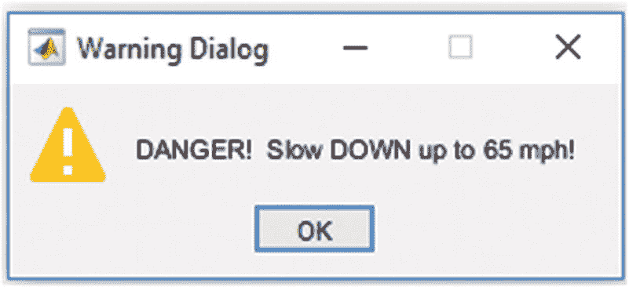

#### 案例 3

给定汽车在分隔式州际高速公路上以 77 英里/小时的速度行驶。

```
请输入您汽车的当前速度 [英里/小时]:    77
选择您的驾驶位置：
[1] 学校区域；[2] 住宅和商业区域；
[3] 城镇砾石路；[4] 双车道高速公路；
[5] 多车道高速公路；[6] 分隔式州际公路；
请输入您的驾驶区域，例如 1, 2, 3, ... 6:  6
您的汽车速度 = 77 [英里/小时] 在
北达科他州分隔式州际公路的限速范围内！
```

将显示以下警告对话框。


另一组控制语句是 `switch`、`case`、`otherwise` 和 `end`。这些语句相对于 `if`、`else`、`elseif` 和 `end` 有一个显著优势。它们能够处理多种情况并简化代码。它们具有以下通用语法结构：

```
switch 标量或字符串表达式（变量）
case 变量值 1
A 语句
case 变量值 2
B 语句
case 变量值 3
C 语句
...
otherwise
X, ... W 语句
end
```

让我们看一个简单的示例，了解这些条件语句——`switch`、`case`、`otherwise` 和 `end`——是如何运作的。

### 示例 4

判断用户输入的整数（从 1 到 50）是奇数、偶数还是质数。以下脚本（称为 `Num50Type.m`）定义了 1 到 50 范围内整数的类型。

```
% Num50Type.m - 定义输入的整数类型
clear all; clearvars; clc
N=input('请输入 1 到 50 之间的任意整数:  ');
if N<=50
fprintf('您输入的是: %d \n', N)
switch N
case {2 4 6 8 10 12 14 16 18 20 22 24 26 28 30 32, 34 36 38 40 43 44 46 48 50}
fprintf('您输入了 %g，这是一个偶数 \n', N)
case {9,15,21,25,27,33,35,39,45,49}
fprintf('您输入了 %g，这是一个奇数但不是质数\n', N)
otherwise %N=[3,5,7,11,13,17,19,23,29,31,37,41,43,47]
fprintf('您输入了 %g，这是一个质数 \n ', N)
end
else
disp('此代码仅适用于 1 到 50 之间的整数，用于判断它们是偶数、奇数还是质数！')
end
```

如果您输入整数 23，您将在命令窗口中得到以下输出。

```
请输入 1 到 50 之间的任意整数:  23
您输入了 23，这是一个质数
```

此脚本能正确判断所有输入的小于等于 50 的数值。但是，您可以通过添加条件语句和 `while` 循环来验证整数是否在 1 到 50 的范围内，从而提高其鲁棒性。

使用控制分支语句 `if, elseif, else, end` 的脚本，可以通过在循环语句（例如 `while ... end` 和 `for ... end`）中使用它们来提高其鲁棒性。下一节将通过示例对此进行讨论。


# 循环控制语句：`while`、`for`、`continue`、`break` 和 `end`

控制语句有两种类型——`while...end` 和 `for...end`。第一种循环控制语句是 `while...end`，其通用语法如下：

```
while 表达式不成立时
执行 A, B, C,..., W 操作
end
```

与 `if ... elseif ... else ... end` 语句不同，`while...end` 循环会持续执行操作，直到 `while` 运算符后面的表达式变为有效。一旦表达式变为真/有效，执行过程就会停止。

## 示例 1

使用 `while ... end` 循环控制计算从 1 到 100 的所有奇数的和（称为 `Sum100.m`）。

```
% Sum100.m 使用 while 循环计算所有奇数的和
Sum=0; N=1;
while ne(N, 100)
if ne(mod(N,2),0) % 验证是否将所有奇数都加上了。
Sum=Sum + N;
else              % 验证数字是否为偶数，不求和。
end
N=N+1;
end
disp(['1 到 100 所有奇数的和为： ', num2str(Sum)]);
```

这个基于循环的脚本（`Sum100.m`）将持续运行，直到迭代过程达到最终值 100。`if ... else ... end` 条件语句借助 `mod()` 来验证数字是奇数还是偶数。它用于计算 `N/2` 的余数。如果数字是奇数，则进行求和；否则，将被忽略。

## 注意

在许多使用 `while ... end` 和 `for ... end` 迭代循环的求和类练习中，用户难以理解计算算法并编写代码来执行求和过程。对于许多编程初学者来说，求和算法并不直观。困难之处在于他们忽略了在求和过程的初始步骤中将 `0`（值）赋给求和变量的必要性。这意味着将任何数字加到 `0` 上都会得到相同的数字。随后，在 `for ... end` 或 `while ... end` 循环内部，这个求和变量将在每次迭代中获得一个新值。例如，在前面的示例中：

第 1 步. `Sum(1) = 0`

第 2 步. `Sum(2) = Sum(1)+N(1) = 0+1=1`；当 `N(1)= 1` 且 `ne(mod(N(1),2), 0)` 有效时

第 3 步. `Sum(3)=Sum(2)=1`；当 `N(2)= N(1)+1=2` 时，因为 `N(2)/2 = 1` 余数为 `0` ← `ne(mod(N,2), 0)` 不成立

第 4 步. `Sum(4)=Sum(3)+N(3)=1+3 =4`；当 `N(3)=N(2)+1=2+1=3` 且 `ne(mod(N(3),2), 0)` 有效时

第 5 步. `Sum(5)=Sum(4)=4`；当 `N(4)=N(3)+1=3+1=4` 时；因为 `N(4)/2 = 2` 余数为 `0` ← `ne(mod(N(4),2), 0)` 不成立

第 6 步. `Sum(6)= Sum(5)+N(5)=4+5=9`；当 `N(5)=N(4)+1=4+1=5` 且 `ne(mod(N(5),2), 0)` 有效时

依此类推。迭代过程一直持续，直到 `N` 等于 100。

该脚本在命令窗口中的最终输出为：

```
1 到 100 所有奇数的和为： 2500
```

## 示例 2

为了更好地理解如何使用循环控制语句 `while ... end`，我们以求解二次方程为例：*ax*² + *bx* + *c* = 0

问题：用户可能会以错误的顺序输入 *a*、*b* 和 *c* 的值，或者输错它们的值，或者输入错误的数字。

为了使程序更健壮并解决任何错误输入问题，条件运算符 `if ... elseif ... else ...end` 与 `while ... end` 循环迭代运算符一起使用。

以下是该问题的一种可能解决方案。该脚本（名为 `Quad_Eqn.m`）非常健壮。它接受不同的输入，计算所有可能的根（实根和复根），然后在命令窗口中正确显示它们。它解决了许多可能的错误输入问题，例如错误的值、错误的数据大小或 *a*、*b* 和 *c* 的值混淆。请注意，第一个 `while` 循环语句验证包含 *a*、*b* 和 *c* 值的输入行数组的大小，第二个带有条件运算符 `if ... else ... end` 的循环语句验证 *a*、*b* 和 *c* 输入的顺序。

```
% Quad_Eqn.m 根据用户输入的 a, b, c 求解二次方程
clearvars; clc
SIZE_chk = 0;
while SIZE_chk ~=1
disp('求解：ax²+bx+c=0')
abc=input('请输入数值 [a, b, c]:   ');
SIZE_abc=numel(abc);
if SIZE_abc ==3
SIZE_chk=1;
a=abc(1);
b=abc(2);
c=abc(3);
CorrectEntry=0;
while CorrectEntry~=1
if SIZE_abc == 3
CorrectEntry=1; CorrectABC=0;
% 检查 a, b, c 的顺序
while CorrectABC~=1
disp('这是您想要求根的方程吗？')
disp('   ')
Eqn=sprintf(' %g*x²+(%g)*x + (%g)=0', a, b, c);
disp('   ')
disp(Eqn);
CorrectABC=input('如果是，请输入 1，否则输入任意整数！  ');
disp('   ')
if CorrectABC~=1
abc=input('请输入数值 [a, b, c]:   ');
a=abc(1); b=abc(2); c=abc(3);
end
end
D=b²-4*a*c;
% 求根
x1=(-b+sqrt(D))/(2*a); x2=(-b-sqrt(D))/(2*a);
if lt(D,0)
disp('该方程没有实根！');
Dm=sprintf('因为判别式 <0\. D = %g ', D); disp(Dm);
fprintf(' %g*x²+(%g)*x + (%g)=0\n', a, b, c);
fprintf('它有两个实根 \n');
fprintf('因为判别式 >0\. D = %g\n', D);
fprintf('方程的根为 x1= %g; x2= %g \n', x1, x2);
end
else
CorrectEntry=0;
disp(' a, b, c 不能包含超过一个元素（值）');
disp('请重新输入 a, b, c 的值');
disp('    ')
abc=input('请输入数值 [a, b, c]:   ');
a=abc(a); b=abc(2); c=abc(3);
sa=numel(1); sb=numel(b); sc=numel(c);
end
end
else
fprintf('您的输入有误 \n')
fprintf('请以行向量形式在 [ ] 中输入 [a, b, c] 的正确值： ')
end
end
```

该脚本针对 *a*、*b* 和 *c* 的故意错误输入进行了健壮性测试，如案例 1 和案例 2 所述。

```
求解：ax²+bx+c=0
请输入数值 [a, b, c]:   [12 1 1 1 ]
您的输入有误
请以行向量形式在 [ ] 中输入 [a, b, c] 的正确值：  求解：ax²+bx+c=0
请输入数值 [a, b, c]:   [12 1 1 1 ]
您的输入有误
请以行向量形式在 [ ] 中输入 [a, b, c] 的正确值：  求解：ax²+bx+c=0
请输入数值 [a, b, c]:   [1 2 1 1 ]
您的输入有误
请以行向量形式在 [ ] 中输入 [a, b, c] 的正确值：  求解：ax²+bx+c=0
请输入数值 [a, b, c]:   [1 2 1  ]
这是您想要求根的方程吗？
1*x²+(2)*x + (1)=0
如果是，请输入 1，否则输入任意整数！  0
请输入数值 [a, b, c]:   [1 1 2]
这是您想要求根的方程吗？
1*x²+(1)*x + (2)=0
如果是，请输入 1，否则输入任意整数！  1
该方程没有实根！
因为判别式 <0\. D = -7
1*x²+(1)*x + (2)=0
它没有实根！
因为其判别式 <0\. D=-7
复根为： x1=-0.5+1.3229i;   x2=-0.5-1.3229i
```

从这个简单的例子可以清楚地看出，`while ... end` 循环操作在增强脚本健壮性方面比 `if ... elseif ... else ... end` 运算符更强大。

第二种循环控制语句是 `for ... end`，其通用语法如下：

```
for i=起始值:步长:结束值
迭代 1
迭代 2
...
迭代 N
end
```

`for ... end` 循环控制语句的工作方式如下。它从`起始值`开始，以`步长`为步长，执行 `1, 2, ..., N` 中的每个语句，直到循环迭代达到`结束值`，这对应于 `N` 次迭代。

## 注意

如果在 `for ... end` 循环中分配向量空间或索引范围时未指定步长，则默认步长为 1。


### 示例 3

使用 `for ... end` 循环（名为 `Sum20odd.m`）计算 [1, 20] 范围内所有奇数的和。

```
% Sum20odd.m 使用 for 循环求 0...20 范围内奇数的和
clearvars;
S=0;
for N=1:20;
if rem(N,2)==0 %判断数字是否为偶数，是则不加。
S=S;
else           %所有奇数进行相加：
S=S+N;
end
end
fprintf('1 到 %g 内所有奇数的和等于 %g \n', N, S)
```

`if ... else ... end` 条件语句用于判断数字是否为奇数。如果数字是奇数，则将其加到求和变量（`S`）中；否则，变量不加任何值。此脚本背后的算法与示例 1 相同，这个简短的脚本是示例 1 的另一种解决方案。唯一的区别在于，这里的奇数数量上限为 20。

以下是本例使用 `for ... end` 和 `while ... end` 的另外两种更简单的解决方案：

```
% Sum20odd_alt.m 使用 [for ... end] 循环求 0...20 范围内奇数的和
clearvars;
S=0;
for N=1:2:20
S=S+N;
end
fprintf('1 到 20 内所有奇数的和等于 %g \n', S)
% 使用 [while ... end] 循环求 0...20 范围内奇数的和
clearvars;
S=0; jj=1;
while le(jj,20)
S=S+jj; jj=jj+2;
end
fprintf('1 到 20 内所有奇数的和等于 %g \n', S)
```

此脚本中 `for ... end` 的计算算法如下：

1. `S(1) = 0`
2. 当 `N(1)=1` 时，`S(2)=S(1)+N(1)=0+1=1`
3. 当 `N(2)=3` 时，因为步长为 `2`（即 `N(2)=N(1)+2=1+2=3`），所以 `S(3)=S(2)+N(2)=1+3=4`
4. 当 `N(3)=5` 时，因为 `N(3)=N(2)+2=3+2=5`，所以 `S(4)=S(3)+N(3)=4+5=9`
5. 以此类推……迭代循环运行直到 `N=20`。实际上，在此例中，`N` 不可能等于 20，因为步长为 2。所以 `N` 的最大值为 19。

最后，这些脚本的输出完全相同：

```
1 到 20 内所有奇数的和等于 100
```

正如所示，`for ... end` 可以很容易地被 `while ... end` 循环替代，反之亦然；它们的效率相似。然而，在某些特定示例（如示例 2）中，使用 `while ... end` 循环获得的鲁棒性是 `for ... end` 无法实现的。理论上，在某些问题（如示例 2）中，当迭代次数未知时，`while ... end` 可以被 `for ... end` 替代。

### 注意

在许多基于循环迭代的计算问题中，`for ... end` 可以很容易地替换 `while ... end` 循环，反之亦然。它们的计算效率相似。然而，有许多特定情况下，会采用 `while ... end` 操作来获得脚本的高鲁棒性，而 `for ... end` 无法提供同等的鲁棒性和灵活性。本节中的示例 2 就说明了这一点。

建议在循环迭代中使用 `ii` 或 `jj` 作为索引，以避免与虚数混淆，因为 MATLAB 默认保留 `i` 和 `j` 用于虚数。如果将这些字母（`i` 和 `j`）用作索引，则可以使用 `sqrt(-1)` 表示虚数，或者从工作区中清除这些变量。

### 示例 4

使用循环控制语句 `for, end` 计算偶数的平方和立方。

以下是其中一个可能的解决方案脚本（名为 `SqCube10.m`）。请注意，在本示例中，`startloop=2`，`stepsize=2`，`endloop=10`：

```
% SqCube10.m 计算 2...10 范围内数字的平方和立方
%%  [for  ... end]
for k=2:2:10
Square = k²;
Cube   = k³;
fprintf('%g 的平方是 %g \n', k, Square);
fprintf('%g 的立方是 %g \n'  , k, Cube);
end
%% 另一种方式：[while ... end]
jj =2;
while le(jj, 10)
Square = jj²;
Cube   = jj³;
fprintf('%g 的平方是 %g \n', jj, Square);
fprintf('%g 的立方是 %g \n'  , jj, Cube);
jj =jj+2;
end
```

当脚本执行时，命令窗口中会显示以下内容：

```
2 的平方是 4
2 的立方是 8
4 的平方是 16
4 的立方是 64
6 的平方是 36
6 的立方是 216
8 的平方是 64
8 的立方是 512
10 的平方是 100
10 的立方是 1000
```

### 示例 5

使用 `for ... end` 和 `while ... end` 计算级数 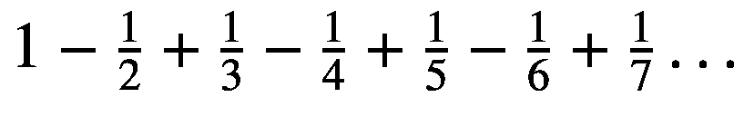。

以下是针对给定练习的四个可能的解决方案脚本，它们集中在一个名为 `SumSeries.m` 的脚本中。

```
% SumSeries.m 计算一个级数的和：
%% 版本 A. [for ... end]
clearvars
sign=1; sum_ser=0;
n=input('输入要计算的级数项数：  ');
for N=1:n
sum_ser=sum_ser+sign/N; sign=-sign;
end
fprintf('%g 项级数的和等于 %2.5f \n', n, sum_ser)
%% 版本 B. [while ... end]
clearvars
S=0;
N=input('输入要计算的级数项数：  ');
ii=1;
while ii~=N+1
if mod(ii,2)==0
S=S-1/ii;
else
S=S+1/ii;
end
ii=ii+1;
end
fprintf('%g 项级数的和等于 %2.5f \n', ii, S)
%% 版本 C. [for ... end]
clearvars
Sum=1;
n = input('输入要计算的级数项数：  ');
for k=2:n
if eq(mod(k,2), 0)
Sum=Sum-1/k;
else
Sum=Sum+1/k;
end
end
fprintf('%g 项级数的和等于 %2.5f  \n', k, Sum)
```

所有这些使用 `for ... end` 和 `while ... end` 的解法都会得到相同的结果。必须注意，MATLAB 函数 `mod(N, 2)` 用于判断数字是偶数还是奇数。在此脚本中，它用于分离 `ii` 和 `k` 的偶数和奇数部分。

在所有这些示例中，迭代过程的最终值都被保存了下来。那么如何保存所有迭代步骤中的全部值呢？

```
%% 版本 A. [for ... end]
clearvars
Sum=1;
n = input('输入要计算的级数项数：  ');
k=2:1:n;
for jj=1:numel(k)
if eq(mod(k(jj),2), 0)
Sum(jj+1)=Sum(jj)-1/k(jj);
else
Sum(jj+1)=Sum(jj)+1/k(jj);
end
fprintf('%g 项级数的和等于 %2.5f  \n', k(jj), Sum(jj+1))
end
disp('         ')
fprintf('%g 项级数的和等于 %2.5f \n', k(end), Sum(end))
%% 版本 B. [for ... end]
clearvars
sign=1; sum_ser=0;
n=input('输入要计算的级数项数：  ');
for N=1:n
sum_ser=sum_ser+sign/N; sign=-sign;
S(N)=sum_ser;
fprintf('%g 项级数的和等于 %2.5f \n', n, sum_ser)
end
%% 版本 C. [while ... end]
clearvars
S=0;
N=input('输入要计算的级数项数：  ');
ii=1;
while ii~=N+1
if mod(ii,2)==0
S(ii+1)=S(ii)-1/ii;
else
S(ii+1)=S(ii)+1/ii;
end
fprintf('%g 项级数的和等于 %2.5f \n', ii, S(ii+1))
ii=ii+1;
end
%% 版本 D. [while ... end]
clearvars
S=0;
N=input('输入要计算的级数项数：  ');
ii=1;
while ii~=N+1
if mod(ii,2)==0
S=S-1/ii;
Ss(ii)=S;
else
S=S+1/ii;
Ss(ii)=S;
end
fprintf('%g 项级数的和等于 %2.5f \n', ii, Ss(ii))
ii=ii+1;
end
```

保留所有迭代中所有值的最简单直接的方法之一是启动一系列新变量，例如 `Sum(jj)`、`S(N)` 和 `Ss(ii)`。在循环内保存所有计算输出值时，正确理解 `Sum(jj+1)`、`Sum(jj)`、`S(ii+1)` 和 `S(ii)` 至关重要。例如，`Sum(jj)` 取 `Sum=1` 的值，`Sum(1+1) = Sum(1)-1/k(1)` 等于 `Sum(2) = 1-1/2 =` ½。在下一步（步骤 2）中，`Sum(3)=Sum(2) +1/k(2)` 等于 `Sum(3) =1/2+1/3 =5/6`，依此类推。在版本 B 中，`S(N)` 保存了在 `1:n` 范围内每一次迭代中 `S` 的每个值。

### 示例 6

使用 `for ... end` 和 `while ... end` 循环迭代算子计算表达式 *f*(*t*) = *e*^(*sin*(3*t*)) *t* = 0 : 0.001 : 6.28，并保留所有迭代中的所有值。每次迭代中，对应于每个 *t* 值，保存一个 *f*(*t*) 值。

```
%% Ex6_FOR_WHILE.m
clearvars
% 版本 1
ii =1;
for t=0:.001:6.28
f(ii)=exp(sin(t));
ii=ii+1;
end
% 版本 2
t=0:.001:6.28;
for k=1:numel(t)
f(k)=exp(sin(t(k)));
end
%% 版本 3
jj=0;
while jj~=numel(t)
f(jj+1)=exp(sin(t(jj+1)));
jj=jj+1;
end
% 版本 4
m=1;
while m~=numel(t)+1
f(m)=exp(sin(t(m)));
m=m+1;
end
```


### 注意

在 `for ... end` 和 `while ... end` 循环中计算 `f(t)` 时，务必使用 `f(ii)`、`f(k)`、`f(jj+1)` 或 `f(k)`。这样可以保留迭代过程中关于不同 `t` 值的所有 `f(t)` 结果。如果只用 `f` 而非 `f(ii)`、`f(k)`、`f(jj+1)` 或 `f(k)`，则只会保存 `f(t)` 的最后一个值。

用户在使用循环控制语句（`for ... end` 和 `while ... end`）时，最容易犯的错误之一是在主变量之后忽略了索引 `(ii)`、`(k)`、`(jj)` 或 `(m)`。例如，前一个例子中的 `f(ii)`、`f(k)`、`f(jj+1)` 和 `f(k)`，其目的是收集整个迭代过程中的所有值。

用户在使用循环控制语句时另一个常见错误是给 `(ii)` 和 `(jj)` 分配了错误的索引值。例如，分配负值、以 `0` 开头，或使用非整数值或尺寸不匹配的值。在前一个示例的 Ver 3 中，我们忽略了在 `while` 之前给 `jj` 赋值 `0`，或者赋值了 `jj=0` 的同时又使用 `f(jj)`。因为 `f(0)` 是没有意义的，变量不能有索引 `0`。索引可以是 1、2、3、... 10¹²、... 10²⁵ + 1，但不能是 ..., -3、-2、-1、0 或 0.12、2.1、3.35、5.5、7/8、100/899 等。

有一种很好的替代方法可以收集循环中每次计算的所有值，即为一个新变量分配索引。例如，这可以通过以下方式实现：

```
%% Ex6_FOR_WHILE.m
clearvars
% Ver 1
ii =1;
for t=0:.001:6.28
f=exp(sin(t));
F1(ii)=f;
ii=ii+1;
end
% Ver 2
t=0:.001:6.28;
for ii=1:numel(t)
f=exp(sin(t(ii)));
F2(ii)=f;
end
%% Ver 3
jj=0;
while jj~=numel(t)
f=exp(sin(t(jj+1)));
F3(jj+1)=f;
jj=jj+1;
end
% Ver 4
jj=1;
while jj~=numel(t)+1
f=exp(sin(t(jj)));
F4(jj)=f;
jj=jj+1;
end
```

注意，在此示例中，最佳且最高效的计算方法是向量化，如下所示。

```
t=0:.001:6.28
f=exp(sin(t));
```

### 注意

为了提高计算过程的效率并改进代码，建议尽可能避免使用 `for ... end` 和 `while ... end` 循环控制语句。与其使用这些循环迭代，不如采用示例 6 中所示的向量化代码方法。

### 示例 7

让我们在这个例子中使用著名的“小麦与棋盘”的故事。问题定义如下：按照顺序在棋盘的每个格子里放置麦粒，第一个格子放一粒，第二个格子放两粒，第三个格子放四粒，第四个格子放八粒，第五个格子放十六粒，第六个格子放三十二粒，以此类推，每向后一个格子，麦粒数量翻倍。

要放在棋盘上的所有麦粒的总数为 1+2+4+8+16+32 ... 以此类推。这也可以表示为 2 的幂的和：2⁰ + 2¹ + 2² + 2³ + 2⁴ + 2⁵ + ... + 2⁶³，等于 2⁶⁴ − 1 = 18,446,744,073,709,551,615。这确实是一个巨大的麦粒数量。简单计算一下，如果一粒麦粒重 0.025 克，那么总重量将超过 4610 亿吨。那将是一座比珠穆朗玛峰还高的麦粒山。让我们使用 `for ... end` 和 `while ... end` 循环来计算麦粒的数量。

```
% ChessInventorReward.m
% 示例：棋盘上的麦粒
%% 版本 A. [while ... end] 循环
clearvars
S=1; Ncell=64; jj=1;
while jj~=Ncell
S=S+2^jj; jj=jj+1;
end
display(['格子数量: ', num2str(Ncell)])
display('& 麦粒总数为: '), disp(uint64(S))
% 现在用简单解法测试我们的结果：2⁶⁴-1;
Error=S-2⁶⁴ %#ok
%% 版本 B. [for ... end] 循环
clearvars
S=0; Ncell=64;
for ii=0:Ncell-1
S=S+2^ii;
end
display(['格子数量: ', num2str(Ncell)])
display('& 麦粒总数为: '), disp(uint64(S))
% 现在用简单解法测试我们的结果：2⁶⁴-1;
Error=S-2⁶⁴ %#ok
```

两个解决方案脚本输出的麦粒数量相同，均为 18,446,744,073,709,551,615，且误差为 `0`。注意，18,446,744,073,709,551,615 = 2⁶⁴ − 1 是在 64 位计算机上安装的 MATLAB 64 位版本中能正确显示的最大整数长度。

### 示例 8

证明 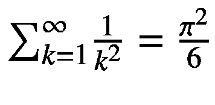。使用 `for ... end` 和 `while ... end` 循环计算此求和。

```
% SumPi6.m
%% 示例：sum(1/k²)=pi²/6
% 版本 A. [while...end] 循环
clearvars
S=0; jj=1; k=input('输入计算的迭代次数: ');
while le(jj, k)
S=S+1/jj²; jj=jj+1;
end
display(['单元格数量: ', num2str(Ncell)])
display('& 总麦粒数为: '), disp(uint64(S))
Error = (pi²/6)-S; display(Error)
% 示例：sum(1/k²)=pi²/6
% 版本 B. [for ... end] 循环
clearvars –except k
S=0;
for jj=1:k
S=S+1/jj²;
end
display(['单元格数量: ', num2str(Ncell)])
display('& 总麦粒数为: '), disp(uint64(S))
Error = (pi²/6)-S; display(Error)
```

### 内存分配

当需要保存所有迭代的所有值时，建议采用内存分配方法，以提高计算效率。让我们分析内存分配方法如何增强计算效率。使用内存分配技术，会以用户指定的大小为计算变量分配指定的内存，在循环计算过程中，所有变量的值都会被记录到预先指定的内存中。这能显著加快计算过程。使用内存分配技术，在循环迭代之前，通过标准的矩阵/数组生成函数（例如 `ones()` 或 `zeros()`）创建变量的确切大小。

内存分配的一般语法/伪代码如下：

```
% [FOR ... END]
M = zeros(1, n);
for ii = 1:n
M(ii) = [计算];
end
% [WHILE ... END]
MM = zeros(1, k); jj=1;
while jj ~=k
MM(jj) = [计算];
jj=jj+1;
end
```

此语法也可应用于嵌套循环。让我们在以下示例中考虑内存分配技术。

### 注意

在使用 `for ... end` 和 `while ... end` 循环进行大量计算时，应用内存分配技术非常重要。这将减少计算时间并节省计算资源。


### 示例 9

在 17 世纪，莱布尼茨使用`arctan(x)`的级数展开来确定`π`的近似值。利用麦克劳林级数公式，可以写成：

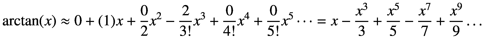

考虑到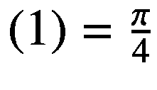，你可以将`x = 1`代入表达式，这将得到以下表达式：


也可以写成 `N` 项的形式：


任务在于编写一个脚本，用于计算 `N` 项的和 (`S[N]`) 以及  的近似值，然后通过计算差值（误差） 来绘制迭代过程，分别使用 `for ... end` 和 `while ... end` 循环。

以下是可能的解决方案脚本，它们被收集在一个名为 `LeibnitzSeries.m` 的文件中，用于计算莱布尼茨级数以近似：

```
%% LeibnitzSeries.m
% 版本 A.
clearvars
N=input('输入近似 pi/4 的项数:  ');
S=0;                        % 求和初始值
Err=zeros(1, N);   % 内存分配
for k=0:N-1
p=(-1)^k;
S=S+p/(2*k+1);
Err(k)=pi/4-S;  % 累积所有迭代的误差
end
plot(1:N, Err), grid on
title(['使用 ', num2str(N), ' 项近似 \pi/4'])
ylabel('误差'), xlabel('项数')
%% 莱布尼茨级数
% 版本 B
clearvars
n=input('输入近似 pi/4 的项数:  ');
S=0;  % 求和初始值
Error=zeros(1, n);  % 内存分配
k=0;
while k<=n-1
p=(-1)^k;
S=S+p/(2*k+1);
Error(k+1)=pi/4-S; % 累积所有迭代的误差
k=k+1;
end
plot(1:n, Error), grid on
title(['使用 ', num2str(n), ' 项近似 \pi/4'])
ylabel('误差'), xlabel('项数')
```

如果执行 `N=200` 项的脚本，你将得到如图 2-2 所示的图，该图显示了级数近似的结果：


**图 2-2** – 用 200 项莱布尼茨级数近似 

也可以在循环内部嵌套另一个循环。让我们看几个使用 `for ... end` 和 `while ... end` 生成循环嵌套的示例。

### 注意

也可以创建多个嵌套的 `for ... end` 循环。

### 示例 10

创建包含 1 到 10 的伪随机整数的 5 行 7 列矩阵元素。以下是解决方案脚本 `PseudoRandi.m`：

```
% PseudoRandi.m
for k=1:5
for n=1:7
AB(k,n)=randi(10,1);
end
end
display(AB)
```

执行脚本后，得到以下结果：

```
AB =
3     5     3     6     4     8     6
2     1     5     6     7     2     9
9     6     8     1     9     4     9
4     9     9     4     7     3     3
3     7     2     8     8    10     8
```

请注意，每次执行脚本时，都会生成范围在 [1, 10] 之间的不同伪随机整数。如所示，对于许多问题，`for...end` 和 `while...end` 循环控制语句可以互换使用。

### 示例 11

通过使用 `for ... end` 和 `while ... end` 循环迭代计算以下级数的和：

`f(b[n], x) =`  使用 `for...end` 循环控制语句。取 `n = 1 : 11`，`b[n] = [-5...5]`，`x = [0...L]`，且 `L = 10`。对于 `x`，取步长 。绘制所有计算结果。

以下是使用 `for ... end` 循环的解决方案脚本（名为 `Ex11_sine_series.m`）：

```
%% 版本 A. [FOR ... END]
clearvars, close all
n=11; b = -5:5;x=0:.01:10; f=0; L=10;
f = zeros(n, numel(x)); % 内存分配
for k=1:n
f=f+(b(k)*sin((2*k-1)*pi*x(:))/(2*L));
Fun(k,:)=f;
plot(x(:), Fun(k,:)), label{k}=(['迭代: ' num2str(k)]);
legend(label{:}), hold all,
end
grid on, title('级数的和'), xlabel('x'), ylabel('f(b_n, x)')
%% 版本 B.
clearvars
n=11; b = -5:5;x=0:.01:10; L=10;
f = zeros(n, numel(x)); % 内存分配
for k=1:n
f(k, :)=(b(k)*sin((2*k-1)*pi*x(:))/(2*L));
end
Fun = sum(f(:,:));  % 获取最终值（所有项的总和）。
```

以下是使用 `while ... end` 循环的替代解决方案脚本（见图 2-3）：


**图 2-3** – 级数 `f(b[n], x) =`  的和

```
%% 版本 C. [WHILE...END]
clearvars, close all
n=11; b = -5:5;x=0:.01:10; f=0; L=10; k=1;
Fun = zeros(n, numel(x)); % 内存分配
while k<n+1
f=f+(b(k)*sin((2*k-1)*pi*x(:))/(2*L));
Fun(k,:)=f;
plot(x(:), Fun(k,:)), label{k}=(['迭代: ' num2str(k)]);
legend(label{:}), hold all
k=k+1;
end
grid on, title('级数的和'), xlabel('x'), ylabel('f(b_n, x)')
```

请注意，与图形构建相关的命令——例如 `plot()`、`label{}` 和 `legend()`——不会影响计算的准确性，但会显著降低计算过程的速度。因此，如有可能，建议避免在循环内绘制计算数据。


### 示例 12

使用 `for ... end` 和 `while ... end` 循环运算符，计算函数  在 `t`=0...π（`Δt`=π/1000）且 `μ`=1...7 时的取值。

以下是包含两个循环运算符的普通脚本（名为 `Ex12_FS.m`）。

```
% [FOR ... END]
mu=1:7; t=0:pi/1e3:pi;
F=zeros(numel(mu), numel(t)); % 内存分配
for mu=1:7
for ii=1:numel(t)
F(mu, ii)=sin(2*t(ii))*sqrt(sin(mu*t(ii)*sqrt(t(ii)+t(ii)²+t(ii)³)));
end
plot(t, F(mu,:)), hold all
end
xlabel('t'), ylabel('F'), title('正弦波'), grid on
%% [WHILE ... END]
mu=1:7; t=0:pi/1e3:pi;
F=zeros(numel(mu), numel(t)); % 内存分配
MU = 1;
while ne(MU, 8)
ii=1;
while ii~=numel(t)+1
F(MU, ii)=sin(2*t(ii))*sqrt(sin(MU*t(ii)*sqrt(t(ii)+t(ii)²+t(ii)³)));
ii=ii+1;
end
plot(t, F(MU,:)), hold all
MU=MU+1;
end
xlabel('t'), ylabel('F'), title('正弦波'), grid on
```

两种迭代循环产生相同的解和图形。在执行此脚本时，负数平方根也会产生复数输出。因此，命令窗口中将显示警告消息，提示在图 2-4 的绘图中已省略/忽略了虚部。


图 2-4

 在 `t`=0...π（`Δt`=π/1000）、`μ`=1...7 时的绘图

### 示例 13

计算  函数在 `t`=0...5 区间内，时间步长分别为 `Δt`=10^(−6) 和 `Δt`=10^(−3) 时的取值，并将计算出的函数值相对于时间值进行绘图。采用非常小的时间步长 `Δt`=10^(−6) 是为了展示内存分配和循环迭代相对于向量化计算的重要性，而采用 `Δt`=10^(−3) 则是为了展示在使用 `for ... end` 和 `while ... end` 循环迭代时，`plot()` 命令放置位置的重要性。

这里有四种不同的方法（合并到一个名为 `Ex13_CF.m` 的脚本中）可使用 `for, end` 和 `while, end` 循环控制语句来解决给定练习。所有这些方法产生的结果相同，但其计算（运行）时间差异显著。请注意，在本练习中，`for, end` 和 `while, end` 循环控制语句仅用于演示目的，旨在说明如何使用循环语句并提高其效率。对于此类练习或任何其他向量计算，直接计算 `f(t)` 的向量值比使用循环语句效率高得多。

```
% Ex13_CF.m 计算 Exp(-3t/7) 数学函数
% 解法 1
clc; clear all; close all
tic
t=0:1e-6:5;
m_num=length(t);
for m=1:m_num
f(m)=exp(-3*t(m)/7);
end
Tfor=toc; fprintf('[1] FOR 循环计算时间: %g \n', Tfor)
plot(t, f, 'ro'), xlabel('t'), ylabel('f(t)'), title('t 与 f(t)')
% % 解法 2
clearvars, close all
tic
t=0:1e-3:5;
m_num=length(t);
for m=1:m_num
f(m)=exp(-3*t(m)/7); plot(t(m), f(m), 'ro')
end
TforP=toc;
xlabel('t'), ylabel('f(t)'), title('t 与 f(t)')
fprintf('[2] 包含 plot() 的 FOR 循环计算时间: %g \n', TforP)
% 解法 3
clearvars, close all
tic
t=0:1e-3:5;
m_num=length(t); m=1;
while m<=m_num
f(m)=exp(-3*t(m)/7); plot(t(m), f(m), 'ro')
m=m+1;
end
Twhile=toc;
xlabel('t'), ylabel('f(t)'), title('t 与 f(t)')
fprintf('[3] 包含 plot() 的 WHILE 循环计算时间: %g \n', Twhile)
% 解法 4. 通过内存分配改进。
clearvars, close all
tic
t=0:1e-6:5;
m_num=length(t); f=zeros(1,m_num-1);
for m=1:m_num
f(m)=exp(-3*t(m)/7);
end
plot(t,f, 'bo'); TforIm=toc;
xlabel('t'), ylabel('f(t)'), title('t 与 f(t)')
fprintf('[4] 改进后的 FOR 循环（含内存分配）时间: %g\n', TforIm)
% 解法 5. 向量化方法
clearvars, close all
t=0:1e-6:5;
tic
f=exp(-3*t/7);
Tvec=toc; plot(t, f, 'bo')
xlabel('t'), ylabel('f(t)'), title('t 与 f(t)')
fprintf('[5] 推荐的向量化方法时间: %g\n', Tvec)
```

如果在个人计算机（处理器：Intel COREi5，内存：4GB，操作系统：Windows 7，MATLAB 7.9.0）上执行 `Ex13_CF.m` 脚本，命令窗口中将得到以下计算时间结果。请注意，此处未显示绘图图形。

```
[1] FOR 循环计算时间: 0.532263
[2] 包含 plot() 的 FOR 循环计算时间: 9.43334
[3] 包含 plot() 的 WHILE 循环计算时间: 9.30924
[4] 改进后的 FOR 循环（含内存分配）时间: 0.205544
[5] 推荐的向量化方法时间: 0.0335956
```

仿真结果再次证明了 `plot()` 命令在 `for, end` 和 `while, end` 控制循环内对计算时间的影响。在这个简单示例中，可以清楚地看到，与方法 1 和 4 相比，使用方法 2 和 3 绘制计算数据所消耗的 CPU 时间要多得多（约 17.5 倍），尽管所选的方法 2 和 3 的步长 `Δt` = 10^(−3) 比其他三种方法使用的步长（`Δt` = 10^(−6)）大了 10³ 倍。

### 注意

如果可能，应避免在 `for...end` 和 `while...end` 循环中使用 `plot()` 命令，以提高计算/仿真效率。

当必须使用 `for, end` 和 `while, end` 循环控制语句时，内存分配是必要的。通过使用内存分配，可以显著提高循环控制语句的时间效率。在前面的简单示例中，使用内存分配技术（方法 1 与方法 4 对比）使计算时间提高了超过 2.5 倍。

请注意，只有当迭代次数相当大（例如几千次或更多）时，才能观察到内存分配技术带来的时间效率提升。向量化方法确实更为优越。当将带有内存分配的方法 4 与向量化方法（方法 5）进行比较时，向量化比内存分配方法快六倍以上。


### 注意

如果计算/仿真问题需要使用`for...end`和`while...end`循环，请采用内存分配技术以提高计算/仿真的时间效率。

为了计算已用（计算）时间，建议使用秒表计时器和`tic...toc`操作符来跟踪脚本的计算时间。实际上，在 MATLAB 中还有几种备选操作符可以计算脚本或函数文件的已用（计算）时间，它们是`cputime`、`clock`和`etime`。这些操作符可以在 M 文件中按如下方式使用。这是对比分析脚本（`Ex13_CT.m`），它将上述操作符与前一个示例配合使用，计算`f(t)=e^{\frac{-3t}{7}}`函数在*t* = 0...5、时间步长*∆t* = 0.0001 时的取值。

```
% Ex13_CT.m
%% [tic ... toc]
clc; clear all, close all
T1=tic;
t=0:1e-4:5; m_num=length(t);
for m=1:m_num
f(m)=exp(-3*t(m)/7);
end
Tfor1=toc(T1);
fprintf('FOR 循环时间 [tic...toc]: %g \n', Tfor1)
%% [cputime ... cputime-Time]
clear all, close all
TT=cputime;
t=0:1e-4:5; m_num=length(t);
for m=1:m_num
f(m)=exp(-3*t(m)/7);
end
Tfor2=cputime-TT;
fprintf('FOR 循环时间 [cputime]: %g \n', Tfor2)
%% [clock ... etime()]
clear all, close all
TT=clock; t=0:1e-4:5; m_num=length(t);
for m=1:m_num
f(m)=exp(-3*t(m)/7);
end
Tfor3=etime(clock, TT);
fprintf('FOR 循环时间 [clock...etime]: %g \n', Tfor3)
```

执行此脚本后，在命令窗口中会得到以下结果：

```
FOR 循环时间 [tic...toc]: 2.49076
FOR 循环时间 [cputime]: 2.46482
FOR 循环时间 [clock...etime]: 2.494
```

结果显示，这些操作符工作方式相似，产生的数值结果非常接近。除了这些操作符之外，还有一个名为`timeit`的操作符，也可用于计算函数文件所有仿真过程所花费的总计算时间。该操作符是在较新版本的 MATLAB 包（R2014b）中引入的。

`break`命令是一个功能强大且方便的操作符，主要用于`while...end`和`for...end`循环控制语句中，以便在满足特定条件时停止求值过程。这是另一种提高迭代时间效率的技巧。我们在下面的示例中来看`break`命令的实现。

### 示例 14

计算斐波那契数。斐波那契数列由以下表达式定义：*f*[1] = 1, *f*[2] = 1, *f*[3] = *f*[1] + *f*[2], ..., *f*[*n*] = *f*[*n* − 2] + *f*[*n* − 1]

因此，如果*f*[1] = 1, *f*[2] = 1, *f*[3] = 3, *f*[4] = 3 + 1, *f*[5] = 4 + 3, ...：

1. 展示斐波那契数列的前 13 个元素。

2. 计算斐波那契数列的前 111 个元素，或者当数列达到 123456789 时停止迭代。

以下是解决方案脚本（名为`Ex14_FN.m`）。它使用`for...end`和`while...end`计算前 13 个元素（序列），并使用`while...end`计算数列的前 111 个元素（序列），如果数列达到 123456789，则通过使用`break`操作符停止计算。

```
% Ver 1\. 计算斐波那契数列的 13 个元素：[for ... end]
clearvars
f(1) = 1; f(2)=1;
f = [f(1), f(2), zeros(1, 11)]; % 内存分配
fprintf('元素: %.0f  斐波那契数: %.0f \n', 1, f(1));
fprintf('元素: %.0f  斐波那契数: %.0f \n', 2, f(2));
for jj=3:13
f(jj)=f(jj-2)+f(jj-1);
fprintf('元素: %.0f  斐波那契数: %.0f \n', jj, f(jj));
end
%% Ver 2\. 计算斐波那契数列的 13 个元素：[while...end]
clearvars
f(1) = 1; f(2)=1; jj=3;
f = [f(1), f(2), zeros(1, 11)]; % 内存分配
fprintf('元素: %.0f  斐波那契数: %.0f \n', 1, f(1));
fprintf('元素: %.0f  斐波那契数: %.0f \n', 2, f(2));
while jj<14
f(jj)=f(jj-2)+f(jj-1);
fprintf('元素: %.0f  斐波那契数: %.0f \n', jj, f(jj));
jj=jj+1;
end
%% Ver 3\. 计算前 111 个元素或在达到 123456789 时停止
clearvars
F(1)=1; F(2)=1; jj=3;
F = [F(1), F(2), zeros(1, 40)];
fprintf('元素: %.0f  斐波那契数: %.0f \n', 1, F(1));
fprintf('元素: %.0f  斐波那契数: %.0f \n', 2, F(2));
while jj<112
F(jj)=F(jj-2)+F(jj-1);
if F(jj)>=123456789
fprintf('迭代已停止，因为 \n ')
fprintf('最后一个计算值大于 123456789 \n')
break
else
continue
end
end
```

此脚本在命令窗口中产生以下输出：

```
元素: 1  斐波那契数: 1
元素: 2  斐波那契数: 1
元素: 3  斐波那契数: 2
元素: 4  斐波那契数: 3
元素: 5  斐波那契数: 5
元素: 6  斐波那契数: 8
元素: 7  斐波那契数: 13
元素: 8  斐波那契数: 21
元素: 9  斐波那契数: 34
元素: 10  斐波那契数: 55
元素: 11  斐波那契数: 89
元素: 12  斐波那契数: 144
元素: 13  斐波那契数: 233
```

Ver 2 的结果与 Ver 1 完全相同，因此此处未显示。以下是使用`break`操作符的最后一个部分的结果。

```
元素: 1  斐波那契数: 1
元素: 2  斐波那契数: 1
元素: 3  斐波那契数: 2
元素: 4  斐波那契数: 3
元素: 5  斐波那契数: 5
元素: 6  斐波那契数: 8
元素: 7  斐波那契数: 13
元素: 8  斐波那契数: 21
元素: 9  斐波那契数: 34
元素: 10  斐波那契数: 55
元素: 11  斐波那契数: 89
元素: 12  斐波那契数: 144
元素: 13  斐波那契数: 233
...
元素: 25  斐波那契数: 75025
元素: 26  斐波那契数: 121393
元素: 27  斐波那契数: 196418
...
元素: 39  斐波那契数: 63245986
元素: 40  斐波那契数: 102334155
元素: 41  斐波那契数: 165580141
迭代已停止，因为
最后一个计算值大于 123456789
```

请注意，在使用`break`操作符的最后一个部分中，内存分配操作`F = [F(1), F(2), zeros(1, 40)]`创建了[1, 1, 40 个“0”元素]。因此，经过 41 次迭代后，`F`的最后一个元素（第 42 个元素）仍为 0。

### 示例 15

计算正弦函数*h*(*θ*) = *sin*(*θ*)在*θ* = 0...2*π*范围内，以 1000 个递增步长进行取值，并在函数值*h*(*θ*) ≈ 0.9999 时停止计算。

正弦函数在*θ* = 0...2*π*范围内在 0...1、1...0、0...-1、-1...0 之间波动；因此，当函数值达到 0.9999 时，应停止计算循环。以下是解决方案脚本（`Ex15_SINE.m`），它使用`break`语句在满足预设条件时计算并停止计算过程。

```
% Ex15_SINE.m 计算 sin(theta)
clearvars
theta=linspace(0, 2*pi, 1000); k=length(theta); h=ones(1,k-1);
for ii=1:k
h(ii)=sin(theta(ii));
data(ii,:)=[theta(ii);h(ii)];
if abs(h(ii))>=0.9999
fprintf('经过 %g 次迭代后计算停止\n', ii);
fprintf('函数值为: %1.5f \n', h(ii))
fprintf('当 theta 等于 % 1.5f 度时\n', theta(ii)*180/pi)
break
else
continue
end
end
plot(data(:,1), data(:,2), 'bd'), hold on
plot(data(ii,1),data(ii,2), 'p', 'markerfacecolor','c',  'markersize', 18)
grid on
```

当执行脚本（`Ex15_SINE.m`）时，命令窗口中会显示以下输出。

```
经过 249 次迭代后计算停止
函数值为: 0.99994
当 theta 等于  89.36937 度时
```

下一张绘制的图如图 2-5 所示。


图 2-5

*h*(*θ*) = sin(*θ*)在*θ* = 0…*π*/2 范围内的图形，且计算在*h*(*θ*)=0.9999 时停止

此解决方案脚本也可以用`while...end`以非常相似的方式进行编辑或重写。这留给读者自行尝试，用于自测。


### 示例 16

编写一个包含 `for ... end` 循环和条件语句 `if, elseif, else, end` 的脚本文件，用于计算函数值。然后绘制计算得到的值：

 

对于 *t* ∈ [−4*π*, 3*π*] 的值。取 *∆t* = 0.0001，以下是解决方案脚本（名为 `Ex16_FNs.m`）。

```
%% Ex16_FNs.m
clc, clearvars
t=-4*pi:.0001:3*pi;  % Whole t series
F=ones(size(t));     % Memory allocation
tic;
for ii = 1:numel(t)
if t(ii)-2*pi && t(ii)pi && t(ii)<=2*pi
F(ii)=exp(sin(100*t(ii)))+exp(cos(2*t(ii)));
else
F(ii)=1;
end
end
Tma=toc;
plot(t, F), grid on;
plot(t, F), grid on, xlabel('\it t'), ylabel('\it F(t)'),
title('Plot of function values w.r.t value ranges of t'), shg
fprintf('Computation Time with memory allocation:  %2.6g \n', Tma)
```

以下是命令窗口中的输出（名为 `Ex16_FNs.m`）。图 2-6 显示了脚本的绘图结果。


图 2-6

函数图像  

```
Computation Time with memory allocation:  0.0286769
```

本例中的一个棘手步骤是根据问题描述分离出 `t` 的四个取值范围，然后计算四个独立的函数值。条件语句 `if... elseif... elseif... elseif ... else ... end` 之前的循环操作 `for ... end` 根据 `t` 的索引执行整个计算。而 `if... elseif... elseif... elseif ... else ... end` 则通过根据给定条件比较每个 `t(ii)` 的值来分离 `t` 的值。在这种情况下，索引 `(ii)` 是必需的。

### 星号

通常，`*` 符号用作乘法运算符，但在其他情况下，它可以用作文件名识别的通配符。例如，如果需要删除所有扩展名为 `*.asv` 的文件，以下命令可执行此任务：

```
>> delete *.asv
```

这样，您就可以删除 MATLAB 当前目录下所有扩展名为 `*.asv` 的文件。另一个例子是，如果需要定位一个名为 `midpoint_rule.m` 的 M 文件，您可以输入部分文件名，如下所示：

```
>>  dir('midp*.m')
midpoint_rule.m
```

此外，您还可以使用 `*` 通过输入变量的部分名称来获取工作区中变量的信息，或通过输入部分名称来删除它们：

```
>> whos
>> who
Your variables are:
H    N    NaH
>> clear N*
>> whos
Name      Size            Bytes  Class     Attributes
H         5x1              3525  struct
```

### At（`@`）符号

`@` 符号/运算符主要用于构造函数句柄。例如：

```
F=@(argument lists)expression
```

此外，`@` 运算符用于指定新的 MATLAB 类目录标识符，以覆盖 MATLAB 文件。例如：

```
\@myclass\myfun.m
```

请注意，MATLAB 类可用于定义面向对象的设计，本书不对此进行讨论。

### 冒号

`:` 运算符用于生成数字序列或数组元素序列，或分配索引。例如：

```
>>M=1:3:300;
>>N=1:200;
>>K=[N(1:10); M(1:10)];
>>Knew=K(1,:)
Knew =
1     2     3     4     5     6     7     8     9    10
```

请注意，当您使用冒号 `:` 运算符通过指定步长生成数字序列时，生成的最后一个元素可能与指定的最后一个元素不匹配。例如，`A = 1:3:20` 生成 `A = [1 4 7 10 13 16 19]`，而 `B = 1:3:21` 生成 `B = [1 4 7 10 13 16 19]`。

### 逗号

`,` 运算符用于分隔变量或数组的元素和索引、函数输入和输出参数、命令或语句。例如：

```
>> M, N,K
>> K(1,2)
>> G=@(t, x) sin(x*t)
>> for ii=1:2:20, Knewm(:)=K(1, ii)*2, end
```

### 花括号

`{ }` 用于分配或构造元胞数组，以及在绘图标题和轴标签中通过 LaTEX 解释器编写分数、上标和下标。例如：

```
>> KnM=[{Knew}, {K}, {N},{M}];
>> title('$sin(\frac{2\phi}{5})$','interpreter', 'latex');
>> xlabel('t_{at}');
>> ylabel('F^{dot}')
```

### 美元符号

`$` 用于在绘图标题和轴标签中通过 LaTEX 解释器表示分数。例如：

```
>> ylabel('$\Omega(\frac{2\beta}{\alpha})$', 'interpreter', 'latex')
```

### 点

`.` 运算符用于向现有结构体字段添加字段和指定对象方法。它用于小数位和矩阵的逐元素运算。例如：

```
>> MH=H(1,1).bytes
>> P = [-3.1416, -1.5708, 0, 1.5708, 3.1416];
>> A = P.²;
```

### 双点号

`..` 两个点运算符用于引用当前目录中的上一级目录。例如，以下命令从当前目录向上跳转一级和两级目录（如果存在的话）：

```
>>cd ..\Fax
>>cd ..\..\Desktop
```

### 三点号（省略号）

`...` 三点（或省略号）运算符是行连续运算符。例如：

```
>>  KmN=[1,2; ...
3,2; ]
KmN =
1     2
3     2
>> fprintf('This is what you have entered: %f\n', ...
KmN)
This is what you have entered: 1.000000
This is what you have entered: 3.000000
This is what you have entered: 2.000000
This is what you have entered: 2.000000
```

### 圆括号

`( )` 用于索引数组元素或指定传递给被调用函数的参数。例如：

```
>> K(3, 4)
>> F=@(x, y)sqrt(x.²+y.²)
>> [m, n]=myFUN(x, y, k)
```

### 百分号

`%` 运算符是 MATLAB 编程中最常用的参考符号之一。它有五个主要用途（其中四个用于注释）：

*   在 M 文件中添加注释（`%`）。
*   使用双百分号（`%%`）创建单元格模式，然后留一个空格。
*   在 `fprintf()` 和 `sprintf()` 中指定转换说明符。
*   与花括号（`%{`）配合使用来定义注释块。它们在一行开始，在另一行用 `%}` 结束。
*   它们（`%#ok`）用于移除警告标志，以在命令窗口中显示计算结果。

让我们看几个使用 `%` 符号的例子。

```
% This script is used for ...
% Created by ...
%% New cell mode starts from here ...
fprintf('you have entered %g which is EVEN number \n', N)
sprintf('you have entered %g which is EVEN number \n', N)
X1=sprintf('Root2 of the equation is x1= %g*i', x1);
%{
Start comments and remarks...
This script is used for....
Created by ...
Define entered integer type
End comments and remarks...
%}
K=randi(100,3);
M=K*2.2        %#ok
```

### 注意

在脚本中使用 `%` 与 `{ }` 插入注释时，`%{` 左花括号必须单独放在一行，位于开始注释之前；`%}` 右花括号必须放在注释块的末尾，并且也单独成行。同一行上不应有其他内容跟在它们后面。


### 分号

`;` 主要用于构造数组、抑制命令窗口中的输出显示，以及分隔在同一行输入的多个命令。例如：

```
>> K=[1 2; 3,4];
>> clear all; close all; clc
```

### 单引号

单引号（`' '`）是 MATLAB 最常用的引号符号之一。它们用于构造字符和字符串，以及与内联函数配合使用。例如：

```
>> a=input('请输入 a 的值： ');
>> Hurray = '今天真是个好日子！ '
>> F_1 =inline('2*x²-3*x+13')
```

注意，单引号也用作矩阵转置运算：

```
>> A = [1, 2; 3, 4]
A =
1     2
3     4
>> A'
ans =
1     3
2     4
```

### 斜杠和反斜杠

`/ \` 字符用于分隔路径或目录字符串中的元素。注意，这些字符也用于除法（和矩阵左除）运算，而 `\` 在 LaTEX 格式中用于书写希腊字母。例如：

```
>> dir(['..\Circle13.m']) % 路径或目录
>> title(' \alpha(\theta) vs. \Omega(\theta)')  % LaTEX 解释
>> A = [2, 3, 4]; B=A/2;  % 除法
```

### 方括号

方括号 `[ ]` 用于构造、声明和拼接数组，也用于声明和捕获函数返回的值。它们还在绘图图形中指示文本和标签。例如：

```
>> K=[1 2; 3,4];
>> B=[K, K*2; rand(2,2), eye(2)];
>> [xout yout] = myfunction(z, t);
>> gtext(['终点：' num2str(yout(end)) ' [m]'], 'background', 'y');
```

## 函数文件

函数文件是 MATLAB 在高效代码生成与计算方面的一个显著优势。函数文件保存后，会带有 `` 符号，而其他 M 文件带有 `` 符号，MLX 文件则带有 `` 符号，以标识其文件类型。函数文件的执行方式及其模拟结果的获取方式与 M 文件和 MLX 文件有本质区别。

首先，我们来探讨为什么需要函数文件。使用函数文件的主要原因在于它们运行速度更快、计算效率更高，并且占用工作区的空间更少。此外，它们可以在任何 M 文件或 MLX 文件以及命令窗口中调用和执行。函数文件非常强大且灵活，可用于多种目的。不仅用于评估数学函数或执行计算，还可以用于评估、比较和审查作为参数输入的数据。函数文件的一般语法和结构可以表示如下：

```
function [A, B, ..., W] = FCN_name(a, b, ..., w)
% 帮助文档....
....
end
```

其中 `[A, B, ..., W]` 是输出变量，`(a, b, ..., w)` 是输入变量，也称为输入参数。请注意，函数文件必须以关键字 `function` 开头，并且函数文件的文件名必须与之匹配（例如，`FCN_name`）。换句话说，上述函数文件必须命名为 `FCN_name.m`。否则，你将无法执行它。只要你输入 `function` 这个词，MATLAB 就会自动识别该函数文件，并在你第一次保存时提示函数文件名。此外，必须使用关键字 `end` 来结束函数文件。命名函数文件与命名任何 M 文件或 MLX 文件类似：必须以字母开头，并且不能包含任何空格或符号，下划线 `_` 除外。

### 注意

在调用函数文件时，最常见的错误之一就是拼错文件名。

在较新版本的 MATLAB 中，函数文件可以拥有不同的文件名和函数名。（也就是说，函数文件可以命名为 `MY_fun`，但其脚本可以写成 `function [Out1, Out2, ...] = fun(In1, In2, ...)`。）这不会导致错误。不过，仍然建议使用相同的文件名和函数名。

在较新版本的 MATLAB 中，函数文件语法（称为子函数/成员函数）也可以被实现/嵌入到 M 文件中，并作为 M 文件的一部分进行调用/执行。

函数文件可以为了各种目的而创建，例如执行计算或显示模拟结果。函数文件可以通过以下几种方式创建/编写：

*   第一种方式。使用 M 文件或 MLX 文件编辑器，或者使用记事本文本编辑器。

*   第二种方式。使用主菜单 ``，并从下拉框中选择 `` 或 ``。后一个选项（实时函数）仅在 MATLAB 2018b 中可用。

*   第三种方式。使用符号数学工具箱的符号对象标识符 `syms`。

使用第一种方式时，你需要输入函数文件内容并保存，且文件名必须与函数名精确匹配，文件扩展名为 `*.m` 或 `*.mlx`。MATLAB 会自动将其识别为函数文件。在第二和第三种方式中，编辑器会自动生成函数文件的标准语法组件。你可以在无需输入标准部分的情况下编辑文件。

让我们看几个示例，来演示如何创建函数文件以及如何使用它们。


### 示例 1

编写一个函数文件，计算  并绘制计算结果。可通过以下名为 `myfunction.m` 的脚本来实现。它使用了创建函数文件的第一种方式。

```
function f=myfunction(t)
% 帮助：此函数文件（myfunction.m）计算表达式 f(t) = 3./exp(sind(t))+5./exp(cosd(t)) 的值，适用于
% 给定的 t 值，将计算出的 f(t) 值保存到工作区，并绘制结果。
% 注意：[t] 是输入参数，需以度为单位而非弧度，例如数值数组，如 >> t = -360:720360;
% 执行此文件：>> t = -720:10:720;  f=myfunction(t);  % 将输出值赋给变量 f     % 并显示图形。
% 执行此文件：>> t = 0:1:180;     myfunction(t);  % 将输出值赋给变量 ans % 并显示图形。
% 执行此文件：>> FF=myfunction(-180:2:360);  % 将输出值赋给变量 FF           % 并显示图形。
f=3./exp(sind(t))+5./exp(cosd(t));
plot(t, f, 'ro-', 'linewidth', 1.5), grid on
title('Plot of myfunction.m file')
end
```

在函数文件中包含注释和说明是一个好习惯和做法，这些注释应当指明函数文件的功能、输入参数的细节，以及使用示例数据等有用提示。当函数文件中存在帮助注释时，用户可以从命令窗口搜索有关该函数文件的帮助信息。他们通过使用 `help` 命令并调用函数文件名来做到这一点：

```
>> help myfunction
帮助：此函数文件（myfunction.m）计算表达式 f(t) = 3./exp(sind(t))+5./exp(cosd(t)) 的值，适用于
给定的 t 值，将计算出的 f(t) 值保存到工作区，并绘制结果。
注意：[t] 是输入参数，需以度为单位而非弧度，例如数值数组，如 >> t = -360:720360;
执行此文件：>> t = -720:10:720;  f=myfunction(t);  % 将输出值赋给变量 f     % 并显示图形。
执行此文件：>> t = 0:1:180;     myfunction(t);  % 将输出值赋给变量 ans % 并显示图形。
执行此文件：>> FF=myfunction(-180:2:360);  % 将输出值赋给变量 FF           % 并显示图形。
```

请注意，为了调用和使用函数文件，它们必须位于当前（活动）MATLAB 路径目录中。或者，你必须将函数文件的路径（目录）添加到 MATLAB 的搜索目录中。你可以使用 `addpath(' ')` 命令并在 `(' ')` 内指定目录来完成此操作。如果函数文件的目录不在当前目录中，或者未添加到 MATLAB 路径列表中，则无法调用和执行该函数文件。随后，你将收到指示未定义函数或变量的错误消息。

你可以从命令窗口或在另一个 M 文件中使用输入变量 `t` 来模拟此函数文件（名为 `myfunction.m`）：

```
>> % 如果未指定输出变量，则 "ans" 将是默认变量名。
>> % 它包含函数文件的所有 "f" 值。
>> myfunction(0:2:720);  % 输入参数 "t" 的值直接定义。
>> t=0:2:720; f=myfunction(t); % 输入和输出变量均被定义并给出。
```

创建函数文件的第二种方式是单击主菜单  并选择  或 。将打开以下函数文件，其默认名称为 `untitled`。

此文件通过 M 文件编辑器窗口中的  按钮打开。

```
function [outputArg1,outputArg2] = untitled(inputArg1,inputArg2)
%UNTITLED6 此函数的摘要在此处
%   详细说明在此处
outputArg1 = inputArg1;
outputArg2 = inputArg2;
end
```

此文件通过 MLX 文件编辑器窗口中的  按钮打开。

```
function z = Untitled(x, y)
z = x + y;
end
```

下面的示例说明了如何使用创建函数文件的第三种方式。

### 示例 2

给定：。

创建函数文件的第三种方式是使用符号数学^(³)工具箱的符号对象标识符 `syms`。MATLAB 工具 `matlabFunction` 会创建一个匿名函数文件，用于计算 *f*(*u*[1], *u*[2])，其输入参数为 *u*[1], *u*[2]。

```
syms u1 u2         % 定义变量（输入数据名称）
% 列出给定的函数方程
f=[u2-exp(2*u1), 1.25*u1-exp(3*u2)];
% 定义函数文件名，例如 myFUN
matlabFunction(f, 'file', 'myFUN');
```

当执行这些命令时，会在当前 MATLAB 目录中创建一个名为 `myFUN.m` 的函数文件。

```
function f = myFUN(u1, u2)
%MYFUN
% F = MYFUN(U1,U2)
% 此函数由符号数学工具箱版本 5.9 生成
%    24-Apr-2013 14:20:01
f = [u2-exp(u1.*2.0),u1.*(5.0./4.0)-exp(u2.*3.0)];
```

请注意，一旦使用 `matlabFunction` 创建了函数，就不应再重复使用此函数工具来重新创建已创建的函数文件。如果尝试这样做，将会弹出错误消息。使用 `matlabFunction` 工具还有另一个重要注意事项——该工具无法生成包含带索引变量的函数文件，因此如果变量带有索引，`matlabFunction` 工具会提示错误。

某些操作、命令、计算以及多个函数文件的执行，可以在没有输入参数或输出的函数文件内进行。此类没有输入参数和输出变量的函数文件的一般语法非常简单：

```
function functionNAME
% ...
```

现在让我们来看下面的示例。

### 示例 3

创建一个函数文件，用于清除命令窗口中所有先前键入的命令，并显示计算机的基准测试结果。此 `getREADY.m` 函数文件在没有输入参数或输出数据的情况下执行指定的任务。

```
function getREADY
% 帮助. getREADY.m
% 此函数文件清理 MATLAB 的命令历史记录，并
% 针对当前日期的某些计算机配置，对所安装计算机上的几个 MATLAB 函数（LU、FFT、
% ODE 等）执行基准测试计算。
clc; close all; bench
end
```

### 注意

在两种情况下，可以通过 M/MLX 文件编辑器窗口中的“运行”按钮  来执行函数文件。即当函数文件没有输入参数或具有可变数量的输入参数（即无输入），或者有一个、两个或更多输入参数时。


### 示例 4

让我们创建一个函数文件，该文件根据输入的标量参数 `a`、`b`、`c`，计算二次方程 *ax*² + *bx* + *c* = 0 的根（`x1`、`x2`）和判别式（`D`）。这个函数文件（名为 `QUAD.m`）将根据三个输入参数生成三个输出变量。

```
function [x1, x2, D]=QUAD(a, b, c)
% QUAD.m
% 根据系数 a, b, c 求解二次方程
% 注意 a, b, c 必须为标量
fprintf('求解: (%g)x²+(%g)x+(%g)=0\n', a,b,c)
D=b²-4*a*c;
% 根
x1=(-b+sqrt(D))/(2*a); x2=(-b-sqrt(D))/(2*a);
if lt(D,0)
fprintf('该方程没有实根!\n');
fprintf('因为判别式为负值。 D = %g\n', D);
fprintf('复根 1: x1= %10s\n', num2str(x1));
fprintf('复根 2: x2= %10s\n', num2str(x2));
elseif eq(D,0)
disp('该方程有唯一根! ');
disp('因为判别式为零。 D=0 ');
fprintf('该方程有唯一根! \n');
fprintf('因为判别式为零。 D=0 \n');
fprintf('唯一根: x = %g \n', x1);
else
fprintf('该方程有两个根 \n');
fprintf('因为判别式为: D = %g \n', D);
fprintf('方程的根 1 为: x1= %g \n', x1);
fprintf('方程的根 2 为: x2= %g \n', x2);
end
```

让我们用不同的输入参数测试这个函数文件，并从命令窗口获取输出变量。

```
>> a=1; b=2; c=3;
>> [x1, x2, D]=QUAD_01(a, b, c)     % 情况 1\. a, b, c 的值已预定义
求解: (1)x²+(2)x+(3)=0
该方程没有实根!
因为判别式为负值。 D = -8
复根 1: x1= -1+1.4142i
复根 2: x2= -1-1.4142i
x1 =
-1.0000 + 1.4142i
x2 =
-1.0000 - 1.4142i
D =

>> [x1, x2, D]=QUAD_01(1, 2, 3)   % 情况 2\. a, b, c 的值直接输入
求解: (1)x²+(2)x+(3)=0
该方程没有实根!
因为判别式为负值。 D = -8
复根 1: x1= -1+1.4142i
复根 2: x2= -1-1.4142i
x1 =
-1.0000 + 1.4142i
x2 =
-1.0000 - 1.4142i
D =

>> [x1, x2, D]=QUAD_01(b, c, a)  % 情况 3\. a, b, c 的值混淆输入
求解: (2)x²+(3)x+(1)=0
该方程有两个根
因为判别式为: D = 1
方程的根 1 为: x1= -0.5
方程的根 2 为: x2= -1
x1 =
-0.5000
x2 =

D =

>> QUAD_01(b, c, a);   % 情况 4\. a, b, c 的值混淆输入且未指定输出
求解: (2)x²+(3)x+(1)=0
该方程有两个根
因为判别式为: D = 1
方程的根 1 为: x1= -0.5
方程的根 2 为: x2= -1
>> a1=1; a2=5; a3=8;
>> [X, Y, Dis]=QUAD_01(a1, a2, a3) % 情况 5\. 输出变量名已更改
求解: (1)x²+(5)x+(8)=0
该方程没有实根!
因为判别式为负值。 D = -7
复根 1: x1= -2.5+1.3229i
复根 2: x2= -2.5-1.3229i
X =
-2.5000 + 1.3229i
Y =
-2.5000 - 1.3229i
Dis =

```

从五次模拟中可以清楚看出，在调用和执行函数文件时，输入参数和输出变量的名称并不重要。这意味着用户可以更改输出变量并使用不同的输入参数。此外，函数文件根据输入参数的顺序进行处理（比较情况 2 与情况 3 和情况 4）。输出变量可以被省略，函数文件仍然会运行，但只会输出一个结果，该结果对应于函数文件上下文中指定的第一个输出变量。

### 函数文件最常见的错误

使用函数文件时，需要避免以下几个常见错误：

*   调用函数时拼写错误函数名
*   提供的输入参数数量与函数文件中实际定义的数量不符
*   调用的输出变量数量与函数文件中实际定义的数量不符
*   错误使用输入参数，例如尺寸不匹配、变量类型错误等
*   在函数文件中定义输入参数，并在函数文件内部为其赋值。也就是说，在没有缺失参数且不使用替代（默认）值的任何前提条件下，两次定义输入参数。

让我们以示例 1 为例，测试使用函数文件时最常见的一些错误。

```
>> t=0:2:720;
>> % 错误：函数名拼写错误，将 "m" 写成了 "M"
>> f=Myfunction(t);
无法找到精确的（区分大小写）匹配项 'Myfunction'
最接近的匹配项是：myfunction 位于
C:\ ...\Documents\MATLAB\myfunction.m
您要查找的是：
>> f=myfunction(t);   % MATLAB 自动检测到了相似的函数名
>>  t1 = [0:2:720]; t2= -720:2:0;
>> % 错误：输入了两个输入参数，而函数文件中只定义了一个
>> f=myfunction(t1, t2);
错误使用 myfunction
输入参数过多。
>>  t2= -720:2:0;   % 输入参数名称可以更改，这不是错误！
>> % 错误：请求了两个输出变量，而函数文件中只定义了一个
>> [f1, f2]=myfunction(t2);
错误使用 myfunction
输出参数过多。
>> % 错误：输入参数类型错误
>> t3 =['a', 'b', 'c', 'd', 'f', '-a'  '-b' '-c' '-d' '-f'];  % t3 是字符数组，不是数值数组
>> f=myfunction(t3);
未定义函数 'sind'，其输入参数类型为 'char'。
出错 myfunction (第 4 行)
f=3./exp(sind(t))+5./exp(cosd(t));
```

让我们分析一种情况：输入参数在函数文件内被定义，同时在执行函数文件时又被作为输入参数调用。让我们对函数文件（`myfunction.m`）做一些修改。

```
function f=myfunction(t)
% 帮助：此函数文件 (myfunction.m) 针对给定的 t 值计算表达式 f(t) = 3./exp(sind(t))+5./exp(cosd(t)) 的值，
% 将计算出的 f(t) 值保存到工作区，并绘制计算结果图。
% 注意：[t] 是输入参数，其单位必须是度而非弧度，例如输入数值数组：>> t = -360:720360;
% 要执行此文件：>> t = -720:10:720;  f=myfunction(t);  % 将输出值赋给变量 f，并显示绘图。
% 要执行此文件：>> t = 0:1:180;     myfunction(t);  % 将输出值赋给变量 ans，并显示绘图。
% 要执行此文件：>> FF=myfunction(-180:2:360);  % 将输出值赋给变量 FF
t = 0:720;  % 输入变量 t 在函数内部被赋值
f=3./exp(sind(t))+5./exp(cosd(t));
plot(t,f, 'ro-', 'linewidth', 1.5), grid on
title('myfunction.m 文件绘图')
```

在这种情况下，函数文件会接受输入参数的值，但在被调用/执行时，会忽略为 `t` 提供的输入参数。例如：

```
>> t =0:1:180; f=myfunction(t)
```

该示例会忽略指定的输入变量 `t =0:1:180`，输出 `t = 0:720` 时 `f(t)` 的计算结果。


### 可变数量的输入与输出

函数文件相较于 M 或 MLX 文件的一个显著优势在于，它们可以接受可变数量的输入参数和输出变量。这种灵活性可以通过 MATLAB 内置的几个工具/命令/函数来实现。要改变输入参数的数量，可使用 `varargin`；要改变输出变量的数量，则使用 `varargout`。为了使这些函数在解决特定问题时更具实用性，MATLAB 还提供了另外两个内置工具/命令/函数——`nargin` 和 `nargout`——用于确定执行函数文件时实际调用了多少个输入参数和输出变量。在声明函数输入参数和输出变量时，函数文件的可变输入和输出可以按几种不同的组合方式使用：

```
function [Out1, Out2] = function_name(varargin)
function varargout =  function_name(Input1, Input2, Input3)
function varargout = function_name(varargin)
```

要查找关于这些工具的更详细信息，请在命令窗口中输入以下内容：

```
>> help varargin
>> help varargout
>> help narargin
>> help narargout
>> doc varargin
>> doc varargout
```

下面我们来观看两个关于处理可变输入参数和输出变量的不同示例。

- 可变数量输入与三个输出变量
- 可变数量输入与可变数量输出变量

#### 示例 5

创建一个函数文件（`Quad_Var.m`），用于求解二次方程（*ax*² + *bx* + *c* = 0），该函数应能接受可变数量的输入变量（*a, b, c*），并返回三个输出值（*x*[1], *x*[2], *D*）。

```
function [x1, x2, D]=Quad_Var(varargin)
% Quad_Var.m 计算二次方程的根，接受可变数量的输入参数 a, b, c。返回三个输出变量：x1, x2, D。
% 共考虑四种情况：
% 情况 1\. 无输入参数：默认使用 a=1; b=2; c=3; 作为输入。
% 情况 2\. 给定一个输入参数：a 由用户提供，b=2, c=3 作为默认输入。
% 情况 3\. 给定两个输入参数：a 和 b 由用户提供，c=3 作为第三个输入。
% 情况 4\. 给定三个输入参数：a, b, c 均由用户提供。
% 例如：
% 运行: [x1, x2, D] = Quad_Var();        % 无输入
% 运行: [x1, x2, D] = Quad_Var(1);       % 一个输入: a=1;
% 运行: [x1, x2, D] = Quad_Var(1, 2);    % 两个输入: a=1; b=2;
% 运行: [x1, x2, D] = Quad_Var(1, 2, 3); % 三个输入: a=1; b=2; c=3;
if nargin==0         % 情况 1\. 无输入参数
a=1; b=2; c=3;
elseif nargin==1     % 情况 2\. 仅有一个输入参数
a=varargin{1}; b=2; c=3;
elseif nargin==2     % 情况 3\. 有两个输入参数
a=varargin{1}; b=varargin{2}; c=3;
else                 % 情况 4\. 有三个输入参数
a=varargin{1}; b=varargin{2}; c=varargin{3};
end
D=b²-4*a*c;x1=(-b+sqrt(D))/(2*a); x2=(-b-sqrt(D))/(2*a);
end
```

在这个名为 `Quad_Var.m` 的函数文件中，MATLAB 的内置命令/工具 `nargin` 会自动统计调用该函数文件时提供了多少个输入。`varargin{1}` 代表第一个输入参数，`varargin{2}` 代表第二个输入参数，`varargin{3}` 代表第三个变量。按照此顺序，可以创建和调用任意数量（n 个）的函数文件。

让我们在四种场景下测试这个函数文件（名为 `Quad_Var.m`）：

- **无输入**：*a, b*, *c* 的值均取自函数文件内部上下文，即 *a=1, b=2*, *c=3*。
- **一个输入**：提供了 *a* 的值（例如，*a=1* 或任意标量赋值给 *a*），其余两个值（*b, c*）取自函数文件上下文：*b=2* 和 *c=3*。
- **两个输入参数**：提供了 *a* 和 *b* 的值（例如，*a=1, b=2* 或任意标量赋值给 *a* 和 *b*），一个输入 *c* 取自函数文件上下文：*c=3*。
- **三个输入参数**：提供了 *a, b*, *c* 的值（例如，*a=1, b=2, c=3* 或任意标量赋值给 *a, b, c*）。

```
>> [x1, x2, D]=Quad_Var         % 情况 1\. 无输入
x1 =
-1.0000 + 1.4142i
x2 =
-1.0000 - 1.4142i
D =

>> [x1, x2, D]=Quad_Var(1)     % 情况 2\. 一个输入
x1 =
-1.0000 + 1.4142i
x2 =
-1.0000 - 1.4142i
D =

>> [x1, x2, D]=Quad_Var(1,2)   % 情况 3\. 两个输入
x1 =
-1.0000 + 1.4142i
x2 =
-1.0000 - 1.4142i
D =

>> [x1, x2, D]=Quad_Var(1,2, 3) % 情况 4\. 三个输入
x1 =
-1.0000 + 1.4142i
x2 =
-1.0000 - 1.4142i
D =

```

接下来，让我们看一个分析可变数量输出和特定（非可变）输入参数（两个输入参数）的示例。


#### 示例 6

编写一个函数文件，用于计算 `arctan(x)` 的莱布尼茨级数展开。利用麦克劳林级数公式的 `N` 项求和，以以下形式求 `π` 的近似值：


编写一个脚本，计算 `N` 项的和（`S[N]`），即  的近似值、差值（误差），以及当迭代因用户指定的误差容限（`E_tol`）而停止时的 `Nhalt`。代码需分别使用 `for ... end` 和 `while ... end` 循环实现。

```
function [varargout] = Leibnitz_VarOut(varargin)
% Leibnitz_VarOut.m 计算并绘制 arctan(1) 的莱布尼茨级数展开，以求得 PI 的近似值。
%         输入参数：
%         N （项数，例如 10000）
%         E_tol （误差容限，例如 0.0001）
%         输出变量为：
%         Out1 = Error（误差）；
%         Out2 = SN （级数和）；
%         Out3 = Nhalt （模拟停止时的项数）。
if nargin==0
N =1000; E_tol = 0.001;
elseif nargin<2
E_tol = 0.001;
N = varargin{1};
else
N = varargin{1}; E_tol=varargin{2};
end
SN=0;
for ii=0:N
SN = SN+((-1)^ii)/(2*ii+1);
Error=abs(pi/4-SN);
if abs(Error)<=E_tol
Nhalt=ii;
break
else
Nhalt=ii;
continue
end
end
if nargout == 0        % 未指定输出：无输出
disp('NO Outputs!')
elseif    nargout ==1  % 一个输出：误差
varargout{1}=Error;
elseif nargout ==2     % 两个输出：误差和级数和
varargout{1}=Error; varargout{2}=SN;
else      % 三个输出：误差、级数和、迭代次数
varargout{1}=Error; varargout{2}=SN;varargout{3}= Nhalt;
end
```

如果未提供输入参数，输出将包含误差和两个输入参数。例如，迭代次数和误差容限将分别为 1000 和 0.001。如果提供一个输入，则该输入为迭代次数，误差容限将取值为 0.001。

执行此函数文件时，如果未指定输出变量，则将不会得到任何输出，并且会在命令窗口中显示一条简短提示（`NO Outputs!`）。如果调用了一个输出变量（使用任意变量名），则最后一次的误差（`Error`）值将成为该输出变量的值。如果在调用/执行函数文件时指定了两个输出变量（名称），则会输出误差（`Error`）和级数和（`S[N]`）。如果调用了三个输出变量，则将获得 `Nhalt`、`S[N]` 和 `Error` 的值。请注意，根据指定条件，如果给定的（`N` 输入）迭代次数无法达到指定的输入（`E_tol`）误差容限，则 `Nhalt`（输出变量）将等于 `N`（输入参数）。

```
[EE, SM]=Leibnitz_VarOut()
EE =
1.0000e-03
SM =
0.7844
>> [EE, SM]=Leibnitz_VarOut(10000)
EE =
1.0000e-03
SM =
0.7844
>> Leibnitz_VarOut(1e5, 1e-4)    % 未指定输出变量，因此无输出
NO Outputs!
>> E = Leibnitz_VarOut(1e5, 1e-4) % 指定了一个输出，因此显示误差
E =
1.0000e-04
>> [ Ee Ss]  = Leibnitz_VarOut(1e5, 1e-4) % 两个输出：误差和级数和
Ee =
1.0000e-04
Ss =
0.7853
>> [ Ee Ss Nn ]  = Leibnitz_VarOut(1e5, 1e-4) % 三个输出：误差、级数和、迭代次数 N
Ee =
1.0000e-04
Ss =
0.7853
Nn =
```

让我们再看一个改变输入参数和输出变量数量的示例。

让我们再看一个包含一些计算的示例，以演示和分析具有可变数量输入参数和输出变量的函数文件。

#### 示例 7

计算以下函数的值：
 

函数 `f(t)` 将有四个输入参数（`t[1]`、`t[2]`、`t[3]`、`t[4]`），其预设值为 `t = [t[1], t[2], t[3], t[4]] ∈ [−20, 6]`，且 `t[1] = −20: 0.001: −13`；`t[2] = −12.999: 0.001: −3`；`t[3] = −2.999: 0.001: 3`；`t[4] = 3.001: 0.001: 6`。

##### 任务 1

在 `t = [t[1], t[2], t[3], t[4]]`，`t ∈ [−20, 6]` 范围内，以 `∆t = 0.001` 的步长模拟一个系统。请注意，此函数文件可能具有以下情况：

1.  无输入参数，此时采用函数文件的默认值：`t[1] = −20: 0.001: −13`；`t[2] = −12.999: 0.001: −3`；`t[3] = −2.999: 0.001: 3`；`t[4] = 3.001: 0.001: 6`。
2.  一个输入参数，该参数必须表示 `t` 作为在 `[−20, 6]` 范围内的数据点向量空间。
3.  两个或三个输入参数，这些参数将被忽略，并改为采用默认设定值：`t[1] = −20: 0.001: −13`；`t[2] = −12.999: 0.001: −3`；`t[3] = −2.999: 0.001: 3`；`t[4] = 3.001: 0.001: 6`。
4.  四个输入参数，这些参数必须按顺序表示 `t[1]`、`t[2]`、`t[3]`、`t[4]`。
5.  超过四个输入参数，这意味着所有输入都需要被忽略，并显示一条警告消息。将采用函数文件的默认设定值代替这些输入：`t[1] = −20: 0.001: −13`；`t[2] = −12.999: 0.001: −3`；`t[3] = −2.999: 0.001: 3`；`t[4] = 3.001: 0.001: 6`。


### 任务 2

函数文件（`Ex7Var.m`）需能根据其调用命令生成以下任意一种带下划线的输出：

1.  无输出，并绘制* f *(* t *)计算值的图形
2.  一个输出：
3.  两个输出：
4.  三个输出：, 
5.  四个输出：, 
6.  五个输出：, 
7.  六个输出：, 
8.  七个输出：, 
9.  八个输出：, 
10. 九个输出：, 

如果请求的输出超过九个，该函数文件将弹出一条警告消息并注明此函数文件最多可生成九个输出变量。

最终的解决方案脚本名为 `Ex7Var.m`，它整合了任务 1 和任务 2 中关于输入参数和输出变量数量变化的所有要点。

```matlab
function [f1, f2, f3, f4, t, t1, t2, t3, t4, varargout
] = Ex7Var(varargin)
% 帮助信息: Ex7Var.m 是一个用于计算复杂函数的函数文件，其
% 计算函数分量根据 t 的值而变化
% 它可能包含 0 个、1 个、2 个、3 个或 4 个用于 t 的输入参数
% [f1, f2, f3, f4, t] = Ex7Var(t1, t2, t3, t4)
% [f1, f2, f3, f4, TT, t1, t2, t3, t4]=Ex7Var(linspace(-20, 6, 10000));
if eq(nargin,0)  % 无输入参数
t1 = -20:.001:-13; t2=-12.999:.001:-3; t3=-2.999:.001:3; t4 = 3.001:1e-3:6;
t = [t1,t2, t3, t4];
f1=exp(sin(2*t1))+exp(cos(100*t1)); f2=cos(2*t2)+sin(100*t2);
f3=exp(sin(100*t3))+exp(cos(2*t3))+sin(100*t3)+cos(2*t3);     f4=ones(size(t4));
elseif eq(nargin,1)&&min(varargin{1})=6 % 一个输入
t = varargin{1};
for ii=1:numel(t)
if le(t(ii),-13)
t1(ii)=t(ii);
elseif gt(t(ii),-13) && le(t(ii),-3)
t2(ii)=t(ii);
elseif gt(t(ii),-3) && le(t(ii),3)
t3(ii)=t(ii);
else
t4(ii)=t(ii);
end
end
f1=exp(sin(2*t1))+exp(cos(100*t1));
t2=t2(find(t2~=0)); f2=cos(2*t2)+sin(100*t2);
t3=t3(find(t3~=0));f3=exp(sin(100*t3))+exp(cos(t3))+sin(100*t3)+cos(2*t3);
t4=t4(find(t4~=0)); f4=ones(size(t4));
elseif gt(nargin,1) && lt(nargin,4) % 两个或三个输入
warndlg('t 序列需要分布在四个独立的区间或一个统一区间内！！！')
warndlg('您的输入被忽略，改为使用示例数据！！！')
t1=-20:.001:-13; t2=-13.001:.001:-3; t3=-3.001:.001:3; t4=3.001:1e-3:6;
t = [t1,t2, t3, t4];
f1=exp(sin(2*t1))+exp(cos(100*t1)); f2=cos(2*t2)+sin(100*t2);
f3=exp(sin(100*t3))+exp(cos(2*t3))+sin(100*t3)+cos(2*t3);   f4=ones(size(t4));
elseif eq(nargin, 4)               % 四个输入
t1 = varargin{1}; t2=varargin{2}; t3=varargin{3}; t4 = varargin{4};
t = [t1,t2, t3, t4];
f1=exp(sin(2*t1))+exp(cos(100*t1)); f2=cos(2*t2)+sin(100*t2);
f3=exp(sin(100*t3))+exp(cos(2*t3))+sin(100*t3)+cos(2*t3); f4=ones(size(t4));
else                               % 超过四个输入
warndlg('请检查您的输入：'[t]'或'[t1, t2, t3, t4]'的输入参数')
warndlg('您的输入被忽略，改为使用默认数据！！！')
t1=-20:.001:-13;t2=-12.999:.001:-3; t3=-2.999:.001:3; t4 = 3.001:1e-3:6;
t = [t1,t2, t3, t4];
f1=exp(sin(2*t1))+exp(cos(100*t1)); f2=cos(2*t2)+sin(100*t2);
f3=exp(sin(100*t3))+exp(cos(2*t3))+sin(100*t3)+cos(2*t3);    f4=ones(size(t4));
end
plot(t1, f1, 'r', t2, f2, 'b', t3, f3, 'm',t4, f4, 'go--'), grid on; shg, legend('toggle')
% 设置输出变量的数量并进行验证
MIN_outs = 0; MAX_outs=9;
if nargout>MAX_outs
fprintf('请求了 %3g 个输出，超过了设定的输出数量！！！ \n', nargout);
warndlg('此函数文件最多只能有 9 个输出！！！')
fprintf('请求了 %3g 个输出，超出了设定的输出数量！！！ \n', nargout);
end
% NARGOUTCHK; 检查并在用户请求的输出数量超过 9 时提示错误
% nargoutchk(MIN_outs, MAX_outs) % 也可以使用
end
```

需要注意的是，在 `Ex7Var.m` 函数文件中，`nargin` 函数将确定在调用此函数文件进行任务 1 时指定了多少个输入参数。函数的输入参数根据在 `if... elseif... elsefif ... elseif ... else ... end` 条件运算符中验证的输入参数数量进行仿真，这些条件运算符涵盖了任务 1 中关于输入参数的所有要点。

此外，`for ... end` 循环运算符与另一个内部 `if ...elseif ... elseif...else...end` 条件运算符组合使用，该条件运算符位于第一个 (`elseif ...`) 之后，用于根据给定的习题说明，将给定的一个输入参数 (`t`) 的值分割成 *t*[1]、*t*[2]、*t*[3]、*t*[4] 四组独立的值。

配合 `~= 0` 使用的 `find()` 逻辑索引操作，用于确定应从 `t` 中（通过 `for ... end` 循环和 `if ...elseif ... elseif...else...end` 操作获取）选取 *t*[2]、*t*[3]、*t*[4] 中的哪些元素进行仿真，从而跳过重叠的点。当用户输入两个或三个输入参数时，`nargin` 和 `elseif ...` 会验证该输入。系统会弹出两个警告消息对话框，通知用户所有输入均被忽略，并将采用默认值。

在输入四个参数的情况下，所有输入参数将按照 *t*[1]、*t*[2]、*t*[3]、*t*[4] 的顺序被考虑，并执行仿真。如果输入参数的数量超过四个，同样会弹出两个警告消息对话框，通知用户所有输入均被忽略，并将采用默认值。`plot()` 命令绘制所有仿真结果。至此完成所有验证。

指定的 `MIN_outs = 0; MAX_outs=9;` 以及 `nargout` 用于验证请求的输出数量。在脚本的这个区域，也可以使用 `nargoutchk` 函数来检测请求的输出变量数量是否正确。如果请求的输出数量超过九个，命令窗口中将显示警告消息，显示绘图图形，弹出警告对话框，并且不会获得任何输出变量。与 `nargout` 配合使用的条件语句 (`if ... elseif... ... end`) 决定了哪个输出对应于哪个仿真输出。

现在，我们用不同数量的输入参数和输出变量来测试 `Ex8Var.m` 脚本。

1.  无输入且无输出：

    ```
    >> Ex7Var();
    无输出！
    ```

    除了图 2-7 中所示的图形外，没有其他计算结果。

    

    **图 2-7** 仿真结果图

2.  给定一个输入 `t` 并请求四个输出：

    ```
    >> t=linspace(-20, 6, 1000);
    >> [f1, f2, f3, f4]=Ex7Var(t);
    >> whos
    Name      Size              Bytes  Class     Attributes
    f1        1x269              2152  double
    f2        1x385              3080  double
    f3        1x230              1840  double
    f4        1x116               928  double
    t         1x1000             8000  double
    ```

    四个输出（`f1`、`f2`、`f3` 和 `f4`）保存在工作区中，并显示绘图图形（如图 2-7 所示）。

3.  无输入但请求九个输出变量：

    ```
    >> clearvars;
    >> clearvars; [f1, f2, f3, f4, t_all, t1, t2, t3, t4]=Ex7Var();
    >> whos
    Name       Size                Bytes  Class     Attributes
    f1         1x7001              56008  double
    f2         1x10000             80000  double
    f3         1x6000              48000  double
    f4         1x3000              24000  double
    t1         1x7001              56008  double
    t2         1x10000             80000  double
    t3         1x6000              48000  double
    t4         1x3000              24000  double
    t_all      1x26001            208008  double
    ```

    工作区中获得了九个输出（`f1`、`f2`、`f3`、`f4`、`t1`、`t2`、`t3`、`t4` 和 `t_all`）。

4.  请求三个输入参数且无输出变量：

    ```
    >> clearvars; t=-20:.005:6; t3=-2.999:.002:3; t4 = 3.001:1e-2:6;
    >> Ex7Var(t, t3, t4);
    无输出！
    >> whos
    Name      Size              Bytes  Class     Attributes
    t         1x5201            41608  double
    t3        1x3000            24000  double
    t4        1x300              2400  double
    ```

    工作区中除输入项（输入参数 `t`、`t3` 和 `t4`）外，没有来自仿真的输出，并显示一个绘图图形，如图 2-7 所示。此外，还会显示以下两个警告对话框，说明输入项与必要的 `t` 序列不匹配，因此输入项被忽略：

    

    

5.  请求三个输入参数和三个输出变量：

    ```
    >>clearvars; t_all=-20:.001:6; In2=-2.999:.001:3; In3 = 3.001:1e-3:6;
    >> [Out1, Out2, Out3]=Ex7Var(t_all, In2, In3);
    >> whos
    Name      Size                Bytes  Class     Attributes
    Out1      1x7001              56008  double
    Out2      1x10000             80000  double
    Out3      1x6000              48000  double
    t_all     1x26001            208008  double
    In2       1x6000              48000  double
    In3       1x3000              24000  double
    ```

    工作区中获得了来自仿真的三个输出（`Out1`、`Out2` 和 `Out3`，分别代表 `f1`、`f2` 和 `f3`）以及输入项（输入参数 `t_all`、`In2` 和 `In3`）。同时也会显示一个绘图图形。此外，还会显示两个警告对话框，与前一情况相同。


### 注意事项

在调用/执行函数文件时，输出变量名和输入参数名可以更改。这不会引起任何错误。这是函数文件相较于 M 文件的一个有用特性。

1.  需要四个代表 `t1`、`t2`、`t3` 和 `t4` 的输入参数，以及九个代表 `f1`、`f2`、`f3`、`f4`、`t_all`、`t1`、`t2`、`t3` 和 `tD4` 的输出变量。

```
>> clearvars
t1 = -20:.0025:-13; t2=-12.999:.005:-3; t3=-2.999:.002:3; t4 = 3.001:5e-3:6;
>> [f1, f2, f3, f4, T_all, time1, time2, time3, time4]=Ex8Var(t1, t2, t3, t4);
>> whos
Name       Size              Bytes  Class     Attributes
T_all      1x8401            67208  double
f1         1x2801            22408  double
f2         1x2000            16000  double
f3         1x3000            24000  double
f4         1x600              4800  double
t1         1x2801            22408  double
t2         1x2000            16000  double
t3         1x3000            24000  double
t4         1x600              4800  double
time1      1x2801            22408  double
time2      1x2000            16000  double
time3      1x3000            24000  double
time4      1x600              4800  double
```

所有请求的输出变量都会出现在工作区中，同时还会显示如图第一个案例所示的图形。此外，需要注意的是，输入条目 `t1`、`t2`、`t3` 和 `t4` 分别与输出变量 `time1`、`time2`、`time3` 和 `time4` 相匹配。

1.  需要在没有任何输入参数的情况下，获取九个代表 `f1`、`f2`、`f3`、`f4`、`t_all`、`t1`、`t2`、`t3` 和 `t4` 的输出变量。

```
>> clearvars
>> [f1, f2, f3, f4, T_all, time1, time2, time3, time4]=Ex7Var();
>> whos
Name       Size                Bytes  Class     Attributes
T_all      1x26001            208008  double
f1         1x7001              56008  double
f2         1x10000             80000  double
f3         1x6000              48000  double
f4         1x3000              24000  double
time1      1x7001              56008  double
time2      1x10000             80000  double
time3      1x6000              48000  double
time4      1x3000              24000  double
```

在没有输入参数且只有九个输出变量的情况下，函数文件会在工作区中产生九个输出变量，并使用指定的输出变量名。这是通过使用 `t[1]`、`t[2]`、`t[3]`、`t[4]` 的默认设置值以及生成（如第一个案例所示的）图形来实现的。

1.  使用一个输入参数 `t` 和十个输出：

```
>> clearvars
>> tall=-20:.001:6;
>> [f1, f2, f3, f4, T_all, time1, time2, time3, time4, T_all]=Ex7Var(tall);
Asked  10 outputs are beyond the set outputs !!!
One or more output arguments not assigned during call to "varargout". >> whos
Name      Size                Bytes  Class     Attributes
tall      1x26001            208008  double
```


第十个输出变量超出了已分配输出变量的数量。因此，函数文件除了显示两条警告信息、警告对话框以及图形外，不会在工作区产生任何输出变量。

还有很多其他可能的情景来测试此函数文件的健壮性。在本练习的预定义条件下（尤其是输入参数方面），此函数文件的健壮性相当高。但还有一些其他情况，由于 `t` 或 `t[1]`、`t[2]`、`t[3]`、`t[4]` 的条目选择不准确，可能导致此函数文件的结果不准确。例如，为 `t` 提供的一个输入可能只包含一个行向量或列向量的两个元素（如 [-20, 6]）。类似地，`t[1]`、`t[2]`、`t[3]`、`t[4]` 的条目也可能是 [-20, -13]、[-12.999, -3]、[-2.999, 3]、[3.001, 6]。为了提高此函数文件的健壮性，你可以使用 MATLAB 内置的工具/运算符 `nargchk` 以及 `nargin` 来验证允许的输入参数数量。同样，另一个内置工具/运算符 `nargoutchk` 可以与 `nargout` 一起使用，以验证已定义的输出变量数量。

## 函数文件的嵌套函数与子函数

函数文件可以包含一个或多个执行特定计算和分析的嵌套函数（子函数）。这类函数文件的通用语法如下：

```
function [Output1, Output2, Output3, ...] = MAIN(In1, In2, In3, ...)
% MAIN.m 包含多个嵌套的子函数
Output1 = Nest1;
Output2 = Nest2;
Output3 = Nest3;
...
function Out1Nest1()
Out1 = [执行某些操作]
end
function Out2=Nest2(In2)
Out2 = [执行某些操作]
end
function Out3=Nest3(In3)
Out3 = [执行某些操作]
end
```

我们来看几个在函数文件中使用嵌套函数的示例。

### 示例 8

本示例在三个嵌套函数中生成了三个不同的方阵（Pascal 矩阵、Cauchy 矩阵和 Krylov 矩阵），这些方阵与主函数的输入参数（仅限整数）相关。请注意，输入参数定义了输出矩阵的大小。

以下是解决方案脚本；它是一个名为 `Ex8_MAIN` 的函数文件：

```
function [Output1,Output2, Output3] = Ex8_MAIN(In1,In2, In3)
% Ex8_MAIN.m 在三个嵌套函数中生成三个方阵
%   输入参数: In1, In2, In3 是定义输出矩阵大小的整数。
%   Nest1 生成帕斯卡（Pascal）方阵
%   Nest2 生成柯西（Cauchy）方阵
%   Nest3 生成克雷洛夫（Krylov）方阵
disp(['这是一个 ' num2str(In1) ' 乘 ' num2str(In1) ' 的 Pascal 矩阵'])
Output1 = Nest1; disp(Output1)
disp(['这是一个 ' num2str(In2) ' 乘 ' num2str(In2) ' 的 Cauchy 矩阵'])
Output2 = Nest2; disp(Output2)
disp(['这是一个 ' num2str(In3) ' 乘 ' num2str(In3) ' 的 Krylov 矩阵'])
Output3 = Nest3; disp(Output3)
function Out1=Nest1()
%   Nest1 生成帕斯卡方阵
Out1 = pascal(In1);
end
function Out2=Nest2()
%   Nest2 生成柯西方阵
Out2 = gallery('cauchy',In2);
end
function Out3=Nest3()
%   Nest3 生成克雷洛夫方阵
Out3 = gallery('krylov',In3);
end
end
```

现在，我们来测试这个包含三个嵌套函数的函数文件。

```
>> Input1 = 2; Input2=3; Input3=4;
>> [Output1,Output2, Output3] = Ex8_MAIN(Input1,Input2, Input3);
这是一个 2 乘 2 的 Pascal 矩阵
1     1
1     2
这是一个 3 乘 3 的 Cauchy 矩阵
0.5000    0.3333    0.2500
0.3333    0.2500    0.2000
0.2500    0.2000    0.1667
这是一个 4 乘 4 的 Krylov 矩阵
1.0000    0.6731    3.8494   -2.7613
1.0000    1.7986    2.3591    4.8361
1.0000   -0.8049    1.0833   -0.5926
1.0000    1.7760   -1.1635    1.2842
>> whos
Name         Size            Bytes  Class     Attributes
Input1       1x1                 8  double
Input2       1x1                 8  double
Input3       1x1                 8  double
Output1      2x2                32  double
Output2      3x3                72  double
Output3      4x4               128  double
```

## M 文件中的函数文件

在最新版本的 MATLAB 中，函数文件（包括嵌套函数和子函数）也可以用在 M 文件中。这使得计算过程更高效，并节省了工作区中的内存空间。请看下面的示例。


### 示例 9

给定 `y(x, t) = y[0] sin(kx - ωt)`，这是波动方程的解，其中 `k = 2π / λ` 为波数，`ω = 2πf` 为角频率，`λ` 为波长。

编写一个包含两个嵌套函数的 M 文件，用于计算 `y(x, t)` 的值，并输入 `k, ω, x` 和 `t` 四个参数。

已知：`y0 = 1/2`；`λ = 495 * 10^-9`；`k = 2π / λ`；`f = 5000`；`ω = 2πf`；`x = [0, 1]`，`t = [0, 5]`；`N = 10⁶`（`x` 和 `t` 的数据点数）。

名为 `Ex9_wFUN.m` 的解决方案脚本包含两个内嵌函数，内容如下：

```
y0=1/2;         % 波的振幅
lambda=495e-9;  % 可见光波长
k=2*pi/lambda;  % 波数
f=5000;         % 频率
omega=2*pi*f;   % 角频率
x=[0, 1e-5];    % 长度
t=[0, 1e-3];    % 时间长度
N=1e5;          % 待计算与模拟的数据点数
xs=linspace(x(1), x(2), N);    % 波长的序列
time=linspace(t(1), t(2), N);  % 时间序列
y1 = F1(y0, k, xs, omega, time);
y2 = F2(y0, k, time, omega, xs); % 注意：变量的顺序（xs 与 time，以及 V5 与 V3）至关重要
plot(xs, y1, 'bo', xs, y2, 'rx-'), grid on, hold on
title('M 文件中的嵌套函数文件')
ORG0 = y0*sin(k*xs-omega*time);
plot(xs, ORG0, 'k', 'linewidth', 2)
legend('Fun1','Fun2','Original'), shg
function out1 = F1(var1, var2, var3, var4, var5)
% M 文件嵌套函数 1 名称：F1
out1=var1*sin(var2*var3-var4*var5);
end
function out2 = F2(V1, V2, V3, V4, V5)
% M 文件嵌套函数 2 名称：F2
% 注意：变量的顺序（xs 与 time，以及 V5 与 V3）至关重要
out2=V1*sin(V2*V5-V4*V3);
end
```

可以通过单击菜单面板中的“**运行**”按钮来执行此 M 文件，也可以从另一个 M 文件或命令窗口中调用它。如果执行该文件，将得到以下输出：

```
>> clearvars
>> Ex9_wFUN
>> whos
Name        Size                 Bytes  Class     Attributes
N           1x1                      8  double
ORG0        1x100000            800000  double
f           1x1                      8  double
k           1x1                      8  double
lambda      1x1                      8  double
omega       1x1                      8  double
t           1x2                     16  double
time        1x100000            800000  double
x           1x2                     16  double
xs          1x100000            800000  double
y0          1x1                      8  double
y1          1x100000            800000  double
y2          1x100000            800000  double
```

此外，还会生成如图 2-8 所示的图形。


**图 2-8** 比较 M 文件内嵌套函数获得的模拟结果

模拟结果表明，包含内嵌函数的 M 文件与其他任何 M 文件一样运行。与函数文件类似，输入参数的顺序对于 M 文件中的内嵌函数至关重要。如果顺序搞乱，由于一个变量的值将被应用于另一个变量，输出结果将不正确。

### 脚本与函数文件总结

M 文件和函数文件中包含的警告和错误信息，不仅对用户，而且对开发人员都有极大帮助。因此，在编写脚本（程序）时，添加警告和错误信息以及额外的提示（以注释形式）非常重要。

以下是如何编写健壮且高效的 M 文件和函数文件的基本提示：

- 在执行整个脚本之前，尽可能多地检查（输入和输出参数，例如大小和数据类型），以避免因耗时计算而导致的错误输出负担。
- 始终从最通用的检查（显而易见的检查）开始，然后转向更复杂和繁琐的检查。在必要或适当的地方添加警告和错误信息。例如，在调试过程中，当你有不同数量的输入参数和输出变量时，添加一个独特的示例进行显示（例如 `disp('这是……')`）。这些信息不仅帮助开发人员发现错误，还能遍历代码/脚本中所有预期的场景。
- 当错误发生时，解释如何纠正（例如 `warning('请对某某进行操作……', A, B, C)`）以及（例如 `error('某某处出现错误……', Num(1), Den(3), u(1))`）。
- 添加警告信息标识符，以便用户可以开启或关闭警告。
- 添加数值示例，用已知的正确解来测试你的脚本。
- 使用 M 文件分析器来检查 M 文件的效率。要使用分析器，请键入 `>> help profile` 或 `>> doc profile`。

## 内联函数

MATLAB 的 `inline` 命令允许用户使用输入变量开发解析表达式，并将该表达式赋值给一个变量。创建 `inline` 函数表达式的一般语法如下：

```
f=inline('[表达式 1; 表达式 2, ...]','参数 1','参数 2','参数 3', ...);
```

在此命令语法中，`表达式 1`、`表达式 2` 等是内联函数，`参数 1`、`参数 2`、`参数 3` 等是输入变量。

### 示例 1

`f(t) = sin(2t) / e^(2t)` 可以通过 `inline` 函数表达，无需定义任何参数，因为系统会自动识别出唯一变量。

```
>> f = inline('sin(2*t)/exp(2*t)');
```

### 示例 2

`f(t, θ) = [e^(-2tθ); sin(2t)]` 写成 `f(t, θ)` 的 `inline` 函数形式。必须指定参数。在本例中，有两个变量：`t` 和 `θ`。因此，给定的函数表达式可以通过以下 `inline` 函数表示：

```
>> F = inline('[exp(2*t.*theta); sin(2*t)]', 't', 'theta');
```

这可以用预定义的参数（例如 `t` 和 `theta`）进行测试。

```
>> t=0:pi/20:pi; theta=linspace(0,1,length(t));
```

你可以通过简单地用预定义的输入参数调用 `inline` 函数 `F` 来执行计算。

```
>> fcalc=F(t, theta);
```

此外，还可以同时执行计算并绘制 `inline` 函数 `F` 的计算结果数据。

```
>> plot(t, log(F(t, theta)), 'linewidth', 1.5);
```

### 示例 3

给定一个二阶微分方程 `y'' + y' + 3y = t²`，它可以用两个一阶微分方程表示：

```
y1' = y2
y2' = t² - (y2 + 3*y1)
```

这两个一阶微分方程可以使用以下 `inline` 函数定义：

```
f =inline('[y(2); t²-(y(2)+3*y(1))]', 't', 'y');
```

基于这些示例，你可以看到，无论是在命令窗口还是在解决各种计算问题的脚本中，使用 `inline` 函数工具都非常简单直接。

### 注意

`inline` 命令将在 MATLAB 的未来版本中移除，因此建议使用匿名函数来代替它。


# 带函数句柄的匿名函数（`@`）

匿名函数是一种不存储在程序文件中的函数。它与一个变量相关联，并通过函数句柄（`@`）进行调用。通常，函数句柄接受输入变量并返回输出变量，这与函数文件（如前所述）类似。函数文件与匿名函数表达式的一个主要区别在于，带句柄（`@`）的匿名函数只包含一条可执行语句。带函数句柄的匿名函数的一般语法如下：

```
Fun_handle=@(arg1, arg2, arg3, ...)([expression1; expression2;...])
```

### 示例 1

给定函数 `f(t)` 可通过以下命令用函数句柄表示：

```
>> f_handle = @(t)(sin(2*t)./exp(2*t));
>> t=linspace(0,2*pi, 100);
>> f=f_handle(t); plot(t, f, 'o-')
```

也可以将函数句柄用于脚本的循环迭代中；例如，`Fun_handle.m`。

```
% Fun_handle.m
f_handle = @(t)(sin(2*t)./exp(2*t));
t=linspace(0,2*pi, 100);
for ii=1:length(t)
f(ii)=f_handle(t(ii));
end
plot(t, f, 'o-')
title('plot: f(t)=(sin(2*t)./exp(2*t)')
```

### 示例 2

给定 `f(t, θ) = [e^(-2t*θ); sin(2*t)]`。

该给定函数 `f(t, θ)` 可通过一个函数句柄表示：

```
>> F_handle = @(t, theta)([exp(2*t.*theta); sin(2*t)]);
```

让我们为输入参数 `t` 和 `theta` 指定数据值。

```
>> t=0:pi/20:pi; theta=linspace(0,1,length(t));
```

为了从函数句柄 `F_handle` 获得计算结果，需要再次调用它，并传入输入参数 `t` 和 `theta`。

```
>> Fvalues=F_handle(t, theta);
```

### 示例 3

给定 

它可以写成状态空间形式的两个一阶微分方程。


这个由两个一阶微分方程推导出的系统可以通过以下函数句柄（`@`）定义：

```
f =@(t, y)([y(2); t²-(y(2)+3*y(1))]);
```

匿名函数的函数句柄（`@`）工具也可以像`inline`函数一样用来解决多种问题，包括微分方程。

至此，我已经演示了如何使用函数文件、`inline`函数和匿名函数工具。与函数文件相比，使用带句柄（`@`）定义的匿名函数和`inline`函数各有一些优缺点。匿名函数易于实现和设计，并且在函数名和输入参数方面发生混淆的可能性非常小。另一方面，函数文件在计算时间上效率更高、更灵活。当数值模拟空间较大时，这一点非常重要。此外，函数文件可以在 Simulink 模型中使用。

## 如何提升脚本性能

那么，如何加速仿真/计算过程呢？当处理大型数据集时，你可能会遇到内存问题。为了在 MATLAB 中防止内存问题或错误，或者仅仅是为了提高计算效率，建议遵循以下提示：

*   避免大型临时变量，将变量拆分为较小的部分，并在不再需要时清除变量（使用 `clearvars`）。
*   在不需要更高精度时，使用较低精度的数据类型。
*   通过使用标准矩阵如 `zeros()` 和 `ones()` 为固定大小的数组预分配内存，以减少内存碎片。
*   使用 `pack()` 函数整理内存碎片。
*   考虑定期将数据写入磁盘。
*   增加交换文件的大小。可以通过我的电脑 ➤ 属性 ➤ 高级 ➤ 性能设置来完成。注意，建议将交换文件大小设置为计算机 RAM 的两倍。

其他加速仿真过程的技术：

*   函数（函数文件）比脚本运行速度更快
*   当需要导入或导出数据集时，`load` 和 `save` 比文件 I/O 函数更快
*   避免大型后台进程
*   用 `try-catch` 替代参数检查
*   优先使用 `switch-case` 而非 `if–elseif-else`
*   对稀疏数据使用稀疏数组

关于基本编程问题的讨论到此结束。

脚注 1 2 3

# 3. 图形用户界面模型开发

MATLAB 提供了许多图形用户界面（GUI）工具和函数，无论是在构建 GUI 模型时使用 GUI 工具还是编写脚本，都可以用到它们。在本章中，我们将介绍如何使用 GUI 开发环境（GUIDE）构建 GUI 模型，以及如何编写脚本生成弹出框和对话框。


# 指南

构建 MATLAB GUI 模型需要三类基本元素，分别是**组件**、**图形窗口**和**回调函数**。

-   MATLAB GUI 组件包括图形控件（按钮、编辑框、列表、滑块和弹出式菜单）、静态元素（框架、文本字符串）、菜单和坐标轴。图形控件和静态元素可通过 `uicontrol` 函数创建。菜单可通过 `uimenu` 和 `uicontextmenu` 函数生成。`axes` 函数用于显示图形数据。

-   `figure` 函数用于创建容纳各种组件组合的图形窗口。

-   回调或回调函数用于根据用户的操作（例如鼠标或触摸屏的点击，或键盘输入）执行相应动作（如模拟和显示）。

所有这些组件、图形窗口及其属性和行为，都可以通过编写脚本、函数和回调函数，并利用 MATLAB 内置的功能工具来创建。然而，这种方法相当繁琐冗长，需要大量的代码和编程工作。另一种更直接的设计 GUI 模型的方法是使用 MATLAB 用户友好的 GUI 开发环境（GUIDE）工具。

GUIDE 包含多种模板，包括带 UI 控件的 GUI、带坐标轴和菜单的 GUI 以及模态问题对话框。使用此工具，您可以相当轻松地创建包含所有必要组件（如按钮、菜单、静态元素、文本等）的 GUI 模型布局，并调整它们的属性（大小、颜色、类型等）以及它们在 GUI 模型设计中的位置。这一切都可以通过鼠标和键盘完成，无需任何编程。请注意，MATLAB（从 MATLAB R2016a 开始）引入了一个名为 App Designer 的用户友好型拖放式应用开发环境。它类似于 GUIDE，在未来的版本中，App Designer 和 GUIDE 将整合在一起。这里我们将演示如何使用 GUIDE 工具来创建 GUI。

GUIDE 中的许多 GUI 控件都非常直观，使用 GUI 控件工具构建 GUI 模型并不困难。我们首先启动 GUIDE 工具，熟悉其组件和工具。然后，我们继续使用 GUI 的属性检查器工具，修改模型中使用的 GUI 模块的操作行为。采用这种方法，在完成使用 GUI 模块的 GUI 建模后，我们保存模型。MATLAB 会自动生成一个脚本函数文件（M 文件），我们根据给定的 GUI 模型需求对其进行修改。

我们可以通过在命令窗口中输入 `guide`，或者从菜单栏中选择 `` ➤ 应用 ➤ GUIDE 来启动 GUIDE 应用程序。随后，将出现 GUIDE 快速启动窗口，如图 3-1 所示。


图 3-1

GUIDE 快速启动窗口

在这些选项中，我们可以选择空白 GUI（默认），或者选择 MATLAB 的现成示例模型，包括带 UI 控件的 GUI、带坐标轴和菜单的 GUI，或模态问题对话框。当我们选择“空白 GUI（默认）”时，将打开如图 3-2 所示的空白窗口（默认名称为 `untitled.fig`）。


图 3-2

不带名称标签的 GUI 图形窗口组件

从这个 GUI 布局窗口（图 3-2）开始，我们就可以进行工作了。我们可以通过从 MATLAB GUIDE 首选项中选择“在组件面板上显示名称”来查看 GUI 组件和工具的名称标签。进行此调整后，组件将显示其名称标签，如图 3-3 所示。


图 3-3

显示名称标签的 GUI 组件

图 3-4 所示的 GUI 窗口由 GUI 组件、设计区域以及名为“对齐对象”、“菜单编辑器”、“Tab 顺序编辑器”等的菜单工具组成。一旦 GUI 窗口打开，我们可以通过将所需的 GUI 组件拖放到设计区域来开始构建我们的 GUI 模型（见图 3-4）。我们可以通过单击并拖动鼠标，或使用鼠标右键选项、属性检查器、对齐对象以及其他菜单栏工具，在设计区域内调整 GUI 组件的大小和对齐方式。此外，我们可以通过单击“编辑器”来编辑 GUI 组件的属性，并通过单击“工具栏编辑器”向 GUI 添加菜单工具。


图 3-4

GUI GUIDE 工具窗口及其菜单栏

构建 GUI 模型需要几个基本步骤：

1.  明确定义预期的 GUI 模型应具备的特定功能，以及需要哪些工具和组件。一如既往，最好先在纸上草拟 GUI 模型的草图。

2.  将所有必要的 GUI 组件拖放到设计区域，然后根据您的需求和项目要求对其进行修改和对齐。当每个组件都放置到位并相互调整好后，您可以将它们放入一个按钮组（有一个名为“按钮组”的组件），这为您在设计区域移动和对齐对象提供了良好的灵活性。请注意，将组件分组到按钮组中是可选的。

3.  为模型中使用的所有组件重命名或提供可识别的名称“标签”，以便在稍后阶段编辑脚本和 M 文件时轻松识别它们。此外，您可能需要调整和修改组件的颜色、字体和大小。请注意，更改模型中组件的颜色、字体大小、文本类型、大小和位置不会影响 GUI 模型的执行/仿真结果。

4.  保存已创建的工作。它将以两种不同的文件格式保存，一种是 `*.fig`（图形文件），另一种是 `.m`（函数文件），其中包含模型的完整脚本，包括每个 GUI 组件的所有嵌套回调函数。

5.  编写/编辑一个脚本，实现每个 GUI 组件与其他组件关联的性能。此步骤需要一些额外的编程工作，将在以下示例中讨论。

## 示例 1：构建二维绘图

让我们来看一个非常简单的示例，为用户的输入值范围构建一个辛格函数的二维绘图：。

通过拖放“按钮”、“静态文本”、“编辑文本”和“坐标轴”模块，我们开始构建 GUI 模型的界面，如图 3-5 所示。在 GUI 模型中调整好所有模块的相对位置后，我们可以通过双击每个模块或使用鼠标右键的“属性检查器”选项来编辑它们的属性。请注意，“静态文本”用于显示输入条目名称：Xmin 和 Xmax。Xmin 和 Xmax 的值代表变量的边界值，可以在“编辑文本”模块中定义。


图 3-5

选定的必要模块已放置到 GUI 模型区域中


### 注意

静态文本块与编辑文本块之间有一个主要区别：用户可以在编辑文本块中修改条目，但在静态文本块中则无法进行此操作。

此外，我们还添加了一个坐标区模块，用于根据我们在编辑文本块中输入的*x*[*最小值*]和*x*[*最大值*]，显示函数 *sinc*(*x*)计算值的图形。我们还添加了一个按钮模块，使构建的模型（见图 3-5）能够计算函数值，并将结果显示在绘图区域中。

为了让我们的 GUI 模型信息更丰富、可读性更强且更用户友好，我们可以通过更改字体大小、颜色、背景色等属性来编辑每个模块。每个模块都有许多可更改的属性。例如，我们可以更改前景色、背景色、字体类型、大小和颜色、位置、尺寸、字符串、名称以及其他一些属性（见图 3-6）。在这些属性中，有两个主要属性（见图 3-6）需要我们特别关注。第一个是`tag`，它是模块的名称，必须具有唯一性。第二个属性是`string`，用于显示固定文本或空白区域。`string`会显示在 GUI 模型中。


**图 3-6** 用于编辑模块属性的属性检查器窗口

现在，让我们对 GUI 模型中的模块进行一些修改：更改它们的背景色、尺寸、字体大小、颜色和类型，并调整模块的位置。请注意，在静态文本块中，我们将字符串编辑为加粗、字体大小 12.0 的“Xmin”和“Xmax”，并分别设为红色和蓝色。在编辑文本块中，我们移除它们的字符串，使其为空。此外，我们将它们的字体大小改为 12.0，加粗，并设置黄色背景色。


### 注意

若要使编辑文本块具有预定义值（例如 -6、0、3.14 和 100），我们需要将这些值插入到每个编辑文本块的“String”值中。

按钮的背景色、字体大小、类型、字符串和标签名称均已修改。其字符串更改为`"PLOT"`，标签重命名为`PLOTsinc`。图 3-7 展示了完成后的 GUI 模型。


**图 3-7** 所有按钮和组件均已修改的完成版 GUI 模型

保存模型并点击“运行”按钮，或从键盘按下`Ctrl+T`。新模型（如图 3-8 所示）目前尚未显示任何结果。模型编码部分仍缺少一个关键步骤。

### 注意

在构建 GUI 模型并编辑模块属性时，务必为每个模块分配唯一的名称。当修改 GUI 模型的回调函数时，需要使用模块的标签。

若要同时更改多个模块的属性，请选中所有目标模块，然后在属性检查器中进行修改。


**图 3-8** 创建的 SINC 函数绘图 GUI

MATLAB 以两种文件格式保存模型——`SINC_fun.m`（函数文件）和 `SINC_fun.fig`（GUI 图形文件）。`SINCfun.m`中使用的所有按钮的回调函数如下所示：

```
function varargout = SINCfun(varargin)
% SINCFUN MATLAB code for SINCfun.fig
% SINCFUN, by itself, creates a new SINCFUN or raises the existing
% singleton*.
...
% Begin initialization code - DO NOT EDIT
gui_Singleton = 1;
gui_State = struct('gui_Name', mfilename, ...
'gui_Singleton', gui_Singleton, ...
'gui_OpeningFcn', @SINCfun_OpeningFcn, ...
'gui_OutputFcn', @SINCfun_OutputFcn, ...
'gui_LayoutFcn', [] , ...
'gui_Callback', []);
if nargin && ischar(varargin{1})
gui_State.gui_Callback = str2func(varargin{1});
end
if nargout
[varargout{1:nargout}] = gui_mainfcn(gui_State, varargin{:});
else
gui_mainfcn(gui_State, varargin{:});
end
% End initialization code - DO NOT EDIT
% --- Executes just before SINCfun is made visible.
function SINCfun_OpeningFcn(hObject, eventdata, handles, varargin)
% This function has no output args, see OutputFcn.
...
function Xmax_Callback(hObject, eventdata, handles)
% hObject handle to Xmax (see GCBO)
...
% --- Executes on button press in PLOTsinc.
function PLOTsinc_Callback(hObject, eventdata, handles)
% hObject handle to PLOTsinc (see GCBO)
...
```

请注意，此脚本（`SINC_fun.m`）的大部分内容是在保存 GUI 模型时自动生成的，并且不会更改，我们只需编辑一个回调函数。必须编辑回调函数才能使 GUI 模型执行预期的计算并显示图形。请注意，每个回调函数都有三个参数句柄——`hObject`、`eventdata` 和 `handles`。

在编辑/编写回调函数时，我们可以使用`get()`函数查询句柄的属性，并使用`set()`函数为句柄赋值或更改其任何属性。请注意，在`SINCfun.m`模型中，只有一个需要编辑的回调函数——`PLOTsinc_Callback(hObject, eventdata, handles)`。`PLOTsinc_Callback`回调函数调用 PLOT 按钮，该按钮的标签名为`PLOTsinc`。`PLOTsinc`标签名是在构建 GUI 模型时通过属性检查器赋予 PLOT 按钮的。此回调函数通过获取用户输入的*x*[*最小值*]和*x*[*最大值*]来计算*sinc*(*πx*)并绘制计算结果的图形。要编辑`PLOTsinc_Callback(hObject, eventdata, handles)`回调函数，我们首先需要将 Xmin 和 Xmax 的条目从字符串格式转换为双精度格式，具体方式如下：

```
Xmin=str2double(get(handles.Xmin, 'string'));
Xmax=str2double(get(handles.Xmax, 'string'));
```

`get()`命令从`handles.Xmin`和`handles.Xmax`中获取字符串格式的数据，然后`str2double()`将其转换为数值格式。使用双精度格式的 Xmin 和 Xmax 值来生成变量 x 的等间距值，然后用于计算 f(x) = *sinc*(*πx*) 并使用以下命令绘制结果：

```
x=linspace(Xmin, Xmax, 200); f=sinc(x*pi); plot(x, f, 'b');
grid on
title('sinc(\pi*x) = sin(\pi*x)/(\pi*x) ')
xlabel('x'),ylabel('f(x)=sinc(\pi*x)'),
axis([Xmin, Xmax, -.25, 1.1])
```

最终，编辑后的回调函数 `PLOTsinc_Callback(hObject, eventdata, handles)` 包含以下内容：


```matlab
function PLOTsinc_Callback(hObject, eventdata, handles)
Xmin=str2double(get(handles.Xmin, 'string'));
Xmax=str2double(get(handles.Xmax, 'string'));
x=linspace(Xmin, Xmax, 200);
f=sinc(x*pi);
plot(x, f, 'b'); grid on
title('sinc(\pi*x) = sin(\pi*x)/(\pi*x) ')
xlabel('x'),ylabel('f(x)=sinc(\pi*x)'),
axis([Xmin, Xmax, -.25, 1.1])
```

如上所述，这是我们为了在 GUI 模型中通过一次点击计算并绘制 *sinc*(*πx*) 函数而编辑的 `SINCfun.m` M 文件的唯一一部分。我们保存 `SINCfun.m` 文件，并通过在 M 文件编辑器中使用或从键盘按下 `F5` 来执行它。当我们运行 `SINCfun.m` 时，`SINCfun.fig` GUI 模型弹出。我们输入两个条目——*X*[*min*] = −5 和 *X*[*max*] = 6——然后点击 `PLOT` 按钮。函数的结果被计算并绘制出来，如图 3-9 所示。请注意，`Xmax` 的值必须大于 `Xmin` 的值；否则，将会出现错误。


**图 3-9** 用于绘制 *sinc*(*πx*) 函数的 GUI 模型

这个简单的例子展示了使用 GUIDE 工具构建 GUI 模型是多么容易。一旦 GUI 模型界面布局完成，并且组件的属性已被编辑和保存，M 文件（函数文件）的回调函数就会被生成。随后，通过仅编辑所需的回调函数，我们就可以得到 GUI 模型。

### 示例 2：添加功能

让我们为我们的 GUI 模型（图 3-9）再添加四个选项：

-   创建一个退出/关闭按钮来关闭 GUI 模型窗口
-   通过调用并执行另一个 M 文件（名为 `SOUND_hear.m`）来播放声音
-   显示一个 `*.jpg`/`*.jpeg` 格式的图像（名为 `GC2011.jpg`）
-   显示一个消息框，消息内容为 `"All Done Well Done!!!"`

有几种方法可以完成这些任务，其中一种方法是添加一个 Push Button 模块并编辑其回调函数。我们首先回到 GUI 模型编辑器，添加一个 Push Button 模块。像之前一样更改 Push Button 的属性（背景颜色、字体大小和类型以及字符串和标签）。现在，我们通过更改其字符串将 Push Button 模块重命名为 `QUIT`；其名称标签被重命名为 `QUIT_button`。在保存更新后的 GUI 模型 `SINCfun.fig` 之前，我们需要更改窗口的名称。为此，我们需要在设计区域（任何模块之外的区域，可打开属性检查器窗口）上双击，然后将名称标签从 `figure1`（默认）更改为 `GUI_window`。


我们保存 GUI 模型并执行它。之后，我们编辑最后一个自动添加的回调函数，名为 `QUIT_button_Callback(hObject, eventdata, handles)`，在其中添加以下内容。内置的 MATLAB 函数 `delete()` 会停止整个过程并关闭窗口。

```matlab
function QUIT_button_Callback(hObject, eventdata, handles)
delete(handles.GUI_window)
run('SOUND_hear.m'); A=imread('GC2011.jpg'); image(A);
msgbox('All Done Well Done!!!')
```

图 3-10 展示了更新后的 GUI 模型。我们可以输入 `Xmin` 和 `Xmax` 的数值来测试它，然后点击 `QUIT` 按钮。按下 `QUIT` 后，GUI 窗口 `SINCfun.fig` 将被关闭。


**图 3-10** 用于显示 *sinc*(*πx*) 和退出选项的 GUI 模型

随后，内置函数 `run()` 执行 `SOUND_hear.m` 文件，该文件播放一个声波。另一个名为 `image()` 的内置函数显示 `GC2011.jpg` 图像，如图 3-11 所示。最后，`msgbox()` 函数显示消息：`All Done Well Done!!!`。

单独的 M 文件 `SOUND_hear.m` 包含以下脚本：

```matlab
% SOUND_hear.m
% 三个 CHIRP 信号以产生声音
t=0:1/1e4:10;
D0=chirp(t, 0, 10, 3000, 'quadratic');
D1=chirp(t, 0, 10, 4000, 'q',[],'convex');
D2=chirp(t, .001, 10, 5000, 'logarithmic');
y=[D0, D1, D2]; sound(y);
```


**图 3-11** 显示的图像文件 `GC2011.jpg`

在这个简单的练习中，我们演示了如何将 GUI 模型按钮与其他 GUI 模块和 M 文件关联起来。类似地，Simulink 的文件以及与 MATLAB 包兼容的任何应用程序都可以链接到 GUI 模型。

### 示例 3：求解二次方程

让我们再举一个例子，创建一个 GUI 模型，该模型求解任意给定系数 *a*、*b* 和 *c* 的二次方程，并显示用户指定的变量 *x* 的值范围对应的曲线图。二次方程的公式为 *ax*² + *bx* + *c* = 0，如果给定了 *a*、*b* 和 *c* 的数值，我们可以数值计算给定方程的根。此练习分两个阶段完成：构建 GUI 界面和编辑回调函数。

#### 构建 GUI

我们再次从一个空白的 GUI 窗口开始，选择一个 Panel 模块，然后向其中拖放几个模块，例如 Static Text、Edit Text、Push Button 和 Axes。在构建 GUI 模型时使用 Panel 模块有一个很好的理由。它可以帮助您相对于彼此在设计区域内及周围操作所有 GUI 模块。

我们按照 *a*、*b*、*c* 的顺序放置模块，然后为 *D*（判别式）、*x*[1] 和 *x*[2] 的根计算结果，以及 Push Button 模块，以使 GUI 模型计算判别式、根 *x*[1] 和根 *x*[2] 的值。之后，我们通过更改每个模块的字体大小、类型、字符串、标签和背景颜色来编辑模块属性。此外，我们编辑 *x*[*min*] 和 *x*[*max*] 的用户输入模块，并使用一个 Push Button 模块以 2D 方式绘制计算结果。另外，我们通过在设计区域上双击并在属性检查器中更改标题，将面板窗口的名称更改为“二次方程求解器”。图 3-12 显示了我们完成的 GUI 模型窗口。


### 注意

在此 GUI 模型（如图 3-12 所示）中，为节省组件面板窗口空间，组件名称未予显示。您可以通过选择“文件 ➤ 首选项 ➤ GUIDE ➤ 在组件面板中显示名称”来开启或关闭该功能。


图 3-12  
GUI 模型窗口的完整设计

请注意，在图 3-12 所示的 GUI 模型中，模块的以下属性已更改：在“a”、“b”、“c”、“x1”、“x2”、“Xmin”和“Xmax”等静态文本模块中，其字符串、字体大小与类型以及背景色已更改。用于显示判别式、x1 和 x2 计算结果的三个静态文本模块的属性也已更改。例如，用于显示判别式值的静态文本模块，其背景色、字体类型、大小、字符串和标签均被更改。其字符串被修改为空白，标签重命名为 D。

用于显示 x1 和 x2 值的静态文本模块的背景色、字体类型、大小、字符串和标签也已被更改。这些字符串被设为空，其标签分别重命名为 x1 和 x2，对应*x*[1]和*x*[2]。此外，还有两个按钮模块：一个用于求解给定方程（基于 a、b、c 的值），另一个用于根据用户输入的 Xmin 和 Xmax 值显示二次方程的图形。

第一个按钮模块的字符串改为`SOLVE`，其标签为`SOLVE_eqn`；第二个按钮的字符串称为`PLOT`，其标签为`PLOT_eqn`。如前所述，在编辑或重写 GUI 模型 M 文件中的子函数时，标签至关重要，需要仔细处理。

至此，我们的所有工作均在 GUI 设计窗口内完成，并通过属性检查器（双击各模块进入）修改所选模块的属性。在本例中，我们还对面板窗口进行了更改：修改了其背景色、标题、字体类型和大小。最后，在 GUI 模型中完成所有更改后，我们将其保存为`QUAD_eqn_SIM.fig`文件（见图 3-13），`QUAD_eqn_SIM.m`文件也随之自动保存。


图 3-13  
用于计算根并显示二次方程二维图形的完整 GUI 模型

### 编辑回调函数

图 3-13 所示的模型在单击“SOLVE”或“PLOT”按钮时不会显示任何结果。我们需要编辑并重写 M 文件 `QUAD_eqn_SIM.m` 的两个回调函数。请注意，脚本中所有自动生成的注释均已移除。

```
function varargout = QUAD_eqn_SIM(varargin)
% QUAD_EQN_SIM MATLAB code for QUAD_eqn_SIM.fig
...
gui_Singleton = 1;
gui_State = struct('gui_Name', mfilename, ...
'gui_Singleton', gui_Singleton, ...
'gui_OpeningFcn', @QUAD_eqn_SIM_OpeningFcn, ...
'gui_OutputFcn', @QUAD_eqn_SIM_OutputFcn, ...
'gui_LayoutFcn', [] , ...
'gui_Callback', []);
if nargin && ischar(varargin{1})
gui_State.gui_Callback = str2func(varargin{1});
end
...
handles.output = hObject;
guidata(hObject, handles);
function varargout = QUAD_eqn_SIM_OutputFcn(hObject, eventdata, handles)
...
varargout{1} = handles.output;
function a_Callback(hObject, eventdata, handles)
...
function a_CreateFcn(hObject, eventdata, handles)
...
function b_Callback(hObject, eventdata, handles)
...
function b_CreateFcn(hObject, eventdata, handles)
...
function edit3_Callback(hObject, eventdata, handles)
...
function edit3_CreateFcn(hObject, eventdata, handles)
...
if ispc && isequal(get(hObject,'BackgroundColor'), get(0,'defaultUicontrolBackgroundColor'))
set(hObject,'BackgroundColor','white');
end
function Xmin_Callback(hObject, eventdata, handles)
...
function Xmin_CreateFcn(hObject, eventdata, handles)
...
function Xmax_Callback(hObject, eventdata, handles)
...
function Xmax_CreateFcn(hObject, eventdata, handles)
...
if ispc && isequal(get(hObject,'BackgroundColor'), get(0,'defaultUicontrolBackgroundColor'))
set(hObject,'BackgroundColor','white');
end
function SOLVE_eqn_Callback(hObject, eventdata, handles)
...
function PLOT_eqn_Callback(hObject, eventdata, handles)
...
```

我们将编辑的回调函数是 `PLOT_eqn_Callback(hObject, eventdata, handles)` 和 `SOLVE_eqn_Callback(hObject, eventdata, handles)`。这些回调函数使 GUI 模型能够根据我们输入的 Xmin 和 Xmax 值，计算并显示判别式、两个实根（在预定义的模块中），并显示二维图形。以下是名为 `SOLVE` 和 `PLOT` 的两个按钮的编辑后回调函数：

```
...
function SOLVE_eqn_Callback(hObject, eventdata, handles)
a=str2double(get(handles.a, 'string'));
b=str2double(get(handles.b, 'string'));
c=str2double(get(handles.c, 'string'));
D=b²-4*a*c;
if D>0 % 存在两个实根;
x1=(-b+sqrt(D))/(2*a);
x2=(-b-sqrt(D))/(2*a);
elseif D==0 % 存在唯一根;
x1=-b/(2*a);
x2=x1;
else % 不存在实根;
x1='No Root';
x2='No Root';
end
D=num2str(D); set(handles.D, 'string', D);
x1=num2str(x1); set(handles.x1, 'string', x1);
x2=num2str(x2); set(handles.x2, 'string', x2);
function PLOT_eqn_Callback(hObject, eventdata, handles)
a=str2double(get(handles.a, 'string'));
b=str2double(get(handles.b, 'string'));
c=str2double(get(handles.c, 'string'));
D=str2double(get(handles.D, 'string'));
x1=str2double(get(handles.x1, 'string'));
x2=str2double(get(handles.x2, 'string'));Xmin=str2double(get(handles.Xmin, 'string'));
Xmax=str2double(get(handles.Xmax, 'string'));
x=linspace(Xmin, Xmax, 200); y=a*x.²+b*x+c;
plot(x, y, 'r-', 'linewidth', 1.5); xlabel('x'), ylabel('y = ax²+bx+c')
if D>=0   % 如果方程有实根，则绘制根 x1 和 x2
hold on  % 如果 D>=0，保持图形
plot(x1, 0, 'rs', x2, 0, 'gd', 'markersize', 7, 'markerfacecolor', 'y')
legend('plot of quad. eqn', 'root: x_1', 'root: x_2')
end
title(['Plot of:  ' num2str(a)  'x² + '  num2str(b)  'x + '  num2str(c)  ' = 0']); grid on
```


请注意，在子函数 `SOLVE_eqn_Callback` 中，我们使用 `get()` 命令获取 *a*、*b*、*c* 的字符串值，并通过 `str2double()` 将其转换为数值数据。使用 `set()` 命令，将计算得到的 `D`、`x1` 和 `x2` 的值分别赋给 `D`、`x1` 和 `x2`，以便在名为“D”、“x1”和“x2”的相应静态文本块中显示。在后一个子函数中，我们使用 `get()` 命令获取 *a*、*b* 和 *c* 的数值。然后，我们通过点击“运行”按钮或从命令窗口调用该文件（例如 `-3*x² + 5*x + 1 = 0`）来运行名为 `QUAD_eqn_SIM.m` 的整个 M 文件，并绘制给定方程在 *x* = −1…3 范围内的图形。

请注意，在 `SOLVE_eqn_Callback` 回调函数中，如果判别式 *D* ≥ 0，则计算出的根也将被绘制。此外，这里还使用了几个绘图工具（`hold on`、`legend`、`markersize` 和 `markerfacecolor`），这些工具在第 6 章中有详细说明。

图 3-14 显示了针对给定示例 `-3*x² + 5*x + 1 = 0` 和 *x* = −1…3 的最终 GUI 模型及其结果。


**图 3-14** — 用于计算二次方程根并在用户输入的 Xmin 和 Xmax 范围内绘制其值的 GUI 模型。

让我们回顾一下在编辑和重写子函数时最常见的一些错误。它们是：

-   在子函数中调用或设置值以在 GUI 模型窗口中显示时，块的标签名称拼写错误。
-   在子函数中未正确使用必要的转换操作符（例如 `get()` 和 `set()` 操作符）进行数值计算。
-   编辑了错误的按钮子函数（回调函数），导致 GUI 模型无法执行其预期操作。

为了避免这些常见错误，建议仔细选择标签名称，并在编写和编辑嵌套回调函数时反复检查其名称。另一个建议是写下所有标签名称并仔细键入。在使用 `get()` 和 `set()` 操作符转换变量值时，请查看任务的具体要求。例如，处理时需要什么类型的数据，以及通过哪个句柄名称（例如 `handles.WHAT`）获取变量或数据的值。有几种方法可以避免编辑错误的回调函数。一种是查找每个按钮的分配名称标签，该标签使 GUI 模型执行其预期操作。MATLAB 会自动为每个操作按钮和输入块分配一个子函数名称，该名称由其给定的名称标签（用户给定的名称标签）加上下划线和 `callback()` 组成。例如，如果一个操作按钮的名称标签是 `PLOT_all`，那么它将有一个名为 `PLOT_all_Callback(hObject, eventdata, handles)` 的子函数。另一种方法是在保存 GUI 模型和自动生成的 M 文件后，在 GUI 模型设计窗口中单击一个操作按钮（例如，一个按钮）。然后右键单击并选择 **查看回调** ➤ **回调**，以直接访问需要编辑的正确子函数主体。

## GUI 对话框和消息框

MATLAB 有几种命令，可以创建/调用现成的弹出式对话框，包括错误、警告、帮助、信息、用户输入对话框等。无需编写脚本和回调函数或构建 GUI 即可创建它们。这些消息框最常见的用途之一是向用户传递消息。通常，创建这些弹出式消息框非常简单，只需要一个命令。除用户输入框外，所有对话框和消息框都可以通过一个通用命令调用和生成：`errordlg()`、`warndlg()`、`helpdlg()` 和 `msgbox()`。另一方面，用户输入对话框需要几个命令，例如输入对话框的名称、输入对话框窗口的标题/消息以及输入对话框窗口。让我们看几个示例，了解如何创建这些消息框、用户输入对话框窗口以及输入状态框。

### 错误对话框

通用命令语法：`errordlg('添加备注')`

示例：

```
errordlg(['时间已到！' '今天是 ' date])
```


### 警告消息

通用命令语法：`warndlg('添加备注')`

示例：

```
warndlg(['室外温度为 ' num2str(-20) ' C；因此，请相应着装！！！'])
```


### F1 帮助/消息框

通用命令语法：

```
helpdlg('添加备注')
```

示例：

```
helpdlg('您有什么问题？', '这是帮助热线');
```


第二个示例：

```
CreateStruct.WindowStyle='replace';
CreateStruct.Interpreter='tex';
msgbox('f(\alpha) = e^{cos(\omega*\alpha)}','函数: ',CreateStruct);
```

请注意，此示例中使用的 `CreateStruct` 是一个 `struct` 类型的变量，它创建了一个结构类型变量，包含两个字符类型字段——名为 `WindowStyle`，值为 `replace`；以及名为 `Interpreter`，值为 `tex`。它们会被 MATLAB 自动识别。如果不创建包含 `WindowStyle` 和 `Interpreter` 这两个字段的 `CreateStruct` 变量，则等式将按原样显示在消息框中：*f*(*α*) = *e*^(cos(*ωα*))


最后：

```
msgbox('\copyright by NDSU', '版权',CreateStruct)
```


### 通用语法

创建帮助/消息/错误/警告消息还有其他方法。通用命令语法是：

```
HM = msgbox('消息', '框标题', '图标')
```

这里仅是一个消息框：

```
msgbox('Hello World', '我的消息')
```


这是一个警告消息：

```
msgbox('Hello World', '我的消息', 'warn')
```


这是一个带有错误符号的消息框：

```
msgbox('Hello Students', '我的消息', 'error')
```


这是一个带有信息符号的消息框：

```
msgbox('Hello Students', '我的消息', 'help')
```


### 输入对话框

通用命令语法：

```
ANSWER = inputdlg(PROMPT,NAME)
```

这是一个简短的脚本：

```
Enter1={'输入要演变的傅里叶级数项数，然后点击[确定]并等待: '}; % 消息
Name1='傅里叶级数项数的输入'; % 对话框名称
Numlines = 1; % 输入对话框的行数
ANSWER=inputdlg(Enter1, Name1, Numlines); % 生成并读取输入对话框
[n status] = str2num(ANSWER{1}); % 将用户输入赋值给变量 n
```


### 问题对话框

通用命令语法：

```
|ButtonName = questdlg('Your Question ...', 'Question?', 'Option1', 'Option2', ....)
```

一个示例：

```
YA= questdlg('请选择你对问题："你感觉如何？" 的回答','问题','非常好','我还能工作一会儿','有点累','')
```


让我们看一个包含多个选项的更复杂示例。

#### 做出选择

你正在一家咖啡馆里，想要买点东西。你想从菜单中做出选择：咖啡、茶或一些甜点。咖啡馆有一些你并不知道的缺货情况。需要根据你的订单和咖啡馆的缺货情况来显示消息和对话框，例如警告、帮助、输入或错误消息。以下是此脚本中需要实现的步骤。

- 步骤 0。你在咖啡馆里，一位服务员走过来准备接受你的点单。
- 步骤 1。你在咖啡、茶和巧克力蛋糕之间做出决定。
- 步骤 2。服务员回应说，他们实际上不提供茶，并且巧克力蛋糕已经卖完了。
- 步骤 3。然后你选择咖啡类型：普通、浓或特制（根据你的口味）。
- 步骤 4。你品尝并评价咖啡。
- 步骤 5。你付款并留下小费。

以下是答案脚本：

```
clearvars
% 是时候喝咖啡了，我们去咖啡馆吧...
% 步骤 0
H1 = msgbox('你在一家咖啡馆，正在点你最爱口味的咖啡', '咖啡馆');
pause(2), delete(H1)
% 步骤 1. 点咖啡
H2 = msgbox('今天能为您做点什么？您想要咖啡还是甜点？', ...
'服务员已到');
pause(3), delete(H2)
% 回答你想要什么
YA= questdlg('你的回答："你想要咖啡还是甜点？" ','问题', ...
'咖啡', '茶', '巧克力蛋糕', '');
switch YA
case '咖啡'
CA = questdlg('你的回答："好的。您想要哪种咖啡？" ','问题', ...
'普通', '浓', '特制', '');
case '茶'
H3=warndlg(['抱歉！我们不提供' '茶。或许来点别的？']); pause(2)
delete(H3)
case '巧克力蛋糕'
H4=errordlg(['非常抱歉！' '没有蛋糕了']); pause(2)
delete(H4)
end
Response=exist('CA', 'var');
if Response ==1
switch CA
case '普通'
HN=warndlg(['普通咖啡是', ...
' 3 茶匙咖啡+3 汤匙牛奶+1 茶匙糖']);
pause(3), delete(HN)
case '浓'
HS=warndlg(['浓咖啡是', ...
' 4 茶匙咖啡+2 汤匙牛奶+2 茶匙糖']);
pause(3), delete(HS)
case '特制'
HS = msgbox('选择：要加多少咖啡、牛奶和糖？', '选择');
pause(3), delete(HS)
Call = '点你的咖啡';
Selection = {'咖啡要多少茶匙：', ...
'牛奶要多少汤匙：', '糖要多少茶匙：'};
n_lines=[1, 13];
ANS=inputdlg(Selection, Call, 1, {'', '', ''});
end
OK = msgbox('你已经喝完了咖啡', '你即将离开');
pause(5), delete(OK)
PB= questdlg('服务员问："咖啡味道如何？" ','问题', ...
'非常好', '不错', '嗯...还行吧', '');
switch PB
case '非常好'
helpdlg('非常感谢！4 美元+1 美元（小费）', '这是账单');
case '不错'
helpdlg('谢谢！4 美元+0.50 美元（小费）', '这是账单');
case '嗯...还行吧'
helpdlg('谢谢！4 美元（无小费）', '这是账单');
end
else
H5 = msgbox('再见！下次见！', '服务员离开');
pause(4), delete(H5)
end
```

请注意，在此脚本中，我们使用了 MATLAB 的内置函数 `exist`，它用于验证工作区中是否存在特定变量。它使用命令语法 `exist('N', 'var')` 来确定变量 `N` 是否在工作区中可用。它也可以用来验证当前目录下是否存在任何特定文件。例如，`exist('MY_fun.c', 'file')` 检查 MATLAB 当前目录下是否存在名为 `MY_fun.c` 的文件。内置函数 `exist()` 的输出可以是 0、1 或 2。0 表示变量或文件不存在，1 表示变量存在，2 表示文件存在于当前目录。

当执行这个脚本时，会显示两个消息框（`H1` 和 `H2`）两到三秒钟，然后自动关闭。接着下一个问题对话框会弹出，你需要选择咖啡、茶或巧克力蛋糕。


根据你的选择，其他选项和响应会出现。如果你选择咖啡，问题对话框（`CA`）会弹出，并要求你选择咖啡类型：普通、浓或特制。


如果你在对话框（`CA`）中选择普通或浓，会弹出一个窗口显示你选择的咖啡在咖啡、牛奶和糖方面的配方。如果你选择特制类型咖啡，你需要输入（输入对话框 `ANS`）你想要的咖啡、牛奶和糖的用量。


消息框（`OK`）弹出并在五秒钟后自动关闭。最后，服务员会询问你咖啡的味道如何。


根据你的回答，你会看到一个帮助对话框，指示需要支付多少钱，包括小费。


如果你选择茶，警告对话框（`H3`）会弹出并在两秒后自动关闭。如果你选择巧克力蛋糕，错误对话框（`H4`）会弹出并在两秒后自动关闭。

如果你在第一步选择了茶或巧克力蛋糕，则会显示最后一个消息框（`H5`）。

这些消息和对话框也可以以非常相似的方式在函数文件中使用。


#### 为方程提供输入

这个简单的数值模拟练习通过向函数文件写入一个数值来计算一个数学方程的值：`F = e^(cos(ωt))`。

其可变输入如下：

-   无输入，此时采用默认值 `ωn = 13; t = 0:π/100:π;`
-   一个输入，即 `ω[n]` 或 `t`，此时缺失的参数采用默认值
-   两个输入，即 `ω[n]` 和 `t`，此时会弹出一个错误对话框。

以下是该练习的完整答案脚本：

```
function F = ERR(varargin)
% HELP. ERR.m simulates how to employ ERROR dialog box
warndlg('Note that this is a varargin function file ');
if nargin == 0
omega = 13; t = 0:pi/100:pi;F = exp(cos(omega*t)); plot(t, F, 'bo--'), shg
elseif nargin == 1 && numel(varargin{1})==1
omega=varargin{1}; t = 0:pi/100:pi;F = exp(cos(omega*t)); plot(t, F, 'bo--')
elseif nargin == 1 && numel(varargin{1})>1
t = varargin{1}; omega=13;F = exp(cos(omega*t)); plot(t, F, 'bo--')
elseif nargin ==2 && numel(varargin{1})==1
omega=varargin{1}; t =varargin{2};F = exp(cos(omega*t)); plot(t, F, 'bo--')
elseif nargin == 2 && numel(varargin{1})>1
omega=varargin{2}; t = varargin{1};F = exp(cos(omega*t)); plot(t, F, 'bo--')
else
errordlg(['Wrong Number of Inputs!' num2str(nargin) ' are too many INPUTs'])
disp('No OUPUTS')
F=warndlg(['No OUTPUTS because ' num2str(nargin) ' are too many INPUTS']);
end
end
```

让我们从命令窗口模拟上述函数文件 (`ERR.m`)：

```
>> omega = 13; t = 0:pi/100:pi; OmegaN=13;
>> F = ERR(omega, OmegaN, t);
No OUPUTS
```

这些警告和错误对话框会显示出来。


至此，我们对 GUI 工具和函数的简要讨论就结束了。这些工具非常方便，可以与 M/MLX 文件和函数文件关联，借助 GUI 工具使脚本更易于使用。

# MEX 文件、C/C++ 和独立应用程序

`MEX` 代表 *MATLAB 可执行文件*，它是一种直接从 MATLAB 调用自定义 C、C++ 或 FORTRAN 例程/代码的方式，从而将它们视为 MATLAB 的内置函数。由于 MATLAB 与多种编程语言兼容，包括 C/C++、FORTRAN、C# 和 Java， `MEX` 文件可以像 `M 文件` 或 `M 函数` 一样在 MATLAB 环境中被直接调用。也可以在 MATLAB 中创建作为自执行文件的独立应用程序。

MATLAB 的 `Coder` 工具箱非常强大，能够创建独立且可自执行的 C 代码。了解如何从 MATLAB 的 `M 文件` 创建 C 代码非常有益，因为 C 编程语言是免费的，没有任何许可要求。它可以用来创建可执行文件、动态链接库以及大型应用程序的库。实际上，C 语言可用于解决各种类型应用中的广泛任务。

我们有多种理由创建或使用 `MEX` 文件。其中之一是它们能够直接从 MATLAB 调用大型现有的 C、C++ 或 FORTRAN 程序，而无需将其重写为 `M 文件`。另一个原因是为了加速计算过程，尤其是在 `M 文件` 存在瓶颈的地方。例如，`MEX` 文件可用于基于大型循环的计算，以避免耗时计算过程中的瓶颈。`MEX` 文件在多个方面优于 `M 文件`。它们作为可执行文件被调用和执行，无需像 `M 文件` 那样需要进行编译。它们可以直接从 MATLAB 调用大型现有的 C 或 FORTRAN 例程，而无需重写为 `M 文件`。此外，`MEX` 文件支持并行性，因此我们可以为各种（在机器时间方面）成本高昂且无法向量化的计算和模拟编写多线程 C 代码。

## 验证编译器

在开始生成 `MEX` 文件之前，最好先验证当前 MATLAB 软件包中安装了哪些编译器。这可以通过在命令窗口提示符下键入以下命令来完成：

```
>> mex –setup
```

然后，我们按照指示从已安装的编译器列表中选择合适的编译器。如果没有安装编译器，我们需要安装一个与 MATLAB 兼容的编译器，以便生成 `MEX` 文件（兼容编译器列表可在 MathWorks 网站上找到：[`https://www.mathworks.com/support/requirements/previous-releases.html`](https://www.mathworks.com/support/requirements/previous-releases.html)）。图 4-1 显示了 MATLAB 中 C/C++ 代码生成的一般流程图。


**图 4-1** C/C++ 代码生成流程图

接下来，我们将演示几个示例，包括将 `M 文件` 转换为 C/C++、`MEX` 和可执行的独立应用程序，编译 C 代码，并在 MATLAB 环境中进行测试。

## 生成 C 代码

这个简单的示例将在 MATLAB 中生成 C 代码，以根据用户指定的整数计算奇数和。我们首先编写一个 `M 文件`，然后使用名为 MATLAB `Coder⁴` 的代码生成器应用程序工具，将其转换为 MATLAB 中的 `MEX` 文件。该工具用于从 MATLAB 代码为各种硬件平台、嵌入式系统和桌面平台生成 C 和 C++ 代码。生成的代码可以作为源代码、库和/或动态库集成到现有的程序和项目中。


### 注意

`MATLAB Coder` 是一个独立的应用程序，不随基础 MATLAB 软件包提供，需要单独安装。

让我们以一个名为 `SUModd.m` 的 M 文件函数为例，该函数计算直到用户指定整数 `N` 的奇数之和。

```
function SUModd(N)
%#codegen
Sum=0; ii=1;
while ne(ii,N)
if ne(mod(ii,2),0)
Sum=Sum+ii;
else
Sum=Sum;
end
ii=ii+1;
end
Sum
```

请注意，`SUModd.m` 函数的第二行是一条指令（注释），`%#codegen`。建议我们在要转换为 MEX 文件的 M 文件中包含此注释。M 文件的转换可以通过三种方式实现。使用以下命令：

```
>> mex SUModd.m
```

或者在命令窗口中输入 `>> coder`，或者使用主菜单中 `APPS` 选项卡下的 `MATLAB Coder`^(⁵) 选项 。当我们点击 `MATLAB Coder` 图标时，`MATLAB Coder` 的 GUI 窗口会弹出。然后，我们在 `Generate Code for Function` 框中指定要转换为 C/C++ 和 MEX 的 M 文件的名称，并输入变量类型 `N`（single、double、int8、uint8、int16、uint16、… 结构体、复数等）和大小（1x1、… mxn）。

按下回车键后，如果转换 MATLAB 函数没有问题，`MATLAB Coder` 将自动生成包含所有 `*.c` 和 `*.h` 源代码的 MEX 文件。我们通过从下拉选项中选择要生成的源代码类型来启动代码生成过程。在这种情况下，我们可以选择 `C/C++ 源代码`、`MEX`、`静态库 (.lib)`、`动态库 (.dll)` 和 `可执行文件 (.exe)`，如图 4-2 所示。请注意，这些选项取决于操作系统和平台。在我们的例子中，我们在 Windows 操作系统环境下工作，因此这些库适用于 Windows 操作系统。


图 4-2 选择生成的 C/C++ 源代码类型

接下来，我们需要选择使用哪种语言——C 或 C++——来创建 MEX 文件（见图 4-3）。


图 4-3 通过 `MATLAB Coder` 从 MATLAB 脚本生成 C/C++ 的 GUI 窗口

然后我们选择设备厂商和类型——生产硬件、主机计算机类型（见图 4-4）。


图 4-4 生产硬件和处理器类型选择选项

我们还可以从 `更多设置` 区域进行一些额外调整，如图 4-5 所示。


图 4-5 Coder GUI 窗口工具的 `更多设置` 选项

如果没有错误或警告，将会显示生成的 C 代码及其目标源代码（见图 4-6）。MEX 文件可以在 MATLAB 工作区或任何 M 文件中打开，就像打开任何 MATLAB 函数文件或 M 文件一样。


图 4-6 从名为 `SUModd.m` 的源代码生成的 MEX 文件内容和库

图 4-6 显示了成功生成的名为 `SUModd_mex.c` 的 MEX 文件。它保存在 MATLAB 的当前（工作）目录中。

将 M 文件转换为 MEX 文件的过程可能涉及编码和转换方面的问题，因为许多 MATLAB 函数与 C 不兼容。例如，让我们修改 M 文件（在我们最初名为 `SUModd.m` 的 M 文件中），添加用于计算运行时间的 `tic` 和 `toc` MATLAB 命令，然后尝试重新创建 MEX 文件。

对 M 文件进行这些修改后，Coder 会提示图 4-7 中所示的两个兼容性问题。从 M 文件中删除 `tic` 和 `toc` 这两个命令并保存更新版本后，我们重新编码，然后不再收到警告。随后，转换后的代码完美运行。


图 4-7 将 M 文件转换为 MEX 文件时，`tic` 和 `toc` 命令出现两个错误/问题

调用和使用 MEX 文件的过程与任何 M 文件类似。对于此示例，可以通过以下方式调用创建的 MEX 文件：

```
>> SUModd_mex(N)
```

它也可以在任何 M 文件中以类似方式调用。请注意，`N` 是根据初始步骤中 MEX 文件使用的变量类型和大小在 MATLAB 工作区中预定义的。在处理 `for` 和 `while` 循环时，MEX 文件相对于 M 文件最重要的优势之一是其速度，换句话说，就是计算效率。例如，从之前的例子中，我们可以展示 MEX 文件相对于其源 M 文件的效率。

```
% 比较 MATLAB 和 MEX 文件的计算效率
clearvars; N=1e+8;
Tmatlab=cputime; SUModd(N), TM=cputime-Tmatlab;
fprintf('M 文件计算时间为 %5.5f 秒 \n', TM);
clearvars; N=1e+8;
Tmex=cputime; SUModd_mex(N), TMEX=cputime-Tmex;
fprintf('MEX 文件计算时间为 %5.5f 秒 \n', TMEX);
```

每个文件的（运行）计算时间如下：

*   M 文件计算时间为 9.26115 秒
*   MEX 文件计算时间为 1.06168 秒

因此，MEX 文件的计算时间比原始 M 文件短约九倍。此外，必须注意，当 M 文件和 MEX 函数中存在相同文件名时，MEX 文件优先于 M 文件。

## 从其他语言创建 MEX 文件

MEX 文件也可以从 C/C++ 或 FORTRAN 源代码创建。这可以通过单个命令完成：

```
>> mex HELLO.c
```

另一个替代命令是：

```
>> mex -v HELLO.c
```

在后一种情况下，`-v` 标志会显示编译和链接过程。请注意，C 语言的源代码 `HELLO.c`（如下所示）已经创建并放置在 MATLAB 的工作目录中。

```
#include "mex.h" /* 始终包含此头文件 */
void mexFunction(int nlhs, mxArray *plhs[], /* 输出变量 */
int nrhs, const mxArray *prhs[]) /* 输入变量 */
{
/* 做一些有趣或好玩的事情 */
mexPrintf("Hello WORLD:)...:), This is SALOMON ... world!\n");
return;
}
```

从源代码 `HELLO.c` 创建的 MEX 文件（名为 `HELLO_mex.mexw64`）可以通过在命令窗口中调用来执行：

```
>> HELLO_mex
```

该命令输出以下内容：

```
>> Hello WORLD:)...:), This is SALOMON ... world!
```

请注意，MEX 文件的扩展名，无论是 `mexw32` 还是 `mexw64`，都指示用户计算机上运行的处理器类型（操作系统）。

在这里，我们介绍了创建 MEX 文件的一般步骤；然而，具体步骤取决于系统。换句话说，它们取决于安装了哪个操作系统、安装和使用了哪个 MATLAB 版本和编译器等等。因此，有必要为每个平台重新编译 MEX 文件。开发 MEX 文件时最关键的一个挑战是问题陈述必须以向量形式呈现。如果不是，那么创建的 MEX 应用程序将会相当慢。


# 构建独立应用程序

独立应用程序可以在未安装 MATLAB 软件包的机器/计算机上安装和运行。要从 MATLAB 代码/脚本编译/创建独立应用程序，除了 MATLAB 软件包外，还需要 MATLAB Application Compiler。从现有的 MATLAB 脚本生成独立应用程序是一个直接的过程，可以通过多种方式完成。我们可以运行以下命令：

```
>> mcc
```

或者，我们可以使用带有 GUI 工具的 MATLAB Application Compiler，通过选择 APPS 选项卡 ➤ APPLICATION DEPLOYMENT ➤ MATLAB Application Compiler  来访问。

当我们点击  图标时，MATLAB Application Compiler 的 GUI 窗口将打开，如图 4-8 所示。我们可以执行以下操作，如图 4-8 上的数字标注所示。(1) 我们可以通过点击添加 + 按钮来添加一个主文件名（M 文件）。(2) 我们可能还需要向应用程序添加信息，例如应用程序名称、作者姓名、电子邮件、公司、摘要、描述等。(3) 我们可以通过点击占位符并添加照片/截图来添加/更改自定义启动画面。


图 4-8

MATLAB Compiler 的独立应用程序 GUI 开发工具

(4) 我们还可以通过“设置”图标调整设置，例如传递给 MATLAB Compiler 的任何附加参数、测试和最终用户文件的输出文件夹位置以及软件包安装程序。(5) 在步骤 1 中添加文件名以创建可执行的独立应用程序后，“打包”图标将变为可用状态（见图 4-9）。

请注意，在此示例中，我们使用名为 `QUAD_eqn_SIM.m` 的函数文件（在第 3 章中创建的 GUI 模型）来生成独立应用程序。此外，我们还添加了一些关于项目的信息，并为自定义启动画面添加了一张照片。完成所有这些步骤后，我们点击  图标，并指示保存独立应用程序项目的位置。

然后，创建独立应用程序的过程开始，如图 4-9 所示。这可能需要几分钟时间，具体取决于原始 M 文件的复杂性，以及它是否还调用/使用其他 M 文件和数据（`.mat` 文件），是否使用 GUI 工具等。如果在独立应用程序的打包过程中没有遇到有问题的错误或问题，新应用程序将被创建并打包到三个文件夹中——`for_redistribution`、`for_redistribution_files_only` 和 `for_testing`——以及一个名为 `PackagingLog.txt` 的日志文件中。这些由编译器自动生成。为了验证生成的独立应用程序，我们打开名为 `for_testing` 的文件夹（或单击超链接的“打开输出文件夹”），并在此文件夹中，通过点击运行 `QUAD_eqn_SIM.prj` 。


图 4-9

指示已成功完成编译的独立应用程序项目 `QUAD_eqn_SIM.prj` 的说明

### 注意

当独立应用程序的打包/编译过程完成后，将生成三个文件夹——`for_redistribution`、`for_redistribution_files_only` 和 `for_testing`——以及一个名为 `PackagingLog.txt` 的日志文件。这些由 MATLAB Application Compiler 自动生成。

创建的独立应用程序打开，如图 4-10 所示。现在可以用一些输入项对其进行测试。


图 4-10

完整的独立应用程序

我们可以使用以下输入项测试我们新创建的应用程序：—`a = 2`，`b = 7` 和 `c = 3`—并设置 `xmin = -5` 和 `xmax = 5` 进行绘图。结果显示在图 4-11 中。因此，现在这个独立应用程序可以安装在任何计算机上，并且无需 MATLAB 软件包即可运行。独立应用程序的安装包是一个可执行文件，名为 `MyAppinstaller_web.exe`。这个 `*.exe` 文件位于名为 `for_redistribution` 的文件夹内。该应用程序可以通过在任何计算机上双击此 `*.exe` 文件进行安装。它可以在没有 MATLAB 软件包的情况下无缝运行，如图 4-12 所示。我们只需选择要安装应用程序的文件夹，然后按照软件包安装的其他几个标准步骤进行操作。请注意，此安装过程可能需要几分钟时间。


图 4-12

`QUAD_eqn_SIM` 独立应用程序安装过程


图 4-11

带有仿真结果的完整独立应用程序

一旦独立应用程序安装完成，它将出现在计算机的程序列表中，并且可以像任何其他程序一样通过单击或使用其快捷图标启动。

### 注意

唯一的安装 `*.exe` 文件（称为 `MyAppinstaller_web.exe`）位于名为 `for_redistribution` 的文件夹内。这是在任何机器上安装所开发应用程序所需的唯一文件。

请注意，与 MEX 文件一样，独立应用程序也是系统相关的。换句话说，如果我们在 MATLAB 中的 64 位处理器操作系统计算机上创建了一个独立应用程序，它只能在没有安装 MATLAB 软件包的 64 位处理器操作系统计算机上运行。因此，对于每种系统类型，我们都必须重新编译独立应用程序。此外，必须注意，MATLAB 中各种工具箱内有许多函数和工具，如果我们使用了 MATLAB 和/或软件包中特定工具箱的函数或工具，并打算创建独立应用程序，MATLAB Compiler 可能会因显而易见的原因而无法打包这些应用程序。另一方面，基于 MATLAB 与这些独立应用程序的不兼容性，从 GUI 模型创建独立应用程序是可行的，但存在一些限制。


# 5. Simulink 建模基础

`Simulink`^(⁷) 是一个图形化编程包，它与 `MATLAB` 协同工作，并作为一个组合包进行交互。它用于动态系统的建模、仿真与分析、控制算法开发等。它支持线性和非线性系统、连续和离散系统以及多速率系统。使用 `Simulink`，您可以对多种类型的系统、过程和问题进行建模，并可以采用自顶向下和自底向上的方法。

`Simulink` 包与 `MATLAB` 一样，具有可扩展性。通过使用其标准模块，您可以开发自己的模块库和子系统，并将其添加到现有的 `Simulink` 库中进行扩展。在我们的 `Simulink` 模型中，我们可以将连续系统与离散系统结合起来。从用户的角度来看，使用该包的主要优势之一是，通过模块图来建模要容易得多，而无需用户具备任何编程基础或经验。在 `Simulink` 中，您只需拖拽、放置并连接模块，当然，还可以调整模型中的参数、求解器等。`Simulink` 包的另一个显著优势是其模型可以与 `MATLAB` 交互式工作，并且可以通过 `MATLAB` 命令窗口以及 `M`/`MLX` 文件和函数文件进行操作/执行。

## Simulink 建模

要从 `MATLAB` 启动该包，您只需在命令窗口中键入 `>> simulink`，点击菜单栏中的 Simulink 图标 ，或点击  和  Simulink 模型。此时将弹出图 5-1 所示的窗口。从 Simulink 启动窗口，您可以从右侧窗格（打开）打开现有模型（最近使用过的），或通过点击空白模型或其他选项来创建新模型。此外，“示例”选项卡允许用户打开、研究并修改现有示例。这里有来自工程、物理、计算、图像处理、代码生成等不同领域的数十个示例。


图 5-1

Simulink 的启动窗口

图 5-1 展示了 `Simulink` 包的默认启动窗口。请注意，`Simulink` 是一个独立的包，并且有一些可安装的工具箱和附加产品（见图 5-2）。一旦从 Simulink 库浏览器中安装了额外的库和附加产品的所有模块，它们即可使用。


图 5-2

Simulink 的启动窗口及其中安装的附加工具箱

### 示例：算术运算

我们通过以下简单示例来演示如何构建一个计算四个不同标量的加法、乘法和减法的 `Simulink` 模型。完整的模型如图 5-3 所示。它由 `Constant`（常量）、`Gain`（增益）、`Sum`（求和）和 `Display`（显示）模块组成。在常量模块中输入的标量分别为 13, 22, `3i/2` 和 。当执行此模型时，它会在 `Display` 模块中显示计算结果。请注意，此模型中使用到的所有模块都可在 Simulink 库中找到。


图 5-3

包含算术运算的完整 Simulink 模型示例

要打开一个空白模型，我们点击“空白模型”，如图 5-1 所示。请注意，您也可以通过点击  或按键盘上的 `Ctrl+N`，从已打开的 Simulink 窗口中打开空白模型。点击空白模型图标（见图 5-1）后，将打开如图 5-4 所示的模型。该模型默认名为 `untitled.slx`，就像 `MATLAB` 的 `M`/`MLX` 文件一样。


图 5-4

新建的 Simulink 模型窗口（默认未命名）

在打开的空白模型窗口中，点击 （Simulink 库图标）。这将打开一个 Simulink 库窗口，如图 5-5 所示。必须注意，库中可用的工具箱由已安装的工具箱以及用户开发/创建的自定义库决定。如有必要，您也可以通过点击库浏览器中的“新建模型”图标  来创建一个新的空白模型（见图 5-5）。这同样会创建一个空白模型窗口。

Simulink 库（见图 5-5）在不同版本中外观有所不同，但大多数通用模块的工作原理相同。在这方面，值得指出的是，该包一直在不断开发和改进，增加了许多新颖的附加产品和模块，因此，在较新版本的 `Simulink` 中创建的模型与旧版本并不完全兼容。所有模型都是向前兼容的：在旧版本 `Simulink` 中创建的模型可以在该包的后续版本中运行。


图 5-5

Simulink 库浏览器

让我们构建一个新模型，从库中拖放所有必需的模块。将模块拖放到新模型区域是基于 `Simulink` 建模或编程中最常见的做法；然而，在较新版本的 `Simulink` 中（从 `MATLAB`/`Simulink` 2018a 开始），有一种在模型区域内获取模块的替代方法。您也可以通过双击模型区域的所需位置来获取任何模块。例如，如果您想使用一个 `Input`（输入）模块，您可以双击并在“创建注释”搜索框中输入。将会出现提示下拉选项，如图 5-6 所示。从下拉选项中，您可以选择所需的模块名称。在这种情况下，还有另一个可选步骤来指定端口号。对于其他模块，此选项有所不同。


**图 5-6** 使用标注选项在模型区创建/获取模块

当所有必要的模块都放置在模型区后，需要将它们连接起来。在 Simulink 模型窗口中有两种连接模块的方法。您可以在空白模型窗口中通过按住键盘上的 `Ctrl` 键并点击鼠标左键来连接一个模块。然后点击另一个模块上的鼠标左键，即可将两者连接。另一种连接模块或在模块之间连接信号的方法是，将信号箭头（见图 5-7）拖到您想要连接的模块上。


**图 5-7** 连接模块

有些模块既有输入端口也有输出端口，有些只有输入端口，还有些只有输出端口。您只能从它们的输出端口向另一个模块的输入端口连接信号。换句话说，无法将输出端口连接到输出端口，或将输入端口连接到输入端口。

### 注意

模块可以轻松调整大小。点击要调整大小的模块，然后从模块周围矩形边界的四个角之一进行拖动。

在开始使用 Simulink 建模之前，您必须调整一个工具以简化模块库的使用过程。为了将 Simulink 库始终置于所有模型窗口的顶部，必须点击图标  使其处于置顶状态 。只需单击一次即可完成此操作。

### 注意

要将 Simulink 库始终置于所有窗口（包括模型窗口）的顶部，请点击置顶图标 。

此外，一开始您需要在 Simulink 库中工作。可以通过点击 Simulink 前面的 `+` 来访问该库。Simulink 库包含许多模块组，这些模块组被归纳在 `Commonly Used Blocks`、`Continuous`、`Dashboard`、`Discontinuities`、`Discrete`、`Logic` 和 `Bit Operations` 中。让我们通过几个示例来探索 Simulink 环境中的建模工具和方面。

### 示例：对简单算术运算进行建模

让我们计算简单的算术运算，例如 `+`、`-`、`/`、`*`、`sqrt()` 等。

计算 `13+22*5.3-(3i/2+sqrt(5))` 并显示结果。

为了对这个练习中的算术计算进行建模，您需要从库中获取以下模块：`Simulink/Commonly Used Blocks`：四个 `Constant` 模块、三个 `Sum` 模块、一个 `Gain` 模块，以及来自 `Simulink/Sinks` 的一个 `Display` 模块，用于输出计算结果。


**图 5-8** 模块

1.  将所有模块拖放到模型区。
2.  所有 `Constant` 模块的常量值必须根据给定任务进行更改（`13`、`22`、`3i/2`、`sqrt(5)`）——见图 5-8。类似地，通过依次双击每个模块来添加一个 `Gain` 模块（用于 `5.3`）（见图 5-9）。
3.  将一个名为 `Constant`（`13`）的 `Constant` 模块连接到一个带有 `+` 符号的 `Sum` 模块。操作方法是：左键点击该模块并按住键盘上的 `Ctrl` 键，然后左键点击一个 `Sum` 模块。
4.  将一个名为 `Constant1`（`22`）的 `Constant` 模块连接到一个 `Gain` 模块，该模块再连接到带有 `+` 符号的 `Sum` 模块，如图 5-6 所示。
5.  将一个名为 `Constant2`（`3i/2`）的 `Constant` 模块连接到第二个 `Sum` 模块。这个矩形形状可以通过双击带有 `+` 符号的 `Sum` 模块来更改。类似地，使用 `+` 符号将一个名为 `Constant3`（`sqrt(5)`）的 `Constant` 模块连接到此 `Sum` 模块。
6.  将两个 `Sum` 模块连接到一个带有 `+` 和 `-` 符号的第三个 `Sum` 模块。随后，将第三个 `Sum` 模块连接到 `Display` 模块。

### 注意

任何模块都可以通过按住 `Ctrl` 并左键点击该模块，然后将其拖到模型空间中的任意位置来复制多次。这种方法比从库中拖动同一个模块更快、更高效。


**图 5-9** 更改 `Sum` 模块的符号和图标形状

至此，我们简单的 Simulink 计算模型就完成了。

此模型以文件名 `Ex1_Arithmetic_operations.mdl` 保存。

### 注意

在 Simulink 的最新版本中，模型可以保存为 `*.mdl`（向后兼容的文件格式）或 `*.slx`（后续版本支持）格式。任何 Simulink 模型都可以通过 `文件 ➤ 导出模型到 ➤ 先前版本...` 导出到以前的版本。在“保存类型”选项中，您可以从下拉菜单中选择适当的版本。

要查看计算结果，请点击 `运行` 按钮  或按键盘上的 `Ctrl+T` 键。结果将显示在显示模块中。图 5-10 显示了完整的模型。


**图 5-10** 名为 `Ex1_Arithmetic_operations.mdl` 的完整 Simulink 模型

### 注意

要在全屏模式下查看模型，只需按键盘上的空格键。要放大或缩小，请按键盘上的 `Ctrl++` 和 `Ctrl+-` 键（在后续版本中），或者点击  以获得适合视图，或使用  进行放大。

请注意，`sqrt(5)` 作为名为 `Constant3` 的 `Constant` 模块的值输入，输入方式为 `sqrt(5)`，而 `3i/2` 的输入方式为 `3i/2`，因为 Simulink（像 MATLAB 一样）会自动通过字母 `i` 和 `j` 识别虚数。任何 Simulink 模型都可以通过工作区或任何 M 文件中的 `sim()` 命令从 MATLAB 进行仿真/执行。被仿真的模型必须位于当前工作目录中。例如，之前的模型可以通过以下命令运行：

```
>> sim('Ex1_Arithmetic_operations.mdl')
```

### 注意

任何模块的名称都可以通过点击其名称标签来更改。

任何模块的属性和参数都可以通过打开属性窗口（双击该模块）并插入必要的更改或选择必要的选项来更改。例如，在 `Display` 模块中，您可以将数据格式化为 `short`、`long`、`short_e`、`long_e`、`hex` 等。


### 执行矩阵运算

我们将构建一个执行以下矩阵运算的 Simulink 模型：

![$$ {\left[\begin{array}{cc}3&amp; 2.5i\\ {}-2i&amp; 3.2\end{array}\right]}^T\ast \frac{1}{5} $$](images/471979_1_En_5_Chapter/471979_1_En_5_Chapter_TeX_IEq7.png) + ![$$ {\left[\begin{array}{cc}\sqrt{-3i}&amp; \sqrt{2.2}\\ {}\sqrt{2.5}&amp; \sqrt{5.4}\end{array}\right]}^{-1}\ast \sqrt{3.3i} $$](images/471979_1_En_5_Chapter/471979_1_En_5_Chapter_TeX_IEq8.png) 并显示结果。

完整的模型如图 5-11 所示。该模型执行矩阵运算，例如求逆、平方根、转置、求和以及除以标量（实数和虚数）。矩阵运算（转置和求逆）：![$$ {\left[\begin{array}{cc}3&amp; 2.5i\\ {}-2i&amp; 3.2\end{array}\right]}^T,\kern0.5em {\left[\begin{array}{cc}\sqrt{-3i}&amp; \sqrt{2.2}\\ {}\sqrt{2.5}&amp; \sqrt{5.4}\end{array}\right]}^{-1} $$](images/471979_1_En_5_Chapter/471979_1_En_5_Chapter_TeX_IEq9.png) 是通过使用 `Interpreted MATLAB Function` 模块来执行的。`Math Function` 和 `Product of Elements` 模块与计算结果进行比较，并通过 `Display` 模块显示。


**图 5-11**  
完整模型：示例 2，矩阵运算

要为此练习建模，请按照以下步骤操作。


**图 5-13**  
将矩阵元素输入到 `Constant` 模块的常量值中


**图 5-12**  
本模型所需的所有模块

1. 对于此模型，您需要两个 `Constant` 模块、四个 `Gain` 模块、五个 `Display` 模块、一个来自 Simulink/常用模块库的 `Add` 模块、两个 `Sqrt` 模块、一个 `Math Function` 模块、一个来自 Simulink/数学运算库的 `Product of Elements` 模块，以及两个来自 Simulink/用户定义函数的 `Interpreted MATLAB Function` 模块（见图 5-12）。

2. 将两个矩阵的元素分别输入到两个 `Constant` 模块中：`[3 2.5j; 2j 3.2]`（见图 5-13）和 `[-3i 2.2; 2.5 5.4]`。这些模块将连接两个独立的 `Math Function` 模块，其中一个为 `Math Function`（矩阵转置），另一个为 `Product of Elements`（矩阵求逆）。相应地编辑这两个模块；例如，要为 `Math Function` 模块获取转置算子，需从下拉选项中选择 `Function` 类型为转置。在 `Product of Elements` 模块中，将输入数量选项更改为除法 (`/`)，并将乘法选项选择为矩阵 (`*`) 乘法。

3. 将 `Math Function`（转置）模块链接到 `Gain` 模块（`1/5`），该模块随后链接到 `Sum` 模块。`Product of Elements` 模块连接到 `Sqrt` 模块，后者又链接到 `Gain` 模块（）。最后，来自 `Gain` 模块（`1/5`）和 `Gain` 模块（）的信号连接到 `Sum` 模块（见图 5-13），该模块再链接到 `Display` 模块。

> **注：** 在 Simulink 建模中，通过更改模块的属性和参数可以得到相同的结果。例如，矩阵求逆可以通过在 `Interpreted MATLAB Function` 模块中插入名为 `inv(u)` 的 MATLAB 函数来实现。

矩阵转置是通过 `Math Function` 模块的选项获得的，如图 5-14 所示。


**图 5-15**  
所有模块均已调整选项并输入数值/元素


**图 5-14**  
在 `Math Function` 模块中选择 `Function` 类型

请注意，在完成的模型中有两种方法可以获得矩阵的逆，如图 5-16 所示。通过运行完成的模型，您可以看到两种矩阵求逆操作的结果是相同的。


**图 5-16**  
完整的矩阵运算及名为 `Ex2__MATRIX_operations.slx` 的 Simulink 模型

> **注：** 用于保存 Simulink 模型的文件格式有两种：`*.mdl` 和 `*.slx`。后一种模型类型受 Simulink 软件包更高版本（自 MATLAB 2010 起）支持，而前一种格式可以被大多数版本打开和仿真，这取决于所使用的模块。通过“模型导出”选项，我们可以将模型保存为 Simulink 的早期版本。

Simulink 软件包的更高版本中包含了一些具有不同属性的新模块。因此，通过使用此类新模块开发的模型无法通过该软件包的早期版本进行仿真。


# 计算函数值

在本节中，您将学习如何计算以下数学函数的值，将计算结果同时保存到独立的 `*.mat` 文件和 MATLAB 工作区中，并在图形窗口中显示。已知：*H*(*t*) = *e*^(*sinc*(*t*)) + *e*^(sin(250*t*))，*t* = − 3*π* … 3*π*，∆*t* = *π*/3000。

构建给定示例的计算模型有多种方法。我们从一种简单直接的方法开始。与前面两个示例类似，您首先从 Simulink 库中获取所需的模块。为此，您需要以下模块：`Clock`、`Scope`、`Math Function`、`Gain`、`Trigonometric Function`、`To File` 和 `Add To Workspace`，它们分别来自 `Simulink/Sources`、`Simulink/Math Operations`、`Simulink/Sinks` 和 `Simulink/User-Defined Functions`。建模过程从将所有模块从 Simulink 库中拖出并按照以下顺序连接开始：`Clock` + `Interpreted MATLAB Function` + `Math Function1` + `Add` + `Scope2` + `To File` 以及 `Clock` + `Trigonometric Function` + `Math Function` + `Scope1` + `Add` + `To Workspace`。图 5-17 显示了已完成的模型，其保存文件名为 `Ex3_Function_Compute.slx`。


**图 5-17** 名为 `Ex3_Function_Compute.slx` 的完整仿真模型

这个完成的模型本身无法直接运行，因为模型中使用的几个模块的属性和参数需要根据本练习的给定任务进行调整。

例如，仿真周期应在 *t* = − 3*π*…3*π* 范围内，时间间隔为 ∆*t* = *π*/300。`Interpreted MATLAB Function` 模块的 MATLAB 函数必须修改为 `sinc()`，并且两个可选编辑点——`To File` 和 `To Workspace` 模块——应重命名为外部 `*.mat` 文件和一个以结构体格式保存在工作区中的变量。

您可以通过模型配置参数开始调整仿真时间间隔和时间步长（见图 5-18）。可以通过点击  图标或按下键盘上的 `Ctrl+E` 键来访问这些参数。您需要输入开始时间：`-3*pi` 和停止时间：`3*pi`，并将求解器类型从默认选择的变步长更改为固定步长。此外，您还应在求解器选项中指定类型：`Fixed-step`，并在附加选项中指定固定步长大小（基本采样时间）：`pi/3000`。有关求解器以及如何选择其类型和参数（包括求解算法、步长、相对误差和绝对误差容限）的更详细说明，请参见第 8 章。


**图 5-18** 调整配置参数

### 注意

对于许多模型，仿真结果的准确性取决于所选的求解器类型和步长。

另外，在进行仿真之前，您需要对模型进行以下调整：

1.  `Interpreted MATLAB Function` 模块的 MATLAB 函数应为 `sinc(u)`。请注意，输入变量名 `u` 是默认定义的。

2.  在两个 `MATH Function` 模块中，应使用函数类型（从下拉选项中选择）`exp` 函数（这是默认设置）。

3.  在 `Gain` 模块中，增益值应为 `250` 以获得 `250*t`。

4.  在 `Trigonometric function` 中，将其设置为 `sin` 函数（此为默认设置）。

5.  虽然这一步是可选的，但可以将输出文件重命名为 `Output_Data.mat`，并将输出变量重命名为保存在 MATLAB 工作区中的输出。

### 注意

当您通过 `*.mat` 格式的输出文件和输出变量保存计算结果时，有几种保存数据的选项（格式）——`Time-Series`、`Array`、`Structure` 和 `Structure with Time Series`。

完成所有这些调整后，模型应呈现如图 5-19 所示的形式。


**图 5-19** 经过所有必要调整和微调后的最终模型

最后，您可以通过按下键盘上的 `Ctrl+T` 或点击运行按钮来仿真 `Ex3_Function_Compute.slx` 模型。您可以通过双击 `Scope` 模块查看仿真结果。图 5-20 显示了在 `Scope` 模块中绘制的仿真结果。


**图 5-20** 仿真结果


### 注意

在示波器显示中，模拟结果可以按比例、水平或垂直方向进行放大或缩小。也可以使用自动缩放功能，所有这些操作都可以通过使用 、、 和  工具完成。

图 5-20 中显示的模拟结果与设定的仿真周期（设定在 `-3*pi ... 3*pi` 范围内）不一致。问题出在示波器模块的时间显示偏移量上，其默认值为 0。需要将时间偏移量设置为 `-3*pi`，这可以通过示波器的“配置属性”进行修复。点击其下拉选项中的  图标，即可进入示波器的“配置属性”。打开“配置属性”后，点击“时间”选项卡，并在“时间显示偏移量”中输入 `-3*pi`。接着，点击“应用”和“确定”（见图 5-21），即可在示波器中获得正确的结果显示，如图 5-22 所示。此外，示波器中显示的模拟结果可以作为变量保存，格式可以是带时间序列的结构体、数组或结构体。只需在“记录”选项卡下勾选“将数据记录到工作区”选项即可（见图 5-21）。

此外，示波器模块还具有许多图形显示选项，可以通过  下拉选项（即选择“样式” ）进行访问。通过“样式”  选项，您可以调整图形颜色、坐标轴颜色、线条和标记。参见图 5-22。


图 5-22 模拟结果完整视图


图 5-21 在“配置属性：示波器”中将时间显示偏移量设置为 `-3*pi`

为了提高大型复杂 Simulink 模型的可读性和可管理性，可以将整个模型或部分模型关联到一个子系统模块中。从现有模型创建子系统非常简单直接。从现有模型创建子系统的最简单方法是：按住鼠标左键并拖动光标选中所需模块（相互连接的模块），然后按键盘上的 `Ctrl+G`。要基于整个模型创建一个子系统，请先按 `Ctrl+A`，然后再按键盘上的 `Ctrl+G`。

我们来看一下完整的模型（见图 5-19），并基于整个模型（不包括输入信号（至 Clock 模块）和输出信号（至 To File、Scope 和 To Workspace 模块））创建一个子系统。首先，使用鼠标左键选中除输入模块和所有输出模块之外的模型模块，然后按键盘上的 `Ctrl+G`。子系统将从选中的模型模块中创建，如图 5-23 所示。要查看所创建子系统的内部内容，需要双击它。参见图 5-24。


图 5-24 所创建的子系统的组件


图 5-23 基于完整模型（图 5-19）但不包含输入和输出模块创建的子系统

请注意，图 5-24 中的这个子系统有一个名为 `In1` 的输入模块和一个名为 `Out1` 的输出模块。它们分别与输入模块（Clock）和输出模块（To File、Scope、To Workspace）连接，用于接收和发送信号。请注意，如果基于整个模型（图 5-19）创建子系统时仅排除输入模块，那么该子系统将只包含一个输入模块，名为 `In1`。如果基于整个模型（图 5-19）创建子系统时仅排除输出模块（To File、Scope、To Workspace），那么它将包含一个输出模块 `Out1`。如果基于整个模型（包括所有输入和输出模块）创建子系统，那么所创建的子系统中将不包含任何输入和输出模块。

完整的模型可以简化。换句话说，可以通过使用“解释的 MATLAB 函数”模块（其函数公式编辑为 `exp(sinc(u))+exp(sin(250*u))`）并调整示波器参数（将仿真结果作为带时间序列的结构体保存到 MATLAB 工作区）来减少此模型中使用的模块数量。图 5-25 与基于图 5-23 中的模型创建的子系统一起，可产生与图 5-19 中的子系统相同的结果。


图 5-25 简化模型 `Ex3_Function_Compute_Simple.slx`


### MATLAB 工作空间的输入/输出信号

如前所述，Simulink 模型与 MATLAB 工作空间能够交互式且完美地协同工作。出于模型开发和仿真目的，输入信号可以在 MATLAB 工作空间或 M 文件中生成，然后传输到 Simulink 模型环境中。同样，Simulink 模型的所有最终仿真结果都可以发送到 MATLAB 工作空间。为了同时从 MATLAB 工作空间加载输入信号并将输出信号（仿真结果）发送回 MATLAB 工作空间，需要使用输入和输出模块，并调整模型配置参数。可以通过点击菜单面板上的图标或按键盘上的 `Ctrl+E` 来访问这些参数。在图 5-25 所示的上一示例（考虑简化部分）中，我们用 `In1`（输入模块）替代了输入信号 Clock 模块，并用 `Out1`（输出模块）替代了 Scope 模块；见图 5-26。

此外，在模型配置参数中检查输入和输出信号选项（见图 5-27），分别将输入设置为 `t`、`u`，将输出设置为 `tout` 和 `yout`。请注意，在开始仿真之前，必须在 MATLAB 工作空间中以 `t`、`u` 的形式将输入信号定义为两个列向量。对于此示例，可以按如下方式操作：

```
>> t=[-3*pi:pi/3000:3*pi]'; u=t;
```

在此示例中，输入信号仅由时间定义，因此 `t=u`。此外，我们通过配置参数对此模型的求解器选项进行了多项调整（开始时间：`-3*pi`；结束时间：`3*pi`；类型：`固定步长`；固定步长大小（基本采样时间）：`pi/3000`），如图 5-18 所示。

此外，我们可以通过点击通往 `Out1` 模块的信号线，并使用鼠标右键选项（Create & Connect Viewer --> Simulink --> Scope）将 Scope 模块添加到模型中，如图 5-28, a 所示。选择 Scope 后，通往 `Out1` 模块的信号线上方会出现示波器图标，如图 5-28, b 所示。

另外，在 Scope 模块中做一项重要调整（时间显示偏移量：`-3*pi`），使其能完整显示整个仿真结果，如示例和图 5-21 所示。现在，保存模型（`Ex3__Function_compute_In_Out.slx`），并在 MATLAB 工作空间中输入以下内容后开始仿真：

```
>> t=[-3*pi:pi/3000:3*pi]'; u=t;
```

在仿真了三个替代模型 `Ex3__Function_compute.slx`、`Ex3_Function_Compute_Simple.slx` 和 `Ex3_Function_Compute_In_Out.slx` 之后，仿真结果是一致的。通过这些示例，您已经看到如何轻松地用一个模块替代另一个模块，如何通过关联互连模块的部分来从现有模型创建子系统，以及如何通过减少模型中使用的模块数量来简化模型。

### 仿真一个机械系统

让我们考虑一个具有牛顿摩擦力的机械弹簧-质量-阻尼器系统，其微分方程表述为：`m\ddot{x}(t)+ bsign(\dot{x}){\dot{x}}²(t)+ kx(t)=f(t)`。

我们将把给定的系统模型视为连续系统和离散系统，以演示如何在 Simulink 中对这类系统进行建模和仿真。请注意，通过 Simulink 建模求解和仿真微分方程在第 8 章中有更多解释。这里，我们更侧重于模型构建、调整模块参数以及 Simulink 与 MATLAB 的交互。此外，我们还将讨论连续和离散系统的建模问题以及创建子系统的相关问题。

已知：`m=0.52 kg`；`b=0.00525 kg/m`；`k=165.5 N/m`；`f(t)=A cos(\omega t)`；`\omega =131 rad/sec`；`A=2.3`，所有初始条件均为“零”。采样时间：`t[s]=0.01`。系统的参数中，`m` 代表质量，`b` 代表阻尼系数，`k` 代表刚度，`f(t)` 代表输入力，`A` 代表幅值，`\omega` 代表频率。

1.  通过拖放的方式，从 Simulink 库中收集所有必需的模块到空白模型窗口中。图 5-29 显示了所需的模块，它们来自 Simulink/Math Operations、Continuous、Discrete、Sources、Signal Routing 和 Sinks。

2.  通过移动模块以及将其中一些旋转 180 度，将模块调整成更容易阅读的顺序。Product、Sign 和 Gain 模块需要旋转。您可以通过选择一个模块并按键盘上的 `Ctrl+R` 键，或使用鼠标右键的 Rotate & Flip 选项来进行旋转。见图 5-30。

3.  调整模块的参数。首先调整作为输入信号的 Sine Wave 和 Sine Wave1 模块的幅值、频率和采样时间（见图 5-31）。请注意，对于 Sine Wave1，采样时间设置为 0，因为默认情况下它用于连续系统建模。

4.  注意，当采样时间设置为 0.01 时，Sine Wave 模块中的正弦波符号如何从平滑曲线变为阶梯曲线。将 Gain 和 Gain3 的增益值更改为 `1/m`，Gain1 和 Gain4 的增益值更改为 `b`，Gain2 和 Gain5 的增益值更改为 `k`。另外，将 Add 和 Add1 模块中的符号更改为 `-+-`。

5.  所有模块均已连接，完整的模型搭建完成。此外，添加了两个注释：Discrete System 和 Continuous System；见图 5-32。完整的模型已保存（`Ex4_Discrete_Continuous_Sys.slx`）。

6.  您可以通过按键盘上的 `Ctrl+T` 键或按 Run 按钮来执行这些模型。


现在，完成的模型（`Ex4_Discrete_Continuous_Sys.slx`）似乎已准备好进行仿真。然而，如果直接执行它们，将会弹出错误消息窗口，并且无法获得任何结果。这是因为三个参数——`m`、`k`、`b`——的值尚未定义。你可以通过多种不同方式定义它们，其中一种是在每个模块或 MATLAB 工作区中指定参数值。你也可以在 **模型属性/回调/初始化函数** 中指定此信息，可通过 **文件 ➤ 模型属性** 访问。在命令窗口中输入：`>> m=0.52; k=155; b=.00144`。

随后，点击 Simulink 模型窗口中的  **运行** 按钮。你可以更改示波器模块的“样式”设置（通过  下拉选项 --> **样式** ），并获取显示在示波器模块中的仿真结果；参见图 5-33。


**图 5-33**

**仿真结果**

从仿真结果可以看出，其中一个系统（离散系统）不稳定，需要进行调整。该离散系统建模的问题在于采样时间，需要对其进行调整。这可以通过输入信号模块（即正弦波）轻松解决。在该模块的采样时间值从 0.01 更改为 0.0001，这比初始设置小了 100 倍。

### 注意

如果在离散积分器模块中将采样时间设置为 -1，则采样时间将从输入信号源自动继承。

除了通过为离散和连续系统模型显示图例使示波器中的图形更具可读性之外，我们还应该勾选示波器模块属性的**图例**选项 。其次，点击从 **离散时间积分器 1** 到 **总线创建器** 的信号线，使用鼠标右键的选项访问**属性（信号属性）**。在那里，指定**信号名称**为 `Discrete Sys`，然后点击确定。类似地，更改从 **积分器 1** 到 **总线创建器** 的信号线的信号名称，将其命名为 `Continuous Sys`。然后点击确定，如图 5-34 所示。


**图 5-34**

**信号名称更改**

完成这三处更改后，整个模型运行并得到以下结果，如图 5-35 所示。注意，这是沿水平轴放大的视图。


**图 5-35**

**在属性调整后的示波器中显示的仿真结果**

您已经完成并验证了系统模型，这些模型可以使用子系统选项进行简化，如前面的示例所示（参见图 5-25；`Ex3_Function_Compute_Simple.slx`）。任何包含两个以上模块的系统都可以通过使用子系统模块进行简化或替换。从系统模型创建子系统有几种方法。最简单的方法是选中打算归入一个子系统的模型模块，然后使用鼠标右键选项 **从所选内容创建子系统**，或从键盘按下 `Ctrl+G`。您可以从离散和连续系统模型中创建两个子系统（**Subsystem** 和 **Subsystem1**）（见图 5-36）。


**图 5-36**

**包含两个子系统模型的模型**

可以通过双击来访问任何子系统下的模型。代表离散系统的子系统包含如图 5-37 所示的模型。


**图 5-37**

**该子系统由此模型组成**

此外，也可以逆转子系统的创建过程，方法是点击一个子系统模块，然后使用鼠标右键选项 **子系统与模型引用 ➤ 展开子系统**。或者在点击一个子系统模块后，按下 `Ctrl+Shift+G` 键。

在本练习中，您学习了如何构建离散和连续系统，以及 Simulink 如何处理这种系统组合，但您尚未对求解器参数进行任何调整。仿真过程的精度和效率可以通过调整求解器类型（默认选择可变步长求解器或固定步长求解器）和参数设置（求解器、误差容限、求解算法、如果选择固定步长求解器则为步长、过零点等）来提高。关于这些关键问题的更多讨论和解释将在第 8 章关于微分方程的章节中重点阐述。


### 处理二阶微分方程

我们将为二阶微分方程描述的系统构建一个 Simulink 模型：

```
A\ddot{q}(t) + B\ddot{q}(t) + Cq(t) = F(t)
```

其中 `F(t)` 是施加的力（系统的输入信号），与 MATLAB 函数文件相关联。`F(t)` 是一个由傅里叶级数近似的矩形脉冲：

```
F(t) = (Amp/π) * Σ_{n=1}^N (1 - cos(nπ)) * sin(nπ t)
```

该函数在 MATLAB 中通过 `function_pulse.m` 函数文件实现：

```matlab
function F = function_pulse(t, Amp, n)
% 帮助说明: 仿真需要两个输入参数，即 t, Amp 和 n，
% 其中 t 是时间向量，Amp 是脉冲幅度，n 是傅里叶级数中的近似项数。
F(1,:) = (Amp/pi) * (1 - cos(pi)) * sin(pi * t);
for ii = 2:n
    F = F + (Amp/(ii * pi)) * (1 - cos(ii * pi)) * sin(ii * pi * t);
end
return
```

让我们构建一个与函数文件 `function_pulse.m` 关联的 Simulink 模型。此外，您将使用 Simulink 模块——重复序列和信号发生器——来生成矩形脉冲信号。您将探索使用 MATLAB 关联函数文件和 Simulink 模块生成输入信号的选项。另外，您还将探索一些关键的 Simulink 建模工具和辅助功能，例如模型浏览器、模型顾问、C/C++ 代码生成和报告生成等。数值仿真采用以下值：`A = 2`；`B = 4`；`C = 200`；`Amp = 10`；`n = 25`。

此练习的完整模型如图 5-38 所示。该模型通过 Interpreted MATLAB Fcn 模块关联了名为 `function_pulse.m` 的函数文件。输入信号 `F(t)` 矩形脉冲通过两种方式生成：一种是带有三个输入变量（`Amp`、`n`、`t`）的 Interpreted MATLAB Fcn，另一种是带有两个输入（`amp` 和 `frequency`）的信号发生器。您可以比较来自两个输入信号源的仿真结果，即 MATLAB 关联的输入信号生成（通过 Interpreted MATLAB Fcn 嵌入的 `pulse_function.m`）与 Simulink 库模块（信号发生器）。此外，您还将了解如何使用 Simulink 的模型属性输入模型参数，例如 `Amp`、`n`、`A`、`B`、`C`，以及如何使用多端口开关模块。


**图 5-38** 二阶 ODE 的完整模型：`A\ddot{q}(t) + B\ddot{q}(t) + Cq(t) = F(t)`

建模此练习所需的模块包括 Add、Gain、Integrator、Bus Creator 和 Scope，您可以将它们拖放到空白模型窗口中。这些模块按图 5-38 所示连接。请注意，与 Bus Creator 和 Scope 模块相连的三个信号分别称为 Input、`dq(t)` 和 `q(t)`，它们代表输入信号、脉冲、速度和位移。这些信息通过 Scope 模块绘图中的图例显示。


**图 5-39** 无输入力信号发生器的给定二阶微分方程 Simulink 模型

函数文件（名为 `function_pulse.m`）通过 Interpreted MATLAB Fcn 模块与 Simulink 模型关联（见图 5-38）。Interpreted MATLAB Fcn 被修改为调用 MATLAB 函数：`function_pulse(u(1), u(2), u(3))`，其中 `u(1)` 调用时间信号，`u(2)` 调用幅度 `Amp`，`u(3)` 调用傅里叶级数近似的项数 `n`。因此，Interpreted MATLAB Fcn 模块需要同时接收三个输入信号。这可以通过 Bus Creator 模块实现，如图 5-40 所示。请注意，您可以通过单击每个模块的名称并输入新名称来更改模块名称。另请注意，模块标签在模型仿真期间不被考虑，因此它们仅对用户/程序员具有信息提示作用。


**图 5-40** 具有三个输入的 MATLAB Fcn 模块

随后，向模型添加一个名为 Signal Generator 的 Simulink 模块，并设置其参数以生成脉冲（`Amplitude = -Amp/2` 和 `Frequency = 3.15 [rad/sec]`）。然后根据给定的脉冲参数进行调整，如图 5-41 所示。


**图 5-41** Signal Generator 模块的已调整参数

要连接两个输入信号源（Signal Generator 和 MATLAB Interpreted Fcn），请添加 Multiport Switch 模块，并将其连接到另一个 Constant 模块以指定用于选择的源信号模块。最后，通过 Bus Selector 模块命名连接到 Scope 模块的三个信号。此外，调整 Scope 模块的样式选项以使输出信号清晰可读。完成的模型如图 5-42 所示。


**图 5-42** 称为 `Ex5_Function_PULSE.slx` 的完整 Simulink 模型

在开始仿真之前，您需要指定 `A`、`B`、`C`、`Amp` 和 `n` 的值。您可以通过回调选项进行设置，路径为 **文件** > **模型属性** > **模型属性** > **回调**（模型回调）> **InitFcn**。在模型初始化函数窗口（或替代地，在命令窗口中），输入 `A = 2; B = 4; C = 200; n = 25; Amp = 10` 并单击 **确定**。当您执行模型时，两个输入信号将根据 Constant 模块（称为 `Which_Signal`）的值 1、2 按第一和第二顺序被接收。它们对应于 **输入 1** – Signal Generator 和 MATLAB Interpreted Fcn。图 5-43 中的仿真结果表明，两个输入信号和两对输出信号（`dq(t)`、`q(t)`，分别代表速度 `\dot{q}` 和位移 `q`）已良好收敛。请注意，输入：1 是 Signal Generator，输入：2 是 MATLAB Interpreted Fcn。


**图 5-43** 仿真结果：a) 来自 Signal Generator, b) 来自 Repeating Sequence, 和 c) 来自 Interpreted MATLAB Fcn

从图 5-43 显示的仿真结果可以清楚地看出，所有三个生成脉冲输入信号的模块在系统中产生了大致相同的激励。Simulink 模型模块如果正确建模和调整，可以与 MATLAB 文件关联。需要注意的是，通过 Interpreted MATLAB Fcn 的第二种输入信号生成方法精度较低。它从 M 文件 `function_pulse.m` 中近似傅里叶级数。此外，它的速度更慢，因为它调用外部 M 文件来生成信号。


# Simulink 模型分析与诊断

`Simulink 模型分析与诊断` 工具为程序员提供了良好的辅助，帮助他们在仿真速度、效率以及消除不准确和低效仿真方面改进模型。因此，建议对所使用模块及其组合的效率与充分性、所选的求解器类型以及许多其他选项进行分析和诊断。所有这些选项都可以通过 `模型浏览器`  和 `模型顾问`  工具进行探索。通过 `模型浏览器` 工具，你可以生成 `Simulink` 模型的 C/C++ 代码、获取模型的分析报告、启动模型顾问、重置求解器、输入/输出、优化和代码生成的配置参数，以及执行更多操作。让我们以之前的示例为例，看看 `模型浏览器` 中的一些工具。

## 代码生成

代码生成（见图 5-44）可以通过 `模型浏览器`  或 `模型配置参数`  按钮访问。


图 5-44 `模型浏览器工具`

在依次点击 `仅生成代码` 和 `打包代码与工件` 之后，点击 `生成代码` 按钮。随后，C 代码（C 是所选语言）将被生成。请注意，代码生成存在一些限制条件；例如，所选的求解器必须是固定步长，并且并非所有使用的模块都与 C/C++ 代码生成兼容。如果这些或其他类似的要求没有得到满足，则无法生成 C/C++ 代码。此外，代码生成过程还取决于所安装的编译器类型和版本。

## 模型顾问

`模型顾问`  工具（见图 5-45）有助于识别模型中出现问题的位置以及需要优化的地方。它可以按产品、按任务类型或同时按两者来识别与代码生成和模型性能相关的问题。


图 5-45 `模型顾问工具`

你首先需要选择要从 `模型顾问` 获取帮助/建议的流程，然后点击 `运行`  按钮。在此示例中，我们选择了 `按产品` 和 `按任务` 的 `模型顾问`。一旦 `模型顾问` 启动，就会对该模型（`Ex5_Function_PULSE.slx`）运行所有诊断检查，并准备一份关于所有通过、失败、警告和未运行检查点的报告。你可以通过点击 `模型顾问` 窗口中的 `生成报告` 按钮来查看报告。点击 `生成报告` 按钮会弹出 `生成模型顾问报告` 窗口，你可以从中选择目录（用于保存生成的报告）、文件名、文件格式（默认为 HTML，也可选 PDF 或 Word）以及一个勾选选项，以便在报告生成后立即查看。见图 5-46。我们选择了 HTML，这是 `模型顾问` 的默认报告格式。


图 5-46 `生成模型顾问报告窗口`

此外，还有一些关于模型中模块使用双精度运算的警告。代码生成不支持 `解释的 MATLAB 函数` 模块。此外，`时钟`、`积分器`、`积分器 1`、`信号发生器` 和 `解释的 MATLAB 函数` 模块不建议用于 C/C++ 生产环境部署。


图 5-47 `模型顾问报告`

图 5-47 显示了 `Ex5_Function_PULSE.slx` 的 `模型顾问报告` 部分内容。该报告以 HTML 格式创建，显示：59 个通过，0 个失败，10 个警告，0 个未运行，共运行 69 项。向下滚动报告，你可以看到模型哪些地方通过了检查，哪些地方存在一些警告问题，例如优化设置——建议将参数“移除浮点数到整数转换中会导致超出范围值的警告的代码（`EfficientFloat2IntCast`）”设置为开启。另一个建议是将参数“内联不变信号（`InlineInvariantSignals`）”设置为开启。此外，另一个警告是检查数据存储内存模块是否存在多任务、强类型和屏蔽问题。未将重复数据存储名称检查设置为错误。重复使用数据存储名称可能导致意外屏蔽更高模型作用域中的数据存储。因此，请考虑将重复数据存储名称的设置更改为错误。

另一个有趣的警告与总线信号有关。该警告内容是：检查被当作向量处理的总线信号。总线信号被 `Simulink` 软件当作向量处理。请识别模型中那些被 `Simulink` 软件当作向量处理的总线信号。

馈入模块输入端口 1 的总线信号：`Ex5_Function_PULSE`/解释的 MATLAB 函数。馈入 `Ex5_Function_PULSE/示波器` 中模块输入端口 1 的总线信号。

建议操作：模型中存在被 `Simulink` 软件隐式转换为向量的总线信号。然而，模型并未配置为明确将这些信号转换为向量。要解决此问题，请在上述列出的模块的输入端口处插入“总线转向量”模块。


您可以按照以下步骤自动执行此操作：按下修改按钮或运行`Simulink.BlockDiagram.addBusToVector`函数。您也可以手动执行此操作，使用 `Simulink` → `Signal Attributes` 库。

通过研究 Model Advisor 的报告，您可以通过移除错误、仿真瓶颈和不必要的警告，并替换模型中一些低效的模块来改进模型。

除了 Model Advisor，您还可以使用 Model Explorer 或 Configuration Parameters 下的 Optimization 工具来优化模型中的参数和模块。此外，为了定位错误或瓶颈，我们还可以使用调试工具。这些工具可以通过菜单栏访问：`Simulation` ➤ `Debug` ➤ `Debug Model`。另一种了解模型性能的方法是通过菜单栏：`Analysis` ➤ `Performance Tools` ➤ `Show Profile Report`（选择），然后 ➤ `Performance Tools` ➤ `Performance Advisor`。相关选项如图 5-48 所示。


**图 5-48**
Performance Advisor 选项

点击 `Run Selected Checks`（见图 5-48）后，将显示 `Simulink Profile Report`。该报告由 Summary 和 `Simulink Performance Advisor Report` 组成，展示了模型及其仿真过程的完整视图。


**图 5-49**
`Simulink Model Profile Report` 的 Summary

因此，建议您运行 `Model Advisor` 和 `Performance Advisor` 选项，以获取许多有助于改进模型性能的提示。此外，还可以通过命令重新调用和执行`profile report generator`，以定位模型中低效的操作和模块。

```
>> profile on; sim('Ex5_Function__PULSE.mdl'); profile viewer
```

`profile report generator` 适用于所有 `M` 文件和 `Simulink` 模型，并提供全面的报告，包括代码/脚本/模型中每个命令和操作的计算和执行时间瓶颈。

## 总结

在本章中，我们涵盖了 `Simulink` 软件包中大多数基本的图形化编程工具和一些常用模块，包括信号源、矩阵运算、积分、可视化、信号路由和 `C` 代码生成。此外，本章通过数值仿真示例，重点介绍并演示了如何调整参数、使用求解器工具、设置误差容限以及提高 `Simulink` 模型性能的几个关键点。您学习了如何从现有模型创建子系统，以及如何将 `Simulink` 模型与 `MATLAB` 脚本和函数文件关联。您还使用了 `Simulink` 模型分析和诊断工具，并学习了如何获取 `Model Advisor` 和 `Performance Reports`。

## 自测练习

### 练习 1

编写一个 `M` 文件，使用 `while, end` 循环控制语句计算余弦函数 *g*(*θ*) = cos (*θ*) 的值，*θ* = 0…*π*，步长为 2000 步。当函数 *g*(*θ*) ≈ 0.99999 时停止计算。此外，显示计算过程在多少步后停止，并绘制仿真结果。在同一张图中也显示最终值 0.99999。

### 练习 2

根据用户输入的以下数值，计算圆、正方形和矩形的面积：

*   `W = input('Width of a rectangle:    ')`
*   `L = input('Length of a rectangle:    ')`
*   `R = input('Radius of a circle:            ')`
*   `S = input('Side length of a square: ')`

脚本中需要考虑几种情况：(1) 如果用户输入矩形宽度(`W`)和长度(`L`)两个维度，代码必须计算矩形的面积并附带注释显示；(2) 如果用户输入圆半径(`R`)和正方形边长(`S`)两个维度，代码必须分别计算圆和正方形的面积并附带注释显示；(3) 如果用户输入所有必需的值，代码必须计算三个面积并附带适当的注释显示；(4) 如果用户没有输入所有值或遗漏了任何必需的值(`W, L, R, S`)，代码必须显示`"You need to ENTER all dimensions!"` 可以使用`input()`，`isempty()`，`exist()`，`length()`，`numel()`，`size()`和`fprintf()`命令。

### 练习 3

编写一个脚本，根据学生获得的分数显示其等级。学生等级需根据以下标准定义：

*   F → 0…65
*   D → 66 … 70
*   C → 71 … 81
*   B → 82 … 87
*   A → 88 … 100
*   使用`input()`，`disp()`，`fprintf()`和`if, elseif, elseif, elseif, else ... end`。

使用以下示例分数测试您的脚本：70, 82, 35, 90, 99, 56, 81, 89, 66, 87, 88, 83, 71, 69, 和 55。

### 练习 4

这些练习涵盖了`while, end`和`for, end`循环控制运算符：

1.  使用`while, end`和`for, end`循环控制语句计算级数：。取 *n* = 101 并绘制迭代过程中的误差值。
2.  计算以下级数的和：1², 2², 3², … *n*²。取 *n* = 500 并使用`while, end`和`for, end`循环控制语句计算总和 。绘制总和与`n`的关系图。
3.  计算以下级数的和：1 * 2 + 2 * 3 + 3 * 4 + 4 * 5 + …。这可以重写为求和 。使用`while, end`和`for, end`循环控制语句计算总和。绘制总和与`k`的关系图。
4.  使用`while, end`和`for, end`循环控制语句计算此级数（欧拉于 1735 年发现）：。取 *n* = 1…99 并绘制迭代过程中的误差值。执行穷举计算，当误差小于 10^(−13) 时停止计算过程。
5.  计算以下奇数序列的总和：1, 3, 5, 7, … 它们可以写成如下序列形式：2 * *n* + 1。取 *N* = 111111 并使用`while, end`和`for, end`循环控制语句计算总和 。当总和大于 30869136 时停止迭代过程。将最终数字显示为整数。绘制求和迭代过程。

### 练习 5

编写一个脚本文件，使用条件语句`if`，`elseif`，`elseif`，`else`，`end`和函数句柄（`@`）来计算此函数的值：

 


# 练习 6

这些练习涵盖 `while, end` 和 `for, end` 循环控制运算符：

1.  使用 `while ... end` 和 `for ... end` 循环控制语句计算此级数：*f* (*x*)= 。取 *n* = 11，*b*[*n*] = [−5…5]，*x* = [0…*L*]，以及 *L* = 10。对于 *x*，取步长  绘制所有计算结果。

2.  使用 `while ... end` 和 `for ... end` 循环计算 *f* (*t*) = cos(20*t*) − sin(10*t*)，其中 *t* ∈ [−*π*, *π*]，∆*t* = *π*/50。

# 练习 7

这些练习涵盖 `while ... end` 和 `for ... end` 循环运算符：

1.  计算此级数的总和：。使用 `while, end` 和 `for, end` 循环控制语句计算总和。将总和绘制为 `m` 的函数。

2.  计算此级数的总和：。使用 `while, end` 和 `for, end` 循环控制语句计算总和，并在总和大于 18446744073709551615 时停止计算过程。将最终总和显示为整数。将总和绘制为 `k` 的函数。

3.  使用 `while, end` 和 `for, end` 循环控制语句计算以下序列 4, 1, 0.5, 0.25, …，直到它小于 0.000005。请注意，该序列可以表示为 4 * (0.5)^(*n* − 1)。找到使序列小于 0.000005 的 `n`。

4.  计算此级数的总和：，直到它等于或大于 0.999 999 999。请注意，该级数的总和可以用  表示。

5.  使用 `while, end` 和 `for, end` 循环控制语句计算  的总和，其中 *m* = 202 且 *x* = 2.5。

6.  使用 `while, end` 和 `for, end` 循环控制语句计算  的总和，其中 *m* = 1001 且 *x* = 2。

# 练习 8

修复以下脚本中的两个错误：

1.  修复错误后，代码需在命令窗口中，对于用户输入 `[1, 2; 3,-1]`，生成以下输出：

    ```
    Enter ANY numerical entry of any size within [  ]:   [1, 2; 3,-1]
    Your entry is not scalar, but an array
    1     2
    3    -1
    ```

2.  代码需在命令窗口中，对于用户输入 `['ab' 'bc'; 'cd' 'ef']`，生成以下输出：

    ```
    Enter ANY numerical entry of any size within [  ]:   ['ab' 'bc'; 'cd'  'ef']
    Your entry is not scalar, but an array
    abbc
    cdef
    ```

3.  代码需在命令窗口中，对于用户输入 `13.12`，生成以下输出：

    ```
    Enter ANY numerical entry of any size within [  ]:   13.12
    This is a scalar:                13.12
    ```

```
%% Find out if the entry is a Scalar or NOT.
% Prepare your entry data that MUST be in array
% or matrix format of any size: 1-by-1, 2-by-2, 2-by-3, etc, etc!
% Your entry can be also any standard array generating functions!
ABC=input('Enter ANY numerical entry of any size surrounded with square brackets [  ]:   ');
if isnumeric(ABC) && isscalar(ABC)
fprintf('This is a scalar: %20g \n', ABC);
else
format short
fprintf('Your entry is not scalar, but an array \n', ABC);
fprintf(ABC);
end
```

# 练习 9

修复以下脚本中的三个错误：

```
%% Find out whether the array is square and if it is, show its size.
% Prepare your entry data that MUST be in array
% or matrix format of any size: 1-by-1, 2-by-2, 2-by-3, etc, etc!
% Your entry can be also any standard array generating functions!!!
ABC=input('Enter ANY numerical entry of any size within [  ]:   ');
[Rows, Cols]=size(ABC);
if isnumeric(ABC) && Rows==Rows
fprintf('This is a square ARRAY! ');
fprintf('Your entry is of %5g -by- %5g  square ARRAY \n', Cols, Rows);
else
format short
fprintf('Your entry is NOT a square array \n')
fprintf('BUT an ARRAY of size %5g - by - %5g \n', Cols, Cols);
end
```

修复错误后，代码需在命令窗口中，对于以下输入生成相应输出：

1.  输入: `[magic(5)]`

    ```
    Enter ANY numerical entry of any size within [  ]:   [magic(5)]
    This is a square ARRAY!
    Your entry is of     5 -by-     5  square ARRAY
    ```

2.  输入: `[rand(3,5)]`

    ```
    Enter ANY numerical entry of any size within [  ]:   [rand(3,5)]
    Your entry is NOT a square array
    BUT an ARRAY of size     3 - by -     5
    ```

# 练习 10

修复以下脚本中的两个错误：

```
%% Find out: the user entry is scalar or not. If it is, display it.
% otherwise, show the variable type.
ABC=input('Enter ANY numerical entry of any size within [  ]:   ');
if isnumeric(ABC)
fprintf('This is a Scalar! \n');
fprintf('Your entry is a scalar:  %5g  \n', ABC);
else
class(ABC, 1)
end
```

修复两个错误后，应使用相应输入获得以下输出。

对于输入 1：

```
Enter ANY numerical entry of any size within [  ]:   123
This is a Scalar!
Your entry is a scalar:    123
```

对于输入 2：

```
Enter ANY numerical entry of any size within [  ]:   '1001011'
ans =
'char'
```

对于输入 3：

```
Enter ANY numerical entry of any size within [  ]:   [1 3 -2]
ans =
'double'
```

# 练习 11

修复以下脚本中的两个错误：

```
%% Find out: the array is real and square. If it is, display it;
% otherwise, show its size and type.
% NB: size(), display(), class() can be used.
% Prepare your entry data that MUST be in array
% or matrix format of any size: 1-by-1, 2-by-2, 2-by-3, etc.
% Your entry can be also any standard array generating functions!
ABC=input('Enter ANY numerical entry of any size surrounded with [  ]:   ');
[Rs, Cs]=size(ABC);
if ischar(ABC) && Rs==Cs
fprintf('This is a square array! \n');
disp(ABC);
elseif
format short
fprintf('This is not a square array & its size: %5g-by-%5g \n', Rs, Cs);
disp(num2str(ABC));
end
```

修复两个错误后，应使用相应输入获得以下输出。

输入 1：

```
Enter ANY numerical entry of any size within [  ]:   magic(3)
This is a square array!
8     1     6
3     5     7
4     9     2
```

输入 2：

```
Prepare your entry data that MUST be in array or matrix format of any size
1-by-1, 2-by-2, 2-by-3, etc., etc.! with real value elements
Your entry can be also any standard array generating functions!!!
Enter ANY numerical entry of any size within [  ]:   [1, 2/0; 0/0, 1]
This is a square array!
1   Inf
NaN     1
```

输入 3：

```
Your entry can be also any standard array generating functions!!!
Enter ANY numerical entry of any size within [  ]:   [1, 2/0; 0/0, 1; 1, 0]
This is not a square array and its size:     3 - by -     2
1  Inf
NaN    1
```


### 练习 12

修正以下脚本中的五个错误：

```
%% Q7\. 根据用户输入计算圆、正方形和矩形的面积：
W = input('矩形的宽度：          ', 's');
L = input('矩形的长度：         ', 's');
R = input('圆的半径：            ', 's');
S = input('正方形的边长：       ', 's');
if isempty(R) && isempty(S)
A1=W*L;
fprintf('矩形的面积：  A1 =  %5g \n', A1);
elseif isempty(W) && isempty(L) && exist('R','var') && exist('S', 'var')
A2 = pi*R²; A3 = S²;
fprintf('圆的面积：  A2 =  %5g \n', A2);
fprintf('正方形的面积：  A3 =  %5g \n', A3);
elseif isempty(W) && isempty(L) && isempty(R)
A3 = S²;
fprintf('正方形的面积：  A3 =  %5g \n', A3);
elseif isempty(S) && isempty(W) && isempty(L)
A2 = pi*R²;
fprintf('圆的面积：  A2 =  %5g \n', A2);
else exist('W','var') && exist('L','var') && exist('R','var') && exist('S','var')
A1=W*L; A2 = pi*R²; A3 = S²;
fprintf('矩形的面积：  A1 =  %5g \n', A1);
fprintf('圆的面积：  A2 =  %5g \n', A2);
fprintf('正方形的面积：  A3 =  %5g \n', A3);
else
fprintf('你需要输入一些尺寸！\n')
end
```

修正错误后，在命令窗口中应显示以下输入内容：

```
矩形的宽度：          1
矩形的长度：         1
圆的半径：            1
正方形的边长：       1
矩形的面积：  A1 =     1
圆的面积：  A2 =  3.14159
正方形的面积：  A3 =        1
```

### 练习 13

修正以下脚本中的五个错误：

```
%% 评估学生成绩
clc; clearvars
SP =input('请输入学生成绩：  ');
if SP =66 && SP71 && SP82 && SP<87
disp('学生成绩等级为  B ')
else
disp('学生成绩等级为  A ')
end
```

修正错误后，依次输入 65、71、81、82、87 和 87.5，命令窗口应显示以下输出：

```
请输入学生成绩：  65
学生成绩等级为  F
请输入学生成绩：  71
学生成绩等级为  C
请输入学生成绩：  81
学生成绩等级为  C
请输入学生成绩：  82
学生成绩等级为  B
请输入学生成绩：  87
学生成绩等级为  B
请输入学生成绩：  87.5
学生成绩等级为  A
```

### 练习 14

编写一个脚本（程序），计算以下方程的所有解：

1.  但仅显示这些三次多项式方程对任意 `a`、`b`、`c` 和 `f` 值的实数解：i) `x³ + bx² + cx = 0`；ii) `ax³ + f = 0`；iii) `ax³ + cx = 0`；iv) `x² + bx + c = 0`。

2.  但仅显示这些方程对任意 `a`、`b`、`c` 和 `f` 值的复数解：i) `ax² + c = 0`；ii) `ax³ + f = 0`；iii) `ax² + bx + c = 0`。

### 练习 15

编写一个脚本（程序），计算可能为立方体、圆柱体和长方体形状的模型的体积和重量。用户需要（通过输入提示）输入模型的必要几何尺寸，并从脚本中给定的数据（铝、铜和钢）中输入或选择材料属性（如密度）。你的脚本必须将所有计算出的数据和用户输入的数据集写入一个名为 `RESULTS.txt` 的外部文件中，并在其中包含解释性注释以及数值数据。

### 练习 16

编辑并修正以下脚本，以便在命令窗口中正确显示当前日期和时间。

```
format short e
T=clock;
fprintf('今年是： %n4 \n', T(1))
if T(2)==1
sprintf('现在是： %f4 年中的第 -st 个月：  %n4 \n', T(2),T(1))
elseif T(2)==2
sprintf('现在是： %f4 年中的第 -nd 个月：  %n4 \n', T(2),T(1))
elseif T(3)==3
sprintf('现在是： %f4 年中的第 -rd 个月：  %n4 \n', T(2),T(1))
else
sprintf('现在是： %f4 年中的第 -th 个月：  %n4 \n', T(2),T(1))
end
sprintf('当前时间是： %lo 点 %l0 分 \n', T(4), T(5))
sprintf('和 %s 秒 \n', (T(6)))
```

修正此脚本，以获得以下格式的正确日期和时间：

```
现在是： 11 年中的第 6 个月的第 11 天：  2014
当前时间是： 15 点 3 分 和 17.136 秒
```

### 练习 17

已知 `y(x, t) = y₀ sin(kx − ωt)` 是波动方程的解，其中 `k = 2π/λ` 是波数，`ω = 2πf` 是角频率，`λ` 是波长。

1.  编写一个匿名函数，并为其创建函数句柄，以根据输入参数 `k`、`ω`、`x` 和 `t` 计算 `y(x, t)` 的值。

2.  编写一个内联函数，根据输入参数 `k`、`ω`、`x` 和 `t` 计算 `y(x, t)` 的值。

3.  编写一个函数文件，根据输入参数 `k`、`ω`、`x` 和 `t` 计算 `y(x, t)` 的值。

### 练习 18

无电感串联 RC（电阻-电容）电路的功率因数方程为 `cos δ = RCω / sqrt(1 + (RCω)²)`。

1.  编写一个匿名函数，并为其创建函数句柄，以根据输入参数 `R`、`C` 和 `ω` 计算 `δ` 的值。

2.  编写一个内联函数，根据输入参数 `R`、`C` 和 `ω` 计算 `δ` 的值。

3.  编写一个函数文件，根据输入参数 `R`、`C` 和 `ω` 计算 `δ` 的值，并绘制 `δ` 与 `ω` 的关系图。

### 练习 19

串联 RLC（电阻-电感-电容）电路中的电荷方程由基尔霍夫定律确定：`L q'' + R q' + q/C = E_max cos(ωt)`。


1.  编写一个用于求解给定二阶微分方程 `q(t)` 的匿名函数，并为其创建函数句柄，输入参数为 `R`、`L`、`C`、`ω` 和 `t`。

2.  编写一个内联函数，用于求解给定二阶微分方程 `q(t)`，输入参数为 `R`、`L`、`C`、`ω` 和 `t`。

3.  编写一个函数文件，用于求解给定二阶微分方程 `q(t)`，输入参数为 `R`、`L`、`C`、`ω` 和 `t`。

4.  创建一个 Simulink 模型来模拟给定的 RLC 系统。

### 练习 20

跳伞者的加速度由下式确定：

`a = g(1 − v²/3600)`

其中 `g = 9.81 米/秒²`。

1.  编写一个匿名函数，以计算 `a` 作为速度 `v` 的函数。

2.  编写一个函数文件，以计算 `a` 作为速度 `v` 的函数，并绘制 `a` 与 `v` 的关系图。

3.  创建一个 Simulink 模型来模拟跳伞者的加速度。

4.  计算跳伞者的终端速度。

### 练习 21

一辆质量为 `m` 的卡车在 `t = 0` 时从静止开始，以恒定功率 `P` 沿水平道路加速。卡车的速度作为时间的函数由下式给出：`v(t) = sqrt(2P/m) * sqrt(t)`

如果 `x = 0` 在时间 `t = 0`，位置函数 `x(t)` 由下式给出：`x(t) = sqrt(8P/(9m)) * sqrt(t³)`，其中 `P = 550 千瓦` 且 `m = 15000 公斤`。

1.  编写一个函数句柄，以计算卡车的速度 `v(t)` 作为时间 `t` 的函数。

2.  编写一个内联函数，以根据函数 `x(t)` 计算卡车的位置 `x(t)` 作为时间 `t` 的函数。

3.  创建一个 Simulink 模型，以在 MATLAB 工作区中获取 `v(t)`、`x(t)` 作为 `t` 函数的数值，并将结果与从函数句柄和内联函数获得的结果进行比较。

4.  在两个单独的图形中绘制 `x(t)` 与 `t`、`v(t)` 与 `t` 的关系图。


### 练习 22

在一次碰撞测试中，一辆以 100 *公里*/*小时* (28 *米*/*秒*) 行驶的汽车撞上了一面不可移动的混凝土墙。我们可以通过将车身近似视为一个整体来一般性地处理这个问题，尽管汽车的不同部分在碰撞时会以不同的加速度运动。实际上，在碰撞时，汽车中心向前移动的距离不到其长度的一半。让我们假设汽车从撞上墙到完全停止的停止距离是 0.72 *米*。到完全停止的时间等于：


汽车到完全静止的平均加速度等于：


注意，这大约是 55*g*，意味着非常大的加速度（减速度）从惯性力中吸收了大量能量并将其转化为热量。编写一个函数文件，针对任何类型、以不同行驶速度 *v* 行驶的汽车的碰撞测试，计算 `a` 作为 Δ*x*（针对不同类型的前保险杠）和 *v* 的函数（对于所有情况，取 `v[0] = 0`）。

### 练习 23

创建一个函数文件（命名为 `Ex23.m`）。它应有一个输入参数（枫树的种植年份，是一个四位整数：0 … 2018）和两个输出变量：`AGE`（计算出的枫树年龄）和 `NOTE`（枫树的年龄状态），以及带有提示信息的警告/消息框。

1.  如果树的种植年份在 1000 年之前，则输出为：`NOTE = "CANNOT be TRUE"`，`AGE = []`（空值），并显示一个带有提示信息 `"Check Your Entry"` 的错误框。

2.  如果树的种植年份在 1000 到 1918 年之间，则输出为：`NOTE = "NEED to be PROTECTED"`，`AGE = [∀]`（相对于当前年份计算出的年龄），以及一个带有提示信息 `"Maple Tree is to be Under Protection"` 的警告对话框。

3.  如果树的种植年份在 1919 到 2000 年之间，则输出为：`NOTE = "WELL fit"`，`AGE = [∀]`（相对于当前年份计算出的年龄），以及一个带有提示信息 `"GOOD one for a timber"` 的消息框。

4.  如果树的种植年份在 2001 到 2018 年之间，则输出为：`NOTE = "TOO young"`，`AGE = [∀]`（相对于当前年份计算出的年龄），并显示一个带有提示信息 `"TOO young for timber"` 的消息框。

### 练习 24

阿基米德螺线（也称为阿基米德螺旋）是一条螺旋曲线（以公元三世纪的希腊数学家阿基米德命名）。螺线的方程使用以下方程在极坐标系中表示：*r* = *a* + *bθ*。其中 *r* 是到原点的距离，*θ* 是该点相对于原点的弧度角。方程中的参数 *a*、*b* 是实数，分别控制螺线的位置和连续螺线匝之间的距离。

1.  使用向量化方法计算当  时的阿基米德螺线。

2.  使用 `for ... end` 和 `while ... end` 循环（不分配内存）计算当  时的阿基米德螺线。

3.  使用 `for ... end` 和 `while ... end` 循环（分配内存）计算当  时的阿基米德螺线。

4.  使用 `tic ... toc` 比较步骤 2 和步骤 3 相对于步骤 1 的计算效率。

### 练习 25

创建一个函数文件（命名为 `Ex25.m`），该文件接受以下四个输入变量：`n`、`b[n]`、∆*x* 和 `L`，以及以下三个输出变量：`f(x)`、`ALL_cell`、`ALL_struct`。

使用 `for, end` 循环控制语句计算以下级数：


取 `n = 1:11`，`b[n] = [-5…5]`，`x = [0…L]`，`L = 10`。


`ALL_cell` 是一个由 `f(x)`、`x`、`b[n]` 组成的元胞数组。

`ALL_struct` 是一个由 `f(x)`、`x`、`b[n]`、`ALL_cell` 组成的结构体数组。

### 练习 26

创建一个函数文件（命名为 `Ex26.m`），该文件接受一个输入变量（`k`）和一个输出变量（`S`）。

计算以下级数的总和：


使用 `while, end` 和 `for, end` 循环控制语句计算总和。

1.  当总和大于 `2.5 * 10¹⁸` 时停止计算过程，并在命令窗口中显示计算停止时的迭代步数和计算出的级数和。

2.  显示计算出的级数和与 `2.5 * 10¹⁸` 之间的差值。

3.  将最终的和与迭代次数显示为整数，但收集每一步的所有和 `S`。

### 练习 27

编写一个脚本文件，通过用户提示输入，并使用条件语句 `if`、`elseif`、`else` 和 `end`，计算三次多项式 `a[3]*x³ + a[2]*x² + a[1]*x = 0` 在其系数 `a[1]`、`a[2]`、`a[3]` 任意给定值下的解。在你的脚本中，包含将多项式的解以正确的数据格式（包括复数值）打印输出到外部 `*.dat` 文件中的功能。

### 练习 28

设计/建模并重写下一个 GUI 模型中的 M 文件，通过接受用户输入来计算环面函数并绘制其 3D 图（显示在下一个名为 `PLOTall` 的 GUI 模型图中）。（关于如何构建 3D 图，请参见第 6 章。）


使用由以下公式定义的脐点环面函数：


对于 −*π* ≤ *u* ≤ *π*，−*π* ≤ *v* ≤ *π*。

1.  创建一个绘制脐点环面函数的 GUI 模型的独立应用程序。

2.  将 GUI 与另一个 M 文件关联，以显示例如 `*.jpg` 格式的现有（外部）图像。

3.  创建一个名为 `umbilic_torus.m` 的函数文件，用于计算输入 *u* 和 *v* 对应的 *x*、*y*、*z*，并从中创建一个 `.mex` 文件。

### 练习 29

使用 MATLAB 的带 UIControls 的 GUI 示例。参见下图。

创建一个 GUI 模型，通过必要的用户输入来计算圆柱体和长方体的体积。对于圆柱体，使用半径和高度；对于长方体，使用长度、宽度和高度。所有这些都仅使用国际单位制。此外，执行以下任务：

1.  创建 GUI 模型的独立应用程序。

2.  将 GUI 模型与另一个 M 文件关联，该文件计算 `f(t) = e^(sin(250*t) + 2.5 * cos(750*t))` 在 `t = -π…π` 且 ∆*t* = 1/10000 时的值，并使用 MATLAB 的 `sound()` 函数以 `f[s] = 10000 Hz` 的采样频率播放 `f(t)` 的声音。


### 练习 30

使用包含坐标轴和菜单的 MATLAB 指南 GUI，并以此构建一个新的 GUI 模型。


新的 GUI 模型应包含一个下拉选项（弹出式菜单按钮），用于选择函数类型（ 和二次多项式 *x*² + 6*x* + 3）。这些函数由独立的 M 文件计算并绘图。添加一个编辑文本框，以便用户指定参数 *θ*、*φ*、*x* 的取值范围。此外，添加一个按钮，用于关闭 GUI 模型并弹出一个消息对话框，显示消息"All Completed!"，并播放矩形脉冲声音，例如 `rectpuls()`。

### 练习 31

1.  编写一个函数文件（命名为 `Ex31_a.m`），该函数生成一个线性系统 *Ax*[*i*] = *b*，其中包含 `N` 个未知数 *x*[*i*]。`A` 是一个大小为 N×N 的方阵，`b` 是一个大小为 N×1 的列矩阵。`A` 和 `b` 必须使用随机整数函数 `randi()` 生成。（有关矩阵代数的更多信息，请参见第 7 章"线性代数"）。注意，该函数有一个名为 `N` 的输入参数。

2.  编写一个函数文件（命名为 `Ex31_b.m`），该函数接受由步骤 1 中的函数文件（`Ex31_a.m`）生成的方阵 `A`（例如 1000×1000）和列矩阵 `b`（例如 1000×1）作为输入参数。分别使用以下三种不同方式求解系统解：`x = linsolve(A, b)`、`x = inv(A) * b`、`x = A \ b`。

3.  创建一个 GUI 模型，该模型调用步骤 1 和步骤 2 中的两个 M 文件（`Ex31_a.m` 和 `Ex31_b.m`），计算系统的解，并在一个 *1:N* 与 *x*[*i*] 的关系图中显示出来。

4.  根据步骤 2 创建一个独立应用程序，并找出哪些函数（在 C/C++ 中不受支持）在生成可执行应用程序的项目文件时会引发错误。

### 练习 32

编写一个名为 `Say_HELLO.c` 的 C 代码来显示以下文字：

```
Hello World!
This is a Great DAY!
Live and Learn...
```

从名为 `Say_HELLO.c` 的 C 代码创建一个 `.mex` 文件，并在 MATLAB 工作区中对其进行测试。

### 练习 33

在 Simulink 中执行以下矩阵运算：

![$$ {M}_1=\left[\begin{array}{ccc}-3&amp; -j&amp; 2j\\ {}2&amp; 5&amp; 0\\ {}1&amp; 2j&amp; 4j\end{array}\right];{M}_2=\left[\begin{array}{ccc}2.5&amp; 1&amp; i\\ {}-2&amp; 3i&amp; 3i\\ {}3&amp; 0&amp; 4j\end{array}\right];v=\left(\begin{array}{c}2\\ {}-3j\\ {}1\end{array}\right); $$](images/471979_1_En_5_Chapter/471979_1_En_5_Chapter_TeX_Equd.png)

![$$ {M}_1\ast v+\sqrt{{M_2}^T}\ast \frac{\sqrt[3]{2.5}}{1.15}\ast \sqrt{v}-\left({M}_2\ast {M_1}^{-1}\right)\ast \sqrt[3]{v}=? $$](images/471979_1_En_5_Chapter/471979_1_En_5_Chapter_TeX_Eque.png)

### 练习 34

通过在 Simulink 中建模来计算以下两个数学函数的值，并将计算结果同时保存到单独的 `*.mat` 文件和 MATLAB 工作区中。在一个示波器模块的绘图图中显示结果，并使用新的设置：图例、数据点绘制线条的颜色，并显示所有数据点。已知：, *t* = −2*π*…2*π*, ∆*t* = *π*/5000。

### 练习 35

创建一个 Simulink 模型来计算以下一阶微分方程的数值解。


提示：有关常微分方程的更多信息，请参阅第 8 章。

---

# 6. 绘图与数据可视化

MATLAB 软件包包含大量内置函数，用于通过绘图、图形、图表和动画来可视化数值数据。有二维 (2D) 和三维 (3D) 绘图、图表、地图等。此外，一些 MATLAB 工具箱还具有特定的绘图和可视化函数。构建绘图图形非常简单，可以通过两种不同的方式完成：一种是使用命令并编写脚本，另一种是使用 GUI 工具。在本章中，我们将讨论并通过示例演示一些用于构建线图、条形图、饼图、曲面图、网格图、图形和动画图的最基本工具和技术。

## 绘图构建基础

在主菜单的"绘图"选项卡下（见图 6-1），包含了当前 MATLAB 软件包（包括其已安装的工具箱）中所有可用的绘图类型。


**图 6-1** MATLAB 桌面菜单的"绘图"选项卡

如果选择了工作区中的任何数据（变量），则适用的绘图命令将变为可用。例如，如果所选变量的大小为 20×1，则图 6-2 中显示的绘图将变为可用，表明这些绘图可以被使用。


**图 6-2** "绘图"选项卡中针对所选数据的可用绘图

如果所选数据（变量）是 10×100，则图 6-3 中显示的绘图将变为可用。


**图 6-3** "绘图"选项卡中针对所选数据的可用绘图

### `PLOT()`

让我们看几个使用 `plot()` 命令和 GUI 工具创建二维线图的示例。

### 示例 1：绘制两行数据

给定两组数据：`A = [1, 3, 4.5, 5, 6.7, 8.1, 9.5, 10.3]` 和 `B = [-2.32, 0.23, 2.14, 2.22, 3.92, 6.67, 7.41, 6.43]`。

让我们使用 `plot()` 命令来绘制它们。

```
>> A = [1, 3, 4.5, 5, 6.7, 8.1, 9.5, 10.3]; B = [-2.32, 0.23, 2.14, 2.22, 3.92, 6.67, 7.41, 6.43]; plot(A, B)
```

绘图图如图 6-4 所示。


**图 6-4** "绘图"选项卡中针对所选数据的可用绘图

同样的绘图也可以通过使用 GUI 工具并在工作区中选择变量 `A` 和 `B` 来生成。按住键盘上的 Ctrl 键，配合鼠标右键单击选择多个变量。然后通过鼠标左键选项，您可以选择 `plot(A, B)`，或者点击"绘图"选项卡并选择"绘图"：。

此外，`A` 和 `B` 数据也可以绘制为散点图、饼图或直方图。

让我们再看一个绘制计算数据点的示例。


### 示例 2：绘制函数值

给定：*y*(*t*) = 1.2 *sin*(2*t* + 10), *t* = [−2*π*, 2*π*]。

通过在命令窗口中执行以下命令，我们可以得到 *y*(*t*) 相对于 *t* 的绘图，如下图所示。

```
>> t=-2*pi:2*pi;  % 赋值 t 的取值范围
>> y=sin(2*t+10); % 计算 y 的值
>> plot(t, y)     % 绘制 t 与 y 的关系图
```

这些命令生成的绘图如图 6-5 所示。


图 6-5

*y*(*t*) = 1.2 *sin*(2*t* + 10), *t* = [−2*π*, 2*π*] 的绘图。

图 6-5 所示的绘图虽然看起来像正弦波，但并不平滑。那么，问题出在哪里呢？

问题出在第一条命令：`>> t=-2*pi:2*pi`。它创建了一个步长 *Δt* = 1 的 *t* 数组，这是线性空间定义中的默认设置。在这种情况下，函数值是在 *t = -*6.28, -5.28, -4.28 … 5.28 和 *6.28* 处计算的。为了解决这个问题，必须指定步长，并使其小于 1.0；例如，取 。

```
>> t=-2*pi:pi/20:2*pi; y=sin(2*t+10); plot(t, y)
```

取  后， *y*(*t*) 的绘图变得平滑且具有周期性，如图 6-6 所示。


图 6-6

 的绘图

### 示例 3：绘制直方图

现有一个由正态分布伪随机数生成函数 `randn()` 生成的 1,000 个数据点。让我们绘制这些数据点的直方图。见图 6-7。


图 6-7

使用 `hist()` 命令生成的 1,000 个正态分布随机数的直方图

```
>> F=randn(1,1000);
>> hist(F)
```

### TITLE（标题）、XLABEL（x 轴标签）、YLABEL（y 轴标签）、AXIS（轴）、GRID（网格）和 LEGEND（图例）

通过使用适当的命令，例如 `title()`、`xlabel()`、`ylabel()`、`axis()`、`grid` 和 `legend()`，可以在绘图中实现标题、坐标轴标签和刻度、网格设置以及图例选项。让我们通过示例演示如何使用它们。

#### TITLE()

`title()` 命令用于设置绘图的标题名称标签。例如，`title('Unit circle')` 会为当前绘图赋予标题 `Unit circle`。

此命令的另一种语法是 `title 'Unit circle'`。该语法与 MATLAB 的后续版本兼容。

#### XLABEL、YLABEL 和 ZLABEL

`xlabel`、`ylabel` 和 `zlabel` 命令分别用于为 x 轴、y 轴或 z 轴分配坐标轴标签或标题。语法为 `xlabel('t, [s] '), ylabel('f(t)')`。这些命令的另一种语法是 `xlabel 't, [s] ', ylabel ' f(t)'`，它会将 x 轴和 y 轴的标签分别设置为 `t, [s]` 和 `f(t)`。

#### AXIS

默认情况下，MATLAB 会缩放绘图的坐标轴以适应该数据。`axis` 命令用于设置绘图的缩放因子。`axis` 命令的一般语法如下。

对于二维绘图：

```
xlim([xmin xmax])           % 为 x 轴设置最小和最大限值
ylim([ymin ymax])           % 为 y 轴设置最小和最大限值
axis([xmin xmax ymin ymax]) % 为 x 和 y 轴设置最小和最大限值
```

对于三维绘图：

```
axis([xmin,xmax,ymin,ymax,zmin,zmax]) % 设置最小和最大限值
```

此外，还可以通过以下命令以几种不同方式设置坐标轴：

```
axis equal  % 所有（或全部 3 个）坐标轴的刻度间距相等
axis square % 当前坐标轴框为正方形
axis normal % 将当前坐标轴框恢复为完整大小
axis off    % 移除所有坐标轴标签、刻度线和背景
axis on     % 恢复所有坐标轴标签、刻度线和背景
axis tight  % 将坐标轴限值设置为数据范围
axis ij     % 将 MATLAB 置于其“MATRIX”坐标轴模式
```

#### GRID

`grid on` 命令用于在绘图上设置网格，使其更清晰易读，例如，使用 `grid on` 设置主网格线，或使用 `grid minor` 设置次网格线。

让我们使用这些附加的绘图命令。

### 示例 4：使用绘图工具绘制单位圆

让我们创建一个由 x = sin(t), y = cos(t), *t* = [0, 2*π*] 定义的单位圆。（见图 6-8）。


图 6-8

使用绘图工具绘制的单位圆

```
>>t=0:pi/100:2*pi; x=sin(t); y=cos(t); scatter(x, y);
>>title('由 x=sin(t) vs. y=cos(t) 定义的单位圆'); axis tight; >>grid on; axis tight; xlabel('sin(t)'), ylabel('cos(t)')
```

在极坐标系中还有一个替代方案，即使用 `polar()` 命令，如图 6-9 所示。


图 6-9

在极坐标系中绘制的单位圆

```
>> t=0:pi/100:2*pi;x=sin(t);y=cos(t);r=sqrt(x.²+y.²);polar(t,r)
>> title('由 x=sin(t) vs. y=cos(t) 定义的单位圆')
```

### 注意

在绘制 x 与 y 的关系图时，数据大小（即 x 和 y 中的元素个数）必须相等；否则，MATLAB 会返回错误。这是一个非常常见的错误。


### 线条与标记说明符

线条和标记说明符有助于区分绘制在单个绘图区域中的几个数据集。这些说明符可以是线条颜色、线型和标记。线条规格（`line specifier`）、标记规格（`marker specifier`）和颜色规格（`color specifier`）分别在表格 6-1、6-2 和 6-3 中说明。

**表 6-3** 颜色说明符

| 说明符 | 颜色 |
| --- | --- |
| R | 红色 |
| G | 绿色 |
| B | 蓝色 |
| C | 青色 |
| M | 品红色 |
| Y | 黄色 |
| K | 黑色 |
| W | 白色 |

**表 6-2** 标记说明符

| 说明符 | 标记类型 |
| --- | --- |
| + | 加号 |
| o | 圆圈 |
| ∗ | 星号 |
| . | 点 |
| x | 叉号 |
| 'square' 或 s | 方形 |
| 'diamond' 或 d | 菱形 |
| ^ | 上三角 |
| v | 下三角 |
| > | 右三角 |
| < | 左三角 |
| 'pentagram' 或 p | 五角星 |
| 'hexagram' 或 h | 六角星 |

**表 6-1** 线型说明符

| 说明符 | 线型 |
| --- | --- |
| - | 实线（默认） |
| -- | 虚线 |
| : | 点线（冒号） |
| -. | 点划线 |

所有绘图函数（*简易绘图*系列除外，即 `ezplot`、`ezsurf` 和 `ezmesh`，以及隐函数绘图 `fimplicit`、`fimplicit3` 和 `fsurf`）都接受一个线条规格参数，该参数定义了以下三个部分来指定线条：

-   颜色
-   标记符号
-   线型

例如：`>> plot(x, f, ':pb')` 命令使用冒号 (`:`) 绘制 *x* 与 *f* 的关系图，在数据点处放置五角星标记 (`p`)，并将线条和标记颜色设为蓝色 (`b`)。我们可以将这些部分（按任意顺序）作为带引号的字符串放在数据参数之后。请注意，线条规格是单个字符串，而不是属性-值对，例如：

```
>> plot(x, h, 'd')
```

命令绘制 *x* 与 *h* 的关系图，并仅使用菱形标记，不绘制任何线条。请注意，如果未指定绘图线条或标记的颜色，则默认颜色为蓝色。

此外，在使用 `plot` 和 `plot3` 函数时，我们可以通过图形属性指定线条的其他特征：

-   `LineWidth` — 指定线条的宽度（以磅为单位），例如 `'LineWidth', 2`
-   `MarkerSize` — 指定标记的大小（以磅为单位），例如 `'MarkerSize', 5`
-   `MarkerEdgeColor` — 指定标记的颜色或填充标记的边缘颜色，例如（圆圈 `'o'`、方形 `'s'`、菱形 `'d'`、五角星 `'p'`、六角星 `'h'` 以及四个三角形 `'<'`、`'>'`、`'^'`、`'v'`）
-   `MarkerFaceColor` — 指定填充标记的填充颜色。

此外，我们可以指定 `LineStyle`、`Color` 和 `Marker` 属性来替代使用符号字符串。当您想要指定不在列表中的颜色时，这非常有用。您可以使用红绿蓝 (RGB) 值，例如，绘制线条规格：

```
plot(t,y, 'LineWidth', 1/25, 'LineStyle', '--','Color', 'magenta',... 'Marker', 'v')
```

这将绘制 *t* 与 *y* 数据的关系图，线条宽度为 1/25 英寸，线型为虚线，品红色虚线，数据点用向下的三角形标记标出。

让我们看另一个例子。

### 示例 5：使用绘图工具绘制正弦函数值

绘制此函数：*y*(*α*) = *sin*(2*α* + 10)，*α* = [−2*π*, 2*π*]。

以下是包含计算相对于  的 *y*(*α*) 的指令的解决方案脚本 (`plot_ex5.m`)。它包含指定线条颜色（`'b'` 为蓝色）、线型（`':'` 为冒号）、线条宽度（`2`）、标记类型（`'d'` 为菱形）、标记大小（`7`）和标记填充颜色（`'m'` 为品红色）的绘图命令。此外，它还显示字体大小为 13 的绘图标题文本（`'Plot of function y = sin(2a+10)'`），以及字体大小同样为 13 的 x 轴和 y 轴标签文本（`'a'`，`'y(a)'`）。

```
%% plot_ex5.m
a=-2*pi:pi/20:2*pi; y=sin(2*a+10);
plot(a,y,'bd:','LineWidth',2,'MarkerSize',7,'MarkerFaceColor','m')
grid on; axis([-2*pi 0.5*pi -1 1]);
title('Plot of function y = sin(2a+10)', 'FontSize', 13)
xlabel('a'); ylabel('y(a)','FontSize',13)
```

执行代码 (`plot_ex5.m`) 后，将生成如图 6-10 所示的图形。


**图 6-10** *y*(*α*) = *sin*(2*α* + 10), *α* = [−2*π*, 2*π*] 的图形

#### 特殊字符

MATLAB 可以通过使用 TeX 标记和 LaTEX 代码语法来识别各种特殊字符。在绘图中使用 LaTEX 非常方便。以下示例展示了如何在图形中的标题、坐标轴标签、绘图文本或注释中显示特殊字符和希腊字母。您可以使用反斜杠运算符 (`\`) 来书写特殊字符，例如希腊字母。以下是一些示例：

- `title('\alpha')` 在绘图标题中显示 *α*
- `xlabel('\beta')` 在 x 轴标签上显示 *β*
- `text(0, 1, '\rightarrow')` 在坐标点 (0, 1) 的绘图区域显示 ➤
- `title('e^{at}')` 在绘图标题中显示 *e*^(*at*)
- `ylabel('\fontsize{13} y(x)')` 在 y 轴上显示 *y*(*x*)，字体大小为 13
- `title('\it y(\alpha) vs. \alpha'` 在绘图标题中以斜体显示 *y*(*α*) *vs*. *α*
- `xlabel('\bf f, [s^{-1}]')` 在 x 轴标签上以粗体显示 **f**，[**s**^(**−1**)]
- `title('\copyright by SE')` 在绘图标题中显示 © by SE
- `text(2,1,'\Gamma \approx \pi/2')` 在坐标点 (2,1) 的绘图区域显示 Γ ≈ *π*/2

有关 TeX 和 LaTEX 的更广泛信息和帮助，请在命令窗口中键入以下内容：

```
>> help tex; help latex
```

### 示例 6：使用绘图工具绘制正弦函数值

绘制此函数：*y*(*α*) = *sin*(2*α* + 10)，*α* = [−2*π*, 2*π*]。

答案脚本 (`plot_ex6.m`) 包含带有线条和标记说明符的绘图命令，例如线型（`'-'` 为实线）、线条宽度（`2`）、线条颜色（`'b'` 为蓝色）、标记类型（`'o'`）、标记大小（`7`）和标记填充颜色（`'y'` 为黄色）。此外，它还包括用于标题文本的命令，该标题包含斜体且字体大小为 13 的希腊字母 (*α*)。坐标轴标签包含字体大小为 13 的希腊字母 (*α*)。它还包含在绘图区域显示的文本注释 ← *α* = 0⁰，如图 6-11 所示。


**图 6-11** *y*(*α*) = *sin*(2*α* + 10), *α* = [−2*π*, 2*π*] 的图形

```
a=-2*pi:pi/20:2*pi; y=sin(2*a+10);
plot(a,y,'b-o','LineWidth',2,'MarkerSize',7,'MarkerFaceColor','y');
grid on; axis([-2*pi 0.5*pi -1 1]);
title('\it \fontsize{13} Plot of function y = sin(2\alpha+10)')
ylabel('\fontsize{13} y(\alpha)');  xlabel('\fontsize{13} \alpha')
text(0,0, '\leftarrow \fontsize{13} \alpha = 0⁰');
```

## 在两个 Y-Y 轴上绘制两个数据集

有时我们可能需要在同一个图形中，使用两个垂直的 y-y 轴绘制两个独立的数据集或函数值。这种类型的图形相对容易实现，有两种方法。一种方法适用于较旧版本的 MATLAB，另一种适用于较新的版本。

让我们看下面的例子。


### 示例 7: 在 Y-Y 轴上绘制两个函数值

已知：

- `y(γ) = 2.725 * e^(-0.1 * γ) * cos(2.725 * γ + 25)`；`γ = 0…15 * π`
- `z(γ) = 0.725 * sin(0.725 * γ + 25) * ln(0.5 * γ)`；`γ = 0…15 * π`

以下代码展示了两种解决方案（`plot_ex7.m`）。版本 1 适用于 MATLAB 旧版本，版本 2 适用于新版本。两个版本的主要区别在于 `plotyy` 和 `yyaxis`（`left` 和 `right`）这两个命令。MATLAB 在大多数情况下是向前兼容的，因此为旧版本编写的脚本和命令语法在新版本中同样有效。

```
% 版本 1. 适用于 MATLAB 旧版本
clf          % 清除打开的图形
gamma=0:pi/40:15*pi;
y=2.725*cos(2.725*gamma+25).*exp(-.1*gamma);
z=0.725*sin(0.725*gamma+25).*log(0.5*gamma);
% 针对每个 gamma 值，绘制 gamma 与 y 以及 gamma 与 z 的关系图。
[AX,Y1,Y2] = plotyy(gamma, y, gamma, z, 'plot');
% 图的标题使用 LaTEX 格式。
title(['\fontsize{9} y=2.725*cos(2.725*\gamma+25)*e^{-0.1\gamma}',...
'& z=0.725*sin(0.725*\gamma+25)*log(0.5*\gamma)'])
xlabel('\fontsize{15} \gamma');
set(get(AX(1),'Ylabel'),'String',...
'y=2.725*cos(2.725*\gamma+25).*e^{-⁰.1\gamma}')
set(get(AX(2),'Ylabel'),'String',...
'z=0.725*sin(0.725*\gamma+25)*log(0.5*\gamma)')
grid on; axis tight
%% 版本 2. 适用于 MATLAB 新版本
gamma=0:pi/40:15*pi;
y=2.725*cos(2.725*gamma+25).*exp(-.1*gamma);
z=0.725*sin(0.725*gamma+25).*log(0.5*gamma);
yyaxis left  % 选择左 y 轴来绘制数据
plot(gamma, y, 'r-o'),
ylabel('y=2.725*cos(2.725*\gamma+25).*e^{-⁰.1\gamma}')
yyaxis right % 选择右 y 轴来绘制数据
plot(gamma, z, 'b--x');
ylabel('z=0.725*sin(0.725*\gamma+25)*log(0.5*\gamma)'),
grid minor,
title(['\fontsize{9} y=2.725*cos(2.725*\gamma+25)*e^{-0.1\gamma}',...
'& z=0.725*sin(0.725*\gamma+25)*log(0.5*\gamma)']), axis tight
```

得到的图形也有所不同。在版本 1 中，存在一些限制，例如无法调整绘图的线型、标记和颜色规格，只能使用默认颜色（见图 6-12）。


**图 6-12** 在 Y-Y 轴上绘制两个函数值（版本 1）

图 6-13 所示的版本 2 解决方案适用于较新的 MATLAB 版本，它更加灵活，包含可调整的绘图说明符，例如标记类型、线型、颜色、大小等。


**图 6-13** 在 Y-Y 轴上绘制两个函数值（版本 2）

### 子图

通过使用 `subplot()` 命令，可以在一个图形中以子图形式绘制多个图形。

#### 示例 8: 创建函数的子图

已知以下四个函数：

`z(γ) = 0.725 * sin(0.725γ + 25) * ln(0.5γ)`

`y(γ) = 2.725 * e^(-0.1γ) * cos(2.725γ + 25)`

`x(t) = e^(2.725 * cos(2.725t + 25))`

`w(t) = 0.725 * sin(0.725 * ln(0.5t) + 25)`

`γ = 0 … 15π`；`t = -5π … 5π`；

让我们将它们绘制为单个图形中的子图。解决方案脚本（`plot_ex8.m`）计算所有四个函数并将其在一个图形上绘制为四个独立的子图（见图 6-14）。


**图 6-14** 在单个图形中将四个函数值绘制为子图

```
%% plot_ex8.m
gamma=0:pi/40:15*pi;
y=2.725*cos(2.725*gamma+25).*exp(-.1*gamma);
z=0.725*sin(0.725*gamma+25).*log(0.5*gamma);
t=-5*pi:pi/40:5*pi;
x=exp(2.725*cos(2.725*t+25));
w=0.725*sin(0.725*log(0.5*t)+25);
figure % 创建一个空白图形
subplot(2,2,1); plot(gamma, y, 'r-'); grid on
title('y=2.725*cos(2.725*\gamma+25)*e^{-0.1\gamma}')
subplot(2,2,2); plot(gamma, z, 'b-'); grid on
title('z=0.725*sin(0.725*\gamma+25).*log(0.5*\gamma)')
subplot (2,2,3)
semilogx(t,x,'r-')  % x 轴采用对数比例，用于演示目的
grid on
axis([0.05 25 0 15.5]); % 为 x 和 y 轴指定最小值和最大值
title('x=e^{2.725cos(2.725t+25)}')
subplot(2,2,4)
semilogy(t, w, 'b-')      % y 轴采用对数比例
grid on; axis([-17 17 0.025 5.5]),
title('w=0.725*sin(0.725*log(0.5*t)+25)')
```

此外，当所有图形构建完成后，命令窗口中会显示以下警告信息：

```
Warning: Negative data ignored
Warning: Imaginary parts of complex X and/or Y arguments ignored
Warning: Negative data ignored
```

在将计算值作为复数绘制时，将省略其虚部。

### 图例

`legend` 命令用于指定所绘制数据集的图例，以便识别数据，例如 `legend('y(t)', 'z(t)', 'h(t)')`。任何 TeX 和 LaTEX 的特殊符号都可以通过 `legend` 命令实现。例如，`legend('x(\alpha)', 'y(\xi)')` 会在绘图区域显示 `x(α)` 和 `y(ξ)`。

### 保持图形

要在单个图形中保持并绘制多个图形，可使用 `hold on` 命令。当所有数据集都绘制完毕后，需要使用 `hold off` 命令来释放所保持的图形。或者，在循环中绘制多组数据时，可以使用 `hold all` 命令为每组数据分配唯一的颜色。

#### 示例 9: 在单个图形中绘制几个函数值

已知：
`y1 = sec(x) / x`；`y2 = 100 * sin(x) / x`；`y3 = 10 * cos(x) / x`；`y4 = 10 * tan(x) / x`；`y5 = e^x / x`；`x = [-3π, 3π]`。

让我们计算这五个函数的数值，并将其一起绘制在单个图形中。

```
%% plot_ex9.m
close all
x = linspace(-3*pi, 3*pi, 3333);
y=[sec(x)./x; 100*sin(x)./x;10*cos(x)./x;10*tan(x)./x; exp(x)./(x);];
plot( x, y(1,:),'go'); hold on
plot(x, y(2,:),'--', x, y(3,:),':', x, y(4,:),'b','LineWidth',1.5)
plot(x, y(5,:),'-','LineWidth',1.5)
title('[y_1, y_2, y_3, y_4, y_5] vs. x')
xlabel('\it x'); ylabel('\it y function values')
legend('sec(x)/x', '100*sin(x)/x','10*cos(x)/x','10*tan(x)/x','e^x/x')
axis([-3*pi, 3*pi, -100, 100]); hold off; grid on
shg % 显示图形
```

模拟脚本后，图 6-15 显示了结果。


**图 6-15** 在单个图形中绘制多个函数值

如果在单个图形中有多组不同的数据需要绘制，可以使用循环控制运算符来处理线的颜色、类型、标记规格和图例。可以预先将线型、颜色和标记类型指定为字符串，并在之后使用。让我们考虑以下示例。


### 示例 10：使用不同线条标记和颜色绘制函数值

给定 ![$$ {y}_1=\frac{\sec (x)}{x};{y}_2=\frac{100\sin x}{x};{y}_3=\frac{10\cos x}{x};{y}_4=\frac{10\tan x}{x};{y}_5=\frac{e^x}{x};x=\left[-3\pi, 3\pi \right]. $$](images/471979_1_En_6_Chapter/471979_1_En_6_Chapter_TeX_IEq6.png)

如果我们沿用前面示例中的逐步方法，脚本会变得相当冗长且凌乱。因此，我们采用另一种方法：先创建一组线条和标记说明符，然后使用循环控制语句从预定义的说明符中进行选择。在每次迭代中，针对每个 *μ* 值分别绘制数据集时，你都需要执行此操作。解决方案脚本（`plot_ex10.m`）相当简洁。参见图 6-16。


**图 6-16**  
使用不同线条标记和颜色绘制函数值

```
%% plot_ex10.m
close all; clearvars
t=0:.001*pi:1*pi;
% 定义线条颜色、类型和标记说明符：
Labelit  = {};
Colorit  = 'bgrcmkgrckmbgrygr';
Lineit   = '--:-:--:-:--:----:----:--';
Markit  = 'odxsh+*^v.xsh+od+*^v';
for ii=1:7
% 每次迭代时获取线条和标记说明符：
Stylo = [Colorit(ii) Lineit(ii) Markit(ii)];
F     = sqrt(sin(ii*t.*sqrt(t+t.²+t.³))).*sin(2*t);
plot(t, F, Stylo), hold on
Labelit{ii} = ['\mu = ' num2str(ii)];
legend(Labelit{:})
end
```

## 使用函数句柄 (@) 的 EZPLOT、FPLOT 和 FIMPLICIT

`EZPLOT` 和 `FPLOT` 用于使用函数句柄 (`@`) 和隐式定义的参数值来绘制数学表达式。例如：

```
fplot(@(t)([sin(t), cos(t), exp(cos(t))]));
ezplot(@(x)(sin(x)));
fimplicit(@(x,y) (25-(x.²+y.²)));
```

或者指定参数值的范围。例如：

```
fplot(@(t)([sin(t),cos(t),exp(cos(t))]),[-pi,pi]); ezplot(@(x)(sin(x)),[0,2*pi]);
fimplicit(@(x,y)(25-(x.²+y.²)),[-5,5]);
```

函数句柄 (`@`) 可以在 `fplot`、`ezplot` 和 `fimplicit` 内部或外部定义：

```
G=@(t)([t.²+2*t-13,sqrt(t.³+3*t),(t.⁵+t^(3/4))^(3/2)]);
fplot(G, [-2.5, 2]);
```

### 示例 11：使用 ezplot() 绘制数学表达式

给定 ；*ω* = 00200*，自变量为 *x*，函数 *f*(*x*) 是频率范围为 、增量为 *∆ω* = 20 的余弦和正弦函数之和。以下是包含循环控制语句的解决方案脚本（`plot_ex11.m`）（见图 6-17）。


**图 6-17**  
使用 ezplot() 绘制数学表达式

```
%% plot_ex11.m 演示 EZPLOT 和 FPLOT
close all
for N=0:20:200
FH=@(x)(0.5*cos(N*pi*x/180)+0.75*sin(N*pi*x/180));
ezplot(FH, [-6.25, 6.25]); hold all % 或使用 fplot(FH, [-6.25, 6.25])
end
hold off
```

`fplot`、`fimplicit` 和 `ezplot` 易于用于绘制具有一个或两个自变量的数学表达式，可以指定其范围，也可以不指定。`fplot` 的一个重要特性是，它可以在不绘图的情况下计算表达式的值，如下所示：

```
[X, Y] = fplot(@(x)(0.5*cos(N*pi*x/180)+0.75*sin(N*pi*x/180)));
```

## GTEXT、TEXT 和 GINPUT

`GTEXT` 和 `TEXT` 命令用于向图形添加注释和文本字符串。`GTEXT` 用于使用鼠标放置文本。`TEXT` 用于向数据点添加文本描述。`GTEXT` 命令的一般语法如下：

```
gtext('文本', '属性名称', 属性值,...)
gtext({'第一行','第二行'},'FontName','Times','Fontsize',12)
```

`TEXT` 命令的一般语法是：

```
text(x, y, '文本消息')
```

以下是使用 `text` 和 `gtext` 在图形上显示文本或注释的两个示例。使用了 `gtext` 和 `text` 图形注释命令：

```
>> text(0,0, '\alpha  = \pi/2')
>> gtext(['\alpha  = ' num2str(13) ' \pi'])
```

`text` 命令在当前图形曲面的 `[0, 0]` 处显示 ，而 `gtext` 则在用户用光标点击的位置显示 *α* = 13 *π*。

`GINPUT` 是一种鼠标图形输入。它是一种非常方便的工具，可以使用鼠标指针在图形中定位我们感兴趣的点。此命令的一般语法是：

```
[X,Y] = ginput(N);  % N 是要选择的点数
```

此命令返回使用鼠标定位/选择的 X 和 Y 坐标的 `N` 个点。以下命令选择无限数量的点，直到按下键盘上的 Enter 键。

```
[X,Y] = ginput();
```

要定位图形上感兴趣的点，或绘制数据的局部或全局最小值，`ginput` 是一个很好的图形工具：

```
>> [x, y] = ginput(3);
```

此命令会自动将光标置于当前图形表面。它选择三个点，其 x 和 y 坐标将被测量并保存到工作区中，变量名为 `x` 和 `y`。如果没有打开的图形，`ginput` 会打开一个空白图形。让我们看一个结合使用这些命令的示例。

### 示例 12：在图形中定位并显示函数图形的最小值

给定函数 *f*(*x*) = sin(1.313^(−1.7 * *x*)) − cos(1.313^(1.7 * *x*))

让我们计算并绘制 *f*(*x*)，然后在 *x* = −6.5…6.5 的区域内找到其最小值。此外，我们通过使用 `text` 和 `gtext` 在图形上显示找到的值。我们使用两种不同的方法，通过 `ginput` 定位给定函数的最小值。

解决方案脚本（`plot_ex12.m`）使用带有 `ginput` 的鼠标光标。

```
% plot_ex12.m
fun_fun=@(x)sin(1.313^(-1.7*x))-cos(1.313^(1.7*x));
fplot(fun_fun, [-6.5, 6.5]); grid on; hold on
[xm, ym]=ginput(3);    % 小心使用鼠标光标以定位最小值
TXT1=['第一个局部最小值 (方形) @x= ', num2str(xm(1))];
gtext(TXT1, 'fontsize', 11)
text(-2,0,['第二个局部最小值 (圆形) @x= ', num2str(xm(2))]);
text(-2, -0.5, ['第三个局部最小值 (星形)   @x= ', num2str(xm(3))]);
plot(xm(1),ym(1),'rs', xm(2),ym(2), 'bo', xm(3),ym(3), 'kp', ...
'markersize',13,'markerfacecolor', 'm'); hold off
title('sin(1.313^{-1.7*x})-cos(1.313^{1.7x}')
xlabel('\it x'), ylabel('\it f(x)')
```

在此脚本中，`text` 和 `gtext` 命令用于插入 `f(x)` 的三个局部最小值，这些最小值通过 `ginput` 激活的光标点击获得。执行脚本后，我们从左到右选择绘制数据的局部最小值，并将局部最小值打印在图形上。图 6-18 所示的图形即为结果。


**图 6-18**  
显示定位最小值的图形

请注意，在图 6-18 中，第一个局部最小值（方形）@x = -6.1855 通过 `gtext` 命令显示，其他两个局部最小值（第二个和第三个最小值）则通过 `text` 命令显示。

`GINPUT` 函数在我们需要定位图形中的多个点及其对应坐标点时特别有用，但精度取决于我们能够将鼠标光标放置在感兴趣点上的准确程度。


# 坐标轴刻度与刻度标签

在某些情况下，可能需要在绘图坐标轴上显示特定的刻度值。此时，可分别针对 x、y、z 轴使用 `xticks`、`xticklabels`、`yticks`、`yticklabels`、`zticks` 和 `zticklabels` 命令。

## 示例 13：显示 X 轴刻度标签

给定 *G* = [sin(2*t*), cos(2*t*), *e*^(sin(2*t*) + cos(2*t*))]，*t* = [0, 2*π*]。将 x 轴刻度放置在 ![$$ \left[0,\frac{\pi }{2},\pi, \frac{3\pi }{2},2\pi \right] $$](images/471979_1_En_6_Chapter/471979_1_En_6_Chapter_TeX_IEq11.png) 处。

以下是解决方案脚本 (`plot_ex13.m`)。

```
%% plot_ex13.m 演示 Xticks 和 Xticklabels
H=@(t)([sin(2*t), cos(2*t), exp(sin(2*t)+cos(2*t))]);
fplot(H, [0, 2*pi], '-*')
xticks([0:pi/2:3*pi]); xticklabels({'0', '\pi/2', '\pi', '3\pi/2', '2\pi'});
xlabel('\it t'), ylabel('\it H'),
title('\it \fontsize{9} Xticks & Xticklabels'), grid on
```

该解决方案脚本 (`plot_ex13.m`) 生成的图形将显示 x 轴刻度标签，如图 6-19 所示。


图 6-19

显示 X 轴刻度标签

# 图形句柄

绘图图形的属性以及线条和标记的说明符（例如线型、颜色、线宽、标记类型、大小和标记面颜色）可以通过图形句柄进行设置和管理，例如 `FH = plot(x, y)`。句柄 `FH` 将包含该绘图的所有图形属性。让我们通过以下示例了解如何管理绘图图形属性。

## 示例 14：使用图形句柄

给定 *G* = [sin(2*t*), cos(2*t*), *e*^(sin(2*t*) + cos(2*t*))]，*t* = [0, 2*π*]。

以下是解决方案脚本 (`plot_ex14.m`)。

```
%% plot_ex14.m - 绘图句柄。
% 第 1 部分。绘制图形并获取句柄：HG
clf                                 % 清除当前图形
t = 0:pi/30:2*pi;
GH = [sin(2*t); cos(2*t); exp(sin(2*t)+cos(2*t));];
HG = plot(t, GH); shg
%% 第 2 部分。更改绘图属性
% 设置线条颜色
HG(1).Color='r';                    % HG(1).color = [1 0 0]; % 替代写法
HG(2).Color='g';                    % HG(2).color = [0 1 0]  % 替代写法
HG(3).Color='b';                    % HG(3).color = [0 0 1]  % 替代写法
% 设置线型
HG(1).LineStyle = '-';
HG(2).LineStyle = '--';
HG(3).LineStyle = '-.';
% 设置线宽
HG(1).LineWidth = HG(1).LineWidth+0.5;
HG(2).LineWidth = HG(2).LineWidth+0.5;
HG(3).LineWidth = HG(3).LineWidth+0.5;
% 设置标记类型
set(HG(1), 'marker', 'p')           % 标记为五边形
set(HG(2), 'marker', 'd')           % 标记为菱形
set(HG(3), 'marker', 'o')           % 标记为圆形
% 设置标记大小
set(HG(1), 'MarkerSize', 5)
set(HG(2), 'MarkerSize', 7)
set(HG(3), 'MarkerSize', 9)
% 设置标记面颜色
set(HG(1), 'markerfacecolor', [1 0 1])
set(HG(2), 'markerfacecolor', [0 1 1])
set(HG(3), 'markerfacecolor', [1 1 0])
title('\fontsize{11} G(\alpha) vs. \alpha. [\alpha = 0:\pi/30:2\pi]')
xlabel('\alpha'), ylabel 'F(\alpha)', grid on, axis tight
legend('sin(2\alpha)', 'cos(2\alpha)',...
'e^{sin(2\alpha)+cos(2\alpha)}')
```

脚本的第 1 部分生成如图 6-20 所示的绘图图形，脚本的第 2 部分更改属性（线条和标记说明符），如图 6-21 所示。


图 6-20

使用 `plot()` 命令默认值绘制的三个函数值的图形

图 6-21 中的图形显示了所有已更改的属性（线条和标记说明符）以及添加的标题、坐标轴标签和图例。


图 6-21

三个函数值的绘图图形

所有 2D 绘图属性也可以通过 GUI 工具（通过属性检查器）进行更改，只需单击  激活“绘图编辑”选项，然后双击绘图区域即可访问。

# 3D 曲面图

要创建和编辑 3D 条形图、图表和图形，可以使用 `bar3h`、`pie3`、`ezsurf`、`surf`、`surfc`、`mesh`、`contour3`、`ribbon`、`waterfall` 和 `plot3` 函数。几乎所有用于构建 2D 图形的命令、工具和函数也适用于构建 3D 图形。这包括 `title`、`axis label`、`axis scale`、`legend` 等。

## 示例 15：使用 `pie()` 创建 3D 饼图

给定 `A = 10; B = 15; C = 20; D = 17; E = 28; F = 10; H = [A, B, C, D, E, F]`，让我们为该数据集构建一个饼图（见图 6-22）。


图 6-22

3D 饼图

```
pie3(1:6,H, {'A', 'B', 'C', 'D', 'E','F'}), title('股东')
```

## 示例 16：使用 `ezsurf()` 创建 3D 曲面图

给定 *h*(*z*, *β*) = ln(0.01 * *z*) * cot(2.5 * *β*)。

对于此示例，我们使用 `ezsurf` 命令定义一个函数句柄（见图 6-23）：


图 6-23

3D 曲面图

```
ezsurf(@(z, beta)log(0.01*z)*(1./tan(2.5*beta)))
```

## 示例 17：使用 `ezmesh()` 创建 3D 网格图

给定函数 *h*(*α*, *x*) = cos(2.1*α*)*e*^(0.1*x*)

在此练习中，我们通过使用带曲面绘图命令的内联函数 `ezsurf()` 创建一个符号数学函数 *h*(*α*, *x*)（见图 6-24）。


图 6-24

3D 网格图

```
ezmesh(inline('cos(2.1*alpha)*exp(0.1*x)'))
```

## 示例 18：使用 `ezsurfc()` 创建 3D 曲面轮廓图

给定 ；*ω* = 50 … 500，*x* = [−*π*, *π*]，*y* = [−*π*, *π*]*，* 具有两个自变量 *x* 和 *y*，让我们为特定频率范围构建一个带动画模拟的 3D 图形 *f*(*x*, *y*)。

```
close all
for omega=50:5:150
handle=@(x,y)(0.5*cos(omega*pi*x/180)+0.75*sin(omega*y*pi/180));
ezsurfc(handle, [-pi, pi], [-pi, pi]);
end
```

该脚本构建了给定函数 *f*(*x*, *y*) 的 3D 图形（见图 6-25），并带有关于频率范围 *ω* = 50 … 150 的动画模拟。


图 6-25

使用 `surfc()` 绘制的 3D 曲面-轮廓图


### 示例 19：创建电势场的 3D 图

两个带电粒子在某点的电势场 `V` 由下式给出：


其中 `q1` 和 `q2` 是粒子的电荷量，单位为库仑（`C`），`r1` 和 `r2` 是该点到电荷的距离（单位为米），`ϵ0` 是真空介电常数，其值为：


假设电荷量分别为 `q1 = 2e-10 C` 和 `q2 = 4e-10 C`。它们在 `xy` 平面上的位置分别为 `(0.3, 0)` 和 `(-0.3, 0)`。接下来将在 3D 曲面图上绘制电势场，即在由 `-0.25 <= x <= 0.25` 和 `-0.25 <= y <= 0.25` 定义的范围内，将 `V` 绘制在 `z` 轴上。可以通过两种方式创建 3D 图：

- 使用 `surf` 函数
- 使用 `mesh` 函数。

以下是计算上述电势场问题并绘制结果的脚本（`plot_ex19.m`）。

```matlab
%% plot_ex19.m
% q1, q2 是粒子的电荷量，单位是库仑（C）
% r1, r2 是电荷到点的距离，单位是米
% epsilon 是真空介电常数
% r1,r2, V(r1,r2) 是用于绘图的坐标系
close all
[r1, r2] = meshgrid(-0.25:0.01:.25);
epsilon  = 8.854e-12;q1 = 2e-10; q2=4e-10;
coeff    = (1./(4*pi*epsilon));
V = coeff.*(q1./r1 + q2./r2);
figure(1) % 曲面图
surface(r1,r2,V); xlabel('r1'); ylabel('r2'); zlabel('V(r1,r2)')
title(['图 1\. 两个带电粒子的电势场', ...
'（曲面图）'])
grid on, view(-15,15), axis tight, colormap Jet
figure(2) % 带等高线的网格图
mesh(r1,r2,V); xlabel('r1'); ylabel('r2'); zlabel('V');
title(['图 2\. 两个带电粒子的电势场', ...
'（网格图）']);
axis vis3d; colormap hsv
```

运行此脚本后，得到图 6-26 和图 6-27 所示的 3D 图。


图 6-27：两个带电粒子电势场的网格图


图 6-26：两个带电粒子势场的 3D 曲面图

### 示例 20：使用 `waterfall()` 和 `ribbon()` 创建 3D 图

给定 `G(t, theta) = ln(|cos(0.5*t + 5*theta) + cosh(5*t + 0.5*theta)|)`，其中 `t = -0.2*pi...0.2*pi`；`theta = -0.2*pi...0.2*pi`。

我们定义函数变量为线性间隔的向量（向量空间）或数组，然后根据定义的数组计算其函数值。之后，可以根据计算出的数据创建图表。以下是完整的解决方案脚本（`plot_ex20.m`）。

```matlab
% plot_ex20.m
[t, theta]=meshgrid(linspace(-0.2*pi, 0.2*pi, 50));
G=log(abs(cos(0.5*t+theta*5)+sinh(5*t+0.5*theta)));
figure(1), waterfall(t,theta,G);
xlabel('t 轴'); ylabel('\theta 轴');
zlabel('G(t,\theta) 函数值');
title(['3D 曲面-瀑布图',... 'G(t,\theta)=ln(abs((cos(0.5*t+\theta*5)+sinh(5*t+0.5*\theta)))']);
figure(2)
ribbon(G), title('函数 G(t, \theta) 的 3D 缎带图');
xlabel('t 轴'); ylabel('\theta 轴');
zlabel('G(t,\theta) 函数'); axis vis3d
```

执行脚本（`plot_ex20.m`）后，得到图 6-28 和图 6-29 所示的 `G(t, theta)` 函数图。


图 6-29：`G(t, theta) = ln(|cos(0.5*t + 5*theta) + cosh(5*t + 0.5*theta)|)` 的 3D 缎带图


图 6-28：`G(t, theta) = ln(|cos(0.5*t + 5*theta) + cosh(5*t + 0.5*theta)|)` 的 3D 曲面-瀑布图

通过使用 3D 曲面图工具，我们演示了 `mesh`、`surf`（曲面）、`waterfall`、`ezsurf` 和 `ribbon` 绘图函数。除此之外，`contour()`、`image()` 和 `imagec()` 函数也可以类似的方式使用。

## 3D 线图与动画

有几种 3D 空间线图绘制工具（`plot3`、`comet3` 和 `scatter3`），用于绘制向量数据点和空间曲线。给定的向量数据可以嵌入到更高维度的空间中。3D 绘图方法与前面描述的 2D 绘图中使用的绘图工具类似。用于 3D 曲线的绘图函数有 `plot3`、`comet3`、`ezplot3` 和 `scatter3`。它们的实现方式与 2D 绘图函数（如 `plot` 和 `comet`）非常相似。`comet` 和 `comet3` 函数通过动态/动画的方式绘制图形。让我们来看下一个示例。

### 示例 21：使用 `plot3()`、`comet3()` 和 `ezplot3()` 构建 3D 线图与动画 3D 线图

一种名为“螺旋过山车”的流行游乐园设施呈螺旋形。圆形螺旋线的参数方程定义为 `x = a * cos(t)`，`y = a * sin(t)`，`z = b * t`，其中 `a` 是螺旋路径的半径，`b` 是决定路径“紧密程度”的常数。此外，如果 `b > 0`，则螺旋线呈右手螺旋形状。如果 `b < 0`，则螺旋线为左手螺旋。

本示例在以下三种情况下创建螺旋线的三维图，并比较它们的形状。使用 `0 <= t <= 10*pi` 且 `a = 1`。

a) `b = 0.1`； b) `b = 0.2`； c) `b = -0.1`；

```matlab
% plot_ex21.m - 游乐园设施 - 3D 螺旋图
close all
t=0:pi/15:10*pi; a=1; x=a.*cos(t); y=a.*sin(t);
% 情况 (a)
b1=0.1; z1=b1.*t;
% 情况 (b)
b2=0.2; z2=b2.*t;
% 情况 (c)
b3=-0.1; z3=b3.*t;
subplot(311); plot3(x, y, z1, 'r*-'); legend('b_1=0.1')
title('螺旋图：b_1=0.1; b_2=0.2, b_3= -0.1');
subplot(312); plot3(x, y, z2, 'bs-'); legend('b_2=0.2')
subplot(313); plot3(x, y, z3, 'ko--');legend('b_3=-0.1')
xlabel('X'); ylabel('Y'); zlabel('Z');
figure(2); X=[x,x,x]; Y=[y,y,y]; Z=[z1,z2,z3];
comet3(X,Y,Z); % 动画图
%% 使用 ezplot 的备选动画图
figure(3);
ezplot3('cos(t)','sin(t)', '0.1*t', [0,10*pi], 'animate'); hold on
ezplot3('cos(t)', 'sin(t)', '0.2*t', [0, 10*pi], 'animate'),
ezplot3('cos(t)', 'sin(t)', '-0.1*t', [0, 10*pi], 'animate')
```

执行名为 `Amusement3D.m` 的脚本后，得到图 6-30 所示的图形。


图 6-30：螺旋过山车游乐园设施 `b1 = 0.1`、`b2 = 0.2`、`b3 = -0.1` 的仿真图。

通过使用前面脚本中演示的 3D 参数曲线绘图工具 `comet3` 和 `ezplot3`，我们可以获得螺旋过山车游乐园设施运动状态的仿真。`comet3` 和 `ezplot3 'animate'` 工具用于显示模拟动画图。还有其他 3D 线和曲面绘图工具，包括 `quiver`、`compass`、`feather`、`scatter3`、`stem3` 和 `contour3`。

## 动画图

可以使用两个函数 `getframe` 和 `movie` 为图表制作动画。还有一个名为 `drawnow` 的工具可用于演示此模拟过程。使用这些工具的方法很直接，并且可以与其他绘图工具结合使用。让我们看几个练习来了解如何使用这些函数。


好的，作为高级文档工程师和翻译员，我将严格按照您提供的注意事项和示例，将给定的英文文本翻译成中文。


### 示例 22：使用 `getframe()` 构建动画图

给定函数 ，*x* = −13 … 13；*y* = −13…13。

我们使用 `getframe` 和 `movie` 工具，通过以下脚本（`plot_ex22.m`）获得一个动画图。

```
% plot_ex22.m
for m=1:20
[x, y]=meshgrid(linspace(-13, 13, 200));
z=log10(abs(x)).*tan(m*y*pi/180);
mesh(x, y, z)
M(m)=getframe(gcf);
end
title({['3D surface-contour plot of the function' ],...
['f(x, y)=log10(abs(x))tan(0.5*y*\pi/180)']});
xlabel('X-axis'); ylabel('Y-axis');
zlabel('f(x, y) function values');
movie(M,2) % 该绘图影片播放两次
```

### 示例 23：使用 `drawnow` 构建动画图

给定函数 ，*x* = 0 ... 3π；

对于这个示例，我们使用 `drawnow` 函数并编写以下脚本（`plot_ex23.m`）来获得一个二维动画图。

```
% plot_ex23.m
for t=linspace(-2*pi, 2*pi, 200)
f=sin(t)*sqrt(abs(cos(t)));
g=cos(t)*sqrt(abs(sin(t))); drawnow
plot(t,f, 'o-',t, g, 'mp--')
hold all % 用于显示彩色标记
end
title('Animated plot of the function')
xlabel('X-axis'); ylabel('Y-axis'); legend('f(t)', 'g(t)')
```

`drawnow` 命令与绘图（属性）句柄以及 `refreshdata` 命令配合得非常好。

### 示例 24：使用 `drawnow` 构建动画图

给定函数 *y*(*t*) = *sinc* (*e*^(sin(*kt*)))，*t* = 0…5*π*，*k* = [1, 2]。

```
% plot_ex24.m
t= 0:pi/100:5*pi; y = sinc(exp(sin(t)));
for k = 1:.01:2
y = sinc(exp(sin(t.*k))); H = plot(t,y);H.LineStyle = ':';
H.Color = [1 0 1];
set(H, 'marker','o');
set(H, 'markerfacecolor', [0 1 1]);
set(H, 'markersize', 13);
refreshdata(H,'caller')
drawnow; pause(.005), shg
end
```

### 示例 25：使用 `getframe()` 构建抛射体动画图

以速度 *v*[0] 和水平夹角 *θ* 发射的抛射体（如投掷的球）的高度和速度由以下公式给出：


其中 *g* 是重力加速度。当 *h*(*t*) = 0 时，抛射体将击中地面，由此得出击中时间 。假设 *θ* = 30⁰，*v*[0] = 40 *m*/*s*，*g* = 9.81 *m*/*s*²。让我们通过选择足够小的时间步长，使用 `getframe` (`movie`) 和 `drawnow` 来制作球的轨迹动画。

以下是解决方案脚本（`plot_ex25.m`）。

```
% plot_ex25.m
% 研究抛射体轨迹和速度
clearvars; clc; close all
% 给定数据：
g=9.8;      % 地球重力加速度，单位 m/s²
theta=30;   % 与水平轴的夹角，单位 度
v0=40;      % 投掷球的速度，单位 m/s
% t_hit 是投掷的球落地所需的时间。
% h 是投掷的球相对于地面的高度，单位 m。
% v 是投掷的球随时间变化的速度。
% t 是用于计算的时间序列，单位 [秒]。
% dt 是总时间的增量。
t_hit=2*v0*sin(theta*pi/180)/g;
dt=t_hit/80; t=(0:dt:t_hit);
h=v0*t.*sin(theta*pi/180) - 0.5*g*t.²;
v=sqrt(v0*v0-2*v0*g*t.*sin(theta*pi/180)+g*g*t.²);
%% 抛射体的动画图
dt=t_hit/100; t=(0:dt:t_hit);
for ii=1:length(t)
h(ii)=v0*t(ii).*sin(theta*pi/180) - 0.5*g*t(ii).²;
plot(t(ii), h(ii), 'o:', 'markerfacecolor', 'y')
hold all
M(ii)=getframe(gcf);
end
% movie(M, 1)
%% 抛射体速度的动画图
for ii=1:length(t)
v(ii)=sqrt(v0²-2*v0*g*t(ii).*sin(theta*pi/180)+g²*t(ii).²);
drawnow
plot(t(ii), v(ii), 'o:', 'markerfacecolor', 'c'), hold all
end
```

## 本章小结

在本章中，我们讨论了一些基本的绘图工具和函数。特别地，我们通过示例演示了如何使用以下绘图命令和函数：

- 二维绘图命令：
    - `plot`、`plotyy`、`semilogx`、`semilogy`、`loglog`、`hist`、`title`、`axis`、`legend`、`grid`、`xlabel`、`ylabel`、`fplot`、`ezplot`、`xlim` 和 `ylim`
- 三维绘图命令：
    - `ezsurf`、`surface`、`meshc`、`meshgrid`、`ribbon`、`waterfall`、`plot3`、`comet3`、`colormap`、`view` 和 `zlabel`
- 其他与绘图相关的命令：
    - `subplot`、`close all`、`axis`、`axis vis3d`、`set`、`gcf`、`grid`、`hold`、`legend`、`clf`、`figure`、`title`、`text`、`gtext` 和 `ginput`
- 动画绘图命令：
    - `getframe`、`movie`、`refreshdata` 和 `drawnow`

以下是绘图时最常见的几个错误：

- 绘制测量或计算数据时最常见的错误之一是，我们试图绘制两个大小不同的数据集（例如，作为输入与输出）。由于数据点不匹配，无法获得图形。因此，在绘制 x vs. y 图时，需要注意数据集的大小。
- 我们有时会混淆或没有正确分配图例，结果从绘制的数据集中得到错误的信息。
- 当处理由多行多列数据组成的大型数据集时，我们有时会混淆行和列。
- 有时我们试图绘制复数；然而，除非我们单独绘制，否则 MATLAB 只绘制复数的实部。

## 自测练习

### 练习 1

绘制 y = −3 … 2 范围内的多项式 *y vs*. *f*(*y*)。


1. 以 2.0 宽度的洋红色实线（样式）绘制 *y* vs. *f*(*y*)，并使用黄色的矩形标记。
2. 添加图标题：‘*y*⁵ + 5*y*⁴ + 3*y*³ − 10*y*² − (10^(0.5)) = *f*(*y*)’、坐标轴标签和网格。
3. 使用 `ginput` 定位 *f*[*min*]。
4. 在绘图区域添加文本 (*f*[*min*] =) 及步骤 3 中的值。

### 练习 2

使用 `fplot` 函数绘制练习 1 中给出的多项式：

1. 使用 `ginput` 找到多项式的最小值。
2. 分别用蓝色和红色的菱形和圆形标记绘制找到的值（最小值）。

### 练习 3

给定 *f*[1] (*y*) = *y*⁵ + 5*y*⁴ + 3*y*³ − 10*y*² − 10^(0.5)


1. 在 −3 ≤ *y* ≤ 2 范围内，使用 `fplot` 和 `plot` 函数在一个绘图区域中绘制两个函数 *f*[1] (*y*) 和 *f*[2] (*y*)。比较两种方法的结果。插入所有必要的信息（如图标题、坐标轴标签、网格、线宽、标记类型、颜色等）使图形清晰易读并便于分析。
2. 在 −1 ≤ *y* ≤ 1 范围内，使用 `plotyy` 或 `yaxis` 右/左，在一个绘图区域中绘制这两个函数：*y* vs. *f*1 和 *y* vs. *f*2，以便 *f*[1] (*y*) 和 *f*2 位于两个独立的纵轴上。
3. 使用 `ginput` 定位步骤 2 中绘制的 *f*[1] (*y*) 和 *f*2 函数的局部最小值。
4. 将步骤 3 中找到的局部最小值绘制在步骤 2 的图中。


### 练习 4

一根长度为 *C* 的缆绳支撑着一根长度为 *B* 的横梁，使得当重量 *W* 挂在横梁末端时，横梁保持水平。缆绳中的张力 *T* 由公式  给出，其中 *D* 是缆绳附着点到横梁支点的距离。


1.  使用 *W* = 777 *N*, *B* = 2.33 *m*, 和 *C* = 3.77 *m* 的元素运算以及函数 `min()` (提示：`min(X, Y)`) 来计算使张力值最小的 *D* 值。
2.  通过绘制 *T* 与 *D* 的关系图来检查解的敏感性。在张力 *T* 比其最小值增加 13% 之前，*D* 可以偏离其最优值多少？

### 练习 5

1.  使用 MATLAB 求解以下方程组，将 *x*、*y* 和 *z* 表示为参数 *c* 的函数：
   
   
   
2.  在同一张图上绘制 *x*、*y* 和 *z* 关于 *c* 的解曲线，其中 −10 ≤ *c* ≤ 10。注意 *c* 的增量变化为 1。

### 练习 6

在区间 −6 ≤ *x* ≤ 13 上绘制以下两个多项式。


1.  在单独的图中绘制 *f*(*x*) 与 *x* 的关系图，并在图上添加网格。
2.  使用 `ginput` 函数，确定曲线峰值的坐标，并使用 `text` 和 `gtext` 添加此信息。

### 练习 7

计算以下公式：*h*(*α*) = sin(α)/α，其中 。从以下公式计算 *π* 的值——(a) 由斯里尼瓦萨·拉马努金在 1910 年提出，(b) 由 Borwein-Plouffe 在 1995 年提出：

![$$ \pi =\sum \limits_{k=0}^n\frac{1}{16^k}\left[\frac{4}{8k+1}-\frac{2}{8k+4}-\frac{1}{8k+5}-\frac{1}{8k+6}\right]\kern1.5em (b) $$](images/471979_1_En_6_Chapter/471979_1_En_6_Chapter_TeX_Equq.png)

1.  对于 *m* = 100，从 (a) 计算 *π*，绘制 *α* 与 *h*(*α*) 的关系图。
2.  对于 *n* = 10，从 (b) 计算 *π*，绘制 *α* 与 *h*(*α*) 的关系图。
3.  使用 `drawnow` 和 `getframe + movie` 构建步骤 1 和 2 的动画图。

### 练习 8

锥形纸杯的体积 *V* 和纸张表面积 *A* 由下式给出：
 和 
其中 *r* 是圆锥底部的半径，*h* 是圆锥的高度。

1.  通过消去 *h*，得到用 *r* 和 *V* 表示 *A* 的表达式。
2.  创建一个用户自定义函数，该函数接受 *r* 作为唯一参数，并为给定的 *V* 值计算 *A*。在函数内将 *V* 声明为全局变量。

### 练习 9

圆环体形状像一个甜甜圈。如果其内半径为 *a*，外半径为 *b*，则其体积和表面积由下式给出：


1.  创建一个用户自定义函数，该函数从参数 *a* 和 *b* 计算 *V* 和 *A*。
2.  假设外半径被限制为比内半径大 2 英寸。编写一个脚本文件，使用你的函数绘制在 0.25 ≤ *a* ≤ 4 [*英寸*] 区间内 *V* 和 *A* 关于 *a* 的变化图。

### 练习 10

创建四个匿名函数来表示函数 ，该函数由函数 *h*(*z*) = 6*e*^(*z*)、*g*(*y*) = 3 cos *y* 和 *f*(*x*) = *x*² 组成。使用 `fplot` 在 0 ≤ *x* ≤ 4 的范围内绘制 。

### 练习 11

为函数 20*x*² − 200*x* + 3 创建一个匿名函数，并使用它绘制该函数，以便使用 `ginput` 确定其最小值的大致位置。

### 练习 12

通过使用 `fplot` 绘制方程并使用 `ginput`，找到方程  的近似根。

### 练习 13

为了计算结构中的力，有时我们必须求解类似于下面的方程。使用 `fplot` 函数找到该方程的所有正根：*x* tan *x* = 7。

### 练习 14

缆绳用于悬吊桥面和其他结构。如果一根沉重的均匀缆绳悬挂在其两个端点之间，它会呈现悬链线的形状，其方程为 。其中 *a* 是链上最低点相对于某条水平参考线的高度，*x* 是从最低点向右测量的水平坐标，*y* 是从参考线向上测量的垂直坐标。

1.  取 *a* = 10 *m*，绘制在 −20 ≤ *x* ≤ 30 [*m*] 区间内的悬链线。每个端点有多高？
2.  取 *a* = 10 到 20，增量为 1 m，使用循环控制语句和自动标注工具（带字符串）绘制在 −20 ≤ *x* ≤ 30 [*m*] 区间内绘制的数据点，以生成悬链线曲线。
3.  使用 `drawnow` 构建步骤 2 计算结果的动画图。

### 练习 15

当皮带缠绕在圆柱体上时，圆柱体两侧皮带力之间的关系如下：

其中 *β* 是皮带的包角，*μ* 是摩擦系数。编写一个脚本文件，首先提示用户指定 *β*、*μ* 和 *F*[2]，然后计算力 *F*[1]。用 *β* = 130°、*μ* = 0.3 和 *F*[2] = 100 *N* 的值测试你的程序。输出的力 (*F*[1]) 必须在命令窗口中以 *N* 为单位输出。（提示：注意 *β* 的单位！）

1.  对于 *β* = 30°…360°，绘制 *F*[1] 与 *β* 的关系图，使用 30 个线性间隔的数据点。
2.  添加图标题、轴标签、标记类型（青色五角星）和标记大小 (8.0)，并将线宽设置为 1.50。
3.  在绘图区域添加文本“*F*[1] 依赖于包角 *β*!”，字体大小为 13。
4.  对于 *β* = 30°…360°（100 个线性间隔的数据点）、*μ* = 0.1..0.3 和 *F*[2] = 100 *N*，构建输出力 (*F*[1]) 的动画图。

### 练习 16

利用降雨、蒸发和水消耗的估算值，城镇工程师开发了以下水库水体积随时间变化的模型。

其中 *V* 是水体积（升），*t* 是时间（天）。绘制 *V*(*t*) 与 *t* 的关系图。使用该图估算需要多少天，水库中的水体积才会降至其初始体积 10⁹ *升* 的 50%。


### 练习 17

绘制以下矩阵 `A` 的第二列和第三列相对于第一列的图形。第一列的数据是时间（秒）。第二列和第三列的数据是以 *N* 为单位的力。使用矩阵轴线模式以相反顺序显示 y 轴的值。

![$$ A=\left[\begin{array}{c}\begin{array}{ccc}0&amp; -8&amp; 6\\ {}5&amp; -4&amp; 3\\ {}10&amp; -1&amp; 1\end{array}\\ {}\begin{array}{ccc}15&amp; 1&amp; 0\\ {}20&amp; 2&amp; -1\end{array}\end{array}\right] $$](images/471979_1_En_6_Chapter/471979_1_En_6_Chapter_TeX_Equv.png)

### 练习 18

在某些结构振动中，作用在结构上的周期性力会导致振动幅度随时间反复增加或减少。这种被称为*拍频*的现象也出现在音乐声中。特定结构的位移由下式描述：

![$$ y(t)=\frac{1}{f_1²-{f}_2²}\ \left[\cos \left({f}_2t\right)-\cos \left({f}_1t\right)\right] $$](images/471979_1_En_6_Chapter/471979_1_En_6_Chapter_TeX_Equw.png)

其中 `y` 是以英寸为单位的位移，`t` 是以秒为单位的时间。在范围 0 ≤ `t` ≤ 11*π* 内，针对 `f₁ = 13 rad/sec` 和 `f₂ = 1.5 rad/sec`，绘制 `y` 相对于 `t` 的图形。确保选择足够的点以获得该过程的精确图形。

### 练习 19

一个机器人以每分钟两转的速度绕其底座旋转，同时降低其手臂并伸展其手。它降低手臂的速度为每分钟 120°，伸展手的速度为每分钟 5 m。手臂长 0.5 [m]。手的 *xyz* 坐标由下式给出：


其中 `t` 是以分钟为单位的时间。

1.  在 0 ≤ `t` ≤ 0.2 [min] 范围内，获取手部轨迹的三维图。
2.  使用 `comet3` 和 `drawnow` 模拟手臂的轨迹，并分析哪种工具能实现更好的可视化效果。

### 练习 20

获取函数 `z = x² + 2xy + 3y²` 的曲面图和等高线图。该曲面呈马鞍形。在其位于 `x = y = 0` 的鞍点处，曲面斜率为零，但该点既不对应于最小值也不对应于最大值。哪些类型的等高线与鞍点相对应？

### 练习 21

以下函数描述了一些机械结构和电路中的振荡：


在此函数中，`t` 是时间，`ω` 是以弧度每单位时间为单位的振荡频率。振荡周期为 `2π/ω`，其振幅随时间以由 `τ` 决定的速率衰减，`τ` 被称为*时间常数*。`τ` 越小，振荡消失得越快。

假设 `φ = 0`，`ω = 2.5`，并且 `τ` 的取值范围为 0.5 ≤ `τ` ≤ 10 秒。则上述方程变为：


通过 `waterfall` 获取该函数的曲面图，并通过 `contour` 获取等高线图，以帮助可视化 `τ` 的影响，时间范围为 0.5 ≤ `t` ≤ 10 秒。使用函数名称 `z(t, τ)` 标注坐标轴，变量名称分别为 `t` 和 `τ`。

### 练习 22

以下方程描述了扁平矩形金属板中的温度分布。三边的温度保持恒定在 `T₁`，而第四边的温度为 `T₂`（参见下图）。温度 `T(x, y)` 作为所示 *xy* 坐标的函数由下式给出：


其中


本题给定的数据为 `T₁ = 22°C`，`T₂ = 75°C`，`W = L = 3` [m]。

使用 `x` 和 `y` 的间距为 0.05，生成温度分布的曲面网格图和等高线图。


### 练习 23

给定一个函数 `f(x, y) = log₁₀(|x|) * tan(0.5y/180)`，`x = -13…13`；`y = -13…13`；

使用 `meshc` 和 `ribbon` 生成 `f(x, y)` 的三维图。

### 练习 24

给定一个函数 `H(θ, φ) = log₁₀(|θ|) * tan(0.5φ)`，`θ = -π…π`；`φ = -π…π`；

1.  在两个子图中分别使用三维 `surface` 和 `waterfall` 绘图函数绘制给定的函数 `H(θ, φ)`。
2.  构建 `H(θ, φ) = log₁₀(|θ|) * tan(a * φ)` 的三维动画图，其中 `θ = -π…π`；`φ = -π…π`；`a = -1.5..1.5`。

### 练习 25

给定以下函数 `h1 = cos(2t)`；`h2 = sin(3t)`；`h3 = cosh(t/10)`；`t = 0…8π`；`Δt = π/10`。

1.  使用 `plot3` 和 `comet3` 绘制给定的函数。
2.  使用 `getframe` 和 `movie` 构建给定函数的动画图。
3.  使用 `drawnow` 构建给定函数的动画图。

# 7. 线性代数

本章包括对线性代数的简要介绍。它讨论了求解线性方程组的一些基本方法，以及各种矩阵运算（矩阵求逆、行列式、求和、减法、除法、乘法、幂、指数、逐元素和逐数组运算等）。它涵盖了特征值问题和矩阵分解/因式分解，例如 Cholesky、Schur、LU、QR 和奇异值分解。本章还包括 MATLAB 和 Simulink 模型中的内置函数和脚本。此外，本章通过 MATLAB 和 Simulink 中的示例，解释了 MATLAB 的标准矩阵生成函数、创建向量空间、求解多项式以及矩阵的逻辑索引。


# 线性代数导论

线性代数是数学中较为重要的分支之一。它研究向量、向量空间、线性空间、矩阵以及线性方程组。线性代数在工程与科学计算中有着广泛的应用，涵盖自然与社会研究的众多领域。线性代数从不欠定、过定和适定线性方程组开始。对于一个由 *m* 个线性方程和 *n* 个未知数组成的系统，若 *m* ≥ *n*，则该系统可解。考虑以下由方程组（公式 7.1）表述的线性系统。


（公式 7.1）

当 *m* ≥ *n* 时，线性方程组（公式 7.1）在所有情况下均可直接求解。若 *m* < *n*，未知数的数量多于线性无关方程的数量，这样的系统称为欠定系统，无法直接求解。若 *m* > *n*，线性无关方程的数量更多，这样的系统称为过定系统，可以直接求解。

为简便起见，我们取 *m* = *n*，并将公式 7.1 重写为：


（公式 7.2）

公式 7.2 中的线性方程组也可以用矩阵符号形式表示。

![$$ \left[A\right]\ast \left\{X\right\}=\left[B\right] $$](images/471979_1_En_7_Chapter/471979_1_En_7_Chapter_TeX_Equ3.png)

（公式 7.3）

其中：

![$$ \left[A\right]=\left[\begin{array}{ccc}{a}_{11}&amp; \dots &amp; {a}_{1n}\\ {}:&amp; \dots &amp; :\\ {}{a}_{n1}&amp; \dots &amp; {a}_{nn}\end{array}\right] $$](images/471979_1_En_7_Chapter/471979_1_En_7_Chapter_TeX_IEq1.png), ![$$ \left[B\right]=\left[\begin{array}{c}{b}_1\\ {}:\\ {}{b}_n\end{array}\right] $$](images/471979_1_En_7_Chapter/471979_1_En_7_Chapter_TeX_IEq2.png), {*X*} = {*x*[1] ... *x*[*n*]}。

公式 7.3 也可以改写为列矩阵的形式：

![$$ {x}_1\left[\begin{array}{c}{A}_1\\ {}\vdots \\ {}{A}_{n1}\end{array}\right]+\dots +{x}_n\left[\begin{array}{c}{A}_{1n}\\ {}\vdots \\ {}{A}_{nn}\end{array}\right]=\left[\begin{array}{c}{b}_1\\ {}\vdots \\ {}{b}_n\end{array}\right] $$](images/471979_1_En_7_Chapter/471979_1_En_7_Chapter_TeX_Equ4.png)

（公式 7.4）

其中 *A* 和 *B* 是矩阵，*X* 是未知数向量。

公式 7.3 中关于 *X*（未知数）的系统可通过以下公式求解。

![$$ \left\{X\right\}={\left[A\right]}^{-1}\ast \left[B\right] $$](images/471979_1_En_7_Chapter/471979_1_En_7_Chapter_TeX_Equ5.png)

（公式 7.5）

其中 [*A*]^(−1) 是矩阵 [A] 的逆。

## 矩阵属性与运算

矩阵具有多个重要属性和运算，例如行列式、对角线、转置、逆、奇异性、秩等。

矩阵的*行列式*只能在给定矩阵为方阵时计算。例如：

![$$ M=\left[\begin{array}{ccc}a&amp; b&amp; c\\ {}d&amp; e&amp; f\\ {}g&amp; h&amp; i\end{array}\right] $$](images/471979_1_En_7_Chapter/471979_1_En_7_Chapter_TeX_Equa.png)

矩阵 M 的行列式将通过以下表达式计算：


用于行列式计算的 MATLAB 命令是 `det()`。例如：

```
>> A =[      8     1     6;      3     5     7;      4     9     2]
A =
8     1     6
3     5     7
4     9     2
>> det(A)
ans =
```

矩阵的*对角线*由其沿对角线的元素组成。例如，在前例中，对角线元素为 *aei* 和 *ceg*。

用于对角线提取的 MATLAB 命令是 `diag()`。例如：

```
>> A =[      8     1     6;      3     5     7;      4     9     2];
>> diag(A)
ans =
```

矩阵的*转置*可通过将矩阵逆时针旋转 90° 来确定。转置性质如下：


其中 `M` 和 `B` 是大小相同的矩阵，`k` 是标量，`^T` 和 `^-1` 分别是转置和逆运算。

用于转置操作的 MATLAB 命令是 `transpose()` 和 `'`。例如：

```
>> A =[      8     1     6;      3     5     7;      4     9     2];
>> transpose(A)
ans =
8     3     4
1     5     9
6     7     2
>> A'
ans =
8     3     4
1     5     9
6     7     2
```

### 用于矩阵行列式、对角线提取和转置的 Simulink 模块

Simulink 提供了可用于计算矩阵行列式、提取矩阵对角线元素以及获取矩阵转置的模块。行列式模块（`[det(A) (3x3)]`）存在于 Simulink 的 Aerospace Blockset/Utilities/Math Operations 中，它有一个约束条件：只能计算 3×3 矩阵的行列式。


### 注意

注意 Aerospace Blockset 中的 `[det(A) (3x3)]` 模块是有限制的；它只能计算 3x3 矩阵的行列式。

用于提取矩阵对角元素的模块位于 DSP System Toolbox/Math Functions/Matrices and Linear Algebra/Matrix Operations 中。用于计算矩阵转置的模块位于 Simulink/Math Operations 中，模块名称为 `Math Function`。该模块内嵌了多种数学函数，包括 `exp`（默认）、`log`、`10^u`、`magnitude²`、`square`、`pow` 和 `transpose`。可以在 `Math Function` 模块中选择任意一种数学函数。只需点击模块的 `Apply` 和 `OK` 按钮，所选的数学函数即可生效。这三个模块如图 7-1 所示。


*图 7-1*

*用于行列式计算、对角元素提取和转置运算的 Simulink 模块，从左到右*

这些模块都只有一个输入端口和一个输出端口。因此，我们需要添加另外两个模块：一个用于输入数据的 `Constant` 模块，以及一个用于获取/查看计算结果的 `Display` 模块。`Constant` 模块可以从 Simulink 库的 Simulink/Sources 或 DSP System Toolbox/Sources 中获取。类似地，`Display` 模块可以从 Simulink/Sinks 或 DSP System Toolbox/Sinks 中获取。或者，从 2018a 版本开始的 MATLAB 最新版本中，你可以通过双击（鼠标左键）并在搜索框中输入模块名称来获取所有必要的模块。正如前几章所述，在任何 Simulink 模型中，一个信号源可以根据需要多次使用。无需为了将其作为输入信号用于其他模块而在一个模型中重复生成该信号。此外，为了优化 Simulink 模型，强烈建议您构建模块数量较少的 Simulink 模型，以使模型更具可读性、更全面且易于编辑。因此，本示例使用一个 `Constant` 模块作为输入源 `[A]`。图 7-2 显示了 Simulink 模型的初始版本。


*图 7-2*

*用于计算矩阵行列式、提取矩阵对角元素和对矩阵进行转置的 Simulink 模型*

让我们使用示例矩阵 `[A]` 来演示这三个 Simulink 模块。矩阵 `[A]` 的元素可以通过两种不同的方式输入：

*   在 `Constant` 模块的 `Constant Value` 框中直接输入所有元素，如图 7-3 所示。然后点击 `Apply` 和 `OK` 按钮。


*图 7-3*

*在 `Constant` 模块中输入矩阵元素*

*   通过 MATLAB 的命令行窗口和工作区定义 `[A]`：
```
>> A =[ 8  1  6;  3  5  7; 4  9  2];
```
然后，在 `Constant` 模块的 `Constant Value` 框中为 `[A]` 提供变量名 `A`，如图 7-4 所示。


*图 7-4*

*在 MATLAB 工作区中定义的矩阵 `[A]`，通过 `Constant` 模块调用*

然后点击 `Apply` 和 `OK` 按钮。请注意，在本示例中我们不打算使用第二种方法（见图 7-4）来定义矩阵 `[A]` 的元素；此处展示仅用于说明目的。

最后，你将得到完整的模型，其中矩阵 `[A]` 的元素是直接在图 7-3 所示的 `Constant` 模块中输入的。完成模型后，通过按键盘上的 `Ctrl+T` 或点击 Simulink 模型窗口中的 `Run`  按钮，将创建包含计算结果的完整模型。


*图 7-5*

*对 3x3 矩阵进行行列式计算、对角元素提取和转置运算的完整 Simulink 模型*

### 注意

要在 `Display` 模块中看到仿真结果，需要调整/拉伸其大小。用鼠标左键点击它，然后按住鼠标按钮进行拖动。

Simulink 模型的仿真结果与 MATLAB 命令（如 `det()`、`diag()` 和 `transpose()`）的结果一致。

### 矩阵的逆 (Matrix Inverse or Inverse Matrix)

*逆矩阵* 具有以下重要性质：

![$$ \left[A\right]\ast {\left[A\right]}^{-1}=\left[I\right] $$](images/471979_1_En_7_Chapter/471979_1_En_7_Chapter_TeX_Equh.png)

其中 `[I]` 是单位矩阵。

例如，![$$ A=\left[\begin{array}{cc}1&amp; 1\\ {}3&amp; 4\end{array}\right] $$](images/471979_1_En_7_Chapter/471979_1_En_7_Chapter_TeX_IEq3.png) 的逆矩阵是 ![$$ {A}^{-1}=\left[\begin{array}{cc}4&amp; -1\\ {}-3&amp; 1\end{array}\right] $$](images/471979_1_En_7_Chapter/471979_1_En_7_Chapter_TeX_IEq4.png)，其计算过程如下：

![$$ {A}^{-1}=\frac{1}{\det (A)}\ adjugate(A)=\frac{1}{4\ast 1-\left(-1\ast \left(-3\right)\right)}\ast \left[\begin{array}{cc}4&amp; -1\\ {}-3&amp; 1\end{array}\right]=\left[\begin{array}{cc}4&amp; -1\\ {}-3&amp; 1\end{array}\right]. $$](images/471979_1_En_7_Chapter/471979_1_En_7_Chapter_TeX_Equi.png)

用于计算矩阵逆的 MATLAB 命令是 `inv()`。例如：

```
>> A =[      8     1     6;      3     5     7;      4     9     2];
>> inv(A)
ans =
0.1472   -0.1444    0.0639
-0.0611    0.0222    0.1056
-0.0194    0.1889   -0.1028
```

如果一个方阵没有逆矩阵，并且其行列式为 `0`，则该矩阵是*奇异的*。

### 用于求逆矩阵的 Simulink 模块 (Simulink Blocks for Inverse Matrix)

*矩阵求逆* 也可以通过多个 Simulink 模块根据给定的矩阵大小（即方阵或矩形阵）进行计算。求逆矩阵或矩阵逆计算的模块存在于 Simulink 的 DSP System 和 Aerospace Blockset 工具箱中，可以通过 Simulink 库访问：DSP System Toolbox/Math Functions/Matrices and Linear Algebra/Matrix Inverses 和 Aerospace Blockset/Utilities/Math Operations。让我们测试一下这个工具箱中用于计算上一示例中矩阵 `[A]` 的逆的可用模块。打开一个空白的 Simulink 模型，并从图 7-6 所示的 DSP System 和 Aerospace Blockset 工具箱的库中拖放模块。


*图 7-6*

*用于计算逆矩阵的 Simulink 模块*

这些模块如每个模块顶部所示——`General Inverse (LU)`、`Pseudoinverse (SVD)` 和 `inv(A)`——分别用于基于 LU 分解计算方阵的逆，以及基于 SVD 计算矩形矩阵（即 `m > n`，或行数大于列数，反之亦然）的伪逆。关于 LU、SVD 以及其他矩阵分解和变换操作的理论方面，将在“矩阵分解”小节中详细介绍。


### 说明

Aerospace Blockset 中的 `[inv(A) (3x3)]` 模块规模有限，只能计算 3×3 矩阵的逆矩阵。

这三个模块各有一个用于输入矩阵的输入端口和一个用于输出计算结果的输出端口。请按照步骤操作，添加两个额外的模块——一个 Constant 模块和一个 Display 模块。图 7-7 显示了 Simulink 模型的初始版本。


**图 7-7**

通过三个不同的模块计算逆矩阵的 Simulink 模型

矩阵 `[A]` 的元素可以通过两种方式输入：(1) 在 Constant 模块的 Constant Value 框中输入所有元素，然后点击 Apply 和 OK 按钮；或 (2) 通过 MATLAB 的命令窗口和工作区定义 `[A]`。

最后，你将得到以下完整模型，其中矩阵 `[A]` 的元素直接输入在 Constant 模块中。完成模型后，按下键盘上的 `Ctrl+T` 或点击 Simulink 模型窗口中的 Run  按钮，即可生成带有计算结果的最终模型，如图 7-8 所示。


**图 7-8**

通过三个不同模块计算的逆矩阵

计算出的逆矩阵 (`A`^(-1)) 的值与使用 MATLAB 的 `inv()` 命令计算的值相匹配，精确到四位小数。

矩阵的另一个重要运算是其**秩**。矩阵（例如 `[A]`）的**秩**是指该矩阵最大的线性无关行向量的数量，这也等同于最大的线性无关列向量的数量。如果 `[A]` 矩阵的秩等于相同维度矩阵的最大可能秩，则称其满秩。如果矩阵 `[M]` 不满秩，则称其为秩亏损。矩阵的秩决定了系统包含多少个线性无关的行。在 MATLAB 中，用于计算矩阵秩的命令是 `rank()`。例如：

```
>> A =[8, 1, 6; 3, 5, 7; 4, 9, 2]; % 满秩矩阵
>> rank(A)
ans =

>> M =[8 0 6; -3, 0,  7; 0  0 2]   % 秩亏损矩阵
M =
8     0     6
-3     0     7
0     0     2
>> rank(M)
ans =

```

根据秩的不同，系统（系统矩阵）可以是满秩、超定和欠定的。

### 示例 1：求解线性方程组

以下示例向你展示如何使用这些公式求解线性方程。


为了求解未知数（例如 `x`, `y`, `z`），你直接应用公式 7.3、7.4 和 7.5，然后执行以下操作。

![$$ \left[\begin{array}{ccc}2&amp; 3&amp; 5\\ {}-3&amp; -2&amp; 5\\ {}4&amp; -7&amp; 6\end{array}\right]\ast \left\{\begin{array}{c}x\\ {}y\\ {}z\end{array}\right\}=\left[\begin{array}{c}1\\ {}2\\ {}3\end{array}\right] $$](images/471979_1_En_7_Chapter/471979_1_En_7_Chapter_TeX_IEq5.png)，可以重写为：

![$$ \left\{\begin{array}{c}x\\ {}y\\ {}z\end{array}\right\}={\left[\begin{array}{ccc}2&amp; 3&amp; 5\\ {}-3&amp; -2&amp; 5\\ {}4&amp; -7&amp; 6\end{array}\right]}^{-1}\ast \left[\begin{array}{c}1\\ {}2\\ {}3\end{array}\right]\left\{\begin{array}{c}x\\ {}y\\ {}z\end{array}\right\}=\left[\begin{array}{ccc}0.0754&amp; -0.1738&amp; 0.0820\\ {}0.1246&amp; -0.0262&amp; -0.0820\\ {}0.0951&amp; 0.0852&amp; 0.0164\end{array}\right] $$](images/471979_1_En_7_Chapter/471979_1_En_7_Chapter_TeX_IEq6.png)*![$$ \left[\begin{array}{c}1\\ {}2\\ {}3\end{array}\right]=\left[\begin{array}{c}-0.0262\\ {}-0.1738\\ {}0.3148\end{array}\right] $$](images/471979_1_En_7_Chapter/471979_1_En_7_Chapter_TeX_IEq7.png)

![$$ Solution:\left\{\begin{array}{c}x\\ {}y\\ {}z\end{array}\right\}\cong \left[\begin{array}{c}-0.0262\\ {}-0.1738\\ {}0.3148\end{array}\right] $$](images/471979_1_En_7_Chapter/471979_1_En_7_Chapter_TeX_Equk.png)

解决此问题的其他方法包括简化行阶梯形矩阵法、高斯消元法和图解法。在前面的练习中，为了计算方程的解，我们使用了矩阵乘法、求和和求逆运算。MATLAB 中有许多运算符和内置函数可用于求解线性方程组。它们如下所示：

- `inv()`，计算给定矩阵的逆矩阵或给定系统（用于超定系统）的伪逆矩阵。
- `\`，反斜杠运算符，直接求解线性方程组。它基于高斯消元法。这是 MATLAB 中最强大的矩阵处理运算符（工具）之一。
- `mldivide()`，一个与 `\` 反斜杠运算符类似的内置函数。
- `linsolve()`，一个与 `\` 反斜杠运算符类似的内置函数。
- `lsqr()`，一个基于最小二乘法的内置函数。
- `lu()`，一个基于高斯消元法的内置函数。
- `rref()`，一个基于简化行阶梯形法的内置函数。
- `svd()`，一个基于奇异值分解的内置函数。
- `chol()`，一个基于 Cholesky 分解的内置函数。
- `qr()`，一个基于正交三角分解的内置函数。
- `decomposition()`，一个自动选择分解方法的内置函数。
- `bicg()`、`cgs()`、`gmres()`、`pcg()`、`symmlq()` 和 `gmr()`，这些是基于梯度法的内置函数。
- `solve()`，一个来自符号数学工具箱的内置函数。


### 注意

在这些列出的函数/命令和运算符中，有些使用了相同的计算算法，彼此之间互为替代。例如，反斜杠运算符`\` 是 `mldivide()` 的替代方案。

首先，用以下符号表示给定的系统。

![$$ \underset{A}{\underbrace{\left[\begin{array}{ccc}2&amp; 3&amp; 5\\ {}-3&amp; -2&amp; 5\\ {}4&amp; -7&amp; 6\end{array}\right]}}\ast \underset{X}{\underbrace{\left\{\begin{array}{c}x\\ {}y\\ {}z\end{array}\right\}}}=\underset{B}{\underbrace{\left[\begin{array}{c}1\\ {}2\\ {}3\end{array}\right]}} $$](images/471979_1_En_7_Chapter/471979_1_En_7_Chapter_TeX_Equl.png)

在命令窗口中定义`[A]`矩阵的元素（未知数`x`, `y`, `z`的系数）以及`[B]`矩阵的元素。

```
>> A=[2, 3, 5; -3, -2, 5; 4, -7, 6]
A =
2     3     5
-3    -2     5
4    -7     6
>> B=[1; 2; 3]
B =
1
2
3
```

使用 `inv()` 和 `(*)`。

```
>>Ai=inv(A)    %  [B] 矩阵是 [A] 矩阵的逆矩阵。
Ai =
0.0754   -0.1738    0.0820
0.1246   -0.0262   -0.0820
0.0951    0.0852    0.0164
>> XYZ1=Ai*B    %   问题的解
XYZ1 =
-0.0262
-0.1738
0.3148
```

下一个示例使用基于高斯消元法的反斜杠`\`运算符。这种方法在计算时间方面相当简单高效。

```
>> XYZ2=A\B
XYZ2 =
-0.0262
-0.1738
0.3148
```

使用 `mldivide()`:

```
>>XYZ3=mldivide(A,B)
XYZ3 =
-0.0262
-0.1738
0.3148
```

使用 `linsolve()`:

```
>>XYZ4=linsolve(A,B)
XYZ4 =
-0.0262
-0.1738
0.3148
```

使用 `lsqr()`:

```
>>XYZ5=lsqr(A,B)
lsqr converged at iteration 3 to a solution with relative residual 6.6e-17.
XYZ5 =
-0.0262
-0.1738
0.3148
```

使用 `lu()`:

```
>>[L, U, P] = lu(A); %L-下三角矩阵; U-上三角矩阵; P-置换矩阵
>> y = L\(P*B);
>> XYZ6 = U\y
XYZ6 =
-0.0262
-0.1738
0.3148
```

使用 `rref()`:

```
>> MA = [A, B];       % 增广矩阵
>> xyz = rref(MA);
>> XYZ7= xyz(:,end)
XYZ7 =
-0.0262
-0.1738
0.3148
```

使用 `svd()`:

```
>> [U, S, V]= svd(A);
>> XYZ8 = V*inv(S)*U'*B
XYZ8 =
-0.0262
-0.1738
0.3148
```

使用 `chol()`:

```
>> [U, L] = chol(A);    % A 必须是埃尔米特正定矩阵
>> XYZ9 = U\(U'\B)      % U'*U = A
XYZ9 =
-0.0262
-0.1738
0.3148
```

使用 `qr()`:

```
>> [Q, R] = qr(A);
>> XYZ10  = R\Q.'*B
XYZ10 =
-0.0262
-0.1738
0.3148
```

使用 `decomposition()`:

```
>> XYZ11 = decomposition(A)\B
XYZ11 =
-0.0262
-0.1738
0.3148
```

使用 `bicg()` 梯度方法:

```
>> XYZ12 = bicg(A, B)
bicg converged at iteration 3 to a solution with relative residual 3.1e-14.
XYZ12=
-0.0262
-0.1738
0.3148
```

使用 `solve()`，这是一个符号数学工具箱函数:

```
>> syms x y z
>> sol=solve(2*x+3*y+5*z-1, -3*x-2*y+5*z-2, 4*x-7*y+6*z-3);
>> XYZ13=[sol.x; sol.y; sol.z]
XYZ13 =
-8/305
-53/305
96/305
>> XYZ13=double([sol.x; sol.y; sol.z])
XYZ13 =
-0.0262
-0.1738
0.3148
```

所有计算出的解在所使用运算符和函数的四位小数范围内都是精确的。事实上，每个运算符或函数的解的精度和计算时间会有所不同。例如，逆矩阵的计算不仅计算成本高昂，而且精度也较低。此外，在所研究的方法中，符号数学工具箱的最后一个函数 `solve()` 是最慢且效率最低的方法。

### 注意

请注意，从 MATLAB 2018b 开始的 MATLAB 较新版本中提供了 `decomposition()` 函数。

#### Simulink 建模

除了前面展示和演示的 MATLAB 命令之外，Simulink 还有几个模块可以用来求解如 `[A]{x} = [B]` 这样的线性方程组。所有这些求解器模块都位于 DSP System Toolbox 中，可以通过 Simulink 库访问：DSP System Toolbox/数学函数/矩阵与线性代数/线性系统求解器。我们来测试其中的一些模块，以解决前面的示例，称为示例 1。打开一个空白的 Simulink 模型，从图 7-9 所示的 DSP System Toolbox 库中拖放模块。


图 7-9

用于求解线性方程组的 Simulink 模块

它们分别如每个模块顶部所示——基于 LU、SVD、QR 分解和分解运算的求解器。所有这些求解器都有两个输入端口，用于输入`[A]`和`[B]`，以及一个输出端口用于输出解`{x}`。因此，您需要添加三个额外的模块——两个常量模块和一个显示模块——按照之前在构建 Simulink 模型计算矩阵的行列式、转置和逆矩阵时说明的方法添加。图 7-10 显示了 Simulink 模型的基本版本。


图 7-10

用于求解线性方程组的 Simulink 模型

矩阵`[A]`和`[B]`的元素可以直接在常量模块的“常量值”窗口中输入，如图 7-3 所示。或者，您可以通过 MATLAB 的命令窗口和工作区定义`[A]`和`[B]`的元素：

```
>> A=[2, 3, 5; -3, -2, 5; 4, -7, 6]
>> B=[1; 2; 3];
```

然后，将变量名称 `A` 和 `B` 分别输入到第一个和第二个常量模块的“常量值”框中，分别对应`[A]`和`[B]`，如图 7-11 所示。单击“应用”和“确定”以完成模型。


图 7-11

在常量模块中定义的变量名称

通过在键盘上按 Ctrl+T 或单击 Simulink 模型窗口中的“运行”按钮，您将获得完整的模型及其仿真结果（见图 7-12）。计算出的结果/解与 MATLAB 的解在小数点后四位内匹配。


图 7-12

包含计算结果的完整模型

请注意，变量（矩阵）`A`和`B`是通过 MATLAB 命令窗口定义的。

为了使用显示模块获得计算结果更多的小数位数，需要通过选择`long_e`来调整模块参数（格式类型），如图 7-13 所示。


图 7-13

调整显示模块的格式参数


#### 示例 2：嵌入 MATLAB Function 模块以计算行列式并求解线性方程组

之前演示的所有用于计算矩阵行列式、矩阵逆或线性系统解的 MATLAB 函数/命令，都可以通过 MATLAB Function 模块  嵌入到 Simulink 中。我们将采用两个 MATLAB 函数/命令：一个用于使用 `det()` 计算任意大小矩阵的行列式，另一个用于使用 `linsolve()` 求解，并将它们嵌入到一个 Simulink 模型中。例如：

![$$ A1=\left[\begin{array}{ccc}16&amp; 2&amp; -3\kern0.5em 13\\ {}-5&amp; 11&amp; \begin{array}{cc}10&amp; -8\end{array}\\ {}\begin{array}{c}9\\ {}-4\end{array}&amp; \begin{array}{c}7\\ {}14\end{array}&amp; \begin{array}{cc}\begin{array}{c}-6\\ {}15\end{array}&amp; \begin{array}{c}12\\ {}1\end{array}\end{array}\end{array}\right],B1=\left[\begin{array}{c}\begin{array}{c}3\\ {}2\end{array}\\ {}4\\ {}5\end{array}\right] $$](images/471979_1_En_7_Chapter/471979_1_En_7_Chapter_TeX_Equm.png)

以下是完整的 Simulink 模型。图 7-14 由三个 Constant、两个 MATLAB Function 和两个 Display 模块构建而成。


**图 7-14**

使用 MATLAB Function 模块计算行列式并求解线性方程组的 Simulink 模型

在此模型中，输入变量 `A1` 和 `B1` 的取值通过命令窗口和 MATLAB 工作区定义。要编辑并输入必要的脚本，需要打开 MATLAB Function 模块。双击该模块即可打开 MATLAB 编辑器窗口。以下分别是针对上方 MATLAB Function 模块（带有一个输入）和下方模块（带有两个输入 `A1` 和 `B1`）的模型，在 MATLAB 编辑器中键入的函数文件脚本。编辑完模块代码后，保存它们。这些脚本会保存在已创建的 Simulink 模型下，而不会作为独立的 MATLAB 函数文件保存。

```
function y = fcn(u)
y = det(u);
```

以及

```
function y = fcn(A1, B1)
y = linsolve(A1, B1);
```

然后模型就完成了，接着执行最终化的模型。图 7-15 显示的是带有计算结果（显示在 Display 模块中）的完整模型。上方的 Display 模块显示行列式，下方的 Display 模块显示给定方程组的解。


**图 7-15**

带有计算结果的完整模型

Simulink 模型的计算结果可以与 MATLAB 的计算结果进行比较。

```
>> A1=[16 2 -3 13 ; -5 11 10 -8; 9 7 -6 12; -4 14 15 1 ];
>> B1 = [3; 2; 4; 5];
>> det(A1)
ans =

>> linsolve(A1, B1)
ans =
-3.614714012332536e-03
2.740803742292154e-01
6.272591962577077e-02
2.075271103550925e-01
```

行列式计算和线性 MATLAB 求解器的计算结果与 Simulink 模型的结果精确匹配到小数点后 13 位。

#### 示例 3：线性方程组求解函数的精度

让我们来探究示例 1 中强调的函数/工具（方法）中哪一个在计算解时更精确。在本演示练习中，您将使用由 MATLAB 的 `magic()` 和 `randi()`（随机整数）矩阵生成函数生成的以下 13×13 `[A]` 矩阵和 13×1 `[B]` 矩阵。此外，`norm()` 函数用于结合计算出的解来给定线性系统计算范数。`LA_ex2.m` 是完整的求解脚本：

```
%% Given 13-by-13 system of linear equations
clearvars; clc
A = magic(13);
B = randi([-169,169], 13,1); % Elements of B vary within [-169, 169]
%% 1-Way: inv()  or pinv()     %% INVERSE matrix method
x1a = inv(A)*B;
Err_INV = norm(A*x1a-B)/norm(B)     %#ok: ERROR checking
x1b = pinv(A)*B;
Err_PINV = norm(A*x1b-B)/norm(B)     %#ok: ERROR checking
%% 2-Way: \     %% backslash
x2  = A\B;
Err_BACKSLASH = norm(A*x2-B)/norm(B)    %#ok: ERROR checking
%% 3-Way: mldivide()          %% Left divide function
x3 = mldivide(A, B);
Err_MLDIVIDE = norm(A*x3-B)/norm(B)   %#ok: ERROR checking
%% 4-Way: Using linsolve()
x4 = linsolve(A, B);
Err_LINSOLVE = norm(A*x4-B)/norm(B)   %#ok: ERROR checking
%% 5-Way: Using lsqr()
x5 = lsqr(A, B);
Err_LSQR = norm(A*x5-B)/norm(B)   %#ok: ERROR checking
%% 6-Way: Using lu()
[L, U, P] = lu(A);
y = L\(P*B);
x6 = U\y;
Err_LU = norm(A*x6-B)/norm(B)   %#ok: ERROR checking
%% 7 - Way: Using rref()
MA = [A, B];
xyz = rref(MA);
x7= xyz(:,end);
Err_RREF = norm(A*x7-B)/norm(B)   %#ok: ERROR checking
%%  8 - Way: Using svd()
[U, S, V]= svd(A);
x8 = V*inv(S)*U'*B;
Err_SVD = norm(A*x8-B)/norm(B)   %#ok: ERROR checking
%% 9 - Way: Using chol()
[U, L] = chol(A);
x9 = U\(U'\B);
Err_CHOL = norm(A*x9-B)/norm(B)   %#ok: ERROR checking
%% 10 - Way: Using qr()
[Q, R] = qr(A);
x10  = R\Q.'*B;
Err_QR = norm(A*x10-B)/norm(B)   %#ok: ERROR checking
%% 11 - Way: Using decomposition()
x11 = decomposition(A)\B;
Err_DECOMPOSITION = norm(A*x11-B)/norm(B) %#ok: ERROR checking
%% 12 - Way: Using bicg()
x12 = bicg(A,B);
Err_BICG = norm(A*x12-B)/norm(B)   %#ok: ERROR checking
%% 13-Way: solve()            %% SOLVE() symbolic math method
x = sym('x', [1, 13]); x=x';
Eqn = A*(x); Eqn = Eqn - B;
Solution = solve(Eqn); SOLs = struct2array(Solution);
SOLs = double(SOLs); x13 = SOLs';
Err_SOLVE = norm(A*x13-B)/norm(B)   %#ok: ERROR checking
```

以下是使用这些方法求解方程组时产生的误差。

```
Err_INV =
5.8087e-16
Err_PINV =
3.7982e-15
Err_BACKSLASH =
3.0569e-16
Err_MLDIVIDE =
3.0569e-16
Err_LINSOLVE =
3.0569e-16
lsqr converged at iteration 7 to a solution with relative residual 3.5e-07.
Err_LSQR =
3.4959e-07
Err_LU =
3.0569e-16
Err_RREF =
1.1576e-05
Err_SVD =
3.7982e-15
Err_CHOL =
2.2400
Err_QR =
7.0615e-16
Err_DECOMPOSITION =
3.0569e-16
bicg stopped at iteration 13 without converging to the desired tolerance 1e-06
because the maximum number of iterations was reached.
The iterate returned (number 13) has relative residual 9.6e-06.
Err_BICG =
9.5856e-06
Err_SOLVE =
1.5109e-16
```

从计算出的误差来看，`RREF()`、`BICG()` 和 `LSQR()` 函数在计算该给定系统的解时，误差控制在 10^(−5)…10^(−7) 范围内，而所有其他方法在计算该给定系统的解时，误差均控制在 10^(−15)…10^(−16) 范围内。


#### 示例 4：线性方程求解函数的效率

本示例旨在展示所列方法中哪一种在计算时间上更为高效。为此，你将使用随机整数生成函数 `randi()` 生成两个大型矩阵 [A]（1000×1000）和 [B]（1000×1）的元素。此外，为了记录每种计算方法的耗时，将使用 `tic` 和 `toc` 函数。以下是完整的求解脚本，名为 `LA_ex3.m`：

```
clearvars
A=randi([-100,100],1000); B=randi([-100, 100], 1000, 1);
%% 1) inv() 或 pinv()
tic; Ai = inv(A); xyz1=Ai*B; T_inv=toc
%% 2) 反斜杠运算符：\
clearvars
A=randi([-100,100],1000); B=randi([-100, 100], 1000, 1);
tic; xyz2 = A\B; T_backslash = toc
%% 3) mldivide()
clearvars
A=randi([-100,100],1000); B=randi([-100, 100], 1000, 1);
tic; xyz3= mldivide(A, B); T_mld = toc
%% 4) linsolve()
clearvars
A=randi([-100,100],1000); B=randi([-100, 100], 1000, 1);
tic; xyz4 = linsolve(A, B); T_linsolve = toc
%% 5) lsqr()
clearvars
A=randi([-100,100],1000); B=randi([-100, 100], 1000, 1);
tic; xyz5 = lsqr(A, B); T_lsqr = toc
%% 6) lu()
clearvars
A=randi([-100,100],1000); B=randi([-100, 100], 1000, 1);
tic; [L, U, P]=lu(A); y=L\(P*B); xys6=U\y; T_lu=toc
%% 7) rref()
clearvars
A=randi([-100,100],1000); B=randi([-100, 100], 1000, 1);
tic; MA = [A, B];xyz7 = rref(MA); XYZ7=xyz7(:, end); T_rref=toc
%% 8) svd()
clearvars
A=randi([-100,100],1000); B=randi([-100, 100], 1000, 1);
tic; [U S V] = svd(A); xyz8 = V*inv(S)*U'*B; T_svd=toc
%% 9) chol()
clearvars
A=randi([-100,100],1000); B=randi([-100, 100], 1000, 1);
tic; [U L]= chol(A); xyz9 = U\(U'\B); T_chol=toc
%% 10) qr()
clearvars
A=randi([-100,100],1000); B=randi([-100, 100], 1000, 1);
tic; [Q R] = qr(A); xyz10 = R\Q.'*B ; T_qr=toc
%% 11) decomposition()
clearvars
A=randi([-100,100],1000); B=randi([-100, 100], 1000, 1);
tic; xyz11 = decomposition(A)\B; T_decom = toc
%% 12) bicg()  梯度方法
clearvars
A=randi([-100,100], 1000); B=randi([-100, 100], 1000, 1);
tic; xyz12 = bicg(A, B); T_bicg=toc
%% 13) solve()
A=randi([-100,100],100); B=randi([-100, 100], 100, 1);
tic;
x = sym('x', [1, 100]); x=x';
Eqn = A*(x); Eqn = Eqn - B;
Solution = solve(Eqn); SOLs = struct2array(Solution);
SOLs = double(SOLs); x13 = SOLs';
T_solve=toc
```

以下是模拟得出的计算耗时值。

```
T_inv =
0.0390
T_backslash =
0.0173
T_mld =
0.0171
T_linsolve =
0.0171
lsqr stopped at iteration 20 without converging to the desired tolerance 1e-06
because the maximum number of iterations was reached.
The iterate returned (number 20) has relative residual 0.24.
T_lsqr =
0.0236
T_lu =
0.0235
T_rref =
10.1406
T_svd =
0.4263
T_chol =
0.0330
T_qr =
0.1045
T_decom =
0.0459
bicg stopped at iteration 20 without converging to the desired tolerance 1e-06
because the maximum number of iterations was reached.
The iterate returned (number 0) has relative residual 1.
T_bicg =
0.0195
T_solve =
14.6306
```

从这些计算中可以看出，`linsolve()`、`mldivide` 和 `\`（反斜杠运算符，即高斯消元法）在所有测试方法中速度最快。最慢且计算成本最高的是符号数学工具箱中的 `solve()` 运算符，即便系统的规模小了 10 倍。值得注意的是，行简化阶梯形方法 `rref()` 是仅次于 `solve()` 运算符的第二慢方法。

我们再看另一个示例，来求解前面讨论过的四种不同方法：`\`、`linsolve()`、`inv()` 和 `solve()`。

#### 示例 5：通过改变 `[b]` 的值来求解线性方程（`[A]{x} = [b]`）

本练习包含两部分：

1.  求解给定线性系统中的未知数 *a*、*b* 和 *c*。

    

2.  求解给定系统中的未知数 *a*、*b* 和 *c*。第三个方程的值在 50…250 的范围内变化。

    

将该系统重写为矩阵形式 `[A]{x} = [B]`，然后直接求解未知数 *a*、*b* 和 *c*。以下是求解脚本（`LA_Ex4.m`）。

```
% 第一部分。
% 给定的系统从 Ax=B 写为 [A]*[abc]=[B]
A=[.072, 0, -1; 0, .12, -1; 1 1 0];
B=[-12, -9, 50];
abc1=A\B'                %#ok  % 反斜杠 \
abc2 = linsolve(A,B')    %#ok  % LINSOLVE()
abc3 = inv(A)*B'         %#ok  % INV
% 符号数学中的 SOLVE()
syms a b c
abc4=solve(0.072*a-c+12, 0.12*b-c+9, a+b-50);
abc4=double([abc4.a; abc4.b; abc4.c]) %#ok  % SOLVE()
%% 第二部分 %%%%%%%%%%%%%%%%%%%%%%%%%%%%%%%%%%%%%%%%%%%%%%%%%%
% 反斜杠 \ ; LINSOLVE(); INV
tic
Bk=50:250;
a=zeros(numel(Bk),1); b=zeros(numel(Bk),1); c=zeros(numel(Bk),1);
A=[.072, 0, -1; 0, .12, -1; 1 1 0];
for ii=1:numel(Bk)
B=[-12; -9; Bk(ii)];
abc=A\B;
a(ii)=abc(1,:);
b(ii)=abc(2,:);
c(ii)=abc(3,:);
end
Time1=toc;
fprintf('使用反斜杠的计算时间: %3.3f  \n', Time1)
clearvars
tic
Bk=50:250;
a=zeros(numel(Bk),1); b=zeros(numel(Bk),1); c=zeros(numel(Bk),1);
A=[.072, 0, -1; 0, .12, -1; 1 1 0];
for ii=1:numel(Bk)
B=[-12; -9; Bk(ii)];
abc=linsolve(A,B);
a(ii)=abc(1,:);
b(ii)=abc(2,:);
c(ii)=abc(3,:);
end
Time2=toc;
fprintf('使用 LINSOLVE 的计算时间:  %3.3f  \n', Time2)
clearvars
tic
Bk=50:250;
a=zeros(numel(Bk),1); b=zeros(numel(Bk),1); c=zeros(numel(Bk),1);
A=[.072, 0, -1; 0, .12, -1; 1 1 0];
for ii=1:numel(Bk)
B=[-12; -9; Bk(ii)];
abc=inv(A)*B;
a(ii)=abc(1,:); b(ii)=abc(2,:); c(ii)=abc(3,:);
end
Time3=toc;
fprintf('使用 INV 的计算时间:       %3.3f  \n', Time3)
%% 符号数学中的 SOLVE()
clearvars
tic;
Bk=50:250;
a1=zeros(numel(Bk),1);b1=zeros(numel(Bk),1); c1=zeros(numel(Bk),1);
syms a b c
for ii=1:numel(Bk)
abc=solve(0.072*a-c+12,0.12*b-c+9,a+b-Bk(ii));
a1(ii)=double(abc.a);
b1(ii)=double(abc.b);
c1(ii)=double(abc.c);
end
Time4=toc;
fprintf('使用 SOLVE 的计算时间:     %3.3f  \n', Time4)
```

以下是第一部分计算的结果：

```
abc1 =
15.6250
34.3750
13.1250
abc2 =
15.6250
34.3750
13.1250
abc3 =
15.6250
34.3750
13.1250
abc4 =
15.6250
34.3750
13.1250
```

以下是第二部分脚本的结果：

```
使用反斜杠的计算时间: 0.002
使用 LINSOLVE 的计算时间:  0.002
使用 INV 的计算时间:       0.002
使用 SOLVE 的计算时间:    22.066
```

从使用四种方法计算包含三个变量和 201 种可能情况的给定线性系统所花费的计算时间来看，效率最低的求解线性方程的方法是使用符号数学工具箱的 `solve()` 函数。反斜杠运算符（`\`）、`linsolve()` 和 `inv()` 方法的性能相当。求解器 `linsolve()`、`\` 和 `inv()` 方法比 `solve()` 函数高效 11033 倍以上。


# 矩阵运算

本节涵盖矩阵、向量和特征向量的一般数学运算与计算。文中使用大量数值示例来解释矩阵运算。表 7-1 列出了矩阵运算及其命令语法。

**表 7-1** 两种等价形式的矩阵运算符

| 运算名称 | MATLAB 第一种方式 | MATLAB 第二种方式 |
| --- | --- | --- |
| 矩阵乘法 | `A*B` | `mtimes(A,B)` |
| 逐元素乘法 | `A.*B` | `times(A,B)` |
| 矩阵右除 | `A/B` | `mrdivide(A,B)` |
| 逐元素右除 | `A./B` | `rdivide(A,B)` |
| 矩阵左除 | `A\B` | `mldivide(A,B)` |
| 逐元素左除 | `A.\B` | `ldivide(A,B)` |
| 矩阵幂 | `A^B` | `mpower(A,B)` |
| 逐元素幂 | `A.^B` | `power(A,B)` |
| 复共轭转置 | `A'` | `ctranspose(A)` |
| 矩阵转置 | `A.'` | `transpose(A)` |
| 二元加法 | `A+B` | `plus(A,B)` |
| 一元加法 | `+A` | `uplus(A)` |
| 二元减法 | `A-B` | `minus(A,B)` |
| 一元减法 | `-A` | `uminus(A)` |
| 行列式 | `det(A)` | `det(A)` |
| 逆时针旋转 90⁰ | `rot90(A)` | `rot90(A)` |
| 复制并平铺数组 n 次 | `repmat(A, n)` | `repmat(A, n)` |
| 左右翻转矩阵 | `fliplr(A)` | `fliplr(A)` |
| 上下翻转矩阵 | `flipud(A)` | `flipud(A)` |

MATLAB 的基本单元数据采用数组类型格式。在许多情况下，可以使用矩阵和向量来定义输入输出、局部数据以及函数的输入输出。此外，它们还可用于将多个独立的标量合并为一个信号，并处理多维输入和输出信号。数组由一个名称和按行、列排列的一组数据来定义，如下所示。


我们来看一些数值示例。这些示例在命令行窗口中执行矩阵与标量的运算，例如加法、减法、幂运算、乘法、除法，包括逐元素运算。

```
>> A=[8,1,6; 3,5,7; 4,9,2]  % 3×3 矩阵
A =
8     1     6
3     5     7
4     9     2
>> a = 2; b = 2+3i; c = 5j;
>> B = A^a % 注意：.^ 和 ^ 的区别
B =
91    67    67
67    91    67
67    67    91
>> C = A.^a % 逐元素运算。注意：.^ 和 ^ 的区别
C =
64     1    36
9    25    49
16    81     4
>> D = A*a+B/b
D =
30.0000 -21.0000i  12.3077 -15.4615i  22.3077 -15.4615i
16.3077 -15.4615i  24.0000 -21.0000i  24.3077 -15.4615i
18.3077 -15.4615i  28.3077 -15.4615i  18.0000 -21.0000i
>> E = C./c
E =
0.0000 -12.8000i   0.0000 - 0.2000i   0.0000 - 7.2000i
0.0000 - 1.8000i   0.0000 - 5.0000i   0.0000 - 9.8000i
0.0000 - 3.2000i   0.0000 -16.2000i   0.0000 - 0.8000i
>> F = C/c
E =
0.0000 -12.8000i   0.0000 - 0.2000i   0.0000 - 7.2000i
0.0000 - 1.8000i   0.0000 - 5.0000i   0.0000 - 9.8000i
0.0000 - 3.2000i   0.0000 -16.2000i   0.0000 - 0.8000i>>
```

### 示例：执行矩阵运算

给定六个数组：`A`（4×3）、`B`（3×4）、`C`（4×4）、`D`（4×3）、`E`（3×3）和`F`（3×3）。

![$$ A=\left[\begin{array}{c}\begin{array}{ccc}2&amp; -3&amp; 1\\ {}3&amp; 2&amp; 5\end{array}\\ {}\begin{array}{ccc}1&amp; 3&amp; 4\\ {}-3&amp; -2&amp; 3\end{array}\end{array}\right] $$](images/471979_1_En_7_Chapter/471979_1_En_7_Chapter_TeX_IEq8.png)
![$$ B=\left[\begin{array}{c}\begin{array}{cc}3&amp; 4\end{array}\kern0.5em \begin{array}{cc}-2&amp; 1\end{array}\\ {}\begin{array}{cc}\begin{array}{cc}2&amp; 5\end{array}&amp; \begin{array}{cc}4&amp; -6\end{array}\end{array}\\ {}\begin{array}{cc}\begin{array}{cc}4&amp; -3\end{array}&amp; \begin{array}{cc}1&amp; 2\end{array}\end{array}\end{array}\right] $$](images/471979_1_En_7_Chapter/471979_1_En_7_Chapter_TeX_IEq9.png)
![$$ C=\left[\begin{array}{ccc}16&amp; 2&amp; 3\kern0.5em 13\\ {}5&amp; 11&amp; \begin{array}{cc}10&amp; 8\end{array}\\ {}\begin{array}{c}9\\ {}4\end{array}&amp; \begin{array}{c}7\\ {}14\end{array}&amp; \begin{array}{cc}\begin{array}{c}6\\ {}15\end{array}&amp; \begin{array}{c}12\\ {}1\end{array}\end{array}\end{array}\right],\kern0.75em D=\left[\begin{array}{c}\begin{array}{ccc}1&amp; 2&amp; 3\\ {}2&amp; 3&amp; 4\end{array}\\ {}\begin{array}{ccc}4&amp; 3&amp; 1\\ {}-2&amp; -3&amp; 1\end{array}\end{array}\right] $$](images/471979_1_En_7_Chapter/471979_1_En_7_Chapter_TeX_IEq10.png)
![$$ E=\left[\begin{array}{ccc}8&amp; 1&amp; 6\\ {}3&amp; 5&amp; 7\\ {}4&amp; 9&amp; 2\end{array}\right],\mathrm{F}=\left[\begin{array}{ccc}3&amp; 7&amp; 3\\ {}3&amp; 2&amp; 8\\ {}9&amp; 2&amp; 1\end{array}\right] $$](images/471979_1_En_7_Chapter/471979_1_En_7_Chapter_TeX_Equp.png)

让我们在命令行窗口中执行一些矩阵运算——例如求和、减法、乘法、幂运算、标量乘法、平方根、均值、四舍五入、标准差、复制/旋转/翻转矩阵等。


```matlab
>> A=[2 -3 1; 3 2 5; 1 3 4; -3 -2 3] ;
>> B=[3,4,-2 1;2,5,4,-6;4,-3, 1,2] ;
>> C=[16,2,3,13;5,11,10,8;9 4 7 14;6 15 12 1] ;
>> D=[1 2 3; 2 3 4; 4 3 1; -2 -3 1] ;
>> E=[8, 1, 6; 3, 5, 7; 4, 9, 2];
>> F=[3 7 3; 3 2 8; 9 2 1];
>> M_AB = A*B
M_AB =
4   -10   -15    22
33     7     7     1
25     7    14    -9
-1   -31     1    15
>> M_BA = B*A
M_BA =
13    -9    18
41    28    25
-6   -19    -1
>> M_S = M_AB-C
M_S =
-12   -12   -18     9
28    -4    -3    -7
16     3     7   -23
-7   -46   -11    14
>> M_S = M_BA-C
矩阵维度必须一致。
>> CM=C*M_S     % 不等价于 M_S*C
CM =
-179  -789  -416   243
352  -442  -141  -150
18  -747  -279    88
533  -142   -80  -313
>> CM1=M_S*C    % 不等价于 C*M_S
CM1 =
-360   -93  -174  -495
359  -105   -61   283
196  -252  -149   307
-357  -354  -390  -599
>> CM2=M_S.*C  % 逐元素操作：不等价于 M_S*C
CM2 =
-192   -24   -54   117
140   -44   -30   -56
144    12    49  -322
-42  -690  -132    14
>> MDE=M_S./C  % 逐元素操作：不等价于 M_S/C
MDE =
-0.7500   -6.0000   -6.0000    0.6923
5.6000   -0.3636   -0.3000   -0.8750
1.7778    0.7500    1.0000   -1.6429
-1.1667   -3.0667   -0.9167   14.0000
>> MD=M_S/C   % 不等价于 M_S./C
CM =
1.9275    8.5704   -5.6271   -5.8414
1.4496   -6.4076    1.5420    3.8277
-1.0389  -10.8246    5.0116    6.9401
-4.9118  -12.9118   12.6765    3.6765
>> M_AD = A.*D % 逐元素操作：矩阵乘法
M_AD =
2    -6     3
6     6    20
4     9     4
6     6     3
>> MM_AD = A*D % 由于 [A] 和 [D] 尺寸不匹配导致错误
错误使用  *
矩阵乘法的维度不正确。请检查第一个矩阵的列数是否与第二个矩阵的行数匹配。要执行逐元素乘法，请使用 '.*'。
>> M_EF=E.*F     % 方阵的逐元素乘法
M_EF =
24     7    18
9    10    56
36    18     2
>> MM_EF=E*F     % 方阵可按矩阵乘法相乘
MM_EF =
81    70    38
87    45    56
57    50    86
>> Csqrt=sqrt(C) % 不等价于 sqrtm(C)
Csqrt =
4.0000    1.4142    1.7321    3.6056
2.2361    3.3166    3.1623    2.8284
3.0000    2.0000    2.6458    3.7417
2.4495    3.8730    3.4641    1.0000
>> Csqrt=sqrtm(C) % 不等价于 sqrt(C)
Csqrt =
第 1 至 3 列
3.8335 - 0.0167i   0.0738 + 0.7839i   0.1262 + 0.3666i
0.3251 + 0.0011i   2.6850 - 0.0526i   1.6850 - 0.0246i
1.3123 - 0.0237i   0.7322 + 1.1107i   1.9687 + 0.5194i
0.5925 + 0.0373i   2.0922 - 1.7477i   1.7997 - 0.8172i
第 4 列
1.7975 - 1.1337i
1.1359 + 0.0761i
1.8178 - 1.6064i
1.3466 + 2.5276i
>> C_E1 = expm(C)   % 矩阵指数，不等价于 exp(C)
C_E1 =
1.0e+14 *
1.5718    1.3711    1.3622    1.5295
1.5718    1.3711    1.3622    1.5295
1.5718    1.3711    1.3622    1.5295
1.5718    1.3711    1.3622    1.5295
>> C_E2 = exp(C) % 矩阵的指数运算：不等价于 expm(C)
C_E2 =
1.0e+06 *
8.8861    0.0000    0.0000    0.4424
0.0001    0.0599    0.0220    0.0030
0.0081    0.0001    0.0011    1.2026
0.0004    3.2690    0.1628    0.0000
>> S=[A(1,1:3); B(2,1:3);C(3,2:4)]; % 从已有矩阵创建
>> Y=[A(1), 1.3];
>> Arot90=rot90(A)      % 矩阵旋转
Arot90 =
1     5     4     3
-3     2     3    -2
2     3     1    -3
>>Crep=repmat(C, 2,1)   % 矩阵复制
Crep =
5    11    10     8
9     4     7    14
6    15    12     1
16     2     3    13
5    11    10     8
9     4     7    14
6    15    12     1
>>Bflip=fliplr(B)       % 矩阵左右翻转
Bflip =
1    -2     4     3
-6     4     5     2
2     1    -3     4
>> Cud=flipud(Crep)     % 矩阵上下翻转
Cud =
6    15    12     1
9     4     7    14
5    11    10     8
16     2     3    13
6    15    12     1
9     4     7    14
5    11    10     8
16     2     3    13
```

许多这些矩阵运算也可以在 Simulink 环境中执行。让我们用前面的例子来演示 Simulink 如何使用以及使用哪些模块进行矩阵运算和操作。  

Simulink 库中包含用于求和、乘法/除法、幂运算、指数运算和拼接的模块，如图 7-16 所示。  

  

**图 7-16** Simulink 库中的矩阵运算模块  

首先在命令窗口中定义 `[A]` 和 `[D]` 矩阵：  

```matlab
>> A=[2 -3 1; 3 2 5; 1 3 4; -3 -2 3] ;
>> D=[1 2 3; 2 3 4; 4 3 1; -2 -3 1] ;
```

现在计算矩阵 `[A]` 和 `[D]` 的和与差，如图 7-17 所示。  

  

**图 7-17** Simulink 中的矩阵加法和减法运算  

注意，矩阵 `[A]` 和 `[D]` 是通过命令窗口和工作区定义的。计算出的结果与使用 MATLAB 命令窗口计算的结果一致。  

以下是矩阵的乘法（见图 7-18）、指数运算和平方运算（见图 7-20）的结果。  

  

**图 7-18** Simulink 中的矩阵乘法  

注意，对于图 7-18 中所示的矩阵乘法运算，需要将乘积模块从逐元素乘法（`.*`）更改为矩阵乘法（`*`），如图 7-19 所示。  

  

**图 7-19** 设置矩阵乘积模块为矩阵乘法（*）或逐元素乘法（.*）  

否则，由于 `[A]` 和 `[B]` 的尺寸不匹配，乘法运算将无法执行。同样，计算结果与 MATLAB 的结果一致。  

注意，在图 7-20 的运算中，指数和幂运算通过一个模块（即数学函数模块）执行，只需将其函数类型选择为 `[pow]`（用于 *u*^(*v*)）和 `[square]`（用于 *u*²），如图 7-21 所示。  

  

**图 7-21** 如何为矩阵运算设置数学函数模块  

  

**图 7-20** 矩阵指数和平方运算模块  

现在，通过使用矩阵拼接模块，我们可以根据计算得到的矩阵和（4×3）、平方（4×4）和矩阵除法（4×3）创建一个新矩阵（4×10）。见图 7-22。  

  

**图 7-22** 矩阵拼接模块执行矩阵拼接  

如上所示，Simulink 模块能执行各种矩阵运算，与 MATLAB 函数类似。然而，在某些涉及矩阵和数组运算的计算密集型仿真中，Simulink 模型可能比 MATLAB 脚本慢。例如，在计算离散傅里叶变换时，Simulink 模型比 MATLAB 慢很多。对于某些矩阵和数组运算，可以在 Simulink 建模中使用 MATLAB Fcn 模块或 Interpreted MATLAB Fcn 模块。  

除了这些矩阵运算外，还有一些其他操作可以创建新矩阵。例如，您可以使用 `diag(A)` 提取现有矩阵的对角线元素，或者提取矩阵的选定元素并创建一个新矩阵。  

```matlab
>> E=[8, 1, 6; 3, 5, 7; 4, 9, 2];
>> F=[3 7 3; 3 2 8; 9 2 1];
>> EF = [diag(E), diag(F)]
EF =
8     3
5     2
2     1
```


# 标准矩阵生成器

MATLAB 拥有众多标准数组和矩阵生成器，可用于生成各种矩阵。例如，`eye(n)`、`eye(k, m)`、`ones(m)`、`ones(m, k)`、`zeros(l)`、`zeros(l,k)`、`magic(k)`、`pascal(k)`、`pascal(k, m)`、`rand(m)`、`rand(k, m)`、`randi(n,m,k)`、`repmat(A, r, c)`、`blkdiag(A, B, C)`、`sparse(m,n)` 等。例如：

```
>> eye(3)
ans =
1     0     0
0     1     0
0     0     1
>> magic(5)         % 5 阶幻方矩阵
ans =
17    24     1     8    15
23     5     7    14    16
4     6    13    20    22
10    12    19    21     3
11    18    25     2     9
>> A=pascal(4)       % 4 阶帕斯卡矩阵
A =
1     1     1     1
1     2     3     4
1     3     6    10
1     4    10    20
>> A=pascal(4,2)       % 4 阶帕斯卡矩阵
A =
-1    -1    -1    -1
3     2     1     0
-3    -1     0     0
1     0     0     0
>> zeros(3)            % 3 阶零矩阵
ans =
0     0     0
0     0     0
0     0     0
>> zeros(2,3)          % 2 行 3 列零矩阵
ans =
0     0     0
0     0     0
>> ones(3)             % 3 阶全 1 矩阵
ans =
1     1     1
1     1     1
1     1     1
>> ones(3,2)           % 3 行 2 列全 1 矩阵
ans =
1     1
1     1
1     1
>> eye(4,3)            % 4 行 3 列单位对角矩阵
ans =
1     0     0
0     1     0
0     0     1
0     0     0
>> eye(4,5)
ans =
1     0     0     0     0
0     1     0     0     0
0     0     1     0     0
0     0     0     1     0
>> rand(2)
ans =
0.814723686393179   0.126986816293506
0.905791937075619   0.913375856139019
>> rand(2,3)
ans =
0.957166948242946   0.800280468888800   0.421761282626275
0.485375648722841   0.141886338627215   0.915735525189067
>>A=round(rand(2))
A =
0     1
0     0
>>A_rep=repmat(A, 2, 3) % 复制矩阵 A，将其行复制 2 次，列复制 3 次
A_rep =
0     1     0     1     0     1
0     0     0     0     0     0
0     1     0     1     0     1
0     0     0     0     0     0
>> randi([-13, 13], 5) % 在 [-13, 13] 范围内的随机整数
ans =
-7    10    12     0    10
6    -8     5     1    -2
-11     5    -9    -6     4
-9    11    -6     8     3
-10     0     3    -1    -2
>> C=eye(2); B=magic(3); A=ones(4);
>> D=blkdiag(A,B,C)    % 沿对角线方向组合矩阵以创建块对角矩阵。
D =
1     1       1     1     0     0     0     0     0
1     1       1     1     0     0     0     0     0
1     1       1     1     0     0     0     0     0
1     1       1     1     0     0     0     0     0
0     0       0     0     8     1     6     0     0
0     0       0     0     3     5     7     0     0
0     0       0     0     4     9     2     0     0
0     0       0     0     0     0     0     1     0
0     0       0     0     0     0     0     0     1
>> K=reshape(randperm(9), 3,3) % 通过随机排列改变数组的大小（重塑）以生成 3 行 3 列矩阵
K =
4     9     5
3     8     6
7     1     2
```

此外，还有几十个矩阵生成函数。它们构成了测试矩阵的“展示馆”，例如 `binomial`、`cauchy`、`clement`、`invol`、`house`、`krylov`、`leslie`、`lesp`、`neumann`、`poisson`、`ris`、`rando`、`smoke`、`wilk` 等等。通常，这些矩阵的命令语法如下：

```
[A, B, C,...] = gallery(matname,P1,P2,...);
[A, B, C,...] = gallery(matname,P1,P2,..., classname);
A=gallery(3);
B=gallery(5);
```

要获取关于“展示馆”矩阵的更多信息，请在命令窗口中输入：

```
>> help gallery
>> doc gallery
```

以下是几个如何使用“展示馆”矩阵的例子：

```
>> L=gallery('leslie', s, x)  % 这是一个 3 阶 Leslie 人口矩阵，取自具有平均出生数 s(1:n) 和存活率 x(1:n-1) 的模型
L =
0            2            0
0.5            0            0
0         0.78            0
>> C = gallery('chebspec',3,1) % 3 阶切比雪夫谱微分矩阵
C =
-0.33333           -1      0.33333
1      0.33333           -1
-1.3333            4      -3.1667
>> L=gallery('cauchy', s, y) % 返回 3 阶矩阵，C(i,j) = 1/(s(i)+y(j))。参数 s 和 y 是长度为 3 的向量。如果为 s 和 y 传入标量，则它们被解释为向量 1:s 和 1:y。
L =
2       1.2821      0.76923
0.4      0.35971      0.30303
2       1.2821      0.76923
>> B = gallery('krylov', rand(3)) % 返回 3 阶 Krylov 矩阵
B =
1       1.3462       1.6804
1       1.2107       1.578
1       1.3387       1.7209
>> B = gallery('house',rand(3,1))  % Householder 矩阵
B =
2.1404
0.28584
0.7572
>> B = gallery('ris',4)  % 返回对称的 4 阶 Hankel 矩阵，其元素 A(i,j) = 0.5/(n-i-j+1.5)
B =
0.1429    0.2000    0.3333    1.0000
0.2000    0.3333    1.0000   -1.0000
0.3333    1.0000   -1.0000   -0.3333
1.0000   -1.0000   -0.3333   -0.2000
>>gallery('smoke', 2) % 烟雾矩阵 - 复数，具有“烟环”伪谱。
ans =
-1.0000 + 0.0000i   1.0000
1.0000             1.0000
```

这些标准矩阵和“展示馆”矩阵具有特殊的属性，在各种数值模拟和分析问题中非常有用。例如，标准矩阵 `ones()`、`eye()`、`zeros()`、`rand()`、`randn()` 在信号处理、数据分析和大型计算的内存分配中经常使用。

# 向量空间

在信号处理、数值分析和构建计算机模拟模型时，向量空间非常重要。例如，当频率经过单位圆时，对数空间用于数字信号处理。有几种直接的方法可以创建向量、向量空间以及元素之间等间距的数组。假设我们需要创建一个从值 *w*1 开始到 *w*2 结束的向量 *W*，如图 7-23 所示。


**图 7-23** 向量空间

如果间距 *Δw* 已知，则空间可以表示为 *W* = *w*1: *Δw*: *w*2。例如，整个空间可以根据 *w*1 = 1，*w*2 = 13，*Δw* = 0.1 定义为：

```
>> w=1:0.1:13;
```

此外，如果已知空间起点和终点之间的点数为 *N*，则可以使用线性空间函数 `linspace()`。

```
>>w=linspace(1, 13, N); % 创建一个包含 N 个等间距元素的 w 数组的线性空间
```

### 注意

如果在 `linspace()` 命令中没有指定 *N*，其默认值为 100。

此示例使用正弦函数生成声波。

```
>> fs=3e4;          % 采样频率
>> f1=100; f2=200;  f3=300;  f4=400;  f5=500;  f6=600;
>> t=0:1/fs:5;
>> x=sin(2*pi*t*f1)+sin(2*pi*t*f2)+sin(2*pi*t*f3)+sin(2*pi*t*f4)+...           +sin(2*pi*t*f5);
>> [m, n]=size(x);  % 检查创建的向量空间的大小
>> sound(x, fs)     % 播放创建的声音 & 从声卡收听
```

`linspace` 命令创建线性间距的向量空间/数组。在 MATLAB 中，还有一个类似的函数，名为 `logspace`，它创建对数刻度的向量空间。例如，您使用以下命令在边界点 0 和 13 之间创建包含 130 个对数间距元素（此处 *N* = 130）的 *x* 数组的对数空间：

```
>> x=logspace(1,13,130);
```

同样，使用此命令在 0 和 *π* 之间创建 50 个对数间距点：

```
>> s=logspace(0, pi);
```

### 注意

如果在 `logspace()` 中没有指定 *N*，则其默认值为 50。


### 用向量表示多项式

在 MATLAB 数值模拟中，多项式通过向量表示，向量中的元素是按降序排列的多项式系数。例如，一个五次多项式表示如下：


它被定义为一个向量空间，方式如下：

```
>> f = [12  13 0 -15 17 -13];
```

请注意，MATLAB 将长度为 `n+1` 的向量解读为一个 `n` 次多项式。因此，如果给定的多项式缺失了任何系数，其系数位置必须用零补全。例如，在上面的示例中，`x`³ 的系数就输入为 `0`。

有多个函数可用于计算多项式的根。如下所示：

- 使用 MATLAB 的 `roots()` 函数
- 使用控制系统工具箱的 `zero()` 函数
- 使用符号数学工具箱的 `solve()` 函数

你可以使用 MATLAB 基础函数 `roots()` 来求给定多项式的根。

```
>>x_sols=roots(f)
x_sols =
-1.2403 + 0.9412i
-1.2403 - 0.9412i
0.7941
0.3015 + 0.6869i
0.3015 - 0.6869i
```

请注意，给定的多项式只有一个实根和四个复根。

还可以通过使用 MATLAB 的 `solve()` 函数计算多项式的符号解来求根，然后在命令窗口中输入以下内容，使用 `double()` 函数将解（注意，转换可能非必需）转换为小数点后位数较短的数值数据：

```
>> syms x
>> Sol=solve(12*x⁵+13*x⁴-15*x²+17*x-13)
Sol =
root(z⁵ + (13*z⁴)/12 - (5*z²)/4 + (17*z)/12 - 13/12, z, 1)
root(z⁵ + (13*z⁴)/12 - (5*z²)/4 + (17*z)/12 - 13/12, z, 2)
root(z⁵ + (13*z⁴)/12 - (5*z²)/4 + (17*z)/12 - 13/12, z, 3)
root(z⁵ + (13*z⁴)/12 - (5*z²)/4 + (17*z)/12 - 13/12, z, 4)
root(z⁵ + (13*z⁴)/12 - (5*z²)/4 + (17*z)/12 - 13/12, z, 5)
>> double(Sol)
ans =
7.9411e-01 + 0.0000e+00i
-1.2403e+00 + 9.4121e-01i
-1.2403e+00 - 9.4121e-01i
3.0155e-01 + 6.8690e-01i
3.0155e-01 - 6.8690e-01i
```

根也可以使用 `zero()` 函数计算，该函数是 MATLAB 控制工具箱的一部分：

```
>>f_tf=tf(f,1, 's')
Transfer function:
12 s⁵ + 13 s⁴ - 15 s² + 17 s - 13
>>x_sols=zero(f_tf)
x_sols =
-1.2403 + 0.9412i
-1.2403 - 0.9412i
0.7941
0.3015 + 0.6869i
0.3015 - 0.6869i
```

注意，在这种情况下，首先在 `s` 域中创建一个分母为 1 的传递函数（两个多项式的比率）。然后计算变量 `s` 的值，这些值将使该多项式等于零。

### 基于 Simulink 模型的多项式求解

要通过 Simulink 建模求解多项式，请使用 `MATLAB Fcn` 模块、用于输入多项式系数的 `Constant` 模块，以及用于查看计算所得根的 `Display` 模块。图 7-24 显示了保存为 `Polynomial_Solver.slx` 的完整模型。


图 7-24

用于求解多项式 `12*x*⁵ + 13*x*⁴ − 15*x*² + 17*x* − 13 = 0` 的 Simulink 模型

`MATLAB Function` 模块中嵌入了以下命令语法。

```
function y = fcn(u1, u2, u3, u4, u5, u6)
y = roots([u1, u2, u3, u4, u5, u6]);
```

`MATLAB Fcn` 模块调用 MATLAB 函数 `roots()`，并根据由输入变量 `u1`、`u2`、… `u6` 给出的多项式系数来计算多项式的根，因为我们要求解的是一个五次多项式。按原样，该模型无法运行，并且还有两个与变量大小和求解器类型相关的问题。首先，*求解器类型*必须设置为固定步长类型。这可以通过“仿真 ➤ 模型配置参数 ➤ 求解器选择 ➤ 固定步长求解器”进行调整。默认情况下，求解器是变步长类型。

其次，你需要更改输出变量 `y` 的大小。你可以通过单击  模型资源管理器 ➤ [模型层次结构] ➤ `Polynomial_Solver.slx` ➤ `MATLAB Function` ➤ `y` 输出 ➤ 大小。将大小设置为 5，然后单击应用。（五次多项式有五个根。）在 Simulink 模型窗口的菜单中单击“运行”按钮，或从键盘按下 `Ctrl+T` 后，你将看到如图 7-25 所示的结果。


图 7-25

计算出的多项式 `12*x*⁵ + 13*x*⁴ − 15*x*² + 17*x* − 13 = 0` 的根的完整模型

该给定多项式的计算根与通过 MATLAB 命令计算出的根在小数点后四位精度上是匹配的。


# 特征值与特征向量

特征值与特征向量用途广泛，不仅在线性代数中，也在许多工程问题中有所应用。例如，它们被用于振动、模态分析、控制应用、机器人技术等领域。

**定义 1**。对于方阵`A`，其*特征值*和*特征向量*分别是一个标量`λ`和一个非零向量`ν`，满足


（公式 7.6）

**定义 2**。给定一个线性变换`A`（一个方阵），如果存在某个标量`λ`，使得一个非零向量`ν`满足以下*特征值*方程，则称`ν`为该变换的*特征向量*：


（公式 7.7）

在这种情况下，标量`λ`被称为对应于*特征向量*`ν`的`A`的*特征值*。

![$$ \underset{\left[A\right]\kern1.5em \ast }{\underbrace{\left[\begin{array}{ccc}a&amp; b&amp; c\\ {}d&amp; f&amp; g\\ {}h&amp; i&amp; j\end{array}\right]}}\underset{\left[X\right]\kern2.5em =}{\underbrace{\left\{\begin{array}{c}x\\ {}y\\ {}z\end{array}\right\}}}=\underset{\left[\lambda \kern1.5em \ast \right[X}{\underbrace{\lambda \kern0.5em \left[\begin{array}{c}x\\ {}y\\ {}z\end{array}\right]}} $$](images/471979_1_En_7_Chapter/471979_1_En_7_Chapter_TeX_IEq11.png)

![$$ \left[\ A\ \right]\ast \left[\ \boldsymbol{X}\ \right]-\left[\ \lambda \right]\ast \left[\ I\ \right]\ast \left[\ \boldsymbol{X}\ \right]=0 $$](images/471979_1_En_7_Chapter/471979_1_En_7_Chapter_TeX_Equ8.png)

（公式 7.8）

其中`[I]`是单位矩阵。现在通过重新排列，可以写出以下公式：

![$$ \left(\left[A\right]\hbox{--} \left[\lambda \right]\ast \left[I\right]\right)\ast \left[X\right]=0 $$](images/471979_1_En_7_Chapter/471979_1_En_7_Chapter_TeX_Equ9.png)

（公式 7.9）

假设`[X]`的系数矩阵存在逆矩阵，即`([A] – [λ] * [I])`。

![$$ {\left(\left[A\right]\hbox{--} \left[\lambda \right]\ast \left[I\right]\right)}^{-1} $$](images/471979_1_En_7_Chapter/471979_1_En_7_Chapter_TeX_Equ10.png)

（公式 7.10）

除了平凡解`[X] = 0`之外，可能存在其他解。因此，这意味着通过令该矩阵的行列式等于 0，可以得到`([A] – [λ] * [I]) = 0`。

![$$ \mathit{\det}\left\{\left[A\right]\hbox{--} \left[\lambda \right]\ast \left[I\right]\ \right\}=0 $$](images/471979_1_En_7_Chapter/471979_1_En_7_Chapter_TeX_Equ11.png)

（公式 7.11）

公式 7.11 的左侧称为特征多项式。因此，当展开该方程时，将得到关于`λ`的多项式方程。使用以下示例计算特征值和特征向量：


现在，给定的方程组以矩阵形式写出。

![$$ \left[\begin{array}{ccc}2.3&amp; 3.4&amp; 5\\ {}3&amp; 2.4&amp; -1.5\\ {}2&amp; -0.4&amp; -7.2\end{array}\right]\left[\begin{array}{c}{x}_1\\ {}{x}_2\\ {}{x}_3\end{array}\right]=\kern0.5em 0 $$](images/471979_1_En_7_Chapter/471979_1_En_7_Chapter_TeX_Equs.png)

该变换矩阵的特征值定义为：

![$$ \mathit{\det}\left[\begin{array}{ccc}2.3-\lambda &amp; 3.4&amp; 5\\ {}3&amp; 2.4-\lambda &amp; -1.5\\ {}2&amp; -0.4&amp; -7.2-\lambda \end{array}\right]=\kern0.5em 0 $$](images/471979_1_En_7_Chapter/471979_1_En_7_Chapter_TeX_Equt.png)


该特征多项式方程的解为`λ[1] = −8.434; λ[2] = 0.162; λ[3] = 5.772`。

接着，通过将每个特征值逐一代入方程，计算得到三个特征向量。对于大型系统，手工计算特征值和特征向量既繁琐又耗时。对于非常大的线性方程组系统，手工计算特征值和特征向量是不可行的。所有这些计算都可以通过 MATLAB 的一个内置函数`eig(A)`来完成：

```
>> A=([2.3, 3.4, 5; 3, 2.4, -1.5; 2, -0.4, -7.2])
A =
2.3000    3.4000    5.0000
3.0000    2.4000   -1.5000
2.0000   -0.4000   -7.2000
>> [v, lambda]=eig(A)
v =
0.4725   -0.7649    0.6510
-0.2479   -0.6366   -0.7276
-0.8458   -0.0983    0.2164
lambda =
-8.4345         0         0
0    5.7726         0
0         0    0.1619
>> A*v - v*lambda % 验证：特征向量和特征值；
ans =
1.0e-014 *
0.9326    0.4441    0.1346
-0.2220   -0.0888    0.1402
-0.3553   -0.0222    0.0520
% 结果非常接近
```

注意，存在几种不同的`eig()`函数语法形式，用于计算方阵的特征值和特征向量，并且还有另一个命令`eigs(A)`，用于计算特征值和特征向量。

```
d = eig(A)
d = eig(A,B)
[V,D] = eig(A)
[V,D] = eig(A,'nobalance')
[V,D] = eig(A,B)
[V,D] = eig(A,B,flag)
```

为了计算最大的特征值和特征向量：

```
d     = eigs(A)
[V,D] = eigs(A)
[V,D,flag] = eigs(A)
eigs(A,B)
eigs(A,k)
eigs(A,B,k)
eigs(A,k,sigma)
eigs(A,B,k,sigma)
eigs(A,K,sigma,opts)
eigs(A,B,k,sigma,opts)
```

# 矩阵分解

矩阵分解在线性代数和工程问题求解的许多领域有着广泛而重要的应用，例如，求解线性方程、线性最小二乘、非线性优化、蒙特卡洛模拟、实验数据分析、模态分析、电路设计、滤波器设计等等。矩阵变换和分解有几种类型，包括 QR、LU、LQ、Cholesky、Schur、奇异值分解等。在求解线性方程组时，我们已经非常简要地讨论了 QR、LU、LQ、`chol()` Cholesky 和`svd()` 奇异值分解的命令语法。本节解释如何使用 MATLAB 的内置函数计算矩阵分解。

## QR 分解

QR 分解也称为正交三角分解。它是将给定矩阵分解为两个矩阵乘积的过程。它们传统上被称为 Q 矩阵和 R 矩阵，分别是正交矩阵 Q 和上三角矩阵 R。


（公式 7.12）


（公式 7.13）

其中`Q`是正交矩阵；`Q^T`是`Q`的转置；`R`是上三角矩阵；`I`是单位矩阵。QR 分解基于 Gram-Schmidt 方法。关于 Gram-Schmidt 方法的更多细节可从维基百科的来源[1]中找到。在 MATLAB 中，用于 QR 分解计算的函数名为`qr()`。它有几种不同的语法方法，用于计算 Q、R 及其他相关矩阵。

```
[Q,R] = qr(A)%生成上三角矩阵 R 和单位矩阵 Q
[Q,R] = qr(A,0) %生成经济规模分解
[Q,R,E] = qr(A) %生成 Q、R 和置换矩阵 E =>A*E = Q*R
[Q,R,E] = qr(A,0)%生成经济规模分解：A(:,E) = Q*R
X = qr(A)  %生成矩阵 X。triu(X)是上三角因子 R
X = qr(A,0) %类似于 X = qr(A);
R = qr(A)  %当 A 是稀疏矩阵时使用，计算无 Q 的 QR 分解并返回 R。
```


### 示例：计算 5x5 矩阵的 QR 分解

我们以一个由正态分布随机数生成器 `randn()` 生成的 5x5 矩阵 `[A]` 为例，计算该 `[A]` 矩阵的 QR 分解。

```
>> format short
>> A=randn(5,5)
A =
1.2280   -0.5261    0.6770    0.9856    0.8005
1.8766    1.3087    0.1504    2.0377   -0.0944
-0.8958    0.6341    0.5682   -0.9155   -1.2224
0.2791    1.0490   -0.1173    0.7488    1.2225
-0.7456    0.3522    0.1206   -0.4902    0.1131
>> [Q, R]=qr(A)
Q =
-0.4829    0.4184   -0.6628   -0.3755   -0.1068
-0.7380   -0.5121   -0.0038    0.2917    0.3286
0.3523   -0.4417   -0.7048    0.3635   -0.2279
-0.1098   -0.5418    0.1633   -0.5900   -0.5654
0.2932   -0.2720   -0.1932   -0.5419    0.7135
R =
-2.5428   -0.5003   -0.1895   -2.5283   -0.8486
0   -1.8346   -0.0140   -0.4991    0.2301
0         0   -0.8922    0.2012    0.5091
0         0         0   -0.2847   -1.5550
0         0         0         0   -0.4484
>> [Q, R]=qr(A, 0)
Q =
-0.4829    0.4184   -0.6628   -0.3755   -0.1068
-0.7380   -0.5121   -0.0038    0.2917    0.3286
0.3523   -0.4417   -0.7048    0.3635   -0.2279
-0.1098   -0.5418    0.1633   -0.5900   -0.5654
0.2932   -0.2720   -0.1932   -0.5419    0.7135
R =
-2.5428   -0.5003   -0.1895   -2.5283   -0.8486
0   -1.8346   -0.0140   -0.4991    0.2301
0         0   -0.8922    0.2012    0.5091
0         0         0   -0.2847   -1.5550
0         0         0         0   -0.4484
>> [Q,R,E]=qr(A)
Q =
-0.3790    0.4944    0.1187   -0.7732   -0.0060
-0.7836   -0.3819   -0.4391    0.0709    0.2058
0.3521   -0.5445   -0.3906   -0.5784   -0.3041
-0.2879   -0.4732    0.7478   -0.0438   -0.3634
0.1885   -0.2990    0.2851   -0.2465    0.8562
R =
-2.6005   -0.8385   -0.9904   -0.1179   -2.4722
0   -1.7067    0.4852   -0.0126    0.4692
0         0    1.5604   -0.2610   -0.3322
0         0         0   -0.8660   -0.1267
0         0         0         0   -0.0886
E =
0     0     0     0     1
0     1     0     0     0
0     0     0     1     0
1     0     0     0     0
0     0     1     0     0
>> A*E
ans =
0.9856   -0.5261    0.8005    0.6770    1.2280
2.0377    1.3087   -0.0944    0.1504    1.8766
-0.9155    0.6341   -1.2224    0.5682   -0.8958
0.7488    1.0490    1.2225   -0.1173    0.2791
-0.4902    0.3522    0.1131    0.1206   -0.7456
>> Q*R
ans =
0.9856   -0.5261    0.8005    0.6770    1.2280
2.0377    1.3087   -0.0944    0.1504    1.8766
-0.9155    0.6341   -1.2224    0.5682   -0.8958
0.7488    1.0490    1.2225   -0.1173    0.2791
-0.4902    0.3522    0.1131    0.1206   -0.7456
```

### LU 分解

LU 分解（或称因式分解）也被称为高斯消去法的一种修正形式，由艾伦·图灵 [2] 引入，其定义如下：


（式 7.14）

其中 *A* 是一个矩形矩阵，*L* 和 *U* 分别是下三角矩阵和上三角矩阵。在 MATLAB 中，可以使用内置函数 `lu()` 的以下语法来计算 LU 分解：

```
Y = lu(A)       %生成矩阵 Y，适用于稀疏矩阵 A。Y 仅包含 L
[L,U] = lu(A)   %生成 U 和 L
[L,U,P] = lu(A) %生成 U 与 L，其中 L 为单位下三角矩阵，并生成置换 % 矩阵 P
[L,U,P,Q] = lu(A)     %生成 U、L，以及行置换矩阵 P 和列重排矩阵 Q，使得 P*A*Q = L*U
[L,U,P,Q,R] = lu(A)   %生成 U、L，以及置换矩阵 P 和 Q，还有对角缩放矩阵 R，使得对于非空稀疏矩阵 A，有 P*(R\A)*Q = L*U
[...] = lu(A,'vector') %生成以两个行向量 p 和 q 表示的置换信息。用户可指定 1 到 5 个输出。
[...] = lu(A,thresh)
[...] = lu(A,thresh,'vector')
```

#### 示例：计算 3x3 帕斯卡矩阵的 LU 分解

让我们从任意给定的矩形矩阵计算 L、U 及其他（P、Q、R）矩阵。为此，你需要编写一个名为 `LU_decomposition.m` 的小型脚本，其中使用 MATLAB 的内置函数 `lu()`。该脚本会接收一个用户输入，该输入必须是一个矩形矩阵。你将在脚本中使用另一个 MATLAB 内置函数 `issparse()`，用于判断用户输入的矩阵是否为稀疏矩阵。

```
% LU_decomposition.m
A=input('输入矩形矩阵: ');
if  issparse(A)
Y = lu(A)            %#ok
[L,U,P,Q] = lu(A)    %#ok
disp('  哦哦，还有更多  ')
[L,U,P,Q,R] = lu(A)  %#ok
[L, U, P, Q, R] = lu(A,'vector') %#ok
else
[L,U] = lu(A)        %#ok
[L,U,P] = lu(A)      %#ok
% 检查计算结果：
ERROR=P*A-L*U        %#ok
[L,U,P] = lu(A, 'vector')        %#ok
end
```

运行脚本 `LU_decomposition.m`，并输入一个标准矩阵 `pascal(3)` 作为输入矩阵。

```
输入矩形矩阵: pascal(3)
L =
1.0000         0         0
1.0000    0.5000    1.0000
1.0000    1.0000         0
U =
1.0000    1.0000    1.0000
0    2.0000    5.0000
0         0   -0.5000
L =
1.0000         0         0
1.0000    1.0000         0
1.0000    0.5000    1.0000
U =
1.0000    1.0000    1.0000
0    2.0000    5.0000
0         0   -0.5000
P =
1     0     0
0     0     1
0     1     0
ERROR =
0     0     0
0     0     0
0     0     0
L =
1.0000         0         0
1.0000    1.0000         0
1.0000    0.5000    1.0000
U =
1.0000    1.0000    1.0000
0    2.0000    5.0000
0         0   -0.5000
P =
1     3     2
```

重新运行该脚本，并输入一个大小为 3x3 的稀疏矩阵作为输入。

```
输入矩形矩阵: sparse(3)
Y =
(1,1)        3
L =
(1,1)        1
U =
(1,1)        3
P =
(1,1)        1
Q =
(1,1)        1
哦哦，还有更多
L =
(1,1)        1
U =
(1,1)        1
P =
(1,1)        1
Q =
(1,1)        1
R =
(1,1)        3
```

### 乔列斯基分解

乔列斯基分解对于蒙特卡洛模拟和卡尔曼滤波器设计尤为重要。这种矩阵分解方法仅适用于方阵和乔列斯基因式，即对正定矩阵进行分解，将其分解为一个下三角矩阵与其转置的乘积。乔列斯基分解 [3, 4] 可以通过以下公式表示：


（式 7.15）

其中 *A* 是一个方阵，*U* 和 *U*^(*T*) 分别是上三角矩阵及其转置。此公式也可以使用下三角矩阵（*L*）及其转置（*L*^(*T*)）来表示：


（式 7.16）

在 MATLAB 中，可以使用内置函数 `chol()` 的以下语法选项来计算乔列斯基分解：

```
R = chol(A) %生成一个上三角矩阵 R，满足：R'*R=A
L = chol(A,'lower') %生成一个下三角矩阵 L，满足：L*L'=A
[R,p] = chol(A) %生成一个上三角矩阵 R，并且 p 为 0
[L,p] = chol(A,'lower') %生成下三角矩阵 L，并且 p 为 0
[R,p,S] = chol(A) %当 A 是稀疏矩阵时，生成置换矩阵 S 和 R，以及可能为零或非零的 p
[R,p,s] = chol(A,'vector') %生成一个向量形式的置换信息 's'
[L,p,s] = chol(A,'lower','vector') %生成一个下三角矩阵 L 和一个置换向量 's'
```


### 注意

在判断正定性时，使用`chol()`（乔列斯基分解算子）优于`eig()`（特征值与特征向量）算子。

为计算任意给定矩阵（用户输入的矩阵）的乔列斯基分解，你需要编写一个名为`Chol_decoposition.m`的脚本，该脚本需考虑乔列斯基分解的要求和性质，并依据公式 7.15 和 7.16 中的表述计算任意矩阵的分解。该脚本接受一个输入，即用户输入的矩阵。注意，在此脚本中，我们使用了`disp()`、`size()`、`det()`、`run()`以及一个弹出对话框命令`warndlg()`。

```
% Chol_decomposition.m
clearvars; clc
disp('请注意，你的矩阵必须是方阵且正定！！！')
disp('提示：正定意味着所有行列式必须为正。')
disp('你可以以矩阵元素形式输入')
disp('或先定义你的矩阵，')
disp('然后输入矩阵名称')
disp('      ')
A=input('请输入一个给定矩阵：');
[rows, cols]=size(A);
for k=1:rows
% 计算行列式
Det_A(k)=det(A(1:k, 1:k));
end
if rows==cols
if true(Det_A>0)==1
if issparse(A)
[R,p,S] = chol(A) %#ok
[R,p,s] = chol(A,'vector');
[L,p,s] = chol(A,'lower','vector');
else
R = chol(A) %#ok % 上三角矩阵 R: R'*R=A
L = chol(A,'lower') %#ok % 下三角矩阵 L。
[R,p] = chol(A);
% 验证：
Error_up  = A-R'*R;
Error_low = A-L*L';
disp('使用上三角矩阵的误差：')
disp(Error_up)
disp('使用下三角矩阵的误差：')
disp(Error_low)
end
else
warndlg('抱歉，你的矩阵不是正定矩阵！')
warndlg('请重试！！！')
run('Chol_decomposition')
end
end
```

你可以用不同的输入矩阵来测试该脚本。让我们使用`pascal()`生成的一个 4x4 标准矩阵。

```
请注意，你的矩阵必须是方阵且正定！！！
你可以以矩阵元素形式输入
或先定义你的矩阵，
然后输入矩阵名称
请输入一个给定矩阵：pascal(4)
R =
1     1     1     1
0     1     2     3
0     0     1     3
0     0     0     1
L =
1     0     0     0
1     1     0     0
1     2     1     0
1     3     3     1
使用上三角矩阵的误差：
0     0     0     0
0     0     0     0
0     0     0     0
0     0     0     0
使用下三角矩阵的误差：
0     0     0     0
0     0     0     0
0     0     0     0
0     0     0     0
```

现在，考虑一个 3x3 的魔方矩阵。

```
>> run('Chol_decomposition')
请注意，你的矩阵必须是方阵且正定！！！
你可以以矩阵元素形式输入
或先定义你的矩阵，
然后输入矩阵名称
请输入一个给定矩阵：magic(3)
```

当使用一个 3x3 魔方矩阵作为输入运行脚本后，会出现如图 7-26 所示的警告对话框。


图 7-26

警告显示输入矩阵不是正定矩阵，因此无法计算乔列斯基分解

`Chol_decoposition.m`脚本识别了乔列斯基分解的性质，并计算用户输入矩阵的乔列斯基分解。它能够检测矩阵类型，并借助 MATLAB 内置函数`chol()`处理给定的方阵和正定矩阵。

### 舒尔分解

舒尔分解在数值分析中有许多应用，包括与矩阵分解或因子分解工具结合使用的图像处理领域。一个复数方阵`[A]`的舒尔分解被定义为一种矩阵分解[5]：


（公式 7.17）

其中`Q`是一个酉矩阵，`Q^H`是`Q`的共轭转置，`T`是一个上三角矩阵，它等于一个由`A`的特征值`λ[i]`组成的对角矩阵`D = diag(λ[1], λ[2], λ[3], …, λ[n])`与一个严格上三角矩阵`N`之和。舒尔分解可通过 MATLAB 的内置函数`schur()`计算。

| `'complex'` | `如果 A 有复数特征值，则 T 是复数三角矩阵。` |
| `'real'` | `T 将实数特征值放在对角线上，复数特征值放在 2x2 块的对角线上。'real'是默认选项。` |

```
T = schur(A)       % 生成 A 的舒尔矩阵
T = schur(A, flag) % 针对两种情况生成舒尔矩阵。
%{
对于实数矩阵 A，根据 flag 的值，返回以下两种形式之一的舒尔矩阵 T：
```

```
%}
[U,T] = schur(A,...)
```

让我们看几个标准矩阵的例子，并计算它们的舒尔分解：

```
>> A=magic(5); B=pascal(3); C=round(randn(5,5)*10);
>> T=schur(A)
T =
65.0000    0.0000   -0.0000   -0.0000   -0.0000
0  -21.2768   -2.5888    2.1871   -3.4893
0         0  -13.1263   -3.3845   -2.8239
0         0         0   21.2768    2.6287
0         0         0         0   13.1263
>> T=schur(B)
T =
0.1270         0         0
0    1.0000         0
0         0    7.8730
>> T=schur(C)
T =
-30.8100    7.2703    8.3016   -6.8105   -2.3533
0   12.1987  -20.5925    3.4241    6.1840
0    4.7364   12.1987   21.5183   -7.7496
0         0         0    2.7859    6.9060
0         0         0         0   12.6268
>> [T, U]=schur(A, 'complex')
T =
-0.4472    0.0976   -0.6331    0.6145   -0.1095
-0.4472    0.3525    0.7305    0.3760    0.0273
-0.4472    0.5501   -0.2361   -0.6085    0.2673
-0.4472   -0.3223    0.0793   -0.3285   -0.7628
-0.4472   -0.6780    0.0594   -0.0535    0.5778
U =
65.0000    0.0000   -0.0000   -0.0000   -0.0000
0  -21.2768   -2.5888    2.1871   -3.4893
0         0  -13.1263   -3.3845   -2.8239
0         0         0   21.2768    2.6287
0         0         0         0   13.1263
>> [T, U]=schur(B, 'real')
T =
-0.5438   -0.8165    0.1938
0.7812   -0.4082    0.4722
-0.3065    0.4082    0.8599
U =
0.1270         0         0
0    1.0000         0
0         0    7.8730
>> [T, U]=rsf2csf(U,T) % 将实舒尔形式转换为复舒尔形式
T =
0.0914   -0.0882         0
-0.6667   -0.6912   -0.2790
1.5247    1.5808   -7.5604
U =
0.2645    0.0569    0.0744
0   -1.3538    0.0172
-0.3065         0    0.9971
```


好的，作为一名高级文档工程师和翻译员，我将严格遵循您提供的注意事项和示例格式，将给定的英文文本翻译成中文。


### 奇异值分解（`svd`）

奇异值分解（SVD）在信号处理、统计学和图像处理领域有着广泛的应用。对于一个给定的 *i* 行 *j* 列的实矩阵 `A[ij]`（其中 *i* > *j*），SVD 将其表示为三个矩阵的乘积：一个正交矩阵（`U[ii]`）、一个对角矩阵（`D[ij]`）和另一个正交矩阵的转置（`V[jj]`）。


（方程 7.18）

其中，`U[ii]^T U[ii] = I`，`V[jj]^T V[jj] = I`。`D[ij]` 的对角元素被称为 `A[ij]` 的奇异值。此外，SVD 还有其他几个重要的性质。

-   `A[ij]` 的左奇异向量是 `A[ij] A[ij]^T` 的特征向量。
-   `A[ij]` 的右奇异向量是 `A[ij]^T A[ij]` 的特征向量。
-   `A[ij]` 的非零奇异值（位于 `D[ij]` 的对角线上）是 `A[ij]^T A[ij]` 和 `A[ij] A[ij]^T` 的非零特征值的平方根。

有几种方法可以计算任意给定矩阵的 SVD、奇异值和奇异向量。您可以使用 MATLAB 的内置函数 `svd()` 和 `svds()`。

```
s = svd(A)        %产生一个奇异值向量
[U,D,V] = svd(A) %产生一个与 A 维度相同的对角矩阵 D，其对角线元素为非负且递减，以及酉矩阵 U 和 V，使得 X = U*D*V'。
[U,D,V] = svd(A,0) %产生“经济规模”分解。如果 A 是 m×n 且 m > n，则 SVD 仅计算 U 的前 n 列，且 D 是 n×n。
s = svds(A)
s = svds(A,k)
s = svds(A,k,sigma)
s = svds(A,k,'L')
s = svds(A,k,sigma,options)
[U,D,V] = svds(A,...)
[U,D,V,flag] = svds(A,...)
```

现在，取两个矩阵（大小分别为 2×3 和 3×3）并计算它们的 SVD。

```
>> A=ceil(randn(2,3)*10); B=pascal(3);
>> A
A =
26     2   -19
-6     0    -4
>> s = svd(A)
s =
32.3640
6.7506
>>[U,D,V] = svd(A)
U =
-0.9968    0.0801
0.0801    0.9968
D =
32.3640         0         0
0    6.7506         0
V =
-0.8156   -0.5774   -0.0366
-0.0616    0.0237    0.9978
0.5753   -0.8161    0.0549
>> [U,D,V] = svd(A,0)
U =
-0.9968    0.0801
0.0801    0.9968
D =
32.3640         0         0
0    6.7506         0
V =
-0.8156   -0.5774   -0.0366
-0.0616    0.0237    0.9978
0.5753   -0.8161    0.0549
>> s = svds(A)
s =
32.3640
6.7506
>> s = svds(B)
s =
7.8730
1.0000
0.1270
>> s = svds(B, k)
s =
7.8730
1.0000
>> s = svds(A,k,'L')
s =
32.3640
6.7506
```

## 逻辑运算符、索引和转换

MATLAB 使用逻辑 1 和逻辑 0 作为系统变量，分别表示逻辑值的真（true）和假（false）。逻辑值变量通过逻辑数据类型来区分。表 7-2 列出了 MATLAB 中使用的逻辑运算符及其操作功能。

**表 7-2** MATLAB 中的逻辑表达式与运算符

| 运算符 | 操作 |
| --- | --- |
| `true`, `false` | 设置逻辑值 |
| `&` (与), `\|` (或), `~` (非), `xor`, `any`, `all` | 逻辑运算 |
| `&&`, `\|\|` | 短路运算 |
| `bitand`, `bitcmp`, `bitor`, `bitmax`, `bitxor`, `bitset`, `bitget`, `bitshift` | 按位运算 |
| `==` (`eq`), `~=` (`ne`), `<` (`lt`), `>` (`gt`), `<=` (`le`), `>=` (`ge`) | 关系运算 |
| `strcmp`, `strncmp`, `strcmpi`, `strncmpi` | 字符串比较 |

### 注意

要获取关系运算符、其函数及其用法的完整列表，请在命令窗口中输入 `>> help relop`。

### 逻辑索引

逻辑运算符是任何编程语言中最核心和最重要的要素之一。逻辑运算符引入了另一种访问 MATLAB 变量中数据的方法。例如，给定一个 5×5 的魔方矩阵 `[A]`，假设您需要分离出 `[A]` 中等于或小于 13 的元素。

```
>> A=magic(5)
A =
17    24     1     8    15
23     5     7    14    16
4     6    13    20    22
10    12    19    21     3
11    18    25     2     9
>> A_index=(A> A(A_index)            % 提取元素
ans =

>> % 或者直接：
>> A(A<13 | A==13);
```

让我们通过更多示例来探讨逻辑索引的性质，以便选择矩阵元素。

```
>> E = eye(5)
E =
1     0     0     0     0
0     1     0     0     0
0     0     1     0     0
0     0     0     1     0
0     0     0     0     1
>> A = magic(5); A(E)
数组索引必须为正整数或逻辑值。
>> E_L = logical(eye(5))
E_L =
5×5 logical array
1   0   0   0   0
0   1   0   0   0
0   0   1   0   0
0   0   0   1   0
0   0   0   0   1
>> A(E_L)            % 使用逻辑矩阵 E，提取 A 的对角线元素
ans =

```

### 注意

前面的示例演示了单位矩阵 `[E]`（其元素为 1 和 0）不等同于逻辑矩阵 `[E_L]`（其元素也是 1 和 0）。

此外，还有许多函数/命令（例如 `is*()` 系列命令）可用于判断输入是否为指定类型的变量、是否包含特定类型的任何元素、或者此类变量或文件是否存在等。所有这些函数都可用于逻辑索引。让我们看几个简单的例子：

```
>> x=13; isnumeric(x)     % x 是否为数值数据？
ans =

>> x=13; islogical(x)     % x 是否为逻辑数据？
ans =

>> x=13; islogical(x>110) % 操作 (x>110) 的结果是否为逻辑值？
ans =

>> x = 13; isempty(x)  % x 是否为空？
ans =

>> x = [ ]; isempty(x) % x 是否为空？
ans =
logical

>> x = [1 , 2; 3, 4]; iscell(x)  % x 是否为元胞数组？
ans =
logical

>> x = [1, 0; 0, 4];
>> X_x = x/0; isnan(X_x)  % X_x 中的任何元素是否为非数字（NaN）？
ans =
2×2 logical array
0   1
1   0
>> exist('X_x', 'var')    % 名为 X_x 的变量是否存在？
ans =

```

在前一个示例中，零除以零（`0/0`）在 MATLAB 中被定义为 `NaN`（即非数字）。

### 注意

逻辑索引操作在矩阵/数组运算、编程、数据处理和分析中特别重要，因为它们可用于排序、定位或更改矩阵/数组/数据集的特定元素。

### 示例：使用逻辑索引定位并替换矩阵中的元素

让我们再看一个例子。给定一个 3×3 的矩阵 `[A]`，其中一些元素等于无穷大。

![$$ A=\left[\begin{array}{ccc}17&amp; \infty &amp; -6\\ {}5&amp; -3&amp; 11\\ {}\infty &amp; 13&amp; \infty \end{array}\right] $$](images/471979_1_En_7_Chapter/471979_1_En_7_Chapter_TeX_Equv.png)

如何将等于 `inf` 的元素替换为 1000，并将所有负值元素替换为 0？可以使用逻辑索引操作轻松完成此任务。

```
>> A=[17   Inf     -6 ; 5 -3   11; Inf  13  Inf]  % 输入 [A]
A =
17   Inf    -6
5    -3    11
Inf    13   Inf
>> A_inf = (A==1/0)    % 找出 A 中哪些元素等于 inf
A_inf =
3×3 logical array
0   1   0
0   0   0
1   0   1
>> A(A_inf)=1000      % 将找到的元素设置为 1000
A =
17        1000          -6
5          -3          11
1000          13        1000
>> A_0 = A> A(A_0)=0          % 将找到的元素设置为 0
A =
17        1000           0
5           0          11
1000          13        1000
```


### 备注

在 MATLAB 中，任何数值除以 0 都会得到值 `Inf` 。

接下来看另一个示例。给定一个大小为 4 行 5 列的矩阵 `[A]`，其中包含 `NaN`（非数值）和 `inf`（无穷大）元素。如何将 `NaN` 元素替换为 0，并将 `inf` 替换为 100？此任务可以像之前演示的示例一样，使用逻辑索引轻松解决。

```
>> A = [2 -3 -2 -3 1; Inf -2  3 -1  NaN; -3 0 Inf 3 2; 3 NaN 0 2 Inf]
A =
2    -3    -2    -3     1
Inf    -2     3    -1   NaN
-3     0   Inf     3     2
3   NaN     0     2   Inf
>> A_nan=isnan(A)
A_nan =
4×5 逻辑数组
0   0   0   0   0
0   0   0   0   1
0   0   0   0   0
0   1   0   0   0
>> A(A_nan)=0
A =
2    -3    -2    -3     1
100    -2     3    -1     0
-3     0   100     3     2
3     0     0     2   100
```

请注意，本节包含相当简单且规模较小的示例，旨在演示如何使用逻辑索引操作轻松替换矩阵的特定（有值的）元素。这种技术（逻辑索引或关系运算符）可以应用于任意大小的矩阵、数组和数据集。因此，逻辑索引在大型数据集的分析和处理中尤其有用。它快速高效，并且无需额外编程使用循环（`for ... end`、`while ... end`）和条件（`if .. elseif ... else ... end`）运算符。

### 转换

在信号处理中有许多需要执行转换的场景。例如模数转换器及其逆过程、数据处理与分析，以及在编程中当模拟信号的数据格式或类型需要转换为数字格式或反之亦然时。例如，为了解决图像处理中的内存问题，您可能需要将十进制（双精度）格式的数据转换为二进制数。在 MATLAB 中，使用 `DEC2BIN()` 可以轻松完成此操作。相反，`BIN2DEC()` 用于将二进制字符串转换为十进制（双精度）类型的数据。`DEC2BIN(D)` 将 `D` 的二进制表示作为字符串返回。`D` 必须是一个小于 `2⁵²` 的非负整数。`DEC2BIN(D,N)` 会生成一个至少包含 `N` 位的二进制表示。

另一个转换示例是字符转换。您需要将数字转换为字符串，反之亦然。MATLAB 使用 `CHAR()` 命令将数字转换为 ASCII/ANSI 格式的字符，使用 `DOUBLE()` 将字符和数字的符号表示转换为双精度格式，使用 `STR2NUM()` 将字符串转换为二进制数，并使用 `NUM2STR()` 将任何数字转换为字符串。让我们来看几个使用这些转换命令的示例：

```
>> dec2bin(11) % DEC2BIN - 将十进制整数转换为二进制字符串
ans =

>> dec2bin(23)

>> dec2bin(22)
ans =

>> x=13.125/5.5;
>> dec2bin(x)

>> dec2bin(11.11)
ans =

>> dec2bin(11)
ans =

>> bin2dec('1101') % 将二进制数转换为十进制数
ans =

>> bin2dec('10110')
ans =

>>dec2bin(64)
ans =

>> char(bin2dec('10000000'))
ans =
@
>>  G='MatLab'
G =
MatLab
>> G0=G+0
G0 =
77    97   116    76    97    98
>> d2bG0=dec2bin(G0)
d2bG0 =

>> b2dG0=bin2dec(d2bG0)
b2dG0 =

>> char(b2dG0)'
ans =
MatLab
>> num2str(123)
ans =
'123'
>> num2str('matlab')
ans =
'matlab'
>> ans+0
ans =
109    97   116   108    97    98
```

#### 示例：使用 `char()` 创建字符串

通过编写一个脚本来以递进格式创建以下字母，该脚本具有一个输入参数，该参数必须是整数。所有其他字母都需要通过编程方式生成。

*   a
*   b c
*   d e f
*   g h i j
*   k l m n o

这些字符可以通过多种方式生成。首先，您需要确定 `a` 的 ASCII/ANSI 数值表示。然后您可以生成所有其他字母。

```
>> format short
>> double('a')
ans =

>> char(97)
ans =
'a'
>> double('b')
ans =

```

字母 `a` 在 ASCII/ANSI 中的数值表示是 97，`b` 表示为 98，以此类推。基于此，您可以生成一个从 97 开始的整数线性空间，并逐行将其转换为字符串。换句话说，您在第一行显示一个字符，在第二行显示两个字符，在第三行显示三个，等等。以下是完整的脚本（`print_character.m`），它按递进顺序打印字母。

```
% print_character.m
% 第 1 部分。
Start = 97;
for ii = 1:5
for jj = 1:ii
fprintf(char(Start));
Start = Start+1;
end
fprintf('\n')
end
```

以下是该脚本的运行结果。

```
a
bc
def
ghij
klmno
```

让我们来看以下示例，该示例打印一系列大写字符：

*   ABCDEF
*   GHIJK
*   LMNO
*   PQR
*   ST
*   U

此示例与前一个示例类似，但有一些小的不同——它需要大写字符，从六个字母开始，并且在后续行中逐渐减少。

同样，您可以通过以下命令确定 `A` 在 ANSI/ASCII 中的数值表示：

```
>> double('A')
ans =

>> 'A' + 0    % 另一种方法：
ans =

```

所以现在您知道 `A` 的数值表示是 65。然后您可以通过引入两处微小改动来编辑脚本（`print_characters.m`），并编写这个脚本。

```
%% 第 2 部分
Start = 65;
for ii = 6:-1:1
for jj = 1:ii
fprintf(char(Start));
Start = Start+1;
end
fprintf('\n')
end
```

当您执行此脚本时，在命令窗口中会得到以下输出：

```
ABCDEF
GHIJK
LMNO
PQR
ST
U
```

通过几个示例，本节简要讨论了逻辑运算符、转换和索引问题。在其他章节中，将通过更扩展的示例来演示转换问题的应用。

## 总结

本章介绍了线性代数、矩阵运算、向量空间、多项式、求解线性方程组的方法、矩阵分解与转换。通过示例，您学习了如何使用 MATLAB 的内置函数和命令，如何开发与 MATLAB 命令窗口关联的 Simulink 模块，以及如何使用函数和 MATLAB Fcn 模块。示例中讨论和解释了以下 MATLAB 函数。

*   矩阵运算 `+`、`-`、`*` 和 `/`
*   元素级运算 `.*`、`.^` 和 `./`
*   反斜杠运算符 (`\`) 和 `mldivide()`
*   使用 `linsolve()` 求解线性方程
*   矩阵求逆运算符 `inv()` 和 `pinv()`
*   特征值和特征向量 `eig()`
*   多项式求解器 `roots()`、`solve()` 和 `zero()`
*   符号数学方程求解器 `solve()`
*   标准矩阵和画廊矩阵：`magic()`、`gallery()` 和 `sparse()`
*   向量空间 `linspace()` 和 `logspace()`
*   矩阵运算和分解方法，如 QR、LU、Cholesky、SVD、Schur：`qr()`、`lu()`、`chol()`、`svd()`、`schur()` 和 `decomposition()`
*   逻辑运算符（`<=`、`~=`、`>=`、`|`、`&...`、`is*()`）和索引选项
*   转换工具和运算符（`bin2dec`、`dec2bin`、`double` 和 `char`）

## 自测练习

### 练习 1

求解以下变量为 `x`、`y` 和 `z` 的方程组：


1.  使用反斜杠 (`\`) 运算符或 `mldivide()` 求解给定的方程组。
2.  使用逆矩阵方法 `inv()` 求解给定的方程组。
3.  使用 `linsolve()` 函数求解给定的方程组。
4.  使用 `solve()` 函数求解给定的方程组。
5.  使用 `chol()` 求解给定的方程组。
6.  使用 Simulink 模块求解给定的方程组。
7.  通过计算每种方法的范数来计算误差。


### 练习 2

使用矩阵逆求解下列方程组。


1.  使用逆矩阵方法 `inv()` 求解给定的方程组。
2.  使用最小二乘法 `lsqr()` 求解给定的方程组。
3.  使用高斯消元法结合 `lu()` 函数求解给定的方程组。
4.  使用 `solve()` 函数求解给定的方程组。
5.  使用 Simulink 模块求解给定的方程组。
6.  比较各解法的精度（保留八位小数）。

### 练习 3

求解下列方程组：


1.  使用逆矩阵方法 `qr()` 求解给定的方程组。
2.  使用简化行阶梯形方法 `rref()` 求解给定的方程组。
3.  使用 `decomposition()` 函数求解给定的方程组。
4.  使用 `solve()` 函数求解给定的方程组。
5.  使用 Simulink 模块求解给定的方程组。
6.  比较这四种方法的精度（保留十位小数）。

### 练习 4

求解下列方程组。


1.  使用逆矩阵方法 `inv()` 求解给定的方程组。
2.  使用奇异分解 `svd()` 方法求解给定的方程组。
3.  使用 `linsolve()` 函数求解给定的方程组。
4.  使用 `solve()` 函数求解给定的方程组。
5.  使用 Simulink 模块求解给定的方程组。
6.  比较这四种方法的精度（保留十三位小数）。

### 练习 5

已知：


*   找出使得方程组只有平凡解的 *c* 值。
*   找出使得方程组有无穷多解的 *c* 值。
*   找出 *x*、*y* 和 *z* 之间的关系。

### 练习 6

求给定矩阵的逆矩阵：

![$$ A=\left[\begin{array}{ccc}3&amp; 6&amp; -12\\ {}2&amp; 4&amp; -6\\ {}1&amp; 2&amp; -3\end{array}\right] $$](images/471979_1_En_7_Chapter/471979_1_En_7_Chapter_TeX_Equab.png)

*   解释为什么给定矩阵不存在逆矩阵。
*   计算矩阵的行列式。
*   使用 `eig()` 找出给定系统的特征值和特征向量。
*   使用 `roots()` 找出特征值。

### 练习 7

求给定矩阵的逆矩阵：

![$$ A=\left[\begin{array}{ccc}3&amp; 6&amp; -2\\ {}1&amp; 2&amp; -4\\ {}0&amp; 1&amp; -3\end{array}\right] $$](images/471979_1_En_7_Chapter/471979_1_En_7_Chapter_TeX_Equac.png)

*   计算矩阵的行列式。
*   使用 `eig()` 找出给定系统的特征值和特征向量。
*   使用 `roots()` 找出特征值。

### 练习 8

使用左除（`\` 反斜杠）方法和伪逆方法（`pinv`）求解以下表示欠定方程组的解。比较所得结果并讨论其差异。


### 练习 9

使用反斜杠（`\`）运算符以及 `linsolve()`、`inv()`、`lsqr()` 和 `solve()` 函数求解下列方程组：


### 练习 10

说明为什么以下方程组无解：


### 练习 11

使用逻辑运算符从给定的两个矩阵 [*A*] 和 [*B*] 创建矩阵 [*C*]。解释为什么新数组的某些元素为零。

![$$ C=\left[\begin{array}{c}\begin{array}{ccc}0&amp; 0&amp; -3\kern1em \\ {}1&amp; 0&amp; 0\ \\ {}0&amp; \kern0.5em 0&amp; 1\kern1em \end{array}\\ {}\begin{array}{ccc}\ 1&amp; 0&amp; -2\ \\ {}2&amp; 1&amp; 0\ \\ {}0&amp; 0&amp; 1\ \end{array}\end{array}\right] $$](images/471979_1_En_7_Chapter/471979_1_En_7_Chapter_TeX_IEq13.png), ![$$ A=\left[\begin{array}{c}\begin{array}{ccc}3&amp; 6&amp; -3\kern1em \\ {}1&amp; 2&amp; -2\ \\ {}0&amp; \kern0.5em 1&amp; 1\kern1em \end{array}\\ {}\begin{array}{ccc}\ 1&amp; 3&amp; -2\ \\ {}2&amp; 1&amp; -1\ \\ {}1&amp; 0&amp; 1\ \end{array}\end{array}\right], $$](images/471979_1_En_7_Chapter/471979_1_En_7_Chapter_TeX_IEq14.png) ![$$ B=\left[\begin{array}{c}\begin{array}{ccc}1&amp; 2&amp; -3\\ {}1&amp; 1&amp; -3\\ {}-1&amp; -2&amp; 1\kern0.5em \end{array}\\ {}\begin{array}{ccc}1&amp; 1&amp; -1\\ {}2&amp; 2&amp; -2\\ {}-2&amp; 0&amp; 1\kern0.5em \end{array}\end{array}\right] $$](images/471979_1_En_7_Chapter/471979_1_En_7_Chapter_TeX_IEq15.png)

提示：使用逻辑运算符（`<`、`=`）和元素级矩阵乘法。

### 练习 12

执行以下操作：

*   从大小为 5×5 的幻方矩阵中获取一个大小为 5×5 的单位矩阵。
*   从大小为 10×10 的随机方阵中创建一个大小为 10×10 的单位方阵。
*   从大小为 3×3 的 gallery 矩阵 `pascal()` 中获取一个大小为 3×9 的复制方阵。

### 练习 13

求解以下方程，并讨论 *a* = 13 和 *a* = 29 两种情况下的解。


编写一个包含逻辑和循环运算符（`if`、`break`、`for` 和 `end`）的脚本，找出使得这些方程有实数解的 *a* 值。假设 *a* 是一个介于 1 到 50 之间的整数值。

提示：使用 `rank()` 函数和反斜杠（`\`）运算符。

### 练习 14

使用 `roots()`、`solve()`、`zero()` 和 Simulink 模型求解下列多项式。

*   `2*u⁹ − 3*u⁸ + 5*u⁴ − 13*u² − 131 = 0`
*   
*   

### 练习 15

创建一个对数间隔数组（行向量）*B*，其数字从 10 开始，到 100 结束，并从行向量 *B* 创建列向量 *BB*。

### 练习 16

播放由下列表达式定义的声音：


其中，*f*[*s*] = 10000 *Hz*（*采样频率*）；*t* = 13 *秒*（*时长*）；*f*[1] = 100 *Hz*（第 1 个信号）；*f*[2] = 200 *Hz*（第 2 个信号）；*f*[3] = 300 *Hz*（第 3 个信号）；*f*[4] = 600 *Hz*（第 4 个信号）；*f*[5] = 700 *Hz*（第 5 个信号）。


### 练习 17

使用 MATLAB 回答以下问题：

- 十进制数 123、123.123、321、321.123、223、322、333 和 333.3 的二进制表示分别是什么？
- 为什么 123 与 123.123、321 与 321.123，以及 333 与 333.3 的二进制表示是相同的？

### 练习 18

使用 MATLAB 回答以下问题：

- 二进制数 1001、01010、111100、0101011 的十进制表示分别是什么？
- 二进制数 1001、01010、111100、0101011 的字符表示是什么？

### 练习 19

编写一个脚本，该脚本接收一个输入数字（整数），并在命令窗口中按顺序打印出以下字符。

- A
- BCD
- EFGHI
- JKLMNOP
- QRSTUVWXY

### 练习 20

使用练习 11 中矩阵 `[A]` 和 `[B]` 的数值来评估 QR、LU、LQ、Cholesky、Schur 和奇异值分解。解释为什么 `[A]` 和 `[B]` 的某些分解（矩阵因子分解）无法计算。

### 练习 21

使用 gallery 矩阵函数创建一个 5×5 的 Hilbert 矩阵，并使用 `Chol_decoposition.m` 脚本计算 Cholesky 分解。编辑该脚本（`Chol_decoposition.m`），使其只计算 Cholesky 分解的下三角矩阵。

### 练习 22

使用 gallery 矩阵函数创建一个 3×3 的 Riemann 矩阵，并计算其 QR、LU、LQ、Cholesky、Schur 和奇异值分解。

### 练习 23

执行以下操作：

- 使用 gallery 矩阵函数创建一个 4×4 的随机矩阵，要求列已归一化并具有指定的奇异值。提示：使用 `randcolu`。
- 计算刚创建的矩阵的 QR、LU、LQ 和分解。

### 练习 24

执行以下操作：

- 创建一个 5×5 的随机矩阵，其元素为 1 到 13 之间的随机整数，并将其命名为 `A_mat`。
- 使用 Krylov 矩阵 gallery 创建一个 5×5 的 Krylov 矩阵，并将其命名为 `K_mat`。
- 通过对 `A_mat` 和 `K_mat` 使用逻辑运算（`A_mat` ≥ `K_mat`）和逐元素矩阵乘法，创建一个名为 `Logic_A` 的 5×5 逻辑值矩阵。

### 练习 25

创建以下 10×10 矩阵：

```
AaA =
17    24     1     8    15    17    24     1     8    15
23     5     7    14    16    23     5     7    14    16
4     6    13    20    22     4     6    13    20    22
10    12    19    21     3    10    12    19    21     3
11    18    25     2     9    11    18    25     2     9
17    24     1     8    15    17    24     1     8    15
23     5     7    14    16    23     5     7    14    16
4     6    13    20    22     4     6    13    20    22
10    12    19    21     3    10    12    19    21     3
11    18    25     2     9    11    18    25     2     9
```

提示：使用 `magic()` 和 `repmat()`。

# 常微分方程

许多工程应用的建模问题都可以使用常微分方程（ODE）来描述。微分方程有几种不同的定义。其中最简单的定义来自文献[1]：“微分方程是包含导数的任意方程，导数可以是常导数或偏导数。”根据这个定义，我们可以推导出两种类型的微分方程——常微分方程（ODE）和偏微分方程（PDE）。ODE 包含一种类型的导数或一个自变量，而与之相反，PDE 包含两个或多个导数或自变量。例如，一阶 ODE 可以表示为：


(方程 8.1)

其中 `y(x)` 是因变量，其值取决于自变量 `x` 的值。ODE 的另一个典型例子是牛顿第二运动定律，它被表述为：

`ma` = `dp/dt` = `m dv/dt` = `F(t, v)` (方程 8.2)

其中 `F(t, v)` 是力，它是时间（`t`）和速度（`v`）的函数；`dv/dt` 是运动物体的速度变化率（加速度）；`m` 是运动物体的质量；`a` 是运动物体的加速度；`p` 是动量；`dp/dt` 是其导数。牛顿第二定律的这种表述也可以改写为以下形式。


(方程 8.3)

其中，运动物体位移（`x`）的导数 `(dx/dt)` 即为速度（`v`）。换句话说，速度是运动物体位移 `x(t)` 随时间的变化率。这可以用图 8-1 中的流程图来直观展示。


**图 8-1** 描述运动物体运动与所受作用力的流程图

## ODE 的分类

与 ODE 相关的问题分为两类：

- 初值问题（IVP）：`ẍ = x t - 3ẋ`，初始条件为 `x(0) = 3, ẋ(0) = 1`
- 边值问题（BVP）：`ẍ = x t - 3ẋ`，边界条件为 `x(0) = 3, x(2) = 1.50`

初值问题（IVP）的定义是：ODE 以及在解域中给定点处未知函数的一个指定值（称为初始条件）共同构成的问题。在 ODE 的 IVP 中，可能存在唯一解、无解或许多解。根据定义，ODE 的 IVP 可以显式定义或隐式定义。大多数 IVP 都是显式定义的。我们从显式定义的 IVP 开始，然后过渡到隐式定义的 IVP。除了按解类型（解值在解搜索空间中的变化方式）分类外，IVP 还分为刚性问题和非刚性问题。此外，ODE 可分为线性和非线性两大类，以及齐次和非齐次两类。

以下是不同类型、类别和分组的 ODE 的具体示例。

- 刚性 ODE：`{ẋ = -0.04x + 10⁴ yz, ẏ = 0.04x - 10⁴ yz - 3*10⁷ y², ż = 3*10⁷ y²}`，`t ∈ [0, 40]`
- 非刚性 ODE：`ẏ + 2y = 2t`，`ẅ + ẇ = 5`
- 线性 ODE：`dv/dt = 9.81 - 0.198v`，`ẍ + 3ẋ + 5x = 0`
- 非线性 ODE：`dv/dt = 9.81 - 0.198v²`，`ẍ + 3x ẋ + 5x² = 0`
- 齐次 ODE：`ẏ + 2y = 0`，`ẍ + 3ẋ + 5x = 0`
- 非齐次 ODE：`ẏ + 2y = sin(x)`，`ẍ + 3ẋ + 5x = e^(2t)`

以下是几个 ODE 及其应用领域的示例。


### 示例 1：生物体的无约束增长

这是一个指数增长问题，描述了生物机体（例如细菌）的无约束增长。此行为也可用于描述房地产或投资价值、热门社交网站的会员增长、零售业务增长、电气系统的正反馈以及化学反应。该问题由以下一阶常微分方程表示：

 的解为：`y(t) = y[0]e^(μt)`

### 示例 2：放射性衰变

这指的是指数衰减，它描述了自然界和工程学中的许多现象，例如放射性衰变、反应器中化学物质的洗脱、电容器的放电以及河流中物质的分解。它使用以下一阶常微分方程表示：

 的解为：`y(t) = y[0]e^(-μt)`

示例 1 和示例 2 是一阶常微分方程的两个简单例子。

### 示例 3：牛顿第二定律

使用牛顿第二定律，下落物体的运动由以下方程表示。


这是一个二阶常微分方程，其解的形式为：


其中，`m` 是下落物体的质量；`g` 是重力加速度；`γ` 是下落物体的空气阻力系数。三个参数——`m`、`g` 和 `γ`——是常量，而两个参数随时间变化——（加速度）和 （速度）。在自由落体物体的解中，`C[1]` 和 `C[2]` 是取决于初始条件的任意数。换句话说，它们可以通过考虑下落物体的初始条件来计算。

有几种方法可以评估常微分方程的解析解，包括分离变量法、引入新变量法等。我们将通过考察这些类型常微分方程的具体例子，来了解如何评估它们的解析解并计算数值解。为此，我们将在 MATLAB/Simulink 环境中运用不同的技术，编写脚本并构建模型。在计算常微分方程的解析解时，我们将通过具体例子解释如何使用符号数学工具箱⁽⁸⁾和 MuPAD⁽⁹⁾ 笔记本的内置函数。我们更侧重于符号数学工具箱的命令语法，而非 MuPAD 笔记本。在 MATLAB 的未来版本中，MuPAD 笔记本将被移除。

显而易见，我们更多地关注数值求解方法，而非解析解搜索工具。评估常微分方程的解析解并非总是可行，或者成本过高。因此，数值求解通常是最佳选择。数值方法有很多种，包括欧拉法（向前、向后、修正）、休恩法、中点法、龙格-库塔法、龙格-库塔-吉尔法、亚当斯-巴什福斯法、米尔恩法、亚当斯-莫尔顿法、泰勒级数法和梯形法。这些方法中有些是显式的，有些是隐式的。为了演示如何运用这些方法，我们首先描述它们的公式，然后研究它们的实现算法，以便显式地编写脚本（程序）。我们不试图推导这些数值方法中使用的任何公式。有许多文献资料 [参见 2, 3, 4, 5] 解释了这些方法的理论层面。

在使用数值方法求解初值问题时，我们从一个初始点（初始条件）开始，然后在时间上向前迈一步（等步长或变步长）来计算后续的数值解。之前提到的一些数值方法（如欧拉法）是单步法，而其他方法（如龙格-库塔法、亚当斯-巴什福斯法、米尔恩法、亚当斯-莫尔顿法和泰勒级数法）是多步法。单步法仅参考前一个点及其导数值来确定当前值。其他方法，如龙格-库塔法，会采取一些中间步骤来获得一个高阶步长，然后在进行下一步之前丢弃之前的值。与单步法不同，多步法会保留并使用前几步的值，而不是丢弃它们。这样，多步法将先前获得的几个值（解）和导数值联系起来。所有这些方法，即单步法和多步法，都会根据其准确性和效率进行评估，这些评估基于为特定类型的常微分方程初值问题计算数值解所花费的计算时间和资源（例如机器时间）。然而，事实仍然是，一阶、二阶或更高阶初值问题的大多数解无法通过解析方法找到。因此，我们需要采用各种数值方法。

## 解析方法

符号数学工具箱（或 MuPAD 笔记本）具有多个函数，能够评估许多可解析求解的常微分方程的解析解。有两个命令（内置函数）可以用于评估某些常微分方程的解析解——`dsolve` 和 `ilaplace`/`laplace`。

请注意，在本小节中，我们将通过一些一阶和二阶常微分方程以及耦合微分方程组的示例来演示如何计算常微分方程的解析解。

### DSOLVE

在 MATLAB 中，用于计算任意给定常微分方程解析（或通）解的第一个常微分方程求解器工具是 `dsolve`。它可以与以下通用语法一起使用：

```
Solution = dsolve(equation)
Solution = dsolve(equation, conditions)
Solution = dsolve(equation, conditions, Name, Value)
[y1,...,yN] = dsolve(equations)
[y1,...,yN] = dsolve(equations, conditions)
[y1,...,yN] = dsolve(equations, conditions, Name, Value)
```

### 示例 1：使用 dsolve

给定一个常微分方程 ，注意未指定初始条件和边界条件。

```
>> y_solution=dsolve('Dy=-2*y²*t')
Y_solution=-1/(C3-t²)
```

请注意，`C3` 是由给定常微分方程的初始条件或边界条件定义的。

还有一个替代命令。在更高版本的 MATLAB 中（从 MATLAB 2012 开始），我们可以通过使用以下命令语法来解决给定问题：

```
>>syms y(t); y_sol=dsolve(diff(y) == -2*y²*t)
y_sol =

-1/(- t² + C3)
```

### 示例 2：根据 dsolve 绘图

给定一个常微分方程  及初始条件 `y(0) = 0.5`：

```
>> Solution=dsolve('Dy=-2*y²*t', 'y(0)=0.5')
Solution =
1/(t² + 2)
```

更高版本 MATLAB 的替代命令语法如下：

```
>> syms y(t); Solution=dsolve(diff(y) == -2*y²*t, y(0)==0.5)
Solution =
1/(t² + 2)
```

解析解是以符号形式给出的，因此可以使用 `ezplot` 进行绘图。（参见图 8-2。）


图 8-2

 的解析解

```
>> ezplot(Solution)
```

解析解（方程）的数值可以通过向量化（参数化）符号公式（解）来计算：

```
>> ysol=vectorize(solution)
ysol =
1./(t.² + 2)
>> t=(-5:.1:5); ysol_values=eval(ysol);
```


### 示例 3：添加一个未指定的参数

给定 ，注意该练习包含一个未指定参数 `k`。

```
>> syms k
>> solution=dsolve('Dy=-k*y²*t', 'y(0)=0.5')
solution =
1/((k*t²)/2 + 2)
```

以下是备选命令语法：

```
>> syms y(t) k; solution=dsolve(diff(y) == -k*y²*t, y(0)==0.5)
solution =
1/((k*t²)/2 + 2)
```

### 注意

`dsolve` 中的选项需要根据问题类型进行适当设置。在 MATLAB 2008-2010 或更早版本中，为了获得所有可能的解，应将 `IgnoreAnalyticConstraints` 设置为 `none`。

例如：

```
solution=dsolve('Dy=-k*y²*t', 'y(0)=0.5', ... 'IgnoreAnalyticConstraints', 'none')
```

### 注意

对于 MATLAB 2012 或更高版本，为了获得所有参数值的所有可能正确答案，应将 `IgnoreAnalyticConstraints` 设置为 `false`。否则，`dsolve` 可能因其预代数简化而输出错误答案。

例如：

```
solution=dsolve(diff(y)==-k*y²*t, y(0)==0.5, ... 'IgnoreAnalyticConstraints', false)
```

## 二阶常微分方程与常微分方程组

许多过程和现象都通过二阶微分方程来表达。例如，弹簧-质量系统的简谐运动、具有一定加速度的物体的运动（牛顿第二定律）、阻尼振动、电阻-电容-电感电路中的电流流动等。通常，二阶常微分方程以两种不同形式表示——齐次方程（方程 8.4）和非齐次方程（方程 8.5）。


（方程 8.4）


（方程 8.5）

请注意，方程 8.4 中的齐次常微分方程总是有一个平凡解，即 `y(x) = 0`，它满足方程 8.4 中的给定条件。关于独立函数 `p(x)`、`q(x)`、`g(x)`，这些常微分方程可以是线性的或非线性的。在某些情况下，独立函数 `p(x)`、`q(x)`、`g(x)` 可以是常量或非常量。

让我们通过几个二阶常微分方程的示例，看看如何使用 MATLAB 的符号数学工具箱计算通解和特解。

### 示例 1：使用 dsolve 求解二阶常微分方程

给定一个常微分方程 ：

```
usol=dsolve('D2u+100*u=2.5*sin(10*t)', 'u(0)=0', 'Du(0)=0');
pretty(usol)
%% 备选语法
syms u(t)
Du = diff(u);
u(t) = dsolve(diff(u, 2)==2.5*sin(10*t)-100*u, u(0)==0, Du(0) == 0);
pretty(u(t))
```

执行这两个简短脚本/命令后的输出为：

```
3 sin(10 t)   sin(30 t)
----------- - --------- -
320          320
/ t   sin(20 t) \
cos(10 t) | - - --------- |
\ 8      160    /
```

### 示例 2：常微分方程组

给定常微分方程组：；

给定的问题是一个由两个一阶常微分方程组成的方程组。这个问题可以使用 `dsolve` 直接求解，类似于之前的示例：

```
%% 使用 dsolve 求解两个一阶常微分方程组成的方程组
yt=dsolve('Dy1=y2', 'Dy2=-y1-0.125*y2','y1(0)=1', 'y2(0)=0');
pretty(yt.y1)
pretty(yt.y2)
%% 备选语法
syms y1(t) y2(t)
z=dsolve(diff(y1,1)==y2, diff(y2,1)==(-y1-0.125*y2), y1(0)==1, y2(0)==0);
pretty(z.y1), pretty(z.y2)
```

在命令窗口中显示的计算得出的解析解为：

```
/    1/2   \             /    1/2   \
| 255    t |      1/2    | 255    t |
cos| -------- |   255    sin| -------- |
\    16    /             \    16    /
--------------- + ----------------------
1/16                    1/16
exp(t)              255 exp(t)
/    1/2   \
1/2    | 255    t |
16 255    sin| -------- |
\    16    /
- -------------------------
1/16
255 exp(t)
```

计算得出的解析解为：

![$$ {y}_1(t)=\frac{\mathit{\cos}\left(\frac{\sqrt{255}t}{16}\right)}{\sqrt[16]{e^t}}+\frac{\sqrt{255}\mathit{\sin}\left(\frac{\sqrt{255}t}{16}\right)}{255\sqrt[16]{e^t}} $$](images/471979_1_En_8_Chapter/471979_1_En_8_Chapter_TeX_Equc.png)

![$$ {y}_2(t)=-\frac{16\sqrt{255}\mathit{\sin}\left(\frac{\sqrt{255}t}{16}\right)}{255\sqrt[16]{e^t}} $$](images/471979_1_En_8_Chapter/471979_1_En_8_Chapter_TeX_Equd.png)

### 示例 3：使用 dsolve 无法求解的解

给定一个二阶常微分方程：，`y(0)=0` 且 

```
>> Solution_dsolve=dsolve('2*D2y+3*(Dy³)-cos(100*t)*abs(y)-2=0', ... 'y(0)=0','Dy(0) =0');
警告: 无法找到显式解。
> In dsolve at 194
```

这是处理无法使用 `dsolve` 解析求解的常微分方程的一种好方法。

让我们看几个在 MuPAD 笔记本中计算常微分方程解析解的示例。我们可以通过在命令窗口中输入以下命令来打开 MuPAD：

```
>> mupad
```

### 示例 4：计算解析解

 图 8-3 显示了用于计算给定练习解析解的命令。


图 8-3

用于解析求解  的 MuPAD 命令

### 示例 5：一个有趣的常微分方程

让我们考虑一个二阶常微分方程，如下所示：


图 8-4

用于求解二阶常微分方程的 MuPAD 工具

### 示例 6：应对无解析解的情况

给定 ，`y(0)=0` 且 ，这是一个二阶非齐次非线性常微分方程。

```
Y:=ode({y"(t)+3*(y'(t)³)-y(t)*abs(y(t))=2,y(0)=0,y'(0)=0},y(t)
```

![../images/471979_1_En_8_Chapter/471979_1_En_8_Figa_HTML.jpg

```
Ysolution:=solve(Y)
```


(方程 8.6)

或者


(方程 8.7)

在方程 8.6 或 8.7 中，如果我们代入在 `t` = 0 时给出的初始条件常数值，即 `y`(0) = `a`[0]; `y`^′(0) = `a`[1]; `y`^"(0) = `a`[2]; …; `y`^(*n* − 2)(0) = `a`[*n* − 2]; `y`^(*n* − 1)(0) = `a`[*n* − 1].

现在，我们可以将表达式（方程 8.6 或 8.7）重写如下：


(方程 8.8)

随后，我们首先求解 `Y(s)`，对 `Y(s)` 进行逆拉普拉斯变换，然后得到 n 阶微分方程的解 `y(t)`。

应用拉普拉斯变换和逆拉普拉斯变换求解常系数微分方程的一般步骤如下。

1. 对给定方程的两边同时进行拉普拉斯变换。
2. 用 `F(s)` 和其他未知量表示并求解 `Y(s)`。
3. 对找到的表达式进行逆拉普拉斯变换，以获得问题的最终解。

注意，在步骤 3 中，我们还应将步骤 2 中的表达式分解为部分分式，以便使用逆拉普拉斯变换的对应表。图 8-5 中的流程图给出了拉普拉斯变换和逆拉普拉斯变换的示意图。


图 8-5

用拉普拉斯变换及其逆变换求解常微分方程的流程图

## 示例 1：第一个拉普拉斯变换

让我们考虑一个二阶非齐次微分方程：，`dy`(0) = `k`，`y`(0) = `m`。

现在，通过应用流程图中所示的拉普拉斯变换和逆变换的步骤，我们以明确的步骤写出给定问题的拉普拉斯变换。


(方程 8.9)


(方程 8.10)

所以，


(方程 8.11)


(方程 8.12)


(方程 8.13)

将方程 8.10、8.11、8.12 和 8.13 代入方程 8.9，我们得到以下表达式：


(方程 8.14)

我们求解方程 8.5 得到 `Y(s)`，以确定下式：


(方程 8.15)

根据方程 8.15 中 `Y(s)` 的表达式，我们可以将其分解为部分分式，并对两边取逆拉普拉斯变换。我们得到方程 8.16，即给定微分方程的 `y(t)`：


(方程 8.16)

符号数学工具箱内置的 `laplace()` 函数用于计算任何代数表达式或微分方程的拉普拉斯变换。同样，符号数学工具箱的 `ilaplace()` 函数用于计算已求得的拉普拉斯变换后 `s` 域表达式的逆变换。这两个函数通过自动分解部分分式过程来处理所有变换，然后计算给定常微分方程练习的解析解。

## LAPLACE/ILAPLACE

如前所述，`laplace`/`ilaplace` 基于拉普拉斯变换和逆拉普拉斯变换，它们是符号数学工具箱的内置函数工具。`laplace`/`ilaplace` 的一般语法如下：

```
F=laplace(f)
F=laplace(f, t)
F=laplace(f, var1, var2)
```

以及

```
f=ilaplace(F)
f=ilaplace(F, s)
f=ilaplace(F, var1, var2)
```

### 示例 2：使用 LAPLACE

给定 `x`(`t`) = sin (2`t`)，使用以下命令语法计算 `x`(`t`) 的拉普拉斯变换。

```
>> syms t
>> xt=sin(2*t); Xs=laplace(xt)
Xs =
2/(s² + 4)
```

给定：`y`(`t`) = sin (`Kt`)

```
>> syms t K
>> yt=sin(K*t); Ys=laplace(yt)
Ys =
K/(K² + s²)
```

### 示例 3：最后一个 LAPLACE


```
>> syms x a b
>> yx=a*x³+b; Ys=laplace(yx)
Ys =
(6*a)/s⁴ + b/s
```

我们也可以获得 `t` 变量域而不是 `s`。

```
>> yx=a*x³+b; Yt=laplace(yx, x, t)
Yt =
(6*a)/t⁴ + b/t
```

`ilaplace()` 函数的语法和实现与 `laplace` 完全相同。让我们看几个常微分方程练习，看看如何使用 `laplace`/`ilaplace`，并将它们求得的解与使用 `dsolve` 得到的解进行比较。


### 示例 4：比较 LAPLACE/ILAPLACE 与 DSOLVE

让我们使用 `laplace`/`ilaplace` 和 `dsolve` 求解 。以下脚本 (`ODE_Laplace.m`) 展示了求解过程。

```
% ODE_Laplace.m
clearvars; clc; close all
% 步骤 #1. 定义符号变量名称
syms t s Y
ODE1='D(y)(t)=-2*y(t)';
% 步骤 #2. 拉普拉斯变换
LT_A=laplace(ODE1, t, s);
% 步骤 #3. 代入初始条件并引入未知量 Y
LT_A=subs(LT_A,{'laplace(y(t),t, s)','y(0)'},{Y,0.5});
% 步骤 #4. 求解 Y（未知量）
Y=solve(LT_A, Y);
display('给定 ODE 及其初始条件的拉普拉斯变换'); disp(Y)
% 步骤 #5. 计算逆拉普拉斯变换
Solution_Laplace=ilaplace(Y);
display('使用拉普拉斯变换求得的解：')
pretty(Solution_Laplace)
% 步骤 #6. 计算数值并绘图
t=0:.01:2.5; LTsol=eval(vectorize(Solution_Laplace));
figure, semilogx(t, LTsol, 'ro-')
xlabel('t'), ylabel('解的值')
title('laplace/ilaplace vs dsolve ')
grid on; hold on
% 与 dsolve 求解方法对比
Y_d=dsolve('Dy=-2*y', 'y(0)=0.5'); display('使用 dsolve 的解')
pretty(Y_d); Y_sol=eval(vectorize(Y_d));
plot(t,Y_sol, 'b-', 'linewidth', 2), grid minor
legend('laplace+ilaplace', 'dsolve'), hold off; axis tight
```

执行 `ODE_Laplace.m` 脚本后，得到以下输出。

```
Laplace Transforms of the given ODE with ICs
1/(2*s + 4)
Solution found using Laplace Transforms:
exp(-2 t)

Solution with dsolve
exp(-2 t)
```

图 8-6 所示的解曲线清楚地显示了通过 `laplace`/`ilaplace` 和 `dsolve` 求得的解完美收敛。


**图 8-6**  
使用 `laplace`/`ilaplace` 和 `dsolve` 求解的问题 

### 示例 5：收敛的解

给定 ，以下脚本 (`Laplace_vs_Dsolve.m`) 使用 `laplace`、`ilaplace` 和 `dsolve` 求解这个二阶非齐次常微分方程。

```
% Laplace_vs_Dsolve.m
% %%   拉普拉斯变换
% 给定: y"+y'=sin(t) 初始条件: y(0)=1, y'(0)=2.
clearvars, clc, close all
syms t s Y
ODE2nd='D(D(y))(t)+D(y)(t)-sin(t)';
% 步骤 1. 拉普拉斯变换
LT_A=laplace(ODE2nd, t, s);
% 步骤 2. 代入初始条件并引入未知量 Y
LT_A=subs(LT_A,{'laplace(y(t),t, s)','y(0)','D(y)(0)'},{Y,1,2});
% 步骤 3. 求解未知量 Y
Y=solve(LT_A, Y);
display('给定 ODE 及其初始条件的拉普拉斯变换'); disp(Y)
Solution_Laplace=ilaplace(Y);
display('使用拉普拉斯变换求得的解：')
pretty(Solution_Laplace); t=0:.01:13;
LTsol=eval(vectorize(Solution_Laplace));
figure, plot(t, LTsol, 'ro-'); xlabel('t'),
ylabel('解的值')
title('laplace/ilaplace vs. dsolve: ddy+dy=sin(t)'); hold on
% dsolve 求解方法
Y=dsolve('D2y+Dy=sin(t)', 'y(0)=1, Dy(0)=2', 't');
display('使用 dsolve 的解：');
pretty(Y); Y_sol=eval(vectorize(Y));
plot(t,Y_sol, 'b-', 'linewidth', 2); grid minor
legend('laplace+ilaplace', 'dsolve'); hold off
```

计算得到的解析解如下：

```
Laplace Transforms of the given ODE with ICs
(s + 1/(s² + 1) + 3)/(s² + s)
Solution found using Laplace Transforms:
cos(t)   sin(t)   5 exp(-t)
4 - ------ - ------ - ---------
2        2          2
Solution with dsolve:
cos(t)   sin(t)   5 exp(-t)
4 - ------ - ------ - ---------
2        2          2
```

从图 8-7 的曲线可以清楚地看出，通过拉普拉斯变换（`laplace`/`ilaplace`）和 `dsolve` 函数求得的解完美收敛。两个函数都计算出了给定 ODE 的相同解析解。


**图 8-7**  
 的数值解

### 示例 6：无解析解

给定一个二阶非齐次非线性 ODE ，*y*(0) = 0 和 。以下是使用拉普拉斯和逆拉普拉斯变换的求解脚本 (`Lap_inv_Lap.m`)：

```
% Lap_inv_Lap.m
clearvars, clc, close all
syms t s Y
ODE2nd='2*D(D(y))(t)+3*(D(y)(t))³-cos(100*t)*abs(y(t))-2';
% 步骤 1. 拉普拉斯变换
LT_A=laplace(ODE2nd, t, s);
% 步骤 2. 代入初始条件并引入未知量 Y
LT_A=subs(LT_A,{'laplace(y(t),t, s)','y(0)','D(y)(0)'},{Y,0,0});
% 步骤 3. 求解未知量 Y
Y=solve(LT_A, Y);
display('给定 ODE 及其初始条件的拉普拉斯变换'); disp(Y)
Solution_Laplace=ilaplace(Y);
display('使用拉普拉斯变换求得的解：')
pretty(Solution_Laplace)
```

`Lap_inv_Lap.m` 脚本在命令窗口产生以下输出：

```
Laplace Transforms of the given ODE with ICs
(4 + s*laplace(abs(y(t)), t, s - 100*i) + s*laplace(abs(y(t)), t, s + 100*i) - 6*s*laplace(D(y)(t)³, t, s))/(4*s³)
Solution found using Laplace Transforms:
/                3              \
| laplace(D(y)(t) , t, s)       |
3 ilaplace| -----------------------, s, t |
2             |            2                  |
t              \           s                   /
-- - ------------------------------------------- +
2                         2
/ laplace(|y(t)|, t, s - 100 i)       \
ilaplace| -----------------------------, s, t |
|               2                     |
\              s                      /
----------------------------------------------- +

/ laplace(|y(t)|, t, s + 100 i)       \
ilaplace| -----------------------------, s, t |
|               2                     |
\              s                      /
-----------------------------------------------
```

这个输出意味着，与 `dsolve` 函数工具一样，`laplace`/`ilaplace` 未能显式计算解析解。


#### 示例 7：论证高效与便捷

给定一个二阶非齐次常微分方程 ，`y(0) = 0` 且 ，其中 `g(t)` 是一个不连续的强制函数，定义为


给定方程的拉普拉斯变换为：


请注意，`e^(-2s)`、`e^(-10s)` 用于解释系统输出信号中的时间延迟；换句话说，-2 和 -10 分别表示 2 秒和 10 秒的时间延迟。5 是赫维赛德（阶跃）函数的幅值。

公式 `Y(s)` 是微分方程在 `s` 域的解，但我们需要其在时域中的形式。因此，我们需要计算其逆拉普拉斯变换：。通过使用 `ilaplace()`，编写了以下简短脚本（`Lap_4_non_homog.m`）。该脚本求解了给定问题，并计算了其解析解和数值解。

```
% Lap_4_non_homog.m
syms t s
F=5*(exp(-2*s)-exp(-10*s))/s; Y=2*s²+s+2;
TF=F/Y; TFt=ilaplace(TF); pretty(TFt); Sol=vectorize(TFt);
t=linspace(0, 20, 400); S=eval(Sol); plot(t, S, 'bo-');
grid minor
title('Differential Equation with Discontinuous Forcing Fcn')
grid on, xlabel('time'), ylabel('y(t) solution'), shg
```

脚本执行后，得到如下解图和解的表达式，如图 8-8 所示。


图 8-8

受不连续强制函数作用的二阶非齐次常微分方程的仿真

```
>> pretty(TFt)
/                /             1/2         \       \
|    /       t \ |           15    sin(#1) |       |
| exp| 5/2 - - | | cos(#1) + ------------- |       |
|    \       4 / \                15       /       |
5 heaviside(t - 10) | ------------------------------------------ - 1/2 |
\                     2                            /
/                /             1/2         \       \
|    /       t \ |           15    sin(#2) |       |
| exp| 1/2 - - | | cos(#2) + ------------- |       |
|    \       4 / \                15       /       |
5 heaviside(t - 2) | ------------------------------------------ - 1/2 |
\                     2                            /
where
1/2
15    (t - 10)
#1 == --------------

1/2
15    (t - 2)
#2 == -------------
```

从上一个练习中，可以得出以下几点结论。使用拉普拉斯变换（`laplace`/`ilaplace`）来计算受外部不连续强制函数作用的非齐次常微分方程的解析解相对容易、快速且省力。这类练习在控制工程问题中尤为常见。此外，必须指出，拉普拉斯变换和逆拉普拉斯变换（`laplace`/`ilaplace`）在求解常微分方程时易于实现。用它们求得的常微分方程的解与用 `dsolve()` 求得的解完全吻合。如前所述，许多常微分方程无法用 `laplace`/`ilaplace` 和 `dsolve` 函数解析求解。因此，数值方法通常是唯一的选择。

### 索引

## A
`addpath()` 命令
解析方法，`dsolve` 绘图未指定参数的使用
动画绘图 命令 `drawnow` 函数 `getframe()` 抛射体
匿名函数
App Designer
阿基米德螺线/螺旋线
算术运算
星号 `*` 符号
`axis` 命令
轴刻度

## B
布尔运算
布尔运算符
`Break` 语句

## C
C 代码 计算时间 设备制造商和类型 效率，MEX 文件 问题 MATLAB Coder 源代码类型选择 `SUModd_mex.c`。 `SUModd.m` M 文件 `tic/toc` 命令
元胞数组
字符类型，变量 `char()` 函数 `checkcode()` 命令
Cholesky 分解 矩阵分解 弹出对话框 命令警告
`Clock` 命令
代码剖析
颜色规范
`comet3`
命令窗口使用 变量
计算算法
条件运算
条件语句
控制分支语句
控制逻辑运算符
控制语句
转换 字符串，创建

## D
数据集 元胞数组 字符类型，变量 复数 函数句柄 逻辑数组 `NaN` 数值数据/数组 精度 结构数组 表数组
`dbstop` 函数
调试
依赖关系报告
行列式，矩阵
对角矩阵
`disp()` 命令
`drawnow` 工具

## E
特征值/特征向量
`Ex1_Arithmetic_operations.mdl`
`Ex7Var.m` 函数文件
`ezplot()`
`ezplot3`
`ezsurf` 命令

## F
斐波那契数
图形句柄
`find( )`
`for…end`
`fplot` 函数
`fprintf()` 命令
函数文件 调用 命令 常见错误 计算/显示 仿真结果 创建 `Ex7Var.m` `Ex8Var.m` `getREADY.m` 输入参数 莱布尼茨级数展开 M 和 MLX 文件 `myfunction.m` 嵌套函数和子函数 输出变量 绘图，仿真结果 二次方程 脚本 设置值 符号数学值 数量可变，输入和输出 在 M 文件中

## G
`getREADY.m` 函数文件
`ginput` 函数
图形用户界面开发环境
图形用户界面 错误对话框 F1 帮助/消息框 输入对话框 问题对话框 数学公式 消息框 `MY_fun.c` 弹出框 脚本 语法 警告消息
`grid on` 命令
`GTEXT` 命令
GUIDE 添加功能 `GC2011.jpg` 图像 选项 `QUIT_button_Callback` `sinc(πx)` 和退出选项 `SOUND_hear.m` 文件 基本步骤 元素 图形窗口 GUI 组件 GUI 工具窗口 二次方程 快速启动窗口 2D 绘图

## H
`helpwin` 命令
`Hold` 命令 函数值 线条标记和颜色 单个绘图 `hold all` 命令 `hold off` 命令 `hold on` 命令

## I, J
初值问题
内联函数表达式
逆拉普拉斯变换 流程图 步骤
逆矩阵 精度，求解器函数 效率，求解器函数 MATLAB 函数/命令 模型窗口 秩 Simulink 模块 Simulink 建模 求解线性方程组
`ismissing()`
`isnan()`
`issparse()`

## K
基尔霍夫定律
Krylov 矩阵

## L
拉普拉斯/`ilaplace` 解析解 论证高效与省力 `dsolve` `ilaplace()` 函数 无解析解 数值解 求解脚本
拉普拉斯变换 示例 流程图 `laplace()` 函数 `laplace`/`ilaplace` 过程
LaTEX 代码
`legend` 命令
莱布尼茨级数
线性代数
线条规范
`linspace()` 命令
逻辑数组
逻辑索引
逻辑语句
循环控制语句 `for … end` `while … end` 奇数 平方和立方幂，偶数
循环迭代
LU 分解 高斯消元法 帕斯卡矩阵


## 排版后内容

### M

`Maclaurin Series formula` 标记说明符 MATLAB 内置数组生成函数 内置函数工具 `Clock` 函数 命令窗口 组件 数据存储格式 数据类型 桌面窗口环境 函数文件 GUI 帮助库文档 MathWorks 网站 仿真包窗口 MATLAB 编码器 GUI 窗口设置选项 MATLAB 编译器 `for_redistribution` `MyAppinstaller_web.exe` `QUAD_eqn_SIM.m` `QUAD_eqn_SIM.prj` MATLAB 编辑器 `matlabFunction` 矩阵实验室 矩阵运算 模块 命令语法 `concatenate` 模块 常数模块的值 输入值/元素 指数/平方 `Ex2__MATRIX_operations.slx` 翻转 数学函数模块 模型练习 乘法 Simulink 库 方阵 求和/减法 机械弹簧-质量-阻尼系统 调整后的模块 调整后的属性 连续/离散系统 信号名称更改 仿真结果 Simulink 模型 正弦波模块参数 子系统 内存分配 MEX 文件 优点 C/C++ 或 FORTRAN 流程图，C/C++ 代码 `HELLO_mex.mexw64` M 文件编辑器 `断点` 子节 GUI 工具 `发布` 工具 `查看` 工具 `mlin()` 命令 `*.mlx` 扩展名 MLX 文件编辑器 `%` 注释 代码节功能 HTML 格式 `插入` 选项卡 `LaTEX` 命令 数学表达式 `P1.m` `P2.mlx` `发布` 工具 毕达哥拉斯公式 `查看` 窗口 M/MLX 文件编辑器 单元格模式 创建 调试 语法错误 M/MLX 文件编辑器，编写脚本 加速度方程 单元格模式 代码性能分析 调试模式 依赖关系报告 错误 执行 逻辑运算和条件语句 数学表达式的值 M-Lint 代码检查 P 代码 备注 警告 模型顾问 性能顾问 选项 报告窗口 Simulink 模型 性能分析报告 摘要工具 模型浏览器工具

### N

`nargin` 函数 `nargoutchk` 函数 非数值 (NaN) 数值数据/数组 数值解

### O

常微分方程 (ODEs) 解析方法 参见`解析方法`，`dsolve` 解析解 生物有机体 分类 定义 `dsolve` 二阶无解 解 表达式 流程图 形式 `MuPAD` 工具 牛顿第二定律 放射性衰变 系统 类型/类别/组

### P

P 代码 绘图 构建 错误 函数值，Y-Y 轴 图形属性，线条 线型规格 最小值，绘图图形 `绘图` 选项卡 自测练习 正弦函数值 特殊字符 单位圆 `plot()` 命令 函数值 两行数据 `plot3` `polar()` 命令 `PseudoRandi.m`

### Q

QR 分解 格拉姆-施密特方法 随机数生成器 二次方程 回调函数 错误 `get()` 命令 GUI 模型 `PLOT_all_Callback` `PLOT_eqn_Callback` `QUAD_eqn_SIM.m` 文件 `set()` 命令 `SOLVE_eqn_Callback` GUI 模型窗口 面板模块 `PLOT_eqn` 按钮模块 `QUAD_eqn_SIM.fig` `SOLVE_eqn` 静态文本模块 二维图 二次方程

### R

`rad2deg()` `randn()` 函数 电阻-电容 (RC) 电阻-电感-电容 (RLC)

### S

`scatter3` 舒尔分解 分解工具 标准矩阵 脚本/程序编写 二阶微分方程 `Ex5_Function_PULSE.slx` `function_pulse.m` 函数 输入力 信号发生器 MATLAB `Fcn` 模块 信号发生器 仿真结果 `Simulink.BlockDiagram.addBusToVector` 函数 Simulink 模型 算术计算 注释选项 模块 连接模块 库浏览器 M/MLX 文件 求和模块的符号和图标形状 计算函数值 调整/微调 配置参数 `Ex3_Function_Compute_Simple.slx` `Ex3_Function_Compute.slx` 仿真结果 子系统 组件 时间显示 偏移 MATLAB 工作区 启动窗口 正弦函数 奇异值分解 (SVD) `solve()` 函数 `sprint()` 独立应用程序 编译/创建 完整 `for_testing` GUI 开发者 安装过程 `MyAppinstaller_web.exe` `PackagingLog.txt` 仿真结果 标准矩阵生成器 `struct()` 命令 结构体数组 `subplot()` 命令 符号数学 符号数学工具箱/MuPAD 笔记本 符号引用，编程 `.` 运算符 `%` 运算符 `@` 符号/运算符 星号 冒号 `:` 运算符 逗号 `,` 运算符 花括号 `{ }` 美元符号 `$` 圆括号 `( )` 分号 (`;`) 单引号 (`' '`) 方括号 `[ ]` 斜杠和反斜杠 三个点（或省略号）运算符 两个点运算符

### T

`TAB` 键 表数组 `table()` 命令 TeX 标记 `TEXT` 命令 3D 绘图命令 3D 空间线图 螺旋线，游乐园乘坐工具 工具 3D 曲面图 电场势 `ezsurf` `ezsurfc()` 网格图 饼图 `ribbon()` `waterfall()` `title()` 命令 转置矩阵 2D 绘图 模块 命令 `编辑文本` 模块 `get()` 命令 GUI 模型 界面 `PLOTsinc_Callback` 属性检查器窗口 `SINC_fun.fig` 文件 `SINC_fun.m` 文件 `sinc(πx)` 函数 `SNIC` 函数绘图 `静态文本` 模块

### U

`UIControls` 脐环环面函数

### V

变量 向量空间 多项式 Simulink 建模，多项式 正弦函数

### W

`while…end`

### X

`xlabel` 命令

### Y

`ylabel` 命令

### Z

`zlabel` 命令
