# 3. 图形用户界面模型开发

MATLAB 提供了许多图形用户界面（GUI）工具和函数，无论是在构建 GUI 模型时使用 GUI 工具还是编写脚本，都可以用到它们。在本章中，我们将介绍如何使用 GUI 开发环境（GUIDE）构建 GUI 模型，以及如何编写脚本生成弹出框和对话框。

## 指南

构建 MATLAB GUI 模型需要三类基本元素，分别是`组件`、`图形窗口`和`回调函数`。

- MATLAB GUI 组件包括图形控件（按钮、编辑框、列表、滑块和弹出式菜单）、静态元素（框架、文本字符串）、菜单和坐标轴。图形控件和静态元素可通过 `uicontrol` 函数创建。菜单可通过 `uimenu` 和 `uicontextmenu` 函数生成。`axes` 函数用于显示图形数据。
- `figure` 函数用于创建容纳各种组件组合的图形窗口。
- 回调或回调函数用于根据用户的操作（例如鼠标或触摸屏的点击，或键盘输入）执行相应动作（如模拟和显示）。

所有这些组件、图形窗口及其属性和行为，都可以通过编写脚本、函数和回调函数，并利用 MATLAB 内置的功能工具来创建。然而，这种方法相当繁琐冗长，需要大量的代码和编程工作。另一种更直接的设计 GUI 模型的方法是使用 MATLAB 用户友好的 GUI 开发环境（GUIDE）工具。

GUIDE 包含多种模板，包括带 UI 控件的 GUI、带坐标轴和菜单的 GUI 以及模态问题对话框。使用此工具，您可以相当轻松地创建包含所有必要组件（如按钮、菜单、静态元素、文本等）的 GUI 模型布局，并调整它们的属性（大小、颜色、类型等）以及它们在 GUI 模型设计中的位置。这一切都可以通过鼠标和键盘完成，无需任何编程。请注意，MATLAB（从 MATLAB R2016a 开始）引入了一个名为 App Designer 的用户友好型拖放式应用开发环境。它类似于 GUIDE，在未来的版本中，App Designer 和 GUIDE 将整合在一起。这里我们将演示如何使用 GUIDE 工具来创建 GUI。

GUIDE 中的许多 GUI 控件都非常直观，使用 GUI 控件工具构建 GUI 模型并不困难。我们首先启动 GUIDE 工具，熟悉其组件和工具。然后，我们继续使用 GUI 的属性检查器工具，修改模型中使用的 GUI 模块的操作行为。采用这种方法，在完成使用 GUI 模块的 GUI 建模后，我们保存模型。MATLAB 会自动生成一个脚本函数文件（M 文件），我们根据给定的 GUI 模型需求对其进行修改。

我们可以通过在命令窗口中输入 `guide`，或者从菜单栏中选择 `` ➤ 应用 ➤ GUIDE 来启动 GUIDE 应用程序。随后，将出现 GUIDE 快速启动窗口，如图 3-1 所示。


图 3-1 GUIDE 快速启动窗口

在这些选项中，我们可以选择空白 GUI（默认），或者选择 MATLAB 的现成示例模型，包括带 UI 控件的 GUI、带坐标轴和菜单的 GUI，或模态问题对话框。当我们选择“空白 GUI（默认）”时，将打开如图 3-2 所示的空白窗口（默认名称为 `untitled.fig`）。

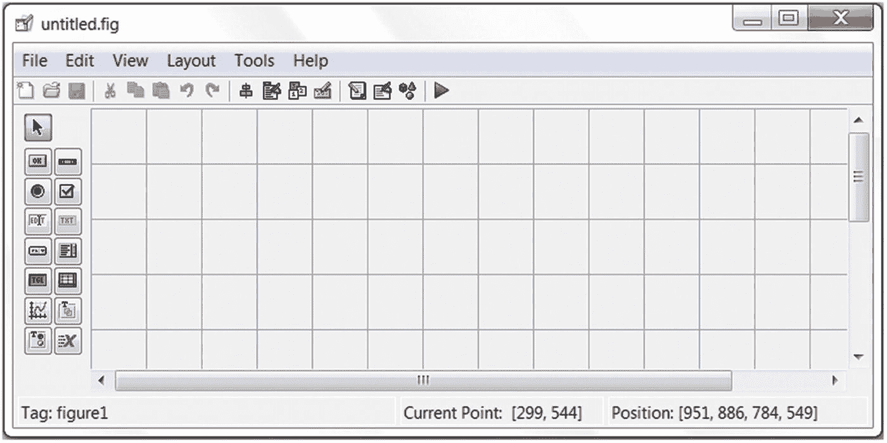
图 3-2 不带名称标签的 GUI 图形窗口组件

从这个 GUI 布局窗口（图 3-2）开始，我们就可以进行工作了。我们可以通过从 MATLAB GUIDE 首选项中选择“在组件面板上显示名称”来查看 GUI 组件和工具的名称标签。进行此调整后，组件将显示其名称标签，如图 3-3 所示。

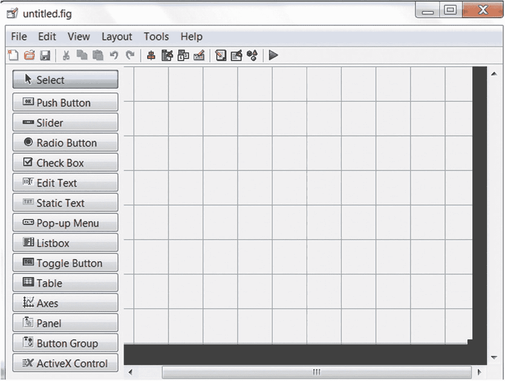
图 3-3 显示名称标签的 GUI 组件

图 3-4 所示的 GUI 窗口由 GUI 组件、设计区域以及名为“对齐对象”、“菜单编辑器”、“Tab 顺序编辑器”等的菜单工具组成。一旦 GUI 窗口打开，我们可以通过将所需的 GUI 组件拖放到设计区域来开始构建我们的 GUI 模型（见图 3-4）。我们可以通过单击并拖动鼠标，或使用鼠标右键选项、属性检查器、对齐对象以及其他菜单栏工具，在设计区域内调整 GUI 组件的大小和对齐方式。此外，我们可以通过单击“编辑器”来编辑 GUI 组件的属性，并通过单击“工具栏编辑器”向 GUI 添加菜单工具。


图 3-4 GUI GUIDE 工具窗口及其菜单栏

构建 GUI 模型需要几个基本步骤：

1. 明确定义预期的 GUI 模型应具备的特定功能，以及需要哪些工具和组件。一如既往，最好先在纸上草拟 GUI 模型的草图。
2. 将所有必要的 GUI 组件拖放到设计区域，然后根据您的需求和项目要求对其进行修改和对齐。当每个组件都放置到位并相互调整好后，您可以将它们放入一个按钮组（有一个名为“按钮组”的组件），这为您在设计区域移动和对齐对象提供了良好的灵活性。请注意，将组件分组到按钮组中是可选的。
3. 为模型中使用的所有组件重命名或提供可识别的名称“标签”，以便在稍后阶段编辑脚本和 M 文件时轻松识别它们。此外，您可能需要调整和修改组件的颜色、字体和大小。请注意，更改模型中组件的颜色、字体大小、文本类型、大小和位置不会影响 GUI 模型的执行/仿真结果。
4. 保存已创建的工作。它将以两种不同的文件格式保存，一种是 `*.fig`（图形文件），另一种是 `.m`（函数文件），其中包含模型的完整脚本，包括每个 GUI 组件的所有嵌套回调函数。
5. 编写/编辑一个脚本，实现每个 GUI 组件与其他组件关联的性能。此步骤需要一些额外的编程工作，将在以下示例中讨论。

### 示例 1：构建二维绘图

让我们来看一个非常简单的示例，为用户的输入值范围构建一个辛格函数的二维绘图：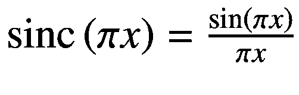。

通过拖放“按钮”、“静态文本”、“编辑文本”和“坐标轴”模块，我们开始构建 GUI 模型的界面，如图 3-5 所示。在 GUI 模型中调整好所有模块的相对位置后，我们可以通过双击每个模块或使用鼠标右键的“属性检查器”选项来编辑它们的属性。请注意，“静态文本”用于显示输入条目名称：Xmin 和 Xmax。Xmin 和 Xmax 的值代表变量的边界值，可以在“编辑文本”模块中定义。


图 3-5 选定的必要模块已放置到 GUI 模型区域中

#### 注意
静态文本块与编辑文本块之间有一个主要区别：用户可以在编辑文本块中修改条目，但在静态文本块中则无法进行此操作。

此外，我们还添加了一个坐标区模块，用于根据我们在编辑文本块中输入的*x*[*最小值*]和*x*[*最大值*]，显示函数 *sinc*(*x*)计算值的图形。我们还添加了一个按钮模块，使构建的模型（见图 3-5）能够计算函数值，并将结果显示在绘图区域中。

为了让我们的 GUI 模型信息更丰富、可读性更强且更用户友好，我们可以通过更改字体大小、颜色、背景色等属性来编辑每个模块。每个模块都有许多可更改的属性。例如，我们可以更改前景色、背景色、字体类型、大小和颜色、位置、尺寸、字符串、名称以及其他一些属性（见图 3-6）。在这些属性中，有两个主要属性（见图 3-6）需要我们特别关注。第一个是`tag`，它是模块的名称，必须具有唯一性。第二个属性是`string`，用于显示固定文本或空白区域。`string`会显示在 GUI 模型中。


图 3-6 用于编辑模块属性的属性检查器窗口

现在，让我们对 GUI 模型中的模块进行一些修改：更改它们的背景色、尺寸、字体大小、颜色和类型，并调整模块的位置。请注意，在静态文本块中，我们将字符串编辑为加粗、字体大小 12.0 的“Xmin”和“Xmax”，并分别设为红色和蓝色。在编辑文本块中，我们移除它们的字符串，使其为空。此外，我们将它们的字体大小改为 12.0，加粗，并设置黄色背景色。


#### 注意
若要使编辑文本块具有预定义值（例如 -6、0、3.14 和 100），我们需要将这些值插入到每个编辑文本块的“String”值中。

按钮的背景色、字体大小、类型、字符串和标签名称均已修改。其字符串更改为`"PLOT"`，标签重命名为`PLOTsinc`。图 3-7 展示了完成后的 GUI 模型。


图 3-7 所有按钮和组件均已修改的完成版 GUI 模型

保存模型并点击“运行”按钮，或从键盘按下`Ctrl+T`。新模型（如图 3-8 所示）目前尚未显示任何结果。模型编码部分仍缺少一个关键步骤。

#### 注意
在构建 GUI 模型并编辑模块属性时，务必为每个模块分配唯一的名称。当修改 GUI 模型的回调函数时，需要使用模块的标签。

若要同时更改多个模块的属性，请选中所有目标模块，然后在属性检查器中进行修改。

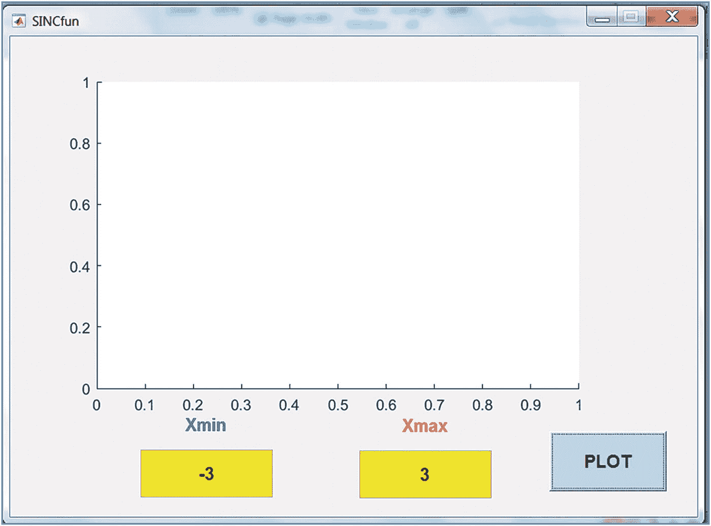
图 3-8 创建的 SINC 函数绘图 GUI

MATLAB 以两种文件格式保存模型——`SINC_fun.m`（函数文件）和 `SINC_fun.fig`（GUI 图形文件）。`SINC_fun.m`中使用的所有按钮的回调函数如下所示：

```
function varargout = SINCfun(varargin)
% SINCFUN MATLAB code for SINCfun.fig
% SINCFUN, by itself, creates a new SINCFUN or raises the existing
% singleton*.
...
% Begin initialization code - DO NOT EDIT
gui_Singleton = 1;
gui_State = struct('gui_Name', mfilename, ...
'gui_Singleton', gui_Singleton, ...
'gui_OpeningFcn', @SINCfun_OpeningFcn, ...
'gui_OutputFcn', @SINCfun_OutputFcn, ...
'gui_LayoutFcn', [] , ...
'gui_Callback', []);
if nargin && ischar(varargin{1})
gui_State.gui_Callback = str2func(varargin{1});
end
if nargout
[varargout{1:nargout}] = gui_mainfcn(gui_State, varargin{:});
else
gui_mainfcn(gui_State, varargin{:});
end
% End initialization code - DO NOT EDIT
% --- Executes just before SINCfun is made visible.
function SINCfun_OpeningFcn(hObject, eventdata, handles, varargin)
% This function has no output args, see OutputFcn.
...
function Xmax_Callback(hObject, eventdata, handles)
% hObject handle to Xmax (see GCBO)
...
% --- Executes on button press in PLOTsinc.
function PLOTsinc_Callback(hObject, eventdata, handles)
% hObject handle to PLOTsinc (see GCBO)
...
```

请注意，此脚本（`SINC_fun.m`）的大部分内容是在保存 GUI 模型时自动生成的，并且不会更改，我们只需编辑一个回调函数。必须编辑回调函数才能使 GUI 模型执行预期的计算并显示图形。请注意，每个回调函数都有三个参数句柄——`hObject`、`eventdata` 和 `handles`。

# 在编辑/编写回调函数时，我们可以使用`get()`函数查询句柄的属性，并使用`set()`函数为句柄赋值或更改其任何属性。请注意，在`SINCfun.m`模型中，只有一个需要编辑的回调函数——`PLOTsinc_Callback(hObject, eventdata, handles)`。`PLOTsinc_Callback`回调函数调用 PLOT 按钮，该按钮的标签名为`PLOTsinc`。`PLOTsinc`标签名是在构建 GUI 模型时通过属性检查器赋予 PLOT 按钮的。此回调函数通过获取用户输入的*x*[*最小值*]和*x*[*最大值*]来计算*sinc*(*πx*)并绘制计算结果的图形。要编辑`PLOTsinc_Callback(hObject, eventdata, handles)`回调函数，我们首先需要将 `Xmin` 和 `Xmax` 的条目从字符串格式转换为双精度格式，具体方式如下：

```matlab
Xmin=str2double(get(handles.Xmin, 'string'));
Xmax=str2double(get(handles.Xmax, 'string'));
```

`get()`命令从`handles.Xmin`和`handles.Xmax`中获取字符串格式的数据，然后`str2double()`将其转换为数值格式。使用双精度格式的 `Xmin` 和 `Xmax` 值来生成变量 `x` 的等间距值，然后用于计算 `f(x) = sinc(πx)` 并使用以下命令绘制结果：

```matlab
x=linspace(Xmin, Xmax, 200); f=sinc(x*pi); plot(x, f, 'b');
grid on
title('sinc(\pi*x) = sin(\pi*x)/(\pi*x) ')
xlabel('x'),ylabel('f(x)=sinc(\pi*x)'),
axis([Xmin, Xmax, -.25, 1.1])
```

最终，编辑后的回调函数 `PLOTsinc_Callback(hObject, eventdata, handles)` 包含以下内容：

```matlab
function PLOTsinc_Callback(hObject, eventdata, handles)
Xmin=str2double(get(handles.Xmin, 'string'));
Xmax=str2double(get(handles.Xmax, 'string'));
x=linspace(Xmin, Xmax, 200);
f=sinc(x*pi);
plot(x, f, 'b'); grid on
title('sinc(\pi*x) = sin(\pi*x)/(\pi*x) ')
xlabel('x'),ylabel('f(x)=sinc(\pi*x)'),
axis([Xmin, Xmax, -.25, 1.1])
```

如上所述，这是我们为了在 GUI 模型中通过一次点击计算并绘制 *sinc*(*πx*) 函数而编辑的 `SINCfun.m` M 文件的唯一一部分。我们保存 `SINCfun.m` 文件，并通过在 M 文件编辑器中使用或从键盘按下 `F5` 来执行它。当我们运行 `SINCfun.m` 时，`SINCfun.fig` GUI 模型弹出。我们输入两个条目——*X*[*min*] = −5 和 *X*[*max*] = 6——然后点击 `PLOT` 按钮。函数的结果被计算并绘制出来，如图 3-9 所示。请注意，`Xmax` 的值必须大于 `Xmin` 的值；否则，将会出现错误。


**图 3-9** 用于绘制 *sinc*(*πx*) 函数的 GUI 模型

这个简单的例子展示了使用 GUIDE 工具构建 GUI 模型是多么容易。一旦 GUI 模型界面布局完成，并且组件的属性已被编辑和保存，M 文件（函数文件）的回调函数就会被生成。随后，通过仅编辑所需的回调函数，我们就可以得到 GUI 模型。

## 示例 2：添加功能

让我们为我们的 GUI 模型（图 3-9）再添加四个选项：

-   创建一个退出/关闭按钮来关闭 GUI 模型窗口
-   通过调用并执行另一个 M 文件（名为 `SOUND_hear.m`）来播放声音
-   显示一个 `*.jpg`/`*.jpeg` 格式的图像（名为 `GC2011.jpg`）
-   显示一个消息框，消息内容为 `"All Done Well Done!!!"`

有几种方法可以完成这些任务，其中一种方法是添加一个 Push Button 模块并编辑其回调函数。我们首先回到 GUI 模型编辑器，添加一个 Push Button 模块。像之前一样更改 Push Button 的属性（背景颜色、字体大小和类型以及字符串和标签）。现在，我们通过更改其字符串将 Push Button 模块重命名为 `QUIT`；其名称标签被重命名为 `QUIT_button`。在保存更新后的 GUI 模型 `SINCfun.fig` 之前，我们需要更改窗口的名称。为此，我们需要在设计区域（任何模块之外的区域，可打开属性检查器窗口）上双击，然后将名称标签从 `figure1`（默认）更改为 `GUI_window`。

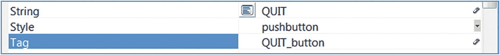

我们保存 GUI 模型并执行它。之后，我们编辑最后一个自动添加的回调函数，名为 `QUIT_button_Callback(hObject, eventdata, handles)`，在其中添加以下内容。内置的 MATLAB 函数 `delete()` 会停止整个过程并关闭窗口。

```matlab
function QUIT_button_Callback(hObject, eventdata, handles)
delete(handles.GUI_window)
run('SOUND_hear.m'); A=imread('GC2011.jpg'); image(A);
msgbox('All Done Well Done!!!')
```

图 3-10 展示了更新后的 GUI 模型。我们可以输入 `Xmin` 和 `Xmax` 的数值来测试它，然后点击 `QUIT` 按钮。按下 `QUIT` 后，GUI 窗口 `SINCfun.fig` 将被关闭。

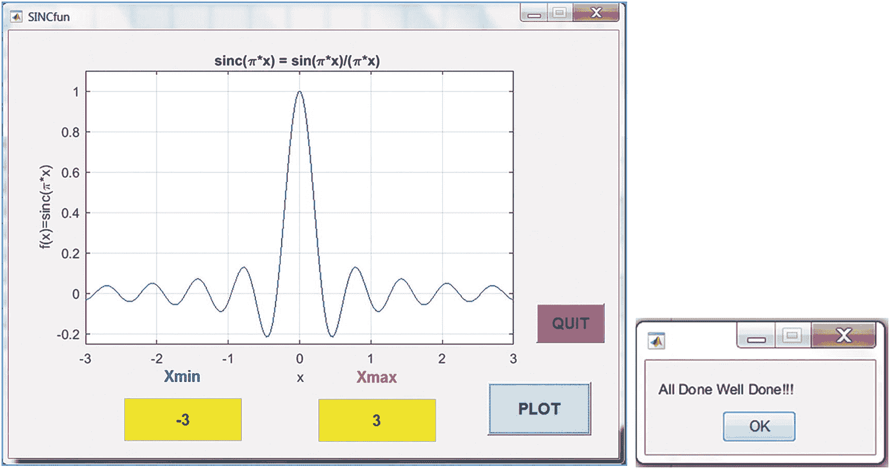

**图 3-10** 用于显示 *sinc*(*πx*) 和退出选项的 GUI 模型

随后，内置函数 `run()` 执行 `SOUND_hear.m` 文件，该文件播放一个声波。另一个名为 `image()` 的内置函数显示 `GC2011.jpg` 图像，如图 3-11 所示。最后，`msgbox()` 函数显示消息：`All Done Well Done!!!`。

单独的 M 文件 `SOUND_hear.m` 包含以下脚本：

```matlab
% SOUND_hear.m
% 三个 CHIRP 信号以产生声音
t=0:1/1e4:10;
D0=chirp(t, 0, 10, 3000, 'quadratic');
D1=chirp(t, 0, 10, 4000, 'q',[],'convex');
D2=chirp(t, .001, 10, 5000, 'logarithmic');
y=[D0, D1, D2]; sound(y);
```


**图 3-11** 显示的图像文件 `GC2011.jpg`

在这个简单的练习中，我们演示了如何将 GUI 模型按钮与其他 GUI 模块和 M 文件关联起来。类似地，Simulink 的文件以及与 MATLAB 包兼容的任何应用程序都可以链接到 GUI 模型。

## 示例 3：求解二次方程

让我们再举一个例子，创建一个 GUI 模型，该模型求解任意给定系数 *a*、*b* 和 *c* 的二次方程，并显示用户指定的变量 *x* 的值范围对应的曲线图。二次方程的公式为 *ax*² + *bx* + *c* = 0，如果给定了 *a*、*b* 和 *c* 的数值，我们可以数值计算给定方程的根。此练习分两个阶段完成：构建 GUI 界面和编辑回调函数。

### 构建 GUI

我们再次从一个空白的 GUI 窗口开始，选择一个 Panel 模块，然后向其中拖放几个模块，例如 Static Text、Edit Text、Push Button 和 Axes。在构建 GUI 模型时使用 Panel 模块有一个很好的理由。它可以帮助您相对于彼此在设计区域内及周围操作所有 GUI 模块。

我们按照 *a*、*b*、*c* 的顺序放置模块，然后为 *D*（判别式）、*x*[1] 和 *x*[2] 的根计算结果，以及 Push Button 模块，以使 GUI 模型计算判别式、根 *x*[1] 和根 *x*[2] 的值。之后，我们通过更改每个模块的字体大小、类型、字符串、标签和背景颜色来编辑模块属性。此外，我们编辑 *x*[*min*] 和 *x*[*max*] 的用户输入模块，并使用一个 Push Button 模块以 2D 方式绘制计算结果。另外，我们通过在设计区域上双击并在属性检查器中更改标题，将面板窗口的名称更改为“二次方程求解器”。图 3-12 显示了我们完成的 GUI 模型窗口。

### 注意

在此 GUI 模型（如图 3-12 所示）中，为节省组件面板窗口空间，组件名称未予显示。您可以通过选择“文件 ➤ 首选项 ➤ GUIDE ➤ 在组件面板中显示名称”来开启或关闭该功能。

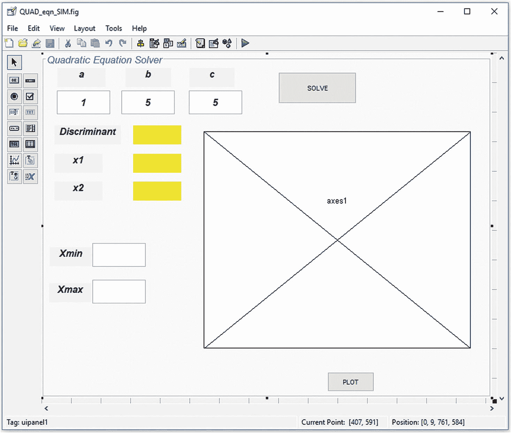

图 3-12
GUI 模型窗口的完整设计

请注意，在图 3-12 所示的 GUI 模型中，模块的以下属性已更改：在“a”、“b”、“c”、“x1”、“x2”、“Xmin”和“Xmax”等静态文本模块中，其字符串、字体大小与类型以及背景色已更改。用于显示判别式、x1 和 x2 计算结果的三个静态文本模块的属性也已更改。例如，用于显示判别式值的静态文本模块，其背景色、字体类型、大小、字符串和标签均被更改。其字符串被修改为空白，标签重命名为 `D`。

用于显示 x1 和 x2 值的静态文本模块的背景色、字体类型、大小、字符串和标签也已被更改。这些字符串被设为空，其标签分别重命名为 `x1` 和 `x2`，对应*x*[1]和*x*[2]。此外，还有两个按钮模块：一个用于求解给定方程（基于 a、b、c 的值），另一个用于根据用户输入的 `Xmin` 和 `Xmax` 值显示二次方程的图形。

第一个按钮模块的字符串改为 `SOLVE`，其标签为 `SOLVE_eqn`；第二个按钮的字符串称为 `PLOT`，其标签为 `PLOT_eqn`。如前所述，在编辑或重写 GUI 模型 M 文件中的子函数时，标签至关重要，需要仔细处理。

至此，我们的所有工作均在 GUI 设计窗口内完成，并通过属性检查器（双击各模块进入）修改所选模块的属性。在本例中，我们还对面板窗口进行了更改：修改了其背景色、标题、字体类型和大小。最后，在 GUI 模型中完成所有更改后，我们将其保存为 `QUAD_eqn_SIM.fig` 文件（见图 3-13），`QUAD_eqn_SIM.m` 文件也随之自动保存。


图 3-13
用于计算根并显示二次方程二维图形的完整 GUI 模型

### 编辑回调函数

图 3-13 所示的模型在单击“SOLVE”或“PLOT”按钮时不会显示任何结果。我们需要编辑并重写 M 文件 `QUAD_eqn_SIM.m` 的两个回调函数。请注意，脚本中所有自动生成的注释均已移除。

```matlab
function varargout = QUAD_eqn_SIM(varargin)
% QUAD_EQN_SIM MATLAB code for QUAD_eqn_SIM.fig
...
gui_Singleton = 1;
gui_State = struct('gui_Name', mfilename, ...
'gui_Singleton', gui_Singleton, ...
'gui_OpeningFcn', @QUAD_eqn_SIM_OpeningFcn, ...
'gui_OutputFcn', @QUAD_eqn_SIM_OutputFcn, ...
'gui_LayoutFcn', [] , ...
'gui_Callback', []);
if nargin && ischar(varargin{1})
gui_State.gui_Callback = str2func(varargin{1});
end
...
handles.output = hObject;
guidata(hObject, handles);
function varargout = QUAD_eqn_SIM_OutputFcn(hObject, eventdata, handles)
...
varargout{1} = handles.output;
function a_Callback(hObject, eventdata, handles)
...
function a_CreateFcn(hObject, eventdata, handles)
...
function b_Callback(hObject, eventdata, handles)
...
function b_CreateFcn(hObject, eventdata, handles)
...
function edit3_Callback(hObject, eventdata, handles)
...
function edit3_CreateFcn(hObject, eventdata, handles)
...
if ispc && isequal(get(hObject,'BackgroundColor'), get(0,'defaultUicontrolBackgroundColor'))
set(hObject,'BackgroundColor','white');
end
function Xmin_Callback(hObject, eventdata, handles)
...
function Xmin_CreateFcn(hObject, eventdata, handles)
...
function Xmax_Callback(hObject, eventdata, handles)
...
function Xmax_CreateFcn(hObject, eventdata, handles)
...
if ispc && isequal(get(hObject,'BackgroundColor'), get(0,'defaultUicontrolBackgroundColor'))
set(hObject,'BackgroundColor','white');
end
function SOLVE_eqn_Callback(hObject, eventdata, handles)
...
function PLOT_eqn_Callback(hObject, eventdata, handles)
...
```

我们将编辑的回调函数是 `PLOT_eqn_Callback(hObject, eventdata, handles)` 和 `SOLVE_eqn_Callback(hObject, eventdata, handles)`。这些回调函数使 GUI 模型能够根据我们输入的 `Xmin` 和 `Xmax` 值，计算并显示判别式、两个实根（在预定义的模块中），并显示二维图形。以下是名为 `SOLVE` 和 `PLOT` 的两个按钮的编辑后回调函数：

## MATLAB GUI 回调函数与对话框

### 回调函数示例
```matlab
function SOLVE_eqn_Callback(hObject, eventdata, handles)
a=str2double(get(handles.a, 'string'));
b=str2double(get(handles.b, 'string'));
c=str2double(get(handles.c, 'string'));
D=b²-4*a*c;
if D>0 % 存在两个实根;
x1=(-b+sqrt(D))/(2*a);
x2=(-b-sqrt(D))/(2*a);
elseif D==0 % 存在唯一根;
x1=-b/(2*a);
x2=x1;
else % 不存在实根;
x1='No Root';
x2='No Root';
end
D=num2str(D); set(handles.D, 'string', D);
x1=num2str(x1); set(handles.x1, 'string', x1);
x2=num2str(x2); set(handles.x2, 'string', x2);
function PLOT_eqn_Callback(hObject, eventdata, handles)
a=str2double(get(handles.a, 'string'));
b=str2double(get(handles.b, 'string'));
c=str2double(get(handles.c, 'string'));
D=str2double(get(handles.D, 'string'));
x1=str2double(get(handles.x1, 'string'));
x2=str2double(get(handles.x2, 'string'));Xmin=str2double(get(handles.Xmin, 'string'));
Xmax=str2double(get(handles.Xmax, 'string'));
x=linspace(Xmin, Xmax, 200); y=a*x.²+b*x+c;
plot(x, y, 'r-', 'linewidth', 1.5); xlabel('x'), ylabel('y = ax²+bx+c')
if D>=0   % 如果方程有实根，则绘制根 x1 和 x2
hold on  % 如果 D>=0，保持图形
plot(x1, 0, 'rs', x2, 0, 'gd', 'markersize', 7, 'markerfacecolor', 'y')
legend('plot of quad. eqn', 'root: x_1', 'root: x_2')
end
title(['Plot of:  ' num2str(a)  'x² + '  num2str(b)  'x + '  num2str(c)  ' = 0']); grid on
```

请注意，在子函数 `SOLVE_eqn_Callback` 中，我们使用 `get()` 命令获取 `a`、`b`、`c` 的字符串值，并通过 `str2double()` 将其转换为数值数据。使用 `set()` 命令，将计算得到的 `D`、`x1` 和 `x2` 的值分别赋给 `D`、`x1` 和 `x2`，以便在名为“D”、“x1”和“x2”的相应静态文本块中显示。在后一个子函数中，我们使用 `get()` 命令获取 `a`、`b` 和 `c` 的数值。然后，我们通过点击“运行”按钮或从命令窗口调用该文件（例如 `-3*x² + 5*x + 1 = 0`）来运行名为 `QUAD_eqn_SIM.m` 的整个 M 文件，并绘制给定方程在 `x` = −1…3 范围内的图形。

请注意，在 `SOLVE_eqn_Callback` 回调函数中，如果判别式 `D` ≥ 0，则计算出的根也将被绘制。此外，这里还使用了几个绘图工具（`hold on`、`legend`、`markersize` 和 `markerfacecolor`），这些工具在第 6 章中有详细说明。

图 3-14 显示了针对给定示例 `-3*x² + 5*x + 1 = 0` 和 `x` = −1…3 的最终 GUI 模型及其结果。


**图 3-14** — 用于计算二次方程根并在用户输入的 `Xmin` 和 `Xmax` 范围内绘制其值的 GUI 模型。

### 常见错误与避免方法
让我们回顾一下在编辑和重写子函数时最常见的一些错误。它们是：
- 在子函数中调用或设置值以在 GUI 模型窗口中显示时，块的标签名称拼写错误。
- 在子函数中未正确使用必要的转换操作符（例如 `get()` 和 `set()` 操作符）进行数值计算。
- 编辑了错误的按钮子函数（回调函数），导致 GUI 模型无法执行其预期操作。

为了避免这些常见错误，建议仔细选择标签名称，并在编写和编辑嵌套回调函数时反复检查其名称。另一个建议是写下所有标签名称并仔细键入。在使用 `get()` 和 `set()` 操作符转换变量值时，请查看任务的具体要求。例如，处理时需要什么类型的数据，以及通过哪个句柄名称（例如 `handles.WHAT`）获取变量或数据的值。有几种方法可以避免编辑错误的回调函数。一种是查找每个按钮的分配名称标签，该标签使 GUI 模型执行其预期操作。MATLAB 会自动为每个操作按钮和输入块分配一个子函数名称，该名称由其给定的名称标签（用户给定的名称标签）加上下划线和 `_Callback()` 组成。例如，如果一个操作按钮的名称标签是 `PLOT_all`，那么它将有一个名为 `PLOT_all_Callback(hObject, eventdata, handles)` 的子函数。另一种方法是在保存 GUI 模型和自动生成的 M 文件后，在 GUI 模型设计窗口中单击一个操作按钮（例如，一个按钮）。然后右键单击并选择 **查看回调** ➤ **回调**，以直接访问需要编辑的正确子函数主体。

## GUI 对话框和消息框
MATLAB 有几种命令，可以创建/调用现成的弹出式对话框，包括错误、警告、帮助、信息、用户输入对话框等。无需编写脚本和回调函数或构建 GUI 即可创建它们。这些消息框最常见的用途之一是向用户传递消息。通常，创建这些弹出式消息框非常简单，只需要一个命令。除用户输入框外，所有对话框和消息框都可以通过一个通用命令调用和生成：`errordlg()`、`warndlg()`、`helpdlg()` 和 `msgbox()`。另一方面，用户输入对话框需要几个命令，例如输入对话框的名称、输入对话框窗口的标题/消息以及输入对话框窗口。让我们看几个示例，了解如何创建这些消息框、用户输入对话框窗口以及输入状态框。

### 错误对话框
通用命令语法：`errordlg('添加备注')`

示例：
```
errordlg(['时间已到！' '今天是 ' date])
```


### 警告消息
通用命令语法：`warndlg('添加备注')`

示例：
```
warndlg(['室外温度为 ' num2str(-20) ' C；因此，请相应着装！！！'])
```

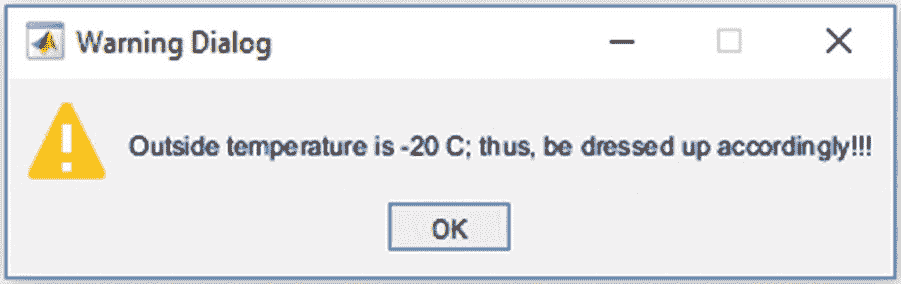

### F1 帮助/消息框
通用命令语法：
```
helpdlg('添加备注')
```

示例：
```
helpdlg('您有什么问题？', '这是帮助热线');
```

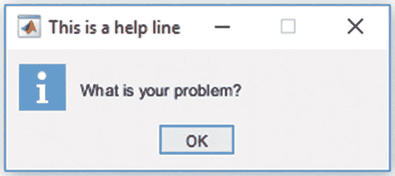

第二个示例：
```
CreateStruct.WindowStyle='replace';
CreateStruct.Interpreter='tex';
msgbox('f(\alpha) = e^{cos(\omega*\alpha)}','函数: ',CreateStruct);
```

请注意，此示例中使用的 `CreateStruct` 是一个 `struct` 类型的变量，它创建了一个结构类型变量，包含两个字符类型字段——名为 `WindowStyle`，值为 `replace`；以及名为 `Interpreter`，值为 `tex`。它们会被 MATLAB 自动识别。如果不创建包含 `WindowStyle` 和 `Interpreter` 这两个字段的 `CreateStruct` 变量，则等式将按原样显示在消息框中：*f*(*α*) = *e*^(cos(*ωα*))

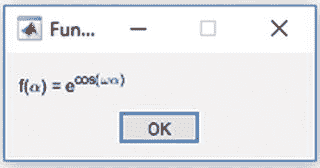

### 通用语法
创建帮助/消息/错误/警告消息还有其他方法。通用命令语法是：
```
HM = msgbox('消息', '框标题', '图标')
```

这里仅是一个消息框：
```
msgbox('Hello World', '我的消息')
```


这是一个警告消息：
```
msgbox('Hello World', '我的消息', 'warn')
```

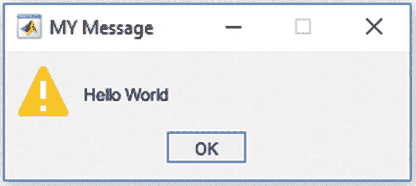

这是一个带有错误符号的消息框：
```
msgbox('Hello Students', '我的消息', 'error')
```


这是一个带有信息符号的消息框：
```
msgbox('Hello Students', '我的消息', 'help')
```


### 输入对话框
通用命令语法：
```
ANSWER = inputdlg(PROMPT,NAME)
```

这是一个简短的脚本：
```
Enter1={'输入要演变的傅里叶级数项数，然后点击[确定]并等待: '}; % 消息
Name1='傅里叶级数项数的输入'; % 对话框名称
Numlines = 1; % 输入对话框的行数
ANSWER=inputdlg(Enter1, Name1, Numlines); % 生成并读取输入对话框
[n status] = str2num(ANSWER{1}); % 将用户输入赋值给变量 n
```

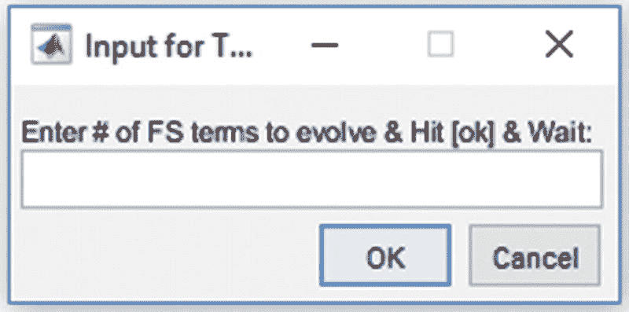

### 问题对话框
通用命令语法：
```
|ButtonName = questdlg('Your Question ...', 'Question?', 'Option1', 'Option2', ....)
```

一个示例：
```
YA= questdlg('请选择你对问题："你感觉如何？" 的回答','问题','非常好','我还能工作一会儿','有点累','')
```


让我们看一个包含多个选项的更复杂示例。

### 做出选择
你正在一家咖啡馆里，想要买点东西。你想从菜单中做出选择：咖啡、茶或一些甜点。咖啡馆有一些你并不知道的缺货情况。需要根据你的订单和咖啡馆的缺货情况来显示消息和对话框，例如警告、帮助、输入或错误消息。以下是此脚本中需要实现的步骤。
- 步骤 0。你在咖啡馆里，一位服务员走过来准备接受你的点单。
- 步骤 1。你在咖啡、茶和巧克力蛋糕之间做出决定。
- 步骤 2。服务员回应说，他们实际上不提供茶，并且巧克力蛋糕已经卖完了。
- 步骤 3。然后你选择咖啡类型：普通、浓或特制（根据你的口味）。
- 步骤 4。你品尝并评价咖啡。
- 步骤 5。你付款并留下小费。

以下是答案脚本：
```
clearvars
% 是时候喝咖啡了，我们去咖啡馆吧...
% 步骤 0
H1 = msgbox('你在一家咖啡馆，正在点你最爱口味的咖啡', '咖啡馆');
pause(2), delete(H1)
% 步骤 1. 点咖啡
H2 = msgbox('今天能为您做点什么？您想要咖啡还是甜点？', ...
'服务员已到');
pause(3), delete(H2)
% 回答你想要什么
YA= questdlg('你的回答："你想要咖啡还是甜点？" ','问题', ...
'咖啡', '茶', '巧克力蛋糕', '');
switch YA
case '咖啡'
CA = questdlg('你的回答："好的。您想要哪种咖啡？" ','问题', ...
'普通', '浓', '特制', '');
case '茶'
H3=warndlg(['抱歉！我们不提供' '茶。或许来点别的？']); pause(2)
delete(H3)
case '巧克力蛋糕'
H4=errordlg(['非常抱歉！' '没有蛋糕了']); pause(2)
delete(H4)
end
Response=exist('CA', 'var');
if Response ==1
switch CA
case '普通'
HN=warndlg(['普通咖啡是', ...
' 3 茶匙咖啡+3 汤匙牛奶+1 茶匙糖']);
pause(3), delete(HN)
case '浓'
HS=warndlg(['浓咖啡是', ...
' 4 茶匙咖啡+2 汤匙牛奶+2 茶匙糖']);
pause(3), delete(HS)
case '特制'
HS = msgbox('选择：要加多少咖啡、牛奶和糖？', '选择');
pause(3), delete(HS)
Call = '点你的咖啡';
Selection = {'咖啡要多少茶匙：', ...
'牛奶要多少汤匙：', '糖要多少茶匙：'};
n_lines=[1, 13];
ANS=inputdlg(Selection, Call, 1, {'', '', ''});
end
OK = msgbox('你已经喝完了咖啡', '你即将离开');
pause(5), delete(OK)
PB= questdlg('服务员问："咖啡味道如何？" ','问题', ...
'非常好', '不错', '嗯...还行吧', '');
switch PB
case '非常好'
helpdlg('非常感谢！4 美元+1 美元（小费）', '这是账单');
case '不错'
helpdlg('谢谢！4 美元+0.50 美元（小费）', '这是账单');
case '嗯...还行吧'
helpdlg('谢谢！4 美元（无小费）', '这是账单');
end
else
H5 = msgbox('再见！下次见！', '服务员离开');
pause(4), delete(H5)
end
```

请注意，在此脚本中，我们使用了 MATLAB 的内置函数 `exist`，它用于验证工作区中是否存在特定变量。它使用命令语法 `exist('N', 'var')` 来确定变量 `N` 是否在工作区中可用。它也可以用来验证当前目录下是否存在任何特定文件。例如，`exist('MY_fun.c', 'file')` 检查 MATLAB 当前目录下是否存在名为 `MY_fun.c` 的文件。内置函数 `exist()` 的输出可以是 0、1 或 2。0 表示变量或文件不存在，1 表示变量存在，2 表示文件存在于当前目录。

当执行这个脚本时，会显示两个消息框（`H1` 和 `H2`）两到三秒钟，然后自动关闭。接着下一个问题对话框会弹出，你需要选择咖啡、茶或巧克力蛋糕。


根据你的选择，其他选项和响应会出现。如果你选择咖啡，问题对话框（`CA`）会弹出，并要求你选择咖啡类型：普通、浓或特制。


如果你在对话框（`CA`）中选择普通或浓，会弹出一个窗口显示你选择的咖啡在咖啡、牛奶和糖方面的配方。如果你选择特制类型咖啡，你需要输入（输入对话框 `ANS`）你想要的咖啡、牛奶和糖的用量。

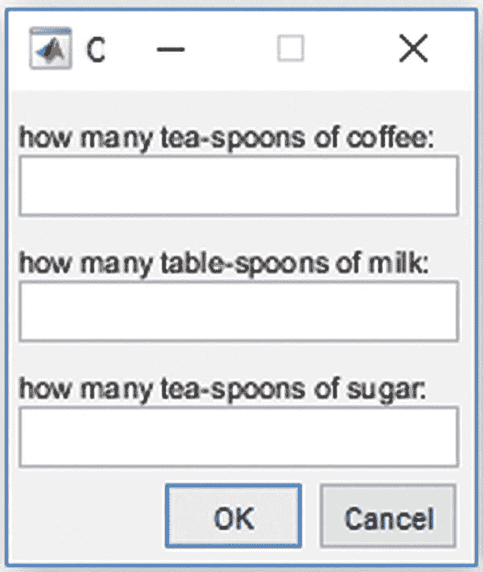

消息框（`OK`）弹出并在五秒钟后自动关闭。最后，服务员会询问你咖啡的味道如何。

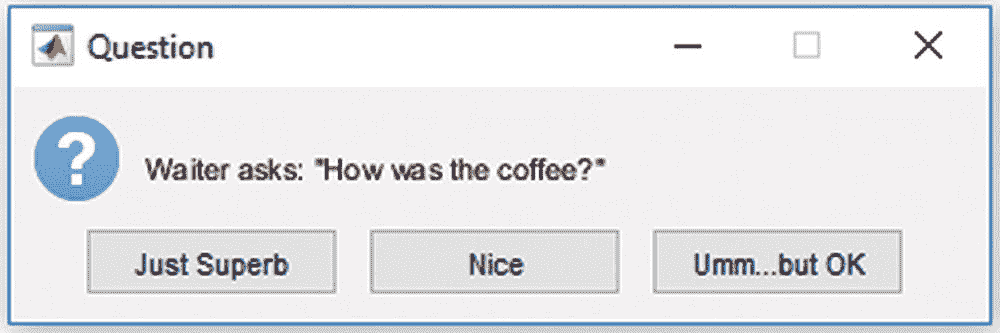

