# 4. MEX 文件、C/C++ 和独立应用程序

`MEX` 代表 *MATLAB 可执行文件*，它是一种直接从 MATLAB 调用自定义 C、C++ 或 FORTRAN 例程/代码的方式，从而将它们视为 MATLAB 的内置函数。由于 MATLAB 与多种编程语言兼容，包括 C/C++、FORTRAN、C# 和 Java，`MEX` 文件可以像 `M 文件` 或 `M 函数` 一样在 MATLAB 环境中被直接调用。也可以在 MATLAB 中创建作为自执行文件的独立应用程序。

MATLAB 的 `Coder` 工具箱非常强大，能够创建独立且可自执行的 C 代码。了解如何从 MATLAB 的 `M 文件` 创建 C 代码非常有益，因为 C 编程语言是免费的，没有任何许可要求。它可以用来创建可执行文件、动态链接库以及大型应用程序的库。实际上，C 语言可用于解决各种类型应用中的广泛任务。

我们有多种理由创建或使用 `MEX` 文件。其中之一是它们能够直接从 MATLAB 调用大型现有的 C、C++ 或 FORTRAN 程序，而无需将其重写为 `M 文件`。另一个原因是为了加速计算过程，尤其是在 `M 文件` 存在瓶颈的地方。例如，`MEX` 文件可用于基于大型循环的计算，以避免耗时计算过程中的瓶颈。`MEX` 文件在多个方面优于 `M 文件`。它们作为可执行文件被调用和执行，无需像 `M 文件` 那样需要进行编译。它们可以直接从 MATLAB 调用大型现有的 C 或 FORTRAN 例程，而无需重写为 `M 文件`。此外，`MEX` 文件支持并行性，因此我们可以为各种（在机器时间方面）成本高昂且无法向量化的计算和模拟编写多线程 C 代码。

## 验证编译器

在开始生成 `MEX` 文件之前，最好先验证当前 MATLAB 软件包中安装了哪些编译器。这可以通过在命令窗口提示符下键入以下命令来完成：

```
>> mex –setup
```

然后，我们按照指示从已安装的编译器列表中选择合适的编译器。如果没有安装编译器，我们需要安装一个与 MATLAB 兼容的编译器，以便生成 `MEX` 文件（兼容编译器列表可在 MathWorks 网站上找到：[`https://www.mathworks.com/support/requirements/previous-releases.html`](https://www.mathworks.com/support/requirements/previous-releases.html)）。图 4-1 显示了 MATLAB 中 C/C++ 代码生成的一般流程图。

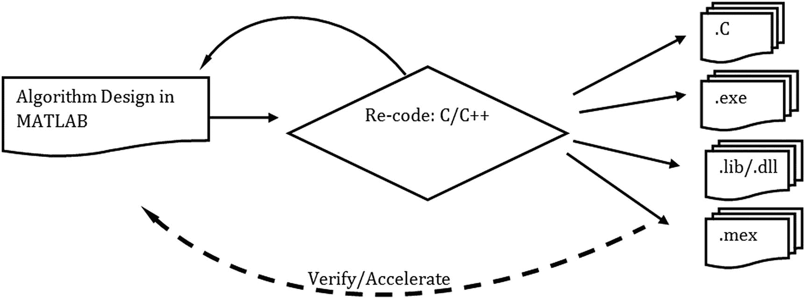

**图 4-1** C/C++ 代码生成流程图

接下来，我们将演示几个示例，包括将 `M 文件` 转换为 C/C++、`MEX` 和可执行的独立应用程序，编译 C 代码，并在 MATLAB 环境中进行测试。

## 生成 C 代码

这个简单的示例将在 MATLAB 中生成 C 代码，以根据用户指定的整数计算奇数和。我们首先编写一个 `M 文件`，然后使用名为 MATLAB `Coder⁴` 的代码生成器应用程序工具，将其转换为 MATLAB 中的 `MEX` 文件。该工具用于从 MATLAB 代码为各种硬件平台、嵌入式系统和桌面平台生成 C 和 C++ 代码。生成的代码可以作为源代码、库和/或动态库集成到现有的程序和项目中。

### 注意

`MATLAB Coder` 是一个独立的应用程序，不随基础 MATLAB 软件包提供，需要单独安装。

让我们以一个名为 `SUModd.m` 的 M 文件函数为例，该函数计算直到用户指定整数 `N` 的奇数之和。

```matlab
function SUModd(N)
%#codegen
Sum=0; ii=1;
while ne(ii,N)
if ne(mod(ii,2),0)
Sum=Sum+ii;
else
Sum=Sum;
end
ii=ii+1;
end
Sum
```

请注意，`SUModd.m` 函数的第二行是一条指令（注释），`%#codegen`。建议我们在要转换为 `MEX` 文件的 M 文件中包含此注释。M 文件的转换可以通过三种方式实现。使用以下命令：

```
>> mex SUModd.m
```

或者在命令窗口中输入 `>> coder`，或者使用主菜单中 `APPS` 选项卡下的 `MATLAB Coder`^(⁵) 选项。当我们点击 `MATLAB Coder` 图标时，`MATLAB Coder` 的 GUI 窗口会弹出。然后，我们在 `Generate Code for Function` 框中指定要转换为 C/C++ 和 MEX 的 M 文件的名称，并输入变量类型 `N`（`single`、`double`、`int8`、`uint8`、`int16`、`uint16`、… 结构体、复数等）和大小（`1x1`、… `mxn`）。

按下回车键后，如果转换 MATLAB 函数没有问题，`MATLAB Coder` 将自动生成包含所有 `*.c` 和 `*.h` 源代码的 MEX 文件。我们通过从下拉选项中选择要生成的源代码类型来启动代码生成过程。在这种情况下，我们可以选择 `C/C++ 源代码`、`MEX`、`静态库 (.lib)`、`动态库 (.dll)` 和 `可执行文件 (.exe)`，如图 4-2 所示。请注意，这些选项取决于操作系统和平台。在我们的例子中，我们在 Windows 操作系统环境下工作，因此这些库适用于 Windows 操作系统。

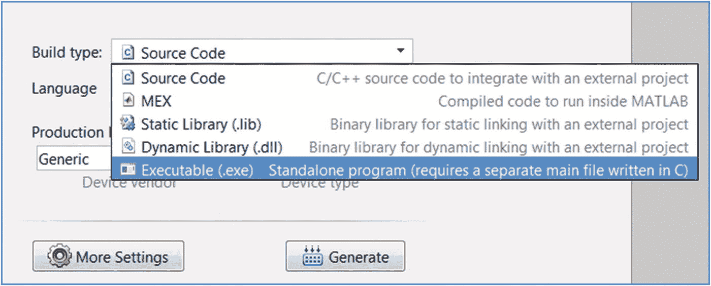

图 4-2 选择生成的 C/C++ 源代码类型

接下来，我们需要选择使用哪种语言——C 或 C++——来创建 MEX 文件（见图 4-3）。

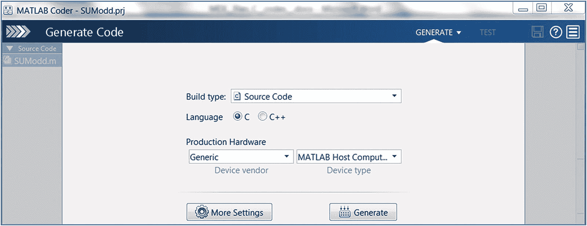

图 4-3 通过 `MATLAB Coder` 从 MATLAB 脚本生成 C/C++ 的 GUI 窗口

然后我们选择设备厂商和类型——生产硬件、主机计算机类型（见图 4-4）。

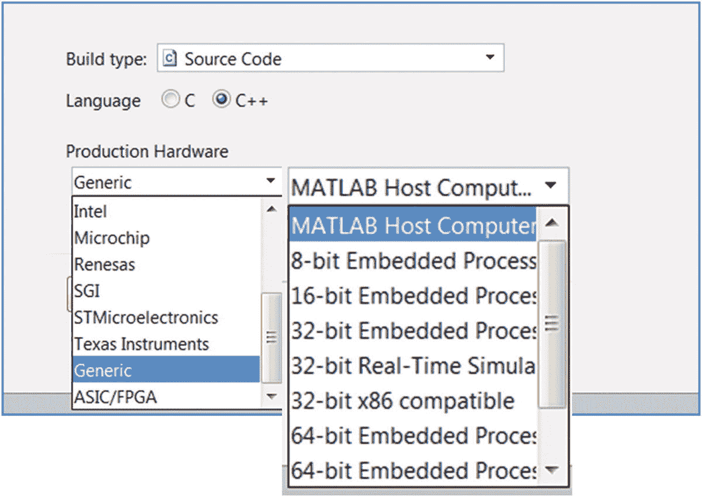

图 4-4 生产硬件和处理器类型选择选项

我们还可以从 `更多设置` 区域进行一些额外调整，如图 4-5 所示。

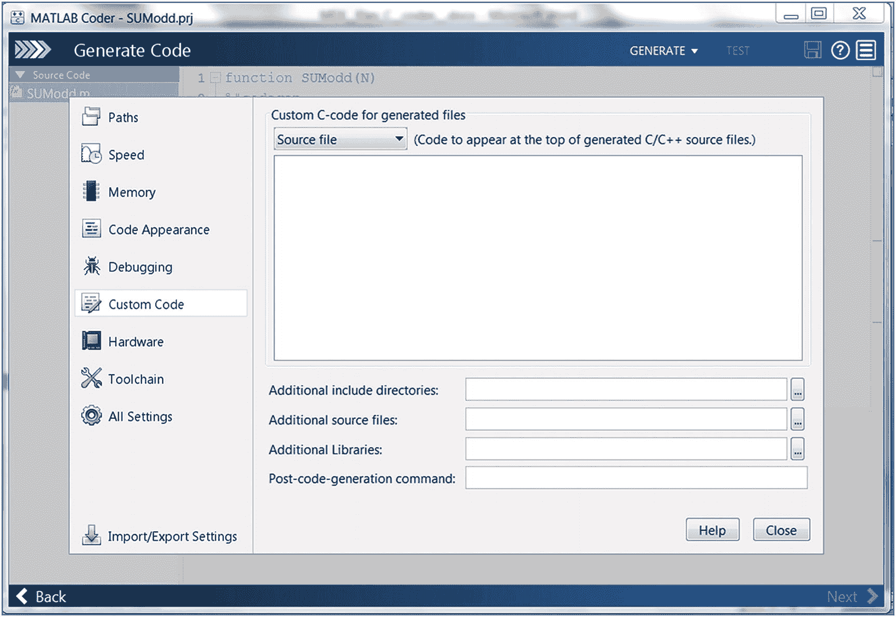

图 4-5 Coder GUI 窗口工具的 `更多设置` 选项

如果没有错误或警告，将会显示生成的 C 代码及其目标源代码（见图 4-6）。MEX 文件可以在 MATLAB 工作区或任何 M 文件中打开，就像打开任何 MATLAB 函数文件或 M 文件一样。

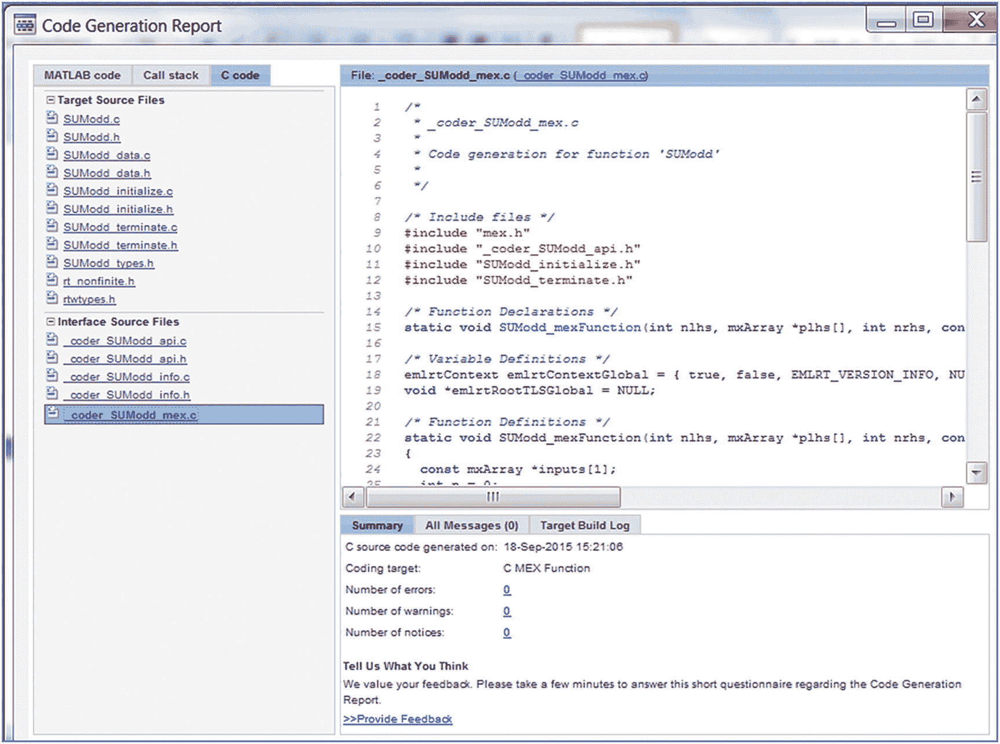

图 4-6 从名为 `SUModd.m` 的源代码生成的 MEX 文件内容和库

图 4-6 显示了成功生成的名为 `SUModd_mex.c` 的 MEX 文件。它保存在 MATLAB 的当前（工作）目录中。

将 M 文件转换为 MEX 文件的过程可能涉及编码和转换方面的问题，因为许多 MATLAB 函数与 C 不兼容。例如，让我们修改 M 文件（在我们最初名为 `SUModd.m` 的 M 文件中），添加用于计算运行时间的 `tic` 和 `toc` MATLAB 命令，然后尝试重新创建 MEX 文件。

对 M 文件进行这些修改后，Coder 会提示图 4-7 中所示的两个兼容性问题。从 M 文件中删除 `tic` 和 `toc` 这两个命令并保存更新版本后，我们重新编码，然后不再收到警告。随后，转换后的代码完美运行。

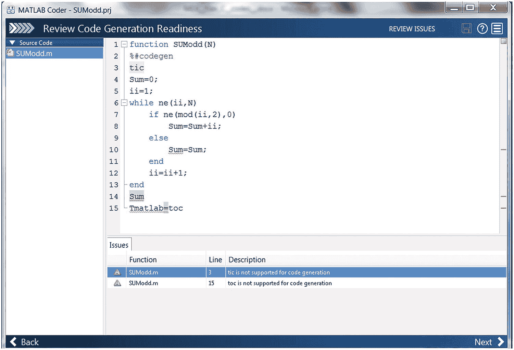

图 4-7 将 M 文件转换为 MEX 文件时，`tic` 和 `toc` 命令出现两个错误/问题

调用和使用 MEX 文件的过程与任何 M 文件类似。对于此示例，可以通过以下方式调用创建的 MEX 文件：

```
>> SUModd_mex(N)
```

它也可以在任何 M 文件中以类似方式调用。请注意，`N` 是根据初始步骤中 MEX 文件使用的变量类型和大小在 MATLAB 工作区中预定义的。在处理 `for` 和 `while` 循环时，MEX 文件相对于 M 文件最重要的优势之一是其速度，换句话说，就是计算效率。例如，从之前的例子中，我们可以展示 MEX 文件相对于其源 M 文件的效率。

```matlab
% 比较 MATLAB 和 MEX 文件的计算效率
clearvars; N=1e+8;
Tmatlab=cputime; SUModd(N), TM=cputime-Tmatlab;
fprintf('M 文件计算时间为 %5.5f 秒 \n', TM);
clearvars; N=1e+8;
Tmex=cputime; SUModd_mex(N), TMEX=cputime-Tmex;
fprintf('MEX 文件计算时间为 %5.5f 秒 \n', TMEX);
```

每个文件的（运行）计算时间如下：
*   `M 文件计算时间为 9.26115 秒`
*   `MEX 文件计算时间为 1.06168 秒`

因此，MEX 文件的计算时间比原始 M 文件短约九倍。此外，必须注意，当 M 文件和 MEX 函数中存在相同文件名时，MEX 文件优先于 M 文件。

## 从其他语言创建 MEX 文件

MEX 文件也可以从 C/C++ 或 FORTRAN 源代码创建。这可以通过单个命令完成：

```
>> mex HELLO.c
```

另一个替代命令是：

```
>> mex -v HELLO.c
```

在后一种情况下，`-v` 标志会显示编译和链接过程。请注意，C 语言的源代码 `HELLO.c`（如下所示）已经创建并放置在 MATLAB 的工作目录中。

```c
#include "mex.h" /* 始终包含此头文件 */
void mexFunction(int nlhs, mxArray *plhs[], /* 输出变量 */
int nrhs, const mxArray *prhs[]) /* 输入变量 */
{
/* 做一些有趣或好玩的事情 */
mexPrintf("Hello WORLD:)...:), This is SALOMON ... world!\n");
return;
}
```

从源代码 `HELLO.c` 创建的 MEX 文件（名为 `HELLO_mex.mexw64`）可以通过在命令窗口中调用来执行：

```
>> HELLO_mex
```

该命令输出以下内容：

```
>> Hello WORLD:)...:), This is SALOMON ... world!
```

请注意，MEX 文件的扩展名，无论是 `mexw32` 还是 `mexw64`，都指示用户计算机上运行的处理器类型（操作系统）。

在这里，我们介绍了创建 MEX 文件的一般步骤；然而，具体步骤取决于系统。换句话说，它们取决于安装了哪个操作系统、安装和使用了哪个 MATLAB 版本和编译器等等。因此，有必要为每个平台重新编译 MEX 文件。开发 MEX 文件时最关键的一个挑战是问题陈述必须以向量形式呈现。如果不是，那么创建的 MEX 应用程序将会相当慢。

# 构建独立应用程序

独立应用程序可以在未安装 MATLAB 软件包的机器/计算机上安装和运行。要从 MATLAB 代码/脚本编译/创建独立应用程序，除了 MATLAB 软件包外，还需要 `MATLAB Application Compiler`。从现有的 MATLAB 脚本生成独立应用程序是一个直接的过程，可以通过多种方式完成。我们可以运行以下命令：

```
>> mcc
```

或者，我们可以使用带有 GUI 工具的 `MATLAB Application Compiler`，通过选择 APPS 选项卡 ➤ APPLICATION DEPLOYMENT ➤ `MATLAB Application Compiler`  来访问。

当我们点击  图标时，`MATLAB Application Compiler` 的 GUI 窗口将打开，如图 4-8 所示。我们可以执行以下操作，如图 4-8 上的数字标注所示。
(1) 我们可以通过点击添加 `+` 按钮来添加一个主文件名（M 文件）。
(2) 我们可能还需要向应用程序添加信息，例如应用程序名称、作者姓名、电子邮件、公司、摘要、描述等。
(3) 我们可以通过点击占位符并添加照片/截图来添加/更改自定义启动画面。

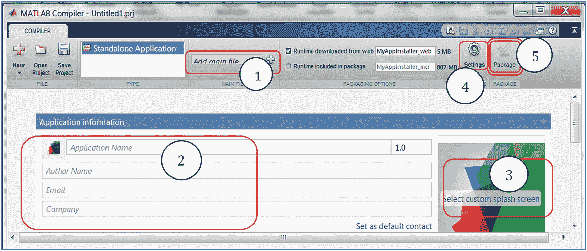

图 4-8 `MATLAB Compiler` 的独立应用程序 GUI 开发工具

(4) 我们还可以通过“设置”图标调整设置，例如传递给 `MATLAB Compiler` 的任何附加参数、测试和最终用户文件的输出文件夹位置以及软件包安装程序。
(5) 在步骤 1 中添加文件名以创建可执行的独立应用程序后，“打包”图标将变为可用状态（见图 4-9）。

请注意，在此示例中，我们使用名为 `QUAD_eqn_SIM.m` 的函数文件（在第 3 章中创建的 GUI 模型）来生成独立应用程序。此外，我们还添加了一些关于项目的信息，并为自定义启动画面添加了一张照片。完成所有这些步骤后，我们点击  图标，并指示保存独立应用程序项目的位置。

然后，创建独立应用程序的过程开始，如图 4-9 所示。这可能需要几分钟时间，具体取决于原始 M 文件的复杂性，以及它是否还调用/使用其他 M 文件和数据（`.mat` 文件），是否使用 GUI 工具等。如果在独立应用程序的打包过程中没有遇到有问题的错误或问题，新应用程序将被创建并打包到三个文件夹中——`for_redistribution`、`for_redistribution_files_only` 和 `for_testing`——以及一个名为 `PackagingLog.txt` 的日志文件中。这些由编译器自动生成。为了验证生成的独立应用程序，我们打开名为 `for_testing` 的文件夹（或单击超链接的“打开输出文件夹”），并在此文件夹中，通过点击运行 `QUAD_eqn_SIM.prj` 。

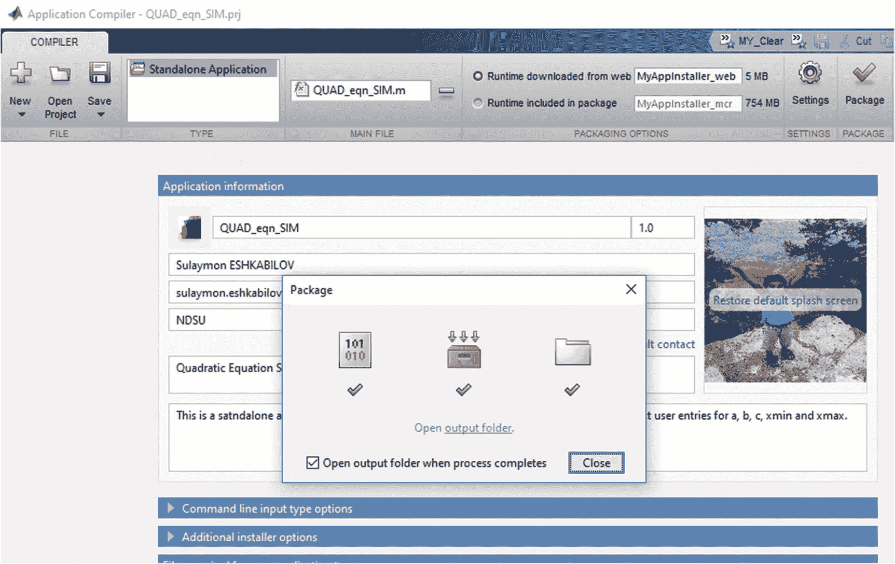

图 4-9 指示已成功完成编译的独立应用程序项目 `QUAD_eqn_SIM.prj` 的说明

### 注意

当独立应用程序的打包/编译过程完成后，将生成三个文件夹——`for_redistribution`、`for_redistribution_files_only` 和 `for_testing`——以及一个名为 `PackagingLog.txt` 的日志文件。这些由 `MATLAB Application Compiler` 自动生成。

创建的独立应用程序打开，如图 4-10 所示。现在可以用一些输入项对其进行测试。

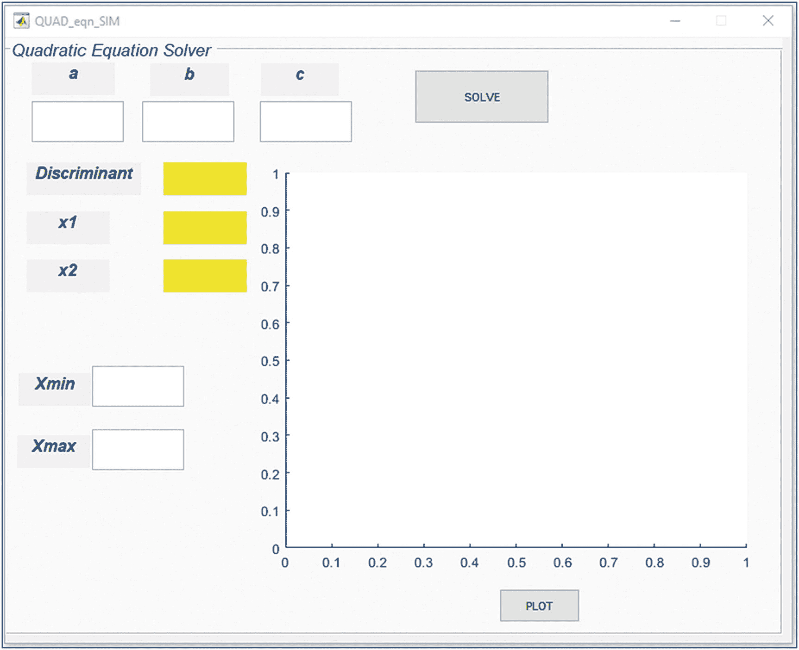

图 4-10 完整的独立应用程序

我们可以使用以下输入项测试我们新创建的应用程序：`a = 2`，`b = 7` 和 `c = 3`——并设置 `xmin = -5` 和 `xmax = 5` 进行绘图。结果显示在图 4-11 中。因此，现在这个独立应用程序可以安装在任何计算机上，并且无需 MATLAB 软件包即可运行。独立应用程序的安装包是一个可执行文件，名为 `MyAppinstaller_web.exe`。这个 `*.exe` 文件位于名为 `for_redistribution` 的文件夹内。该应用程序可以通过在任何计算机上双击此 `*.exe` 文件进行安装。它可以在没有 MATLAB 软件包的情况下无缝运行，如图 4-12 所示。我们只需选择要安装应用程序的文件夹，然后按照软件包安装的其他几个标准步骤进行操作。请注意，此安装过程可能需要几分钟时间。

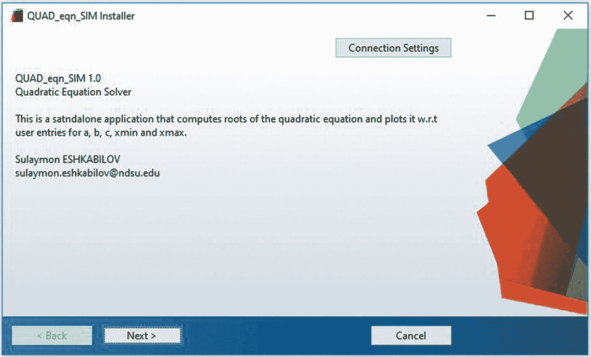

图 4-12 `QUAD_eqn_SIM` 独立应用程序安装过程

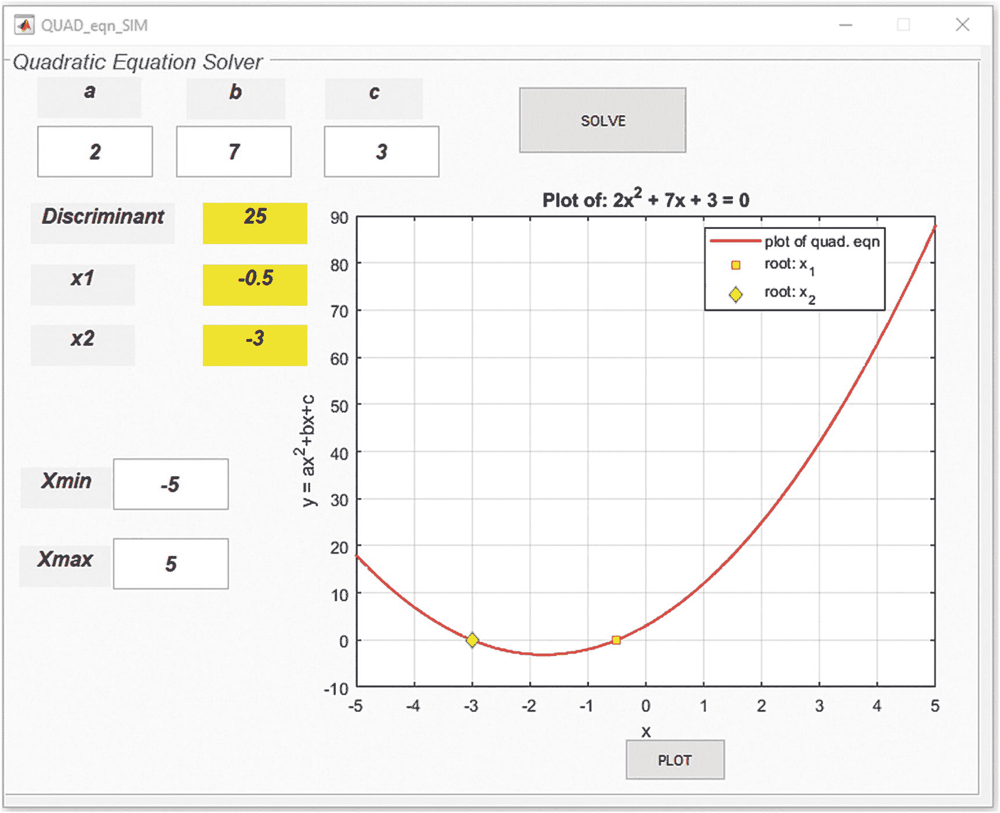

图 4-11 带有仿真结果的完整独立应用程序

一旦独立应用程序安装完成，它将出现在计算机的程序列表中，并且可以像任何其他程序一样通过单击或使用其快捷图标启动。

### 注意

唯一的安装 `*.exe` 文件（称为 `MyAppinstaller_web.exe`）位于名为 `for_redistribution` 的文件夹内。这是在任何机器上安装所开发应用程序所需的唯一文件。

请注意，与 MEX 文件一样，独立应用程序也是系统相关的。换句话说，如果我们在 MATLAB 中的 64 位处理器操作系统计算机上创建了一个独立应用程序，它只能在没有安装 MATLAB 软件包的 64 位处理器操作系统计算机上运行。因此，对于每种系统类型，我们都必须重新编译独立应用程序。此外，必须注意，MATLAB 中各种工具箱内有许多函数和工具，如果我们使用了 MATLAB 和/或软件包中特定工具箱的函数或工具，并打算创建独立应用程序，`MATLAB Compiler` 可能会因显而易见的原因而无法打包这些应用程序。另一方面，基于 MATLAB 与这些独立应用程序的不兼容性，从 GUI 模型创建独立应用程序是可行的，但存在一些限制。

