# 5. Simulink 建模基础

`Simulink`^(⁷) 是一个图形化编程包，它与 `MATLAB` 协同工作，并作为一个组合包进行交互。它用于动态系统的建模、仿真与分析、控制算法开发等。它支持线性和非线性系统、连续和离散系统以及多速率系统。使用 `Simulink`，您可以对多种类型的系统、过程和问题进行建模，并可以采用自顶向下和自底向上的方法。

`Simulink` 包与 `MATLAB` 一样，具有可扩展性。通过使用其标准模块，您可以开发自己的模块库和子系统，并将其添加到现有的 `Simulink` 库中进行扩展。在我们的 `Simulink` 模型中，我们可以将连续系统与离散系统结合起来。从用户的角度来看，使用该包的主要优势之一是，通过模块图来建模要容易得多，而无需用户具备任何编程基础或经验。在 `Simulink` 中，您只需拖拽、放置并连接模块，当然，还可以调整模型中的参数、求解器等。`Simulink` 包的另一个显著优势是其模型可以与 `MATLAB` 交互式工作，并且可以通过 `MATLAB` 命令窗口以及 `M`/`MLX` 文件和函数文件进行操作/执行。

## Simulink 建模

要从 `MATLAB` 启动该包，您只需在命令窗口中键入 `>> simulink`，点击菜单栏中的 Simulink 图标 ，或点击  和  Simulink 模型。此时将弹出图 5-1 所示的窗口。从 Simulink 启动窗口，您可以从右侧窗格（打开）打开现有模型（最近使用过的），或通过点击空白模型或其他选项来创建新模型。此外，“示例”选项卡允许用户打开、研究并修改现有示例。这里有来自工程、物理、计算、图像处理、代码生成等不同领域的数十个示例。


图 5-1 Simulink 的启动窗口

图 5-1 展示了 `Simulink` 包的默认启动窗口。请注意，`Simulink` 是一个独立的包，并且有一些可安装的工具箱和附加产品（见图 5-2）。一旦从 Simulink 库浏览器中安装了额外的库和附加产品的所有模块，它们即可使用。

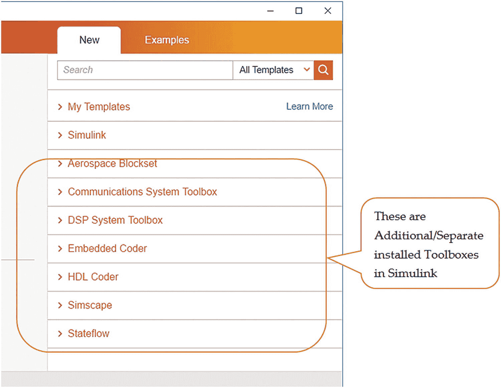

图 5-2 Simulink 的启动窗口及其中安装的附加工具箱

### 示例：算术运算

我们通过以下简单示例来演示如何构建一个计算四个不同标量的加法、乘法和减法的 `Simulink` 模型。完整的模型如图 5-3 所示。它由 `Constant`（常量）、`Gain`（增益）、`Sum`（求和）和 `Display`（显示）模块组成。在常量模块中输入的标量分别为 13, 22, `3i/2` 和 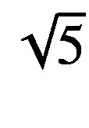。当执行此模型时，它会在 `Display` 模块中显示计算结果。请注意，此模型中使用到的所有模块都可在 Simulink 库中找到。

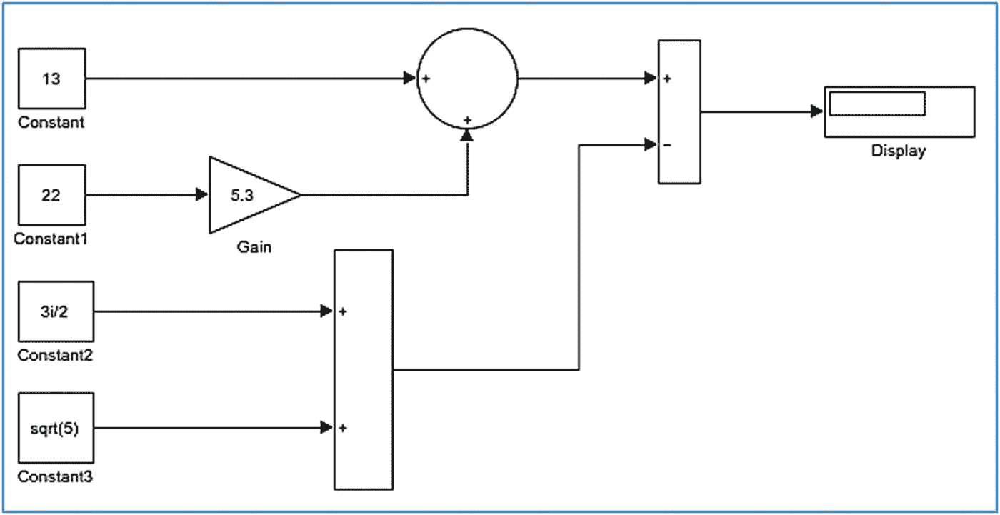

图 5-3 包含算术运算的完整 Simulink 模型示例

要打开一个空白模型，我们点击“空白模型”，如图 5-1 所示。请注意，您也可以通过点击  或按键盘上的 `Ctrl+N`，从已打开的 Simulink 窗口中打开空白模型。点击空白模型图标（见图 5-1）后，将打开如图 5-4 所示的模型。该模型默认名为 `untitled.slx`，就像 `MATLAB` 的 `M`/`MLX` 文件一样。

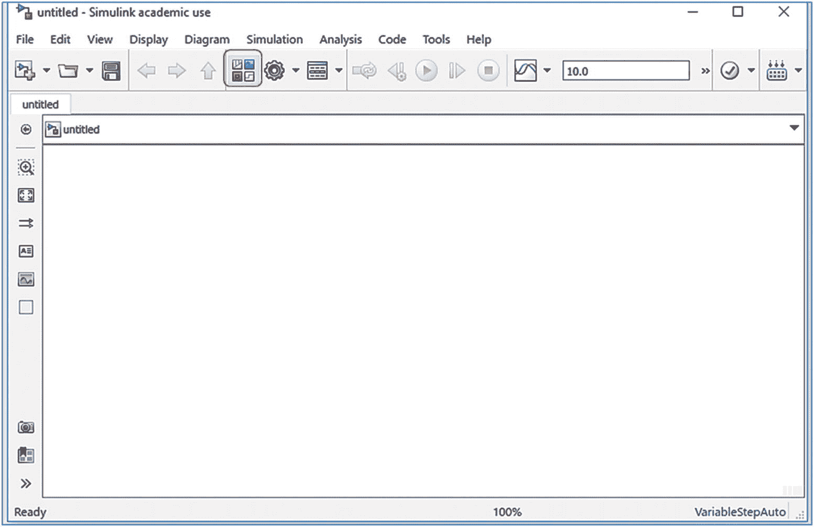

图 5-4 新建的 Simulink 模型窗口（默认未命名）

在打开的空白模型窗口中，点击 （Simulink 库图标）。这将打开一个 Simulink 库窗口，如图 5-5 所示。必须注意，库中可用的工具箱由已安装的工具箱以及用户开发/创建的自定义库决定。如有必要，您也可以通过点击库浏览器中的“新建模型”图标  来创建一个新的空白模型（见图 5-5）。这同样会创建一个空白模型窗口。

Simulink 库（见图 5-5）在不同版本中外观有所不同，但大多数通用模块的工作原理相同。在这方面，值得指出的是，该包一直在不断开发和改进，增加了许多新颖的附加产品和模块，因此，在较新版本的 `Simulink` 中创建的模型与旧版本并不完全兼容。所有模型都是向前兼容的：在旧版本 `Simulink` 中创建的模型可以在该包的后续版本中运行。

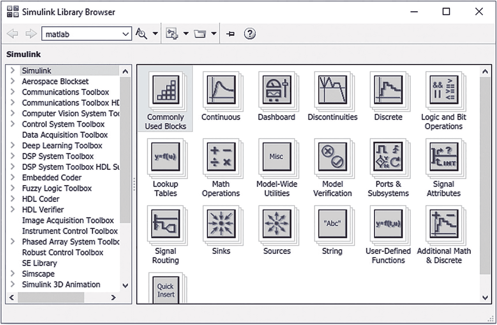

图 5-5 Simulink 库浏览器

让我们构建一个新模型，从库中拖放所有必需的模块。将模块拖放到新模型区域是基于 `Simulink` 建模或编程中最常见的做法；然而，在较新版本的 `Simulink` 中（从 `MATLAB`/`Simulink` 2018a 开始），有一种在模型区域内获取模块的替代方法。您也可以通过双击模型区域的所需位置来获取任何模块。例如，如果您想使用一个 `Input`（输入）模块，您可以双击并在“创建注释”搜索框中输入。将会出现提示下拉选项，如图 5-6 所示。从下拉选项中，您可以选择所需的模块名称。在这种情况下，还有另一个可选步骤来指定端口号。对于其他模块，此选项有所不同。

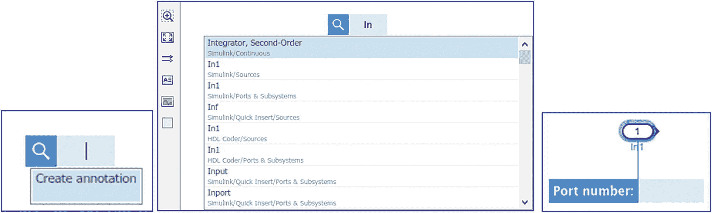

图 5-6 使用标注选项在模型区创建/获取模块

当所有必要的模块都放置在模型区后，需要将它们连接起来。在 Simulink 模型窗口中有两种连接模块的方法。您可以在空白模型窗口中通过按住键盘上的 `Ctrl` 键并点击鼠标左键来连接一个模块。然后点击另一个模块上的鼠标左键，即可将两者连接。另一种连接模块或在模块之间连接信号的方法是，将信号箭头（见图 5-7）拖到您想要连接的模块上。

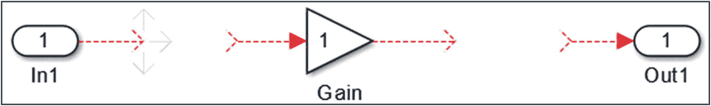

图 5-7 连接模块

有些模块既有输入端口也有输出端口，有些只有输入端口，还有些只有输出端口。您只能从它们的输出端口向另一个模块的输入端口连接信号。换句话说，无法将输出端口连接到输出端口，或将输入端口连接到输入端口。

**注意：** 模块可以轻松调整大小。点击要调整大小的模块，然后从模块周围矩形边界的四个角之一进行拖动。

在开始使用 Simulink 建模之前，您必须调整一个工具以简化模块库的使用过程。为了将 Simulink 库始终置于所有模型窗口的顶部，必须点击图标  使其处于置顶状态 。只需单击一次即可完成此操作。

**注意：** 要将 Simulink 库始终置于所有窗口（包括模型窗口）的顶部，请点击置顶图标 。

此外，一开始您需要在 Simulink 库中工作。可以通过点击 Simulink 前面的 `+` 来访问该库。Simulink 库包含许多模块组，这些模块组被归纳在 `Commonly Used Blocks`、`Continuous`、`Dashboard`、`Discontinuities`、`Discrete`、`Logic` 和 `Bit Operations` 中。让我们通过几个示例来探索 Simulink 环境中的建模工具和方面。

## 示例：对简单算术运算进行建模

让我们计算简单的算术运算，例如 `+`、`-`、`/`、`*`、`sqrt()` 等。

计算 `13+22*5.3-(3i/2+sqrt(5))` 并显示结果。

为了对这个练习中的算术计算进行建模，您需要从库中获取以下模块：`Simulink/Commonly Used Blocks`：四个 `Constant` 模块、三个 `Sum` 模块、一个 `Gain` 模块，以及来自 `Simulink/Sinks` 的一个 `Display` 模块，用于输出计算结果。

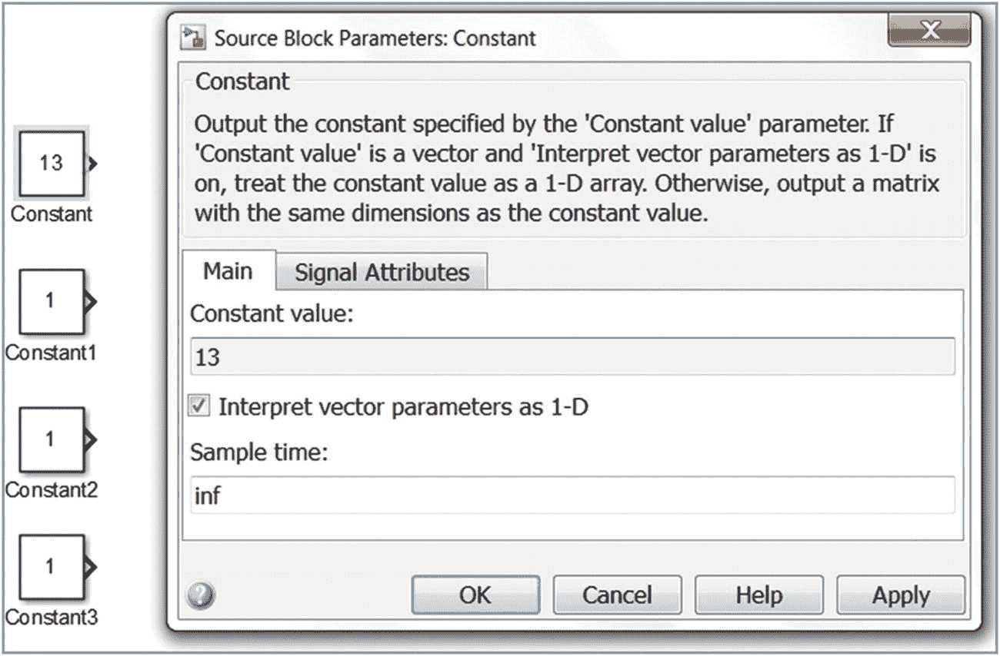

图 5-8 模块

1.  将所有模块拖放到模型区。
2.  所有 `Constant` 模块的常量值必须根据给定任务进行更改（`13`、`22`、`3i/2`、`sqrt(5)`）——见图 5-8。类似地，通过依次双击每个模块来添加一个 `Gain` 模块（用于 `5.3`）（见图 5-9）。
3.  将一个名为 `Constant`（`13`）的 `Constant` 模块连接到一个带有 `+` 符号的 `Sum` 模块。操作方法是：左键点击该模块并按住键盘上的 `Ctrl` 键，然后左键点击一个 `Sum` 模块。
4.  将一个名为 `Constant1`（`22`）的 `Constant` 模块连接到一个 `Gain` 模块，该模块再连接到带有 `+` 符号的 `Sum` 模块，如图 5-6 所示。
5.  将一个名为 `Constant2`（`3i/2`）的 `Constant` 模块连接到第二个 `Sum` 模块。这个矩形形状可以通过双击带有 `+` 符号的 `Sum` 模块来更改。类似地，使用 `+` 符号将一个名为 `Constant3`（`sqrt(5)`）的 `Constant` 模块连接到此 `Sum` 模块。
6.  将两个 `Sum` 模块连接到一个带有 `+` 和 `-` 符号的第三个 `Sum` 模块。随后，将第三个 `Sum` 模块连接到 `Display` 模块。

**注意：** 任何模块都可以通过按住 `Ctrl` 并左键点击该模块，然后将其拖到模型空间中的任意位置来复制多次。这种方法比从库中拖动同一个模块更快、更高效。

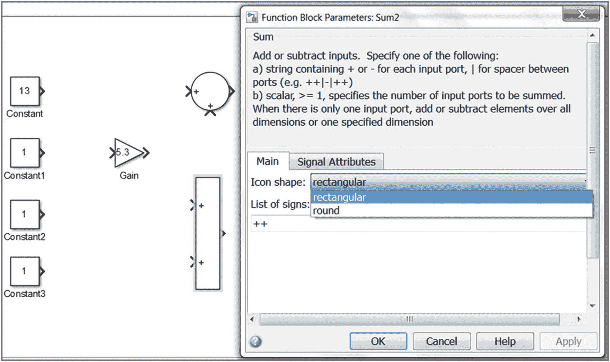

图 5-9 更改 `Sum` 模块的符号和图标形状

至此，我们简单的 Simulink 计算模型就完成了。

此模型以文件名 `Ex1_Arithmetic_operations.mdl` 保存。

**注意：** 在 Simulink 的最新版本中，模型可以保存为 `*.mdl`（向后兼容的文件格式）或 `*.slx`（后续版本支持）格式。任何 Simulink 模型都可以通过 `文件 ➤ 导出模型到 ➤ 先前版本...` 导出到以前的版本。在“保存类型”选项中，您可以从下拉菜单中选择适当的版本。

要查看计算结果，请点击 `运行` 按钮  或按键盘上的 `Ctrl+T` 键。结果将显示在显示模块中。图 5-10 显示了完整的模型。

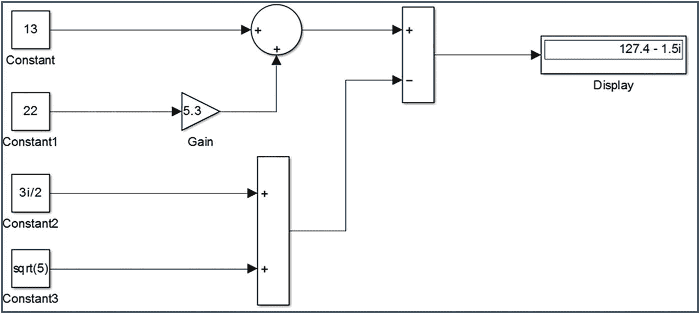

图 5-10 名为 `Ex1_Arithmetic_operations.mdl` 的完整 Simulink 模型

**注意：** 要在全屏模式下查看模型，只需按键盘上的空格键。要放大或缩小，请按键盘上的 `Ctrl++` 和 `Ctrl+-` 键（在后续版本中），或者点击  以获得适合视图，或使用  进行放大。

请注意，`sqrt(5)` 作为名为 `Constant3` 的 `Constant` 模块的值输入，输入方式为 `sqrt(5)`，而 `3i/2` 的输入方式为 `3i/2`，因为 Simulink（像 MATLAB 一样）会自动通过字母 `i` 和 `j` 识别虚数。任何 Simulink 模型都可以通过工作区或任何 M 文件中的 `sim()` 命令从 MATLAB 进行仿真/执行。被仿真的模型必须位于当前工作目录中。例如，之前的模型可以通过以下命令运行：

```
>> sim('Ex1_Arithmetic_operations.mdl')
```

**注意：** 任何模块的名称都可以通过点击其名称标签来更改。

任何模块的属性和参数都可以通过打开属性窗口（双击该模块）并插入必要的更改或选择必要的选项来更改。例如，在 `Display` 模块中，您可以将数据格式化为 `short`、`long`、`short_e`、`long_e`、`hex` 等。

## 执行矩阵运算

我们将构建一个执行以下矩阵运算的 Simulink 模型：

![$$ {\left[\begin{array}{cc}3&amp; 2.5i\\ {}-2i&amp; 3.2\end{array}\right]}^T\ast \frac{1}{5} $$](images/471979_1_En_5_Chapter/471979_1_En_5_Chapter_TeX_IEq7.png) + ![$$ {\left[\begin{array}{cc}\sqrt{-3i}&amp; \sqrt{2.2}\\ {}\sqrt{2.5}&amp; \sqrt{5.4}\end{array}\right]}^{-1}\ast \sqrt{3.3i} $$](images/471979_1_En_5_Chapter/471979_1_En_5_Chapter_TeX_IEq8.png) 并显示结果。

完整的模型如图 5-11 所示。该模型执行矩阵运算，例如求逆、平方根、转置、求和以及除以标量（实数和虚数）。矩阵运算（转置和求逆）：![$$ {\left[\begin{array}{cc}3&amp; 2.5i\\ {}-2i&amp; 3.2\end{array}\right]}^T,\kern0.5em {\left[\begin{array}{cc}\sqrt{-3i}&amp; \sqrt{2.2}\\ {}\sqrt{2.5}&amp; \sqrt{5.4}\end{array}\right]}^{-1} $$](images/471979_1_En_5_Chapter/471979_1_En_5_Chapter_TeX_IEq9.png) 是通过使用 `Interpreted MATLAB Function` 模块来执行的。`Math Function` 和 `Product of Elements` 模块与计算结果进行比较，并通过 `Display` 模块显示。

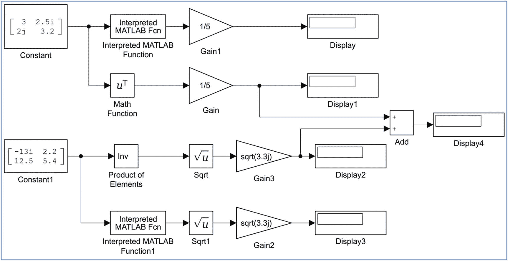

图 5-11 完整模型：示例 2，矩阵运算

要为此练习建模，请按照以下步骤操作。

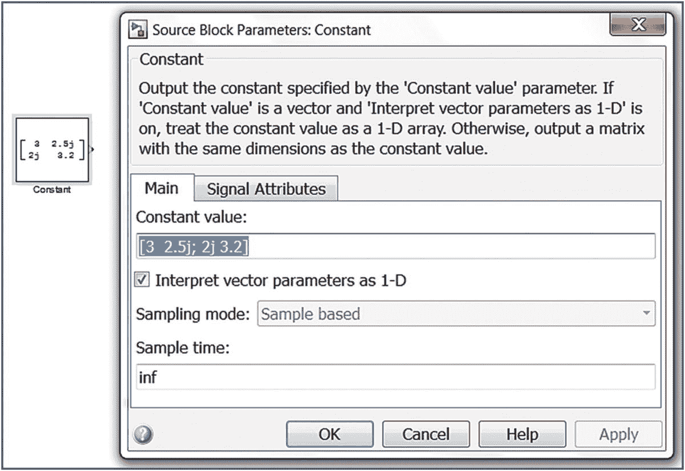

图 5-13 将矩阵元素输入到 `Constant` 模块的常量值中

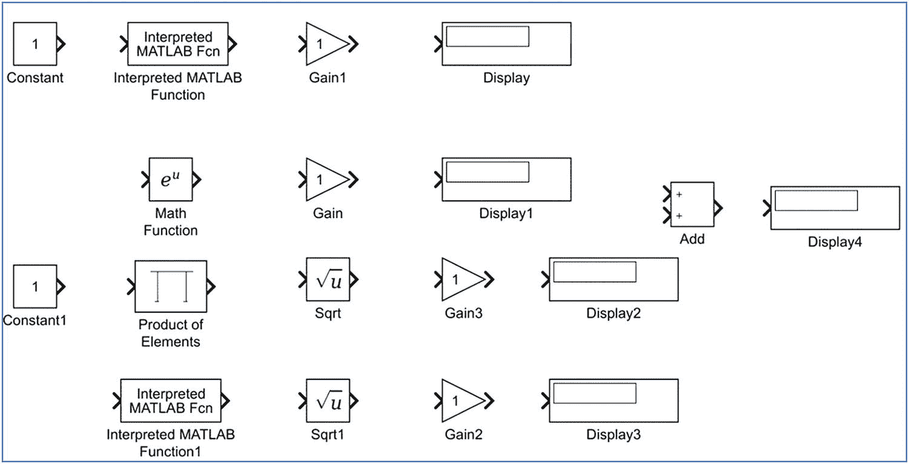

图 5-12 本模型所需的所有模块

1.  对于此模型，您需要两个 `Constant` 模块、四个 `Gain` 模块、五个 `Display` 模块、一个来自 `Simulink/Commonly Used Blocks` 的 `Add` 模块、两个 `Sqrt` 模块、一个 `Math Function` 模块、一个来自 `Simulink/Math Operations` 的 `Product of Elements` 模块，以及两个来自 `Simulink/User-Defined Functions` 的 `Interpreted MATLAB Function` 模块（见图 5-12）。

2.  将两个矩阵的元素分别输入到两个 `Constant` 模块中：`[3 2.5j; 2j 3.2]`（见图 5-13）和 `[-3i 2.2; 2.5 5.4]`。这些模块将连接两个独立的 `Math Function` 模块，其中一个为 `Math Function`（矩阵转置），另一个为 `Product of Elements`（矩阵求逆）。相应地编辑这两个模块；例如，要为 `Math Function` 模块获取转置算子，需从下拉选项中选择 `Function` 类型为转置。在 `Product of Elements` 模块中，将输入数量选项更改为除法 (`/`)，并将乘法选项选择为矩阵 (`*`) 乘法。

3.  将 `Math Function`（转置）模块链接到 `Gain` 模块（`1/5`），该模块随后链接到 `Sum` 模块。`Product of Elements` 模块连接到 `Sqrt` 模块，后者又链接到 `Gain` 模块（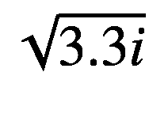）。最后，来自 `Gain` 模块（`1/5`）和 `Gain` 模块（）的信号连接到 `Sum` 模块（见图 5-13），该模块再链接到 `Display` 模块。

> **注：** 在 Simulink 建模中，通过更改模块的属性和参数可以得到相同的结果。例如，矩阵求逆可以通过在 `Interpreted MATLAB Function` 模块中插入名为 `inv(u)` 的 MATLAB 函数来实现。

矩阵转置是通过 `Math Function` 模块的选项获得的，如图 5-14 所示。

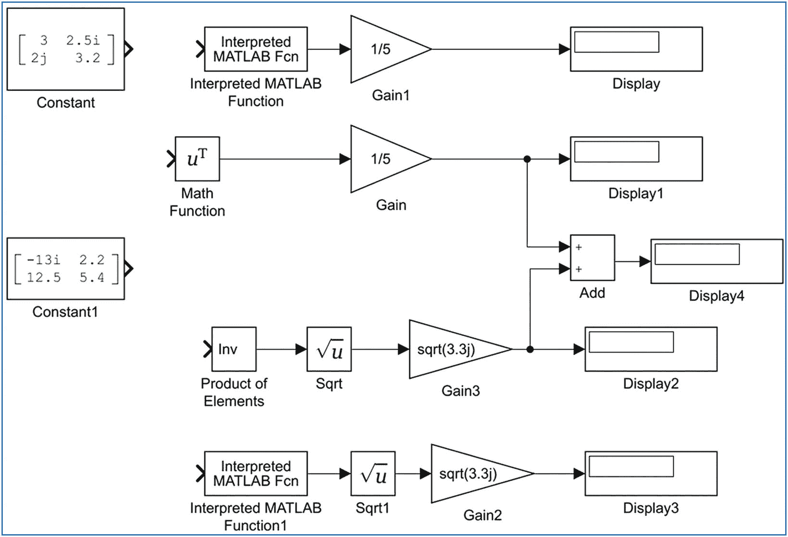

图 5-15 所有模块均已调整选项并输入数值/元素

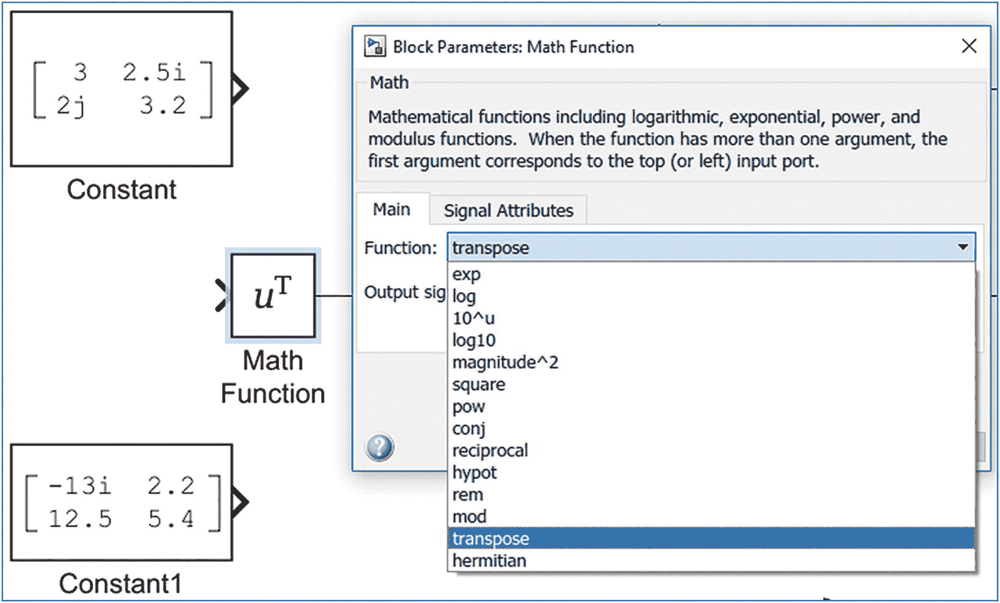

图 5-14 在 `Math Function` 模块中选择 `Function` 类型

请注意，在完成的模型中有两种方法可以获得矩阵的逆，如图 5-16 所示。通过运行完成的模型，您可以看到两种矩阵求逆操作的结果是相同的。

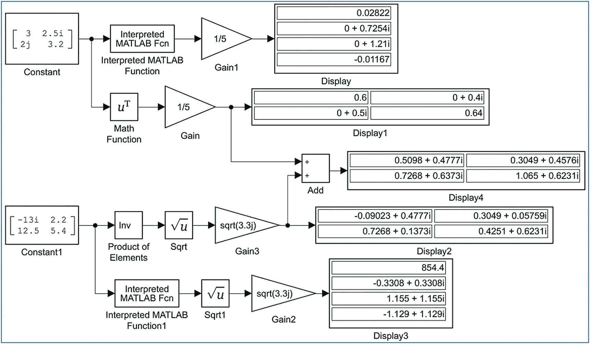

图 5-16 完整的矩阵运算及名为 `Ex2__MATRIX_operations.slx` 的 Simulink 模型

> **注意：** 用于保存 Simulink 模型的文件格式有两种：`*.mdl` 和 `*.slx`。后一种模型类型受 Simulink 软件包更高版本（自 MATLAB 2010 起）支持，而前一种格式可以被大多数版本打开和仿真，这取决于所使用的模块。通过“模型导出”选项，我们可以将模型保存为 Simulink 的早期版本。

Simulink 软件包的更高版本中包含了一些具有不同属性的新模块。因此，通过使用此类新模块开发的模型无法通过该软件包的早期版本进行仿真。

# 计算函数值

在本节中，您将学习如何计算以下数学函数的值，将计算结果同时保存到独立的 `*.mat` 文件和 MATLAB 工作区中，并在图形窗口中显示。已知：*H*(*t*) = *e*^(*sinc*(*t*)) + *e*^(sin(250*t*))，*t* = − 3*π* … 3*π*，∆*t* = *π*/3000。

构建给定示例的计算模型有多种方法。我们从一种简单直接的方法开始。与前面两个示例类似，您首先从 Simulink 库中获取所需的模块。为此，您需要以下模块：`Clock`、`Scope`、`Math Function`、`Gain`、`Trigonometric Function`、`To File` 和 `Add To Workspace`，它们分别来自 `Simulink/Sources`、`Simulink/Math Operations`、`Simulink/Sinks` 和 `Simulink/User-Defined Functions`。建模过程从将所有模块从 Simulink 库中拖出并按照以下顺序连接开始：`Clock` + `Interpreted MATLAB Function` + `Math Function1` + `Add` + `Scope2` + `To File` 以及 `Clock` + `Trigonometric Function` + `Math Function` + `Scope1` + `Add` + `To Workspace`。图 5-17 显示了已完成的模型，其保存文件名为 `Ex3_Function_Compute.slx`。

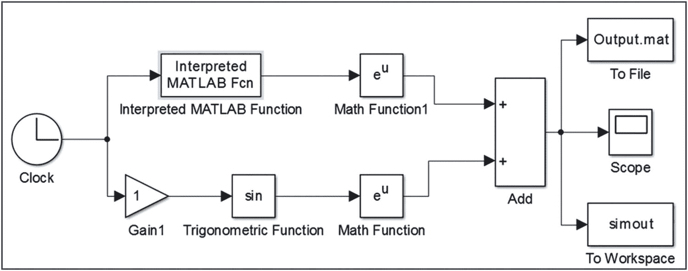

**图 5-17** 名为 `Ex3_Function_Compute.slx` 的完整仿真模型

这个完成的模型本身无法直接运行，因为模型中使用的几个模块的属性和参数需要根据本练习的给定任务进行调整。

例如，仿真周期应在 *t* = − 3*π*…3*π* 范围内，时间间隔为 ∆*t* = *π*/300。`Interpreted MATLAB Function` 模块的 MATLAB 函数必须修改为 `sinc()`，并且两个可选编辑点——`To File` 和 `To Workspace` 模块——应重命名为外部 `*.mat` 文件和一个以结构体格式保存在工作区中的变量。

您可以通过模型配置参数开始调整仿真时间间隔和时间步长（见图 5-18）。可以通过点击  图标或按下键盘上的 `Ctrl+E` 键来访问这些参数。您需要输入开始时间：`-3*pi` 和停止时间：`3*pi`，并将求解器类型从默认选择的变步长更改为固定步长。此外，您还应在求解器选项中指定类型：`Fixed-step`，并在附加选项中指定固定步长大小（基本采样时间）：`pi/3000`。有关求解器以及如何选择其类型和参数（包括求解算法、步长、相对误差和绝对误差容限）的更详细说明，请参见第 8 章。

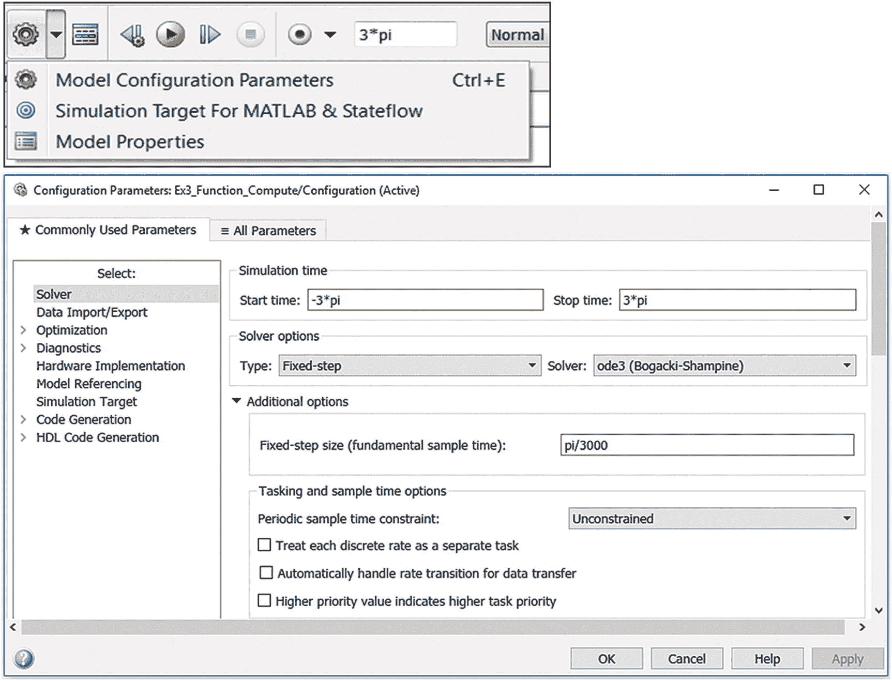

**图 5-18** 调整配置参数

### 注意

对于许多模型，仿真结果的准确性取决于所选的求解器类型和步长。

另外，在进行仿真之前，您需要对模型进行以下调整：

1.  `Interpreted MATLAB Function` 模块的 MATLAB 函数应为 `sinc(u)`。请注意，输入变量名 `u` 是默认定义的。
2.  在两个 `MATH Function` 模块中，应使用函数类型（从下拉选项中选择）`exp` 函数（这是默认设置）。
3.  在 `Gain` 模块中，增益值应为 `250` 以获得 `250*t`。
4.  在 `Trigonometric function` 中，将其设置为 `sin` 函数（此为默认设置）。
5.  虽然这一步是可选的，但可以将输出文件重命名为 `Output_Data.mat`，并将输出变量重命名为保存在 MATLAB 工作区中的输出。

### 注意

当您通过 `*.mat` 格式的输出文件和输出变量保存计算结果时，有几种保存数据的选项（格式）——`Time-Series`、`Array`、`Structure` 和 `Structure with Time Series`。

完成所有这些调整后，模型应呈现如图 5-19 所示的形式。

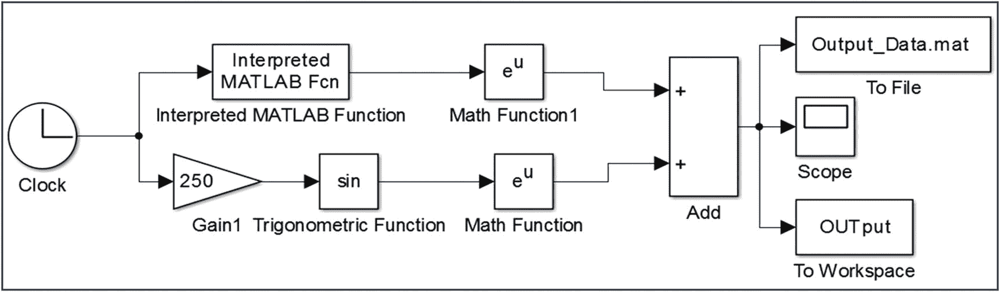

**图 5-19** 经过所有必要调整和微调后的最终模型

最后，您可以通过按下键盘上的 `Ctrl+T` 或点击运行按钮来仿真 `Ex3_Function_Compute.slx` 模型。您可以通过双击 `Scope` 模块查看仿真结果。图 5-20 显示了在 `Scope` 模块中绘制的仿真结果。

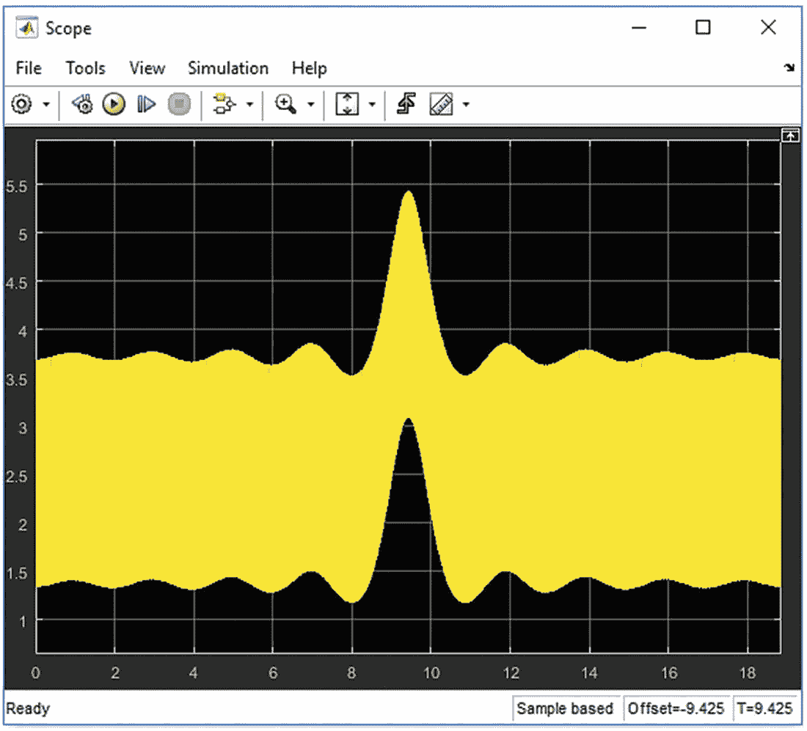

**图 5-20** 仿真结果

### 注意

在示波器显示中，模拟结果可以按比例、水平或垂直方向进行放大或缩小。也可以使用自动缩放功能，所有这些操作都可以通过使用 、、 和  工具完成。

图 5-20 中显示的模拟结果与设定的仿真周期（设定在 `-3*pi ... 3*pi` 范围内）不一致。问题出在示波器模块的时间显示偏移量上，其默认值为 0。需要将时间偏移量设置为 `-3*pi`，这可以通过示波器的“配置属性”进行修复。点击其下拉选项中的  图标，即可进入示波器的“配置属性”。打开“配置属性”后，点击“时间”选项卡，并在“时间显示偏移量”中输入 `-3*pi`。接着，点击“应用”和“确定”（见图 5-21），即可在示波器中获得正确的结果显示，如图 5-22 所示。此外，示波器中显示的模拟结果可以作为变量保存，格式可以是带时间序列的结构体、数组或结构体。只需在“记录”选项卡下勾选“将数据记录到工作区”选项即可（见图 5-21）。

此外，示波器模块还具有许多图形显示选项，可以通过  下拉选项（即选择“样式” ）进行访问。通过“样式”  选项，您可以调整图形颜色、坐标轴颜色、线条和标记。参见图 5-22。

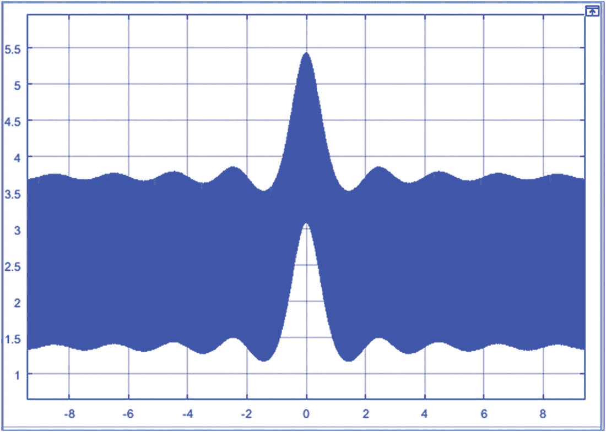

图 5-22 模拟结果完整视图

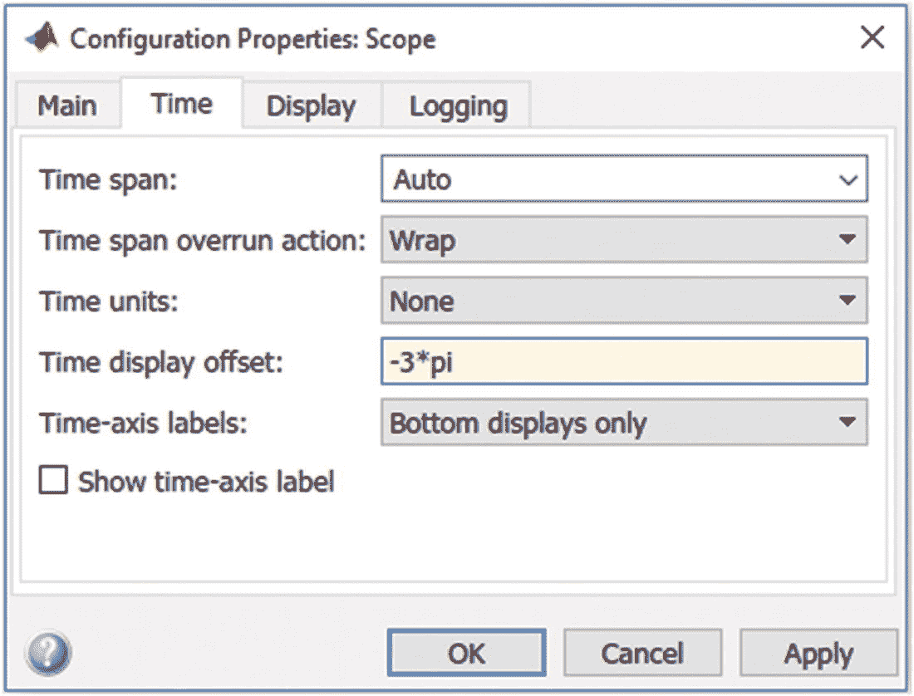

图 5-21 在“配置属性：示波器”中将时间显示偏移量设置为 `-3*pi`

为了提高大型复杂 Simulink 模型的可读性和可管理性，可以将整个模型或部分模型关联到一个子系统模块中。从现有模型创建子系统非常简单直接。从现有模型创建子系统的最简单方法是：按住鼠标左键并拖动光标选中所需模块（相互连接的模块），然后按键盘上的 `Ctrl+G`。要基于整个模型创建一个子系统，请先按 `Ctrl+A`，然后再按键盘上的 `Ctrl+G`。

我们来看一下完整的模型（见图 5-19），并基于整个模型（不包括输入信号（至 Clock 模块）和输出信号（至 To File、Scope 和 To Workspace 模块））创建一个子系统。首先，使用鼠标左键选中除输入模块和所有输出模块之外的模型模块，然后按键盘上的 `Ctrl+G`。子系统将从选中的模型模块中创建，如图 5-23 所示。要查看所创建子系统的内部内容，需要双击它。参见图 5-24。

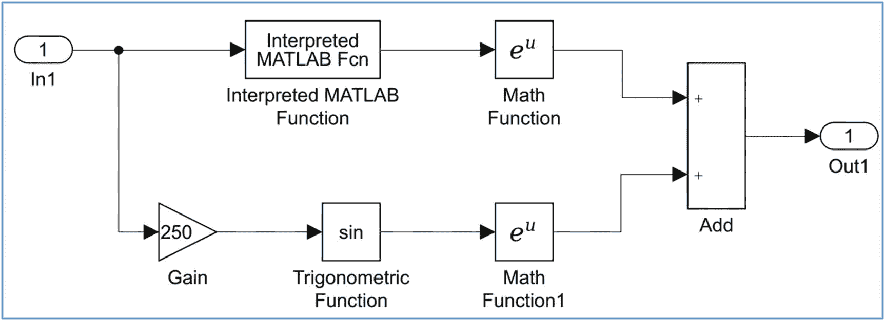

图 5-24 所创建的子系统的组件

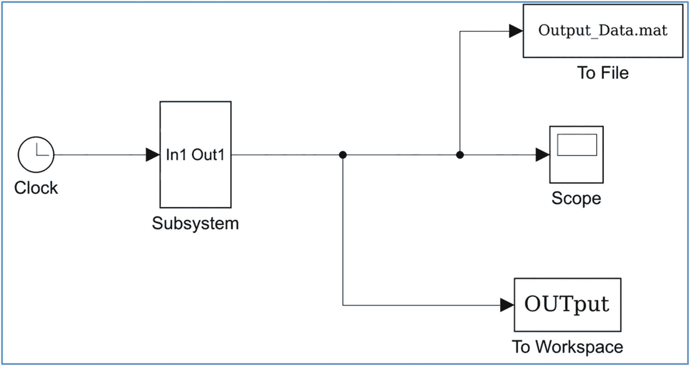

图 5-23 基于完整模型（图 5-19）但不包含输入和输出模块创建的子系统

请注意，图 5-24 中的这个子系统有一个名为 `In1` 的输入模块和一个名为 `Out1` 的输出模块。它们分别与输入模块（`Clock`）和输出模块（`To File`、`Scope`、`To Workspace`）连接，用于接收和发送信号。请注意，如果基于整个模型（图 5-19）创建子系统时仅排除输入模块，那么该子系统将只包含一个输入模块，名为 `In1`。如果基于整个模型（图 5-19）创建子系统时仅排除输出模块（`To File`、`Scope`、`To Workspace`），那么它将包含一个输出模块 `Out1`。如果基于整个模型（包括所有输入和输出模块）创建子系统，那么所创建的子系统中将不包含任何输入和输出模块。

完整的模型可以简化。换句话说，可以通过使用“解释的 MATLAB 函数”模块（其函数公式编辑为 `exp(sinc(u))+exp(sin(250*u))`）并调整示波器参数（将仿真结果作为带时间序列的结构体保存到 MATLAB 工作区）来减少此模型中使用的模块数量。图 5-25 与基于图 5-23 中的模型创建的子系统一起，可产生与图 5-19 中的子系统相同的结果。

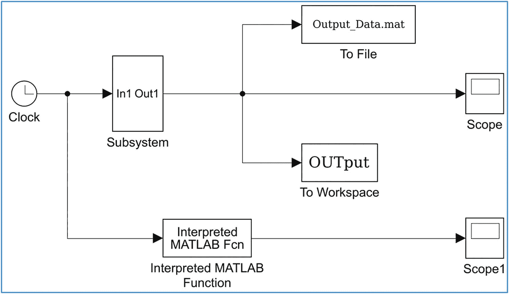

图 5-25 简化模型 `Ex3_Function_Compute_Simple.slx`

### MATLAB 工作空间的输入/输出信号

如前所述，Simulink 模型与 MATLAB 工作空间能够交互式且完美地协同工作。出于模型开发和仿真目的，输入信号可以在 MATLAB 工作空间或 M 文件中生成，然后传输到 Simulink 模型环境中。同样，Simulink 模型的所有最终仿真结果都可以发送到 MATLAB 工作空间。为了同时从 MATLAB 工作空间加载输入信号并将输出信号（仿真结果）发送回 MATLAB 工作空间，需要使用输入和输出模块，并调整模型配置参数。可以通过点击菜单面板上的图标或按键盘上的 `Ctrl+E` 来访问这些参数。在图 5-25 所示的上一示例（考虑简化部分）中，我们用 `In1`（输入模块）替代了输入信号 `Clock` 模块，并用 `Out1`（输出模块）替代了 `Scope` 模块；见图 5-26。

此外，在模型配置参数中检查输入和输出信号选项（见图 5-27），分别将输入设置为 `t`、`u`，将输出设置为 `tout` 和 `yout`。请注意，在开始仿真之前，必须在 MATLAB 工作空间中以 `t`、`u` 的形式将输入信号定义为两个列向量。对于此示例，可以按如下方式操作：

```
>> t=[-3*pi:pi/3000:3*pi]'; u=t;
```

在此示例中，输入信号仅由时间定义，因此 `t=u`。此外，我们通过配置参数对此模型的求解器选项进行了多项调整（开始时间：`-3*pi`；结束时间：`3*pi`；类型：`固定步长`；固定步长大小（基本采样时间）：`pi/3000`），如图 5-18 所示。

此外，我们可以通过点击通往 `Out1` 模块的信号线，并使用鼠标右键选项（`Create & Connect Viewer --> Simulink --> Scope`）将 `Scope` 模块添加到模型中，如图 5-28, a 所示。选择 `Scope` 后，通往 `Out1` 模块的信号线上方会出现示波器图标，如图 5-28, b 所示。

另外，在 `Scope` 模块中做一项重要调整（时间显示偏移量：`-3*pi`），使其能完整显示整个仿真结果，如示例和图 5-21 所示。现在，保存模型（`Ex3__Function_compute_In_Out.slx`），并在 MATLAB 工作空间中输入以下内容后开始仿真：

```
>> t=[-3*pi:pi/3000:3*pi]'; u=t;
```

在仿真了三个替代模型 `Ex3__Function_compute.slx`、`Ex3_Function_Compute_Simple.slx` 和 `Ex3_Function_Compute_In_Out.slx` 之后，仿真结果是一致的。通过这些示例，您已经看到如何轻松地用一个模块替代另一个模块，如何通过关联互连模块的部分来从现有模型创建子系统，以及如何通过减少模型中使用的模块数量来简化模型。

### 仿真一个机械系统

让我们考虑一个具有牛顿摩擦力的机械弹簧-质量-阻尼器系统，其微分方程表述为：`m\ddot{x}(t)+ bsign(\dot{x}){\dot{x}}²(t)+ kx(t)=f(t)`。

我们将把给定的系统模型视为连续系统和离散系统，以演示如何在 `Simulink` 中对这类系统进行建模和仿真。请注意，通过 `Simulink` 建模求解和仿真微分方程在第 8 章中有更多解释。这里，我们更侧重于模型构建、调整模块参数以及 `Simulink` 与 `MATLAB` 的交互。此外，我们还将讨论连续和离散系统的建模问题以及创建子系统的相关问题。

已知：`m=0.52 kg`；`b=0.00525 kg/m`；`k=165.5 N/m`；`f(t)=A cos(\omega t)`；`\omega =131 rad/sec`；`A=2.3`，所有初始条件均为“零”。采样时间：`t[s]=0.01`。系统的参数中，`m` 代表质量，`b` 代表阻尼系数，`k` 代表刚度，`f(t)` 代表输入力，`A` 代表幅值，`\omega` 代表频率。

1.  通过拖放的方式，从 `Simulink` 库中收集所有必需的模块到空白模型窗口中。图 5-29 显示了所需的模块，它们来自 `Simulink/Math Operations`、`Continuous`、`Discrete`、`Sources`、`Signal Routing` 和 `Sinks`。
2.  通过移动模块以及将其中一些旋转 180 度，将模块调整成更容易阅读的顺序。`Product`、`Sign` 和 `Gain` 模块需要旋转。您可以通过选择一个模块并按键盘上的 `Ctrl+R` 键，或使用鼠标右键的 `Rotate & Flip` 选项来进行旋转。见图 5-30。
3.  调整模块的参数。首先调整作为输入信号的 `Sine Wave` 和 `Sine Wave1` 模块的幅值、频率和采样时间（见图 5-31）。请注意，对于 `Sine Wave1`，采样时间设置为 `0`，因为默认情况下它用于连续系统建模。
4.  注意，当采样时间设置为 `0.01` 时，`Sine Wave` 模块中的正弦波符号如何从平滑曲线变为阶梯曲线。将 `Gain` 和 `Gain3` 的增益值更改为 `1/m`，`Gain1` 和 `Gain4` 的增益值更改为 `b`，`Gain2` 和 `Gain5` 的增益值更改为 `k`。另外，将 `Add` 和 `Add1` 模块中的符号更改为 `-+-`。
5.  所有模块均已连接，完整的模型搭建完成。此外，添加了两个注释：`Discrete System` 和 `Continuous System`；见图 5-32。完整的模型已保存（`Ex4_Discrete_Continuous_Sys.slx`）。
6.  您可以通过按键盘上的 `Ctrl+T` 键或按 `Run` 按钮来执行这些模型。

现在，完成的模型（`Ex4_Discrete_Continuous_Sys.slx`）似乎已准备好进行仿真。然而，如果直接执行它们，将会弹出错误消息窗口，并且无法获得任何结果。这是因为三个参数——`m`、`k`、`b`——的值尚未定义。你可以通过多种不同方式定义它们，其中一种是在每个模块或 `MATLAB` 工作区中指定参数值。你也可以在 **模型属性/回调/初始化函数** 中指定此信息，可通过 **文件 > 模型属性** 访问。在命令窗口中输入：`>> m=0.52; k=155; b=.00144`。

随后，点击 `Simulink` 模型窗口中的  **运行** 按钮。你可以更改示波器模块的“样式”设置（通过  下拉选项 --> **样式** ），并获取显示在示波器模块中的仿真结果；参见图 5-33。

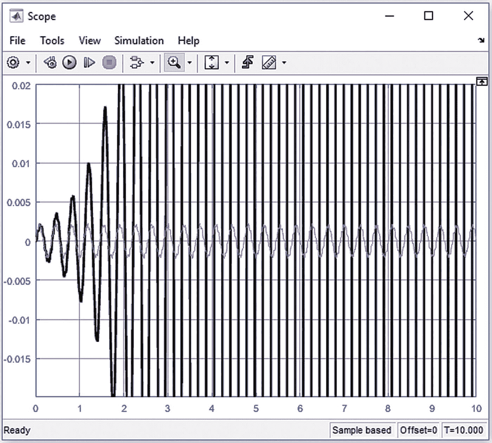

**图 5-33**

**仿真结果**

从仿真结果可以看出，其中一个系统（离散系统）不稳定，需要进行调整。该离散系统建模的问题在于采样时间，需要对其进行调整。这可以通过输入信号模块（即正弦波）轻松解决。在该模块的采样时间值从 `0.01` 更改为 `0.0001`，这比初始设置小了 `100` 倍。

### 注意

如果在离散积分器模块中将采样时间设置为 `-1`，则采样时间将从输入信号源自动继承。

除了通过为离散和连续系统模型显示图例使示波器中的图形更具可读性之外，我们还应该勾选示波器模块属性的 **图例** 选项 。其次，点击从 **离散时间积分器 1** 到 **总线创建器** 的信号线，使用鼠标右键的选项访问 **属性（信号属性）**。在那里，指定 **信号名称** 为 `Discrete Sys`，然后点击确定。类似地，更改从 **积分器 1** 到 **总线创建器** 的信号线的信号名称，将其命名为 `Continuous Sys`。然后点击确定，如图 5-34 所示。

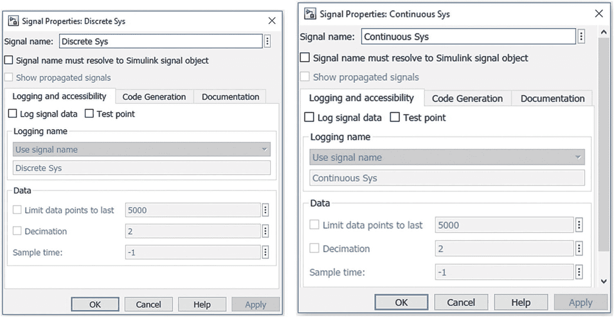

**图 5-34**

**信号名称更改**

完成这三处更改后，整个模型运行并得到以下结果，如图 5-35 所示。注意，这是沿水平轴放大的视图。

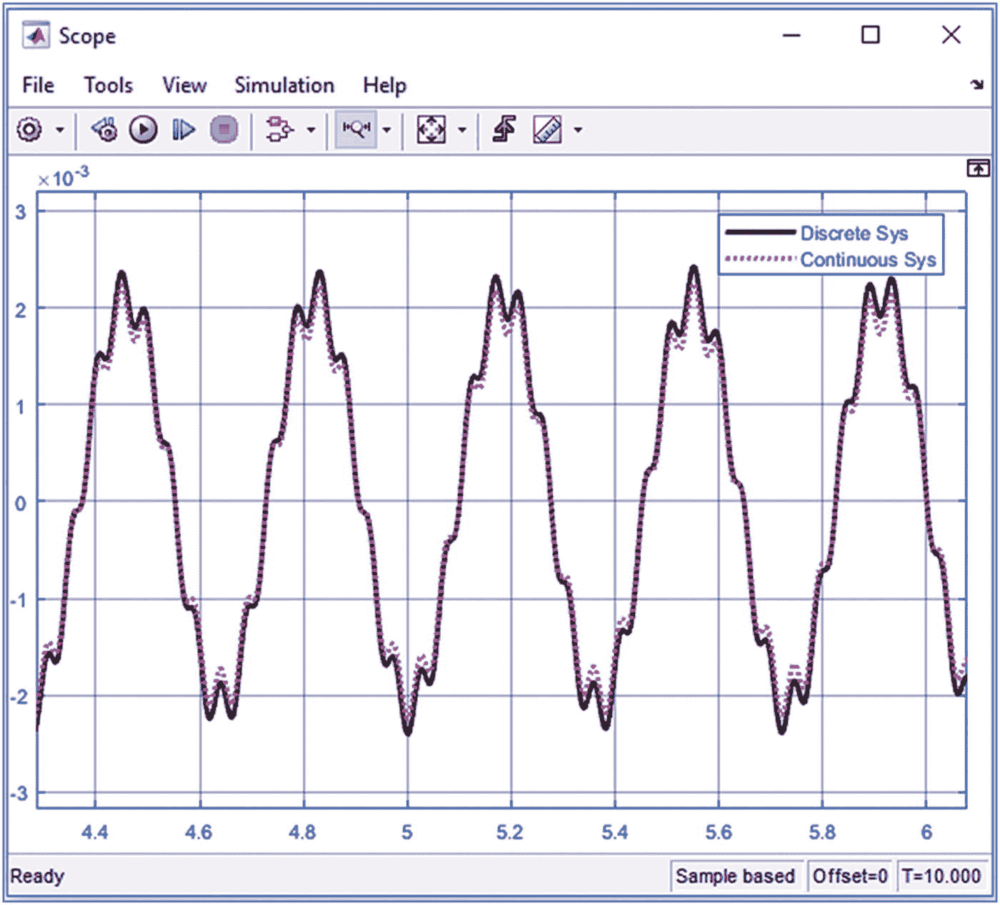

**图 5-35**

**在属性调整后的示波器中显示的仿真结果**

您已经完成并验证了系统模型，这些模型可以使用子系统选项进行简化，如前面的示例所示（参见图 5-25；`Ex3_Function_Compute_Simple.slx`）。任何包含两个以上模块的系统都可以通过使用子系统模块进行简化或替换。从系统模型创建子系统有几种方法。最简单的方法是选中打算归入一个子系统的模型模块，然后使用鼠标右键选项 **从所选内容创建子系统**，或从键盘按下 `Ctrl+G`。您可以从离散和连续系统模型中创建两个子系统（`Subsystem` 和 `Subsystem1`）（见图 5-36）。

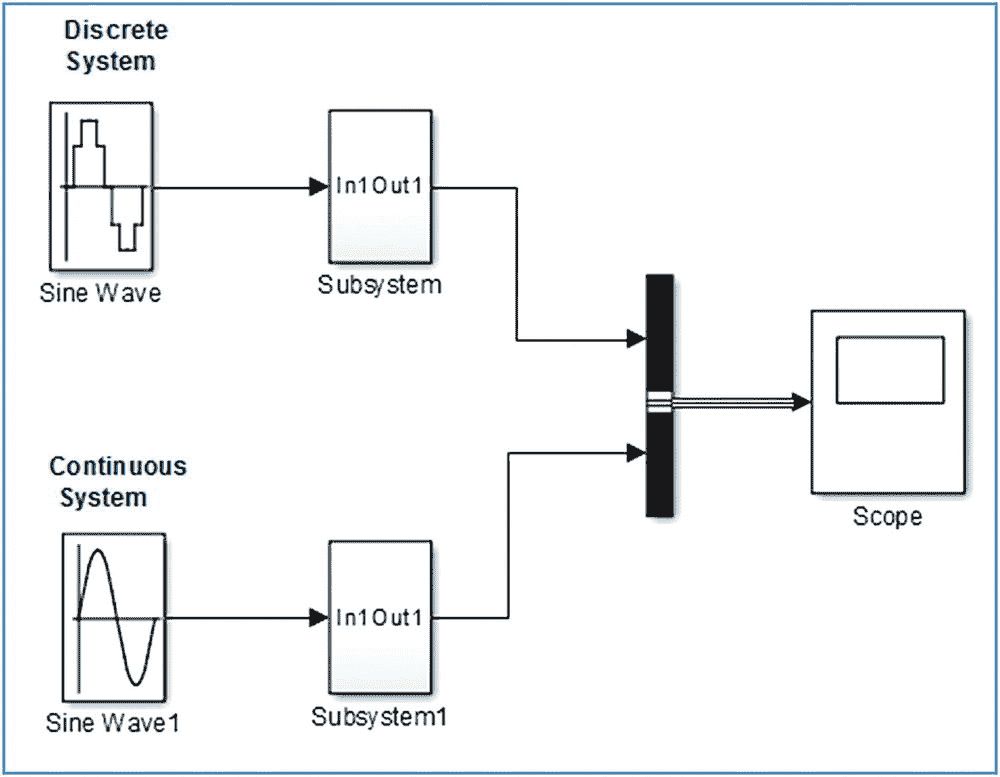

**图 5-36**

**包含两个子系统模型的模型**

可以通过双击来访问任何子系统下的模型。代表离散系统的子系统包含如图 5-37 所示的模型。

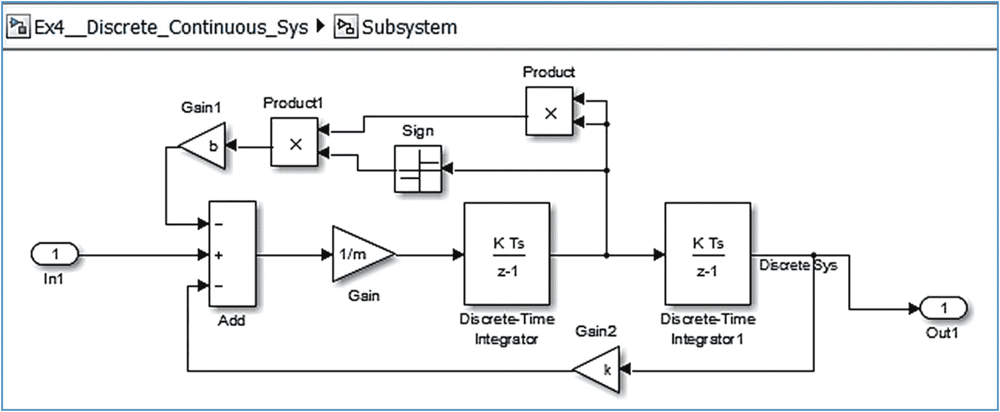

**图 5-37**

**该子系统由此模型组成**

此外，也可以逆转子系统的创建过程，方法是点击一个子系统模块，然后使用鼠标右键选项 **子系统与模型引用 > 展开子系统**。或者在点击一个子系统模块后，按下 `Ctrl+Shift+G` 键。

在本练习中，您学习了如何构建离散和连续系统，以及 `Simulink` 如何处理这种系统组合，但您尚未对求解器参数进行任何调整。仿真过程的精度和效率可以通过调整求解器类型（默认选择可变步长求解器或固定步长求解器）和参数设置（求解器、误差容限、求解算法、如果选择固定步长求解器则为步长、过零点等）来提高。关于这些关键问题的更多讨论和解释将在第 8 章关于微分方程的章节中重点阐述。

### 处理二阶微分方程

我们将为二阶微分方程描述的系统构建一个 `Simulink` 模型：

```
A\ddot{q}(t) + B\ddot{q}(t) + Cq(t) = F(t)
```

其中 `F(t)` 是施加的力（系统的输入信号），与 `MATLAB` 函数文件相关联。`F(t)` 是一个由傅里叶级数近似的矩形脉冲：

```
F(t) = (Amp/π) * Σ_{n=1}^N (1 - cos(nπ)) * sin(nπ t)
```

该函数在 `MATLAB` 中通过 `function_pulse.m` 函数文件实现：

```matlab
function F = function_pulse(t, Amp, n)
% 帮助说明: 仿真需要两个输入参数，即 t, Amp 和 n，
% 其中 t 是时间向量，Amp 是脉冲幅度，n 是傅里叶级数中的近似项数。
F(1,:) = (Amp/pi) * (1 - cos(pi)) * sin(pi * t);
for ii = 2:n
    F = F + (Amp/(ii * pi)) * (1 - cos(ii * pi)) * sin(ii * pi * t);
end
return
```

让我们构建一个与函数文件 `function_pulse.m` 关联的 `Simulink` 模型。此外，您将使用 `Simulink` 模块——重复序列和信号发生器——来生成矩形脉冲信号。您将探索使用 `MATLAB` 关联函数文件和 `Simulink` 模块生成输入信号的选项。另外，您还将探索一些关键的 `Simulink` 建模工具和辅助功能，例如模型浏览器、模型顾问、`C/C++` 代码生成和报告生成等。数值仿真采用以下值：`A = 2`；`B = 4`；`C = 200`；`Amp = 10`；`n = 25`。

此练习的完整模型如图 5-38 所示。该模型通过 `Interpreted MATLAB Fcn` 模块关联了名为 `function_pulse.m` 的函数文件。输入信号 `F(t)` 矩形脉冲通过两种方式生成：一种是带有三个输入变量（`Amp`、`n`、`t`）的 `Interpreted MATLAB Fcn`，另一种是带有两个输入（`amp` 和 `frequency`）的信号发生器。您可以比较来自两个输入信号源的仿真结果，即 `MATLAB` 关联的输入信号生成（通过 `Interpreted MATLAB Fcn` 嵌入的 `pulse_function.m`）与 `Simulink` 库模块（信号发生器）。此外，您还将了解如何使用 `Simulink` 的模型属性输入模型参数，例如 `Amp`、`n`、`A`、`B`、`C`，以及如何使用多端口开关模块。

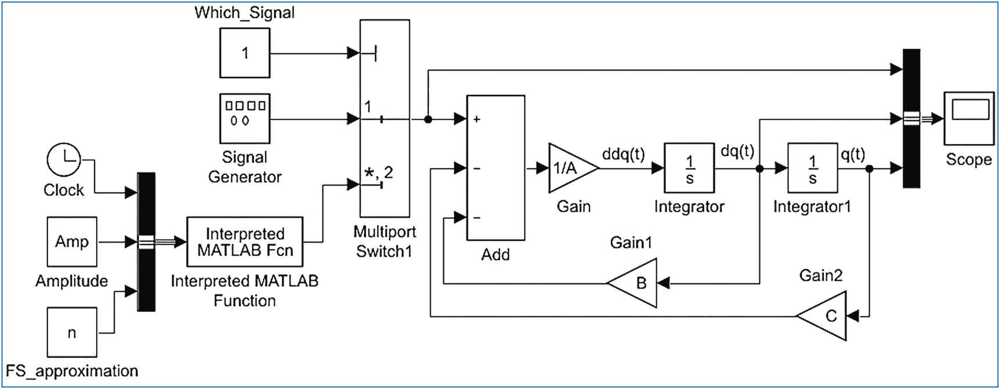

**图 5-38** 二阶 ODE 的完整模型：`A\ddot{q}(t) + B\ddot{q}(t) + Cq(t) = F(t)`

建模此练习所需的模块包括 `Add`、`Gain`、`Integrator`、`Bus Creator` 和 `Scope`，您可以将它们拖放到空白模型窗口中。这些模块按图 5-38 所示连接。请注意，与 `Bus Creator` 和 `Scope` 模块相连的三个信号分别称为 `Input`、`dq(t)` 和 `q(t)`，它们代表输入信号、脉冲、速度和位移。这些信息通过 `Scope` 模块绘图中的图例显示。

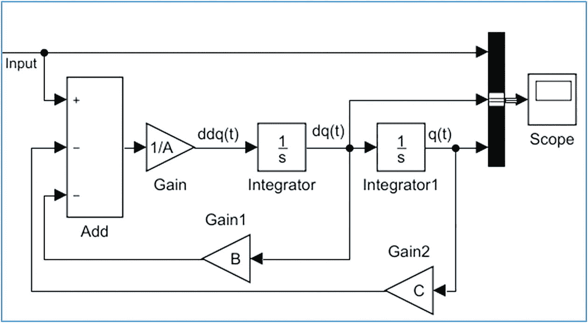

**图 5-39** 无输入力信号发生器的给定二阶微分方程 `Simulink` 模型

函数文件（名为 `function_pulse.m`）通过 `Interpreted MATLAB Fcn` 模块与 `Simulink` 模型关联（见图 5-38）。`Interpreted MATLAB Fcn` 被修改为调用 `MATLAB` 函数：`function_pulse(u(1), u(2), u(3))`，其中 `u(1)` 调用时间信号，`u(2)` 调用幅度 `Amp`，`u(3)` 调用傅里叶级数近似的项数 `n`。因此，`Interpreted MATLAB Fcn` 模块需要同时接收三个输入信号。这可以通过 `Bus Creator` 模块实现，如图 5-40 所示。请注意，您可以通过单击每个模块的名称并输入新名称来更改模块名称。另请注意，模块标签在模型仿真期间不被考虑，因此它们仅对用户/程序员具有信息提示作用。

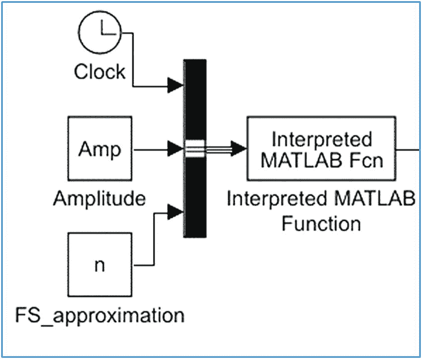

**图 5-40** 具有三个输入的 `MATLAB Fcn` 模块

随后，向模型添加一个名为 `Signal Generator` 的 `Simulink` 模块，并设置其参数以生成脉冲（`Amplitude = -Amp/2` 和 `Frequency = 3.15 [rad/sec]`）。然后根据给定的脉冲参数进行调整，如图 5-41 所示。

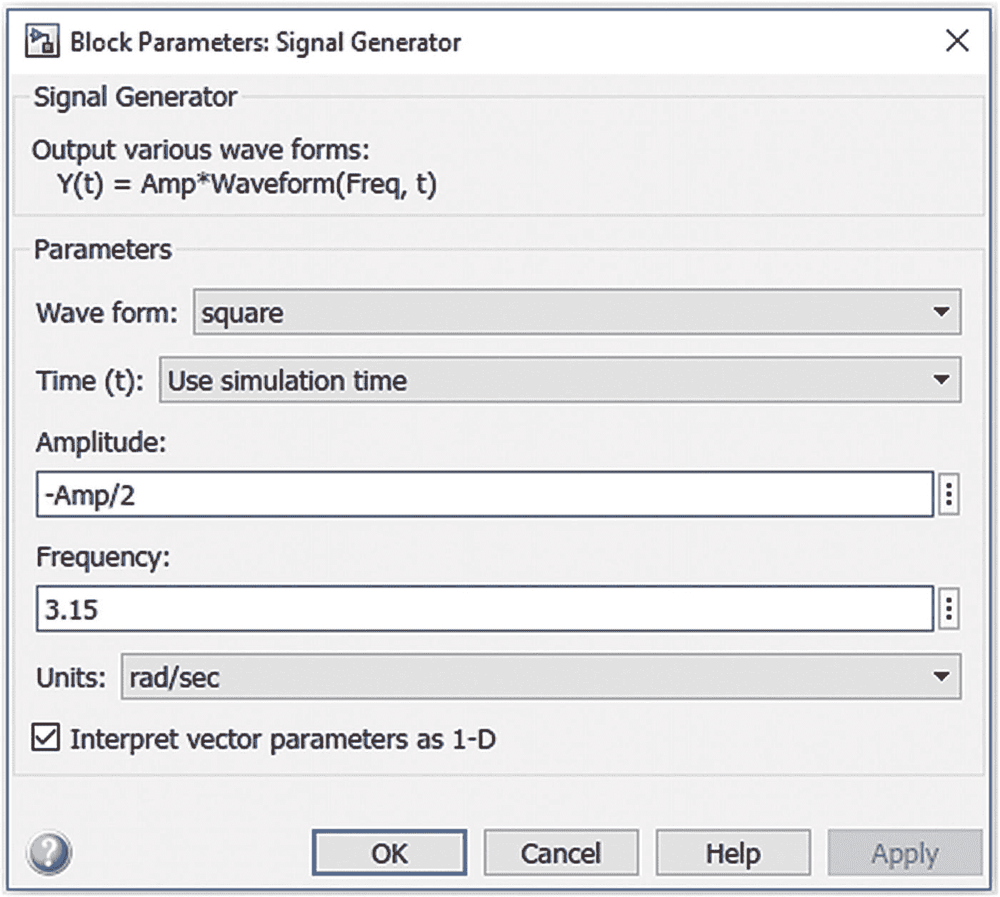

**图 5-41** `Signal Generator` 模块的已调整参数

要连接两个输入信号源（`Signal Generator` 和 `MATLAB Interpreted Fcn`），请添加 `Multiport Switch` 模块，并将其连接到另一个 `Constant` 模块以指定用于选择的源信号模块。最后，通过 `Bus Selector` 模块命名连接到 `Scope` 模块的三个信号。此外，调整 `Scope` 模块的样式选项以使输出信号清晰可读。完成的模型如图 5-42 所示。

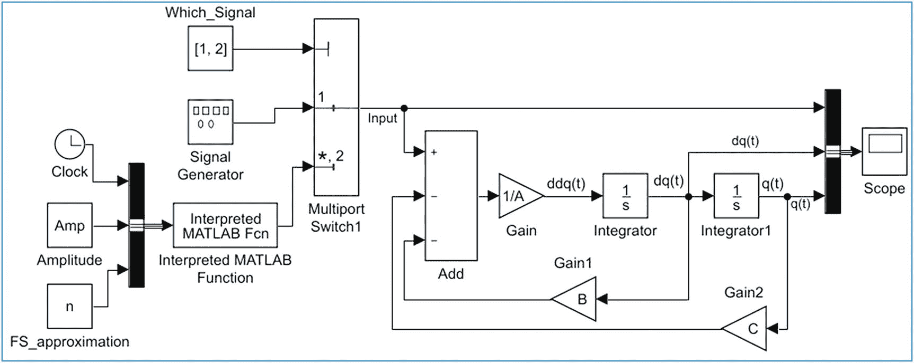

**图 5-42** 称为 `Ex5_Function_PULSE.slx` 的完整 `Simulink` 模型

在开始仿真之前，您需要指定 `A`、`B`、`C`、`Amp` 和 `n` 的值。您可以通过回调选项进行设置，路径为 **文件** > **模型属性** > **模型属性** > **回调**（模型回调）> **InitFcn**。在模型初始化函数窗口（或替代地，在命令窗口中），输入 `A = 2; B = 4; C = 200; n = 25; Amp = 10` 并单击 **确定**。当您执行模型时，两个输入信号将根据 `Constant` 模块（称为 `Which_Signal`）的值 `1`、`2` 按第一和第二顺序被接收。它们对应于 **输入 1** – `Signal Generator` 和 `MATLAB Interpreted Fcn`。图 5-43 中的仿真结果表明，两个输入信号和两对输出信号（`dq(t)`、`q(t)`，分别代表速度 `\dot{q}` 和位移 `q`）已良好收敛。请注意，输入：`1` 是 `Signal Generator`，输入：`2` 是 `MATLAB Interpreted Fcn`。

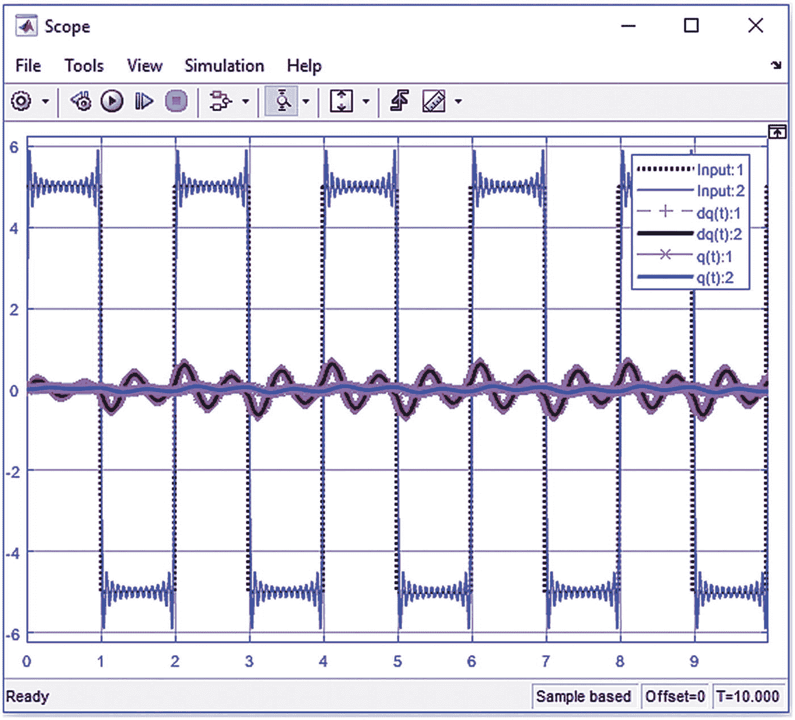

**图 5-43** 仿真结果：a) 来自 `Signal Generator`, b) 来自 `Repeating Sequence`, 和 c) 来自 `Interpreted MATLAB Fcn`

从图 5-43 显示的仿真结果可以清楚地看出，所有三个生成脉冲输入信号的模块在系统中产生了大致相同的激励。`Simulink` 模型模块如果正确建模和调整，可以与 `MATLAB` 文件关联。需要注意的是，通过 `Interpreted MATLAB Fcn` 的第二种输入信号生成方法精度较低。它从 M 文件 `function_pulse.m` 中近似傅里叶级数。此外，它的速度更慢，因为它调用外部 M 文件来生成信号。

# Simulink 模型分析与诊断

`Simulink 模型分析与诊断` 工具为程序员提供了良好的辅助，帮助他们在仿真速度、效率以及消除不准确和低效仿真方面改进模型。因此，建议对所使用模块及其组合的效率与充分性、所选的求解器类型以及许多其他选项进行分析和诊断。所有这些选项都可以通过 `模型浏览器`  和 `模型顾问`  工具进行探索。通过 `模型浏览器` 工具，你可以生成 `Simulink` 模型的 `C/C++` 代码、获取模型的分析报告、启动模型顾问、重置求解器、输入/输出、优化和代码生成的配置参数，以及执行更多操作。让我们以之前的示例为例，看看 `模型浏览器` 中的一些工具。

## 代码生成

代码生成（见图 5-44）可以通过`模型浏览器`或`模型配置参数`按钮访问。

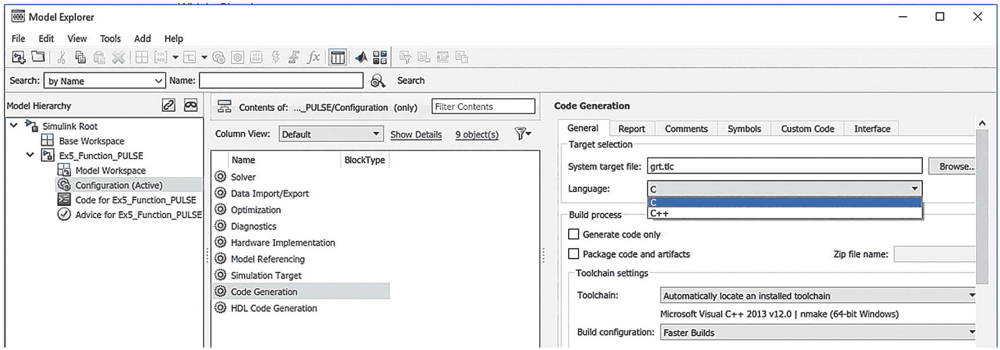
`图 5-44 模型浏览器工具`

在依次点击`仅生成代码`和`打包代码与工件`之后，点击`生成代码`按钮。随后，C 代码（C 是所选语言）将被生成。请注意，代码生成存在一些限制条件；例如，所选的求解器必须是固定步长，并且并非所有使用的模块都与 C/C++ 代码生成兼容。如果这些或其他类似的要求没有得到满足，则无法生成 C/C++ 代码。此外，代码生成过程还取决于所安装的编译器类型和版本。

## 模型顾问

`模型顾问`工具（见图 5-45）有助于识别模型中出现问题的位置以及需要优化的地方。它可以按产品、按任务类型或同时按两者来识别与代码生成和模型性能相关的问题。

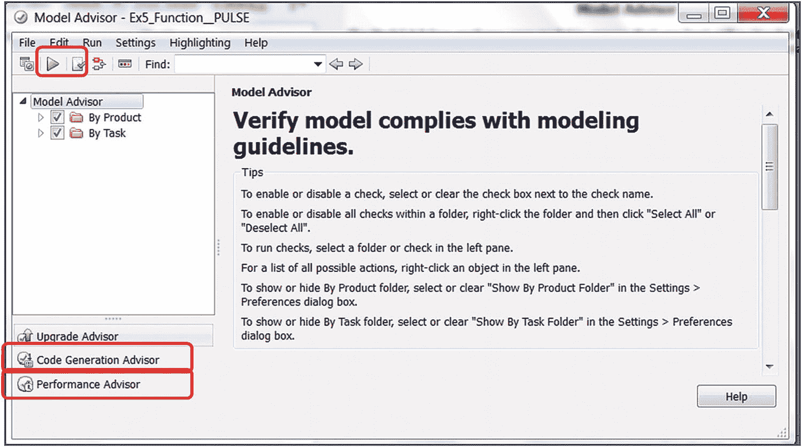
`图 5-45 模型顾问工具`

你首先需要选择要从`模型顾问`获取帮助/建议的流程，然后点击`运行`按钮。在此示例中，我们选择了`按产品`和`按任务`的`模型顾问`。一旦`模型顾问`启动，就会对该模型（`Ex5_Function_PULSE.slx`）运行所有诊断检查，并准备一份关于所有通过、失败、警告和未运行检查点的报告。你可以通过点击`模型顾问`窗口中的`生成报告`按钮来查看报告。点击`生成报告`按钮会弹出`生成模型顾问报告`窗口，你可以从中选择目录（用于保存生成的报告）、文件名、文件格式（默认为 HTML，也可选 PDF 或 Word）以及一个勾选选项，以便在报告生成后立即查看。见图 5-46。我们选择了 HTML，这是`模型顾问`的默认报告格式。

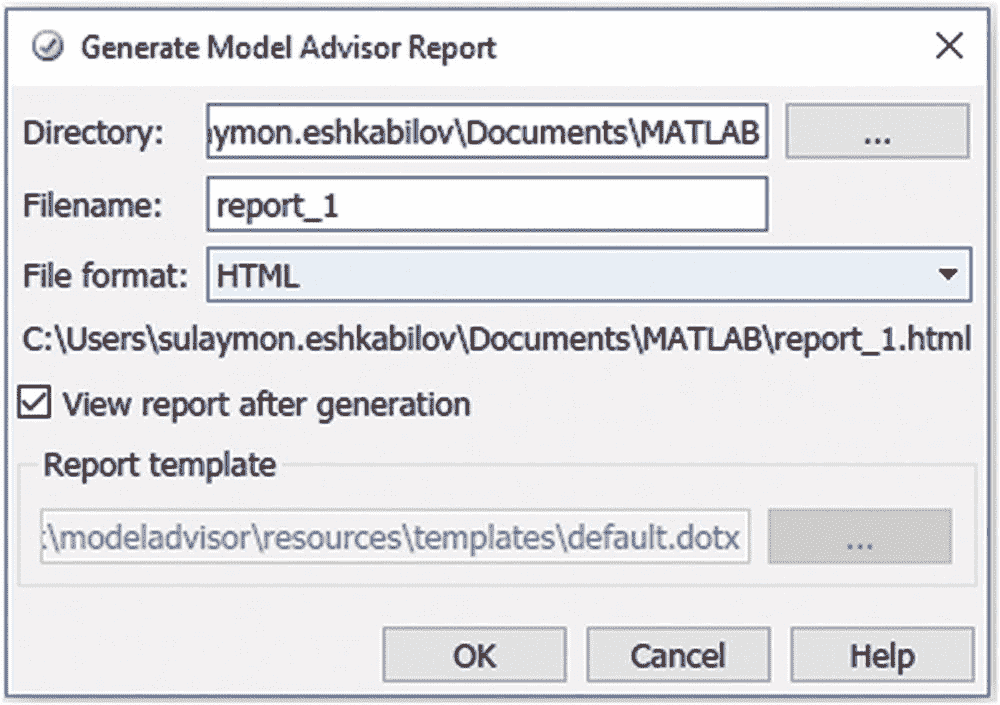
`图 5-46 生成模型顾问报告窗口`

此外，还有一些关于模型中模块使用双精度运算的警告。代码生成不支持`解释的 MATLAB 函数`模块。此外，`时钟`、`积分器`、`积分器 1`、`信号发生器`和`解释的 MATLAB 函数`模块不建议用于 C/C++ 生产环境部署。

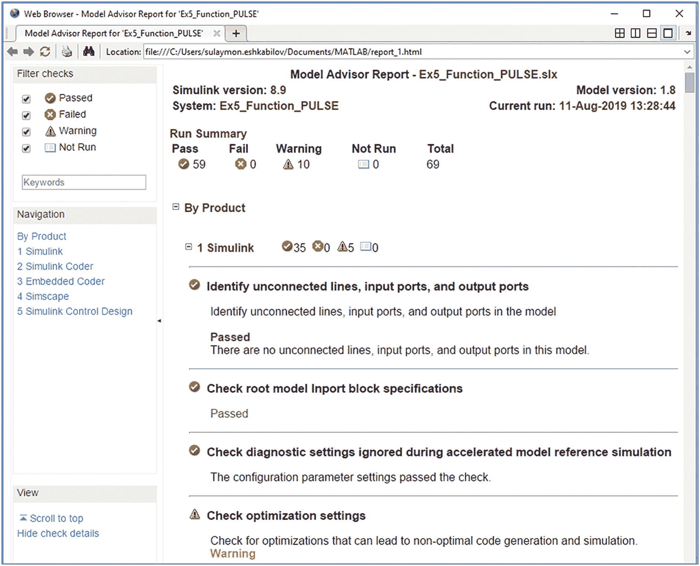
`图 5-47 模型顾问报告`

图 5-47 显示了`Ex5_Function_PULSE.slx`的`模型顾问报告`部分内容。该报告以 HTML 格式创建，显示：59 个通过，0 个失败，10 个警告，0 个未运行，共运行 69 项。向下滚动报告，你可以看到模型哪些地方通过了检查，哪些地方存在一些警告问题，例如优化设置——建议将参数“移除浮点数到整数转换中会导致超出范围值的警告的代码（`EfficientFloat2IntCast`）”设置为开启。另一个建议是将参数“内联不变信号（`InlineInvariantSignals`）”设置为开启。此外，另一个警告是检查数据存储内存模块是否存在多任务、强类型和屏蔽问题。未将重复数据存储名称检查设置为错误。重复使用数据存储名称可能导致意外屏蔽更高模型作用域中的数据存储。因此，请考虑将重复数据存储名称的设置更改为错误。

另一个有趣的警告与总线信号有关。该警告内容是：检查被当作向量处理的总线信号。总线信号被`Simulink`软件当作向量处理。请识别模型中那些被`Simulink`软件当作向量处理的总线信号。

馈入模块输入端口 1 的总线信号：`Ex5_Function_PULSE`/解释的 MATLAB 函数。馈入`Ex5_Function_PULSE/示波器`中模块输入端口 1 的总线信号。

建议操作：模型中存在被`Simulink`软件隐式转换为向量的总线信号。然而，模型并未配置为明确将这些信号转换为向量。要解决此问题，请在上述列出的模块的输入端口处插入“总线转向量”模块。

您可以按照以下步骤自动执行此操作：按下修改按钮或运行`Simulink.BlockDiagram.addBusToVector`函数。您也可以手动执行此操作，使用`Simulink` → `Signal Attributes`库。

通过研究 Model Advisor 的报告，您可以通过移除错误、仿真瓶颈和不必要的警告，并替换模型中一些低效的模块来改进模型。

除了 Model Advisor，您还可以使用 Model Explorer 或 Configuration Parameters 下的 Optimization 工具来优化模型中的参数和模块。此外，为了定位错误或瓶颈，我们还可以使用调试工具。这些工具可以通过菜单栏访问：`Simulation` ➤ `Debug` ➤ `Debug Model`。另一种了解模型性能的方法是通过菜单栏：`Analysis` ➤ `Performance Tools` ➤ `Show Profile Report`（选择），然后 ➤ `Performance Tools` ➤ `Performance Advisor`。相关选项如图 5-48 所示。

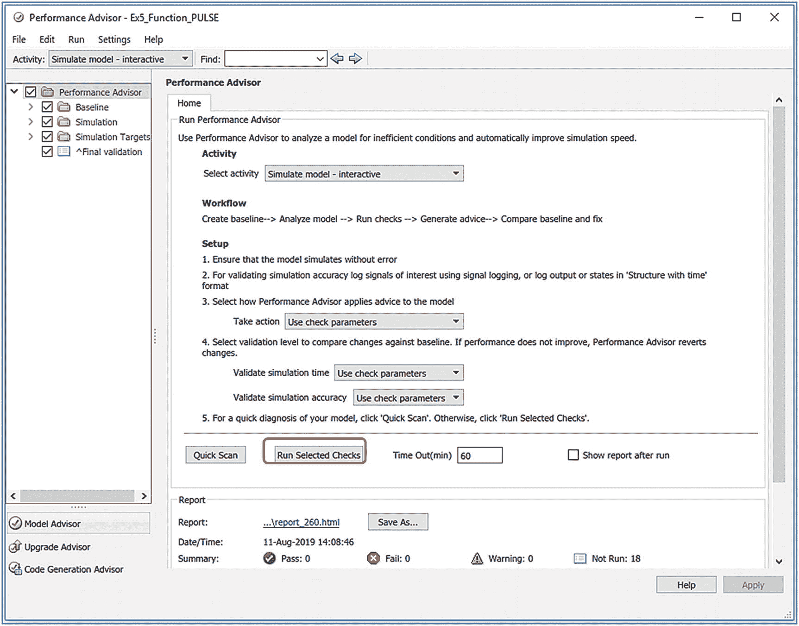
`图 5-48 Performance Advisor 选项`

点击`Run Selected Checks`（见图 5-48）后，将显示`Simulink Profile Report`。该报告由 Summary 和`Simulink Performance Advisor Report`组成，展示了模型及其仿真过程的完整视图。

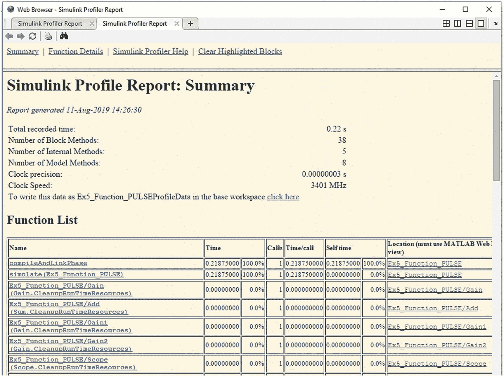
`图 5-49 Simulink Model Profile Report 的 Summary`

因此，建议您运行`Model Advisor`和`Performance Advisor`选项，以获取许多有助于改进模型性能的提示。此外，还可以通过命令重新调用和执行`profile report generator`，以定位模型中低效的操作和模块。

```
>> profile on; sim('Ex5_Function__PULSE.mdl'); profile viewer
```

`profile report generator`适用于所有`M`文件和`Simulink`模型，并提供全面的报告，包括代码/脚本/模型中每个命令和操作的计算和执行时间瓶颈。

## 总结

在本章中，我们涵盖了`Simulink`软件包中大多数基本的图形化编程工具和一些常用模块，包括信号源、矩阵运算、积分、可视化、信号路由和`C`代码生成。此外，本章通过数值仿真示例，重点介绍并演示了如何调整参数、使用求解器工具、设置误差容限以及提高`Simulink`模型性能的几个关键点。您学习了如何从现有模型创建子系统，以及如何将`Simulink`模型与`MATLAB`脚本和函数文件关联。您还使用了`Simulink`模型分析和诊断工具，并学习了如何获取`Model Advisor`和`Performance Reports`。

## 自测练习

### 练习 1

编写一个`M`文件，使用`while, end`循环控制语句计算余弦函数 *g*(*θ*) = cos (*θ*) 的值，*θ* = 0…*π*，步长为 2000 步。当函数 *g*(*θ*) ≈ 0.99999 时停止计算。此外，显示计算过程在多少步后停止，并绘制仿真结果。在同一张图中也显示最终值 0.99999。

### 练习 2

根据用户输入的以下数值，计算圆、正方形和矩形的面积：

*   `W = input('Width of a rectangle:    ')`
*   `L = input('Length of a rectangle:    ')`
*   `R = input('Radius of a circle:            ')`
*   `S = input('Side length of a square: ')`

脚本中需要考虑几种情况：(1) 如果用户输入矩形宽度(`W`)和长度(`L`)两个维度，代码必须计算矩形的面积并附带注释显示；(2) 如果用户输入圆半径(`R`)和正方形边长(`S`)两个维度，代码必须分别计算圆和正方形的面积并附带注释显示；(3) 如果用户输入所有必需的值，代码必须计算三个面积并附带适当的注释显示；(4) 如果用户没有输入所有值或遗漏了任何必需的值(`W, L, R, S`)，代码必须显示`"You need to ENTER all dimensions!"` 可以使用`input()`，`isempty()`，`exist()`，`length()`，`numel()`，`size()`和`fprintf()`命令。

### 练习 3

编写一个脚本，根据学生获得的分数显示其等级。学生等级需根据以下标准定义：

*   F → 0…65
*   D → 66 … 70
*   C → 71 … 81
*   B → 82 … 87
*   A → 88 … 100
*   使用`input()`，`disp()`，`fprintf()`和`if, elseif, elseif, elseif, else ... end`。

使用以下示例分数测试您的脚本：70, 82, 35, 90, 99, 56, 81, 89, 66, 87, 88, 83, 71, 69, 和 55。

### 练习 4

这些练习涵盖了`while, end`和`for, end`循环控制运算符：

1.  使用`while, end`和`for, end`循环控制语句计算级数：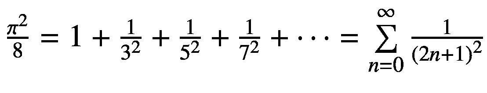。取 *n* = 101 并绘制迭代过程中的误差值。
2.  计算以下级数的和：1², 2², 3², … *n*²。取 *n* = 500 并使用`while, end`和`for, end`循环控制语句计算总和 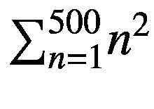。绘制总和与`n`的关系图。
3.  计算以下级数的和：1 * 2 + 2 * 3 + 3 * 4 + 4 * 5 + …。这可以重写为求和 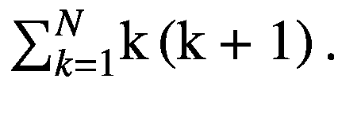。使用`while, end`和`for, end`循环控制语句计算总和。绘制总和与`k`的关系图。
4.  使用`while, end`和`for, end`循环控制语句计算此级数（欧拉于 1735 年发现）：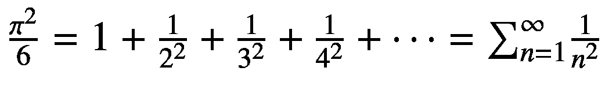。取 *n* = 1…99 并绘制迭代过程中的误差值。执行穷举计算，当误差小于 10^(−13) 时停止计算过程。
5.  计算以下奇数序列的总和：1, 3, 5, 7, … 它们可以写成如下序列形式：2 * *n* + 1。取 *N* = 111111 并使用`while, end`和`for, end`循环控制语句计算总和 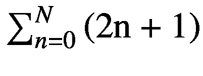。当总和大于 30869136 时停止迭代过程。将最终数字显示为整数。绘制求和迭代过程。

### 练习 5

编写一个脚本文件，使用条件语句`if`，`elseif`，`elseif`，`else`，`end`和函数句柄（`@`）来计算此函数的值：

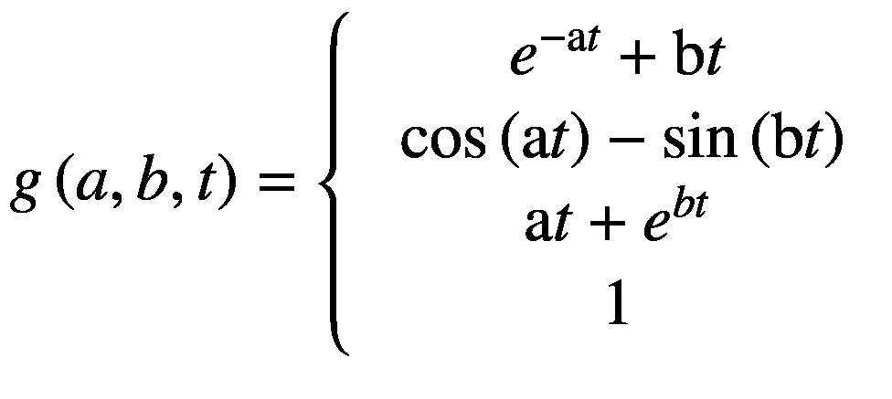 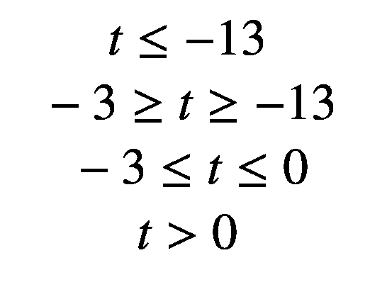


## 练习 6

这些练习涵盖 `while, end` 和 `for, end` 循环控制运算符：

1. 使用 `while ... end` 和 `for ... end` 循环控制语句计算此级数：`f` (`x`) = 。取 `n` = 11，`b`[`n`] = [−5…5]，`x` = [0…`L`]，以及 `L` = 10。对于 `x`，取步长  绘制所有计算结果。

2. 使用 `while ... end` 和 `for ... end` 循环计算 `f` (`t`) = cos(20`t`) − sin(10`t`)，其中 `t` ∈ [−`π`, `π`]，∆`t` = `π`/50。

## 练习 7

这些练习涵盖 `while ... end` 和 `for ... end` 循环运算符：

1. 计算此级数的总和：。使用 `while, end` 和 `for, end` 循环控制语句计算总和。将总和绘制为 `m` 的函数。

2. 计算此级数的总和：。使用 `while, end` 和 `for, end` 循环控制语句计算总和，并在总和大于 18446744073709551615 时停止计算过程。将最终总和显示为整数。将总和绘制为 `k` 的函数。

3. 使用 `while, end` 和 `for, end` 循环控制语句计算以下序列 4, 1, 0.5, 0.25, …，直到它小于 0.000005。请注意，该序列可以表示为 4 * (0.5)^(`n` − 1)。找到使序列小于 0.000005 的 `n`。

4. 计算此级数的总和：，直到它等于或大于 0.999 999 999。请注意，该级数的总和可以用  表示。

5. 使用 `while, end` 和 `for, end` 循环控制语句计算  的总和，其中 `m` = 202 且 `x` = 2.5。

6. 使用 `while, end` 和 `for, end` 循环控制语句计算  的总和，其中 `m` = 1001 且 `x` = 2。

## 练习 8

修复以下脚本中的两个错误：

1. 修复错误后，代码需在命令窗口中，对于用户输入 `[1, 2; 3,-1]`，生成以下输出：

```
    Enter ANY numerical entry of any size within [  ]:   [1, 2; 3,-1]
    Your entry is not scalar, but an array
    1     2
    3    -1
```

2. 代码需在命令窗口中，对于用户输入 `['ab' 'bc'; 'cd' 'ef']`，生成以下输出：

```
    Enter ANY numerical entry of any size within [  ]:   ['ab' 'bc'; 'cd'  'ef']
    Your entry is not scalar, but an array
    abbc
    cdef
```

3. 代码需在命令窗口中，对于用户输入 `13.12`，生成以下输出：

```
    Enter ANY numerical entry of any size within [  ]:   13.12
    This is a scalar:                13.12
```

```matlab
%% Find out if the entry is a Scalar or NOT.
% Prepare your entry data that MUST be in array
% or matrix format of any size: 1-by-1, 2-by-2, 2-by-3, etc, etc!
% Your entry can be also any standard array generating functions!
ABC=input('Enter ANY numerical entry of any size surrounded with square brackets [  ]:   ');
if isnumeric(ABC) && isscalar(ABC)
fprintf('This is a scalar: %20g \n', ABC);
else
format short
fprintf('Your entry is not scalar, but an array \n', ABC);
fprintf(ABC);
end
```

## 练习 9

修复以下脚本中的三个错误：

```matlab
%% Find out whether the array is square and if it is, show its size.
% Prepare your entry data that MUST be in array
% or matrix format of any size: 1-by-1, 2-by-2, 2-by-3, etc, etc!
% Your entry can be also any standard array generating functions!!!
ABC=input('Enter ANY numerical entry of any size within [  ]:   ');
[Rows, Cols]=size(ABC);
if isnumeric(ABC) && Rows==Rows
fprintf('This is a square ARRAY! ');
fprintf('Your entry is of %5g -by- %5g  square ARRAY \n', Cols, Rows);
else
format short
fprintf('Your entry is NOT a square array \n')
fprintf('BUT an ARRAY of size %5g - by - %5g \n', Cols, Cols);
end
```

修复错误后，代码需在命令窗口中，对于以下输入生成相应输出：

1. 输入: `[magic(5)]`

```
    Enter ANY numerical entry of any size within [  ]:   [magic(5)]
    This is a square ARRAY!
    Your entry is of     5 -by-     5  square ARRAY
```

2. 输入: `[rand(3,5)]`

```
    Enter ANY numerical entry of any size within [  ]:   [rand(3,5)]
    Your entry is NOT a square array
    BUT an ARRAY of size     3 - by -     5
```

## 练习 10

修复以下脚本中的两个错误：

```matlab
%% Find out: the user entry is scalar or not. If it is, display it.
% otherwise, show the variable type.
ABC=input('Enter ANY numerical entry of any size within [  ]:   ');
if isnumeric(ABC)
fprintf('This is a Scalar! \n');
fprintf('Your entry is a scalar:  %5g  \n', ABC);
else
class(ABC, 1)
end
```

修复两个错误后，应使用相应输入获得以下输出。

对于输入 1：

```
Enter ANY numerical entry of any size within [  ]:   123
This is a Scalar!
Your entry is a scalar:    123
```

对于输入 2：

```
Enter ANY numerical entry of any size within [  ]:   '1001011'
ans =
'char'
```

对于输入 3：

```
Enter ANY numerical entry of any size within [  ]:   [1 3 -2]
ans =
'double'
```

## 练习 11

修复以下脚本中的两个错误：

```matlab
%% Find out: the array is real and square. If it is, display it;
% otherwise, show its size and type.
% NB: size(), display(), class() can be used.
% Prepare your entry data that MUST be in array
% or matrix format of any size: 1-by-1, 2-by-2, 2-by-3, etc.
% Your entry can be also any standard array generating functions!
ABC=input('Enter ANY numerical entry of any size surrounded with [  ]:   ');
[Rs, Cs]=size(ABC);
if ischar(ABC) && Rs==Cs
fprintf('This is a square array! \n');
disp(ABC);
elseif
format short
fprintf('This is not a square array & its size: %5g-by-%5g \n', Rs, Cs);
disp(num2str(ABC));
end
```

修复两个错误后，应使用相应输入获得以下输出。

输入 1：

```
Enter ANY numerical entry of any size within [  ]:   magic(3)
This is a square array!
8     1     6
3     5     7
4     9     2
```

输入 2：

```
Prepare your entry data that MUST be in array or matrix format of any size
1-by-1, 2-by-2, 2-by-3, etc., etc.! with real value elements
Your entry can be also any standard array generating functions!!!
Enter ANY numerical entry of any size within [  ]:   [1, 2/0; 0/0, 1]
This is a square array!
1   Inf
NaN     1
```

输入 3：

```
Your entry can be also any standard array generating functions!!!
Enter ANY numerical entry of any size within [  ]:   [1, 2/0; 0/0, 1; 1, 0]
This is not a square array and its size:     3 - by -     2
1  Inf
NaN    1
```

## 练习 12

修正以下脚本中的五个错误：

```matlab
%% Q7\. 根据用户输入计算圆、正方形和矩形的面积：
W = input('矩形的宽度：          ', 's');
L = input('矩形的长度：         ', 's');
R = input('圆的半径：            ', 's');
S = input('正方形的边长：       ', 's');
if isempty(R) && isempty(S)
A1=W*L;
fprintf('矩形的面积：  A1 =  %5g \n', A1);
elseif isempty(W) && isempty(L) && exist('R','var') && exist('S', 'var')
A2 = pi*R²; A3 = S²;
fprintf('圆的面积：  A2 =  %5g \n', A2);
fprintf('正方形的面积：  A3 =  %5g \n', A3);
elseif isempty(W) && isempty(L) && isempty(R)
A3 = S²;
fprintf('正方形的面积：  A3 =  %5g \n', A3);
elseif isempty(S) && isempty(W) && isempty(L)
A2 = pi*R²;
fprintf('圆的面积：  A2 =  %5g \n', A2);
else exist('W','var') && exist('L','var') && exist('R','var') && exist('S','var')
A1=W*L; A2 = pi*R²; A3 = S²;
fprintf('矩形的面积：  A1 =  %5g \n', A1);
fprintf('圆的面积：  A2 =  %5g \n', A2);
fprintf('正方形的面积：  A3 =  %5g \n', A3);
else
fprintf('你需要输入一些尺寸！\n')
end
```

修正错误后，在命令窗口中应显示以下输入内容：

## 练习 13

修正以下脚本中的五个错误：

```matlab
%% 评估学生成绩
clc; clearvars
SP =input('请输入学生成绩：  ');
if SP =66 && SP71 && SP82 && SP<87
disp('学生成绩等级为  B ')
else
disp('学生成绩等级为  A ')
end
```

修正错误后，依次输入 65、71、81、82、87 和 87.5，命令窗口应显示以下输出：

```
请输入学生成绩：  65
学生成绩等级为  F
请输入学生成绩：  71
学生成绩等级为  C
请输入学生成绩：  81
学生成绩等级为  C
请输入学生成绩：  82
学生成绩等级为  B
请输入学生成绩：  87
学生成绩等级为  B
请输入学生成绩：  87.5
学生成绩等级为  A
```

## 练习 14

编写一个脚本（程序），计算以下方程的所有解：

1.  但仅显示这些三次多项式方程对任意 `a`、`b`、`c` 和 `f` 值的实数解：i) `x³ + bx² + cx = 0`；ii) `ax³ + f = 0`；iii) `ax³ + cx = 0`；iv) `x² + bx + c = 0`。

2.  但仅显示这些方程对任意 `a`、`b`、`c` 和 `f` 值的复数解：i) `ax² + c = 0`；ii) `ax³ + f = 0`；iii) `ax² + bx + c = 0`。

## 练习 15

编写一个脚本（程序），计算可能为立方体、圆柱体和长方体形状的模型的体积和重量。用户需要（通过输入提示）输入模型的必要几何尺寸，并从脚本中给定的数据（铝、铜和钢）中输入或选择材料属性（如密度）。你的脚本必须将所有计算出的数据和用户输入的数据集写入一个名为 `RESULTS.txt` 的外部文件中，并在其中包含解释性注释以及数值数据。

## 练习 16

编辑并修正以下脚本，以便在命令窗口中正确显示当前日期和时间。

```matlab
format short e
T=clock;
fprintf('今年是： %n4 \n', T(1))
if T(2)==1
sprintf('现在是： %f4 年中的第 -st 个月：  %n4 \n', T(2),T(1))
elseif T(2)==2
sprintf('现在是： %f4 年中的第 -nd 个月：  %n4 \n', T(2),T(1))
elseif T(3)==3
sprintf('现在是： %f4 年中的第 -rd 个月：  %n4 \n', T(2),T(1))
else
sprintf('现在是： %f4 年中的第 -th 个月：  %n4 \n', T(2),T(1))
end
sprintf('当前时间是： %lo 点 %l0 分 \n', T(4), T(5))
sprintf('和 %s 秒 \n', (T(6)))
```

修正此脚本，以获得以下格式的正确日期和时间：

```
现在是： 11 年中的第 6 个月的第 11 天：  2014
当前时间是： 15 点 3 分 和 17.136 秒
```

## 练习 17

已知 `y(x, t) = y₀ sin(kx − ωt)` 是波动方程的解，其中 `k = 2π/λ` 是波数，`ω = 2πf` 是角频率，`λ` 是波长。

1.  编写一个匿名函数，并为其创建函数句柄，以根据输入参数 `k`、`ω`、`x` 和 `t` 计算 `y(x, t)` 的值。

2.  编写一个内联函数，根据输入参数 `k`、`ω`、`x` 和 `t` 计算 `y(x, t)` 的值。

3.  编写一个函数文件，根据输入参数 `k`、`ω`、`x` 和 `t` 计算 `y(x, t)` 的值。

## 练习 18

无电感串联 RC（电阻-电容）电路的功率因数方程为 `cos δ = RCω / sqrt(1 + (RCω)²)`。

1.  编写一个匿名函数，并为其创建函数句柄，以根据输入参数 `R`、`C` 和 `ω` 计算 `δ` 的值。

2.  编写一个内联函数，根据输入参数 `R`、`C` 和 `ω` 计算 `δ` 的值。

3.  编写一个函数文件，根据输入参数 `R`、`C` 和 `ω` 计算 `δ` 的值，并绘制 `δ` 与 `ω` 的关系图。

## 练习 19

串联 RLC（电阻-电感-电容）电路中的电荷方程由基尔霍夫定律确定：`L q'' + R q' + q/C = E_max cos(ωt)`。


1.  编写一个用于求解给定二阶微分方程 `q(t)` 的匿名函数，并为其创建函数句柄，输入参数为 `R`、`L`、`C`、`ω` 和 `t`。

2.  编写一个内联函数，用于求解给定二阶微分方程 `q(t)`，输入参数为 `R`、`L`、`C`、`ω` 和 `t`。

3.  编写一个函数文件，用于求解给定二阶微分方程 `q(t)`，输入参数为 `R`、`L`、`C`、`ω` 和 `t`。

4.  创建一个 Simulink 模型来模拟给定的 RLC 系统。

## 练习 20

跳伞者的加速度由下式确定：

`a = g(1 − v²/3600)`

其中 `g = 9.81 米/秒²`。

1.  编写一个匿名函数，以计算 `a` 作为速度 `v` 的函数。

2.  编写一个函数文件，以计算 `a` 作为速度 `v` 的函数，并绘制 `a` 与 `v` 的关系图。

3.  创建一个 Simulink 模型来模拟跳伞者的加速度。

4.  计算跳伞者的终端速度。

## 练习 21

一辆质量为 `m` 的卡车在 `t = 0` 时从静止开始，以恒定功率 `P` 沿水平道路加速。卡车的速度作为时间的函数由下式给出：`v(t) = sqrt(2P/m) * sqrt(t)`

如果 `x = 0` 在时间 `t = 0`，位置函数 `x(t)` 由下式给出：`x(t) = sqrt(8P/(9m)) * sqrt(t³)`，其中 `P = 550 千瓦` 且 `m = 15000 公斤`。

1.  编写一个函数句柄，以计算卡车的速度 `v(t)` 作为时间 `t` 的函数。

2.  编写一个内联函数，以根据函数 `x(t)` 计算卡车的位置 `x(t)` 作为时间 `t` 的函数。

3.  创建一个 Simulink 模型，以在 MATLAB 工作区中获取 `v(t)`、`x(t)` 作为 `t` 函数的数值，并将结果与从函数句柄和内联函数获得的结果进行比较。

4.  在两个单独的图形中绘制 `x(t)` 与 `t`、`v(t)` 与 `t` 的关系图。

## 练习 22

在一次碰撞测试中，一辆以 100 *公里*/*小时* (28 *米*/*秒*) 行驶的汽车撞上了一面不可移动的混凝土墙。我们可以通过将车身近似视为一个整体来一般性地处理这个问题，尽管汽车的不同部分在碰撞时会以不同的加速度运动。实际上，在碰撞时，汽车中心向前移动的距离不到其长度的一半。让我们假设汽车从撞上墙到完全停止的停止距离是 0.72 *米*。到完全停止的时间等于：


汽车到完全静止的平均加速度等于：


注意，这大约是 55*g*，意味着非常大的加速度（减速度）从惯性力中吸收了大量能量并将其转化为热量。编写一个函数文件，针对任何类型、以不同行驶速度 *v* 行驶的汽车的碰撞测试，计算 `a` 作为 Δ*x*（针对不同类型的前保险杠）和 *v* 的函数（对于所有情况，取 `v[0] = 0`）。

## 练习 23

创建一个函数文件（命名为 `Ex23.m`）。它应有一个输入参数（枫树的种植年份，是一个四位整数：0 … 2018）和两个输出变量：`AGE`（计算出的枫树年龄）和 `NOTE`（枫树的年龄状态），以及带有提示信息的警告/消息框。

1.  如果树的种植年份在 1000 年之前，则输出为：`NOTE = "CANNOT be TRUE"`，`AGE = []`（空值），并显示一个带有提示信息 `"Check Your Entry"` 的错误框。

2.  如果树的种植年份在 1000 到 1918 年之间，则输出为：`NOTE = "NEED to be PROTECTED"`，`AGE = [∀]`（相对于当前年份计算出的年龄），以及一个带有提示信息 `"Maple Tree is to be Under Protection"` 的警告对话框。

3.  如果树的种植年份在 1919 到 2000 年之间，则输出为：`NOTE = "WELL fit"`，`AGE = [∀]`（相对于当前年份计算出的年龄），以及一个带有提示信息 `"GOOD one for a timber"` 的消息框。

4.  如果树的种植年份在 2001 到 2018 年之间，则输出为：`NOTE = "TOO young"`，`AGE = [∀]`（相对于当前年份计算出的年龄），并显示一个带有提示信息 `"TOO young for timber"` 的消息框。

## 练习 24

阿基米德螺线（也称为阿基米德螺旋）是一条螺旋曲线（以公元三世纪的希腊数学家阿基米德命名）。螺线的方程使用以下方程在极坐标系中表示：*r* = *a* + *bθ*。其中 *r* 是到原点的距离，*θ* 是该点相对于原点的弧度角。方程中的参数 *a*、*b* 是实数，分别控制螺线的位置和连续螺线匝之间的距离。

1.  使用向量化方法计算当  时的阿基米德螺线。

2.  使用 `for ... end` 和 `while ... end` 循环（不分配内存）计算当  时的阿基米德螺线。

3.  使用 `for ... end` 和 `while ... end` 循环（分配内存）计算当  时的阿基米德螺线。

4.  使用 `tic ... toc` 比较步骤 2 和步骤 3 相对于步骤 1 的计算效率。

## 练习 25

创建一个函数文件（命名为 `Ex25.m`），该文件接受以下四个输入变量：`n`、`b[n]`、∆*x* 和 `L`，以及以下三个输出变量：`f(x)`、`ALL_cell`、`ALL_struct`。

使用 `for, end` 循环控制语句计算以下级数：


取 `n = 1:11`，`b[n] = [-5…5]`，`x = [0…L]`，`L = 10`。


`ALL_cell` 是一个由 `f(x)`、`x`、`b[n]` 组成的元胞数组。

`ALL_struct` 是一个由 `f(x)`、`x`、`b[n]`、`ALL_cell` 组成的结构体数组。

## 练习 26

创建一个函数文件（命名为 `Ex26.m`），该文件接受一个输入变量（`k`）和一个输出变量（`S`）。

计算以下级数的总和：


使用 `while, end` 和 `for, end` 循环控制语句计算总和。

1.  当总和大于 `2.5 * 10¹⁸` 时停止计算过程，并在命令窗口中显示计算停止时的迭代步数和计算出的级数和。

2.  显示计算出的级数和与 `2.5 * 10¹⁸` 之间的差值。

3.  将最终的和与迭代次数显示为整数，但收集每一步的所有和 `S`。

## 练习 27

编写一个脚本文件，通过用户提示输入，并使用条件语句 `if`、`elseif`、`else` 和 `end`，计算三次多项式 `a[3]*x³ + a[2]*x² + a[1]*x = 0` 在其系数 `a[1]`、`a[2]`、`a[3]` 任意给定值下的解。在你的脚本中，包含将多项式的解以正确的数据格式（包括复数值）打印输出到外部 `*.dat` 文件中的功能。

## 练习 28

设计/建模并重写下一个 GUI 模型中的 M 文件，通过接受用户输入来计算环面函数并绘制其 3D 图（显示在下一个名为 `PLOTall` 的 GUI 模型图中）。（关于如何构建 3D 图，请参见第 6 章。）


使用由以下公式定义的脐点环面函数：


对于 −*π* ≤ *u* ≤ *π*，−*π* ≤ *v* ≤ *π*。

1.  创建一个绘制脐点环面函数的 GUI 模型的独立应用程序。

2.  将 GUI 与另一个 M 文件关联，以显示例如 `*.jpg` 格式的现有（外部）图像。

3.  创建一个名为 `umbilic_torus.m` 的函数文件，用于计算输入 *u* 和 *v* 对应的 *x*、*y*、*z*，并从中创建一个 `.mex` 文件。

## 练习 29

使用 MATLAB 的带 UIControls 的 GUI 示例。参见下图。

创建一个 GUI 模型，通过必要的用户输入来计算圆柱体和长方体的体积。对于圆柱体，使用半径和高度；对于长方体，使用长度、宽度和高度。所有这些都仅使用国际单位制。此外，执行以下任务：

1.  创建 GUI 模型的独立应用程序。

2.  将 GUI 模型与另一个 M 文件关联，该文件计算 `f(t) = e^(sin(250*t) + 2.5 * cos(750*t))` 在 `t = -π…π` 且 ∆*t* = 1/10000 时的值，并使用 MATLAB 的 `sound()` 函数以 `f[s] = 10000 Hz` 的采样频率播放 `f(t)` 的声音。


## 练习 30

使用包含坐标轴和菜单的 MATLAB 指南 GUI，并以此构建一个新的 GUI 模型。


新的 GUI 模型应包含一个下拉选项（弹出式菜单按钮），用于选择函数类型（ 和二次多项式 *x*² + 6*x* + 3）。这些函数由独立的 M 文件计算并绘图。添加一个编辑文本框，以便用户指定参数 *θ*、*φ*、*x* 的取值范围。此外，添加一个按钮，用于关闭 GUI 模型并弹出一个消息对话框，显示消息"All Completed!"，并播放矩形脉冲声音，例如 `rectpuls()`。

## 练习 31

## 练习 31

1.  编写一个函数文件（命名为 `Ex31_a.m`），该函数生成一个线性系统 `Ax[i] = b`，其中包含 `N` 个未知数 `x[i]`。`A` 是一个大小为 N×N 的方阵，`b` 是一个大小为 N×1 的列矩阵。`A` 和 `b` 必须使用随机整数函数 `randi()` 生成。（有关矩阵代数的更多信息，请参见第 7 章"线性代数"）。注意，该函数有一个名为 `N` 的输入参数。
2.  编写一个函数文件（命名为 `Ex31_b.m`），该函数接受由步骤 1 中的函数文件（`Ex31_a.m`）生成的方阵 `A`（例如 1000×1000）和列矩阵 `b`（例如 1000×1）作为输入参数。分别使用以下三种不同方式求解系统解：`x = linsolve(A, b)`、`x = inv(A) * b`、`x = A \ b`。
3.  创建一个 GUI 模型，该模型调用步骤 1 和步骤 2 中的两个 M 文件（`Ex31_a.m` 和 `Ex31_b.m`），计算系统的解，并在一个 `1:N` 与 `x[i]` 的关系图中显示出来。
4.  根据步骤 2 创建一个独立应用程序，并找出哪些函数（在 C/C++ 中不受支持）在生成可执行应用程序的项目文件时会引发错误。

### 练习 32

编写一个名为 `Say_HELLO.c` 的 C 代码来显示以下文字：

```
Hello World!
This is a Great DAY!
Live and Learn...
```

从名为 `Say_HELLO.c` 的 C 代码创建一个 `.mex` 文件，并在 MATLAB 工作区中对其进行测试。

### 练习 33

在 Simulink 中执行以下矩阵运算：


### 练习 34

通过在 Simulink 中建模来计算以下两个数学函数的值，并将计算结果同时保存到单独的 `*.mat` 文件和 MATLAB 工作区中。在一个示波器模块的绘图图中显示结果，并使用新的设置：图例、数据点绘制线条的颜色，并显示所有数据点。已知：

, `t = -2*pi ... 2*pi`, `dt = pi/5000`。

### 练习 35

创建一个 Simulink 模型来计算以下一阶微分方程的数值解。


提示：有关常微分方程的更多信息，请参阅第 8 章。

