## 6. 绘图与数据可视化

MATLAB 软件包包含大量内置函数，用于通过绘图、图形、图表和动画来可视化数值数据。有二维 (2D) 和三维 (3D) 绘图、图表、地图等。此外，一些 MATLAB 工具箱还具有特定的绘图和可视化函数。构建绘图图形非常简单，可以通过两种不同的方式完成：一种是使用命令并编写脚本，另一种是使用 GUI 工具。在本章中，我们将讨论并通过示例演示一些用于构建线图、条形图、饼图、曲面图、网格图、图形和动画图的最基本工具和技术。

### 绘图构建基础

在主菜单的"绘图"选项卡下（见图 6-1），包含了当前 MATLAB 软件包（包括其已安装的工具箱）中所有可用的绘图类型。

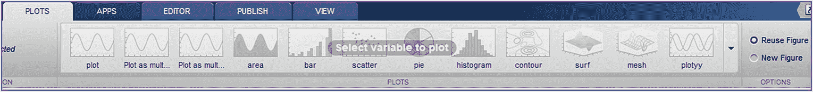

**图 6-1** MATLAB 桌面菜单的"绘图"选项卡

如果选择了工作区中的任何数据（变量），则适用的绘图命令将变为可用。例如，如果所选变量的大小为 20×1，则图 6-2 中显示的绘图将变为可用，表明这些绘图可以被使用。

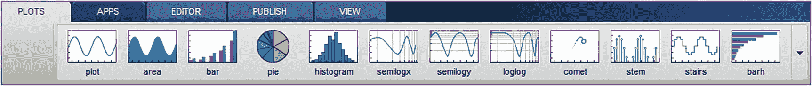

**图 6-2** "绘图"选项卡中针对所选数据的可用绘图

如果所选数据（变量）是 10×100，则图 6-3 中显示的绘图将变为可用。

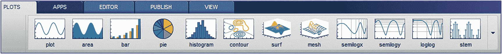

**图 6-3** "绘图"选项卡中针对所选数据的可用绘图

### `PLOT()`

让我们看几个使用 `plot()` 命令和 GUI 工具创建二维线图的示例。

### 示例 1：绘制两行数据

给定两组数据：`A = [1, 3, 4.5, 5, 6.7, 8.1, 9.5, 10.3]` 和 `B = [-2.32, 0.23, 2.14, 2.22, 3.92, 6.67, 7.41, 6.43]`。

让我们使用 `plot()` 命令来绘制它们。

```
>> A = [1, 3, 4.5, 5, 6.7, 8.1, 9.5, 10.3]; B = [-2.32, 0.23, 2.14, 2.22, 3.92, 6.67, 7.41, 6.43]; plot(A, B)
```

绘图图如图 6-4 所示。

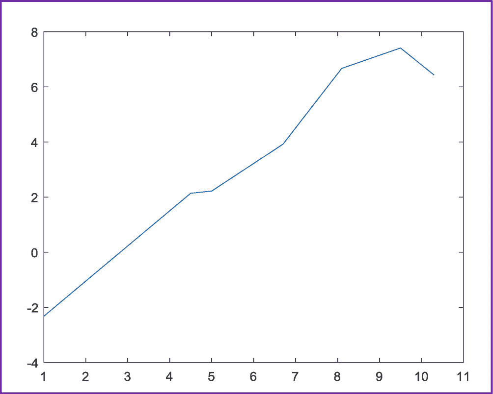

**图 6-4** "绘图"选项卡中针对所选数据的可用绘图

同样的绘图也可以通过使用 GUI 工具并在工作区中选择变量 `A` 和 `B` 来生成。按住键盘上的 Ctrl 键，配合鼠标右键单击选择多个变量。然后通过鼠标左键选项，您可以选择 `plot(A, B)`，或者点击"绘图"选项卡并选择"绘图"：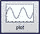。

此外，`A` 和 `B` 数据也可以绘制为散点图、饼图或直方图。

让我们再看一个绘制计算数据点的示例。

### 示例 2：绘制函数值

给定：`y(t) = 1.2 * sin(2*t + 10)`, `t = [-2*pi, 2*pi]`。

通过在命令窗口中执行以下命令，我们可以得到 `y(t)` 相对于 `t` 的绘图，如下图所示。

```
>> t=-2*pi:2*pi;  % 赋值 t 的取值范围
>> y=sin(2*t+10); % 计算 y 的值
>> plot(t, y)     % 绘制 t 与 y 的关系图
```

这些命令生成的绘图如图 6-5 所示。

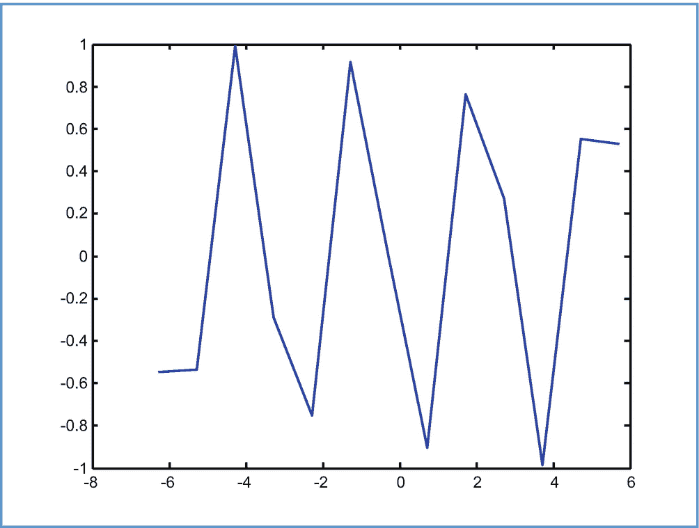

图 6-5 `y(t) = 1.2 * sin(2*t + 10)`, `t = [-2*pi, 2*pi]` 的绘图。

图 6-5 所示的绘图虽然看起来像正弦波，但并不平滑。那么，问题出在哪里呢？

问题出在第一条命令：`>> t=-2*pi:2*pi`。它创建了一个步长 `dt = 1` 的 `t` 数组，这是线性空间定义中的默认设置。在这种情况下，函数值是在 `t = -6.28, -5.28, -4.28 … 5.28` 和 `6.28` 处计算的。为了解决这个问题，必须指定步长，并使其小于 1.0；例如，取 `dt = pi/20`。

```
>> t=-2*pi:pi/20:2*pi; y=sin(2*t+10); plot(t, y)
```

取 `dt = pi/20` 后， `y(t)` 的绘图变得平滑且具有周期性，如图 6-6 所示。

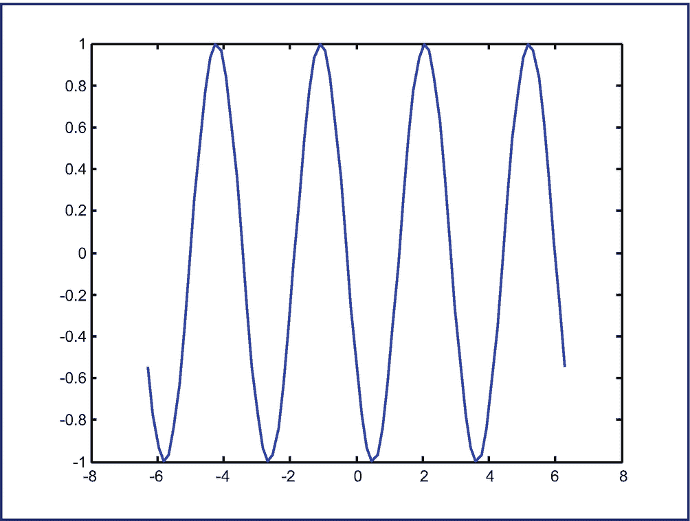

图 6-6 `y(t) = sin(2*t+10) vs. t = -2*pi ... 2*pi, dt = pi/20` 的绘图

### 示例 3：绘制直方图

现有一个由正态分布伪随机数生成函数 `randn()` 生成的 1,000 个数据点。让我们绘制这些数据点的直方图。见图 6-7。

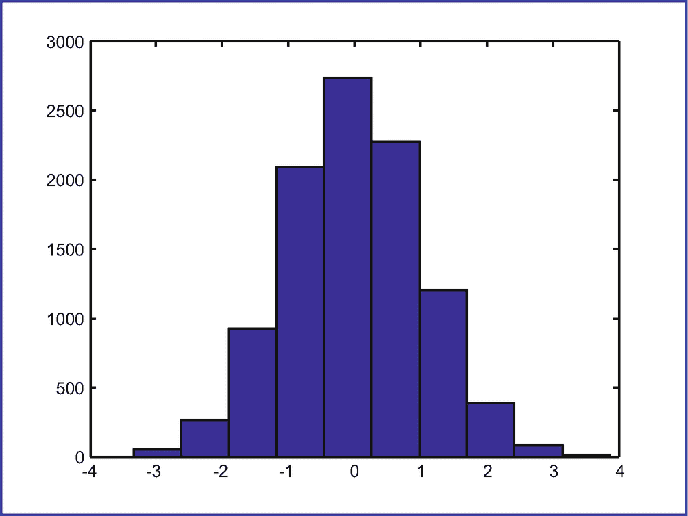

图 6-7 使用 `hist()` 命令生成的 1,000 个正态分布随机数的直方图

```
>> F=randn(1,1000);
>> hist(F)
```

### TITLE（标题）、XLABEL（x 轴标签）、YLABEL（y 轴标签）、AXIS（轴）、GRID（网格）和 LEGEND（图例）

通过使用适当的命令，例如 `title()`、`xlabel()`、`ylabel()`、`axis()`、`grid` 和 `legend()`，可以在绘图中实现标题、坐标轴标签和刻度、网格设置以及图例选项。让我们通过示例演示如何使用它们。

#### TITLE()

`title()` 命令用于设置绘图的标题名称标签。例如，`title('Unit circle')` 会为当前绘图赋予标题 `Unit circle`。

此命令的另一种语法是 `title 'Unit circle'`。该语法与 MATLAB 的后续版本兼容。

#### XLABEL、YLABEL 和 ZLABEL

`xlabel`、`ylabel` 和 `zlabel` 命令分别用于为 x 轴、y 轴或 z 轴分配坐标轴标签或标题。语法为 `xlabel('t, [s] '), ylabel('f(t)')`。这些命令的另一种语法是 `xlabel 't, [s] ', ylabel ' f(t)'`，它会将 x 轴和 y 轴的标签分别设置为 `t, [s]` 和 `f(t)`。

#### AXIS

默认情况下，MATLAB 会缩放绘图的坐标轴以适应该数据。`axis` 命令用于设置绘图的缩放因子。`axis` 命令的一般语法如下。

对于二维绘图：

```
xlim([xmin xmax])           % 为 x 轴设置最小和最大限值
ylim([ymin ymax])           % 为 y 轴设置最小和最大限值
axis([xmin xmax ymin ymax]) % 为 x 和 y 轴设置最小和最大限值
```

对于三维绘图：

```
axis([xmin,xmax,ymin,ymax,zmin,zmax]) % 设置最小和最大限值
```

此外，还可以通过以下命令以几种不同方式设置坐标轴：

```
axis equal  % 所有（或全部 3 个）坐标轴的刻度间距相等
axis square % 当前坐标轴框为正方形
axis normal % 将当前坐标轴框恢复为完整大小
axis off    % 移除所有坐标轴标签、刻度线和背景
axis on     % 恢复所有坐标轴标签、刻度线和背景
axis tight  % 将坐标轴限值设置为数据范围
axis ij     % 将 MATLAB 置于其“MATRIX”坐标轴模式
```

#### GRID

`grid on` 命令用于在绘图上设置网格，使其更清晰易读，例如，使用 `grid on` 设置主网格线，或使用 `grid minor` 设置次网格线。

让我们使用这些附加的绘图命令。

### 示例 4：使用绘图工具绘制单位圆

让我们创建一个由 `x = sin(t)`, `y = cos(t)`, `t = [0, 2*pi]` 定义的单位圆。（见图 6-8）。

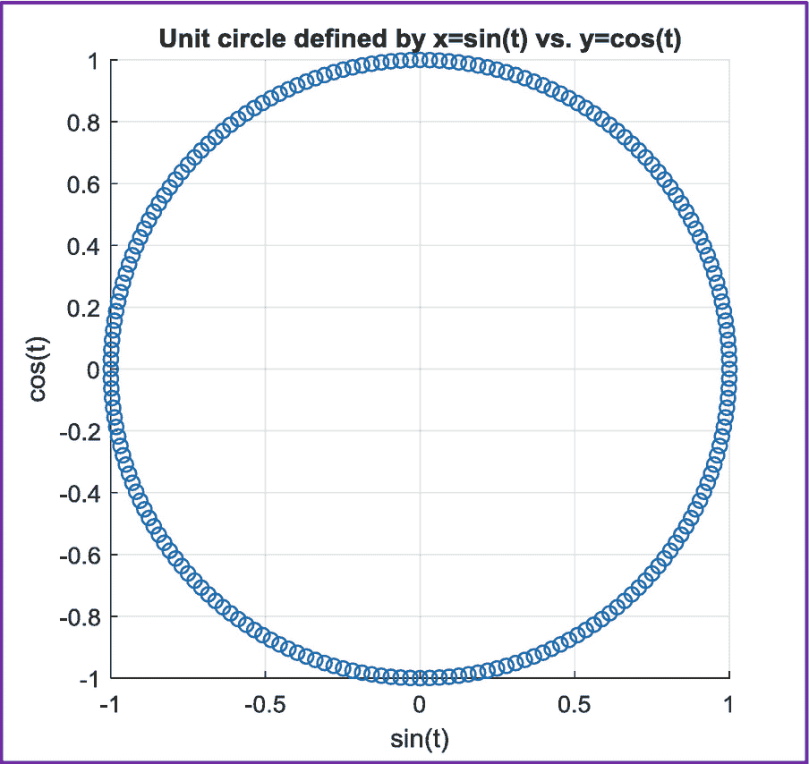

图 6-8 使用绘图工具绘制的单位圆

```
>>t=0:pi/100:2*pi; x=sin(t); y=cos(t); scatter(x, y);
>>title('由 x=sin(t) vs. y=cos(t) 定义的单位圆'); axis tight; >>grid on; axis tight; xlabel('sin(t)'), ylabel('cos(t)')
```

在极坐标系中还有一个替代方案，即使用 `polar()` 命令，如图 6-9 所示。

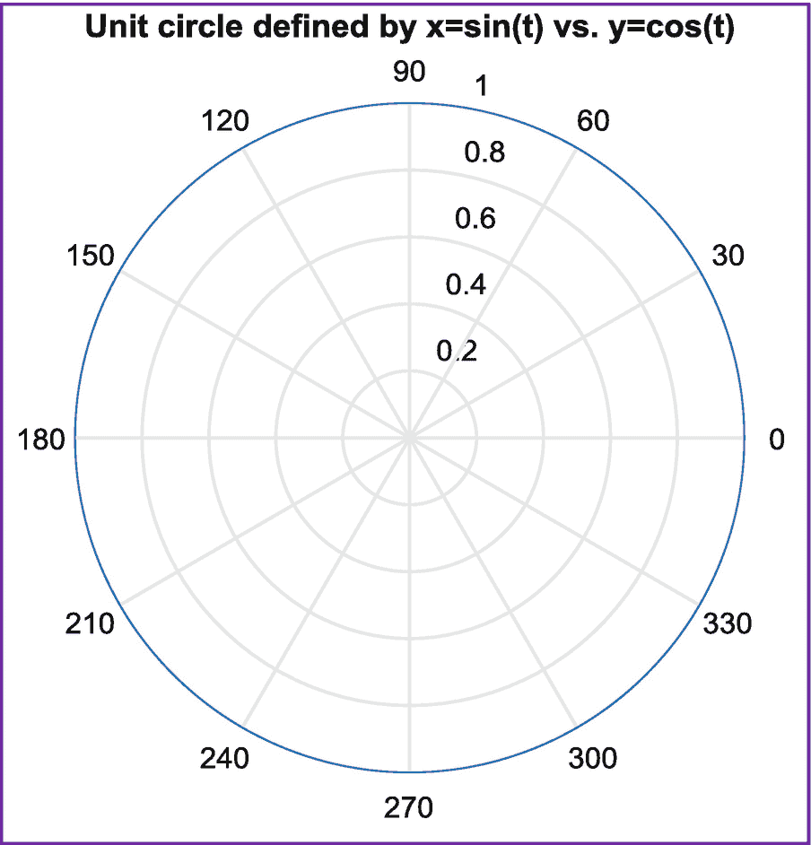

图 6-9 在极坐标系中绘制的单位圆

```
>> t=0:pi/100:2*pi;x=sin(t);y=cos(t);r=sqrt(x.^2+y.^2);polar(t,r)
>> title('由 x=sin(t) vs. y=cos(t) 定义的单位圆')
```

### 注意

在绘制 `x` 与 `y` 的关系图时，数据大小（即 `x` 和 `y` 中的元素个数）必须相等；否则，MATLAB 会返回错误。这是一个非常常见的错误。

### 线条与标记说明符

线条和标记说明符有助于区分绘制在单个绘图区域中的几个数据集。这些说明符可以是线条颜色、线型和标记。线条规格（`line specifier`）、标记规格（`marker specifier`）和颜色规格（`color specifier`）分别在表格 6-1、6-2 和 6-3 中说明。

**表 6-3** 颜色说明符

| 说明符 | 颜色 |
| --- | --- |
| R | 红色 |
| G | 绿色 |
| B | 蓝色 |
| C | 青色 |
| M | 品红色 |
| Y | 黄色 |
| K | 黑色 |
| W | 白色 |

**表 6-2** 标记说明符

| 说明符 | 标记类型 |
| --- | --- |
| + | 加号 |
| o | 圆圈 |
| * | 星号 |
| . | 点 |
| x | 叉号 |
| 'square' 或 s | 方形 |
| 'diamond' 或 d | 菱形 |
| ^ | 上三角 |
| v | 下三角 |
| > | 右三角 |
| < | 左三角 |
| 'pentagram' 或 p | 五角星 |
| 'hexagram' 或 h | 六角星 |

**表 6-1** 线型说明符

| 说明符 | 线型 |
| --- | --- |
| - | 实线（默认） |
| -- | 虚线 |
| : | 点线（冒号） |
| -. | 点划线 |

所有绘图函数（*简易绘图*系列除外，即 `ezplot`、`ezsurf` 和 `ezmesh`，以及隐函数绘图 `fimplicit`、`fimplicit3` 和 `fsurf`）都接受一个线条规格参数，该参数定义了以下三个部分来指定线条：

-   颜色
-   标记符号
-   线型

例如：`>> plot(x, f, ':pb')` 命令使用冒号 (`:`) 绘制 `x` 与 `f` 的关系图，在数据点处放置五角星标记 (`p`)，并将线条和标记颜色设为蓝色 (`b`)。我们可以将这些部分（按任意顺序）作为带引号的字符串放在数据参数之后。请注意，线条规格是单个字符串，而不是属性-值对，例如：

```
>> plot(x, h, 'd')
```

命令绘制 `x` 与 `h` 的关系图，并仅使用菱形标记，不绘制任何线条。请注意，如果未指定绘图线条或标记的颜色，则默认颜色为蓝色。

此外，在使用 `plot` 和 `plot3` 函数时，我们可以通过图形属性指定线条的其他特征：

# MATLAB 绘图功能详解

## 绘图属性设置

以下是一些常用的绘图属性，用于定制图形外观：

- `LineWidth` — 指定线条的宽度（以磅为单位），例如 `'LineWidth', 2`
- `MarkerSize` — 指定标记的大小（以磅为单位），例如 `'MarkerSize', 5`
- `MarkerEdgeColor` — 指定标记的颜色或填充标记的边缘颜色，例如（圆圈 `'o'`、方形 `'s'`、菱形 `'d'`、五角星 `'p'`、六角星 `'h'` 以及四个三角形 `'<'`、`'>'`、`'^'`、`'v'`）
- `MarkerFaceColor` — 指定填充标记的填充颜色。

此外，我们可以指定 `LineStyle`、`Color` 和 `Marker` 属性来替代使用符号字符串。当您想要指定不在列表中的颜色时，这非常有用。您可以使用红绿蓝 (RGB) 值，例如，绘制线条规格：

```matlab
plot(t,y, 'LineWidth', 1/25, 'LineStyle', '--','Color', 'magenta',... 'Marker', 'v')
```

这将绘制 *t* 与 *y* 数据的关系图，线条宽度为 1/25 英寸，线型为虚线，品红色虚线，数据点用向下的三角形标记标出。

## 使用绘图工具绘制函数值

让我们看几个使用 MATLAB 绘图工具绘制函数值的例子。

### 示例 5：使用绘图工具绘制正弦函数值

绘制此函数：*y*(*α*) = *sin*(2*α* + 10)，*α* = [−2*π*, 2*π*]。

以下是包含计算相对于 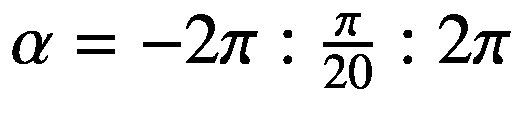 的 *y*(*α*) 的指令的解决方案脚本 (`plot_ex5.m`)。它包含指定线条颜色（`'b'` 为蓝色）、线型（`':'` 为冒号）、线条宽度（`2`）、标记类型（`'d'` 为菱形）、标记大小（`7`）和标记填充颜色（`'m'` 为品红色）的绘图命令。此外，它还显示字体大小为 13 的绘图标题文本（`'Plot of function y = sin(2a+10)'`），以及字体大小同样为 13 的 x 轴和 y 轴标签文本（`'a'`，`'y(a)'`）。

```matlab
%% plot_ex5.m
a=-2*pi:pi/20:2*pi; y=sin(2*a+10);
plot(a,y,'bd:','LineWidth',2,'MarkerSize',7,'MarkerFaceColor','m')
grid on; axis([-2*pi 0.5*pi -1 1]);
title('Plot of function y = sin(2a+10)', 'FontSize', 13)
xlabel('a'); ylabel('y(a)','FontSize',13)
```

执行代码 (`plot_ex5.m`) 后，将生成如图 6-10 所示的图形。

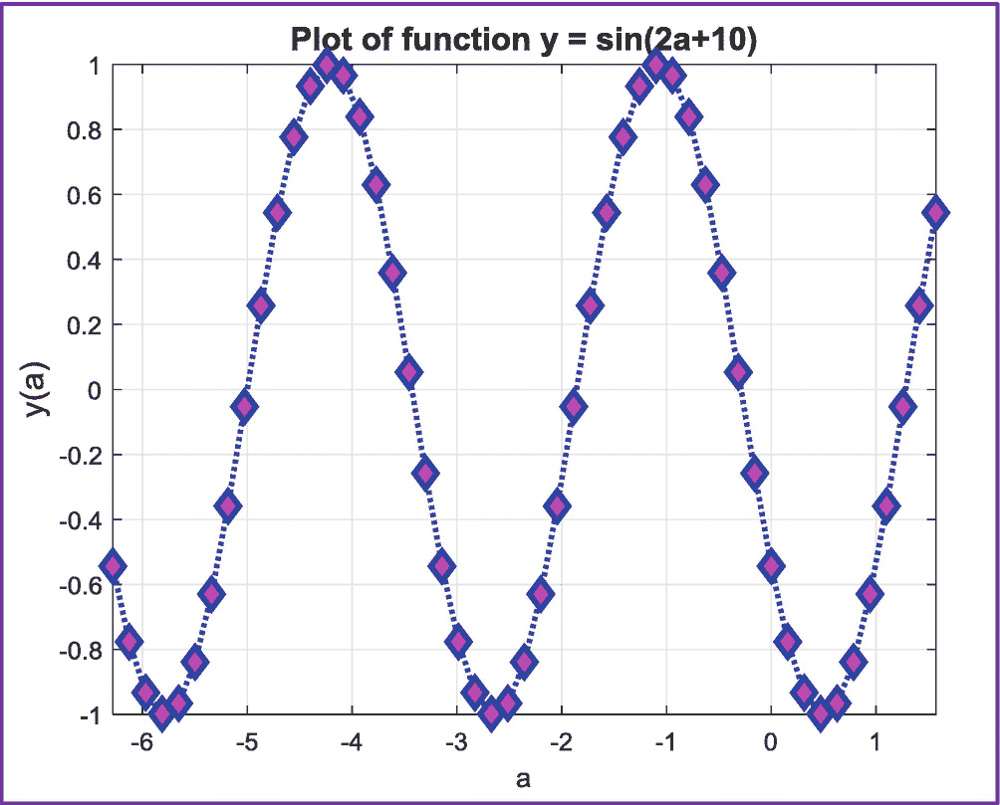

**图 6-10** *y*(*α*) = *sin*(2*α* + 10), *α* = [−2*π*, 2*π*] 的图形

### 特殊字符

MATLAB 可以通过使用 TeX 标记和 LaTEX 代码语法来识别各种特殊字符。在绘图中使用 LaTEX 非常方便。以下示例展示了如何在图形中的标题、坐标轴标签、绘图文本或注释中显示特殊字符和希腊字母。您可以使用反斜杠运算符 (`\`) 来书写特殊字符，例如希腊字母。以下是一些示例：

- `title('\alpha')` 在绘图标题中显示 *α*
- `xlabel('\beta')` 在 x 轴标签上显示 *β*
- `text(0, 1, '\rightarrow')` 在坐标点 (0, 1) 的绘图区域显示 ➤
- `title('e^{at}')` 在绘图标题中显示 *e*^(*at*)
- `ylabel('\fontsize{13} y(x)')` 在 y 轴上显示 *y*(*x*)，字体大小为 13
- `title('\it y(\alpha) vs. \alpha'` 在绘图标题中以斜体显示 *y*(*α*) *vs*. *α*
- `xlabel('\bf f, [s^{-1}]')` 在 x 轴标签上以粗体显示 **f**，[**s**^(**−1**)]
- `title('\copyright by SE')` 在绘图标题中显示 © by SE
- `text(2,1,'\Gamma \approx \pi/2')` 在坐标点 (2,1) 的绘图区域显示 Γ ≈ *π*/2

有关 TeX 和 LaTEX 的更广泛信息和帮助，请在命令窗口中键入以下内容：

```
>> help tex; help latex
```

### 示例 6：使用绘图工具绘制正弦函数值

绘制此函数：*y*(*α*) = *sin*(2*α* + 10)，*α* = [−2*π*, 2*π*]。

答案脚本 (`plot_ex6.m`) 包含带有线条和标记说明符的绘图命令，例如线型（`'-'` 为实线）、线条宽度（`2`）、线条颜色（`'b'` 为蓝色）、标记类型（`'o'`）、标记大小（`7`）和标记填充颜色（`'y'` 为黄色）。此外，它还包括用于标题文本的命令，该标题包含斜体且字体大小为 13 的希腊字母 (*α*)。坐标轴标签包含字体大小为 13 的希腊字母 (*α*)。它还包含在绘图区域显示的文本注释 ← *α* = 0⁰，如图 6-11 所示。

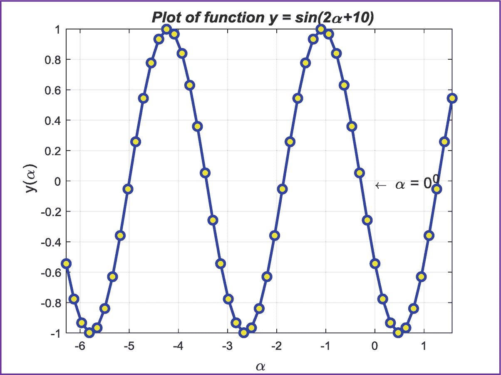

**图 6-11** *y*(*α*) = *sin*(2*α* + 10), *α* = [−2*π*, 2*π*] 的图形

```matlab
a=-2*pi:pi/20:2*pi; y=sin(2*a+10);
plot(a,y,'b-o','LineWidth',2,'MarkerSize',7,'MarkerFaceColor','y');
grid on; axis([-2*pi 0.5*pi -1 1]);
title('\it \fontsize{13} Plot of function y = sin(2\alpha+10)')
ylabel('\fontsize{13} y(\alpha)');  xlabel('\fontsize{13} \alpha')
text(0,0, '\leftarrow \fontsize{13} \alpha = 0⁰');
```

## 在两个 Y-Y 轴上绘制两个数据集

有时我们可能需要在同一个图形中，使用两个垂直的 y-y 轴绘制两个独立的数据集或函数值。这种类型的图形相对容易实现，有两种方法。一种方法适用于较旧版本的 MATLAB，另一种适用于较新的版本。

### 示例 7: 在 Y-Y 轴上绘制两个函数值

已知：

- `y(γ) = 2.725 * e^(-0.1 * γ) * cos(2.725 * γ + 25)`；`γ = 0…15 * π`
- `z(γ) = 0.725 * sin(0.725 * γ + 25) * ln(0.5 * γ)`；`γ = 0…15 * π`

以下代码展示了两种解决方案 (`plot_ex7.m`)。版本 1 适用于 MATLAB 旧版本，版本 2 适用于新版本。两个版本的主要区别在于 `plotyy` 和 `yyaxis`（`left` 和 `right`）这两个命令。MATLAB 在大多数情况下是向前兼容的，因此为旧版本编写的脚本和命令语法在新版本中同样有效。

```matlab
% 版本 1. 适用于 MATLAB 旧版本
clf          % 清除打开的图形
gamma=0:pi/40:15*pi;
y=2.725*cos(2.725*gamma+25).*exp(-.1*gamma);
z=0.725*sin(0.725*gamma+25).*log(0.5*gamma);
% 针对每个 gamma 值，绘制 gamma 与 y 以及 gamma 与 z 的关系图。
[AX,Y1,Y2] = plotyy(gamma, y, gamma, z, 'plot');
% 图的标题使用 LaTEX 格式。
title(['\fontsize{9} y=2.725*cos(2.725*\gamma+25)*e^{-0.1\gamma}',...
'& z=0.725*sin(0.725*\gamma+25)*log(0.5*\gamma)'])
xlabel('\fontsize{15} \gamma');
set(get(AX(1),'Ylabel'),'String',...
'y=2.725*cos(2.725*\gamma+25).*e^{-⁰.1\gamma}')
set(get(AX(2),'Ylabel'),'String',...
'z=0.725*sin(0.725*\gamma+25)*log(0.5*\gamma)')
grid on; axis tight
%% 版本 2. 适用于 MATLAB 新版本
gamma=0:pi/40:15*pi;
y=2.725*cos(2.725*gamma+25).*exp(-.1*gamma);
z=0.725*sin(0.725*gamma+25).*log(0.5*gamma);
yyaxis left  % 选择左 y 轴来绘制数据
plot(gamma, y, 'r-o'),
ylabel('y=2.725*cos(2.725*\gamma+25).*e^{-⁰.1\gamma}')
yyaxis right % 选择右 y 轴来绘制数据
plot(gamma, z, 'b--x');
ylabel('z=0.725*sin(0.725*\gamma+25)*log(0.5*\gamma)'),
grid minor,
title(['\fontsize{9} y=2.725*cos(2.725*\gamma+25)*e^{-0.1\gamma}',...
'& z=0.725*sin(0.725*\gamma+25)*log(0.5*\gamma)']), axis tight
```

得到的图形也有所不同。在版本 1 中，存在一些限制，例如无法调整绘图的线型、标记和颜色规格，只能使用默认颜色（见图 6-12）。

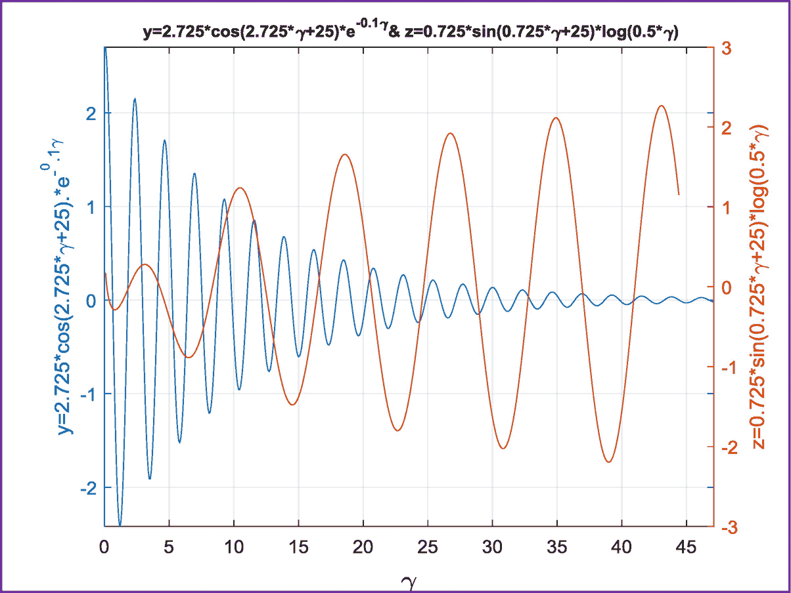

**图 6-12** 在 Y-Y 轴上绘制两个函数值（版本 1）

图 6-13 所示的版本 2 解决方案适用于较新的 MATLAB 版本，它更加灵活，包含可调整的绘图说明符，例如标记类型、线型、颜色、大小等。

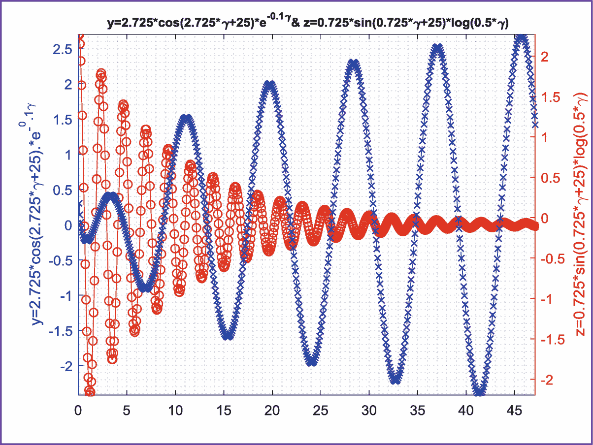

**图 6-13** 在 Y-Y 轴上绘制两个函数值（版本 2）

## 高级绘图功能

### 子图

通过使用 `subplot()` 命令，可以在一个图形中以子图形式绘制多个图形。

#### 示例 8: 创建函数的子图

已知以下四个函数：

`z(γ) = 0.725 * sin(0.725γ + 25) * ln(0.5γ)`

`y(γ) = 2.725 * e^(-0.1γ) * cos(2.725γ + 25)`

`x(t) = e^(2.725 * cos(2.725t + 25))`

`w(t) = 0.725 * sin(0.725 * ln(0.5t) + 25)`

`γ = 0 … 15π`；`t = -5π … 5π`；

让我们将它们绘制为单个图形中的子图。解决方案脚本 (`plot_ex8.m`) 计算所有四个函数并将其在一个图形上绘制为四个独立的子图（见图 6-14）。

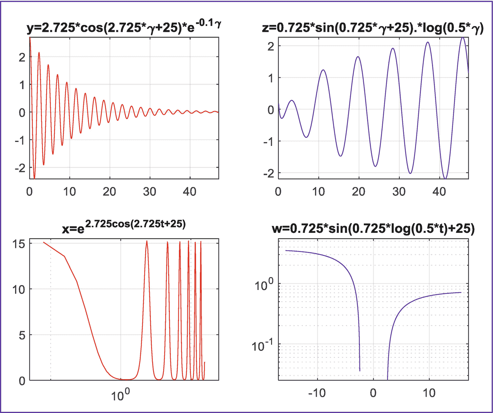

**图 6-14** 在单个图形中将四个函数值绘制为子图

```matlab
%% plot_ex8.m
gamma=0:pi/40:15*pi;
y=2.725*cos(2.725*gamma+25).*exp(-.1*gamma);
z=0.725*sin(0.725*gamma+25).*log(0.5*gamma);
t=-5*pi:pi/40:5*pi;
x=exp(2.725*cos(2.725*t+25));
w=0.725*sin(0.725*log(0.5*t)+25);
figure % 创建一个空白图形
subplot(2,2,1); plot(gamma, y, 'r-'); grid on
title('y=2.725*cos(2.725*\gamma+25)*e^{-0.1\gamma}')
subplot(2,2,2); plot(gamma, z, 'b-'); grid on
title('z=0.725*sin(0.725*\gamma+25).*log(0.5*\gamma)')
subplot (2,2,3)
semilogx(t,x,'r-')  % x 轴采用对数比例，用于演示目的
grid on
axis([0.05 25 0 15.5]); % 为 x 和 y 轴指定最小值和最大值
title('x=e^{2.725cos(2.725t+25)}')
subplot(2,2,4)
semilogy(t, w, 'b-')      % y 轴采用对数比例
grid on; axis([-17 17 0.025 5.5]),
title('w=0.725*sin(0.725*log(0.5*t)+25)')
```

此外，当所有图形构建完成后，命令窗口中会显示以下警告信息：

```
Warning: Negative data ignored
Warning: Imaginary parts of complex X and/or Y arguments ignored
Warning: Negative data ignored
```

在将计算值作为复数绘制时，将省略其虚部。

### 图例

`legend` 命令用于指定所绘制数据集的图例，以便识别数据，例如 `legend('y(t)', 'z(t)', 'h(t)')`。任何 TeX 和 LaTEX 的特殊符号都可以通过 `legend` 命令实现。例如，`legend('x(\alpha)', 'y(\xi)')` 会在绘图区域显示 `x(α)` 和 `y(ξ)`。

### 保持图形

要在单个图形中保持并绘制多个图形，可使用 `hold on` 命令。当所有数据集都绘制完毕后，需要使用 `hold off` 命令来释放所保持的图形。或者，在循环中绘制多组数据时，可以使用 `hold all` 命令为每组数据分配唯一的颜色。

#### 示例 9: 在单个图形中绘制几个函数值

已知：
`y1 = sec(x) / x`；`y2 = 100 * sin(x) / x`；`y3 = 10 * cos(x) / x`；`y4 = 10 * tan(x) / x`；`y5 = e^x / x`；`x = [-3π, 3π]`。

让我们计算这五个函数的数值，并将其一起绘制在单个图形中。

```matlab
%% plot_ex9.m
close all
x = linspace(-3*pi, 3*pi, 3333);
y=[sec(x)./x; 100*sin(x)./x;10*cos(x)./x;10*tan(x)./x; exp(x)./(x);];
plot( x, y(1,:),'go'); hold on
plot(x, y(2,:),'--', x, y(3,:),':', x, y(4,:),'b','LineWidth',1.5)
plot(x, y(5,:),'-','LineWidth',1.5)
title('[y_1, y_2, y_3, y_4, y_5] vs. x')
xlabel('\it x'); ylabel('\it y function values')
legend('sec(x)/x', '100*sin(x)/x','10*cos(x)/x','10*tan(x)/x','e^x/x')
axis([-3*pi, 3*pi, -100, 100]); hold off; grid on
shg % 显示图形
```

模拟脚本后，图 6-15 显示了结果。

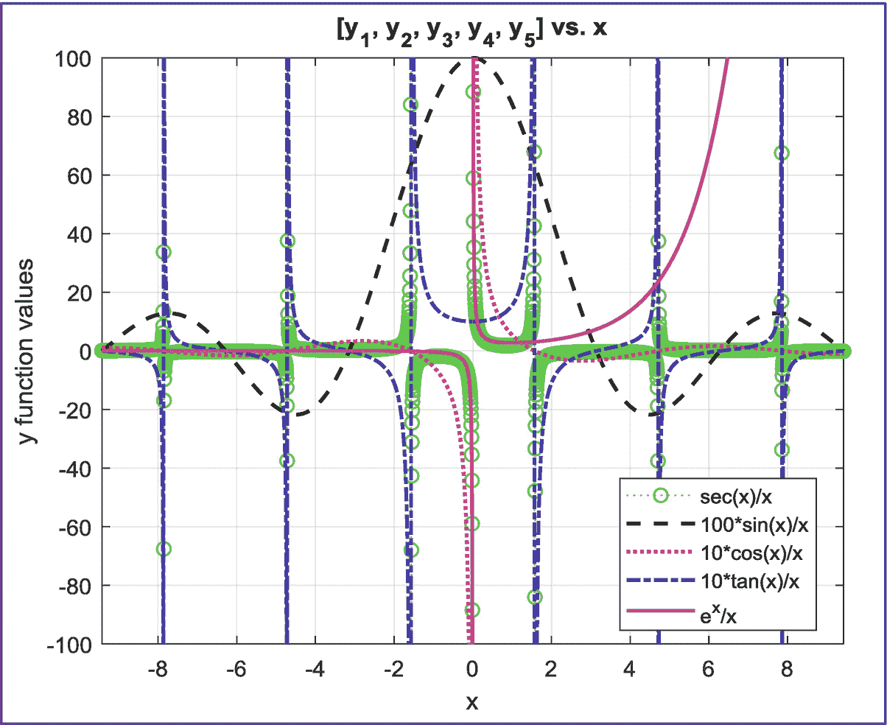

**图 6-15** 在单个图形中绘制多个函数值

如果在单个图形中有多组不同的数据需要绘制，可以使用循环控制运算符来处理线的颜色、类型、标记规格和图例。可以预先将线型、颜色和标记类型指定为字符串，并在之后使用。让我们考虑以下示例。

### 示例 10：使用不同线条标记和颜色绘制函数值

给定 $${y}_1=\frac{\sec (x)}{x};{y}_2=\frac{100\sin x}{x};{y}_3=\frac{10\cos x}{x};{y}_4=\frac{10\tan x}{x};{y}_5=\frac{e^x}{x};x=\left[-3\pi, 3\pi \right].$$

如果我们沿用前面示例中的逐步方法，脚本会变得相当冗长且凌乱。因此，我们采用另一种方法：先创建一组线条和标记说明符，然后使用循环控制语句从预定义的说明符中进行选择。在每次迭代中，针对每个 `μ` 值分别绘制数据集时，你都需要执行此操作。解决方案脚本（`plot_ex10.m`）相当简洁。参见图 6-16。

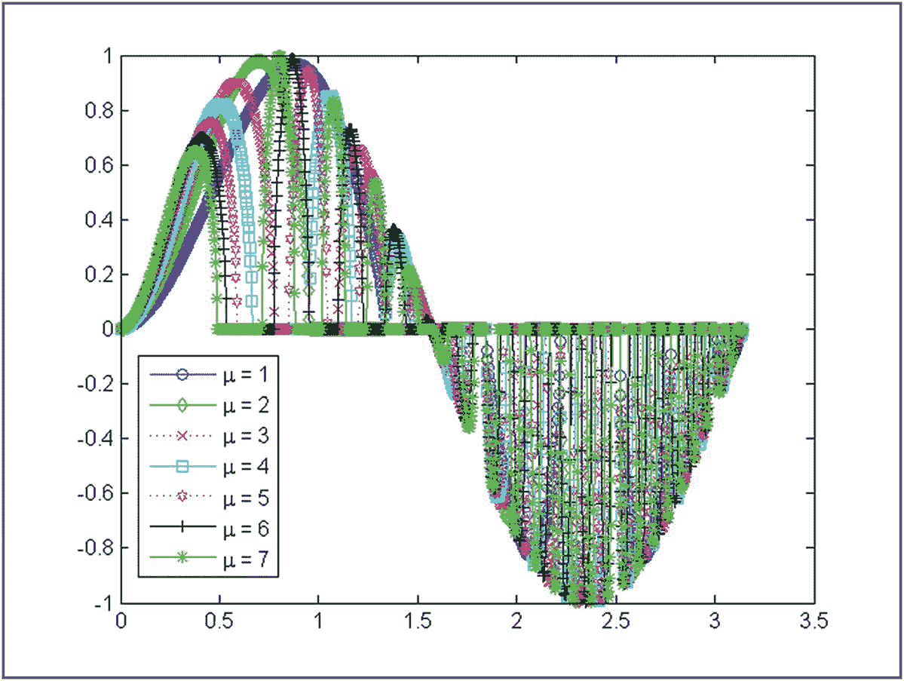

**图 6-16** 使用不同线条标记和颜色绘制函数值

```
%% plot_ex10.m
close all; clearvars
t=0:.001*pi:1*pi;
% 定义线条颜色、类型和标记说明符：
Labelit  = {};
Colorit  = 'bgrcmkgrckmbgrygr';
Lineit   = '--:-:--:-:--:----:----:--';
Markit  = 'odxsh+*^v.xsh+od+*^v';
for ii=1:7
% 每次迭代时获取线条和标记说明符：
Stylo = [Colorit(ii) Lineit(ii) Markit(ii)];
F     = sqrt(sin(ii*t.*sqrt(t+t.²+t.³))).*sin(2*t);
plot(t, F, Stylo), hold on
Labelit{ii} = ['\mu = ' num2str(ii)];
legend(Labelit{:})
end
```

## 使用函数句柄 (`@`) 的 `EZPLOT`、`FPLOT` 和 `FIMPLICIT`

`EZPLOT` 和 `FPLOT` 用于使用函数句柄 (`@`) 和隐式定义的参数值来绘制数学表达式。例如：

```
fplot(@(t)([sin(t), cos(t), exp(cos(t))]));
ezplot(@(x)(sin(x)));
fimplicit(@(x,y) (25-(x.²+y.²)));
```

或者指定参数值的范围。例如：

```
fplot(@(t)([sin(t),cos(t),exp(cos(t))]),[-pi,pi]); ezplot(@(x)(sin(x)),[0,2*pi]);
fimplicit(@(x,y)(25-(x.²+y.²)),[-5,5]);
```

函数句柄 (`@`) 可以在 `fplot`、`ezplot` 和 `fimplicit` 内部或外部定义：

```
G=@(t)([t.²+2*t-13,sqrt(t.³+3*t),(t.⁵+t^(3/4))^(3/2)]);
fplot(G, [-2.5, 2]);
```

### 示例 11：使用 `ezplot()` 绘制数学表达式

给定 $$f(x)=0.5\cos \frac{\omega \pi x}{180}+0.75\sin \frac{\omega \pi x}{180}$$；*ω* = 00200*，自变量为 *x*，函数 *f*(*x*) 是频率范围为 $$0\ s\ s\frac{rad}{\mathit{\sec}}$$、增量为 *∆ω* = 20$$\frac{rad}{\mathit{\sec}}$$ 的余弦和正弦函数之和。以下是包含循环控制语句的解决方案脚本（`plot_ex11.m`）（见图 6-17）。

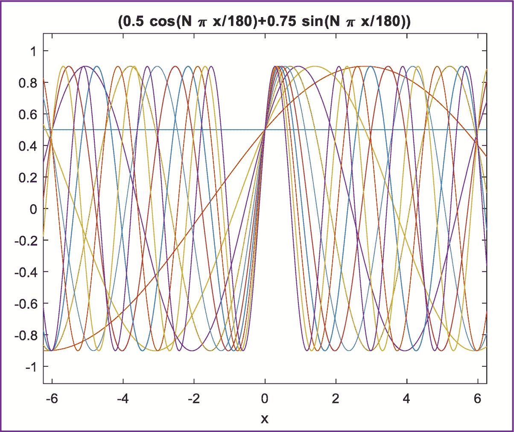

**图 6-17** 使用 `ezplot()` 绘制数学表达式

```
%% plot_ex11.m 演示 EZPLOT 和 FPLOT
close all
for N=0:20:200
FH=@(x)(0.5*cos(N*pi*x/180)+0.75*sin(N*pi*x/180));
ezplot(FH, [-6.25, 6.25]); hold all % 或使用 fplot(FH, [-6.25, 6.25])
end
hold off
```

`fplot`、`fimplicit` 和 `ezplot` 易于用于绘制具有一个或两个自变量的数学表达式，可以指定其范围，也可以不指定。`fplot` 的一个重要特性是，它可以在不绘图的情况下计算表达式的值，如下所示：

```
[X, Y] = fplot(@(x)(0.5*cos(N*pi*x/180)+0.75*sin(N*pi*x/180)));
```

## `GTEXT`、`TEXT` 和 `GINPUT`

`GTEXT` 和 `TEXT` 命令用于向图形添加注释和文本字符串。`GTEXT` 用于使用鼠标放置文本。`TEXT` 用于向数据点添加文本描述。`GTEXT` 命令的一般语法如下：

```
gtext('文本', '属性名称', 属性值,...)
gtext({'第一行','第二行'},'FontName','Times','Fontsize',12)
```

`TEXT` 命令的一般语法是：

```
text(x, y, '文本消息')
```

以下是使用 `text` 和 `gtext` 在图形上显示文本或注释的两个示例。使用了 `gtext` 和 `text` 图形注释命令：

```
>> text(0,0, '\alpha  = \pi/2')
>> gtext(['\alpha  = ' num2str(13) ' \pi'])
```

`text` 命令在当前图形曲面的 `[0, 0]` 处显示 $$\alpha =\frac{\pi }{2}$$，而 `gtext` 则在用户用光标点击的位置显示 *α* = 13 *π*。

`GINPUT` 是一种鼠标图形输入。它是一种非常方便的工具，可以使用鼠标指针在图形中定位我们感兴趣的点。此命令的一般语法是：

```
[X,Y] = ginput(N);  % N 是要选择的点数
```

此命令返回使用鼠标定位/选择的 X 和 Y 坐标的 `N` 个点。以下命令选择无限数量的点，直到按下键盘上的 Enter 键。

```
[X,Y] = ginput();
```

要定位图形上感兴趣的点，或绘制数据的局部或全局最小值，`ginput` 是一个很好的图形工具：

```
>> [x, y] = ginput(3);
```

此命令会自动将光标置于当前图形表面。它选择三个点，其 x 和 y 坐标将被测量并保存到工作区中，变量名为 `x` 和 `y`。如果没有打开的图形，`ginput` 会打开一个空白图形。让我们看一个结合使用这些命令的示例。

### 示例 12：在图形中定位并显示函数图形的最小值

给定函数 *f*(*x*) = sin(1.313^(−1.7 * *x*)) − cos(1.313^(1.7 * *x*))

让我们计算并绘制 *f*(*x*)，然后在 *x* = −6.5…6.5 的区域内找到其最小值。此外，我们通过使用 `text` 和 `gtext` 在图形上显示找到的值。我们使用两种不同的方法，通过 `ginput` 定位给定函数的最小值。

解决方案脚本（`plot_ex12.m`）使用带有 `ginput` 的鼠标光标。

```
% plot_ex12.m
fun_fun=@(x)sin(1.313^(-1.7*x))-cos(1.313^(1.7*x));
fplot(fun_fun, [-6.5, 6.5]); grid on; hold on
[xm, ym]=ginput(3);    % 小心使用鼠标光标以定位最小值
TXT1=['第一个局部最小值 (方形) @x= ', num2str(xm(1))];
gtext(TXT1, 'fontsize', 11)
text(-2,0,['第二个局部最小值 (圆形) @x= ', num2str(xm(2))]);
text(-2, -0.5, ['第三个局部最小值 (星形)   @x= ', num2str(xm(3))]);
plot(xm(1),ym(1),'rs', xm(2),ym(2), 'bo', xm(3),ym(3), 'kp', ...
'markersize',13,'markerfacecolor', 'm'); hold off
title('sin(1.313^{-1.7*x})-cos(1.313^{1.7x}')
xlabel('\it x'), ylabel('\it f(x)')
```

在此脚本中，`text` 和 `gtext` 命令用于插入 `f(x)` 的三个局部最小值，这些最小值通过 `ginput` 激活的光标点击获得。执行脚本后，我们从左到右选择绘制数据的局部最小值，并将局部最小值打印在图形上。图 6-18 所示的图形即为结果。

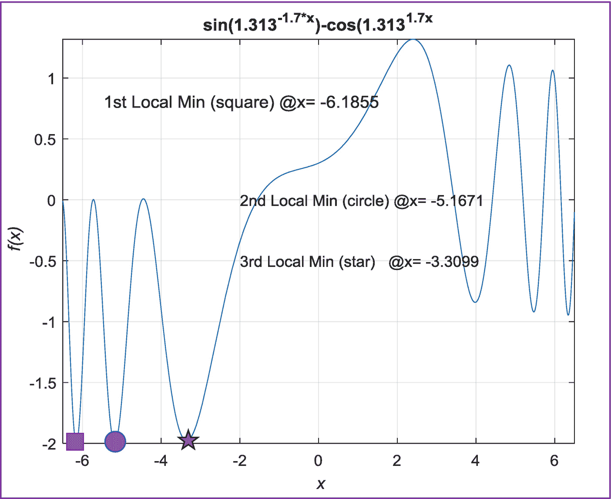

**图 6-18** 显示定位最小值的图形

请注意，在图 6-18 中，第一个局部最小值（方形）@x = -6.1855 通过 `gtext` 命令显示，其他两个局部最小值（第二个和第三个最小值）则通过 `text` 命令显示。

`GINPUT` 函数在我们需要定位图形中的多个点及其对应坐标点时特别有用，但精度取决于我们能够将鼠标光标放置在感兴趣点上的准确程度。

# 坐标轴刻度与刻度标签

在某些情况下，可能需要在绘图坐标轴上显示特定的刻度值。此时，可分别针对 x、y、z 轴使用 `xticks`、`xticklabels`、`yticks`、`yticklabels`、`zticks` 和 `zticklabels` 命令。

## 示例 13：显示 X 轴刻度标签

给定 *G* = [sin(2*t*), cos(2*t*), *e*^(sin(2*t*) + cos(2*t*))]，*t* = [0, 2*π*]。将 x 轴刻度放置在 $$\left[0,\frac{\pi }{2},\pi, \frac{3\pi }{2},2\pi \right]$$ 处。

以下是解决方案脚本 (`plot_ex13.m`)。

```
%% plot_ex13.m 演示 Xticks 和 Xticklabels
H=@(t)([sin(2*t), cos(2*t), exp(sin(2*t)+cos(2*t))]);
fplot(H, [0, 2*pi], '-*')
xticks([0:pi/2:3*pi]); xticklabels({'0', '\pi/2', '\pi', '3\pi/2', '2\pi'});
xlabel('\it t'), ylabel('\it H'),
title('\it \fontsize{9} Xticks & Xticklabels'), grid on
```

该解决方案脚本 (`plot_ex13.m`) 生成的图形将显示 x 轴刻度标签，如图 6-19 所示。

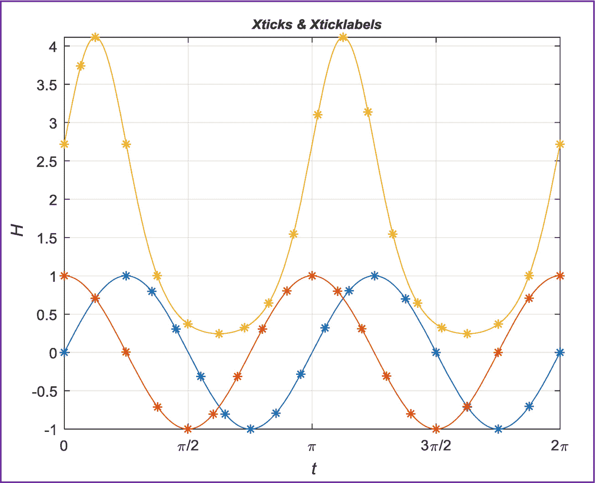

图 6-19 显示 X 轴刻度标签

# 图形句柄

绘图图形的属性以及线条和标记的说明符（例如线型、颜色、线宽、标记类型、大小和标记面颜色）可以通过图形句柄进行设置和管理，例如 `FH = plot(x, y)`。句柄 `FH` 将包含该绘图的所有图形属性。让我们通过以下示例了解如何管理绘图图形属性。

## 示例 14：使用图形句柄

给定 *G* = [sin(2*t*), cos(2*t*), *e*^(sin(2*t*) + cos(2*t*))]，*t* = [0, 2*π*]。

以下是解决方案脚本 (`plot_ex14.m`)。

```
%% plot_ex14.m - 绘图句柄。
% 第 1 部分。绘制图形并获取句柄：HG
clf                                 % 清除当前图形
t = 0:pi/30:2*pi;
GH = [sin(2*t); cos(2*t); exp(sin(2*t)+cos(2*t));];
HG = plot(t, GH); shg
%% 第 2 部分。更改绘图属性
% 设置线条颜色
HG(1).Color='r';                    % HG(1).color = [1 0 0]; % 替代写法
HG(2).Color='g';                    % HG(2).color = [0 1 0]  % 替代写法
HG(3).Color='b';                    % HG(3).color = [0 0 1]  % 替代写法
% 设置线型
HG(1).LineStyle = '-';
HG(2).LineStyle = '--';
HG(3).LineStyle = '-.';
% 设置线宽
HG(1).LineWidth = HG(1).LineWidth+0.5;
HG(2).LineWidth = HG(2).LineWidth+0.5;
HG(3).LineWidth = HG(3).LineWidth+0.5;
% 设置标记类型
set(HG(1), 'marker', 'p')           % 标记为五边形
set(HG(2), 'marker', 'd')           % 标记为菱形
set(HG(3), 'marker', 'o')           % 标记为圆形
% 设置标记大小
set(HG(1), 'MarkerSize', 5)
set(HG(2), 'MarkerSize', 7)
set(HG(3), 'MarkerSize', 9)
% 设置标记面颜色
set(HG(1), 'markerfacecolor', [1 0 1])
set(HG(2), 'markerfacecolor', [0 1 1])
set(HG(3), 'markerfacecolor', [1 1 0])
title('\fontsize{11} G(\alpha) vs. \alpha. [\alpha = 0:\pi/30:2\pi]')
xlabel('\alpha'), ylabel 'F(\alpha)', grid on, axis tight
legend('sin(2\alpha)', 'cos(2\alpha)',...
'e^{sin(2\alpha)+cos(2\alpha)}')
```

脚本的第 1 部分生成如图 6-20 所示的绘图图形，脚本的第 2 部分更改属性（线条和标记说明符），如图 6-21 所示。

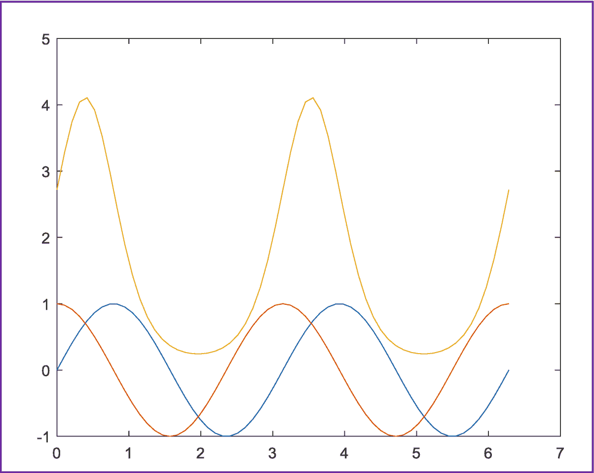

图 6-20 使用 `plot()` 命令默认值绘制的三个函数值的图形

图 6-21 中的图形显示了所有已更改的属性（线条和标记说明符）以及添加的标题、坐标轴标签和图例。

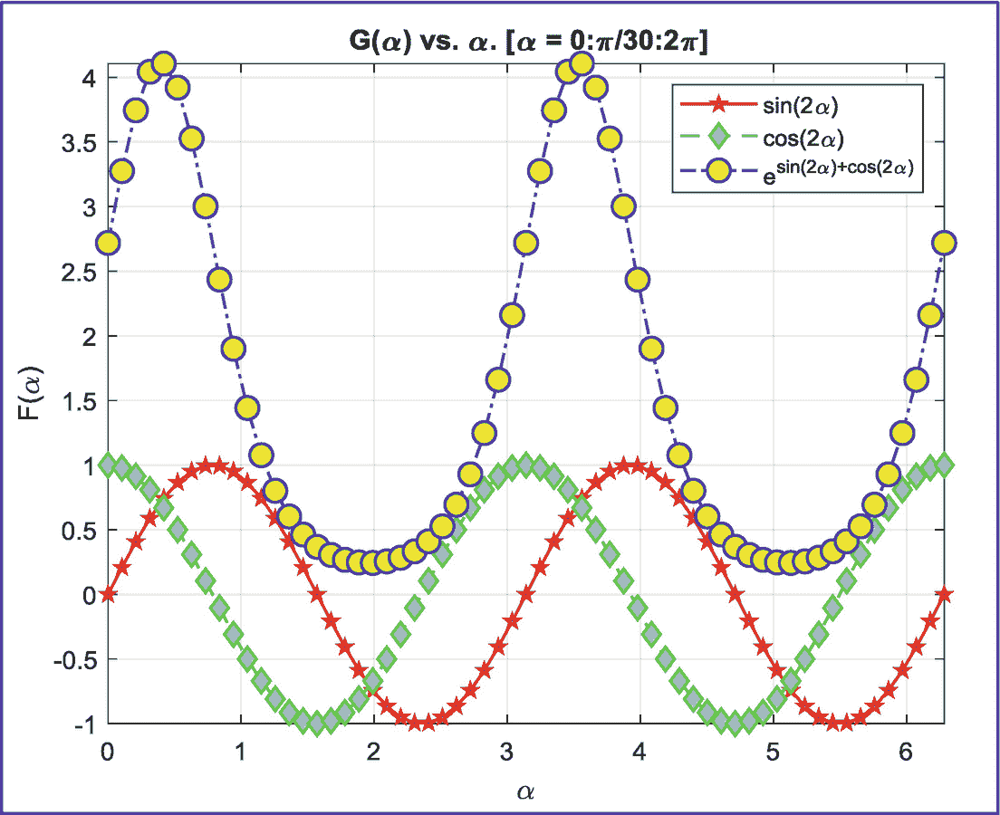

图 6-21 三个函数值的绘图图形

所有 2D 绘图属性也可以通过 GUI 工具（通过属性检查器）进行更改，只需单击  激活“绘图编辑”选项，然后双击绘图区域即可访问。

# 3D 曲面图

要创建和编辑 3D 条形图、图表和图形，可以使用 `bar3h`、`pie3`、`ezsurf`、`surf`、`surfc`、`mesh`、`contour3`、`ribbon`、`waterfall` 和 `plot3` 函数。几乎所有用于构建 2D 图形的命令、工具和函数也适用于构建 3D 图形。这包括 `title`、`axis label`、`axis scale`、`legend` 等。

## 示例 15：使用 `pie()` 创建 3D 饼图

给定 `A = 10; B = 15; C = 20; D = 17; E = 28; F = 10; H = [A, B, C, D, E, F]`，让我们为该数据集构建一个饼图（见图 6-22）。

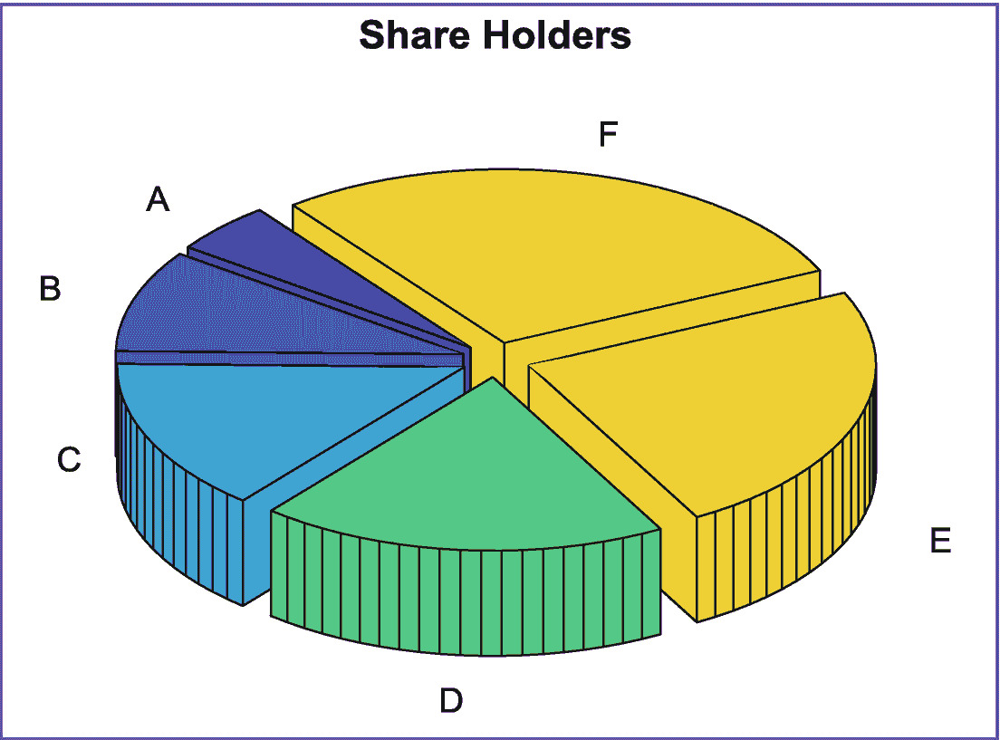
图 6-22 3D 饼图

```matlab
pie3(1:6,H, {'A', 'B', 'C', 'D', 'E','F'}), title('股东')
```

## 示例 16：使用 `ezsurf()` 创建 3D 曲面图

给定 *h*(*z*, *β*) = ln(0.01 * *z*) * cot(2.5 * *β*)。

对于此示例，我们使用 `ezsurf` 命令定义一个函数句柄（见图 6-23）：

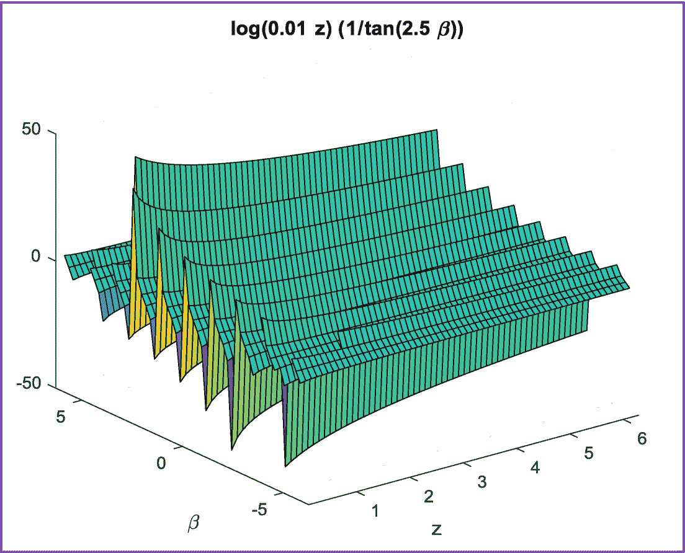
图 6-23 3D 曲面图

```matlab
ezsurf(@(z, beta)log(0.01*z)*(1./tan(2.5*beta)))
```

## 示例 17：使用 `ezmesh()` 创建 3D 网格图

给定函数 *h*(*α*, *x*) = cos(2.1*α*)*e*^(0.1*x*)

在此练习中，我们通过使用带曲面绘图命令的内联函数 `ezsurf()` 创建一个符号数学函数 *h*(*α*, *x*)（见图 6-24）。

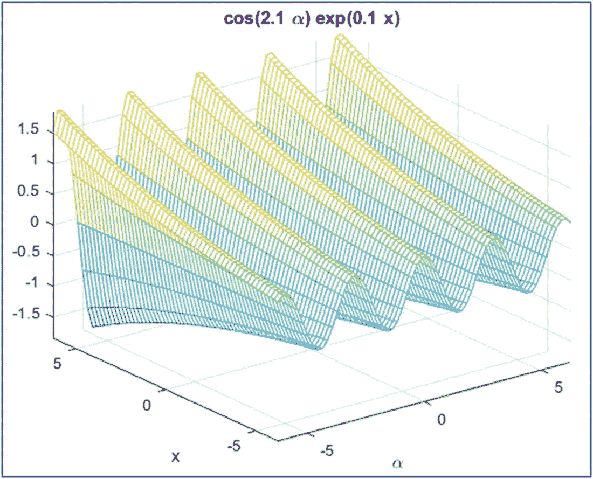
图 6-24 3D 网格图

```matlab
ezmesh(inline('cos(2.1*alpha)*exp(0.1*x)'))
```

## 示例 18：使用 `ezsurfc()` 创建 3D 曲面轮廓图

给定 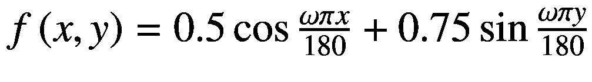；*ω* = 50 … 500，*x* = [−*π*, *π*]，*y* = [−*π*, *π*]*，* 具有两个自变量 *x* 和 *y*，让我们为特定频率范围构建一个带动画模拟的 3D 图形 *f*(*x*, *y*)。

```matlab
close all
for omega=50:5:150
handle=@(x,y)(0.5*cos(omega*pi*x/180)+0.75*sin(omega*y*pi/180));
ezsurfc(handle, [-pi, pi], [-pi, pi]);
end
```

该脚本构建了给定函数 *f*(*x*, *y*) 的 3D 图形（见图 6-25），并带有关于频率范围 *ω* = 50 … 150 的动画模拟。

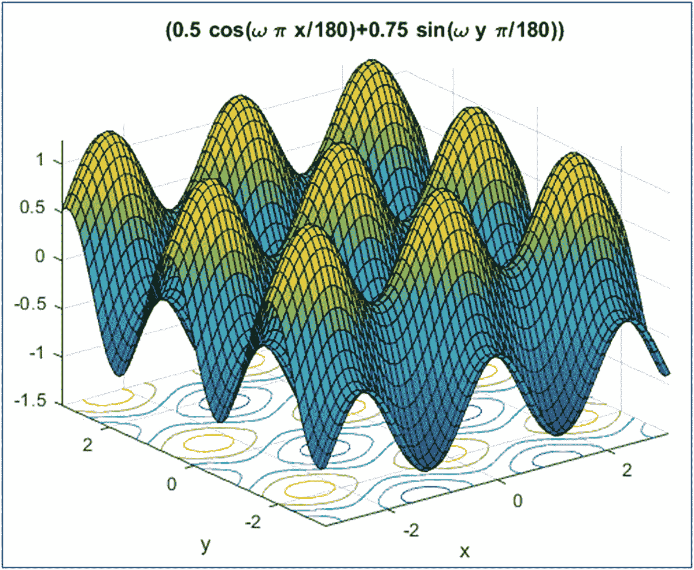
图 6-25 使用 `surfc()` 绘制的 3D 曲面-轮廓图

### 示例 19：创建电势场的 3D 图

两个带电粒子在某点的电势场 `V` 由下式给出：

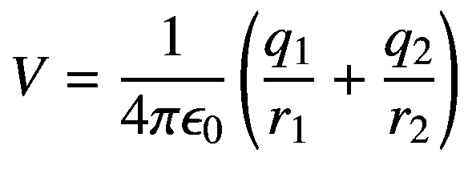

其中 `q1` 和 `q2` 是粒子的电荷量，单位为库仑（`C`），`r1` 和 `r2` 是该点到电荷的距离（单位为米），`ϵ0` 是真空介电常数，其值为：

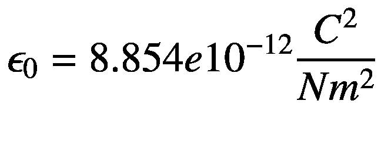

假设电荷量分别为 `q1 = 2e-10 C` 和 `q2 = 4e-10 C`。它们在 `xy` 平面上的位置分别为 `(0.3, 0)` 和 `(-0.3, 0)`。接下来将在 3D 曲面图上绘制电势场，即在由 `-0.25 <= x <= 0.25` 和 `-0.25 <= y <= 0.25` 定义的范围内，将 `V` 绘制在 `z` 轴上。可以通过两种方式创建 3D 图：
- 使用 `surf` 函数
- 使用 `mesh` 函数。

以下是计算上述电势场问题并绘制结果的脚本（`plot_ex19.m`）。

```matlab
%% plot_ex19.m
% q1, q2 是粒子的电荷量，单位是库仑（C）
% r1, r2 是电荷到点的距离，单位是米
% epsilon 是真空介电常数
% r1,r2, V(r1,r2) 是用于绘图的坐标系
close all
[r1, r2] = meshgrid(-0.25:0.01:.25);
epsilon  = 8.854e-12;q1 = 2e-10; q2=4e-10;
coeff    = (1./(4*pi*epsilon));
V = coeff.*(q1./r1 + q2./r2);
figure(1) % 曲面图
surface(r1,r2,V); xlabel('r1'); ylabel('r2'); zlabel('V(r1,r2)')
title(['图 1\. 两个带电粒子的电势场', ...
'（曲面图）'])
grid on, view(-15,15), axis tight, colormap Jet
figure(2) % 带等高线的网格图
mesh(r1,r2,V); xlabel('r1'); ylabel('r2'); zlabel('V');
title(['图 2\. 两个带电粒子的电势场', ...
'（网格图）']);
axis vis3d; colormap hsv
```

运行此脚本后，得到图 6-26 和图 6-27 所示的 3D 图。

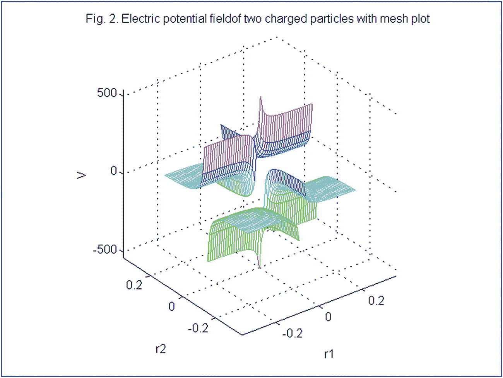
图 6-27：两个带电粒子电势场的网格图

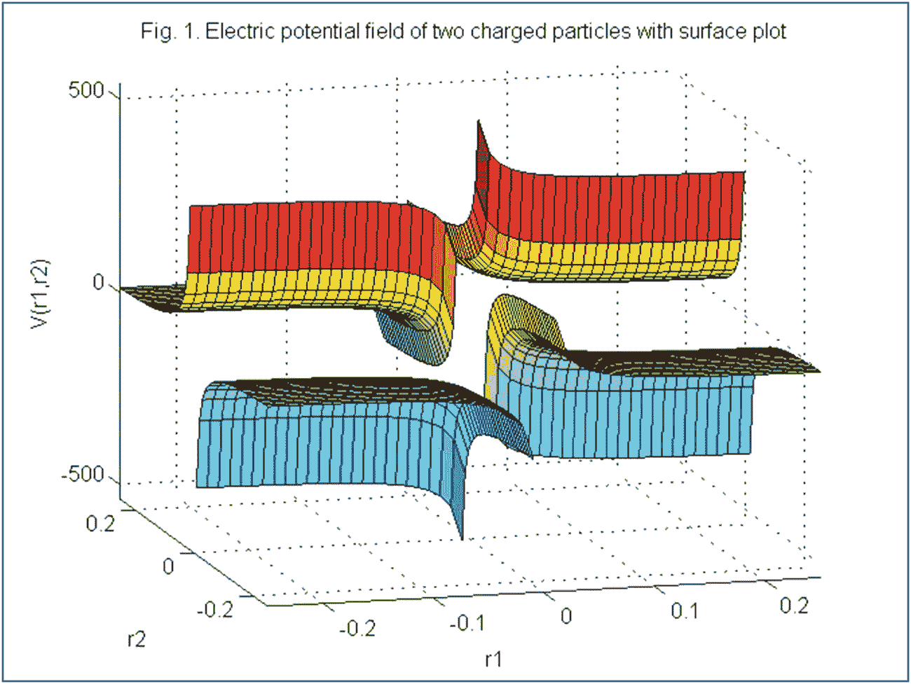
图 6-26：两个带电粒子势场的 3D 曲面图

### 示例 20：使用 `waterfall()` 和 `ribbon()` 创建 3D 图

给定 `G(t, theta) = ln(|cos(0.5*t + 5*theta) + cosh(5*t + 0.5*theta)|)`，其中 `t = -0.2*pi...0.2*pi`；`theta = -0.2*pi...0.2*pi`。

我们定义函数变量为线性间隔的向量（向量空间）或数组，然后根据定义的数组计算其函数值。之后，可以根据计算出的数据创建图表。以下是完整的解决方案脚本（`plot_ex20.m`）。

```matlab
% plot_ex20.m
[t, theta]=meshgrid(linspace(-0.2*pi, 0.2*pi, 50));
G=log(abs(cos(0.5*t+theta*5)+sinh(5*t+0.5*theta)));
figure(1), waterfall(t,theta,G);
xlabel('t 轴'); ylabel('\theta 轴');
zlabel('G(t,\theta) 函数值');
title(['3D 曲面-瀑布图',... 'G(t,\theta)=ln(abs((cos(0.5*t+\theta*5)+sinh(5*t+0.5*\theta)))']);
figure(2)
ribbon(G), title('函数 G(t, \theta) 的 3D 缎带图');
xlabel('t 轴'); ylabel('\theta 轴');
zlabel('G(t,\theta) 函数'); axis vis3d
```

执行脚本（`plot_ex20.m`）后，得到图 6-28 和图 6-29 所示的 `G(t, theta)` 函数图。

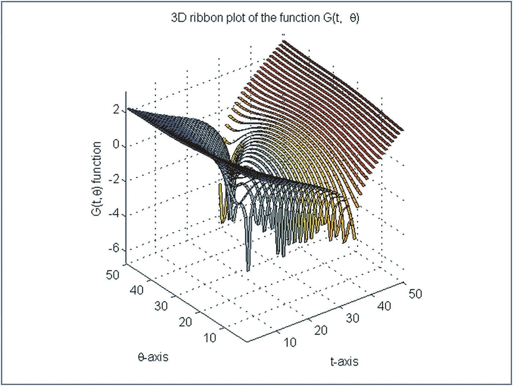
图 6-29：`G(t, theta) = ln(|cos(0.5*t + 5*theta) + cosh(5*t + 0.5*theta)|)` 的 3D 缎带图

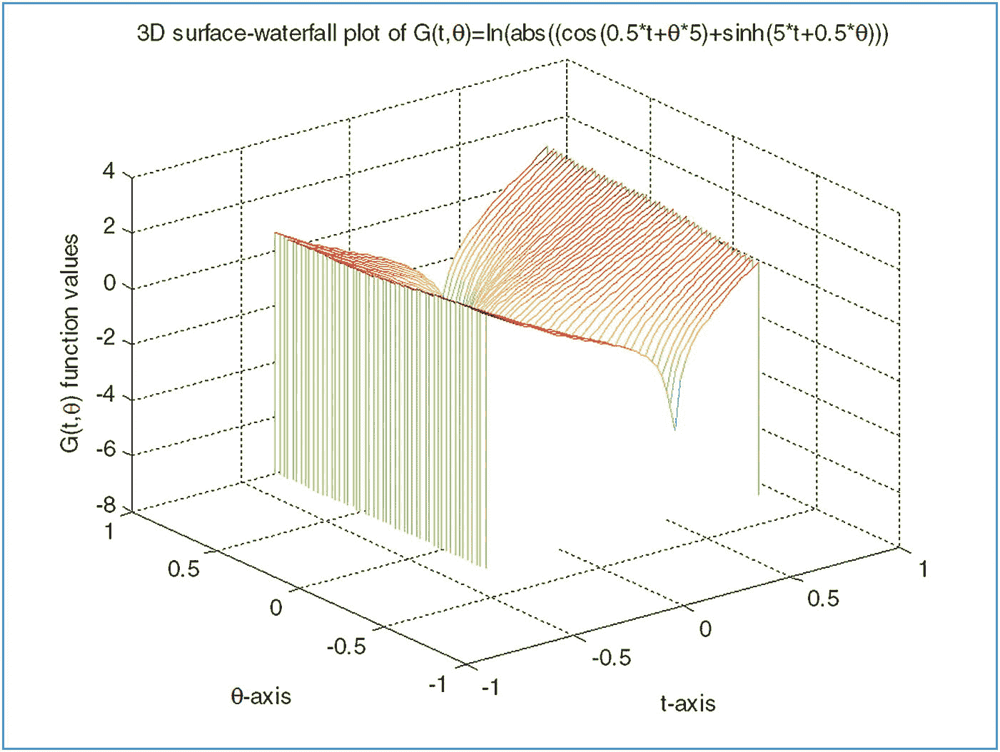
图 6-28：`G(t, theta) = ln(|cos(0.5*t + 5*theta) + cosh(5*t + 0.5*theta)|)` 的 3D 曲面-瀑布图

通过使用 3D 曲面图工具，我们演示了 `mesh`、`surf`（曲面）、`waterfall`、`ezsurf` 和 `ribbon` 绘图函数。除此之外，`contour()`、`image()` 和 `imagec()` 函数也可以类似的方式使用。

## 3D 线图与动画

有几种 3D 空间线图绘制工具（`plot3`、`comet3` 和 `scatter3`），用于绘制向量数据点和空间曲线。给定的向量数据可以嵌入到更高维度的空间中。3D 绘图方法与前面描述的 2D 绘图中使用的绘图工具类似。用于 3D 曲线的绘图函数有 `plot3`、`comet3`、`ezplot3` 和 `scatter3`。它们的实现方式与 2D 绘图函数（如 `plot` 和 `comet`）非常相似。`comet` 和 `comet3` 函数通过动态/动画的方式绘制图形。让我们来看下一个示例。

### 示例 21：使用 `plot3()`、`comet3()` 和 `ezplot3()` 构建 3D 线图与动画 3D 线图

一种名为“螺旋过山车”的流行游乐园设施呈螺旋形。圆形螺旋线的参数方程定义为 `x = a * cos(t)`，`y = a * sin(t)`，`z = b * t`，其中 `a` 是螺旋路径的半径，`b` 是决定路径“紧密程度”的常数。此外，如果 `b > 0`，则螺旋线呈右手螺旋形状。如果 `b < 0`，则螺旋线为左手螺旋。

本示例在以下三种情况下创建螺旋线的三维图，并比较它们的形状。使用 `0 <= t <= 10*pi` 且 `a = 1`。
a) `b = 0.1`； b) `b = 0.2`； c) `b = -0.1`；

```matlab
% plot_ex21.m - 游乐园设施 - 3D 螺旋图
close all
t=0:pi/15:10*pi; a=1; x=a.*cos(t); y=a.*sin(t);
% 情况 (a)
b1=0.1; z1=b1.*t;
% 情况 (b)
b2=0.2; z2=b2.*t;
% 情况 (c)
b3=-0.1; z3=b3.*t;
subplot(311); plot3(x, y, z1, 'r*-'); legend('b_1=0.1')
title('螺旋图：b_1=0.1; b_2=0.2, b_3= -0.1');
subplot(312); plot3(x, y, z2, 'bs-'); legend('b_2=0.2')
subplot(313); plot3(x, y, z3, 'ko--');legend('b_3=-0.1')
xlabel('X'); ylabel('Y'); zlabel('Z');
figure(2); X=[x,x,x]; Y=[y,y,y]; Z=[z1,z2,z3];
comet3(X,Y,Z); % 动画图
%% 使用 ezplot 的备选动画图
figure(3);
ezplot3('cos(t)','sin(t)', '0.1*t', [0,10*pi], 'animate'); hold on
ezplot3('cos(t)', 'sin(t)', '0.2*t', [0, 10*pi], 'animate'),
ezplot3('cos(t)', 'sin(t)', '-0.1*t', [0, 10*pi], 'animate')
```

执行名为 `Amusement3D.m` 的脚本后，得到图 6-30 所示的图形。

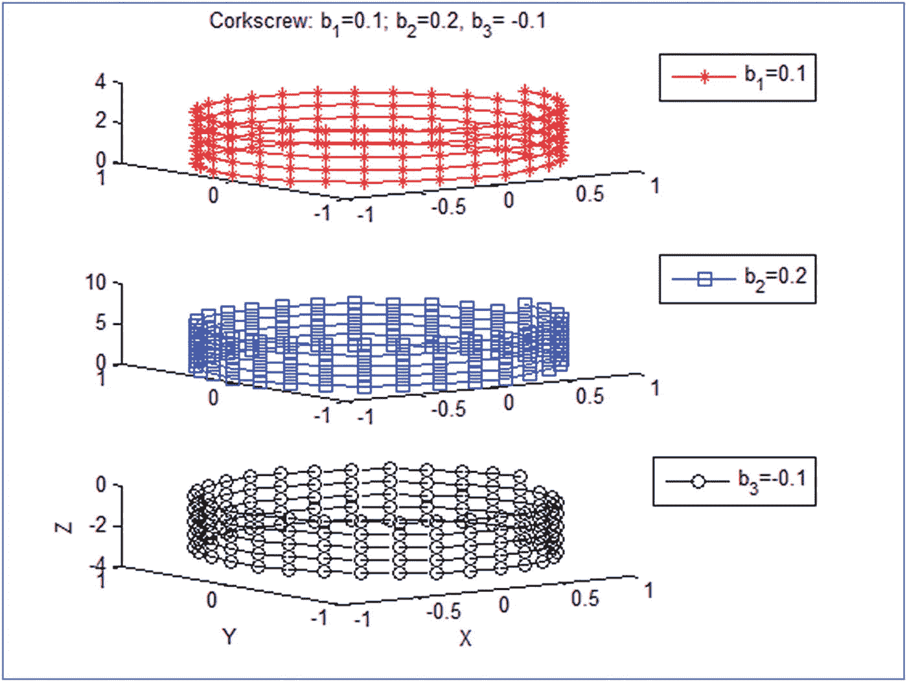
图 6-30：螺旋过山车游乐园设施 `b1 = 0.1`、`b2 = 0.2`、`b3 = -0.1` 的仿真图。

通过使用前面脚本中演示的 3D 参数曲线绘图工具 `comet3` 和 `ezplot3`，我们可以获得螺旋过山车游乐园设施运动状态的仿真。`comet3` 和 `ezplot3 'animate'` 工具用于显示模拟动画图。还有其他 3D 线和曲面绘图工具，包括 `quiver`、`compass`、`feather`、`scatter3`、`stem3` 和 `contour3`。

## 动画图

可以使用两个函数 `getframe` 和 `movie` 为图表制作动画。还有一个名为 `drawnow` 的工具可用于演示此模拟过程。使用这些工具的方法很直接，并且可以与其他绘图工具结合使用。让我们看几个练习来了解如何使用这些函数。

### 示例 22：使用 `getframe()` 构建动画图

给定函数 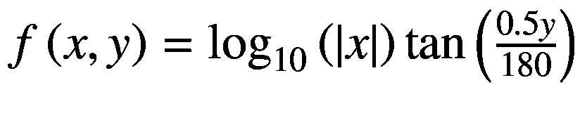，*x* = −13 … 13；*y* = −13…13。

我们使用 `getframe` 和 `movie` 工具，通过以下脚本（`plot_ex22.m`）获得一个动画图。

```matlab
% plot_ex22.m
for m=1:20
[x, y]=meshgrid(linspace(-13, 13, 200));
z=log10(abs(x)).*tan(m*y*pi/180);
mesh(x, y, z)
M(m)=getframe(gcf);
end
title({['3D surface-contour plot of the function' ],...
['f(x, y)=log10(abs(x))tan(0.5*y*\pi/180)']});
xlabel('X-axis'); ylabel('Y-axis');
zlabel('f(x, y) function values');
movie(M,2) % 该绘图影片播放两次
```

### 示例 23：使用 `drawnow` 构建动画图

给定函数 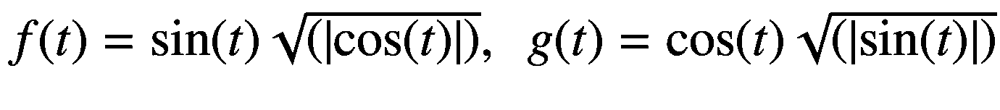，*x* = 0 ... 3π；

对于这个示例，我们使用 `drawnow` 函数并编写以下脚本（`plot_ex23.m`）来获得一个二维动画图。

```matlab
% plot_ex23.m
for t=linspace(-2*pi, 2*pi, 200)
f=sin(t)*sqrt(abs(cos(t)));
g=cos(t)*sqrt(abs(sin(t))); drawnow
plot(t,f, 'o-',t, g, 'mp--')
hold all % 用于显示彩色标记
end
title('Animated plot of the function')
xlabel('X-axis'); ylabel('Y-axis'); legend('f(t)', 'g(t)')
```

`drawnow` 命令与绘图（属性）句柄以及 `refreshdata` 命令配合得非常好。

### 示例 24：使用 `drawnow` 构建动画图

给定函数 *y*(*t*) = *sinc* (*e*^(sin(*kt*)))，*t* = 0…5*π*，*k* = [1, 2]。

```matlab
% plot_ex24.m
t= 0:pi/100:5*pi; y = sinc(exp(sin(t)));
for k = 1:.01:2
y = sinc(exp(sin(t.*k))); H = plot(t,y);H.LineStyle = ':';
H.Color = [1 0 1];
set(H, 'marker','o');
set(H, 'markerfacecolor', [0 1 1]);
set(H, 'markersize', 13);
refreshdata(H,'caller')
drawnow; pause(.005), shg
end
```

### 示例 25：使用 `getframe()` 构建抛射体动画图

以速度 `v0` 和水平夹角 `θ` 发射的抛射体（如投掷的球）的高度和速度由以下公式给出：

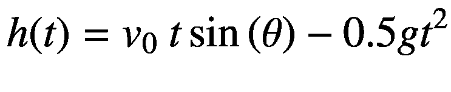

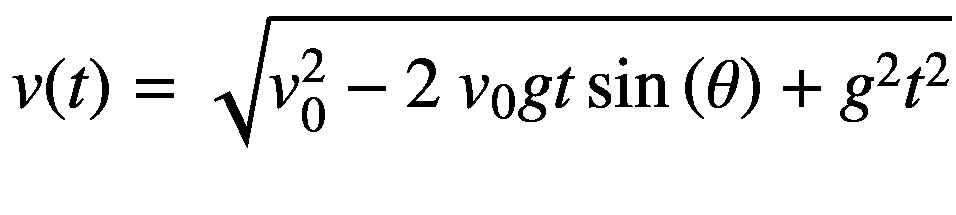

其中 `g` 是重力加速度。当 `h(t)` = 0 时，抛射体将击中地面，由此得出击中时间 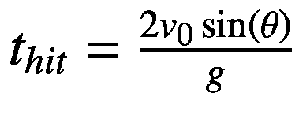。假设 `θ` = 30⁰，`v0` = 40 `m`/`s`，`g` = 9.81 `m`/`s`²。让我们通过选择足够小的时间步长，使用 `getframe` (`movie`) 和 `drawnow` 来制作球的轨迹动画。

以下是解决方案脚本（`plot_ex25.m`）。

```matlab
% plot_ex25.m
% 研究抛射体轨迹和速度
clearvars; clc; close all
% 给定数据：
g=9.8;      % 地球重力加速度，单位 m/s²
theta=30;   % 与水平轴的夹角，单位 度
v0=40;      % 投掷球的速度，单位 m/s
% t_hit 是投掷的球落地所需的时间。
% h 是投掷的球相对于地面的高度，单位 m。
% v 是投掷的球随时间变化的速度。
% t 是用于计算的时间序列，单位 [秒]。
% dt 是总时间的增量。
t_hit=2*v0*sin(theta*pi/180)/g;
dt=t_hit/80; t=(0:dt:t_hit);
h=v0*t.*sin(theta*pi/180) - 0.5*g*t.²;
v=sqrt(v0*v0-2*v0*g*t.*sin(theta*pi/180)+g*g*t.²);
%% 抛射体的动画图
dt=t_hit/100; t=(0:dt:t_hit);
for ii=1:length(t)
h(ii)=v0*t(ii).*sin(theta*pi/180) - 0.5*g*t(ii).²;
plot(t(ii), h(ii), 'o:', 'markerfacecolor', 'y')
hold all
M(ii)=getframe(gcf);
end
% movie(M, 1)
%% 抛射体速度的动画图
for ii=1:length(t)
v(ii)=sqrt(v0²-2*v0*g*t(ii).*sin(theta*pi/180)+g²*t(ii).²);
drawnow
plot(t(ii), v(ii), 'o:', 'markerfacecolor', 'c'), hold all
end
```

## 本章小结

在本章中，我们讨论了一些基本的绘图工具和函数。特别地，我们通过示例演示了如何使用以下绘图命令和函数：

- 二维绘图命令：
    - `plot`、`plotyy`、`semilogx`、`semilogy`、`loglog`、`hist`、`title`、`axis`、`legend`、`grid`、`xlabel`、`ylabel`、`fplot`、`ezplot`、`xlim` 和 `ylim`
- 三维绘图命令：
    - `ezsurf`、`surface`、`meshc`、`meshgrid`、`ribbon`、`waterfall`、`plot3`、`comet3`、`colormap`、`view` 和 `zlabel`
- 其他与绘图相关的命令：
    - `subplot`、`close all`、`axis`、`axis vis3d`、`set`、`gcf`、`grid`、`hold`、`legend`、`clf`、`figure`、`title`、`text`、`gtext` 和 `ginput`
- 动画绘图命令：
    - `getframe`、`movie`、`refreshdata` 和 `drawnow`

以下是绘图时最常见的几个错误：

- 绘制测量或计算数据时最常见的错误之一是，我们试图绘制两个大小不同的数据集（例如，作为输入与输出）。由于数据点不匹配，无法获得图形。因此，在绘制 x vs. y 图时，需要注意数据集的大小。
- 我们有时会混淆或没有正确分配图例，结果从绘制的数据集中得到错误的信息。
- 当处理由多行多列数据组成的大型数据集时，我们有时会混淆行和列。
- 有时我们试图绘制复数；然而，除非我们单独绘制，否则 MATLAB 只绘制复数的实部。

## 自测练习

### 练习 1

绘制 `y` = −3 … 2 范围内的多项式 `y` vs. `f(y)`。

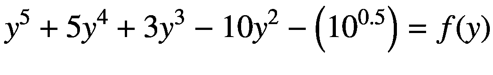

1. 以 2.0 宽度的洋红色实线（样式）绘制 `y` vs. `f(y)`，并使用黄色的矩形标记。
2. 添加图标题：‘`y`⁵ + 5`y`⁴ + 3`y`³ − 10`y`² − (10^(0.5)) = `f(y)`’、坐标轴标签和网格。
3. 使用 `ginput` 定位 `f[min]`。
4. 在绘图区域添加文本 (`f[min]` =) 及步骤 3 中的值。

### 练习 2

使用 `fplot` 函数绘制练习 1 中给出的多项式：

1. 使用 `ginput` 找到多项式的最小值。
2. 分别用蓝色和红色的菱形和圆形标记绘制找到的值（最小值）。

### 练习 3

给定 `f1(y)` = `y`⁵ + 5`y`⁴ + 3`y`³ − 10`y`² − 10^(0.5)

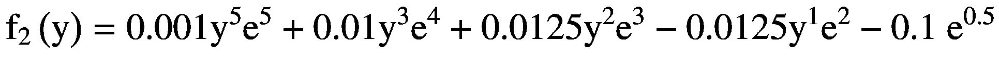

1. 在 −3 ≤ `y` ≤ 2 范围内，使用 `fplot` 和 `plot` 函数在一个绘图区域中绘制两个函数 `f1(y)` 和 `f2(y)`。比较两种方法的结果。插入所有必要的信息（如图标题、坐标轴标签、网格、线宽、标记类型、颜色等）使图形清晰易读并便于分析。
2. 在 −1 ≤ `y` ≤ 1 范围内，使用 `plotyy` 或 `yaxis` 右/左，在一个绘图区域中绘制这两个函数：`y` vs. `f1` 和 `y` vs. `f2`，以便 `f1(y)` 和 `f2` 位于两个独立的纵轴上。
3. 使用 `ginput` 定位步骤 2 中绘制的 `f1(y)` 和 `f2` 函数的局部最小值。
4. 将步骤 3 中找到的局部最小值绘制在步骤 2 的图中。

### 练习 4

一根长度为 `C` 的缆绳支撑着一根长度为 `B` 的横梁，使得当重量 `W` 挂在横梁末端时，横梁保持水平。缆绳中的张力 `T` 由公式 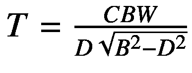 给出，其中 `D` 是缆绳附着点到横梁支点的距离。

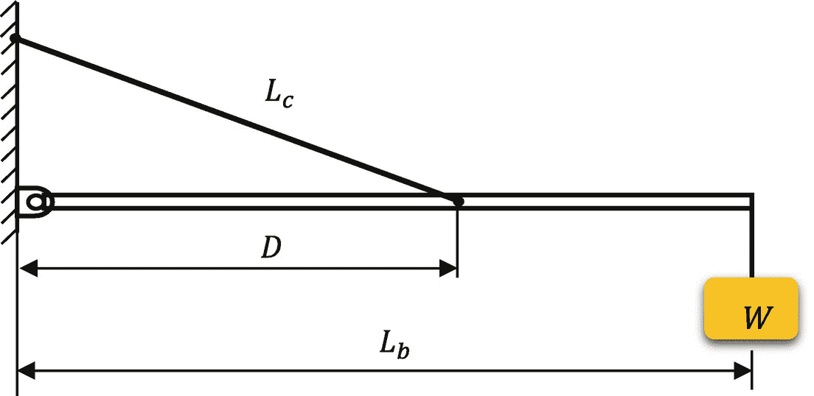

1.  使用 `W` = 777 `N`, `B` = 2.33 `m`, 和 `C` = 3.77 `m` 的元素运算以及函数 `min()` (提示：`min(X, Y)`) 来计算使张力值最小的 `D` 值。
2.  通过绘制 `T` 与 `D` 的关系图来检查解的敏感性。在张力 `T` 比其最小值增加 13% 之前，`D` 可以偏离其最优值多少？

### 练习 5

1.  使用 MATLAB 求解以下方程组，将 `x`、`y` 和 `z` 表示为参数 `c` 的函数：
   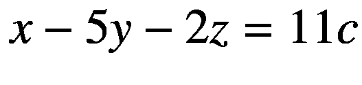
   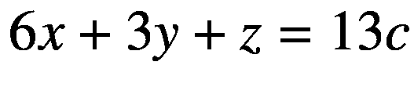
   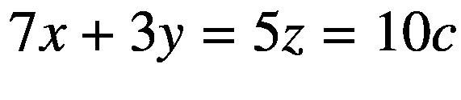
2.  在同一张图上绘制 `x`、`y` 和 `z` 关于 `c` 的解曲线，其中 −10 ≤ `c` ≤ 10。注意 `c` 的增量变化为 1。

### 练习 6

在区间 −6 ≤ `x` ≤ 13 上绘制以下两个多项式。
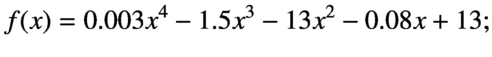
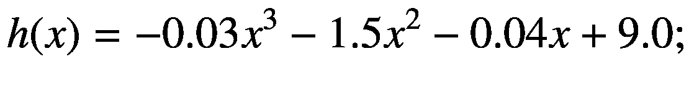

1.  在单独的图中绘制 `f(x)` 与 `x` 的关系图，并在图上添加网格。
2.  使用 `ginput` 函数，确定曲线峰值的坐标，并使用 `text` 和 `gtext` 添加此信息。

### 练习 7

计算以下公式：`h(α) = sin(α)/α`，其中 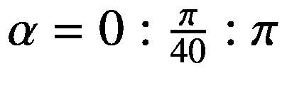。从以下公式计算 `π` 的值——(a) 由斯里尼瓦萨·拉马努金在 1910 年提出，(b) 由 Borwein-Plouffe 在 1995 年提出：

![$$ \pi =\sum \limits_{k=0}^n\frac{1}{16^k}\left[\frac{4}{8k+1}-\frac{2}{8k+4}-\frac{1}{8k+5}-\frac{1}{8k+6}\right]\kern1.5em (b) $$](images/471979_1_En_6_Chapter/471979_1_En_6_Chapter_TeX_Equq.png)

1.  对于 `m` = 100，从 (a) 计算 `π`，绘制 `α` 与 `h(α)` 的关系图。
2.  对于 `n` = 10，从 (b) 计算 `π`，绘制 `α` 与 `h(α)` 的关系图。
3.  使用 `drawnow` 和 `getframe + movie` 构建步骤 1 和 2 的动画图。

### 练习 8

锥形纸杯的体积 `V` 和纸张表面积 `A` 由下式给出：
 和 
其中 `r` 是圆锥底部的半径，`h` 是圆锥的高度。

1.  通过消去 `h`，得到用 `r` 和 `V` 表示 `A` 的表达式。
2.  创建一个用户自定义函数，该函数接受 `r` 作为唯一参数，并为给定的 `V` 值计算 `A`。在函数内将 `V` 声明为全局变量。

### 练习 9

圆环体形状像一个甜甜圈。如果其内半径为 `a`，外半径为 `b`，则其体积和表面积由下式给出：


1.  创建一个用户自定义函数，该函数从参数 `a` 和 `b` 计算 `V` 和 `A`。
2.  假设外半径被限制为比内半径大 2 英寸。编写一个脚本文件，使用你的函数绘制在 0.25 ≤ `a` ≤ 4 [*英寸*] 区间内 `V` 和 `A` 关于 `a` 的变化图。

### 练习 10

创建四个匿名函数来表示函数 ，该函数由函数 `h(z) = 6e^z`、`g(y) = 3 cos y` 和 `f(x) = x²` 组成。使用 `fplot` 在 0 ≤ `x` ≤ 4 的范围内绘制 。

### 练习 11

为函数 `20x² − 200x + 3` 创建一个匿名函数，并使用它绘制该函数，以便使用 `ginput` 确定其最小值的大致位置。

### 练习 12

通过使用 `fplot` 绘制方程并使用 `ginput`，找到方程  的近似根。

### 练习 13

为了计算结构中的力，有时我们必须求解类似于下面的方程。使用 `fplot` 函数找到该方程的所有正根：`x tan x = 7`。

### 练习 14

缆绳用于悬吊桥面和其他结构。如果一根沉重的均匀缆绳悬挂在其两个端点之间，它会呈现悬链线的形状，其方程为 。其中 `a` 是链上最低点相对于某条水平参考线的高度，`x` 是从最低点向右测量的水平坐标，`y` 是从参考线向上测量的垂直坐标。

1.  取 `a` = 10 `m`，绘制在 −20 ≤ `x` ≤ 30 [`m`] 区间内的悬链线。每个端点有多高？
2.  取 `a` = 10 到 20，增量为 1 m，使用循环控制语句和自动标注工具（带字符串）绘制在 −20 ≤ `x` ≤ 30 [`m`] 区间内绘制的数据点，以生成悬链线曲线。
3.  使用 `drawnow` 构建步骤 2 计算结果的动画图。

### 练习 15

当皮带缠绕在圆柱体上时，圆柱体两侧皮带力之间的关系如下：

其中 `β` 是皮带的包角，`μ` 是摩擦系数。编写一个脚本文件，首先提示用户指定 `β`、`μ` 和 `F[2]`，然后计算力 `F[1]`。用 `β` = 130°、`μ` = 0.3 和 `F[2]` = 100 `N` 的值测试你的程序。输出的力 (`F[1]`) 必须在命令窗口中以 `N` 为单位输出。（提示：注意 `β` 的单位！）

1.  对于 `β` = 30°…360°，绘制 `F[1]` 与 `β` 的关系图，使用 30 个线性间隔的数据点。
2.  添加图标题、轴标签、标记类型（青色五角星）和标记大小 (8.0)，并将线宽设置为 1.50。
3.  在绘图区域添加文本“`F[1]` 依赖于包角 `β`!”，字体大小为 13。
4.  对于 `β` = 30°…360°（100 个线性间隔的数据点）、`μ` = 0.1..0.3 和 `F[2]` = 100 `N`，构建输出力 (`F[1]`) 的动画图。

### 练习 16

利用降雨、蒸发和水消耗的估算值，城镇工程师开发了以下水库水体积随时间变化的模型。

其中 `V` 是水体积（升），`t` 是时间（天）。绘制 `V(t)` 与 `t` 的关系图。使用该图估算需要多少天，水库中的水体积才会降至其初始体积 10⁹ *升* 的 50%。

### 练习 17

绘制以下矩阵 `A` 的第二列和第三列相对于第一列的图形。第一列的数据是时间（秒）。第二列和第三列的数据是以 `N` 为单位的力。使用矩阵轴线模式以相反顺序显示 y 轴的值。

![$$ A=\left[\begin{array}{c}\begin{array}{ccc}0&amp; -8&amp; 6\\ {}5&amp; -4&amp; 3\\ {}10&amp; -1&amp; 1\end{array}\\ {}\begin{array}{ccc}15&amp; 1&amp; 0\\ {}20&amp; 2&amp; -1\end{array}\end{array}\right] $$](images/471979_1_En_6_Chapter/471979_1_En_6_Chapter_TeX_Equv.png)

### 练习 18

在某些结构振动中，作用在结构上的周期性力会导致振动幅度随时间反复增加或减少。这种被称为*拍频*的现象也出现在音乐声中。特定结构的位移由下式描述：

![$$ y(t)=\frac{1}{f_1²-{f}_2²}\ \left[\cos \left({f}_2t\right)-\cos \left({f}_1t\right)\right] $$](images/471979_1_En_6_Chapter/471979_1_En_6_Chapter_TeX_Equw.png)

其中 `y` 是以英寸为单位的位移，`t` 是以秒为单位的时间。在范围 0 ≤ `t` ≤ 11`π` 内，针对 `f₁ = 13 rad/sec` 和 `f₂ = 1.5 rad/sec`，绘制 `y` 相对于 `t` 的图形。确保选择足够的点以获得该过程的精确图形。

### 练习 19

一个机器人以每分钟两转的速度绕其底座旋转，同时降低其手臂并伸展其手。它降低手臂的速度为每分钟 120°，伸展手的速度为每分钟 5 m。手臂长 0.5 [`m`]。手的 `xyz` 坐标由下式给出：


其中 `t` 是以分钟为单位的时间。

1.  在 0 ≤ `t` ≤ 0.2 [`min`] 范围内，获取手部轨迹的三维图。
2.  使用 `comet3` 和 `drawnow` 模拟手臂的轨迹，并分析哪种工具能实现更好的可视化效果。

### 练习 20

获取函数 `z = x² + 2xy + 3y²` 的曲面图和等高线图。该曲面呈马鞍形。在其位于 `x = y = 0` 的鞍点处，曲面斜率为零，但该点既不对应于最小值也不对应于最大值。哪些类型的等高线与鞍点相对应？

### 练习 21

以下函数描述了一些机械结构和电路中的振荡：


在此函数中，`t` 是时间，`ω` 是以弧度每单位时间为单位的振荡频率。振荡周期为 `2π/ω`，其振幅随时间以由 `τ` 决定的速率衰减，`τ` 被称为*时间常数*。`τ` 越小，振荡消失得越快。

假设 `φ = 0`，`ω = 2.5`，并且 `τ` 的取值范围为 0.5 ≤ `τ` ≤ 10 秒。则上述方程变为：


通过 `waterfall` 获取该函数的曲面图，并通过 `contour` 获取等高线图，以帮助可视化 `τ` 的影响，时间范围为 0.5 ≤ `t` ≤ 10 秒。使用函数名称 `z(t, τ)` 标注坐标轴，变量名称分别为 `t` 和 `τ`。

### 练习 22

以下方程描述了扁平矩形金属板中的温度分布。三边的温度保持恒定在 `T₁`，而第四边的温度为 `T₂`（参见下图）。温度 `T(x, y)` 作为所示 *xy* 坐标的函数由下式给出：


其中


本题给定的数据为 `T₁ = 22°C`，`T₂ = 75°C`，`W = L = 3` [`m`]。

使用 `x` 和 `y` 的间距为 0.05，生成温度分布的曲面网格图和等高线图。


### 练习 23

给定一个函数 `f(x, y) = log₁₀(|x|) * tan(0.5y/180)`，`x = -13…13`；`y = -13…13`；

使用 `meshc` 和 `ribbon` 生成 `f(x, y)` 的三维图。

### 练习 24

给定一个函数 `H(θ, φ) = log₁₀(|θ|) * tan(0.5φ)`，`θ = -π…π`；`φ = -π…π`；

1.  在两个子图中分别使用三维 `surface` 和 `waterfall` 绘图函数绘制给定的函数 `H(θ, φ)`。
2.  构建 `H(θ, φ) = log₁₀(|θ|) * tan(a * φ)` 的三维动画图，其中 `θ = -π…π`；`φ = -π…π`；`a = -1.5..1.5`。

### 练习 25

给定以下函数 `h1 = cos(2t)`；`h2 = sin(3t)`；`h3 = cosh(t/10)`；`t = 0…8π`；`Δt = π/10`。

1.  使用 `plot3` 和 `comet3` 绘制给定的函数。
2.  使用 `getframe` 和 `movie` 构建给定函数的动画图。
3.  使用 `drawnow` 构建给定函数的动画图。

