# 7. 线性代数

本章包括对线性代数的简要介绍。它讨论了求解线性方程组的一些基本方法，以及各种矩阵运算（矩阵求逆、行列式、求和、减法、除法、乘法、幂、指数、逐元素和逐数组运算等）。它涵盖了特征值问题和矩阵分解/因式分解，例如 Cholesky、Schur、LU、QR 和奇异值分解。本章还包括 MATLAB 和 Simulink 模型中的内置函数和脚本。此外，本章通过 MATLAB 和 Simulink 中的示例，解释了 MATLAB 的标准矩阵生成函数、创建向量空间、求解多项式以及矩阵的逻辑索引。

## 线性代数导论

线性代数是数学中较为重要的分支之一。它研究向量、向量空间、线性空间、矩阵以及线性方程组。线性代数在工程与科学计算中有着广泛的应用，涵盖自然与社会研究的众多领域。线性代数从不欠定、过定和适定线性方程组开始。对于一个由 `m` 个线性方程和 `n` 个未知数组成的系统，若 `m` ≥ `n`，则该系统可解。考虑以下由方程组（公式 7.1）表述的线性系统。


（公式 7.1）

当 `m` ≥ `n` 时，线性方程组（公式 7.1）在所有情况下均可直接求解。若 `m` < `n`，未知数的数量多于线性无关方程的数量，这样的系统称为欠定系统，无法直接求解。若 `m` > `n`，线性无关方程的数量更多，这样的系统称为过定系统，可以直接求解。

为简便起见，我们取 `m` = `n`，并将公式 7.1 重写为：


（公式 7.2）

公式 7.2 中的线性方程组也可以用矩阵符号形式表示。

![$$ \left[A\right]\ast \left\{X\right\}=\left[B\right] $$](images/471979_1_En_7_Chapter/471979_1_En_7_Chapter_TeX_Equ3.png)

（公式 7.3）

其中：

![$$ \left[A\right]=\left[\begin{array}{ccc}{a}_{11}&amp; \dots &amp; {a}_{1n}\\ {}:&amp; \dots &amp; :\\ {}{a}_{n1}&amp; \dots &amp; {a}_{nn}\end{array}\right] $$](images/471979_1_En_7_Chapter/471979_1_En_7_Chapter_TeX_IEq1.png), ![$$ \left[B\right]=\left[\begin{array}{c}{b}_1\\ {}:\\ {}{b}_n\end{array}\right] $$](images/471979_1_En_7_Chapter/471979_1_En_7_Chapter_TeX_IEq2.png), `X` = `x[1] ... x[n]`。

公式 7.3 也可以改写为列矩阵的形式：

![$$ {x}_1\left[\begin{array}{c}{A}_1\\ {}\vdots \\ {}{A}_{n1}\end{array}\right]+\dots +{x}_n\left[\begin{array}{c}{A}_{1n}\\ {}\vdots \\ {}{A}_{nn}\end{array}\right]=\left[\begin{array}{c}{b}_1\\ {}\vdots \\ {}{b}_n\end{array}\right] $$](images/471979_1_En_7_Chapter/471979_1_En_7_Chapter_TeX_Equ4.png)

（公式 7.4）

其中 `A` 和 `B` 是矩阵，`X` 是未知数向量。

公式 7.3 中关于 `X`（未知数）的系统可通过以下公式求解。

![$$ \left\{X\right\}={\left[A\right]}^{-1}\ast \left[B\right] $$](images/471979_1_En_7_Chapter/471979_1_En_7_Chapter_TeX_Equ5.png)

（公式 7.5）

其中 `[A]^(−1)` 是矩阵 `[A]` 的逆。

## 矩阵属性与运算

矩阵具有多个重要属性和运算，例如行列式、对角线、转置、逆、奇异性、秩等。

矩阵的*行列式*只能在给定矩阵为方阵时计算。例如：

![$$ M=\left[\begin{array}{ccc}a&amp; b&amp; c\\ {}d&amp; e&amp; f\\ {}g&amp; h&amp; i\end{array}\right] $$](images/471979_1_En_7_Chapter/471979_1_En_7_Chapter_TeX_Equa.png)

矩阵 `M` 的行列式将通过以下表达式计算：

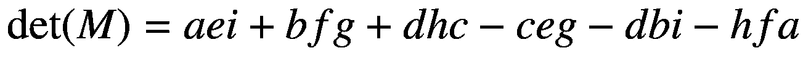

用于行列式计算的 MATLAB 命令是 `det()`。例如：

```
>> A =[      8     1     6;      3     5     7;      4     9     2]
A =
8     1     6
3     5     7
4     9     2
>> det(A)
ans =
```

矩阵的*对角线*由其沿对角线的元素组成。例如，在前例中，对角线元素为 `aei` 和 `ceg`。

用于对角线提取的 MATLAB 命令是 `diag()`。例如：

```
>> A =[      8     1     6;      3     5     7;      4     9     2];
>> diag(A)
ans =
```

矩阵的*转置*可通过将矩阵逆时针旋转 90° 来确定。转置性质如下：

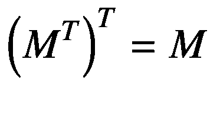

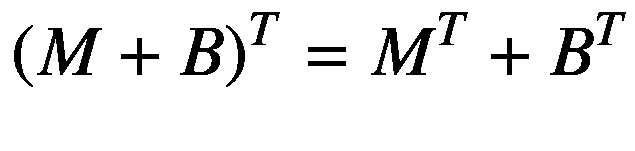

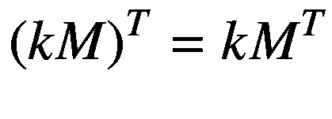

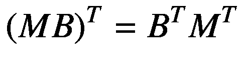

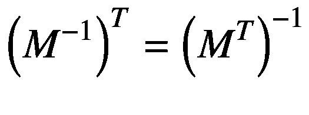

其中 `M` 和 `B` 是大小相同的矩阵，`k` 是标量，`^T` 和 `^-1` 分别是转置和逆运算。

用于转置操作的 MATLAB 命令是 `transpose()` 和 `'`。例如：

```
>> A =[      8     1     6;      3     5     7;      4     9     2];
>> transpose(A)
ans =
8     3     4
1     5     9
6     7     2
>> A'
ans =
8     3     4
1     5     9
6     7     2
```

### 用于矩阵行列式、对角线提取和转置的 Simulink 模块

Simulink 提供了可用于计算矩阵行列式、提取矩阵对角线元素以及获取矩阵转置的模块。行列式模块（`[det(A) (3x3)]`）存在于 Simulink 的 Aerospace Blockset/Utilities/Math Operations 中，它有一个约束条件：只能计算 3×3 矩阵的行列式。

### 注意

注意 Aerospace Blockset 中的 `[det(A) (3x3)]` 模块是有限制的；它只能计算 3x3 矩阵的行列式。

用于提取矩阵对角元素的模块位于 DSP System Toolbox/Math Functions/Matrices and Linear Algebra/Matrix Operations 中。用于计算矩阵转置的模块位于 Simulink/Math Operations 中，模块名称为 `Math Function`。该模块内嵌了多种数学函数，包括 `exp`（默认）、`log`、`10^u`、`magnitude²`、`square`、`pow` 和 `transpose`。可以在 `Math Function` 模块中选择任意一种数学函数。只需点击模块的 `Apply` 和 `OK` 按钮，所选的数学函数即可生效。这三个模块如图 7-1 所示。

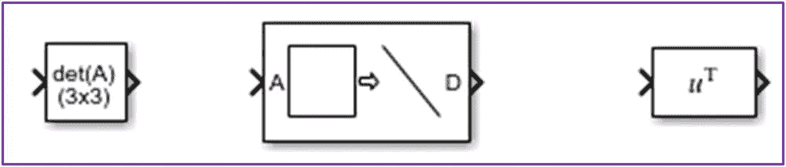

*图 7-1*

*用于行列式计算、对角元素提取和转置运算的 Simulink 模块，从左到右*

这些模块都只有一个输入端口和一个输出端口。因此，我们需要添加另外两个模块：一个用于输入数据的 `Constant` 模块，以及一个用于获取/查看计算结果的 `Display` 模块。`Constant` 模块可以从 Simulink 库的 Simulink/Sources 或 DSP System Toolbox/Sources 中获取。类似地，`Display` 模块可以从 Simulink/Sinks 或 DSP System Toolbox/Sinks 中获取。或者，从 2018a 版本开始的 MATLAB 最新版本中，你可以通过双击（鼠标左键）并在搜索框中输入模块名称来获取所有必要的模块。正如前几章所述，在任何 Simulink 模型中，一个信号源可以根据需要多次使用。无需为了将其作为输入信号用于其他模块而在一个模型中重复生成该信号。此外，为了优化 Simulink 模型，强烈建议您构建模块数量较少的 Simulink 模型，以使模型更具可读性、更全面且易于编辑。因此，本示例使用一个 `Constant` 模块作为输入源 `[A]`。图 7-2 显示了 Simulink 模型的初始版本。

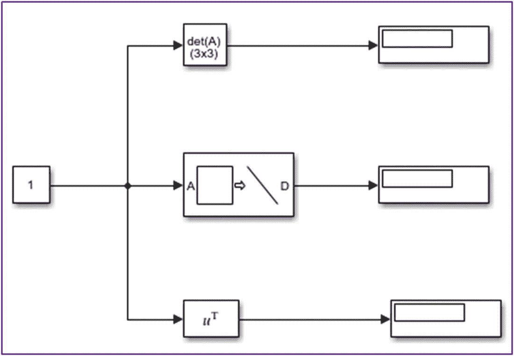

*图 7-2*

*用于计算矩阵行列式、提取矩阵对角元素和对矩阵进行转置的 Simulink 模型*

让我们使用示例矩阵 `[A]` 来演示这三个 Simulink 模块。矩阵 `[A]` 的元素可以通过两种不同的方式输入：
*   在 `Constant` 模块的 `Constant Value` 框中直接输入所有元素，如图 7-3 所示。然后点击 `Apply` 和 `OK` 按钮。

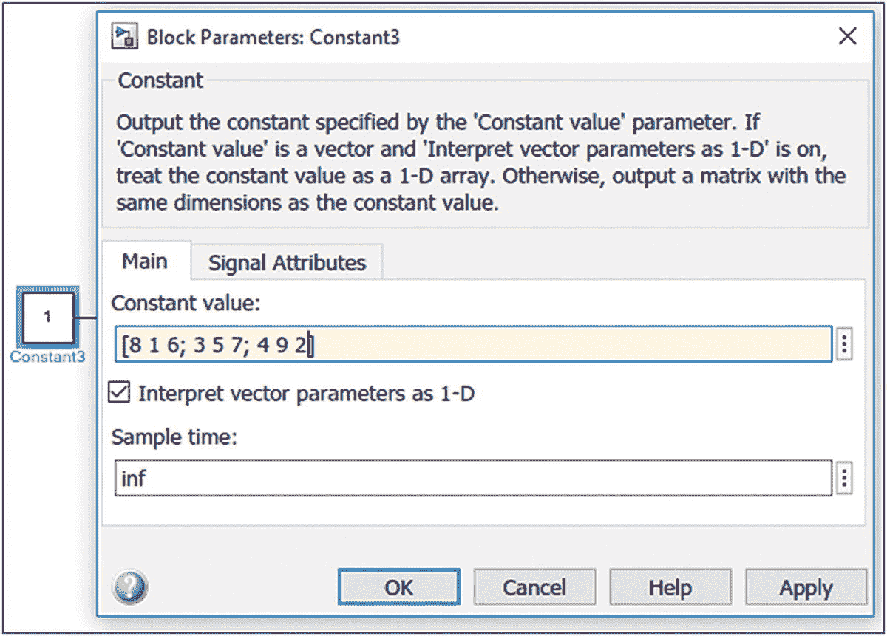

*图 7-3*

*在 `Constant` 模块中输入矩阵元素*

*   通过 MATLAB 的命令行窗口和工作区定义 `[A]`：
```
>> A =[ 8  1  6;  3  5  7; 4  9  2];
```
然后，在 `Constant` 模块的 `Constant Value` 框中为 `[A]` 提供变量名 `A`，如图 7-4 所示。

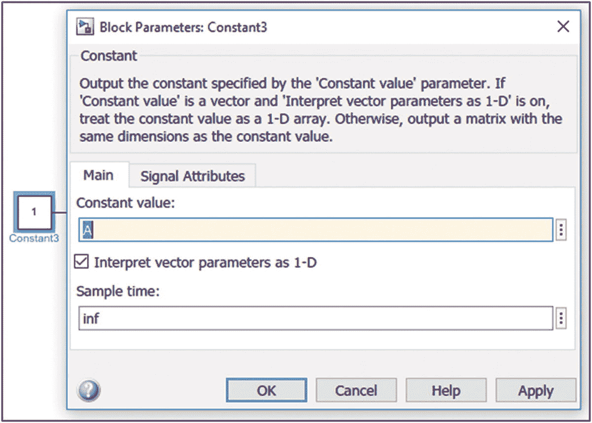

*图 7-4*

*在 MATLAB 工作区中定义的矩阵 `[A]`，通过 `Constant` 模块调用*

然后点击 `Apply` 和 `OK` 按钮。请注意，在本示例中我们不打算使用第二种方法（见图 7-4）来定义矩阵 `[A]` 的元素；此处展示仅用于说明目的。

最后，你将得到完整的模型，其中矩阵 `[A]` 的元素是直接在图 7-3 所示的 `Constant` 模块中输入的。完成模型后，通过按键盘上的 `Ctrl+T` 或点击 Simulink 模型窗口中的 `Run`  按钮，将创建包含计算结果的完整模型。

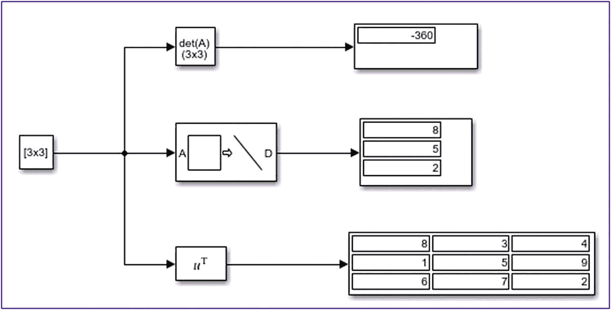

*图 7-5*

*对 3x3 矩阵进行行列式计算、对角元素提取和转置运算的完整 Simulink 模型*

### 注意

要在 `Display` 模块中看到仿真结果，需要调整/拉伸其大小。用鼠标左键点击它，然后按住鼠标按钮进行拖动。

Simulink 模型的仿真结果与 MATLAB 命令（如 `det()`、`diag()` 和 `transpose()`）的结果一致。

### 矩阵的逆 (Matrix Inverse or Inverse Matrix)

*逆矩阵* 具有以下重要性质：

![$$ \left[A\right]\ast {\left[A\right]}^{-1}=\left[I\right] $$](images/471979_1_En_7_Chapter/471979_1_En_7_Chapter_TeX_Equh.png)

其中 `[I]` 是单位矩阵。

例如，![$$ A=\left[\begin{array}{cc}1&amp; 1\\ {}3&amp; 4\end{array}\right] $$](images/471979_1_En_7_Chapter/471979_1_En_7_Chapter_TeX_IEq3.png) 的逆矩阵是 ![$$ {A}^{-1}=\left[\begin{array}{cc}4&amp; -1\\ {}-3&amp; 1\end{array}\right] $$](images/471979_1_En_7_Chapter/471979_1_En_7_Chapter_TeX_IEq4.png)，其计算过程如下：

![$$ {A}^{-1}=\frac{1}{\det (A)}\ adjugate(A)=\frac{1}{4\ast 1-\left(-1\ast \left(-3\right)\right)}\ast \left[\begin{array}{cc}4&amp; -1\\ {}-3&amp; 1\end{array}\right]=\left[\begin{array}{cc}4&amp; -1\\ {}-3&amp; 1\end{array}\right]. $$](images/471979_1_En_7_Chapter/471979_1_En_7_Chapter_TeX_Equi.png)

用于计算矩阵逆的 MATLAB 命令是 `inv()`。例如：

```
>> A =[      8     1     6;      3     5     7;      4     9     2];
>> inv(A)
ans =
0.1472   -0.1444    0.0639
-0.0611    0.0222    0.1056
-0.0194    0.1889   -0.1028
```

如果一个方阵没有逆矩阵，并且其行列式为 `0`，则该矩阵是*奇异的*。

### 用于求逆矩阵的 Simulink 模块 (Simulink Blocks for Inverse Matrix)

*矩阵求逆* 也可以通过多个 Simulink 模块根据给定的矩阵大小（即方阵或矩形阵）进行计算。求逆矩阵或矩阵逆计算的模块存在于 Simulink 的 DSP System 和 Aerospace Blockset 工具箱中，可以通过 Simulink 库访问：DSP System Toolbox/Math Functions/Matrices and Linear Algebra/Matrix Inverses 和 Aerospace Blockset/Utilities/Math Operations。让我们测试一下这个工具箱中用于计算上一示例中矩阵 `[A]` 的逆的可用模块。打开一个空白的 Simulink 模型，并从图 7-6 所示的 DSP System 和 Aerospace Blockset 工具箱的库中拖放模块。

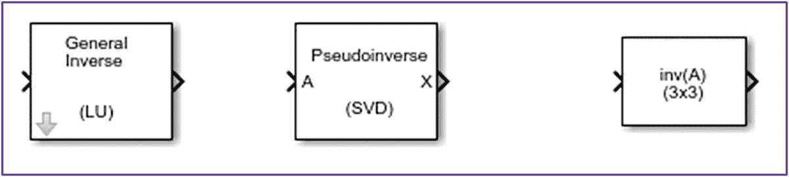

*图 7-6*

*用于计算逆矩阵的 Simulink 模块*

这些模块如每个模块顶部所示——`General Inverse (LU)`、`Pseudoinverse (SVD)` 和 `inv(A)`——分别用于基于 LU 分解计算方阵的逆，以及基于 SVD 计算矩形矩阵（即 `m > n`，或行数大于列数，反之亦然）的伪逆。关于 LU、SVD 以及其他矩阵分解和变换操作的理论方面，将在“矩阵分解”小节中详细介绍。

### 说明

Aerospace Blockset 中的 `[inv(A) (3x3)]` 模块规模有限，只能计算 3×3 矩阵的逆矩阵。

这三个模块各有一个用于输入矩阵的输入端口和一个用于输出计算结果的输出端口。请按照步骤操作，添加两个额外的模块——一个 Constant 模块和一个 Display 模块。图 7-7 显示了 Simulink 模型的初始版本。

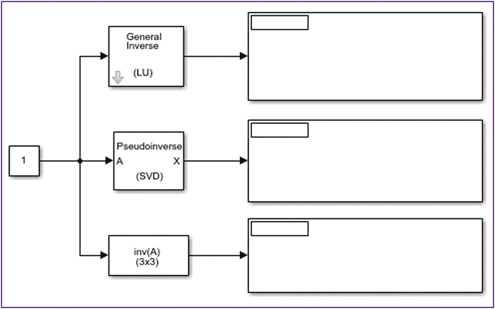

**图 7-7** 通过三个不同的模块计算逆矩阵的 Simulink 模型

矩阵 `[A]` 的元素可以通过两种方式输入：(1) 在 Constant 模块的 Constant Value 框中输入所有元素，然后点击 Apply 和 OK 按钮；或 (2) 通过 MATLAB 的命令窗口和工作区定义 `[A]`。

最后，你将得到以下完整模型，其中矩阵 `[A]` 的元素直接输入在 Constant 模块中。完成模型后，按下键盘上的 `Ctrl+T` 或点击 Simulink 模型窗口中的 Run  按钮，即可生成带有计算结果的最终模型，如图 7-8 所示。

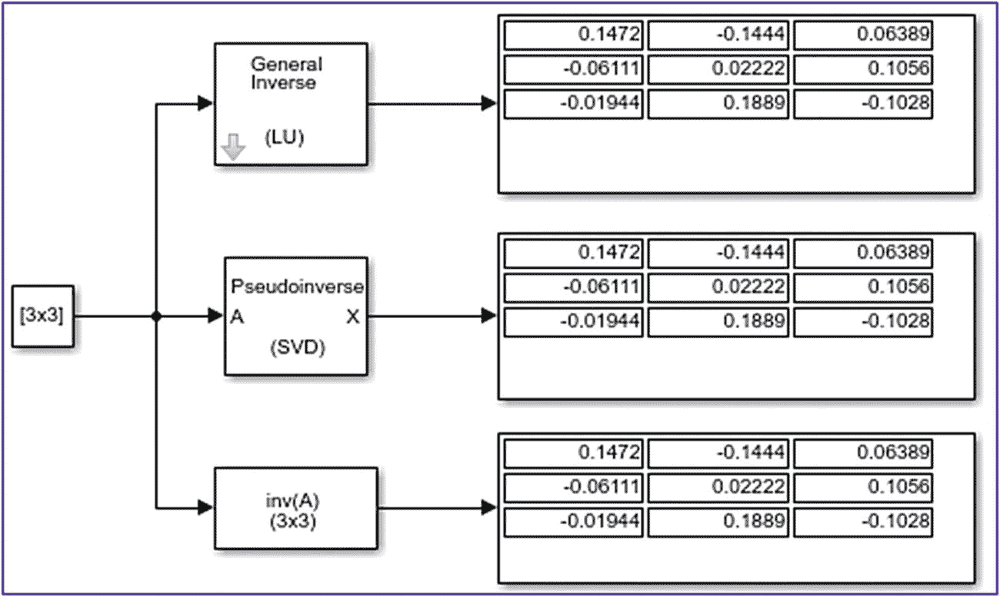

**图 7-8** 通过三个不同模块计算的逆矩阵

计算出的逆矩阵 (`A`^(-1)) 的值与使用 MATLAB 的 `inv()` 命令计算的值相匹配，精确到四位小数。

矩阵的另一个重要运算是其**秩**。矩阵（例如 `[A]`）的**秩**是指该矩阵最大的线性无关行向量的数量，这也等同于最大的线性无关列向量的数量。如果 `[A]` 矩阵的秩等于相同维度矩阵的最大可能秩，则称其满秩。如果矩阵 `[M]` 不满秩，则称其为秩亏损。矩阵的秩决定了系统包含多少个线性无关的行。在 MATLAB 中，用于计算矩阵秩的命令是 `rank()`。例如：

```
>> A =[8, 1, 6; 3, 5, 7; 4, 9, 2]; % 满秩矩阵
>> rank(A)
ans =

>> M =[8 0 6; -3, 0,  7; 0  0 2]   % 秩亏损矩阵
M =
8     0     6
-3     0     7
0     0     2
>> rank(M)
ans =

```

根据秩的不同，系统（系统矩阵）可以是满秩、超定和欠定的。

### 示例 1：求解线性方程组

以下示例向你展示如何使用这些公式求解线性方程。

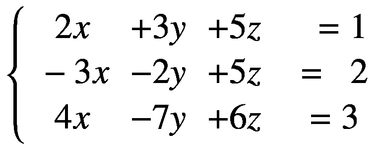

为了求解未知数（例如 `x`, `y`, `z`），你直接应用公式 7.3、7.4 和 7.5，然后执行以下操作。

![$$ \left[\begin{array}{ccc}2&amp; 3&amp; 5\\ {}-3&amp; -2&amp; 5\\ {}4&amp; -7&amp; 6\end{array}\right]\ast \left\{\begin{array}{c}x\\ {}y\\ {}z\end{array}\right\}=\left[\begin{array}{c}1\\ {}2\\ {}3\end{array}\right] $$](images/471979_1_En_7_Chapter/471979_1_En_7_Chapter_TeX_IEq5.png)，可以重写为：

![$$ \left\{\begin{array}{c}x\\ {}y\\ {}z\end{array}\right\}={\left[\begin{array}{ccc}2&amp; 3&amp; 5\\ {}-3&amp; -2&amp; 5\\ {}4&amp; -7&amp; 6\end{array}\right]}^{-1}\ast \left[\begin{array}{c}1\\ {}2\\ {}3\end{array}\right]\left\{\begin{array}{c}x\\ {}y\\ {}z\end{array}\right\}=\left[\begin{array}{ccc}0.0754&amp; -0.1738&amp; 0.0820\\ {}0.1246&amp; -0.0262&amp; -0.0820\\ {}0.0951&amp; 0.0852&amp; 0.0164\end{array}\right] $$](images/471979_1_En_7_Chapter/471979_1_En_7_Chapter_TeX_IEq6.png)*![$$ \left[\begin{array}{c}1\\ {}2\\ {}3\end{array}\right]=\left[\begin{array}{c}-0.0262\\ {}-0.1738\\ {}0.3148\end{array}\right] $$](images/471979_1_En_7_Chapter/471979_1_En_7_Chapter_TeX_IEq7.png)

![$$ Solution:\left\{\begin{array}{c}x\\ {}y\\ {}z\end{array}\right\}\cong \left[\begin{array}{c}-0.0262\\ {}-0.1738\\ {}0.3148\end{array}\right] $$](images/471979_1_En_7_Chapter/471979_1_En_7_Chapter_TeX_Equk.png)

解决此问题的其他方法包括简化行阶梯形矩阵法、高斯消元法和图解法。在前面的练习中，为了计算方程的解，我们使用了矩阵乘法、求和和求逆运算。MATLAB 中有许多运算符和内置函数可用于求解线性方程组。它们如下所示：

- `inv()`，计算给定矩阵的逆矩阵或给定系统（用于超定系统）的伪逆矩阵。
- `\`，反斜杠运算符，直接求解线性方程组。它基于高斯消元法。这是 MATLAB 中最强大的矩阵处理运算符（工具）之一。
- `mldivide()`，一个与 `\` 反斜杠运算符类似的内置函数。
- `linsolve()`，一个与 `\` 反斜杠运算符类似的内置函数。
- `lsqr()`，一个基于最小二乘法的内置函数。
- `lu()`，一个基于高斯消元法的内置函数。
- `rref()`，一个基于简化行阶梯形法的内置函数。
- `svd()`，一个基于奇异值分解的内置函数。
- `chol()`，一个基于 Cholesky 分解的内置函数。
- `qr()`，一个基于正交三角分解的内置函数。
- `decomposition()`，一个自动选择分解方法的内置函数。
- `bicg()`、`cgs()`、`gmres()`、`pcg()`、`symmlq()` 和 `gmr()`，这些是基于梯度法的内置函数。
- `solve()`，一个来自符号数学工具箱的内置函数。

### 注意

在这些列出的函数/命令和运算符中，有些使用了相同的计算算法，彼此之间互为替代。例如，反斜杠运算符 `\` 是 `mldivide()` 的替代方案。

首先，用以下符号表示给定的系统。

![$$ \underset{A}{\underbrace{\left[\begin{array}{ccc}2&amp; 3&amp; 5\\ {}-3&amp; -2&amp; 5\\ {}4&amp; -7&amp; 6\end{array}\right]}}\ast \underset{X}{\underbrace{\left\{\begin{array}{c}x\\ {}y\\ {}z\end{array}\right\}}}=\underset{B}{\underbrace{\left[\begin{array}{c}1\\ {}2\\ {}3\end{array}\right]}} $$](images/471979_1_En_7_Chapter/471979_1_En_7_Chapter_TeX_Equl.png)

在命令窗口中定义 `[A]` 矩阵的元素（未知数 `x`, `y`, `z` 的系数）以及 `[B]` 矩阵的元素。

```
>> A=[2, 3, 5; -3, -2, 5; 4, -7, 6]
A =
2     3     5
-3    -2     5
4    -7     6
>> B=[1; 2; 3]
B =

```

使用 `inv()` 和 `(*)`。

```
>>Ai=inv(A)    %  [B] 矩阵是 [A] 矩阵的逆矩阵。
Ai =
0.0754   -0.1738    0.0820
0.1246   -0.0262   -0.0820
0.0951    0.0852    0.0164
>> XYZ1=Ai*B    %   问题的解
XYZ1 =
-0.0262
-0.1738
0.3148
```

下一个示例使用基于高斯消元法的反斜杠 `\` 运算符。这种方法在计算时间方面相当简单高效。

```
>> XYZ2=A\B
XYZ2 =
-0.0262
-0.1738
0.3148
```

使用 `mldivide()`:

```
>>XYZ3=mldivide(A,B)
XYZ3 =
-0.0262
-0.1738
0.3148
```

使用 `linsolve()`:

```
>>XYZ4=linsolve(A,B)
XYZ4 =
-0.0262
-0.1738
0.3148
```

使用 `lsqr()`:

```
>>XYZ5=lsqr(A,B)
lsqr converged at iteration 3 to a solution with relative residual 6.6e-17.
XYZ5 =
-0.0262
-0.1738
0.3148
```

使用 `lu()`:

```
>>[L, U, P] = lu(A); %L-下三角矩阵; U-上三角矩阵; P-置换矩阵
>> y = L\(P*B);
>> XYZ6 = U\y
XYZ6 =
-0.0262
-0.1738
0.3148
```

使用 `rref()`:

```
>> MA = [A, B];       % 增广矩阵
>> xyz = rref(MA);
>> XYZ7= xyz(:,end)
XYZ7 =
-0.0262
-0.1738
0.3148
```

使用 `svd()`:

```
>> [U, S, V]= svd(A);
>> XYZ8 = V*inv(S)*U'*B
XYZ8 =
-0.0262
-0.1738
0.3148
```

使用 `chol()`:

```
>> [U, L] = chol(A);    % A 必须是埃尔米特正定矩阵
>> XYZ9 = U\(U'\B)      % U'*U = A
XYZ9 =
-0.0262
-0.1738
0.3148
```

使用 `qr()`:

```
>> [Q, R] = qr(A);
>> XYZ10  = R\Q.'*B
XYZ10 =
-0.0262
-0.1738
0.3148
```

使用 `decomposition()`:

```
>> XYZ11 = decomposition(A)\B
XYZ11 =
-0.0262
-0.1738
0.3148
```

使用 `bicg()` 梯度方法:

```
>> XYZ12 = bicg(A, B)
bicg converged at iteration 3 to a solution with relative residual 3.1e-14.
XYZ12=
-0.0262
-0.1738
0.3148
```

使用 `solve()`，这是一个符号数学工具箱函数:

```
>> syms x y z
>> sol=solve(2*x+3*y+5*z-1, -3*x-2*y+5*z-2, 4*x-7*y+6*z-3);
>> XYZ13=[sol.x; sol.y; sol.z]
XYZ13 =
-8/305
-53/305
96/305
>> XYZ13=double([sol.x; sol.y; sol.z])
XYZ13 =
-0.0262
-0.1738
0.3148
```

所有计算出的解在所使用运算符和函数的四位小数范围内都是精确的。事实上，每个运算符或函数的解的精度和计算时间会有所不同。例如，逆矩阵的计算不仅计算成本高昂，而且精度也较低。此外，在所研究的方法中，符号数学工具箱的最后一个函数 `solve()` 是最慢且效率最低的方法。

### 注意

请注意，从 MATLAB 2018b 开始的 MATLAB 较新版本中提供了 `decomposition()` 函数。

### Simulink 建模

除了前面展示和演示的 MATLAB 命令之外，Simulink 还有几个模块可以用来求解如 `[A]{x} = [B]` 这样的线性方程组。所有这些求解器模块都位于 `DSP System Toolbox` 中，可以通过 Simulink 库访问：`DSP System Toolbox/数学函数/矩阵与线性代数/线性系统求解器`。我们来测试其中的一些模块，以解决前面的示例，称为示例 1。打开一个空白的 Simulink 模型，从图 7-9 所示的 `DSP System Toolbox` 库中拖放模块。

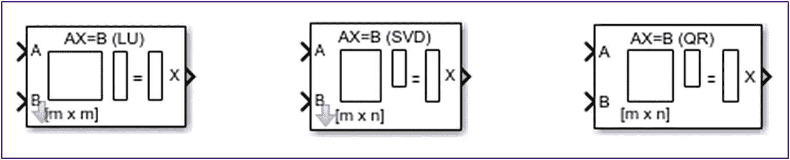

图 7-9 用于求解线性方程组的 Simulink 模块

它们分别如每个模块顶部所示——基于 LU、SVD、QR 分解和分解运算的求解器。所有这些求解器都有两个输入端口，用于输入 `[A]` 和 `[B]`，以及一个输出端口用于输出解 `{x}`。因此，您需要添加三个额外的模块——两个常量模块和一个显示模块——按照之前在构建 Simulink 模型计算矩阵的行列式、转置和逆矩阵时说明的方法添加。图 7-10 显示了 Simulink 模型的基本版本。

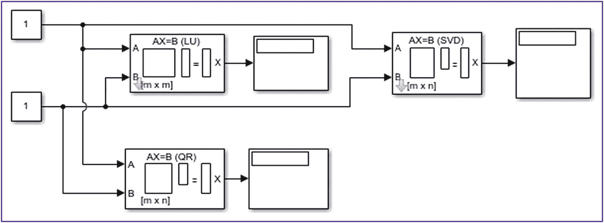

图 7-10 用于求解线性方程组的 Simulink 模型

矩阵 `[A]` 和 `[B]` 的元素可以直接在常量模块的“常量值”窗口中输入，如图 7-3 所示。或者，您可以通过 MATLAB 的命令窗口和工作区定义 `[A]` 和 `[B]` 的元素：

```
>> A=[2, 3, 5; -3, -2, 5; 4, -7, 6]
>> B=[1; 2; 3];
```

然后，将变量名称 `A` 和 `B` 分别输入到第一个和第二个常量模块的“常量值”框中，分别对应 `[A]` 和 `[B]`，如图 7-11 所示。单击“应用”和“确定”以完成模型。

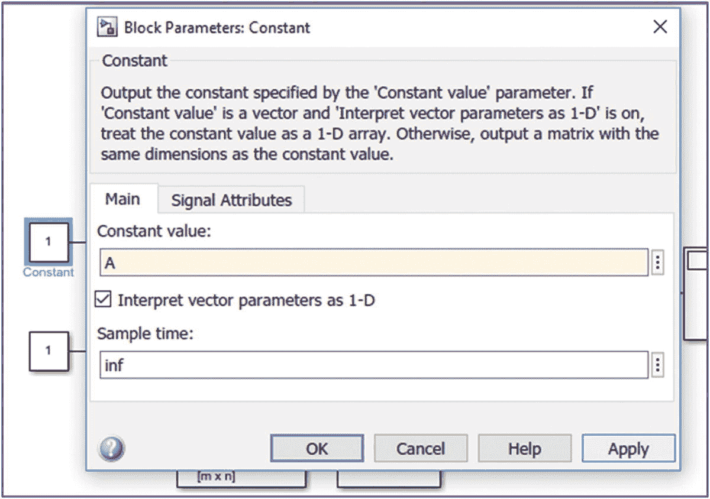

图 7-11 在常量模块中定义的变量名称

通过在键盘上按 `Ctrl+T` 或单击 Simulink 模型窗口中的“运行”按钮，您将获得完整的模型及其仿真结果（见图 7-12）。计算出的结果/解与 MATLAB 的解在小数点后四位内匹配。

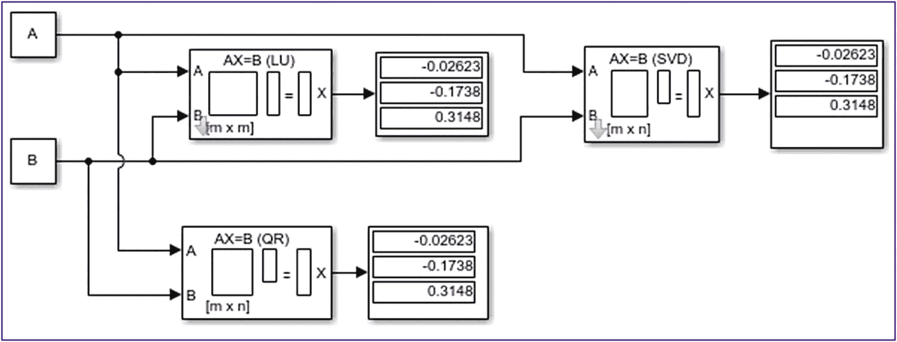

图 7-12 包含计算结果的完整模型

请注意，变量（矩阵） `A` 和 `B` 是通过 MATLAB 命令窗口定义的。

为了使用显示模块获得计算结果更多的小数位数，需要通过选择 `long_e` 来调整模块参数（格式类型），如图 7-13 所示。

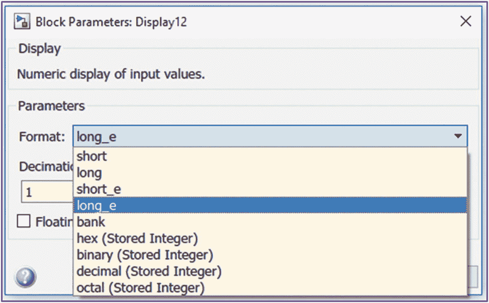

图 7-13 调整显示模块的格式参数

#### 示例 2：嵌入 MATLAB Function 模块以计算行列式并求解线性方程组

之前演示的所有用于计算矩阵行列式、矩阵逆或线性系统解的 MATLAB 函数/命令，都可以通过 MATLAB Function 模块 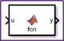 嵌入到 Simulink 中。我们将采用两个 MATLAB 函数/命令：一个用于使用 `det()` 计算任意大小矩阵的行列式，另一个用于使用 `linsolve()` 求解，并将它们嵌入到一个 Simulink 模型中。例如：

![$$ A1=\left[\begin{array}{ccc}16&amp; 2&amp; -3\kern0.5em 13\\ {}-5&amp; 11&amp; \begin{array}{cc}10&amp; -8\end{array}\\ {}\begin{array}{c}9\\ {}-4\end{array}&amp; \begin{array}{c}7\\ {}14\end{array}&amp; \begin{array}{cc}\begin{array}{c}-6\\ {}15\end{array}&amp; \begin{array}{c}12\\ {}1\end{array}\end{array}\end{array}\right],B1=\left[\begin{array}{c}\begin{array}{c}3\\ {}2\end{array}\\ {}4\\ {}5\end{array}\right] $$](images/471979_1_En_7_Chapter/471979_1_En_7_Chapter_TeX_Equm.png)

以下是完整的 Simulink 模型。图 7-14 由三个 Constant、两个 MATLAB Function 和两个 Display 模块构建而成。

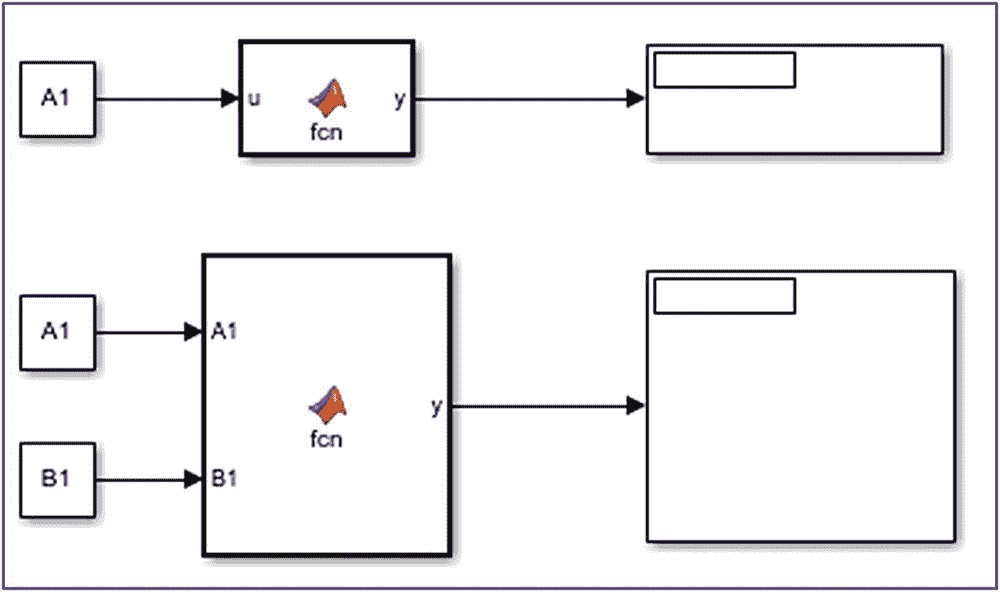

**图 7-14**

使用 MATLAB Function 模块计算行列式并求解线性方程组的 Simulink 模型

在此模型中，输入变量 `A1` 和 `B1` 的取值通过命令窗口和 MATLAB 工作区定义。要编辑并输入必要的脚本，需要打开 MATLAB Function 模块。双击该模块即可打开 MATLAB 编辑器窗口。以下分别是针对上方 MATLAB Function 模块（带有一个输入）和下方模块（带有两个输入 `A1` 和 `B1`）的模型，在 MATLAB 编辑器中键入的函数文件脚本。编辑完模块代码后，保存它们。这些脚本会保存在已创建的 Simulink 模型下，而不会作为独立的 MATLAB 函数文件保存。

```
function y = fcn(u)
y = det(u);
```

以及

```
function y = fcn(A1, B1)
y = linsolve(A1, B1);
```

然后模型就完成了，接着执行最终化的模型。图 7-15 显示的是带有计算结果（显示在 Display 模块中）的完整模型。上方的 Display 模块显示行列式，下方的 Display 模块显示给定方程组的解。

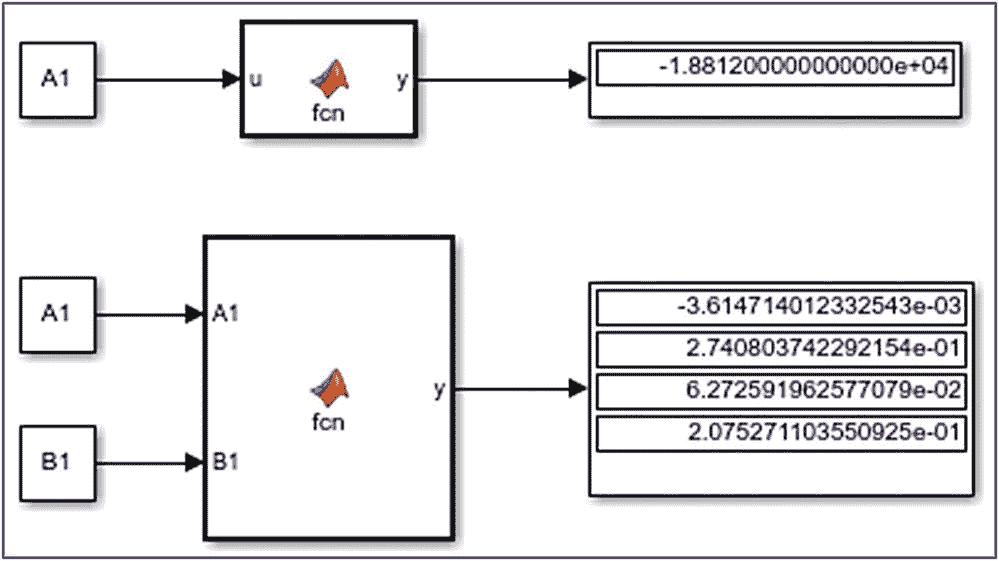

**图 7-15**

带有计算结果的完整模型

Simulink 模型的计算结果可以与 MATLAB 的计算结果进行比较。

```
>> A1=[16 2 -3 13 ; -5 11 10 -8; 9 7 -6 12; -4 14 15 1 ];
>> B1 = [3; 2; 4; 5];
>> det(A1)
ans =

>> linsolve(A1, B1)
ans =
-3.614714012332536e-03
2.740803742292154e-01
6.272591962577077e-02
2.075271103550925e-01
```

行列式计算和线性 MATLAB 求解器的计算结果与 Simulink 模型的结果精确匹配到小数点后 13 位。

#### 示例 3：线性方程组求解函数的精度

让我们来探究示例 1 中强调的函数/工具（方法）中哪一个在计算解时更精确。在本演示练习中，您将使用由 MATLAB 的 `magic()` 和 `randi()`（随机整数）矩阵生成函数生成的以下 13×13 `[A]` 矩阵和 13×1 `[B]` 矩阵。此外，`norm()` 函数用于结合计算出的解来给定线性系统计算范数。`LA_ex2.m` 是完整的求解脚本：

```
%% Given 13-by-13 system of linear equations
clearvars; clc
A = magic(13);
B = randi([-169,169], 13,1); % Elements of B vary within [-169, 169]
%% 1-Way: inv()  or pinv()     %% INVERSE matrix method
x1a = inv(A)*B;
Err_INV = norm(A*x1a-B)/norm(B)     %#ok: ERROR checking
x1b = pinv(A)*B;
Err_PINV = norm(A*x1b-B)/norm(B)     %#ok: ERROR checking
%% 2-Way: \     %% backslash
x2  = A\B;
Err_BACKSLASH = norm(A*x2-B)/norm(B)    %#ok: ERROR checking
%% 3-Way: mldivide()          %% Left divide function
x3 = mldivide(A, B);
Err_MLDIVIDE = norm(A*x3-B)/norm(B)   %#ok: ERROR checking
%% 4-Way: Using linsolve()
x4 = linsolve(A, B);
Err_LINSOLVE = norm(A*x4-B)/norm(B)   %#ok: ERROR checking
%% 5-Way: Using lsqr()
x5 = lsqr(A, B);
Err_LSQR = norm(A*x5-B)/norm(B)   %#ok: ERROR checking
%% 6-Way: Using lu()
[L, U, P] = lu(A);
y = L\(P*B);
x6 = U\y;
Err_LU = norm(A*x6-B)/norm(B)   %#ok: ERROR checking
%% 7 - Way: Using rref()
MA = [A, B];
xyz = rref(MA);
x7= xyz(:,end);
Err_RREF = norm(A*x7-B)/norm(B)   %#ok: ERROR checking
%%  8 - Way: Using svd()
[U, S, V]= svd(A);
x8 = V*inv(S)*U'*B;
Err_SVD = norm(A*x8-B)/norm(B)   %#ok: ERROR checking
%% 9 - Way: Using chol()
[U, L] = chol(A);
x9 = U\(U'\B);
Err_CHOL = norm(A*x9-B)/norm(B)   %#ok: ERROR checking
%% 10 - Way: Using qr()
[Q, R] = qr(A);
x10  = R\Q.'*B;
Err_QR = norm(A*x10-B)/norm(B)   %#ok: ERROR checking
%% 11 - Way: Using decomposition()
x11 = decomposition(A)\B;
Err_DECOMPOSITION = norm(A*x11-B)/norm(B) %#ok: ERROR checking
%% 12 - Way: Using bicg()
x12 = bicg(A,B);
Err_BICG = norm(A*x12-B)/norm(B)   %#ok: ERROR checking
%% 13-Way: solve()            %% SOLVE() symbolic math method
x = sym('x', [1, 13]); x=x';
Eqn = A*(x); Eqn = Eqn - B;
Solution = solve(Eqn); SOLs = struct2array(Solution);
SOLs = double(SOLs); x13 = SOLs';
Err_SOLVE = norm(A*x13-B)/norm(B)   %#ok: ERROR checking
```

以下是使用这些方法求解方程组时产生的误差。

```
Err_INV =
5.8087e-16
Err_PINV =
3.7982e-15
Err_BACKSLASH =
3.0569e-16
Err_MLDIVIDE =
3.0569e-16
Err_LINSOLVE =
3.0569e-16
lsqr converged at iteration 7 to a solution with relative residual 3.5e-07.
Err_LSQR =
3.4959e-07
Err_LU =
3.0569e-16
Err_RREF =
1.1576e-05
Err_SVD =
3.7982e-15
Err_CHOL =
2.2400
Err_QR =
7.0615e-16
Err_DECOMPOSITION =
3.0569e-16
bicg stopped at iteration 13 without converging to the desired tolerance 1e-06
because the maximum number of iterations was reached.
The iterate returned (number 13) has relative residual 9.6e-06.
Err_BICG =
9.5856e-06
Err_SOLVE =
1.5109e-16
```

从计算出的误差来看，`RREF()`、`BICG()` 和 `LSQR()` 函数在计算该给定系统的解时，误差控制在 10^(−5)…10^(−7) 范围内，而所有其他方法在计算该给定系统的解时，误差均控制在 10^(−15)…10^(−16) 范围内。

#### 示例 4：线性方程求解函数的效率

本示例旨在展示所列方法中哪一种在计算时间上更为高效。为此，你将使用随机整数生成函数 `randi()` 生成两个大型矩阵 [A]（1000×1000）和 [B]（1000×1）的元素。此外，为了记录每种计算方法的耗时，将使用 `tic` 和 `toc` 函数。以下是完整的求解脚本，名为 `LA_ex3.m`：

# 矩阵运算

本节涵盖矩阵、向量和特征向量的一般数学运算与计算。文中使用大量数值示例来解释矩阵运算。表 7-1 列出了矩阵运算及其命令语法。

**表 7-1** 两种等价形式的矩阵运算符

| 运算名称 | MATLAB 第一种方式 | MATLAB 第二种方式 |
| --- | --- | --- |
| 矩阵乘法 | `A*B` | `mtimes(A,B)` |
| 逐元素乘法 | `A.*B` | `times(A,B)` |
| 矩阵右除 | `A/B` | `mrdivide(A,B)` |
| 逐元素右除 | `A./B` | `rdivide(A,B)` |
| 矩阵左除 | `A\B` | `mldivide(A,B)` |
| 逐元素左除 | `A.\B` | `ldivide(A,B)` |
| 矩阵幂 | `A^B` | `mpower(A,B)` |
| 逐元素幂 | `A.^B` | `power(A,B)` |
| 复共轭转置 | `A'` | `ctranspose(A)` |
| 矩阵转置 | `A.'` | `transpose(A)` |
| 二元加法 | `A+B` | `plus(A,B)` |
| 一元加法 | `+A` | `uplus(A)` |
| 二元减法 | `A-B` | `minus(A,B)` |
| 一元减法 | `-A` | `uminus(A)` |
| 行列式 | `det(A)` | `det(A)` |
| 逆时针旋转 90⁰ | `rot90(A)` | `rot90(A)` |
| 复制并平铺数组 n 次 | `repmat(A, n)` | `repmat(A, n)` |
| 左右翻转矩阵 | `fliplr(A)` | `fliplr(A)` |
| 上下翻转矩阵 | `flipud(A)` | `flipud(A)` |

MATLAB 的基本单元数据采用数组类型格式。在许多情况下，可以使用矩阵和向量来定义输入输出、局部数据以及函数的输入输出。此外，它们还可用于将多个独立的标量合并为一个信号，并处理多维输入和输出信号。数组由一个名称和按行、列排列的一组数据来定义，如下所示。

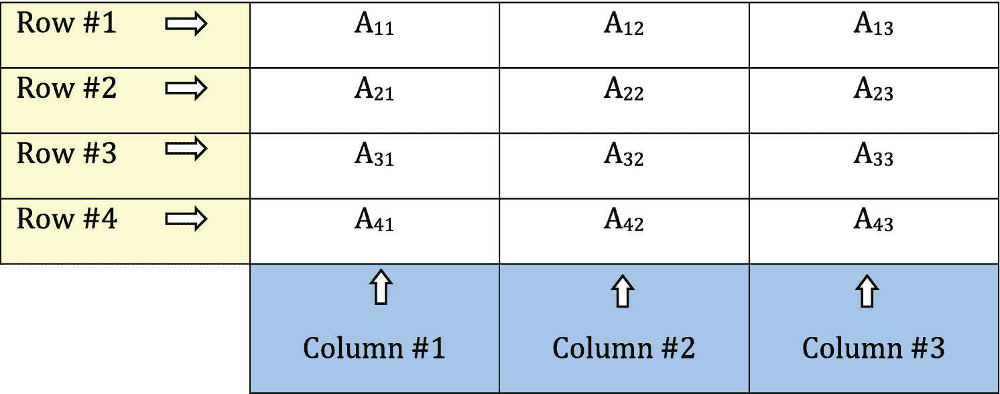

我们来看一些数值示例。这些示例在命令行窗口中执行矩阵与标量的运算，例如加法、减法、幂运算、乘法、除法，包括逐元素运算。

```
>> A=[8,1,6; 3,5,7; 4,9,2]  % 3×3 矩阵
A =
8     1     6
3     5     7
4     9     2
>> a = 2; b = 2+3i; c = 5j;
>> B = A^a % 注意：.^ 和 ^ 的区别
B =
91    67    67
67    91    67
67    67    91
>> C = A.^a % 逐元素运算。注意：.^ 和 ^ 的区别
C =
64     1    36
9    25    49
16    81     4
>> D = A*a+B/b
D =
30.0000 -21.0000i  12.3077 -15.4615i  22.3077 -15.4615i
16.3077 -15.4615i  24.0000 -21.0000i  24.3077 -15.4615i
18.3077 -15.4615i  28.3077 -15.4615i  18.0000 -21.0000i
>> E = C./c
E =
0.0000 -12.8000i   0.0000 - 0.2000i   0.0000 - 7.2000i
0.0000 - 1.8000i   0.0000 - 5.0000i   0.0000 - 9.8000i
0.0000 - 3.2000i   0.0000 -16.2000i   0.0000 - 0.8000i
>> F = C/c
E =
0.0000 -12.8000i   0.0000 - 0.2000i   0.0000 - 7.2000i
0.0000 - 1.8000i   0.0000 - 5.0000i   0.0000 - 9.8000i
0.0000 - 3.2000i   0.0000 -16.2000i   0.0000 - 0.8000i>>
```

### 示例：执行矩阵运算

以下是之前讨论过的各种线性方程求解方法的性能比较和代码示例。

```matlab
clearvars
A=randi([-100,100],1000); B=randi([-100, 100], 1000, 1);
%% 1) inv() 或 pinv()
tic; Ai = inv(A); xyz1=Ai*B; T_inv=toc
%% 2) 反斜杠运算符：\
clearvars
A=randi([-100,100],1000); B=randi([-100, 100], 1000, 1);
tic; xyz2 = A\B; T_backslash = toc
%% 3) mldivide()
clearvars
A=randi([-100,100],1000); B=randi([-100, 100], 1000, 1);
tic; xyz3= mldivide(A, B); T_mld = toc
%% 4) linsolve()
clearvars
A=randi([-100,100],1000); B=randi([-100, 100], 1000, 1);
tic; xyz4 = linsolve(A, B); T_linsolve = toc
%% 5) lsqr()
clearvars
A=randi([-100,100],1000); B=randi([-100, 100], 1000, 1);
tic; xyz5 = lsqr(A, B); T_lsqr = toc
%% 6) lu()
clearvars
A=randi([-100,100],1000); B=randi([-100, 100], 1000, 1);
tic; [L, U, P]=lu(A); y=L\(P*B); xys6=U\y; T_lu=toc
%% 7) rref()
clearvars
A=randi([-100,100],1000); B=randi([-100, 100], 1000, 1);
tic; MA = [A, B];xyz7 = rref(MA); XYZ7=xyz7(:, end); T_rref=toc
%% 8) svd()
clearvars
A=randi([-100,100],1000); B=randi([-100, 100], 1000, 1);
tic; [U S V] = svd(A); xyz8 = V*inv(S)*U'*B; T_svd=toc
%% 9) chol()
clearvars
A=randi([-100,100],1000); B=randi([-100, 100], 1000, 1);
tic; [U L]= chol(A); xyz9 = U\(U'\B); T_chol=toc
%% 10) qr()
clearvars
A=randi([-100,100],1000); B=randi([-100, 100], 1000, 1);
tic; [Q R] = qr(A); xyz10 = R\Q.'*B ; T_qr=toc
%% 11) decomposition()
clearvars
A=randi([-100,100],1000); B=randi([-100, 100], 1000, 1);
tic; xyz11 = decomposition(A)\B; T_decom = toc
%% 12) bicg()  梯度方法
clearvars
A=randi([-100,100], 1000); B=randi([-100, 100], 1000, 1);
tic; xyz12 = bicg(A, B); T_bicg=toc
%% 13) solve()
A=randi([-100,100],100); B=randi([-100, 100], 100, 1);
tic;
x = sym('x', [1, 100]); x=x';
Eqn = A*(x); Eqn = Eqn - B;
Solution = solve(Eqn); SOLs = struct2array(Solution);
SOLs = double(SOLs); x13 = SOLs';
T_solve=toc
```

以下是模拟得出的计算耗时值。

```
T_inv =
0.0390
T_backslash =
0.0173
T_mld =
0.0171
T_linsolve =
0.0171
lsqr stopped at iteration 20 without converging to the desired tolerance 1e-06
because the maximum number of iterations was reached.
The iterate returned (number 20) has relative residual 0.24.
T_lsqr =
0.0236
T_lu =
0.0235
T_rref =
10.1406
T_svd =
0.4263
T_chol =
0.0330
T_qr =
0.1045
T_decom =
0.0459
bicg stopped at iteration 20 without converging to the desired tolerance 1e-06
because the maximum number of iterations was reached.
The iterate returned (number 0) has relative residual 1.
T_bicg =
0.0195
T_solve =
14.6306
```

从这些计算中可以看出，`linsolve()`、`mldivide()` 和 `\`（反斜杠运算符，即高斯消元法）在所有测试方法中速度最快。最慢且计算成本最高的是符号数学工具箱中的 `solve()` 运算符，即便系统的规模小了 10 倍。值得注意的是，行简化阶梯形方法 `rref()` 是仅次于 `solve()` 运算符的第二慢方法。

我们再看另一个示例，来求解前面讨论过的四种不同方法：`\`、`linsolve()`、`inv()` 和 `solve()`。

#### 示例 5：通过改变 `[b]` 的值来求解线性方程（`[A]{x} = [b]`）

本练习包含两部分：

1. 求解给定线性系统中的未知数 *a*、*b* 和 *c*。

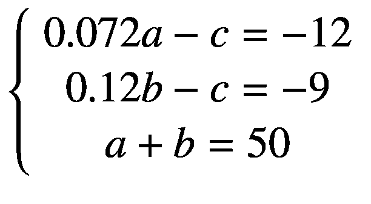

2. 求解给定系统中的未知数 *a*、*b* 和 *c*。第三个方程的值在 50…250 的范围内变化。

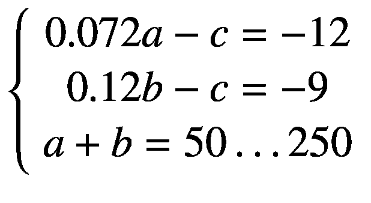

将该系统重写为矩阵形式 `[A]{x} = [B]`，然后直接求解未知数 *a*、*b* 和 *c*。以下是求解脚本（`LA_Ex4.m`）。

```matlab
% 第一部分。
% 给定的系统从 Ax=B 写为 [A]*[abc]=[B]
A=[.072, 0, -1; 0, .12, -1; 1 1 0];
B=[-12, -9, 50];
abc1=A\B'                %#ok  % 反斜杠 \
abc2 = linsolve(A,B')    %#ok  % LINSOLVE()
abc3 = inv(A)*B'         %#ok  % INV
% 符号数学中的 SOLVE()
syms a b c
abc4=solve(0.072*a-c+12, 0.12*b-c+9, a+b-50);
abc4=double([abc4.a; abc4.b; abc4.c]) %#ok  % SOLVE()
%% 第二部分 %%%%%%%%%%%%%%%%%%%%%%%%%%%%%%%%%%%%%%%%%%%%%%%%%%
% 反斜杠 \ ; LINSOLVE(); INV
tic
Bk=50:250;
a=zeros(numel(Bk),1); b=zeros(numel(Bk),1); c=zeros(numel(Bk),1);
A=[.072, 0, -1; 0, .12, -1; 1 1 0];
for ii=1:numel(Bk)
B=[-12; -9; Bk(ii)];
abc=A\B;
a(ii)=abc(1,:);
b(ii)=abc(2,:);
c(ii)=abc(3,:);
end
Time1=toc;
fprintf('使用反斜杠的计算时间: %3.3f  \n', Time1)
clearvars
tic
Bk=50:250;
a=zeros(numel(Bk),1); b=zeros(numel(Bk),1); c=zeros(numel(Bk),1);
A=[.072, 0, -1; 0, .12, -1; 1 1 0];
for ii=1:numel(Bk)
B=[-12; -9; Bk(ii)];
abc=linsolve(A,B);
a(ii)=abc(1,:);
b(ii)=abc(2,:);
c(ii)=abc(3,:);
end
Time2=toc;
fprintf('使用 LINSOLVE 的计算时间:  %3.3f  \n', Time2)
clearvars
tic
Bk=50:250;
a=zeros(numel(Bk),1); b=zeros(numel(Bk),1); c=zeros(numel(Bk),1);
A=[.072, 0, -1; 0, .12, -1; 1 1 0];
for ii=1:numel(Bk)
B=[-12; -9; Bk(ii)];
abc=inv(A)*B;
a(ii)=abc(1,:); b(ii)=abc(2,:); c(ii)=abc(3,:);
end
Time3=toc;
fprintf('使用 INV 的计算时间:       %3.3f  \n', Time3)
%% 符号数学中的 SOLVE()
clearvars
tic;
Bk=50:250;
a1=zeros(numel(Bk),1);b1=zeros(numel(Bk),1); c1=zeros(numel(Bk),1);
syms a b c
for ii=1:numel(Bk)
abc=solve(0.072*a-c+12,0.12*b-c+9,a+b-Bk(ii));
a1(ii)=double(abc.a);
b1(ii)=double(abc.b);
c1(ii)=double(abc.c);
end
Time4=toc;
fprintf('使用 SOLVE 的计算时间:     %3.3f  \n', Time4)
```

以下是第一部分计算的结果：

```
abc1 =
15.6250
34.3750
13.1250
abc2 =
15.6250
34.3750
13.1250
abc3 =
15.6250
34.3750
13.1250
abc4 =
15.6250
34.3750
13.1250
```

以下是第二部分脚本的结果：

```
使用反斜杠的计算时间: 0.002
使用 LINSOLVE 的计算时间:  0.002
使用 INV 的计算时间:       0.002
使用 SOLVE 的计算时间:    22.066
```

从使用四种方法计算包含三个变量和 201 种可能情况的给定线性系统所花费的计算时间来看，效率最低的求解线性方程的方法是使用符号数学工具箱的 `solve()` 函数。反斜杠运算符（`\`）、`linsolve()` 和 `inv()` 方法的性能相当。求解器 `linsolve()`、`\` 和 `inv()` 方法比 `solve()` 函数高效 11033 倍以上。

给定六个数组：`A`（4×3）、`B`（3×4）、`C`（4×4）、`D`（4×3）、`E`（3×3）和`F`（3×3）。


让我们在命令行窗口中执行一些矩阵运算——例如求和、减法、乘法、幂运算、标量乘法、平方根、均值、四舍五入、标准差、复制/旋转/翻转矩阵等。

```matlab
>> A=[2 -3 1; 3 2 5; 1 3 4; -3 -2 3] ;
>> B=[3,4,-2 1;2,5,4,-6;4,-3, 1,2] ;
>> C=[16,2,3,13;5,11,10,8;9 4 7 14;6 15 12 1] ;
>> D=[1 2 3; 2 3 4; 4 3 1; -2 -3 1] ;
>> E=[8, 1, 6; 3, 5, 7; 4, 9, 2];
>> F=[3 7 3; 3 2 8; 9 2 1];
>> M_AB = A*B
M_AB =
4   -10   -15    22
33     7     7     1
25     7    14    -9
-1   -31     1    15
>> M_BA = B*A
M_BA =
13    -9    18
41    28    25
-6   -19    -1
>> M_S = M_AB-C
M_S =
-12   -12   -18     9
28    -4    -3    -7
16     3     7   -23
-7   -46   -11    14
>> M_S = M_BA-C
矩阵维度必须一致。
>> CM=C*M_S     % 不等价于 M_S*C
CM =
-179  -789  -416   243
352  -442  -141  -150
18  -747  -279    88
533  -142   -80  -313
>> CM1=M_S*C    % 不等价于 C*M_S
CM1 =
-360   -93  -174  -495
359  -105   -61   283
196  -252  -149   307
-357  -354  -390  -599
>> CM2=M_S.*C  % 逐元素操作：不等价于 M_S*C
CM2 =
-192   -24   -54   117
140   -44   -30   -56
144    12    49  -322
-42  -690  -132    14
>> MDE=M_S./C  % 逐元素操作：不等价于 M_S/C
MDE =
-0.7500   -6.0000   -6.0000    0.6923
5.6000   -0.3636   -0.3000   -0.8750
1.7778    0.7500    1.0000   -1.6429
-1.1667   -3.0667   -0.9167   14.0000
>> MD=M_S/C   % 不等价于 M_S./C
CM =
1.9275    8.5704   -5.6271   -5.8414
1.4496   -6.4076    1.5420    3.8277
-1.0389  -10.8246    5.0116    6.9401
-4.9118  -12.9118   12.6765    3.6765
>> M_AD = A.*D % 逐元素操作：矩阵乘法
M_AD =
2    -6     3
6     6    20
4     9     4
6     6     3
>> MM_AD = A*D % 由于 [A] 和 [D] 尺寸不匹配导致错误
错误使用  *
矩阵乘法的维度不正确。请检查第一个矩阵的列数是否与第二个矩阵的行数匹配。要执行逐元素乘法，请使用 '.*'。
>> M_EF=E.*F     % 方阵的逐元素乘法
M_EF =
24     7    18
9    10    56
36    18     2
>> MM_EF=E*F     % 方阵可按矩阵乘法相乘
MM_EF =
81    70    38
87    45    56
57    50    86
>> Csqrt=sqrt(C) % 不等价于 sqrtm(C)
Csqrt =
4.0000    1.4142    1.7321    3.6056
2.2361    3.3166    3.1623    2.8284
3.0000    2.0000    2.6458    3.7417
2.4495    3.8730    3.4641    1.0000
>> Csqrt=sqrtm(C) % 不等价于 sqrt(C)
Csqrt =
第 1 至 3 列
3.8335 - 0.0167i   0.0738 + 0.7839i   0.1262 + 0.3666i
0.3251 + 0.0011i   2.6850 - 0.0526i   1.6850 - 0.0246i
1.3123 - 0.0237i   0.7322 + 1.1107i   1.9687 + 0.5194i
0.5925 + 0.0373i   2.0922 - 1.7477i   1.7997 - 0.8172i
第 4 列
1.7975 - 1.1337i
1.1359 + 0.0761i
1.8178 - 1.6064i
1.3466 + 2.5276i
>> C_E1 = expm(C)   % 矩阵指数，不等价于 exp(C)
C_E1 =
1.0e+14 *
1.5718    1.3711    1.3622    1.5295
1.5718    1.3711    1.3622    1.5295
1.5718    1.3711    1.3622    1.5295
1.5718    1.3711    1.3622    1.5295
>> C_E2 = exp(C) % 矩阵的指数运算：不等价于 expm(C)
C_E2 =
1.0e+06 *
8.8861    0.0000    0.0000    0.4424
0.0001    0.0599    0.0220    0.0030
0.0081    0.0001    0.0011    1.2026
0.0004    3.2690    0.1628    0.0000
>> S=[A(1,1:3); B(2,1:3);C(3,2:4)]; % 从已有矩阵创建
>> Y=[A(1), 1.3];
>> Arot90=rot90(A)      % 矩阵旋转
Arot90 =
1     5     4     3
-3     2     3    -2
2     3     1    -3
>>Crep=repmat(C, 2,1)   % 矩阵复制
Crep =
5    11    10     8
9     4     7    14
6    15    12     1
16     2     3    13
5    11    10     8
9     4     7    14
6    15    12     1
>>Bflip=fliplr(B)       % 矩阵左右翻转
Bflip =
1    -2     4     3
-6     4     5     2
2     1    -3     4
>> Cud=flipud(Crep)     % 矩阵上下翻转
Cud =
6    15    12     1
9     4     7    14
5    11    10     8
16     2     3    13
6    15    12     1
9     4     7    14
5    11    10     8
16     2     3    13
```

许多这些矩阵运算也可以在 Simulink 环境中执行。让我们用前面的例子来演示 Simulink 如何使用以及使用哪些模块进行矩阵运算和操作。

Simulink 库中包含用于求和、乘法/除法、幂运算、指数运算和拼接的模块，如图 7-16 所示。


**图 7-16** Simulink 库中的矩阵运算模块

首先在命令窗口中定义`[A]`和`[D]`矩阵：

```matlab
>> A=[2 -3 1; 3 2 5; 1 3 4; -3 -2 3] ;
>> D=[1 2 3; 2 3 4; 4 3 1; -2 -3 1] ;
```

现在计算矩阵`[A]`和`[D]`的和与差，如图 7-17 所示。


**图 7-17** Simulink 中的矩阵加法和减法运算

注意，矩阵`[A]`和`[D]`是通过命令窗口和工作区定义的。计算出的结果与使用 MATLAB 命令窗口计算的结果一致。

以下是矩阵的乘法（见图 7-18）、指数运算和平方运算（见图 7-20）的结果。


**图 7-18** Simulink 中的矩阵乘法

注意，对于图 7-18 中所示的矩阵乘法运算，需要将乘积模块从逐元素乘法（`.*`）更改为矩阵乘法（`*`），如图 7-19 所示。

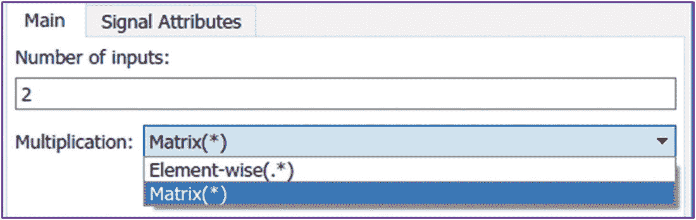

**图 7-19** 设置矩阵乘积模块为矩阵乘法（`*`）或逐元素乘法（`.*`）

否则，由于 `[A]` 和 `[B]` 的尺寸不匹配，乘法运算将无法执行。同样，计算结果与 MATLAB 的结果一致。

注意，在图 7-20 的运算中，指数和幂运算通过一个模块（即数学函数模块）执行，只需将其函数类型选择为 `[pow]`（用于 `u^v`）和 `[square]`（用于 `u²`），如图 7-21 所示。

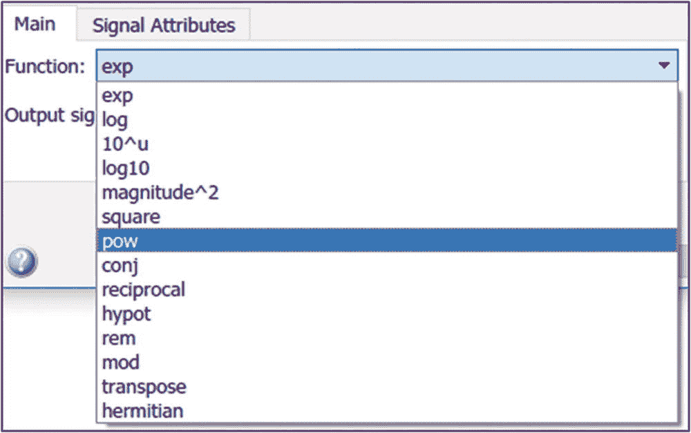

**图 7-21** 如何为矩阵运算设置数学函数模块

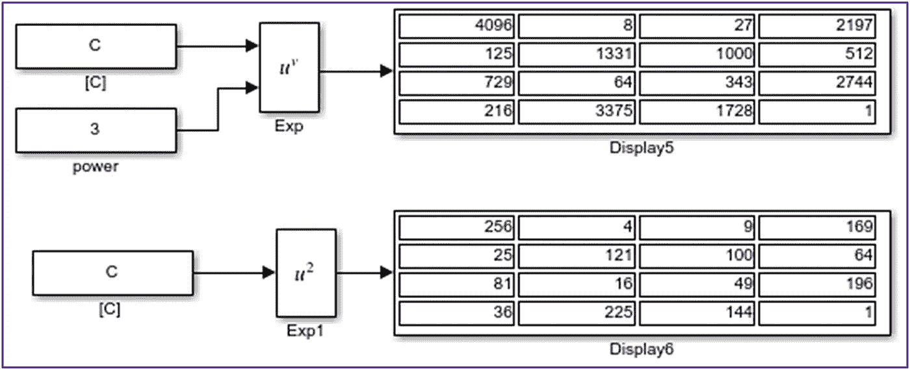

**图 7-20** 矩阵指数和平方运算模块

现在，通过使用矩阵拼接模块，我们可以根据计算得到的矩阵和（4×3）、平方（4×4）和矩阵除法（4×3）创建一个新矩阵（4×10）。见图 7-22。

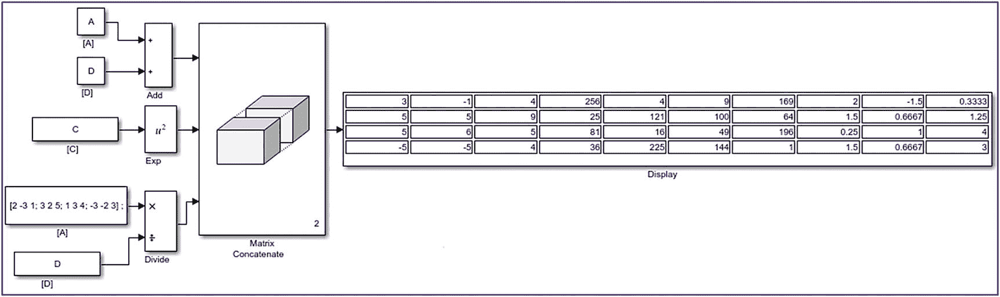

**图 7-22** 矩阵拼接模块执行矩阵拼接

如上所示，Simulink 模块能执行各种矩阵运算，与 MATLAB 函数类似。然而，在某些涉及矩阵和数组运算的计算密集型仿真中，Simulink 模型可能比 MATLAB 脚本慢。例如，在计算离散傅里叶变换时，Simulink 模型比 MATLAB 慢很多。对于某些矩阵和数组运算，可以在 Simulink 建模中使用 `MATLAB Fcn` 模块或 `Interpreted MATLAB Fcn` 模块。

除了这些矩阵运算外，还有一些其他操作可以创建新矩阵。例如，您可以使用 `diag(A)` 提取现有矩阵的对角线元素，或者提取矩阵的选定元素并创建一个新矩阵。

```matlab
>> E=[8, 1, 6; 3, 5, 7; 4, 9, 2];
>> F=[3 7 3; 3 2 8; 9 2 1];
>> EF = [diag(E), diag(F)]
EF =
8     3
5     2
2     1
```

# 标准矩阵生成器

MATLAB 拥有众多标准数组和矩阵生成器，可用于生成各种矩阵。例如，`eye(n)`、`eye(k, m)`、`ones(m)`、`ones(m, k)`、`zeros(l)`、`zeros(l,k)`、`magic(k)`、`pascal(k)`、`pascal(k, m)`、`rand(m)`、`rand(k, m)`、`randi(n,m,k)`、`repmat(A, r, c)`、`blkdiag(A, B, C)`、`sparse(m,n)` 等。例如：

```matlab
>> eye(3)
ans =
1     0     0
0     1     0
0     0     1
>> magic(5)         % 5 阶幻方矩阵
ans =
17    24     1     8    15
23     5     7    14    16
4     6    13    20    22
10    12    19    21     3
11    18    25     2     9
>> A=pascal(4)       % 4 阶帕斯卡矩阵
A =
1     1     1     1
1     2     3     4
1     3     6    10
1     4    10    20
>> A=pascal(4,2)       % 4 阶帕斯卡矩阵
A =
-1    -1    -1    -1
3     2     1     0
-3    -1     0     0
1     0     0     0
>> zeros(3)            % 3 阶零矩阵
ans =
0     0     0
0     0     0
0     0     0
>> zeros(2,3)          % 2 行 3 列零矩阵
ans =
0     0     0
0     0     0
>> ones(3)             % 3 阶全 1 矩阵
ans =
1     1     1
1     1     1
1     1     1
>> ones(3,2)           % 3 行 2 列全 1 矩阵
ans =
1     1
1     1
1     1
>> eye(4,3)            % 4 行 3 列单位对角矩阵
ans =
1     0     0
0     1     0
0     0     1
0     0     0
>> eye(4,5)
ans =
1     0     0     0     0
0     1     0     0     0
0     0     1     0     0
0     0     0     1     0
>> rand(2)
ans =
0.814723686393179   0.126986816293506
0.905791937075619   0.913375856139019
>> rand(2,3)
ans =
0.957166948242946   0.800280468888800   0.421761282626275
0.485375648722841   0.141886338627215   0.915735525189067
>>A=round(rand(2))
A =
0     1
0     0
>>A_rep=repmat(A, 2, 3) % 复制矩阵 A，将其行复制 2 次，列复制 3 次
A_rep =
0     1     0     1     0     1
0     0     0     0     0     0
0     1     0     1     0     1
0     0     0     0     0     0
>> randi([-13, 13], 5) % 在 [-13, 13] 范围内的随机整数
ans =
-7    10    12     0    10
6    -8     5     1    -2
-11     5    -9    -6     4
-9    11    -6     8     3
-10     0     3    -1    -2
>> C=eye(2); B=magic(3); A=ones(4);
>> D=blkdiag(A,B,C)    % 沿对角线方向组合矩阵以创建块对角矩阵。
D =
1     1       1     1     0     0     0     0     0
1     1       1     1     0     0     0     0     0
1     1       1     1     0     0     0     0     0
1     1       1     1     0     0     0     0     0
0     0       0     0     8     1     6     0     0
0     0       0     0     3     5     7     0     0
0     0       0     0     4     9     2     0     0
0     0       0     0     0     0     0     1     0
0     0       0     0     0     0     0     0     1
>> K=reshape(randperm(9), 3,3) % 通过随机排列改变数组的大小（重塑）以生成 3 行 3 列矩阵
K =
4     9     5
3     8     6
7     1     2
```

此外，还有几十个矩阵生成函数。它们构成了测试矩阵的“展示馆”，例如 `binomial`、`cauchy`、`clement`、`invol`、`house`、`krylov`、`leslie`、`lesp`、`neumann`、`poisson`、`ris`、`rando`、`smoke`、`wilk` 等等。通常，这些矩阵的命令语法如下：

```matlab
[A, B, C,...] = gallery(matname,P1,P2,...);
[A, B, C,...] = gallery(matname,P1,P2,..., classname);
A=gallery(3);
B=gallery(5);
```

要获取关于“展示馆”矩阵的更多信息，请在命令窗口中输入：

```matlab
>> help gallery
>> doc gallery
```

以下是几个如何使用“展示馆”矩阵的例子：

```matlab
>> L=gallery('leslie', s, x)  % 这是一个 3 阶 Leslie 人口矩阵，取自具有平均出生数 s(1:n) 和存活率 x(1:n-1) 的模型
L =
0            2            0
0.5            0            0
0         0.78            0
>> C = gallery('chebspec',3,1) % 3 阶切比雪夫谱微分矩阵
C =
-0.33333           -1      0.33333
1      0.33333           -1
-1.3333            4      -3.1667
>> L=gallery('cauchy', s, y) % 返回 3 阶矩阵，C(i,j) = 1/(s(i)+y(j))。参数 s 和 y 是长度为 3 的向量。如果为 s 和 y 传入标量，则它们被解释为向量 1:s 和 1:y。
L =
2       1.2821      0.76923
0.4      0.35971      0.30303
2       1.2821      0.76923
>> B = gallery('krylov', rand(3)) % 返回 3 阶 Krylov 矩阵
B =
1       1.3462       1.6804
1       1.2107       1.578
1       1.3387       1.7209
>> B = gallery('house',rand(3,1))  % Householder 矩阵
B =
2.1404
0.28584
0.7572
>> B = gallery('ris',4)  % 返回对称的 4 阶 Hankel 矩阵，其元素 A(i,j) = 0.5/(n-i-j+1.5)
B =
0.1429    0.2000    0.3333    1.0000
0.2000    0.3333    1.0000   -1.0000
0.3333    1.0000   -1.0000   -0.3333
1.0000   -1.0000   -0.3333   -0.2000
>>gallery('smoke', 2) % 烟雾矩阵 - 复数，具有“烟环”伪谱。
ans =
-1.0000 + 0.0000i   1.0000
1.0000             1.0000
```

这些标准矩阵和“展示馆”矩阵具有特殊的属性，在各种数值模拟和分析问题中非常有用。例如，标准矩阵 `ones()`、`eye()`、`zeros()`、`rand()`、`randn()` 在信号处理、数据分析和大型计算的内存分配中经常使用。

# 向量空间

在信号处理、数值分析和构建计算机模拟模型时，向量空间非常重要。例如，当频率经过单位圆时，对数空间用于数字信号处理。有几种直接的方法可以创建向量、向量空间以及元素之间等间距的数组。假设我们需要创建一个从值 `w1` 开始到 `w2` 结束的向量 `W`，如图 7-23 所示。

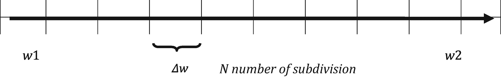

**图 7-23** 向量空间

如果间距 `Δw` 已知，则空间可以表示为 `W` = `w1`: `Δw`: `w2`。例如，整个空间可以根据 `w1` = 1，`w2` = 13，`Δw` = 0.1 定义为：

```matlab
>> w=1:0.1:13;
```

此外，如果已知空间起点和终点之间的点数为 `N`，则可以使用线性空间函数 `linspace()`。

```matlab
>>w=linspace(1, 13, N); % 创建一个包含 N 个等间距元素的 w 数组的线性空间
```

### 注意

如果在 `linspace()` 命令中没有指定 `N`，其默认值为 100。

此示例使用正弦函数生成声波。

```matlab
>> fs=3e4;          % 采样频率
>> f1=100; f2=200;  f3=300;  f4=400;  f5=500;  f6=600;
>> t=0:1/fs:5;
>> x=sin(2*pi*t*f1)+sin(2*pi*t*f2)+sin(2*pi*t*f3)+sin(2*pi*t*f4)+...           +sin(2*pi*t*f5);
>> [m, n]=size(x);  % 检查创建的向量空间的大小
>> sound(x, fs)     % 播放创建的声音 & 从声卡收听
```

`linspace` 命令创建线性间距的向量空间/数组。在 MATLAB 中，还有一个类似的函数，名为 `logspace`，它创建对数刻度的向量空间。例如，您使用以下命令在边界点 0 和 13 之间创建包含 130 个对数间距元素（此处 `N` = 130）的 `x` 数组的对数空间：

```matlab
>> x=logspace(1,13,130);
```

同样，使用此命令在 0 和 `π` 之间创建 50 个对数间距点：

```matlab
>> s=logspace(0, pi);
```

### 注意

如果在 `logspace()` 中没有指定 `N`，则其默认值为 50。

### 用向量表示多项式

在 MATLAB 数值模拟中，多项式通过向量表示，向量中的元素是按降序排列的多项式系数。例如，一个五次多项式表示如下：

`12x⁵+13x⁴-15x²+17x-13`

它被定义为一个向量空间，方式如下：

```matlab
>> f = [12  13 0 -15 17 -13];
```

请注意，MATLAB 将长度为 `n+1` 的向量解读为一个 `n` 次多项式。因此，如果给定的多项式缺失了任何系数，其系数位置必须用零补全。例如，在上面的示例中，`x³` 的系数就输入为 `0`。

有多个函数可用于计算多项式的根。如下所示：

- 使用 MATLAB 的 `roots()` 函数
- 使用控制系统工具箱的 `zero()` 函数
- 使用符号数学工具箱的 `solve()` 函数

你可以使用 MATLAB 基础函数 `roots()` 来求给定多项式的根。

```matlab
>>x_sols=roots(f)
x_sols =
-1.2403 + 0.9412i
-1.2403 - 0.9412i
0.7941
0.3015 + 0.6869i
0.3015 - 0.6869i
```

请注意，给定的多项式只有一个实根和四个复根。

还可以通过使用 MATLAB 的 `solve()` 函数计算多项式的符号解来求根，然后在命令窗口中输入以下内容，使用 `double()` 函数将解（注意，转换可能非必需）转换为小数点后位数较短的数值数据：

```matlab
>> syms x
>> Sol=solve(12*x⁵+13*x⁴-15*x²+17*x-13)
Sol =
root(z⁵ + (13*z⁴)/12 - (5*z²)/4 + (17*z)/12 - 13/12, z, 1)
root(z⁵ + (13*z⁴)/12 - (5*z²)/4 + (17*z)/12 - 13/12, z, 2)
root(z⁵ + (13*z⁴)/12 - (5*z²)/4 + (17*z)/12 - 13/12, z, 3)
root(z⁵ + (13*z⁴)/12 - (5*z²)/4 + (17*z)/12 - 13/12, z, 4)
root(z⁵ + (13*z⁴)/12 - (5*z²)/4 + (17*z)/12 - 13/12, z, 5)
>> double(Sol)
ans =
7.9411e-01 + 0.0000e+00i
-1.2403e+00 + 9.4121e-01i
-1.2403e+00 - 9.4121e-01i
3.0155e-01 + 6.8690e-01i
3.0155e-01 - 6.8690e-01i
```

根也可以使用 `zero()` 函数计算，该函数是 MATLAB 控制工具箱的一部分：

```matlab
>>f_tf=tf(f,1, 's')
Transfer function:
12 s⁵ + 13 s⁴ - 15 s² + 17 s - 13
>>x_sols=zero(f_tf)
x_sols =
-1.2403 + 0.9412i
-1.2403 - 0.9412i
0.7941
0.3015 + 0.6869i
0.3015 - 0.6869i
```

### 基于 Simulink 模型的多项式求解

要通过 Simulink 建模求解多项式，请使用 `MATLAB Fcn` 模块、用于输入多项式系数的 `Constant` 模块，以及用于查看计算所得根的 `Display` 模块。图 7-24 显示了保存为 `Polynomial_Solver.slx` 的完整模型。

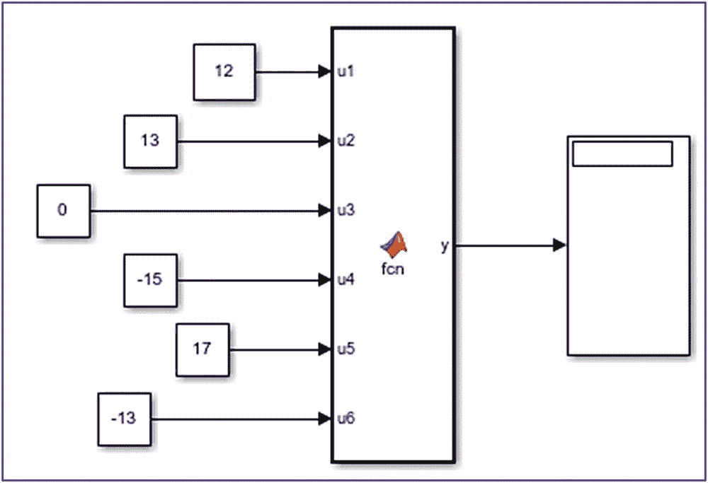

图 7-24

用于求解多项式 `12*x*⁵ + 13*x*⁴ − 15*x*² + 17*x* − 13 = 0` 的 Simulink 模型

`MATLAB Function` 模块中嵌入了以下命令语法。

```
function y = fcn(u1, u2, u3, u4, u5, u6)
y = roots([u1, u2, u3, u4, u5, u6]);
```

`MATLAB Fcn` 模块调用 MATLAB 函数 `roots()`，并根据由输入变量 `u1`、`u2`、… `u6` 给出的多项式系数来计算多项式的根，因为我们要求解的是一个五次多项式。按原样，该模型无法运行，并且还有两个与变量大小和求解器类型相关的问题。首先，*求解器类型*必须设置为固定步长类型。这可以通过“仿真 ➤ 模型配置参数 ➤ 求解器选择 ➤ 固定步长求解器”进行调整。默认情况下，求解器是变步长类型。

其次，你需要更改输出变量 `y` 的大小。你可以通过单击  模型资源管理器 ➤ [模型层次结构] ➤ `Polynomial_Solver.slx` ➤ `MATLAB Function` ➤ `y` 输出 ➤ 大小。将大小设置为 5，然后单击应用。（五次多项式有五个根。）在 Simulink 模型窗口的菜单中单击“运行”按钮，或从键盘按下 `Ctrl+T` 后，你将看到如图 7-25 所示的结果。

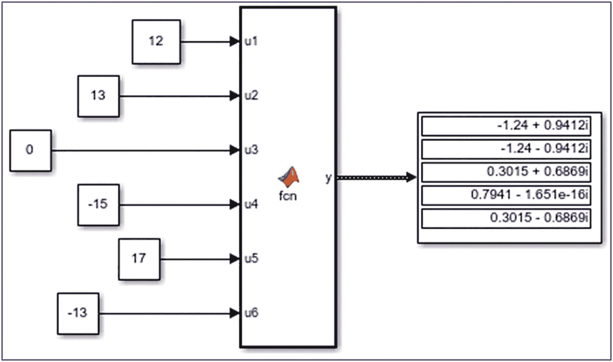

图 7-25

计算出的多项式 `12*x*⁵ + 13*x*⁴ − 15*x*² + 17*x* − 13 = 0` 的根的完整模型

该给定多项式的计算根与通过 MATLAB 命令计算出的根在小数点后四位精度上是匹配的。

# 特征值与特征向量

特征值与特征向量用途广泛，不仅在线性代数中，也在许多工程问题中有所应用。例如，它们被用于振动、模态分析、控制应用、机器人技术等领域。

**定义 1**。对于方阵`A`，其特征值和特征向量分别是一个标量`λ`和一个非零向量`ν`，满足

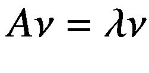

（公式 7.6）

**定义 2**。给定一个线性变换`A`（一个方阵），如果存在某个标量`λ`，使得一个非零向量`ν`满足以下特征值方程，则称`ν`为该变换的特征向量：


（公式 7.7）

在这种情况下，标量`λ`被称为对应于特征向量`ν`的`A`的特征值。

![$$ \underset{\left[A\right]\kern1.5em \ast }{\underbrace{\left[\begin{array}{ccc}a&amp; b&amp; c\\ {}d&amp; f&amp; g\\ {}h&amp; i&amp; j\end{array}\right]}}\underset{\left[X\right]\kern2.5em =}{\underbrace{\left\{\begin{array}{c}x\\ {}y\\ {}z\end{array}\right\}}}=\underset{\left[\lambda \kern1.5em \ast \right[X}{\underbrace{\lambda \kern0.5em \left[\begin{array}{c}x\\ {}y\\ {}z\end{array}\right]}} $$](images/471979_1_En_7_Chapter/471979_1_En_7_Chapter_TeX_IEq11.png)

![$$ \left[\ A\ \right]\ast \left[\ \boldsymbol{X}\ \right]-\left[\ \lambda \right]\ast \left[\ I\ \right]\ast \left[\ \boldsymbol{X}\ \right]=0 $$](images/471979_1_En_7_Chapter/471979_1_En_7_Chapter_TeX_Equ8.png)

（公式 7.8）

其中`[I]`是单位矩阵。现在通过重新排列，可以写出以下公式：

![$$ \left(\left[A\right]\hbox{--} \left[\lambda \right]\ast \left[I\right]\right)\ast \left[X\right]=0 $$](images/471979_1_En_7_Chapter/471979_1_En_7_Chapter_TeX_Equ9.png)

（公式 7.9）

假设`[X]`的系数矩阵存在逆矩阵，即`([A] – [λ] * [I])`。

![$$ {\left(\left[A\right]\hbox{--} \left[\lambda \right]\ast \left[I\right]\right)}^{-1} $$](images/471979_1_En_7_Chapter/471979_1_En_7_Chapter_TeX_Equ10.png)

（公式 7.10）

除了平凡解`[X] = 0`之外，可能存在其他解。因此，这意味着通过令该矩阵的行列式等于 0，可以得到`([A] – [λ] * [I]) = 0`。

![$$ \mathit{\det}\left\{\left[A\right]\hbox{--} \left[\lambda \right]\ast \left[I\right]\ \right\}=0 $$](images/471979_1_En_7_Chapter/471979_1_En_7_Chapter_TeX_Equ11.png)

（公式 7.11）

公式 7.11 的左侧称为特征多项式。因此，当展开该方程时，将得到关于`λ`的多项式方程。使用以下示例计算特征值和特征向量：

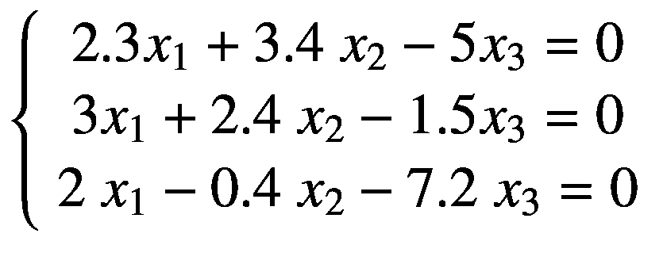

现在，给定的方程组以矩阵形式写出。

![$$ \left[\begin{array}{ccc}2.3&amp; 3.4&amp; 5\\ {}3&amp; 2.4&amp; -1.5\\ {}2&amp; -0.4&amp; -7.2\end{array}\right]\left[\begin{array}{c}{x}_1\\ {}{x}_2\\ {}{x}_3\end{array}\right]=\kern0.5em 0 $$](images/471979_1_En_7_Chapter/471979_1_En_7_Chapter_TeX_Equs.png)

该变换矩阵的特征值定义为：

![$$ \mathit{\det}\left[\begin{array}{ccc}2.3-\lambda &amp; 3.4&amp; 5\\ {}3&amp; 2.4-\lambda &amp; -1.5\\ {}2&amp; -0.4&amp; -7.2-\lambda \end{array}\right]=\kern0.5em 0 $$](images/471979_1_En_7_Chapter/471979_1_En_7_Chapter_TeX_Equt.png)

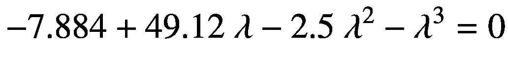

该特征多项式方程的解为`λ[1] = −8.434; λ[2] = 0.162; λ[3] = 5.772`。

接着，通过将每个特征值逐一代入方程，计算得到三个特征向量。对于大型系统，手工计算特征值和特征向量既繁琐又耗时。对于非常大的线性方程组系统，手工计算特征值和特征向量是不可行的。所有这些计算都可以通过 MATLAB 的一个内置函数`eig(A)`来完成：

```
>> A=([2.3, 3.4, 5; 3, 2.4, -1.5; 2, -0.4, -7.2])
A =
2.3000    3.4000    5.0000
3.0000    2.4000   -1.5000
2.0000   -0.4000   -7.2000
>> [v, lambda]=eig(A)
v =
0.4725   -0.7649    0.6510
-0.2479   -0.6366   -0.7276
-0.8458   -0.0983    0.2164
lambda =
-8.4345         0         0
0    5.7726         0
0         0    0.1619
>> A*v - v*lambda % 验证：特征向量和特征值；
ans =
1.0e-014 *
0.9326    0.4441    0.1346
-0.2220   -0.0888    0.1402
-0.3553   -0.0222    0.0520
% 结果非常接近
```

注意，存在几种不同的`eig()`函数语法形式，用于计算方阵的特征值和特征向量，并且还有另一个命令`eigs(A)`，用于计算特征值和特征向量。

```
d = eig(A)
d = eig(A,B)
[V,D] = eig(A)
[V,D] = eig(A,'nobalance')
[V,D] = eig(A,B)
[V,D] = eig(A,B,flag)
```

为了计算最大的特征值和特征向量：

```
d     = eigs(A)
[V,D] = eigs(A)
[V,D,flag] = eigs(A)
eigs(A,B)
eigs(A,k)
eigs(A,B,k)
eigs(A,k,sigma)
eigs(A,B,k,sigma)
eigs(A,K,sigma,opts)
eigs(A,B,k,sigma,opts)
```

# 矩阵分解

矩阵分解在线性代数和工程问题求解的许多领域有着广泛而重要的应用，例如，求解线性方程、线性最小二乘、非线性优化、蒙特卡洛模拟、实验数据分析、模态分析、电路设计、滤波器设计等等。矩阵变换和分解有几种类型，包括 QR、LU、LQ、Cholesky、Schur、奇异值分解等。在求解线性方程组时，我们已经非常简要地讨论了 QR、LU、LQ、`chol()` Cholesky 和`svd()` 奇异值分解的命令语法。本节解释如何使用 MATLAB 的内置函数计算矩阵分解。

## QR 分解

QR 分解也称为正交三角分解。它是将给定矩阵分解为两个矩阵乘积的过程。它们传统上被称为 Q 矩阵和 R 矩阵，分别是正交矩阵 Q 和上三角矩阵 R。

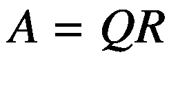

（公式 7.12）

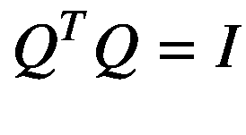

（公式 7.13）

其中`Q`是正交矩阵；`Q^T`是`Q`的转置；`R`是上三角矩阵；`I`是单位矩阵。QR 分解基于 Gram-Schmidt 方法。关于 Gram-Schmidt 方法的更多细节可从维基百科的来源[1]中找到。在 MATLAB 中，用于 QR 分解计算的函数名为`qr()`。它有几种不同的语法方法，用于计算 Q、R 及其他相关矩阵。

```
[Q,R] = qr(A)%生成上三角矩阵 R 和单位矩阵 Q
[Q,R] = qr(A,0) %生成经济规模分解
[Q,R,E] = qr(A) %生成 Q、R 和置换矩阵 E =>A*E = Q*R
[Q,R,E] = qr(A,0)%生成经济规模分解：A(:,E) = Q*R
X = qr(A)  %生成矩阵 X。triu(X)是上三角因子 R
X = qr(A,0) %类似于 X = qr(A);
R = qr(A)  %当 A 是稀疏矩阵时使用，计算无 Q 的 QR 分解并返回 R。
```

### 示例：计算 5x5 矩阵的 QR 分解

我们以一个由正态分布随机数生成器 `randn()` 生成的 5x5 矩阵 `[A]` 为例，计算该 `[A]` 矩阵的 QR 分解。

### LU 分解

LU 分解（或称因式分解）也被称为高斯消去法的一种修正形式，由艾伦·图灵 [2] 引入，其定义如下：

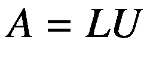

（式 7.14）

其中 `A` 是一个矩形矩阵，`L` 和 `U` 分别是下三角矩阵和上三角矩阵。在 MATLAB 中，可以使用内置函数 `lu()` 的以下语法来计算 LU 分解：

```
Y = lu(A)       %生成矩阵 Y，适用于稀疏矩阵 A。Y 仅包含 L
[L,U] = lu(A)   %生成 U 和 L
[L,U,P] = lu(A) %生成 U 与 L，其中 L 为单位下三角矩阵，并生成置换 % 矩阵 P
[L,U,P,Q] = lu(A)     %生成 U、L，以及行置换矩阵 P 和列重排矩阵 Q，使得 P*A*Q = L*U
[L,U,P,Q,R] = lu(A)   %生成 U、L，以及置换矩阵 P 和 Q，还有对角缩放矩阵 R，使得对于非空稀疏矩阵 A，有 P*(R\A)*Q = L*U
[...] = lu(A,'vector') %生成以两个行向量 p 和 q 表示的置换信息。用户可指定 1 到 5 个输出。
[...] = lu(A,thresh)
[...] = lu(A,thresh,'vector')
```

#### 示例：计算 3x3 帕斯卡矩阵的 LU 分解

让我们从任意给定的矩形矩阵计算 `L`、`U` 及其他（`P`、`Q`、`R`）矩阵。为此，你需要编写一个名为 `LU_decomposition.m` 的小型脚本，其中使用 MATLAB 的内置函数 `lu()`。该脚本会接收一个用户输入，该输入必须是一个矩形矩阵。你将在脚本中使用另一个 MATLAB 内置函数 `issparse()`，用于判断用户输入的矩阵是否为稀疏矩阵。

```
% LU_decomposition.m
A=input('输入矩形矩阵: ');
if  issparse(A)
Y = lu(A)            %#ok
[L,U,P,Q] = lu(A)    %#ok
disp('  哦哦，还有更多  ')
[L,U,P,Q,R] = lu(A)  %#ok
[L, U, P, Q, R] = lu(A,'vector') %#ok
else
[L,U] = lu(A)        %#ok
[L,U,P] = lu(A)      %#ok
% 检查计算结果：
ERROR=P*A-L*U        %#ok
[L,U,P] = lu(A, 'vector')        %#ok
end
```

运行脚本 `LU_decomposition.m`，并输入一个标准矩阵 `pascal(3)` 作为输入矩阵。

```
输入矩形矩阵: pascal(3)
L =
1.0000         0         0
1.0000    0.5000    1.0000
1.0000    1.0000         0
U =
1.0000    1.0000    1.0000
0    2.0000    5.0000
0         0   -0.5000
L =
1.0000         0         0
1.0000    1.0000         0
1.0000    0.5000    1.0000
U =
1.0000    1.0000    1.0000
0    2.0000    5.0000
0         0   -0.5000
P =
1     0     0
0     0     1
0     1     0
ERROR =
0     0     0
0     0     0
0     0     0
L =
1.0000         0         0
1.0000    1.0000         0
1.0000    0.5000    1.0000
U =
1.0000    1.0000    1.0000
0    2.0000    5.0000
0         0   -0.5000
P =
1     3     2
```

重新运行该脚本，并输入一个大小为 3x3 的稀疏矩阵作为输入。

```
输入矩形矩阵: sparse(3)
Y =
(1,1)        3
L =
(1,1)        1
U =
(1,1)        3
P =
(1,1)        1
Q =
(1,1)        1
哦哦，还有更多
L =
(1,1)        1
U =
(1,1)        1
P =
(1,1)        1
Q =
(1,1)        1
R =
(1,1)        3
```

### 乔列斯基分解

乔列斯基分解对于蒙特卡洛模拟和卡尔曼滤波器设计尤为重要。这种矩阵分解方法仅适用于方阵和乔列斯基因式，即对正定矩阵进行分解，将其分解为一个下三角矩阵与其转置的乘积。乔列斯基分解 [3, 4] 可以通过以下公式表示：

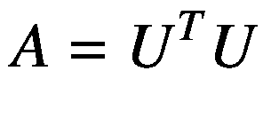

（式 7.15）

其中 `A` 是一个方阵，`U` 和 `U`^(`T`) 分别是上三角矩阵及其转置。此公式也可以使用下三角矩阵（`L`）及其转置（`L`^(`T`)）来表示：

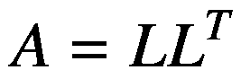

（式 7.16）

在 MATLAB 中，可以使用内置函数 `chol()` 的以下语法选项来计算乔列斯基分解：

```
R = chol(A) %生成一个上三角矩阵 R，满足：R'*R=A
L = chol(A,'lower') %生成一个下三角矩阵 L，满足：L*L'=A
[R,p] = chol(A) %生成一个上三角矩阵 R，并且 p 为 0
[L,p] = chol(A,'lower') %生成下三角矩阵 L，并且 p 为 0
[R,p,S] = chol(A) %当 A 是稀疏矩阵时，生成置换矩阵 S 和 R，以及可能为零或非零的 p
[R,p,s] = chol(A,'vector') %生成一个向量形式的置换信息 's'
[L,p,s] = chol(A,'lower','vector') %生成一个下三角矩阵 L 和一个置换向量 's'
```

### 注意

在判断正定性时，使用`chol()`（乔列斯基分解算子）优于`eig()`（特征值与特征向量）算子。

为计算任意给定矩阵（用户输入的矩阵）的乔列斯基分解，你需要编写一个名为`Chol_decoposition.m`的脚本，该脚本需考虑乔列斯基分解的要求和性质，并依据公式 7.15 和 7.16 中的表述计算任意矩阵的分解。该脚本接受一个输入，即用户输入的矩阵。注意，在此脚本中，我们使用了`disp()`、`size()`、`det()`、`run()`以及一个弹出对话框命令`warndlg()`。

```
% Chol_decomposition.m
clearvars; clc
disp('请注意，你的矩阵必须是方阵且正定！！！')
disp('提示：正定意味着所有行列式必须为正。')
disp('你可以以矩阵元素形式输入')
disp('或先定义你的矩阵，')
disp('然后输入矩阵名称')
disp('      ')
A=input('请输入一个给定矩阵：');
[rows, cols]=size(A);
for k=1:rows
% 计算行列式
Det_A(k)=det(A(1:k, 1:k));
end
if rows==cols
if true(Det_A>0)==1
if issparse(A)
[R,p,S] = chol(A) %#ok
[R,p,s] = chol(A,'vector');
[L,p,s] = chol(A,'lower','vector');
else
R = chol(A) %#ok % 上三角矩阵 R: R'*R=A
L = chol(A,'lower') %#ok % 下三角矩阵 L。
[R,p] = chol(A);
% 验证：
Error_up  = A-R'*R;
Error_low = A-L*L';
disp('使用上三角矩阵的误差：')
disp(Error_up)
disp('使用下三角矩阵的误差：')
disp(Error_low)
end
else
warndlg('抱歉，你的矩阵不是正定矩阵！')
warndlg('请重试！！！')
run('Chol_decomposition')
end
end
```

你可以用不同的输入矩阵来测试该脚本。让我们使用`pascal()`生成的一个 4x4 标准矩阵。

```
请注意，你的矩阵必须是方阵且正定！！！
你可以以矩阵元素形式输入
或先定义你的矩阵，
然后输入矩阵名称
请输入一个给定矩阵：pascal(4)
R =
1     1     1     1
0     1     2     3
0     0     1     3
0     0     0     1
L =
1     0     0     0
1     1     0     0
1     2     1     0
1     3     3     1
使用上三角矩阵的误差：
0     0     0     0
0     0     0     0
0     0     0     0
0     0     0     0
使用下三角矩阵的误差：
0     0     0     0
0     0     0     0
0     0     0     0
0     0     0     0
```

现在，考虑一个 3x3 的魔方矩阵。

```
>> run('Chol_decomposition')
请注意，你的矩阵必须是方阵且正定！！！
你可以以矩阵元素形式输入
或先定义你的矩阵，
然后输入矩阵名称
请输入一个给定矩阵：magic(3)
```

当使用一个 3x3 魔方矩阵作为输入运行脚本后，会出现如图 7-26 所示的警告对话框。


图 7-26

警告显示输入矩阵不是正定矩阵，因此无法计算乔列斯基分解

`Chol_decoposition.m`脚本识别了乔列斯基分解的性质，并计算用户输入矩阵的乔列斯基分解。它能够检测矩阵类型，并借助 MATLAB 内置函数`chol()`处理给定的方阵和正定矩阵。

### 舒尔分解

舒尔分解在数值分析中有许多应用，包括与矩阵分解或因子分解工具结合使用的图像处理领域。一个复数方阵`[A]`的舒尔分解被定义为一种矩阵分解[5]：

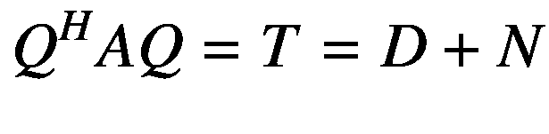

（公式 7.17）

其中`Q`是一个酉矩阵，`Q^H`是`Q`的共轭转置，`T`是一个上三角矩阵，它等于一个由`A`的特征值`λ[i]`组成的对角矩阵`D = diag(λ[1], λ[2], λ[3], …, λ[n])`与一个严格上三角矩阵`N`之和。舒尔分解可通过 MATLAB 的内置函数`schur()`计算。

| 参数 | 描述 |
| :--- | :--- |
| `'complex'` | `如果 A 有复数特征值，则 T 是复数三角矩阵。` |
| `'real'` | `T 将实数特征值放在对角线上，复数特征值放在 2x2 块的对角线上。'real'是默认选项。` |

```
T = schur(A)       % 生成 A 的舒尔矩阵
T = schur(A, flag) % 针对两种情况生成舒尔矩阵。
%{
对于实数矩阵 A，根据 flag 的值，返回以下两种形式之一的舒尔矩阵 T：
```

```
%}
[U,T] = schur(A,...)
```

让我们看几个标准矩阵的例子，并计算它们的舒尔分解：

```
>> format short
>> A=randn(5,5)
A =
1.2280   -0.5261    0.6770    0.9856    0.8005
1.8766    1.3087    0.1504    2.0377   -0.0944
-0.8958    0.6341    0.5682   -0.9155   -1.2224
0.2791    1.0490   -0.1173    0.7488    1.2225
-0.7456    0.3522    0.1206   -0.4902    0.1131
>> [Q, R]=qr(A)
Q =
-0.4829    0.4184   -0.6628   -0.3755   -0.1068
-0.7380   -0.5121   -0.0038    0.2917    0.3286
0.3523   -0.4417   -0.7048    0.3635   -0.2279
-0.1098   -0.5418    0.1633   -0.5900   -0.5654
0.2932   -0.2720   -0.1932   -0.5419    0.7135
R =
-2.5428   -0.5003   -0.1895   -2.5283   -0.8486
0   -1.8346   -0.0140   -0.4991    0.2301
0         0   -0.8922    0.2012    0.5091
0         0         0   -0.2847   -1.5550
0         0         0         0   -0.4484
>> [Q, R]=qr(A, 0)
Q =
-0.4829    0.4184   -0.6628   -0.3755   -0.1068
-0.7380   -0.5121   -0.0038    0.2917    0.3286
0.3523   -0.4417   -0.7048    0.3635   -0.2279
-0.1098   -0.5418    0.1633   -0.5900   -0.5654
0.2932   -0.2720   -0.1932   -0.5419    0.7135
R =
-2.5428   -0.5003   -0.1895   -2.5283   -0.8486
0   -1.8346   -0.0140   -0.4991    0.2301
0         0   -0.8922    0.2012    0.5091
0         0         0   -0.2847   -1.5550
0         0         0         0   -0.4484
>> [Q,R,E]=qr(A)
Q =
-0.3790    0.4944    0.1187   -0.7732   -0.0060
-0.7836   -0.3819   -0.4391    0.0709    0.2058
0.3521   -0.5445   -0.3906   -0.5784   -0.3041
-0.2879   -0.4732    0.7478   -0.0438   -0.3634
0.1885   -0.2990    0.2851   -0.2465    0.8562
R =
-2.6005   -0.8385   -0.9904   -0.1179   -2.4722
0   -1.7067    0.4852   -0.0126    0.4692
0         0    1.5604   -0.2610   -0.3322
0         0         0   -0.8660   -0.1267
0         0         0         0   -0.0886
E =
0     0     0     0     1
0     1     0     0     0
0     0     0     1     0
1     0     0     0     0
0     0     1     0     0
>> A*E
ans =
0.9856   -0.5261    0.8005    0.6770    1.2280
2.0377    1.3087   -0.0944    0.1504    1.8766
-0.9155    0.6341   -1.2224    0.5682   -0.8958
0.7488    1.0490    1.2225   -0.1173    0.2791
-0.4902    0.3522    0.1131    0.1206   -0.7456
>> Q*R
ans =
0.9856   -0.5261    0.8005    0.6770    1.2280
2.0377    1.3087   -0.0944    0.1504    1.8766
-0.9155    0.6341   -1.2224    0.5682   -0.8958
0.7488    1.0490    1.2225   -0.1173    0.2791
-0.4902    0.3522    0.1131    0.1206   -0.7456
```

### 奇异值分解（`svd`）

奇异值分解（SVD）在信号处理、统计学和图像处理领域有着广泛的应用。对于一个给定的 i 行 j 列的实矩阵 `A[ij]`（其中 i > j），SVD 将其表示为三个矩阵的乘积：一个正交矩阵（`U[ii]`）、一个对角矩阵（`D[ij]`）和另一个正交矩阵的转置（`V[jj]`）。

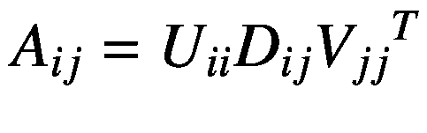

（方程 7.18）

其中，`U[ii]^T U[ii] = I`，`V[jj]^T V[jj] = I`。`D[ij]` 的对角元素被称为 `A[ij]` 的奇异值。此外，SVD 还有其他几个重要的性质。

-   `A[ij]` 的左奇异向量是 `A[ij] A[ij]^T` 的特征向量。
-   `A[ij]` 的右奇异向量是 `A[ij]^T A[ij]` 的特征向量。
-   `A[ij]` 的非零奇异值（位于 `D[ij]` 的对角线上）是 `A[ij]^T A[ij]` 和 `A[ij] A[ij]^T` 的非零特征值的平方根。

有几种方法可以计算任意给定矩阵的 SVD、奇异值和奇异向量。您可以使用 MATLAB 的内置函数 `svd()` 和 `svds()`。

```matlab
s = svd(A)        %产生一个奇异值向量
[U,D,V] = svd(A) %产生一个与 A 维度相同的对角矩阵 D，其对角线元素为非负且递减，以及酉矩阵 U 和 V，使得 X = U*D*V'。
[U,D,V] = svd(A,0) %产生“经济规模”分解。如果 A 是 m×n 且 m > n，则 SVD 仅计算 U 的前 n 列，且 D 是 n×n。
s = svds(A)
s = svds(A,k)
s = svds(A,k,sigma)
s = svds(A,k,'L')
s = svds(A,k,sigma,options)
[U,D,V] = svds(A,...)
[U,D,V,flag] = svds(A,...)
```

现在，取两个矩阵（大小分别为 2×3 和 3×3）并计算它们的 SVD。

```matlab
>> A=ceil(randn(2,3)*10); B=pascal(3);
>> A
A =
    26     2   -19
    -6     0    -4
>> s = svd(A)
s =
   32.3640
    6.7506
>> [U,D,V] = svd(A)
U =
   -0.9968    0.0801
    0.0801    0.9968
D =
   32.3640         0         0
    0    6.7506         0
V =
   -0.8156   -0.5774   -0.0366
   -0.0616    0.0237    0.9978
    0.5753   -0.8161    0.0549
>> [U,D,V] = svd(A,0)
U =
   -0.9968    0.0801
    0.0801    0.9968
D =
   32.3640         0         0
    0    6.7506         0
V =
   -0.8156   -0.5774   -0.0366
   -0.0616    0.0237    0.9978
    0.5753   -0.8161    0.0549
>> s = svds(A)
s =
   32.3640
    6.7506
>> s = svds(B)
s =
    7.8730
    1.0000
    0.1270
>> s = svds(B, k)
s =
    7.8730
    1.0000
>> s = svds(A,k,'L')
s =
   32.3640
    6.7506
```

## 逻辑运算符、索引和转换

MATLAB 使用逻辑 1 和逻辑 0 作为系统变量，分别表示逻辑值的真（true）和假（false）。逻辑值变量通过逻辑数据类型来区分。表 7-2 列出了 MATLAB 中使用的逻辑运算符及其操作功能。

**表 7-2** MATLAB 中的逻辑表达式与运算符

| 运算符 | 操作 |
| --- | --- |
| `true`, `false` | 设置逻辑值 |
| `&` (与), `\|` (或), `~` (非), `xor`, `any`, `all` | 逻辑运算 |
| `&&`, `\|\|` | 短路运算 |
| `bitand`, `bitcmp`, `bitor`, `bitmax`, `bitxor`, `bitset`, `bitget`, `bitshift` | 按位运算 |
| `==` (`eq`), `~=` (`ne`), `<` (`lt`), `>` (`gt`), `<=` (`le`), `>=` (`ge`) | 关系运算 |
| `strcmp`, `strncmp`, `strcmpi`, `strncmpi` | 字符串比较 |

### 注意

要获取关系运算符、其函数及其用法的完整列表，请在命令窗口中输入 `>> help relop`。

### 逻辑索引

逻辑运算符是任何编程语言中最核心和最重要的要素之一。逻辑运算符引入了另一种访问 MATLAB 变量中数据的方法。例如，给定一个 5×5 的魔方矩阵 `[A]`，假设您需要分离出 `[A]` 中等于或小于 13 的元素。

```matlab
>> A=magic(5)
A =
    17    24     1     8    15
    23     5     7    14    16
     4     6    13    20    22
    10    12    19    21     3
    11    18    25     2     9
>> A_index=(A> A(A_index)            % 提取元素
ans =

>> % 或者直接：
>> A(A<13 | A==13);
```

让我们通过更多示例来探讨逻辑索引的性质，以便选择矩阵元素。

```matlab
>> E = eye(5)
E =
     1     0     0     0     0
     0     1     0     0     0
     0     0     1     0     0
     0     0     0     1     0
     0     0     0     0     1
>> A = magic(5); A(E)
数组索引必须为正整数或逻辑值。
>> E_L = logical(eye(5))
E_L =
  5×5 logical array
   1   0   0   0   0
   0   1   0   0   0
   0   0   1   0   0
   0   0   0   1   0
   0   0   0   0   1
>> A(E_L)            % 使用逻辑矩阵 E，提取 A 的对角线元素
ans =

```

### 注意

前面的示例演示了单位矩阵 `[E]`（其元素为 1 和 0）不等同于逻辑矩阵 `[E_L]`（其元素也是 1 和 0）。

此外，还有许多函数/命令（例如 `is*()` 系列命令）可用于判断输入是否为指定类型的变量、是否包含特定类型的任何元素、或者此类变量或文件是否存在等。所有这些函数都可用于逻辑索引。让我们看几个简单的例子：

```matlab
>> x=13; isnumeric(x)     % x 是否为数值数据？
ans =

>> x=13; islogical(x)     % x 是否为逻辑数据？
ans =

>> x=13; islogical(x>110) % 操作 (x>110) 的结果是否为逻辑值？
ans =

>> x = 13; isempty(x)  % x 是否为空？
ans =

>> x = [ ]; isempty(x) % x 是否为空？
ans =
logical

>> x = [1 , 2; 3, 4]; iscell(x)  % x 是否为元胞数组？
ans =
logical

>> x = [1, 0; 0, 4];
>> X_x = x/0; isnan(X_x)  % X_x 中的任何元素是否为非数字（NaN）？
ans =
  2×2 logical array
   0   1
   1   0
>> exist('X_x', 'var')    % 名为 X_x 的变量是否存在？
ans =

```

在前一个示例中，零除以零（`0/0`）在 MATLAB 中被定义为 `NaN`（即非数字）。

### 注意

逻辑索引操作在矩阵/数组运算、编程、数据处理和分析中特别重要，因为它们可用于排序、定位或更改矩阵/数组/数据集的特定元素。

### 示例：使用逻辑索引定位并替换矩阵中的元素

让我们再看一个例子。给定一个 3×3 的矩阵 `[A]`，其中一些元素等于无穷大。

![$$ A=\left[\begin{array}{ccc}17&amp; \infty &amp; -6\\ {}5&amp; -3&amp; 11\\ {}\infty &amp; 13&amp; \infty \end{array}\right] $$](images/471979_1_En_7_Chapter/471979_1_En_7_Chapter_TeX_Equv.png)

如何将等于 `inf` 的元素替换为 1000，并将所有负值元素替换为 0？可以使用逻辑索引操作轻松完成此任务。

```matlab
>> A=[17   Inf     -6 ; 5 -3   11; Inf  13  Inf]  % 输入 [A]
A =
    17   Inf    -6
     5    -3    11
   Inf    13   Inf
>> A_inf = (A==1/0)    % 找出 A 中哪些元素等于 inf
A_inf =
  3×3 logical array
   0   1   0
   0   0   0
   1   0   1
>> A(A_inf)=1000      % 将找到的元素设置为 1000
A =
    17        1000          -6
     5          -3          11
  1000          13        1000
>> A_0 = A> A(A_0)=0          % 将找到的元素设置为 0
A =
    17        1000           0
     5           0          11
  1000          13        1000
```

### 备注

在 MATLAB 中，任何数值除以 0 都会得到值 `Inf`。

接下来看另一个示例。给定一个大小为 4 行 5 列的矩阵 `[A]`，其中包含 `NaN`（非数值）和 `inf`（无穷大）元素。如何将 `NaN` 元素替换为 0，并将 `inf` 替换为 100？此任务可以像之前演示的示例一样，使用逻辑索引轻松解决。

```matlab
>> A = [2 -3 -2 -3 1; Inf -2  3 -1  NaN; -3 0 Inf 3 2; 3 NaN 0 2 Inf]
A =
     2    -3    -2    -3     1
   Inf    -2     3    -1   NaN
    -3     0   Inf     3     2
     3   NaN     0     2   Inf
>> A_nan=isnan(A)
A_nan =
  4×5 logical array
   0   0   0   0   0
   0   0   0   0   1
   0   0   0   0   0
   0   1   0   0   0
>> A(A_nan)=0
A =
     2    -3    -2    -3     1
   100    -2     3    -1     0
    -3     0   100     3     2
     3     0     0     2   100
```

请注意，本节包含相当简单且规模较小的示例，旨在演示如何使用逻辑索引操作轻松替换矩阵的特定（有值的）元素。这种技术（逻辑索引或关系运算符）可以应用于任意大小的矩阵、数组和数据集。因此，逻辑索引在大型数据集的分析和处理中尤其有用。它快速高效，并且无需额外编程使用循环（`for ... end`、`while ... end`）和条件（`if .. elseif ... else ... end`）运算符。

### 转换

在信号处理中有许多需要执行转换的场景。例如模数转换器及其逆过程、数据处理与分析，以及在编程中当模拟信号的数据格式或类型需要转换为数字格式或反之亦然时。例如，为了解决图像处理中的内存问题，您可能需要将十进制（双精度）格式的数据转换为二进制数。在 MATLAB 中，使用 `DEC2BIN()` 可以轻松完成此操作。相反，`BIN2DEC()` 用于将二进制字符串转换为十进制（双精度）类型的数据。`DEC2BIN(D)` 将 `D` 的二进制表示作为字符串返回。`D` 必须是一个小于 `2⁵²` 的非负整数。`DEC2BIN(D,N)` 会生成一个至少包含 `N` 位的二进制表示。

另一个转换示例是字符转换。您需要将数字转换为字符串，反之亦然。MATLAB 使用 `CHAR()` 命令将数字转换为 ASCII/ANSI 格式的字符，使用 `DOUBLE()` 将字符和数字的符号表示转换为双精度格式，使用 `STR2NUM()` 将字符串转换为二进制数，并使用 `NUM2STR()` 将任何数字转换为字符串。让我们来看几个使用这些转换命令的示例：

```matlab
>> dec2bin(11) % DEC2BIN - 将十进制整数转换为二进制字符串
ans =

>> dec2bin(23)

>> dec2bin(22)
ans =

>> x=13.125/5.5;
>> dec2bin(x)

>> dec2bin(11.11)
ans =

>> dec2bin(11)
ans =

>> bin2dec('1101') % 将二进制数转换为十进制数
ans =

>> bin2dec('10110')
ans =

>> dec2bin(64)
ans =

>> char(bin2dec('10000000'))
ans =
@
>> G='MatLab'
G =
MatLab
>> G0=G+0
G0 =
    77    97   116    76    97    98
>> d2bG0=dec2bin(G0)
d2bG0 =

>> b2dG0=bin2dec(d2bG0)
b2dG0 =

>> char(b2dG0)'
ans =
MatLab
>> num2str(123)
ans =
'123'
>> num2str('matlab')
ans =
'matlab'
>> ans+0
ans =
   109    97   116   108    97    98
```

# 示例：使用 `char()` 创建字符串

通过编写一个脚本来以递进格式创建以下字母，该脚本具有一个输入参数，该参数必须是整数。所有其他字母都需要通过编程方式生成。

*   a
*   b c
*   d e f
*   g h i j
*   k l m n o

这些字符可以通过多种方式生成。首先，您需要确定 `a` 的 ASCII/ANSI 数值表示。然后您可以生成所有其他字母。

```matlab
>> format short
>> double('a')
ans =

>> char(97)
ans =
    'a'
>> double('b')
ans =

```

字母 `a` 在 ASCII/ANSI 中的数值表示是 97，`b` 表示为 98，以此类推。基于此，您可以生成一个从 97 开始的整数线性空间，并逐行将其转换为字符串。换句话说，您在第一行显示一个字符，在第二行显示两个字符，在第三行显示三个，等等。以下是完整的脚本（`print_character.m`），它按递进顺序打印字母。

```matlab
% print_character.m
% 第 1 部分。
Start = 97;
for ii = 1:5
    for jj = 1:ii
        fprintf(char(Start));
        Start = Start+1;
    end
    fprintf('\n')
end
```

以下是该脚本的运行结果。

```
a
bc
def
ghij
klmno
```

让我们来看以下示例，该示例打印一系列大写字符：

*   ABCDEF
*   GHIJK
*   LMNO
*   PQR
*   ST
*   U

此示例与前一个示例类似，但有一些小的不同——它需要大写字符，从六个字母开始，并且在后续行中逐渐减少。

同样，您可以通过以下命令确定 `A` 在 ANSI/ASCII 中的数值表示：

```matlab
>> double('A')
ans =

>> 'A' + 0    % 另一种方法：
ans =

```

所以现在您知道 `A` 的数值表示是 65。然后您可以通过引入两处微小改动来编辑脚本（`print_characters.m`），并编写这个脚本。

```matlab
%% 第 2 部分
Start = 65;
for ii = 6:-1:1
    for jj = 1:ii
        fprintf(char(Start));
        Start = Start+1;
    end
    fprintf('\n')
end
```

当您执行此脚本时，在命令窗口中会得到以下输出：

```
ABCDEF
GHIJK
LMNO
PQR
ST
U
```

通过几个示例，本节简要讨论了逻辑运算符、转换和索引问题。在其他章节中，将通过更扩展的示例来演示转换问题的应用。

# 总结

本章介绍了线性代数、矩阵运算、向量空间、多项式、求解线性方程组的方法、矩阵分解与转换。通过示例，您学习了如何使用 MATLAB 的内置函数和命令，如何开发与 MATLAB 命令窗口关联的 Simulink 模块，以及如何使用函数和 MATLAB Fcn 模块。示例中讨论和解释了以下 MATLAB 函数。

*   矩阵运算 `+`、`-`、`*` 和 `/`
*   元素级运算 `.*`、`.^` 和 `./`
*   反斜杠运算符 (`\`) 和 `mldivide()`
*   使用 `linsolve()` 求解线性方程
*   矩阵求逆运算符 `inv()` 和 `pinv()`
*   特征值和特征向量 `eig()`
*   多项式求解器 `roots()`、`solve()` 和 `zero()`
*   符号数学方程求解器 `solve()`
*   标准矩阵和画廊矩阵：`magic()`、`gallery()` 和 `sparse()`
*   向量空间 `linspace()` 和 `logspace()`
*   矩阵运算和分解方法，如 QR、LU、Cholesky、SVD、Schur：`qr()`、`lu()`、`chol()`、`svd()`、`schur()` 和 `decomposition()`
*   逻辑运算符（`<=`、`~=`、`>=`、`|`、`&`、`is*()`）和索引选项
*   转换工具和运算符（`bin2dec`、`dec2bin`、`double` 和 `char`）

# 自测练习

## 练习 1

求解以下变量为 `x`、`y` 和 `z` 的方程组：

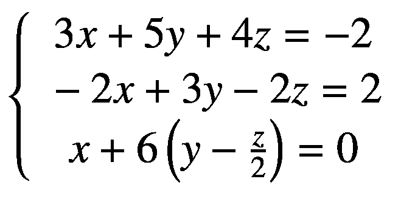

1.  使用反斜杠 (`\`) 运算符或 `mldivide()` 求解给定的方程组。
2.  使用逆矩阵方法 `inv()` 求解给定的方程组。
3.  使用 `linsolve()` 函数求解给定的方程组。
4.  使用 `solve()` 函数求解给定的方程组。
5.  使用 `chol()` 求解给定的方程组。
6.  使用 Simulink 模块求解给定的方程组。
7.  通过计算每种方法的范数来计算误差。

## 练习 2

使用矩阵逆求解下列方程组。

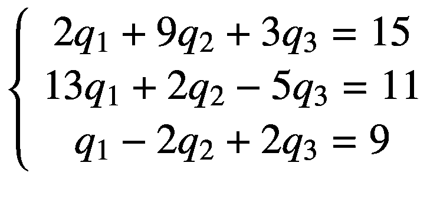

1.  使用逆矩阵方法 `inv()` 求解给定的方程组。
2.  使用最小二乘法 `lsqr()` 求解给定的方程组。
3.  使用高斯消元法结合 `lu()` 函数求解给定的方程组。
4.  使用 `solve()` 函数求解给定的方程组。
5.  使用 Simulink 模块求解给定的方程组。
6.  比较各解法的精度（保留八位小数）。

## 练习 3

求解下列方程组：

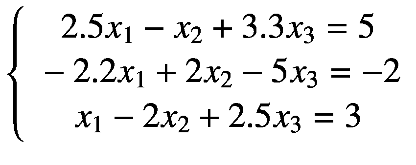

1.  使用逆矩阵方法 `qr()` 求解给定的方程组。
2.  使用简化行阶梯形方法 `rref()` 求解给定的方程组。
3.  使用 `decomposition()` 函数求解给定的方程组。
4.  使用 `solve()` 函数求解给定的方程组。
5.  使用 Simulink 模块求解给定的方程组。
6.  比较这四种方法的精度（保留十位小数）。

## 练习 4

求解下列方程组。


1.  使用逆矩阵方法 `inv()` 求解给定的方程组。
2.  使用奇异分解 `svd()` 方法求解给定的方程组。
3.  使用 `linsolve()` 函数求解给定的方程组。
4.  使用 `solve()` 函数求解给定的方程组。
5.  使用 Simulink 模块求解给定的方程组。
6.  比较这四种方法的精度（保留十三位小数）。

## 练习 5

已知：

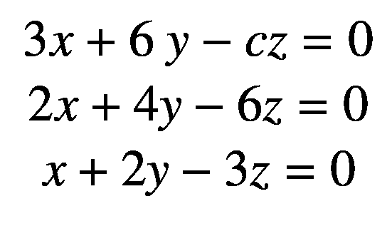

*   找出使得方程组只有平凡解的 `c` 值。
*   找出使得方程组有无穷多解的 `c` 值。
*   找出 `x`、`y` 和 `z` 之间的关系。

## 练习 6

求给定矩阵的逆矩阵：

![$$ A=\left[\begin{array}{ccc}3& 6& -12\\ {}2& 4& -6\\ {}1& 2& -3\end{array}\right] $$](images/471979_1_En_7_Chapter/471979_1_En_7_Chapter_TeX_Equab.png)

*   解释为什么给定矩阵不存在逆矩阵。
*   计算矩阵的行列式。
*   使用 `eig()` 找出给定系统的特征值和特征向量。
*   使用 `roots()` 找出特征值。

## 练习 7

求给定矩阵的逆矩阵：

![$$ A=\left[\begin{array}{ccc}3& 6& -2\\ {}1& 2& -4\\ {}0& 1& -3\end{array}\right] $$](images/471979_1_En_7_Chapter/471979_1_En_7_Chapter_TeX_Equac.png)

*   计算矩阵的行列式。
*   使用 `eig()` 找出给定系统的特征值和特征向量。
*   使用 `roots()` 找出特征值。

## 练习 8

使用左除（`\` 反斜杠）方法和伪逆方法（`pinv`）求解以下表示欠定方程组的解。比较所得结果并讨论其差异。

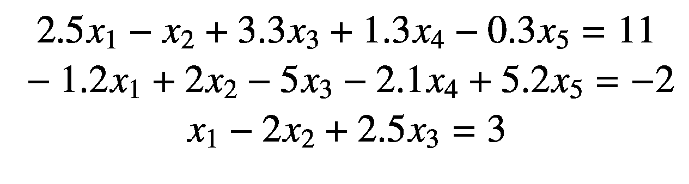

## 练习 9

使用反斜杠（`\`）运算符以及 `linsolve()`、`inv()`、`lsqr()` 和 `solve()` 函数求解下列方程组：

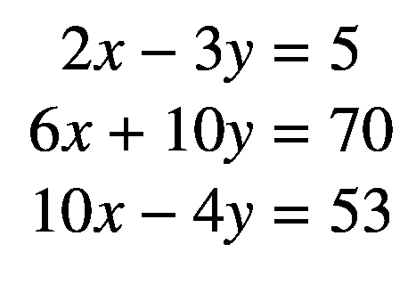

## 练习 10

说明为什么以下方程组无解：

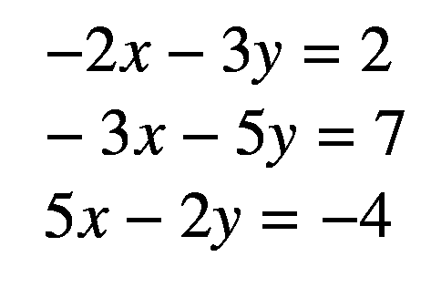

## 练习 11

使用逻辑运算符从给定的两个矩阵 `A` 和 `B` 创建矩阵 `C`。解释为什么新数组的某些元素为零。

![$$ C=\left[\begin{array}{c}\begin{array}{ccc}0& 0& -3\kern1em \\ {}1& 0& 0\ \\ {}0& \kern0.5em 0& 1\kern1em \end{array}\\ {}\begin{array}{ccc}\ 1& 0& -2\ \\ {}2& 1& 0\ \\ {}0& 0& 1\ \end{array}\end{array}\right] $$](images/471979_1_En_7_Chapter/471979_1_En_7_Chapter_TeX_IEq13.png), ![$$ A=\left[\begin{array}{c}\begin{array}{ccc}3& 6& -3\kern1em \\ {}1& 2& -2\ \\ {}0& \kern0.5em 1& 1\kern1em \end{array}\\ {}\begin{array}{ccc}\ 1& 3& -2\ \\ {}2& 1& -1\ \\ {}1& 0& 1\ \end{array}\end{array}\right] $$](images/471979_1_En_7_Chapter/471979_1_En_7_Chapter_TeX_IEq14.png), ![$$ B=\left[\begin{array}{c}\begin{array}{ccc}1& 2& -3\\ {}1& 1& -3\\ {}-1& -2& 1\kern0.5em \end{array}\\ {}\begin{array}{ccc}1& 1& -1\\ {}2& 2& -2\\ {}-2& 0& 1\kern0.5em \end{array}\end{array}\right] $$](images/471979_1_En_7_Chapter/471979_1_En_7_Chapter_TeX_IEq15.png)

提示：使用逻辑运算符（`<`、`=`）和元素级矩阵乘法。

## 练习 12

执行以下操作：

*   从大小为 5×5 的幻方矩阵中获取一个大小为 5×5 的单位矩阵。
*   从大小为 10×10 的随机方阵中创建一个大小为 10×10 的单位方阵。
*   从大小为 3×3 的 gallery 矩阵 `pascal()` 中获取一个大小为 3×9 的复制方阵。

## 练习 13

求解以下方程，并讨论 `a` = 13 和 `a` = 29 两种情况下的解。


编写一个包含逻辑和循环运算符（`if`、`break`、`for` 和 `end`）的脚本，找出使得这些方程有实数解的 `a` 值。假设 `a` 是一个介于 1 到 50 之间的整数值。

提示：使用 `rank()` 函数和反斜杠（`\`）运算符。

## 练习 14

使用 `roots()`、`solve()`、`zero()` 和 Simulink 模型求解下列多项式。

*   `2*u⁹ − 3*u⁸ + 5*u⁴ − 13*u² − 131 = 0`
*   
*   

## 练习 15

创建一个对数间隔数组（行向量）`B`，其数字从 10 开始，到 100 结束，并从行向量 `B` 创建列向量 `BB`。

## 练习 16

播放由下列表达式定义的声音：


其中，`f[s]` = 10000 Hz（采样频率）；`t` = 13 秒（时长）；`f[1]` = 100 Hz（第 1 个信号）；`f[2]` = 200 Hz（第 2 个信号）；`f[3]` = 300 Hz（第 3 个信号）；`f[4]` = 600 Hz（第 4 个信号）；`f[5]` = 700 Hz（第 5 个信号）。

## 练习 17

使用 MATLAB 回答以下问题：

- 十进制数 123、123.123、321、321.123、223、322、333 和 333.3 的二进制表示分别是什么？
- 为什么 123 与 123.123、321 与 321.123，以及 333 与 333.3 的二进制表示是相同的？

## 练习 18

使用 MATLAB 回答以下问题：

- 二进制数 1001、01010、111100、0101011 的十进制表示分别是什么？
- 二进制数 1001、01010、111100、0101011 的字符表示是什么？

## 练习 19

编写一个脚本，该脚本接收一个输入数字（整数），并在命令窗口中按顺序打印出以下字符。

- A
- BCD
- EFGHI
- JKLMNOP
- QRSTUVWXY

## 练习 20

使用练习 11 中矩阵 `A` 和 `B` 的数值来评估 QR、LU、LQ、Cholesky、Schur 和奇异值分解。解释为什么 `A` 和 `B` 的某些分解（矩阵因子分解）无法计算。

### 练习 21
使用 `gallery` 矩阵函数创建一个 5×5 的 Hilbert 矩阵，并使用 `Chol_decoposition.m` 脚本计算 Cholesky 分解。编辑该脚本（`Chol_decoposition.m`），使其只计算 Cholesky 分解的下三角矩阵。

### 练习 22
使用 `gallery` 矩阵函数创建一个 3×3 的 Riemann 矩阵，并计算其 QR、LU、LQ、Cholesky、Schur 和奇异值分解。

### 练习 23
执行以下操作：
- 使用 `gallery` 矩阵函数创建一个 4×4 的随机矩阵，要求列已归一化并具有指定的奇异值。提示：使用 `randcolu`。
- 计算刚创建的矩阵的 QR、LU、LQ 和分解。

### 练习 24
执行以下操作：
- 创建一个 5×5 的随机矩阵，其元素为 1 到 13 之间的随机整数，并将其命名为 `A_mat`。
- 使用 Krylov 矩阵 gallery 创建一个 5×5 的 Krylov 矩阵，并将其命名为 `K_mat`。
- 通过对 `A_mat` 和 `K_mat` 使用逻辑运算（`A_mat` ≥ `K_mat`）和逐元素矩阵乘法，创建一个名为 `Logic_A` 的 5×5 逻辑值矩阵。

### 练习 25
创建以下 10×10 矩阵：
```
AaA =
17    24     1     8    15    17    24     1     8    15
23     5     7    14    16    23     5     7    14    16
4     6    13    20    22     4     6    13    20    22
10    12    19    21     3    10    12    19    21     3
11    18    25     2     9    11    18    25     2     9
17    24     1     8    15    17    24     1     8    15
23     5     7    14    16    23     5     7    14    16
4     6    13    20    22     4     6    13    20    22
10    12    19    21     3    10    12    19    21     3
11    18    25     2     9    11    18    25     2     9
```
提示：使用 `magic()` 和 `repmat()`。

