# 8. 常微分方程
许多工程应用的建模问题都可以使用常微分方程（ODE）来描述。微分方程有几种不同的定义。其中最简单的定义来自文献[1]：“微分方程是包含导数的任意方程，导数可以是常导数或偏导数。”根据这个定义，我们可以推导出两种类型的微分方程——常微分方程（ODE）和偏微分方程（PDE）。ODE 包含一种类型的导数或一个自变量，而与之相反，PDE 包含两个或多个导数或自变量。例如，一阶 ODE 可以表示为：

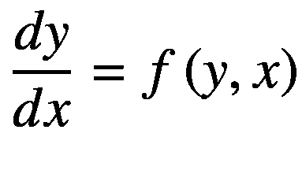

（方程 8.1）

其中 `y(x)` 是因变量，其值取决于自变量 `x` 的值。ODE 的另一个典型例子是牛顿第二运动定律，它被表述为：

`ma` = `dp/dt` = `m dv/dt` = `F(t, v)` (方程 8.2)

其中 `F(t, v)` 是力，它是时间（`t`）和速度（`v`）的函数；`dv/dt` 是运动物体的速度变化率（加速度）；`m` 是运动物体的质量；`a` 是运动物体的加速度；`p` 是动量；`dp/dt` 是其导数。牛顿第二定律的这种表述也可以改写为以下形式。

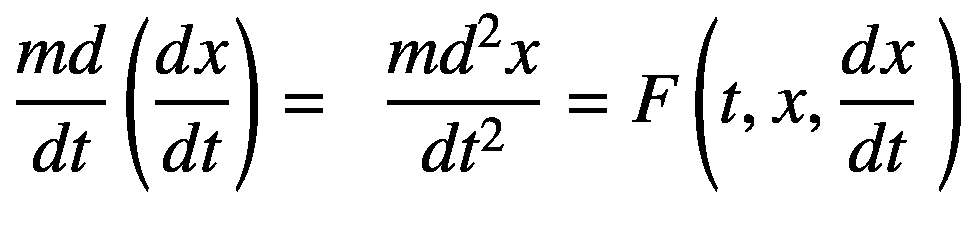

（方程 8.3）

其中，运动物体位移（`x`）的导数 `(dx/dt)` 即为速度（`v`）。换句话说，速度是运动物体位移 `x(t)` 随时间的变化率。这可以用图 8-1 中的流程图来直观展示。

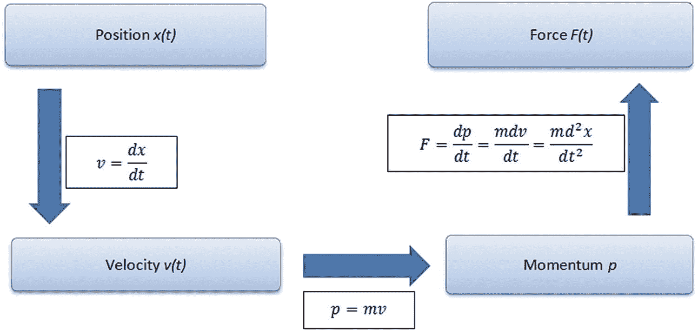

**图 8-1** 描述运动物体运动与所受作用力的流程图

## ODE 的分类
与 ODE 相关的问题分为两类：
- 初值问题（IVP）：`ẍ = x t - 3ẋ`，初始条件为 `x(0) = 3, ẋ(0) = 1`
- 边值问题（BVP）：`ẍ = x t - 3ẋ`，边界条件为 `x(0) = 3, x(2) = 1.50`

初值问题（IVP）的定义是：ODE 以及在解域中给定点处未知函数的一个指定值（称为初始条件）共同构成的问题。在 ODE 的 IVP 中，可能存在唯一解、无解或许多解。根据定义，ODE 的 IVP 可以显式定义或隐式定义。大多数 IVP 都是显式定义的。我们从显式定义的 IVP 开始，然后过渡到隐式定义的 IVP。除了按解类型（解值在解搜索空间中的变化方式）分类外，IVP 还分为刚性问题和非刚性问题。此外，ODE 可分为线性和非线性两大类，以及齐次和非齐次两类。

以下是不同类型、类别和分组的 ODE 的具体示例。
- 刚性 ODE：`{ẋ = -0.04x + 10⁴ yz, ẏ = 0.04x - 10⁴ yz - 3*10⁷ y², ż = 3*10⁷ y²}`，`t ∈ [0, 40]`
- 非刚性 ODE：`ẏ + 2y = 2t`，`ẅ + ẇ = 5`
- 线性 ODE：`dv/dt = 9.81 - 0.198v`，`ẍ + 3ẋ + 5x = 0`
- 非线性 ODE：`dv/dt = 9.81 - 0.198v²`，`ẍ + 3x ẋ + 5x² = 0`
- 齐次 ODE：`ẏ + 2y = 0`，`ẍ + 3ẋ + 5x = 0`
- 非齐次 ODE：`ẏ + 2y = sin(x)`，`ẍ + 3ẋ + 5x = e^(2t)`

以下是几个 ODE 及其应用领域的示例。

### 示例 1：生物体的无约束增长
这是一个指数增长问题，描述了生物机体（例如细菌）的无约束增长。此行为也可用于描述房地产或投资价值、热门社交网站的会员增长、零售业务增长、电气系统的正反馈以及化学反应。该问题由以下一阶常微分方程表示：

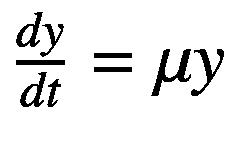 的解为：`y(t) = y[0]e^(μt)`

### 示例 2：放射性衰变
这指的是指数衰减，它描述了自然界和工程学中的许多现象，例如放射性衰变、反应器中化学物质的洗脱、电容器的放电以及河流中物质的分解。它使用以下一阶常微分方程表示：

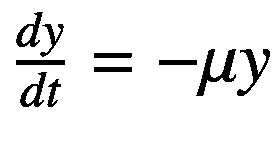 的解为：`y(t) = y[0]e^(-μt)`

示例 1 和示例 2 是一阶常微分方程的两个简单例子。

### 示例 3：牛顿第二定律
使用牛顿第二定律，下落物体的运动由以下方程表示。

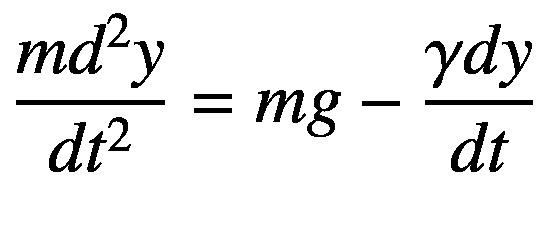

这是一个二阶常微分方程，其解的形式为：

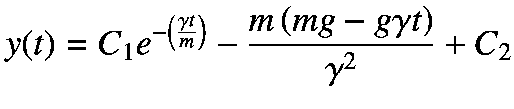

其中，`m` 是下落物体的质量；`g` 是重力加速度；`γ` 是下落物体的空气阻力系数。三个参数——`m`、`g` 和 `γ`——是常量，而两个参数随时间变化——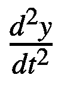（加速度）和 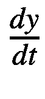（速度）。在自由落体物体的解中，`C[1]` 和 `C[2]` 是取决于初始条件的任意数。换句话说，它们可以通过考虑下落物体的初始条件来计算。

有几种方法可以评估常微分方程的解析解，包括分离变量法、引入新变量法等。我们将通过考察这些类型常微分方程的具体例子，来了解如何评估它们的解析解并计算数值解。为此，我们将在 MATLAB/Simulink 环境中运用不同的技术，编写脚本并构建模型。在计算常微分方程的解析解时，我们将通过具体例子解释如何使用符号数学工具箱⁽⁸⁾和 MuPAD⁽⁹⁾ 笔记本的内置函数。我们更侧重于符号数学工具箱的命令语法，而非 MuPAD 笔记本。在 MATLAB 的未来版本中，MuPAD 笔记本将被移除。

显而易见，我们更多地关注数值求解方法，而非解析解搜索工具。评估常微分方程的解析解并非总是可行，或者成本过高。因此，数值求解通常是最佳选择。数值方法有很多种，包括欧拉法（向前、向后、修正）、休恩法、中点法、龙格-库塔法、龙格-库塔-吉尔法、亚当斯-巴什福斯法、米尔恩法、亚当斯-莫尔顿法、泰勒级数法和梯形法。这些方法中有些是显式的，有些是隐式的。为了演示如何运用这些方法，我们首先描述它们的公式，然后研究它们的实现算法，以便显式地编写脚本（程序）。我们不试图推导这些数值方法中使用的任何公式。有许多文献资料 [参见 2, 3, 4, 5] 解释了这些方法的理论层面。

在使用数值方法求解初值问题时，我们从一个初始点（初始条件）开始，然后在时间上向前迈一步（等步长或变步长）来计算后续的数值解。之前提到的一些数值方法（如欧拉法）是单步法，而其他方法（如龙格-库塔法、亚当斯-巴什福斯法、米尔恩法、亚当斯-莫尔顿法和泰勒级数法）是多步法。单步法仅参考前一个点及其导数值来确定当前值。其他方法，如龙格-库塔法，会采取一些中间步骤来获得一个高阶步长，然后在进行下一步之前丢弃之前的值。与单步法不同，多步法会保留并使用前几步的值，而不是丢弃它们。这样，多步法将先前获得的几个值（解）和导数值联系起来。所有这些方法，即单步法和多步法，都会根据其准确性和效率进行评估，这些评估基于为特定类型的常微分方程初值问题计算数值解所花费的计算时间和资源（例如机器时间）。然而，事实仍然是，一阶、二阶或更高阶初值问题的大多数解无法通过解析方法找到。因此，我们需要采用各种数值方法。

## 解析方法
符号数学工具箱（或 MuPAD 笔记本）具有多个函数，能够评估许多可解析求解的常微分方程的解析解。有两个命令（内置函数）可以用于评估某些常微分方程的解析解——`dsolve` 和 `ilaplace`/`laplace`。

请注意，在本小节中，我们将通过一些一阶和二阶常微分方程以及耦合微分方程组的示例来演示如何计算常微分方程的解析解。

### DSOLVE
在 MATLAB 中，用于计算任意给定常微分方程解析（或通）解的第一个常微分方程求解器工具是 `dsolve`。它可以与以下通用语法一起使用：
```
Solution = dsolve(equation)
Solution = dsolve(equation, conditions)
Solution = dsolve(equation, conditions, Name, Value)
[y1,...,yN] = dsolve(equations)
[y1,...,yN] = dsolve(equations, conditions)
[y1,...,yN] = dsolve(equations, conditions, Name, Value)
```

### 示例 1：使用 dsolve
给定一个常微分方程 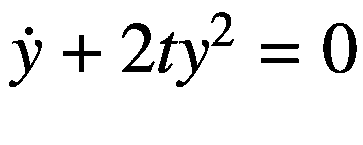，注意未指定初始条件和边界条件。
```
>> y_solution=dsolve('Dy=-2*y²*t')
Y_solution=-1/(C3-t²)
```
请注意，`C3` 是由给定常微分方程的初始条件或边界条件定义的。

还有一个替代命令。在更高版本的 MATLAB 中（从 MATLAB 2012 开始），我们可以通过使用以下命令语法来解决给定问题：
```
>>syms y(t); y_sol=dsolve(diff(y) == -2*y²*t)
y_sol =

-1/(- t² + C3)
```

### 示例 2：根据 dsolve 绘图
给定一个常微分方程  及初始条件 `y(0) = 0.5`：
```
>> Solution=dsolve('Dy=-2*y²*t', 'y(0)=0.5')
Solution =
1/(t² + 2)
```
更高版本 MATLAB 的替代命令语法如下：
```
>> syms y(t); Solution=dsolve(diff(y) == -2*y²*t, y(0)==0.5)
Solution =
1/(t² + 2)
```

解析解是以符号形式给出的，因此可以使用 `ezplot` 进行绘图。（参见图 8-2。）

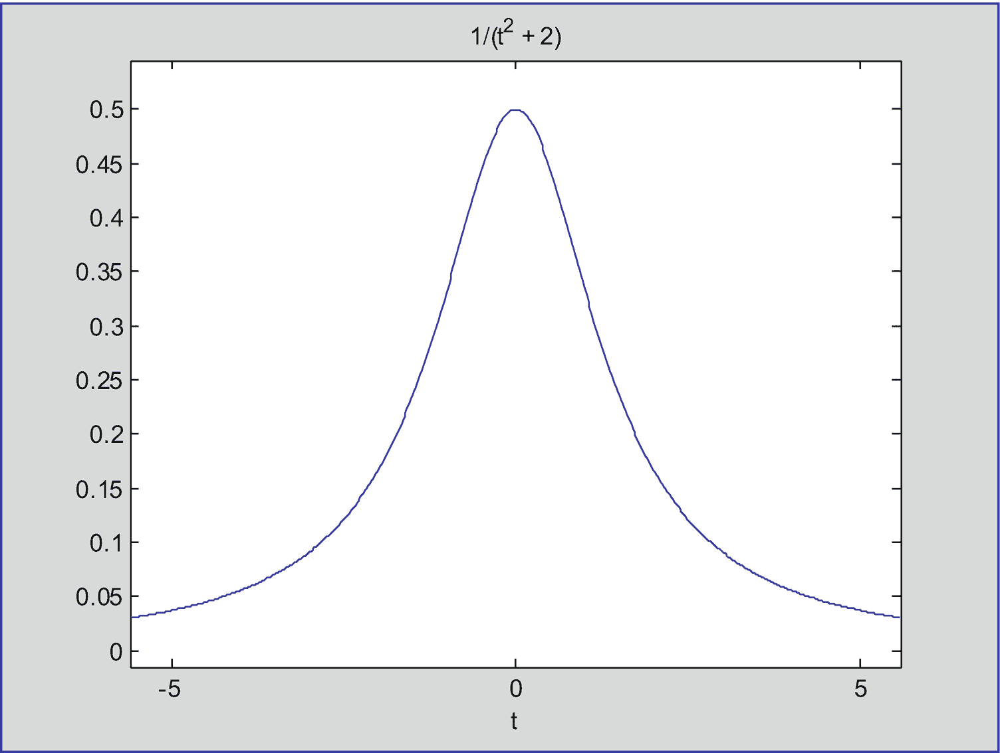

图 8-2

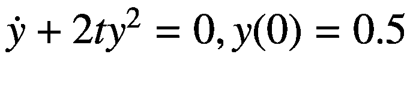 的解析解
```
>> ezplot(Solution)
```
解析解（方程）的数值可以通过向量化（参数化）符号公式（解）来计算：
```
>> ysol=vectorize(solution)
ysol =
1./(t.² + 2)
>> t=(-5:.1:5); ysol_values=eval(ysol);
```

### 示例 3：添加一个未指定的参数
给定 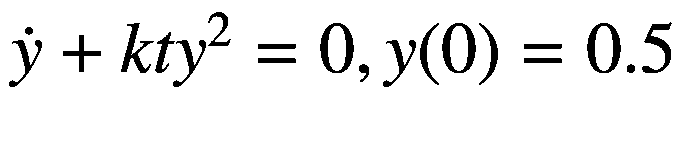，注意该练习包含一个未指定参数 `k`。
```
>> syms k
>> solution=dsolve('Dy=-k*y²*t', 'y(0)=0.5')
solution =
1/((k*t²)/2 + 2)
```
以下是备选命令语法：
```
>> syms y(t) k; solution=dsolve(diff(y) == -k*y²*t, y(0)==0.5)
solution =
1/((k*t²)/2 + 2)
```

### 注意
`dsolve` 中的选项需要根据问题类型进行适当设置。在 MATLAB 2008-2010 或更早版本中，为了获得所有可能的解，应将 `IgnoreAnalyticConstraints` 设置为 `none`。

例如：
```
solution=dsolve('Dy=-k*y²*t', 'y(0)=0.5', ... 'IgnoreAnalyticConstraints', 'none')
```

### 注意
对于 MATLAB 2012 或更高版本，为了获得所有参数值的所有可能正确答案，应将 `IgnoreAnalyticConstraints` 设置为 `false`。否则，`dsolve` 可能因其预代数简化而输出错误答案。

例如：
```
solution=dsolve(diff(y)==-k*y²*t, y(0)==0.5, ... 'IgnoreAnalyticConstraints', false)
```

## 二阶常微分方程与常微分方程组
许多过程和现象都通过二阶微分方程来表达。例如，弹簧-质量系统的简谐运动、具有一定加速度的物体的运动（牛顿第二定律）、阻尼振动、电阻-电容-电感电路中的电流流动等。通常，二阶常微分方程以两种不同形式表示——齐次方程（方程 8.4）和非齐次方程（方程 8.5）。

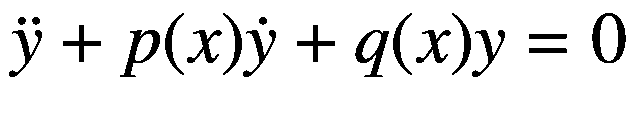
（方程 8.4）

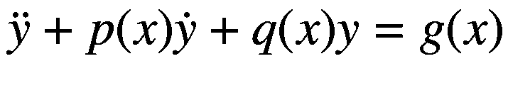
（方程 8.5）

请注意，方程 8.4 中的齐次常微分方程总是有一个平凡解，即 `y(x) = 0`，它满足方程 8.4 中的给定条件。关于独立函数 `p(x)`、`q(x)`、`g(x)`，这些常微分方程可以是线性的或非线性的。在某些情况下，独立函数 `p(x)`、`q(x)`、`g(x)` 可以是常量或非常量。

让我们通过几个二阶常微分方程的示例，看看如何使用 MATLAB 的符号数学工具箱计算通解和特解。

## 使用 `dsolve` 求解常微分方程

### 示例 1：求解二阶常微分方程

给定一个常微分方程 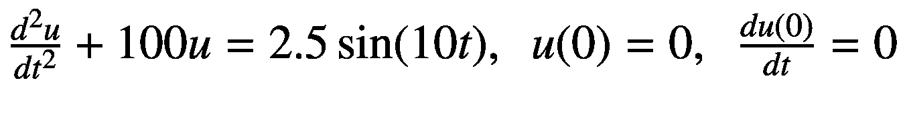：

```
usol=dsolve('D2u+100*u=2.5*sin(10*t)', 'u(0)=0', 'Du(0)=0');
pretty(usol)
%% 备选语法
syms u(t)
Du = diff(u);
u(t) = dsolve(diff(u, 2)==2.5*sin(10*t)-100*u, u(0)==0, Du(0) == 0);
pretty(u(t))
```

执行这两个简短脚本/命令后的输出为：

```
3 sin(10 t)   sin(30 t)
----------- - --------- -
320          320
/ t   sin(20 t) \
cos(10 t) | - - --------- |
\ 8      160    /
```

### 示例 2：求解常微分方程组

给定常微分方程组：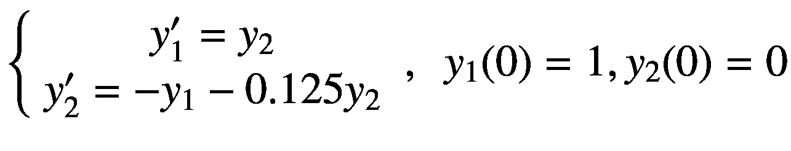。

该问题是一个由两个一阶常微分方程组成的方程组。可以使用 `dsolve` 直接求解：

```
%% 使用 dsolve 求解两个一阶常微分方程组成的方程组
yt=dsolve('Dy1=y2', 'Dy2=-y1-0.125*y2','y1(0)=1', 'y2(0)=0');
pretty(yt.y1)
pretty(yt.y2)
%% 备选语法
syms y1(t) y2(t)
z=dsolve(diff(y1,1)==y2, diff(y2,1)==(-y1-0.125*y2), y1(0)==1, y2(0)==0);
pretty(z.y1), pretty(z.y2)
```

在命令窗口中显示的计算得出的解析解为：

```
/    1/2   \             /    1/2   \
| 255    t |      1/2    | 255    t |
cos| -------- |   255    sin| -------- |
\    16    /             \    16    /
--------------- + ----------------------
1/16                    1/16
exp(t)              255 exp(t)
/    1/2   \
1/2    | 255    t |
16 255    sin| -------- |
\    16    /
- -------------------------
1/16
255 exp(t)
```

计算得出的解析解为：

![$$ {y}_1(t)=\frac{\mathit{\cos}\left(\frac{\sqrt{255}t}{16}\right)}{\sqrt[16]{e^t}}+\frac{\sqrt{255}\mathit{\sin}\left(\frac{\sqrt{255}t}{16}\right)}{255\sqrt[16]{e^t}} $$](images/471979_1_En_8_Chapter/471979_1_En_8_Chapter_TeX_Equc.png)

![$$ {y}_2(t)=-\frac{16\sqrt{255}\mathit{\sin}\left(\frac{\sqrt{255}t}{16}\right)}{255\sqrt[16]{e^t}} $$](images/471979_1_En_8_Chapter/471979_1_En_8_Chapter_TeX_Equd.png)

### 示例 3：`dsolve` 无法求解的情况

给定一个二阶常微分方程：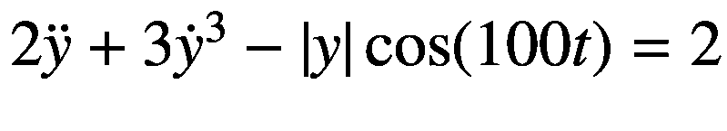，`y(0)=0` 且 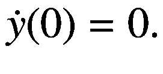

```
>> Solution_dsolve=dsolve('2*D2y+3*(Dy³)-cos(100*t)*abs(y)-2=0', ... 'y(0)=0','Dy(0) =0');
警告: 无法找到显式解。
> In dsolve at 194
```

这是处理无法使用 `dsolve` 解析求解的常微分方程的一种好方法。

让我们看几个在 MuPAD 笔记本中计算常微分方程解析解的示例。我们可以通过在命令窗口中输入以下命令来打开 MuPAD：

```
>> mupad
```

### 示例 4：使用 MuPAD 计算解析解

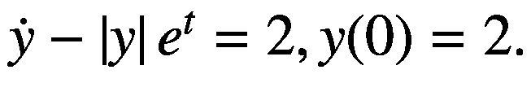 图 8-3 显示了用于计算给定练习解析解的命令。

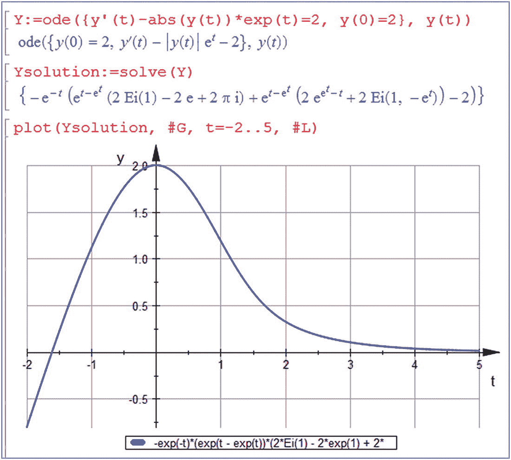

### 示例 5：一个有趣的常微分方程

让我们考虑一个二阶常微分方程，如下所示：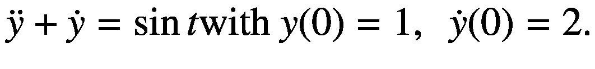

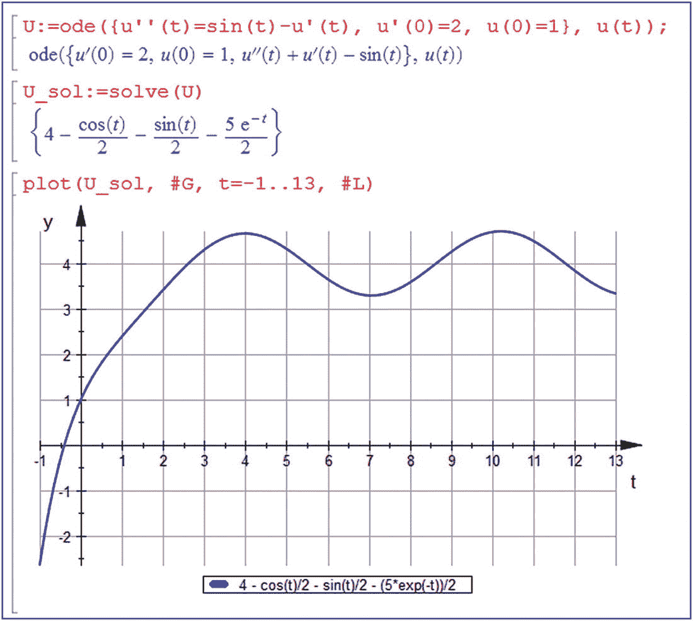

### 示例 6：应对无解析解的情况

给定 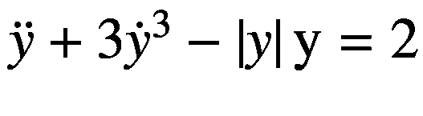，`y(0)=0` 且 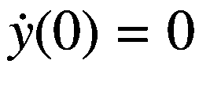，这是一个二阶非齐次非线性常微分方程。

```
Y:=ode({y"(t)+3*(y'(t)³)-y(t)*abs(y(t))=2,y(0)=0,y'(0)=0},y(t)
```


```
Ysolution:=solve(Y)
```


本练习中未计算出解。当 MuPAD 无法计算给定常微分方程问题的解析解时，它会重写给定的问题表述，并且不产生解析解表达式。

## 拉普拉斯变换

常系数线性常微分方程的解可以通过拉普拉斯变换来求解。拉普拉斯变换在解微分方程时最重要的特征之一在于，变换后的方程是一个代数方程。它将被用于定义给定微分方程的解。通常，应用拉普拉斯变换求解微分方程的过程可以表述如下。

考虑 `y`^(*n*)(`x`) = `f`(`t`) 的 n 阶导数。`y`^(*n*)(`x`) 的拉普拉斯变换如下：

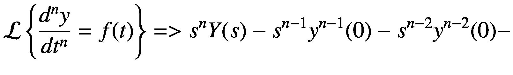

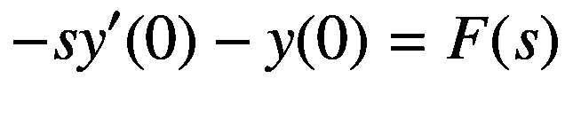

(方程 8.6)

或者

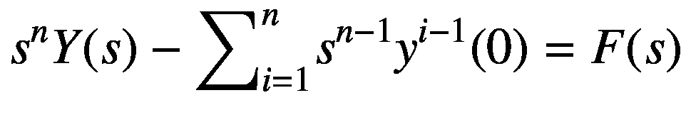

(方程 8.7)

在方程 8.6 或 8.7 中，如果我们代入在 `t` = 0 时给出的初始条件常数值，即 `y`(0) = `a`[0]; `y`^′(0) = `a`[1]; `y`^"(0) = `a`[2]; …; `y`^(*n* − 2)(0) = `a`[*n* − 2]; `y`^(*n* − 1)(0) = `a`[*n* − 1].

现在，我们可以将表达式（方程 8.6 或 8.7）重写如下：

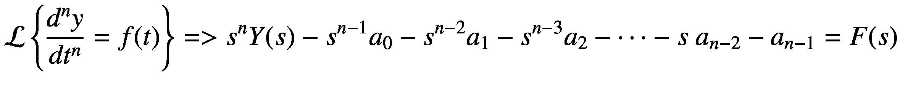

(方程 8.8)

随后，我们首先求解 `Y(s)`，对 `Y(s)` 进行逆拉普拉斯变换，然后得到 n 阶微分方程的解 `y(t)`。

应用拉普拉斯变换和逆拉普拉斯变换求解常系数微分方程的一般步骤如下。

1. 对给定方程的两边同时进行拉普拉斯变换。
2. 用 `F(s)` 和其他未知量表示并求解 `Y(s)`。
3. 对找到的表达式进行逆拉普拉斯变换，以获得问题的最终解。

注意，在步骤 3 中，我们还应将步骤 2 中的表达式分解为部分分式，以便使用逆拉普拉斯变换的对应表。图 8-5 中的流程图给出了拉普拉斯变换和逆拉普拉斯变换的示意图。

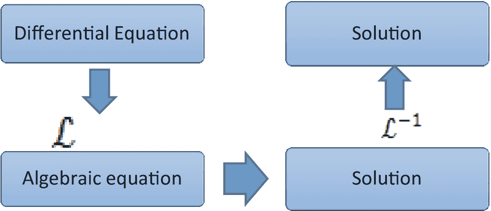

### 示例 1：第一个拉普拉斯变换

让我们考虑一个二阶非齐次微分方程：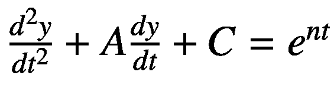，`dy`(0) = `k`，`y`(0) = `m`。

现在，通过应用流程图中所示的拉普拉斯变换和逆变换的步骤，我们以明确的步骤写出给定问题的拉普拉斯变换。

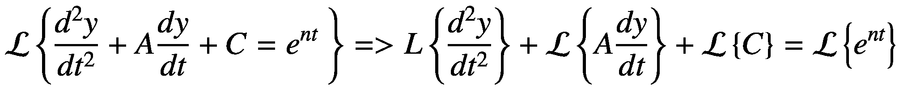

(方程 8.9)

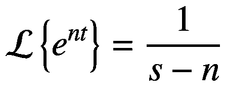

(方程 8.10)

所以，

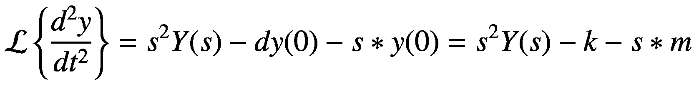

(方程 8.11)

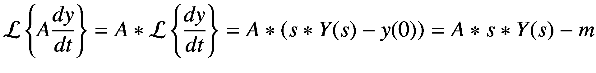

(方程 8.12)

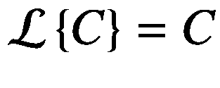

(方程 8.13)

将方程 8.10、8.11、8.12 和 8.13 代入方程 8.9，我们得到以下表达式：

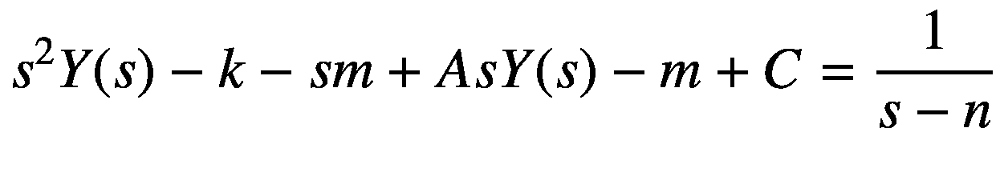

(方程 8.14)

我们求解方程 8.5 得到 `Y(s)`，以确定下式：

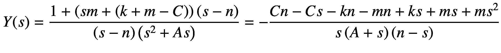

(方程 8.15)

根据方程 8.15 中 `Y(s)` 的表达式，我们可以将其分解为部分分式，并对两边取逆拉普拉斯变换。我们得到方程 8.16，即给定微分方程的 `y(t)`：

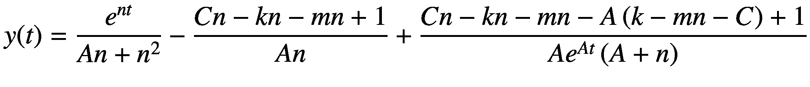

(方程 8.16)

符号数学工具箱内置的 `laplace()` 函数用于计算任何代数表达式或微分方程的拉普拉斯变换。同样，符号数学工具箱的 `ilaplace()` 函数用于计算已求得的拉普拉斯变换后 `s` 域表达式的逆变换。这两个函数通过自动分解部分分式过程来处理所有变换，然后计算给定常微分方程练习的解析解。

### `laplace` / `ilaplace` 函数

如前所述，`laplace`/`ilaplace` 基于拉普拉斯变换和逆拉普拉斯变换，它们是符号数学工具箱的内置函数工具。`laplace`/`ilaplace` 的一般语法如下：

```
F=laplace(f)
F=laplace(f, t)
F=laplace(f, var1, var2)
```

以及

```
f=ilaplace(F)
f=ilaplace(F, s)
f=ilaplace(F, var1, var2)
```

### 示例 2：使用 `LAPLACE`

给定 `x`(`t`) = sin (2`t`)，使用以下命令语法计算 `x`(`t`) 的拉普拉斯变换。

```
>> syms t
>> xt=sin(2*t); Xs=laplace(xt)
Xs =
2/(s² + 4)
```

给定：`y`(`t`) = sin (`Kt`)

```
>> syms t K
>> yt=sin(K*t); Ys=laplace(yt)
Ys =
K/(K² + s²)
```

### 示例 3：最后一个 `LAPLACE`

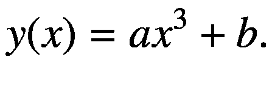

```
>> syms x a b
>> yx=a*x³+b; Ys=laplace(yx)
Ys =
(6*a)/s⁴ + b/s
```

我们也可以获得 `t` 变量域而不是 `s`。

```
>> yx=a*x³+b; Yt=laplace(yx, x, t)
Yt =
(6*a)/t⁴ + b/t
```

`ilaplace()` 函数的语法和实现与 `laplace` 完全相同。让我们看几个常微分方程练习，看看如何使用 `laplace`/`ilaplace`，并将它们求得的解与使用 `dsolve` 得到的解进行比较。

### 示例 4：比较 `laplace`/`ilaplace` 与 `dsolve`

让我们使用 `laplace`/`ilaplace` 和 `dsolve` 求解 $$ \dot{y}+2y=0,y(0)=0.5 $$。以下脚本 (`ODE_Laplace.m`) 展示了求解过程。

```matlab
% ODE_Laplace.m
clearvars; clc; close all
% 步骤 #1. 定义符号变量名称
syms t s Y
ODE1='D(y)(t)=-2*y(t)';
% 步骤 #2. 拉普拉斯变换
LT_A=laplace(ODE1, t, s);
% 步骤 #3. 代入初始条件并引入未知量 Y
LT_A=subs(LT_A,{'laplace(y(t),t, s)','y(0)'},{Y,0.5});
% 步骤 #4. 求解 Y（未知量）
Y=solve(LT_A, Y);
display('给定 ODE 及其初始条件的拉普拉斯变换'); disp(Y)
% 步骤 #5. 计算逆拉普拉斯变换
Solution_Laplace=ilaplace(Y);
display('使用拉普拉斯变换求得的解：')
pretty(Solution_Laplace)
% 步骤 #6. 计算数值并绘图
t=0:.01:2.5; LTsol=eval(vectorize(Solution_Laplace));
figure, semilogx(t, LTsol, 'ro-')
xlabel('t'), ylabel('解的值')
title('laplace/ilaplace vs dsolve ')
grid on; hold on
% 与 dsolve 求解方法对比
Y_d=dsolve('Dy=-2*y', 'y(0)=0.5'); display('使用 dsolve 的解')
pretty(Y_d); Y_sol=eval(vectorize(Y_d));
plot(t,Y_sol, 'b-', 'linewidth', 2), grid minor
legend('laplace+ilaplace', 'dsolve'), hold off; axis tight
```

执行 `ODE_Laplace.m` 脚本后，得到以下输出。

```
Laplace Transforms of the given ODE with ICs
1/(2*s + 4)
Solution found using Laplace Transforms:
exp(-2 t)

Solution with dsolve
exp(-2 t)
```

图 8-6 所示的解曲线清楚地显示了通过 `laplace`/`ilaplace` 和 `dsolve` 求得的解完美收敛。

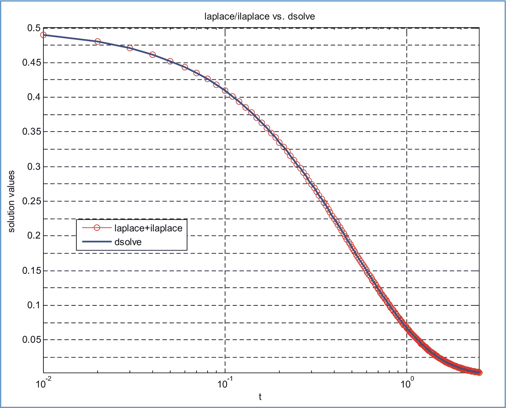

**图 8-6**
使用 `laplace`/`ilaplace` 和 `dsolve` 求解的问题 $$ \dot{y}+2y=0,y(0)=0.5 $$

### 示例 5：收敛的解

给定 $$ \ddot{y}+\dot{y}=\sin t,y(0)=1,\dot{y}(0)=2 $$，以下脚本 (`Laplace_vs_Dsolve.m`) 使用 `laplace`、`ilaplace` 和 `dsolve` 求解这个二阶非齐次常微分方程。

```matlab
% Laplace_vs_Dsolve.m
% %%   拉普拉斯变换
% 给定: y"+y'=sin(t) 初始条件: y(0)=1, y'(0)=2.
clearvars, clc, close all
syms t s Y
ODE2nd='D(D(y))(t)+D(y)(t)-sin(t)';
% 步骤 1. 拉普拉斯变换
LT_A=laplace(ODE2nd, t, s);
% 步骤 2. 代入初始条件并引入未知量 Y
LT_A=subs(LT_A,{'laplace(y(t),t, s)','y(0)','D(y)(0)'},{Y,1,2});
% 步骤 3. 求解未知量 Y
Y=solve(LT_A, Y);
display('给定 ODE 及其初始条件的拉普拉斯变换'); disp(Y)
Solution_Laplace=ilaplace(Y);
display('使用拉普拉斯变换求得的解：')
pretty(Solution_Laplace); t=0:.01:13;
LTsol=eval(vectorize(Solution_Laplace));
figure, plot(t, LTsol, 'ro-'); xlabel('t'),
ylabel('解的值')
title('laplace/ilaplace vs. dsolve: ddy+dy=sin(t)'); hold on
% dsolve 求解方法
Y=dsolve('D2y+Dy=sin(t)', 'y(0)=1, Dy(0)=2', 't');
display('使用 dsolve 的解：');
pretty(Y); Y_sol=eval(vectorize(Y));
plot(t,Y_sol, 'b-', 'linewidth', 2); grid minor
legend('laplace+ilaplace', 'dsolve'); hold off
```

计算得到的解析解如下：

```
Laplace Transforms of the given ODE with ICs
(s + 1/(s² + 1) + 3)/(s² + s)
Solution found using Laplace Transforms:
cos(t)   sin(t)   5 exp(-t)
4 - ------ - ------ - ---------
2        2          2
Solution with dsolve:
cos(t)   sin(t)   5 exp(-t)
4 - ------ - ------ - ---------
2        2          2
```

从图 8-7 的曲线可以清楚地看出，通过拉普拉斯变换（`laplace`/`ilaplace`）和 `dsolve` 函数求得的解完美收敛。两个函数都计算出了给定 ODE 的相同解析解。

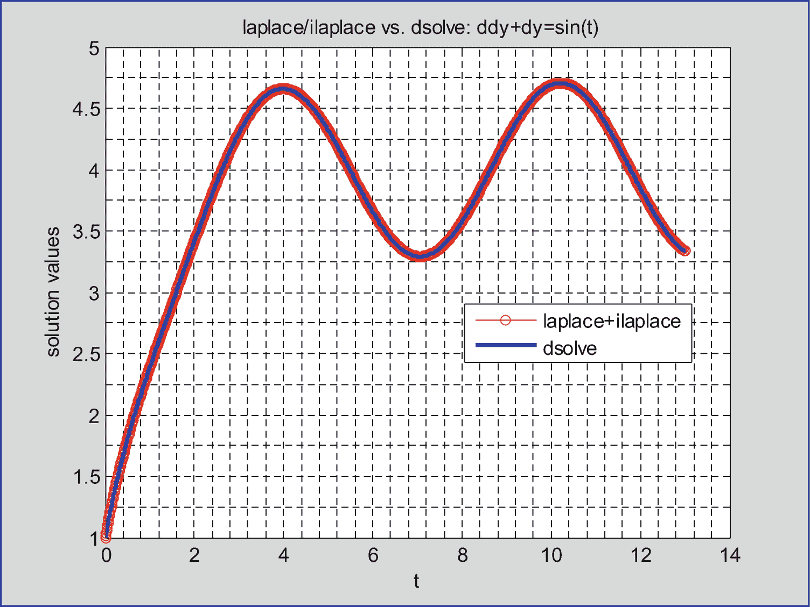

**图 8-7**
$$ \ddot{y}+\dot{y}=\mathit{\sin}(t),y(0)=1,\kern0.5em \dot{y}(0)=2 $$ 的数值解

### 示例 6：无解析解

给定一个二阶非齐次非线性 ODE $$ 2\ddot{y}+3{\dot{y}}³-\left|y\right|\cos (t)=2 $$，*y*(0) = 0 和 $$ \dot{y}(0)=0. $$。以下是使用拉普拉斯和逆拉普拉斯变换的求解脚本 (`Lap_inv_Lap.m`)：

```matlab
% Lap_inv_Lap.m
clearvars, clc, close all
syms t s Y
ODE2nd='2*D(D(y))(t)+3*(D(y)(t))³-cos(100*t)*abs(y(t))-2';
% 步骤 1. 拉普拉斯变换
LT_A=laplace(ODE2nd, t, s);
% 步骤 2. 代入初始条件并引入未知量 Y
LT_A=subs(LT_A,{'laplace(y(t),t, s)','y(0)','D(y)(0)'},{Y,0,0});
% 步骤 3. 求解未知量 Y
Y=solve(LT_A, Y);
display('给定 ODE 及其初始条件的拉普拉斯变换'); disp(Y)
Solution_Laplace=ilaplace(Y);
display('使用拉普拉斯变换求得的解：')
pretty(Solution_Laplace)
```

`Lap_inv_Lap.m` 脚本在命令窗口产生以下输出：

```
Laplace Transforms of the given ODE with ICs
(4 + s*laplace(abs(y(t)), t, s - 100*i) + s*laplace(abs(y(t)), t, s + 100*i) - 6*s*laplace(D(y)(t)³, t, s))/(4*s³)
Solution found using Laplace Transforms:
/                3              \
| laplace(D(y)(t) , t, s)       |
3 ilaplace| -----------------------, s, t |
2             |            2                  |
t              \           s                   /
-- - ------------------------------------------- +
2                         2
/ laplace(|y(t)|, t, s - 100 i)       \
ilaplace| -----------------------------, s, t |
|               2                     |
\              s                      /
----------------------------------------------- +

/ laplace(|y(t)|, t, s + 100 i)       \
ilaplace| -----------------------------, s, t |
|               2                     |
\              s                      /
```

这个输出意味着，与 `dsolve` 函数工具一样，`laplace`/`ilaplace` 未能显式计算解析解。

### 示例 7：论证高效与便捷

给定一个二阶非齐次常微分方程 $$ 2\ddot{y}+3\dot{y}-2y=g(t) $$，`y(0) = 0` 且 $$ \dot{y}(0)=0 $$，其中 `g(t)` 是一个不连续的强制函数，定义为

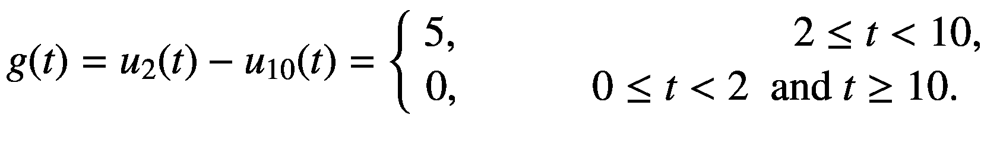

给定方程的拉普拉斯变换为：

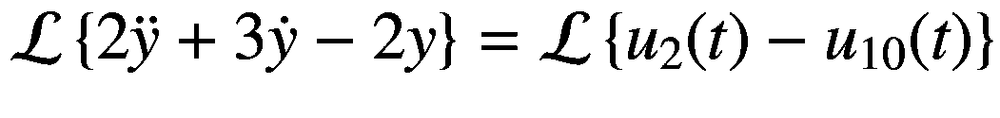

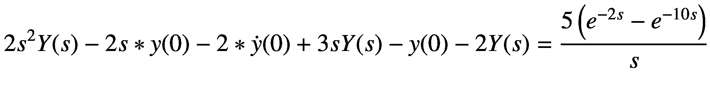

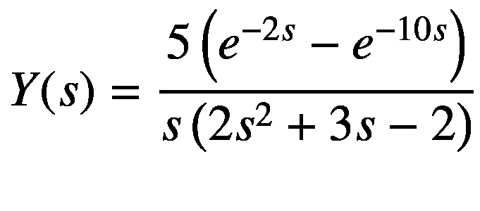

请注意，`e^(-2s)`、`e^(-10s)` 用于解释系统输出信号中的时间延迟；换句话说，-2 和 -10 分别表示 2 秒和 10 秒的时间延迟。5 是赫维赛德（阶跃）函数的幅值。

公式 `Y(s)` 是微分方程在 `s` 域的解，但我们需要其在时域中的形式。因此，我们需要计算其逆拉普拉斯变换：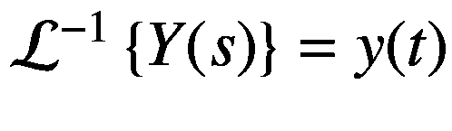。通过使用 `ilaplace()`，编写了以下简短脚本（`Lap_4_non_homog.m`）。该脚本求解了给定问题，并计算了其解析解和数值解。

```
% Lap_4_non_homog.m
syms t s
F=5*(exp(-2*s)-exp(-10*s))/s; Y=2*s²+s+2;
TF=F/Y; TFt=ilaplace(TF); pretty(TFt); Sol=vectorize(TFt);
t=linspace(0, 20, 400); S=eval(Sol); plot(t, S, 'bo-');
grid minor
title('Differential Equation with Discontinuous Forcing Fcn')
grid on, xlabel('time'), ylabel('y(t) solution'), shg
```

脚本执行后，得到如下解图和解的表达式，如图 8-8 所示。

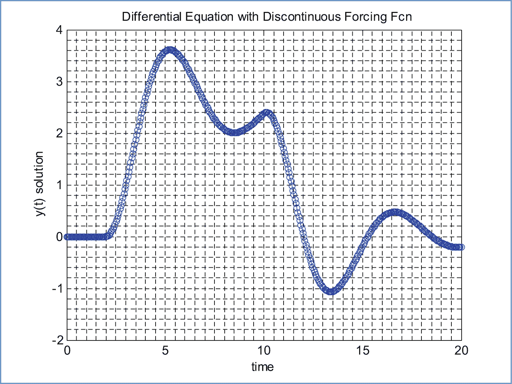

图 8-8

受不连续强制函数作用的二阶非齐次常微分方程的仿真

```
>> pretty(TFt)
/                /             1/2         \       \
|    /       t \ |           15    sin(#1) |       |
| exp| 5/2 - - | | cos(#1) + ------------- |       |
|    \       4 / \                15       /       |
5 heaviside(t - 10) | ------------------------------------------ - 1/2 |
\                     2                            /
/                /             1/2         \       \
|    /       t \ |           15    sin(#2) |       |
| exp| 1/2 - - | | cos(#2) + ------------- |       |
|    \       4 / \                15       /       |
5 heaviside(t - 2) | ------------------------------------------ - 1/2 |
\                     2                            /
where
1/2
15    (t - 10)
#1 == --------------

1/2
15    (t - 2)
#2 == -------------
```

从上一个练习中，可以得出以下几点结论。使用拉普拉斯变换（`laplace`/`ilaplace`）来计算受外部不连续强制函数作用的非齐次常微分方程的解析解相对容易、快速且省力。这类练习在控制工程问题中尤为常见。此外，必须指出，拉普拉斯变换和逆拉普拉斯变换（`laplace`/`ilaplace`）在求解常微分方程时易于实现。用它们求得的常微分方程的解与用 `dsolve()` 求得的解完全吻合。如前所述，许多常微分方程无法用 `laplace`/`ilaplace` 和 `dsolve` 函数解析求解。因此，数值方法通常是唯一的选择。

# 索引

## A

`addpath()` 命令
解析方法，`dsolve` 绘图未指定参数的使用
动画绘图 命令 `drawnow` 函数 `getframe()` 抛射体
匿名函数
App Designer
阿基米德螺线/螺旋线
算术运算
星号 `*` 符号
`axis` 命令
轴刻度

## B

布尔运算
布尔运算符
`Break` 语句

## C

C 代码 计算时间 设备制造商和类型 效率，MEX 文件 问题 MATLAB Coder 源代码类型选择 `SUModd_mex.c`。 `SUModd.m` M 文件 `tic/toc` 命令
元胞数组
字符类型，变量 `char()` 函数 `checkcode()` 命令
Cholesky 分解 矩阵分解 弹出对话框 命令警告
`Clock` 命令
代码剖析
颜色规范
`comet3`
命令窗口使用 变量
计算算法
条件运算
条件语句
控制分支语句
控制逻辑运算符
控制语句
转换 字符串，创建

## D

数据集 元胞数组 字符类型，变量 复数 函数句柄 逻辑数组 `NaN` 数值数据/数组 精度 结构数组 表数组
`dbstop` 函数
调试
依赖关系报告
行列式，矩阵
对角矩阵
`disp()` 命令
`drawnow` 工具

## E

特征值/特征向量
`Ex1_Arithmetic_operations.mdl`
`Ex7Var.m` 函数文件
`ezplot()`
`ezplot3`
`ezsurf` 命令

## F

斐波那契数
图形句柄
`find( )`
`for…end`
`fplot` 函数
`fprintf()` 命令
函数文件 调用 命令 常见错误 计算/显示 仿真结果 创建 `Ex7Var.m` `Ex8Var.m` `getREADY.m` 输入参数 莱布尼茨级数展开 M 和 MLX 文件 `myfunction.m` 嵌套函数和子函数 输出变量 绘图，仿真结果 二次方程 脚本 设置值 符号数学值 数量可变，输入和输出 在 M 文件中

## G

`getREADY.m` 函数文件
`ginput` 函数
图形用户界面开发环境
图形用户界面 错误对话框 F1 帮助/消息框 输入对话框 问题对话框 数学公式 消息框 `MY_fun.c` 弹出框 脚本 语法 警告消息
`grid on` 命令
`GTEXT` 命令
GUIDE 添加功能 `GC2011.jpg` 图像 选项 `QUIT_button_Callback` `sinc(πx)` 和退出选项 `SOUND_hear.m` 文件 基本步骤 元素 图形窗口 GUI 组件 GUI 工具窗口 二次方程 快速启动窗口 2D 绘图

## H

`helpwin` 命令
`Hold` 命令 函数值 线条标记和颜色 单个绘图 `hold all` 命令 `hold off` 命令 `hold on` 命令

## I, J

初值问题
内联函数表达式
逆拉普拉斯变换 流程图 步骤
逆矩阵 精度，求解器函数 效率，求解器函数 MATLAB 函数/命令 模型窗口 秩 Simulink 模块 Simulink 建模 求解线性方程组
`ismissing()`
`isnan()`
`issparse()`

## K

基尔霍夫定律
Krylov 矩阵

## L

拉普拉斯/`ilaplace` 解析解 论证高效与省力 `dsolve` `ilaplace()` 函数 无解析解 数值解 求解脚本
拉普拉斯变换 示例 流程图 `laplace()` 函数 `laplace`/`ilaplace` 过程
LaTEX 代码
`legend` 命令
莱布尼茨级数
线性代数
线条规范
`linspace()` 命令
逻辑数组
逻辑索引
逻辑语句
循环控制语句 `for … end` `while … end` 奇数 平方和立方幂，偶数
循环迭代
LU 分解 高斯消元法 帕斯卡矩阵

## M

`Maclaurin Series formula` 标记说明符 MATLAB 内置数组生成函数 内置函数工具 `Clock` 函数 命令窗口 组件 数据存储格式 数据类型 桌面窗口环境 函数文件 GUI 帮助库文档 MathWorks 网站 仿真包窗口 MATLAB 编码器 GUI 窗口设置选项 MATLAB 编译器 `for_redistribution` `MyAppinstaller_web.exe` `QUAD_eqn_SIM.m` `QUAD_eqn_SIM.prj` MATLAB 编辑器 `matlabFunction` 矩阵实验室 矩阵运算 模块 命令语法 `concatenate` 模块 常数模块的值 输入值/元素 指数/平方 `Ex2__MATRIX_operations.slx` 翻转 数学函数模块 模型练习 乘法 Simulink 库 方阵 求和/减法 机械弹簧-质量-阻尼系统 调整后的模块 调整后的属性 连续/离散系统 信号名称更改 仿真结果 Simulink 模型 正弦波模块参数 子系统 内存分配 MEX 文件 优点 C/C++ 或 FORTRAN 流程图，C/C++ 代码 `HELLO_mex.mexw64` M 文件编辑器 `断点` 子节 GUI 工具 `发布` 工具 `查看` 工具 `mlin()` 命令 `*.mlx` 扩展名 MLX 文件编辑器 `%` 注释 代码节功能 HTML 格式 `插入` 选项卡 `LaTEX` 命令 数学表达式 `P1.m` `P2.mlx` `发布` 工具 毕达哥拉斯公式 `查看` 窗口 M/MLX 文件编辑器 单元格模式 创建 调试 语法错误 M/MLX 文件编辑器，编写脚本 加速度方程 单元格模式 代码性能分析 调试模式 依赖关系报告 错误 执行 逻辑运算和条件语句 数学表达式的值 M-Lint 代码检查 P 代码 备注 警告 模型顾问 性能顾问 选项 报告窗口 Simulink 模型 性能分析报告 摘要工具 模型浏览器工具

## N

`nargin` 函数 `nargoutchk` 函数 非数值 (NaN) 数值数据/数组 数值解

## O

常微分方程 (ODEs) 解析方法 参见`解析方法`，`dsolve` 解析解 生物有机体 分类 定义 `dsolve` 二阶无解 解 表达式 流程图 形式 `MuPAD` 工具 牛顿第二定律 放射性衰变 系统 类型/类别/组

## P

P 代码 绘图 构建 错误 函数值，Y-Y 轴 图形属性，线条 线型规格 最小值，绘图图形 `绘图` 选项卡 自测练习 正弦函数值 特殊字符 单位圆 `plot()` 命令 函数值 两行数据 `plot3` `polar()` 命令 `PseudoRandi.m`

## Q

QR 分解 格拉姆-施密特方法 随机数生成器 二次方程 回调函数 错误 `get()` 命令 GUI 模型 `PLOT_all_Callback` `PLOT_eqn_Callback` `QUAD_eqn_SIM.m` 文件 `set()` 命令 `SOLVE_eqn_Callback` GUI 模型窗口 面板模块 `PLOT_eqn` 按钮模块 `QUAD_eqn_SIM.fig` `SOLVE_eqn` 静态文本模块 二维图 二次方程

## R

`rad2deg()` `randn()` 函数 电阻-电容 (RC) 电阻-电感-电容 (RLC)

## S

`scatter3` 舒尔分解 分解工具 标准矩阵 脚本/程序编写 二阶微分方程 `Ex5_Function_PULSE.slx` `function_pulse.m` 函数 输入力 信号发生器 MATLAB `Fcn` 模块 信号发生器 仿真结果 `Simulink.BlockDiagram.addBusToVector` 函数 Simulink 模型 算术计算 注释选项 模块 连接模块 库浏览器 M/MLX 文件 求和模块的符号和图标形状 计算函数值 调整/微调 配置参数 `Ex3_Function_Compute_Simple.slx` `Ex3_Function_Compute.slx` 仿真结果 子系统 组件 时间显示 偏移 MATLAB 工作区 启动窗口 正弦函数 奇异值分解 (SVD) `solve()` 函数 `sprint()` 独立应用程序 编译/创建 完整 `for_testing` GUI 开发者 安装过程 `MyAppinstaller_web.exe` `PackagingLog.txt` 仿真结果 标准矩阵生成器 `struct()` 命令 结构体数组 `subplot()` 命令 符号数学 符号数学工具箱/MuPAD 笔记本 符号引用，编程 `.` 运算符 `%` 运算符 `@` 符号/运算符 星号 冒号 `:` 运算符 逗号 `,` 运算符 花括号 `{ }` 美元符号 `$` 圆括号 `( )` 分号 (`;`) 单引号 (`' '`) 方括号 `[ ]` 斜杠和反斜杠 三个点（或省略号）运算符 两个点运算符

## T

`TAB` 键 表数组 `table()` 命令 TeX 标记 `TEXT` 命令 3D 绘图命令 3D 空间线图 螺旋线，游乐园乘坐工具 工具 3D 曲面图 电场势 `ezsurf` `ezsurfc()` 网格图 饼图 `ribbon()` `waterfall()` `title()` 命令 转置矩阵 2D 绘图 模块 命令 `编辑文本` 模块 `get()` 命令 GUI 模型 界面 `PLOTsinc_Callback` 属性检查器窗口 `SINC_fun.fig` 文件 `SINC_fun.m` 文件 `sinc(πx)` 函数 `SNIC` 函数绘图 `静态文本` 模块

## U

`UIControls` 脐环环面函数

## V

变量 向量空间 多项式 Simulink 建模，多项式 正弦函数

## W

`while…end`

## X

`xlabel` 命令

## Y

`ylabel` 命令

## Z

`zlabel` 命令