# 第一部分


## 在 Power Pivot 中构建模型

### 第 1 章


## Power Pivot 简介

微软自助式商业智能（BI）工具集的核心是 Power Pivot。其他工具，Power View、Power Query 和 Power Map，都构建在 Power Pivot 表格模型之上。就 Power View 而言，这一点显而易见，因为你需要显式地连接到该模型。就 Power Query 和 Power Map 而言，可能不那么明显，因为 Power Pivot 表格模型是在幕后为你创建的。无论它是如何创建的，为了充分利用这个工具集并深入了解数据，你都需要知道 Power Pivot 是如何工作的。

本章为你提供了一些背景信息，说明为什么 Power Pivot 是如此重要的工具，以及是什么让 Power Pivot 性能如此出色。它会指导你运行 Power Pivot 所需的条件以及如何启用它。本章还为你概述了 Power Pivot 界面，并让你获得一些使用界面不同区域的经验。

读完本章后，你将熟悉以下内容：

*   为什么使用 Power Pivot？
*   xVelocity 内存分析引擎
*   为 Excel 启用 Power Pivot
*   探索数据模型管理界面

#### 为什么使用 Power Pivot？

你可能参与过传统的 BI 项目，这些项目包含一个集中式数据仓库，组织的各种数据存储在其中被加载、清洗，然后移至 OLAP（联机分析处理）数据库用于报告和分析。这种方法的一些目标是：创建历史数据的数据存储库，创建单一版本的事实，减少数据孤岛，清理公司数据并确保其符合标准，以及通过仪表板深入了解数据趋势。尽管这些目标值得称赞，也是提供集中式数据仓库的绝佳理由，但这种方法也有一些缺点。最显著的是构建系统和实施变革的复杂性。问问任何一个试图向企业级数据仓库添加新字段或度量的人。这通常是一个漫长、旷日持久的过程，需要 IT 部门参与，以及数据管理员委员会审查、开发和测试周期。需要的是一种允许敏捷数据分析的解决方案，而无需过多依赖 IT 和正式流程。为了解决这些问题，许多业务分析师曾使用 Excel 创建数据透视表，并对从各种数据源收集的数据集进行临时分析。使用孤立的 Excel 工作簿进行分析的一些问题是：相互冲突的事实版本、数据孤岛以及数据安全性。

那么，你如何解决集中式数据仓库过于僵化而 Excel 解决方案又过于松散这一两难困境呢？这就是微软自助式 BI 工具集的用武之地。这些工具并非取代你的集中式数据仓库解决方案，而是对其进行补充，以促进敏捷数据分析。使用 Power Pivot，你可以从数据仓库中提取数据，用其他数据源（如文本文件或 Web 数据馈送）扩展数据，构建自定义度量，并使用数据透视表和数据透视图分析数据。你可以创建快速的概念验证原型，这些原型可以轻松地推广成为企业级解决方案的一部分。Power Pivot 还促进了单独的数据分析项目，而无需经历冗长的开发周期。当与 SharePoint 结合时，Power Pivot 工作簿可以由 IT 部门进行安全管理和控制，包括数据刷新调度和资源使用。这在很大程度上满足了 IT 部门对治理的需求，同时又不会妨碍业务用户对敏捷性的需求。

以下是 Power Pivot 的一些优势：

*   作为 Excel 的免费加载项运行
*   轻松整合来自各种来源的数据
*   处理多达数千万到数亿行的大量数据
*   使用熟悉的 Excel 数据透视表和数据透视图进行数据分析
*   包含强大的新数据分析表达式 (`DAX`) 语言
*   模型中的数据是只读的，从而提高了安全性和完整性

当 Power Pivot 托管在 SharePoint 中时，它还有以下额外优势：

*   支持 Power Pivot BI 解决方案的共享与协作
*   可以安排和自动化数据刷新
*   可以通过版本管理审计更改
*   可以确保用户具有只读和可更新的访问权限

既然你已经了解了 Power Pivot 的一些优势，那么让我们来看看它的运作机制。

#### xVelocity 内存分析引擎

#### Power Pivot xVelocity 引擎

Power Pivot 背后的独门秘籍是 `xVelocity` 内存分析引擎（没错，这就是它的名字！）。该引擎使得 Power Pivot 能够快速处理海量数据。其关键之一在于采用列式数据库来存储数据。传统的基于行的数据存储方式将所有数据按行存储在一起，在根据行键（例如，根据订单 ID 更新或检索订单）检索和更新数据时效率很高。这对于订单录入系统非常有利，但在需要对历史订单进行分析时（例如，要查看过去一年的趋势以确定产品的销售情况）就不那么理想了。

基于行的存储还会因每行重复存储值而占用更多空间；如果客户数量庞大，像 John 或 Smith 这样的常见名字会被重复多次。列式数据库仅存储每列的不同值，然后将行存储为一组指向列值的指针。这种内置的索引机制节省了大量空间，并且与 `xVelocity` 引擎内置的数据压缩技术相结合，能够实现显著的性能优化。这也意味着对列值进行的数据聚合（例如典型数据分析中使用的聚合操作）速度极快。

`xVelocity` 引擎提供的另一个优势是内存分析。查询数据时，大部分处理瓶颈都发生在从磁盘读取或写入数据的过程中。借助内存分析技术，数据被加载到计算机的 RAM 中，然后进行查询。这极大地缩短了处理时间，并减少了在磁盘上存储预聚合值的需求。当你从 32 位操作系统和应用程序迁移到如今已成为主流的 64 位系统时，这一优势尤为明显。

#### 表格模型优势

除了 `xVelocity` 引擎提供的优势之外，另一个值得一提的优势是 Power Pivot 模型的表格结构。该模型由表和表关系组成。这种表格模型对于大多数业务分析师和数据库开发者来说更为熟悉。传统的 OLAP 数据库（例如 `SSAS`，即 SQL Server Analysis Server）将数据模型呈现为三维立方体结构，处理起来更困难，并且需要使用复杂的查询语言 `MDX`（多维表达式）。我发现，在大多数（但并非所有）情况下，使用表格模型和 `DAX` 比使用 OLAP 多维数据集和 `MDX` 更容易。

#### 启用 Excel 的 Power Pivot

Power Pivot 是 Excel 的一个免费加载项，包含在 Office Professional Plus 和 Office 365 Professional Plus 版本中。如果您使用的是 Excel 2010，则需要从 Microsoft Office 网站下载并安装该加载项。如果您使用的是 Excel 2013（本书涵盖的版本），则加载项已安装，只需启用即可。要检查您安装的版本，请选择 Excel 中的“文件”菜单，然后选择“帐户”选项卡，如图 1-1 所示。

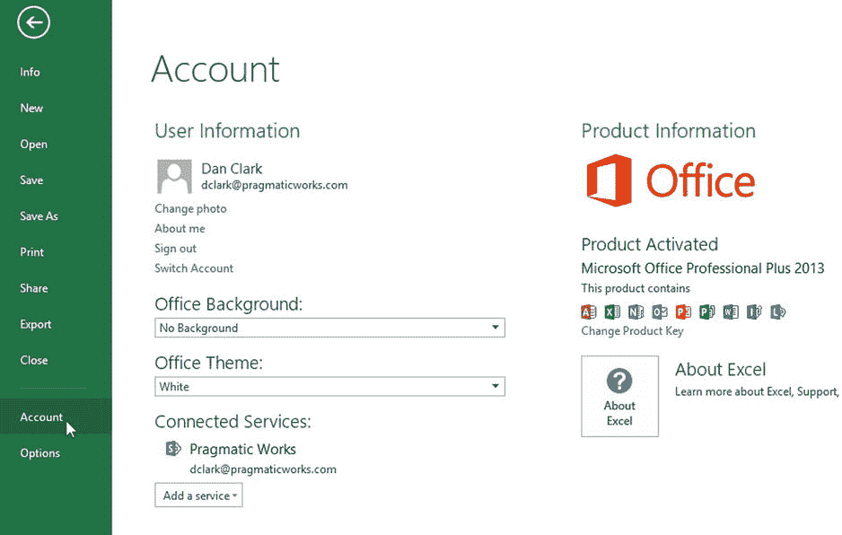

图 1-1. 检查 Excel 版本

在 Excel 的“帐户”选项卡上，单击“关于 Excel”按钮。屏幕上会显示版本详细信息，如图 1-2 所示。请注意版本和版本号。它应该是 Professional Plus 版本，最好是 64 位版本。对于较小的数据集，32 位版本可以很好地工作，但要获得 Power Pivot 的最佳性能和体验，您应该在配备约 8 GB RAM 的 64 位 Windows 系统上使用 64 位版本。

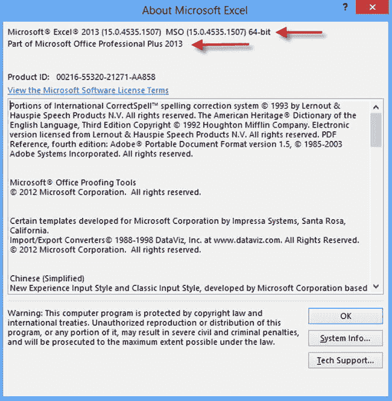

图 1-2. 检查 Excel 版本和版本号

确认您运行的是正确版本后，可以通过转到“文件”菜单并选择“选项”选项卡来启用 Power Pivot 加载项。在“Excel 选项”窗口中，选择“加载项”选项卡。在“管理”下拉菜单中，选择“COM 加载项”，然后单击“转到”按钮（参见图 1-3）。

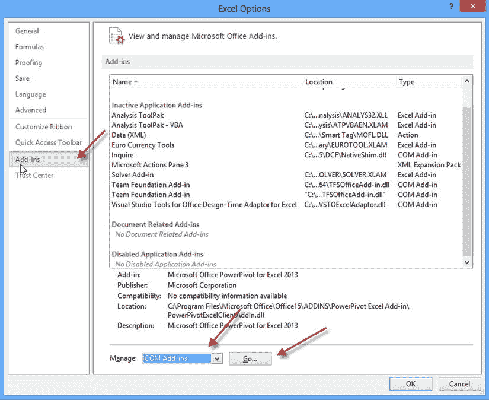

图 1-3. 管理 COM 加载项

屏幕上将弹出“COM 加载项”窗口（参见图 1-4）。选中 `Microsoft Office PowerPivot for Excel 2013`，然后单击“确定”。

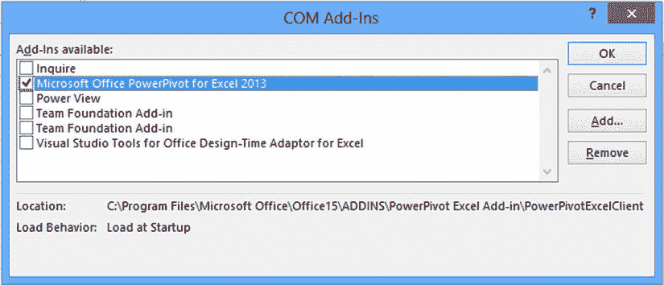

图 1-4. 选择 Power Pivot 加载项

现在您已为 Excel 启用 Power Pivot 加载项，接下来可以探索数据模型管理器了。

#### 探索数据模型管理器界面

启用 Power Pivot 后，您应该会在 Excel 中看到一个新的“Power Pivot”选项卡（参见图 1-5）。单击“管理”按钮将启动数据模型管理界面。

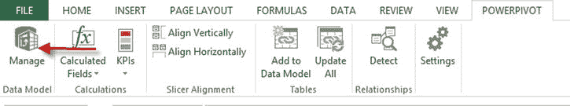

图 1-5. 启动数据模型管理器

数据模型管理器启动后，您将拥有两个独立但相互连接的界面。您可以在普通的 Excel 界面和数据模型管理界面之间来回切换。这可能会让 Power Pivot 新手感到困惑。请记住，数据模型管理器（图 1-6）是您定义模型的地方，包括表、表关系、度量值、计算列和层次结构。Excel 界面（图 1-7）是您使用数据透视表和数据透视图分析数据的地方。

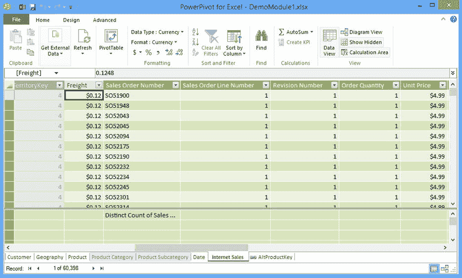

图 1-6. 数据模型管理器界面

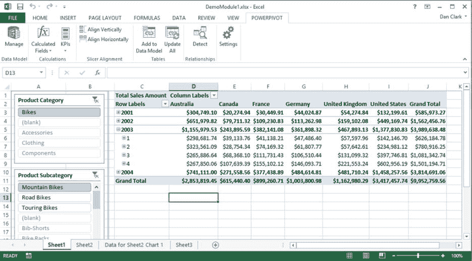

图 1-7. Excel 工作簿界面

#### 数据模型管理器中的视图

数据模型管理器中有两种数据模型视图：数据视图和关系图视图。首次启动时，它处于数据视图模式。在数据视图模式下，您可以看到模型中包含的数据。模型中的每个表在视图中都有其自己的选项卡。表可以包含从数据源检索的数据列，也可以包含使用 `DAX` 计算的列。计算列的颜色比其他列稍深。图 1-8 显示了 `Full Name` 列，该列是通过连接 `First Name` 和 `Last Name` 列得出的。

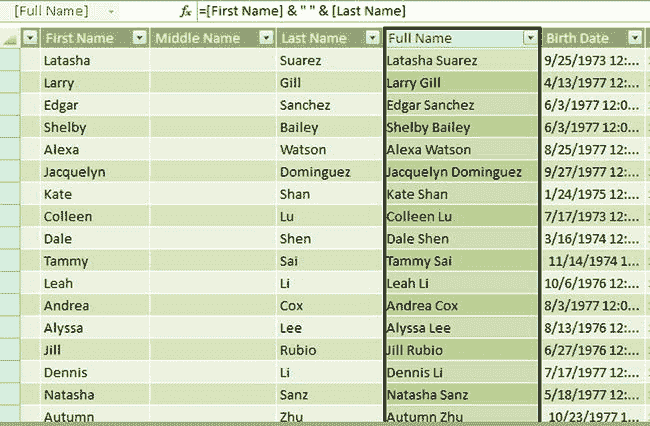

图 1-8. 数据模型管理器中的计算列

每个选项卡在列数据下方还有一个网格区域。该网格区域是您定义模型中度量值的地方。度量值通常包含某种聚合函数。例如，您可能希望按月或按产品查看汇总的销售额。图 1-9 显示了与 `Internet Sales` 表相关的一些度量值。

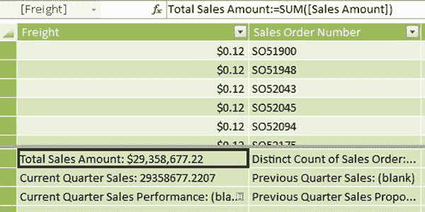

图 1-9. 数据模型管理器中的度量值网格区域

设计师顶部有四个菜单选项卡：`File`、`Home`、`Design` 和 `Advanced`。如果看不到 `Advanced` 选项卡，可以选择 `File` 菜单选项卡并选择 `Switch To Advanced Mode` 来显示它。随着本书的学习，你将逐步熟悉设计师中的菜单。目前，只需知道这些菜单可用于执行各种操作，例如连接到数据源并创建数据查询、格式化数据、设置默认属性以及创建 KPI（关键绩效指标）。图 1-10 显示了数据模型管理器中的 `Home` 菜单。

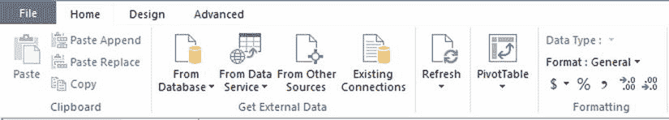

图 1-10. 数据模型管理器中的 `Home` 菜单选项卡

在 `Home` 菜单的右侧，您可以从数据视图模式切换到关系图视图模式。图 1-11 所示的关系图视图展示了各个表以及表之间的关系。通常您可以在此处建立表之间的关系并为钻取模型创建层次结构。数据视图和关系图视图中的菜单大致相同。但是，您会发现某些操作只能在数据视图中完成，而其他操作则只能在关系图视图中完成。

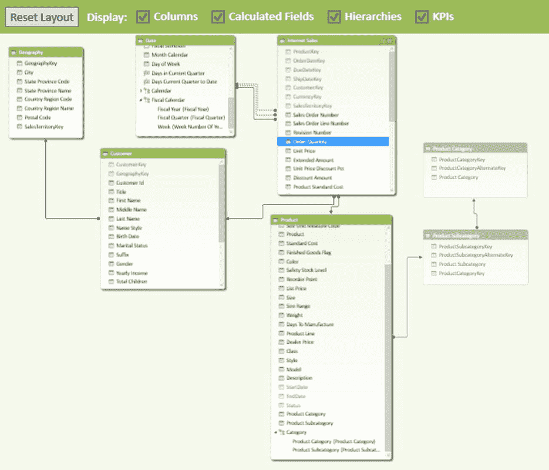

图 1-11. 在数据模型管理器中使用关系图视图

现在您已经熟悉了数据模型管理器的各个部分，该是动手实践并完成以下动手实验的时候了。此实验将帮助您熟悉在数据模型管理器中的操作。

**动手实验——探索 POWER PIVOT**

在以下实验中，您将：

*   启用 Power Pivot 加载项。
*   使用数据透视表分析数据。
*   探索数据模型管理器。

1.  打开 Excel 2013。
2.  在 `File` 菜单上选择 `Account`（参见图 1-1）。
3.  点击 `About Excel`，确保您使用的是专业增强版，并检查版本（32 位或 64 位）。
4.  在 `File` 菜单上选择 `Options`，然后选择 `Add-Ins` 选项卡。在 `Manage` 下拉菜单中选择 `Com Add-Ins`，然后点击 `Go` 按钮。
5.  在 `Com Add-Ins` 窗口中，勾选 `Power Pivot add-in`（参见图 1-4）。
6.  安装完成后，打开位于 `Lab Starters` 文件夹中的 `Chapter1Lab1.xlsx` 文件。
7.  点击 `Sheet1` 工作表。您应该会看到一个基本的数据透视表，按年份和国家显示销售额，如图 1-12 所示。

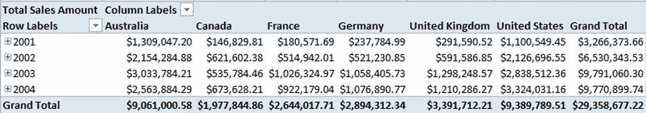

图 1-12. 使用数据透视表

8.  点击数据透视表中的任意位置。您应该会在右侧看到字段列表，如图 1-13 所示。

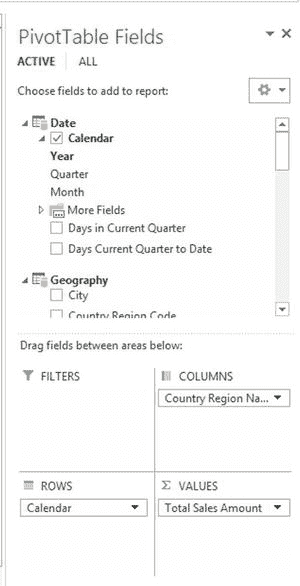

图 1-13. 数据透视表字段列表

9.  字段列表下方是筛选、行、列和值的放置区域。您可以将字段拖放到这些区域来创建数据透视表。
10. 在 `PivotTable Fields` 窗口顶部点击 `All` 选项卡。展开字段列表中的 `Product` 表。找到 `Product Category` 字段并将其拖到 `Report Filter` 放置区域。
11. 数据透视表上方会出现一个筛选下拉菜单。点击筛选下拉图标。您应该会看到产品类别。
12. 将筛选条件更改为 `Bikes`，并注意数据透视表中的值的变化。
13. 当您从筛选器中选择多个项目时，很难判断正在筛选的内容。选择 `Bikes` 和 `Clothing`。注意当筛选下拉菜单关闭时，它只显示“(Multiple Items)”。
14. 切片器用作筛选器，但它们提供了视觉元素以便轻松确定所选内容。在 `Insert` 菜单上点击 `Slicer`。在弹出的窗口中，选择 `All` 选项卡，然后在 `Product` 表下选择 `Category` 层次结构，如图 1-14 所示。

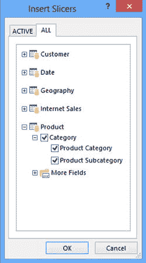

图 1-14. 选择切片器字段

15. 插入了一个 `Product Category` 和 `Product Subcategory` 切片器，用于筛选数据透视表。要按值进行筛选，请点击该值按钮。要选择多个按钮，请在点击时按住 `Ctrl` 键（参见图 1-15）。请注意，由于这些字段是作为层次结构设置的，因此选择一个产品类别会自动筛选 `Product Subcategory` 切片器中的相关子类别。

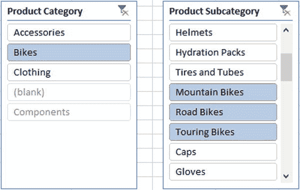

图 1-15. 使用切片器筛选数据透视表

16. 层次结构是按级别排列的列组，可以更轻松地浏览数据。例如，展开字段列表中的 `Date` 表，您可以查看 `Calendar` 层次结构，如图 1-16 所示。此层次结构由 `Year`、`Quarter` 和 `Month` 字段组成，代表了一种向下钻取数据的自然方式。

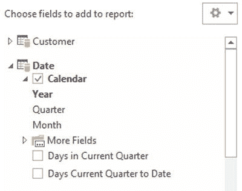

图 1-16. 在数据透视表中使用层次结构

17. 展开字段列表中的 `Internet Sales` 表，您将看到一个交通灯图标。此图标代表一个 KPI。KPI 用于衡量某个值的表现。它们通常通过视觉指示器表示，以便快速判断性能。
18. 在 `Power Pivot` 菜单下选择 `Manage Data Model` 按钮。
19. 在数据模型管理器中，选择底部的不同选项卡以在不同表之间切换。
20. 转到 `Products` 表中的 `ProductAlternateKey` 列。请注意，它已显示为灰色。这意味着它已对任何客户端工具隐藏。您可以通过切换回工作表 1 上的 Excel 数据透视表并验证在字段列表中看不到此字段来确认这一点。
21. 在 `Internet Sales` 表中，点击 `Margin` 列。请注意这是一个计算列。它也被格式化为货币。
22. 在 `Internet Sales` 表的 `Sales Amount` 列下方，注意有一个名为 `Total Sales Amount` 的度量值。点击该度量值，注意它使用了 DAX `SUM` 函数来计算该度量值。
23. 将数据模型管理器切换到关系图视图。观察表之间的关系。
24. 如果将鼠标指针悬停在关系上，您可以看到关系中涉及的字段，如图 1-17 所示。

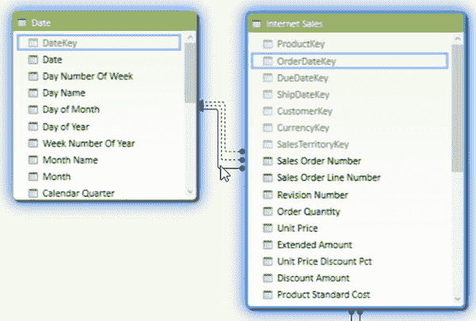

图 1-17. 探索关系

# 25. 在图解视图中单击 `Date` 表。请注意表右上角的 `Create Hierarchy` 按钮（参见图 1-18）。这就是为表定义层次结构的方法。

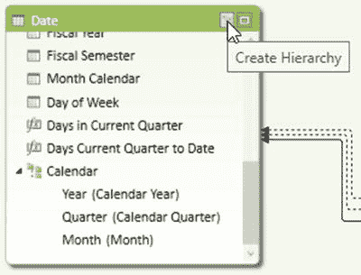

图 1-18. 创建层次结构

## 26. 花一些时间来探索模型和数据透视表。（请随意尝试，即使弄坏也没关系！）完成后，关闭文件。

## 总结

本章向您介绍了 Excel 的 `Power Pivot` 加载项。您简要了解了 `Power Pivot` 为何能够通过使用 `xVelocity` 引擎和列式数据存储来处理大量数据。您还调查并获得了使用 `Power Pivot 数据模型管理器` 的经验。暂时不必担心如何开发模型各个部分的细节。随着您深入学习本书，这些内容都会得到详细解释。从下一章开始，您将学习如何从各种数据源将数据导入模型。

# 第 2 章


# 将数据导入 Power Pivot

创建 Power Pivot 模型的第一步是导入数据。传统上，在创建基于 OLAP 多维数据集的 BI 解决方案时，您需要先将数据导入数据仓库，然后再将其加载到多维数据集中。将数据整合到多维数据集中并可供使用可能需要相当长的时间。而这是 Power Pivot 模型最大的优势之一。您可以轻松快速地合并来自各种来源的数据到模型中。数据源可以是关系数据库、文本文件、Web 服务以及 OLAP 多维数据集等等。本章将向您展示如何将这些来源中的多种数据整合到 Power Pivot 模型中。

完成本章后，您将能够：
- 从关系数据库导入数据。
- 从文本文件导入数据。
- 从数据馈送导入数据。
- 从 OLAP 多维数据集导入数据。
- 重用现有连接来更新模型。

## 从关系数据库导入数据

您会遇到的最常见的数据源类型之一是关系数据库。关系数据库管理系统 (RDMS)，例如 `SQL Server`、`Oracle`、`DB2` 和 `Access`，由表以及基于键的表之间的关系组成。例如，图 2-1 显示了一个采购订单明细表和一个产品表。它们通过 `ProductID` 列相关联。这是一个一对多关系的示例。产品表中的每一行，在采购订单明细表中都有多行与之对应。表中的键被称为主键和外键。每个表都需要一个主键来唯一标识表中的一行。例如，`ProductID` 是产品表中的主键。`ProductID` 在采购订单明细表中被视为外键。外键指向相关表中的主键。请注意，主键可以由多个列组合而成；例如，采购订单明细表的主键是 `PurchaseOrderID` 和 `PurchaseOrderDetailID` 的组合。

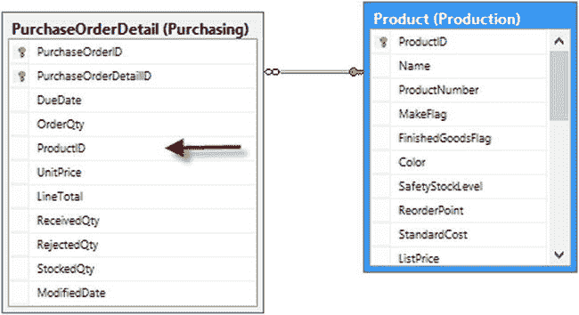

图 2-1. 一对多关系

虽然一对多关系最为常见，但您还会遇到另一种相当普遍的关系类型——多对多关系。图 2-2 显示了一个多对多关系的示例。一个人可以有多个不同类型的电话号码。例如，他们可能有两个传真号码。您不能直接将这两个表关联起来。相反，您需要使用一个包含来自这两个表主键的联结表。联结表中的键组合必须是唯一的。

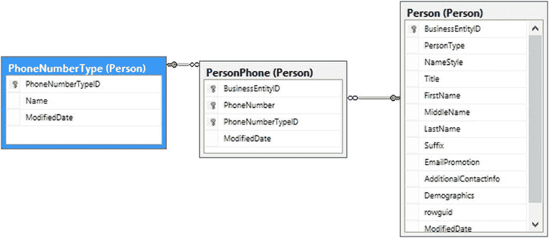

图 2-2. 多对多关系

请注意，联结表可以包含与关联相关的信息；例如，`PhoneNumber` 与客户和电话号码类型相关联。一个客户不能将同一个电话号码列为两种不同的类型。

从关系数据库获取数据的一个好处是，其模型与您将在 Power Pivot 中创建的模型非常相似。事实上，如果在数据库中定义了关系，Power Pivot 导入向导可以检测到这些关系并为您在模型中设置它们。

从关系数据库获取数据的第一步是创建连接。在模型设计器的“主页”选项卡上，有一个“获取外部数据”分组（参见图 2-3）。


图 2-3. 设置连接

“来自数据库”下拉菜单允许您连接到 `SQL Server`、`Access`、`Analysis Services` 或来自另一个 Power Pivot 模型。如果您单击“来自其他源”按钮，您可以看到所有可以连接的各种数据源（参见图 2-4）。如您所见，您可以连接到相当多的关系数据库。如果您需要连接的数据源未列出，您可能可以安装来自该数据库提供商的驱动程序来连接。您或许还可以使用通用的 `ODBC`（开放式数据库连接）驱动程序来连接它。

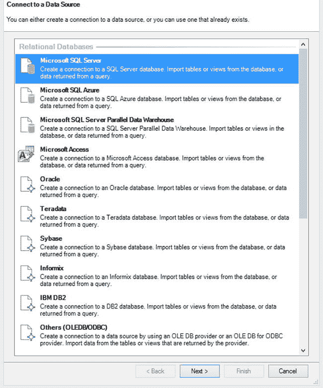

图 2-4. 选择数据源

选择数据源后，会显示一个窗口让您输入连接信息。连接信息取决于您要连接的数据源。对于大多数关系数据库来说，所需的信息非常相似。图 2-5 显示了连接到 `SQL Server` 的连接信息。请记得单击“测试连接”按钮以确保所有信息都输入正确。

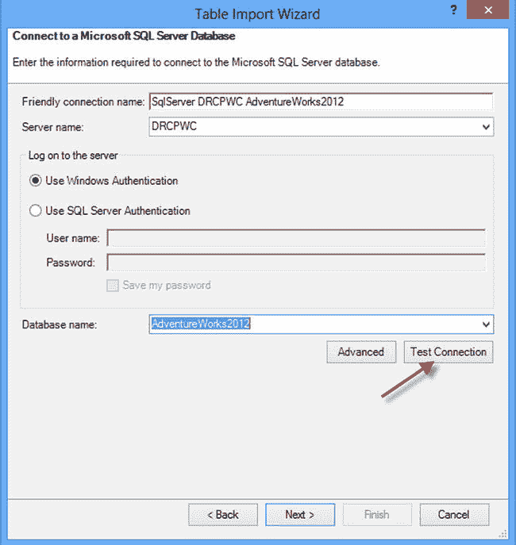

图 2-5. 设置数据库连接

建立连接后，下一步是查询数据库以检索数据。此时您有两个选择：您可以选择从表和视图列表中导入数据，或者编写查询来导入数据（参见图 2-6）。即使您选择从表或视图中导入数据，在后台也会创建一个查询并将其发送到数据库以检索数据。

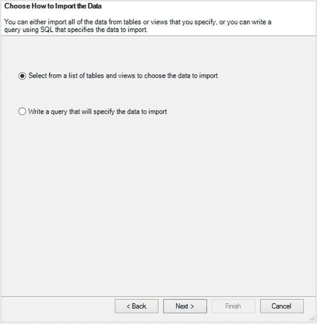

图 2-6. 选择如何检索数据

如果您选择从表和视图列表中获取数据，则会在下一个屏幕中显示该列表。从您的角度来看，视图和表看起来是一样的。实际上，视图是数据库中存储的查询，它向您隐藏了查询的复杂性。视图通常用于展示比实际物理模型更简单的概念模型。例如，您可能需要客户的地址。图 2-7 显示了获取此信息所需在查询中包含的表。您无需编写复杂的查询来检索信息，而是可以从一个视图（该视图为您将信息组合成一个虚拟的客户地址表）中进行选择。视图的另一个常见用途是保护底层表的列安全。通过使用视图，数据库管理员可以对不同用户隐藏某些列。

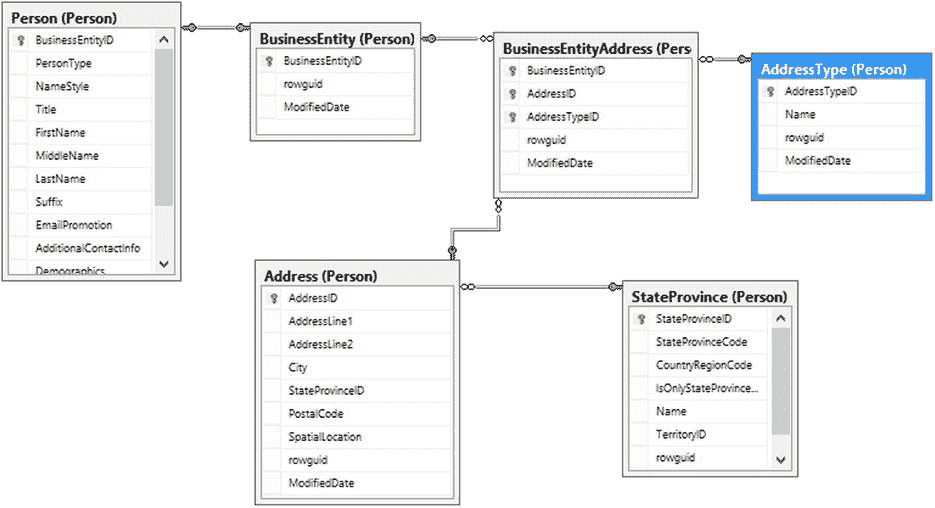

图 2-7. 获取客户地址所需的表

选择表格后，点击`预览和筛选`按钮（见图 2-8），即可预览表格中的数据并对所选数据进行筛选。

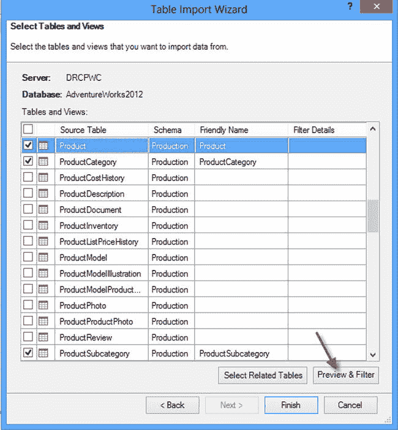

图 2-8 选择表和视图

在 图 2-9 中，你可以看到预览和筛选界面。

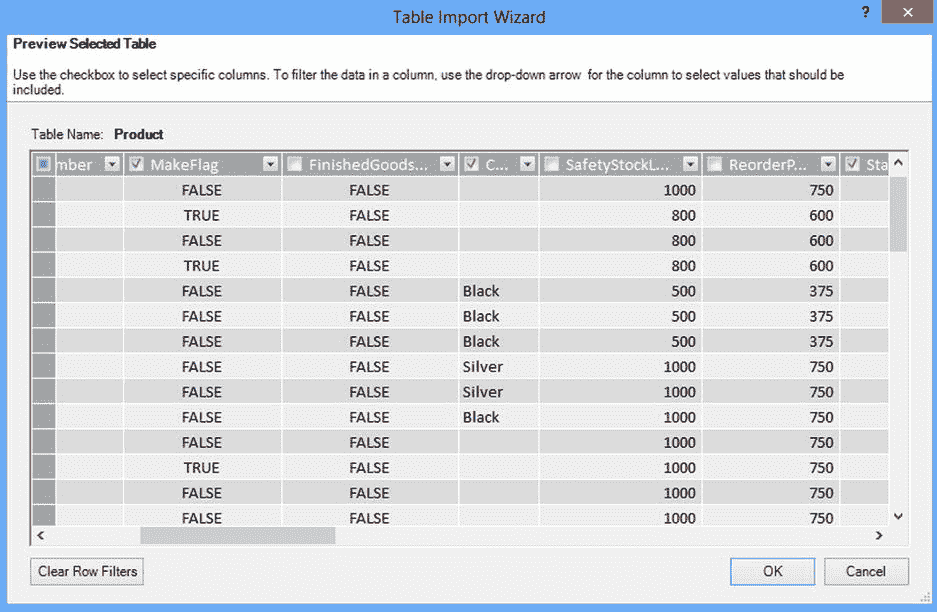

图 2-9 预览和筛选数据

筛选表格的一种方法是只选择你感兴趣的列。另一种方法是在列上设置筛选条件来限制行数。例如，你可能只想查看某一年之后的销售数据。点击列旁边的下拉菜单，即可输入筛选条件来限制行数。图 2-10 展示了按订单日期筛选 `SalesOrderHeader` 表的情况。

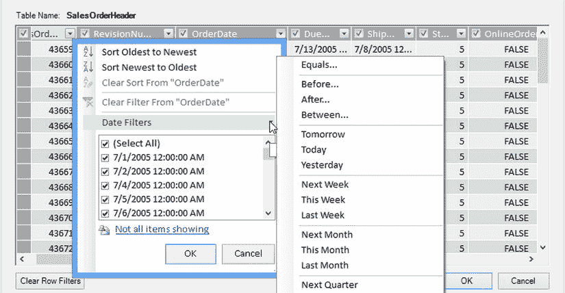

图 2-10 筛选行

在处理大型数据集时，出于性能考虑，最好只导入你感兴趣的数据。如果你只需要少数几列，却将整个表的所有列都导入进来，会带来大量开销。同样，如果你只关注过去三年的销售数据，就不要导入整整二十年的销售数据。如果后续发现需要更多数据，你随时可以返回并更新数据导入设置。

筛选完数据后，在`选择表和视图`界面（见图 2-8）点击`完成`。此时，数据会被导入模型，并出现一个显示进度的界面（见图 2-11）。如果没有错误，你可以关闭`表导入向导`。

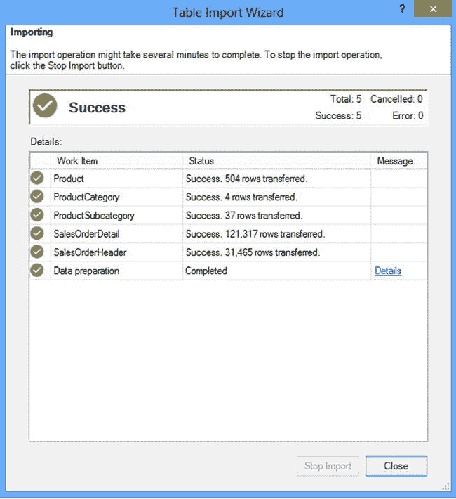

图 2-11 将数据导入模型

向导关闭后，你将在`模型设计器`的数据视图中看到这些数据。

 **注意** 请记住，Power Pivot 仅在检索数据时才连接到数据源。数据检索完毕后，连接即被关闭，数据便成为模型的一部分。

如果你切换到`模型设计器`的图表视图，你将看到各个表；如果在数据库中定义了表关系，你还能看到表之间的关系。在 图 2-12 中，你可以看到产品表之间以及销售表之间定义的关系，但 `SalesOrderDetail` 表和 `Product` 表之间没有定义关系。即使数据源中没有定义关系，你也可以在模型中创建关系（后续将详细介绍）。

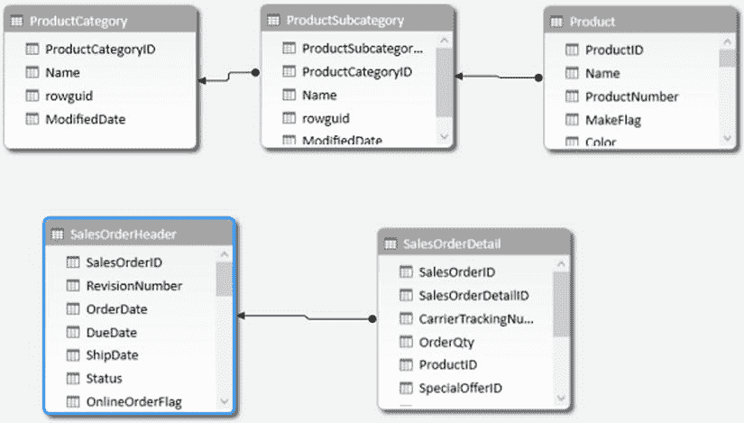

图 2-12 数据源中定义的表关系

虽然从表和视图中选择数据是将数据导入模型的一种简单方法，无需显式编写查询，但这并非总是可行。有时你可能需要编写自己的查询；例如，你可能希望合并来自多个不同表的数据，但并没有可用的视图。另一个因素取决于数据源的支持程度。某些数据源不允许使用视图，可能要求你提供查询来提取数据。在这种情况下，当你进入询问如何检索数据的界面时，请选择查询选项（图 2-6）。

一旦选择了查询选项，就会出现一个界面，你可以在其中编写查询（见图 2-13）。虽然你可能不是从头开始编写查询，但你可以在此处粘贴别人为你编写的查询，或者你在其他工具（如 `Microsoft Management Studio` 或 `TOAD`）中创建的查询。别忘了给查询命名。它将成为模型中的一个表，并以该查询的名称命名。

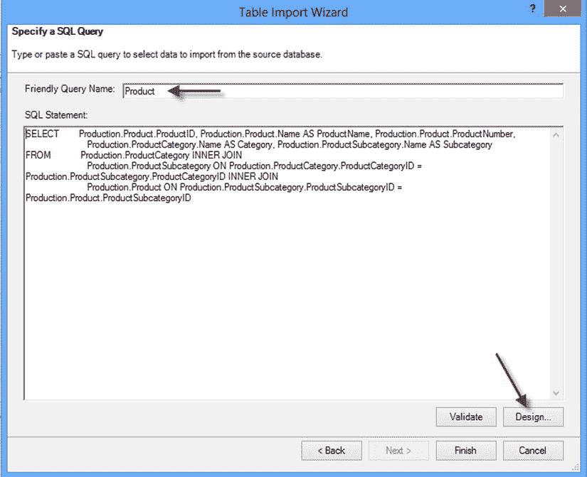

图 2-13 创建自定义查询

如果数据源支持，你可以通过点击查询输入窗口右下角的按钮，启动一个非常便捷的查询设计器（见图 2-13）。这个设计器（见图 2-14）允许你从各个表和视图中选择所需的列。如果在数据库中定义了表关系，它会自动为你添加表连接。你还可以应用筛选条件，并对数据进行分组和聚合。查询设计器的一个令人困惑的地方是参数复选框。

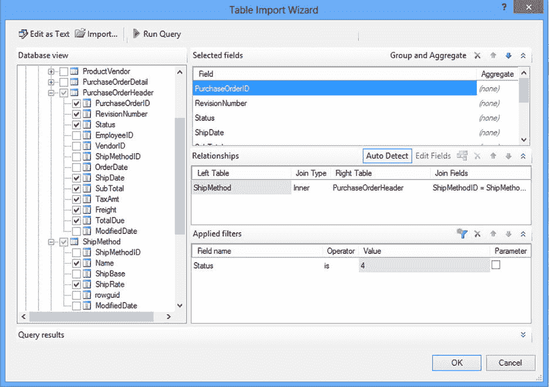

图 2-14 使用查询设计器

 **注意** Power Pivot 模型不支持参数，选中此复选框后，尝试关闭查询设计器时将出现错误消息。

完成查询设计后，你始终应该运行它以确保其按预期工作（见图 2-15）。

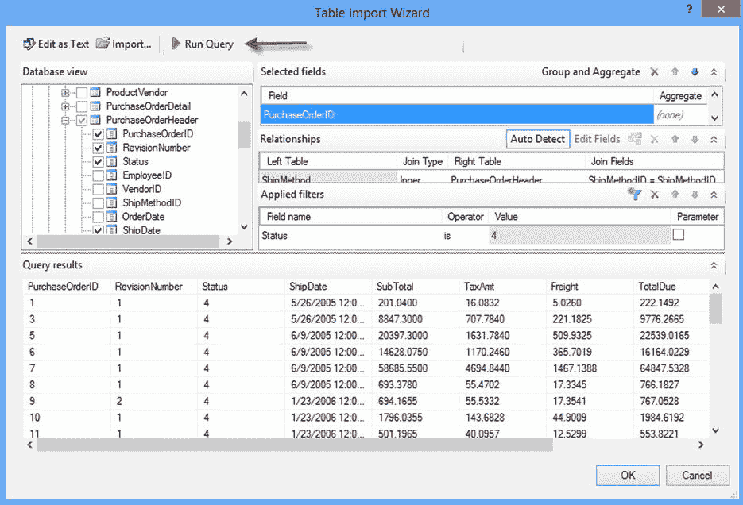

图 2-15 运行查询并查看结果

对查询结果满意后，点击`确定`按钮，返回上一界面，并已填入查询文本。你可以在该界面修改查询，并使用`验证`按钮确保其仍为有效查询（见图 2-16）。点击`完成`即可将数据和表导入模型。

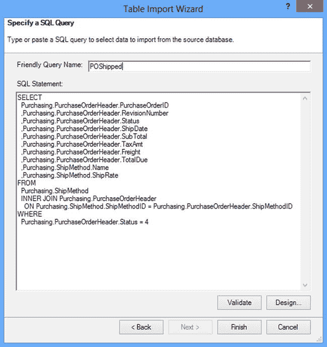

图 2-16 查看并验证查询

现在你已经了解了如何从数据库导入数据，接下来让我们看看如何从文本文件向模型添加数据。

## 从文本文件导入数据

很多时候，你需要合并来自多个不同来源的数据。最常见的来源之一仍然是文本文件。这可能是从其他系统接收数据输出的结果；例如，你可能需要公司 `ERP`（企业资源规划）系统的信息，而这些信息是以文本文件形式提供的。你也可能通过第三方服务获取数据，这些数据以 `CSV`（逗号分隔值）格式提供。例如，你可能使用评级服务来对客户进行评级，结果可以通过 `CSV` 文件返回。

从文本文件导入数据到模型，与从关系数据库表中导入数据类似。首先，在**开始**菜单上选择从其他源获取外部数据的选项，这将弹出连接到数据源的选项。向下滚动到窗口底部，你可以选择从 Excel 文件或文本文件导入数据（见图 2-17）。


图 2-18 预览文本文件数据

### 预览数据

选择列标题旁的下拉菜单，即可基于筛选条件限制导入的行数（见图 2-19）。

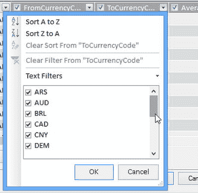

图 2-19 筛选导入模型的行

从文本文件导入数据与从 Excel 文件导入数据的主要区别在于，Excel 文件可能包含多个表。默认情况下，每个工作表被视为一个表（见图 2-20）。选择表后，你可以像处理文本文件一样预览和筛选数据。

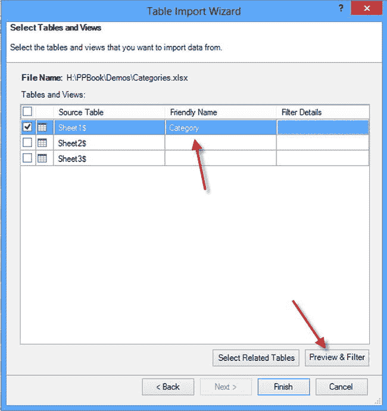

图 2-20 在 Excel 文件中选择表

除了从文本文件导入数据，你可能还需要通过从数据馈送导入数据来补充数据模型。这正成为一种与业务伙伴交换数据的常见方式，接下来你将了解如何操作。

### 从数据馈送导入数据

尽管文本文件是交换数据最常用的方式之一，但数据馈送正日益成为流行的数据交换方式。数据馈送通过 Web 服务提供数据，要连接到 Web 服务，需要输入 Web 服务的网址。在图 2-17 中，你可以看到可用的数据馈送连接。大多数情况下，你会知道合作伙伴或数据提供商提供的数据服务的地址。在这种情况下，选择“其他馈送”，系统将为你提供一个连接信息输入窗口，如图 2-21 所示。

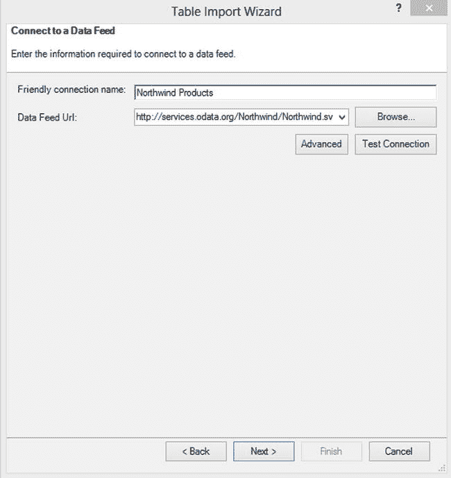

图 2-21 连接到数据馈送

由于数据馈送不仅包含数据，还包含元数据（数据描述），因此一旦建立连接，`Power Pivot` 会提供预览和筛选数据的功能，如图 2-22 所示。

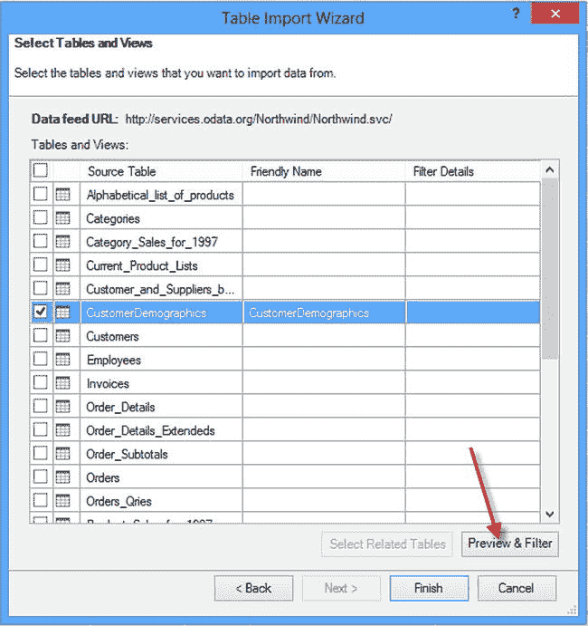

图 2-22 从数据馈送预览和筛选数据

一些值得关注的数据馈送来源包括来自 `Reporting Services` 报表和 `SharePoint` 列表的数据。这些应用程序可以轻松将其数据作为数据馈送公开，供你作为数据源使用。此外，许多数据库供应商（如 `SAP`）也支持将其数据作为数据馈送公开。

### 从 OLAP 多维数据集导入数据

许多公司投入了大量资金和精力来构建企业级报表解决方案，该方案由企业级 `OLAP` 存储库组成，为各种仪表板和记分卡提供数据。使用 `Power Pivot`，你可以轻松集成来自这些存储库的数据。在连接窗口（图 2-17）的连接选项中，选择“多维服务”下的`Microsoft SQL Server Analysis Services`连接。这将启动连接信息窗口，如图 2-23 所示。你可以连接到多维数据集或发布到 `SharePoint` 的 `Power Pivot` 模型。要连接到多维数据集，请输入服务器名称和数据库名称。要连接到 `Power Pivot` 模型，请输入 Excel 工作簿的 `URL`（位于 `SharePoint` 库中）和模型名称。

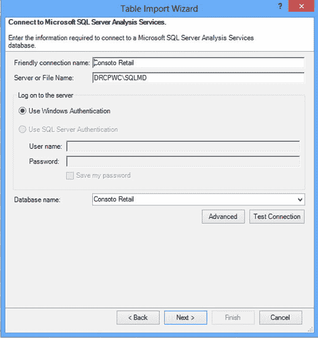

图 2-23 连接到 Analysis Services 多维数据集

连接到多维数据集后，你可以输入 `MDX` 查询来检索数据（见图 2-24）。记得验证查询以确保其能够运行。

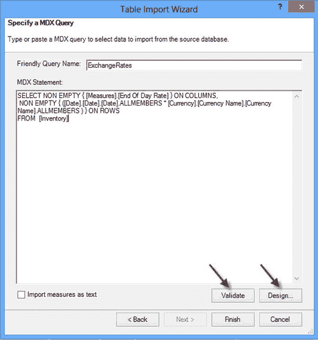

图 2-24 输入 `MDX` 查询

如果你不熟悉 `MDX`，可以使用可视化设计器来创建它，如图 2-25 所示。设计器的一个出色功能是能够预览结果。

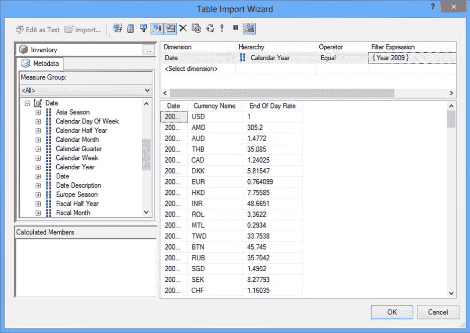

图 2-25 设计 `MDX` 查询

设计完查询后，它将被输入到 `MDX` 语句框中，如图 2-24 所示，你可以在那里完成数据导入。

### 重用现有连接以更新模型

在两种情况下，你需要重用与数据源的现有连接。你可能需要从数据源检索其他数据；例如，需要从其他表或视图中获取数据，或发出新查询。在这种情况下，你应选择“主页”选项卡上的“现有连接”按钮（见图 2-26）。

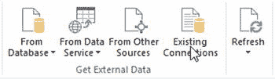

图 2-26 选择现有连接

在“现有连接”窗口中，选择连接并单击“打开”按钮（见图 2-27）。这将启动之前介绍过的屏幕（具体取决于连接类型），你可以按照流程选择要导入的数据。

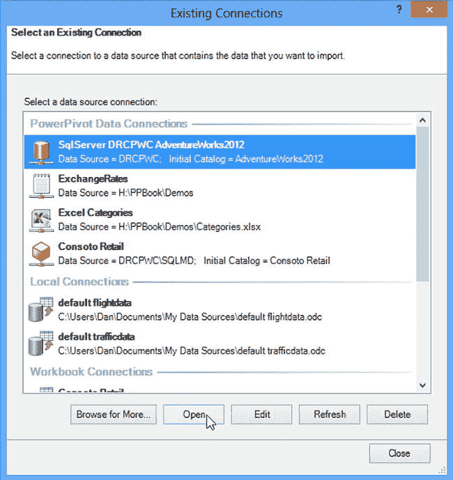

图 2-27 打开现有连接

另一种情况是，当你想更改现有表的筛选条件或向其中添加列时。在这种情况下，你需要在设计器的数据视图模式下选择该表，然后在“设计”选项卡上选择“表属性”（见图 2-28）。


图 2-28 选择表属性

“编辑表属性”窗口允许你更新用于填充表数据的查询。你可以在“表预览”模式（图 2-29）或“查询”模式（图 2-30）下更新表。在“查询编辑器”模式下，你还可以启动查询设计器来更新查询。

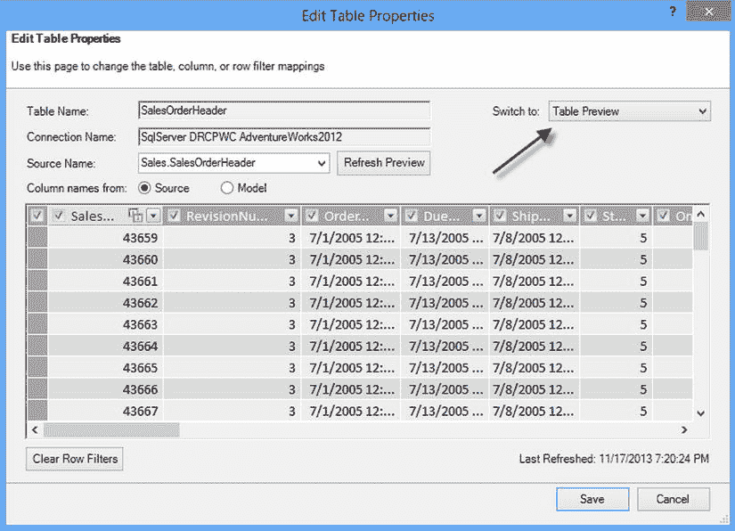

图 2-29 在表预览模式下更新查询

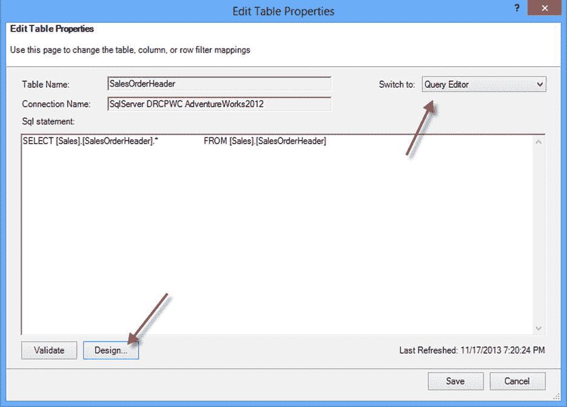

图 2-30 在查询编辑器模式下更新查询

现在你已经了解了如何将数据从各种数据源导入 `Power Pivot` 数据模型，是时候动手实践数据导入了。

### 动手实验——将数据加载到 `Power Pivot`

在以下实验中，你将：
*   从`Access`数据库导入数据。
*   从文本文件导入数据。

1.  打开`Excel 2013`并创建一个名为`LabChapter2.xlsx`的新文件。
2.  在“`Power Pivot`”选项卡上，单击“管理数据模型”按钮（见图 2-31）。这将启动`Power Pivot`模型设计器窗口。

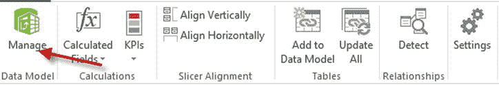

`图 2-31` 打开模型设计器窗口

3.  在“主页”选项卡的“获取外部数据”组中，单击“从数据库”下拉菜单（见图 2-32）。在下拉菜单中选择“从`Access`导入”。这将启动表导入向导。

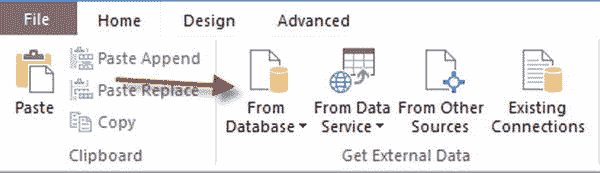

`图 2-32` 启动表导入向导

4.  在“Lab Starters”文件夹中浏览找到`Northwind.acdb`数据库文件，并测试连接。使用友好的连接名称`Access Northwind`。此数据库不需要用户名和密码（请参见图 2-33）。点击`测试连接`以进入下一窗口。

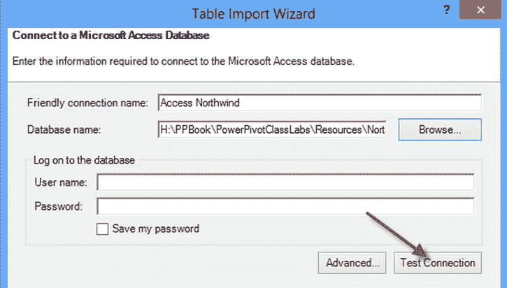

`图 2-33` 连接到 `Access` 数据库

5.  您有两种导入数据的方式：可以从表和视图列表中选择，也可以选择编写查询来选择数据。请选择“从表和视图列表中选择”。
6.  在“选择表和视图”窗口中，选择`Customers`并点击该行以高亮显示。在窗口底部，选择`预览和筛选`按钮以预览和筛选数据（请参见图 2-34）。

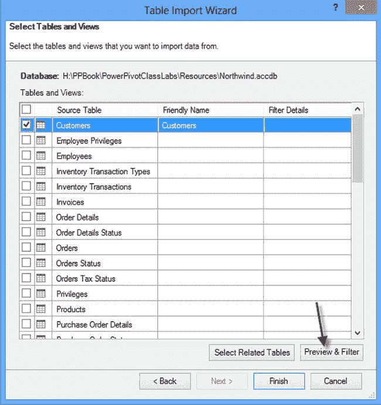

`图 2-34` 选择要导入的表

7.  在`Customers`表中，选择以下字段：`ID`、`公司`、`姓氏`、`名字`、`城市`、`省/州`和`国家/地区`。取消勾选其余字段（请参见图 2-35）。勾选左上角的复选框将选择或取消选择所有列。

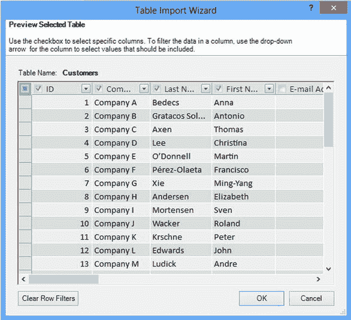

`图 2-35` 筛选表列

8.  从`Employees`表中，选择以下字段：`ID`、`姓氏`、`名字`和`职务`。
9.  从`Orders`表中，选择以下字段：`订单 ID`、`员工 ID`、`客户 ID`、`订单日期`、`发货日期`、`发货人 ID`、`付款类型`和`付款日期`。在`状态 ID`列上，点击下拉菜单以筛选数据。取消勾选`状态 0`和`状态 2`。`状态 3`表示已关闭状态（请参见图 2-36）。

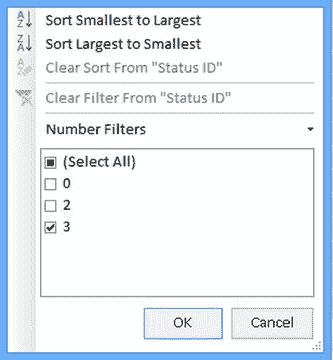

`图 2-36` 筛选表行

10. 完成选择表后，点击`完成`按钮以导入数据。导入后，关闭向导。您应该会看到每个表都作为数据视图窗口中的一个选项卡显示（请参见图 2-37）。


`图 2-37` 数据视图窗口中的表

11. 现在，您将使用查询来选择订单详情。在`Power Pivot`模型设计器中，选择`主页`选项卡。在`主页`选项卡中，选择`现有连接`按钮。在连接窗口中，选择`Access Northwind`连接，然后点击`打开`。
12. 这次，请选择`编写将指定要导入数据的查询`。
13. 在“指定查询”窗口中，将查询命名为`OrderDetails`，然后选择`设计`按钮以启动查询设计器。（您也可以不使用设计器直接编写查询。）在查询设计器中，选择`导入`，然后在“Lab Starters”文件夹中选择`OrderDetailQuery.txt`文件。通过点击红色感叹号 (!) 来测试查询（请参见图 2-38）。测试查询后，点击`确定`按钮。


`图 2-38` 使用查询获取数据

14. 在“表导入向导”中，点击`完成`按钮以导入数据。导入后，关闭向导。您应该会看到已添加了一个`OrderDetail`表选项卡。
15. 您要导入的最后一个表包含在一个制表符分隔的文本文件中。在`主页`选项卡的`获取外部数据`部分，点击`从其他来源`按钮。在数据源列表中，选择`文本文件`，然后点击`下一步`。
16. 在连接信息中，将连接名称更改为`Product`。在`文件路径`中，浏览到“LabStarters”文件夹中的`ProductList.txt`文件。选择制表符作为列分隔符，并勾选`将第一行用作列标题`复选框。点击`完成`按钮以导入数据（请参见图 2-39）。


`图 2-39` 从文本文件导入数据

17. 导入后，关闭向导，您应该会看到已添加了一个`Product`表选项卡。
18. 完成后，保存文件并关闭 Excel。

#### 小结

创建`Power Pivot`模型的首要步骤之一就是导入数据。在本章中，您学习了如何从各种数据源导入数据。在`Power Pivot`中导入数据的一个优点在于，从不同数据源导入数据的体验是相似的。您需要创建连接、提供查询或选择表、预览和筛选数据，然后将其导入模型中。现在，您已将数据导入到模型中的各个表，接下来需要在这些表之间建立关系。在下一章中，您将了解建立关系的重要性，以及如何通过层次结构来增强模型以辅助数据分析。

## 第 3 章


# 创建数据模型

既然您已经知道如何将数据导入 Power Pivot 模型，下一步就是理解什么构成了一个良好的模型。这在处理 Power Pivot 中的数据时非常重要。一个良好的模型将使 Power Pivot 运行得异常快速，并允许您以新颖有趣的方式分析数据。而一个糟糕的模型会导致 Power Pivot 运行缓慢，最坏的情况下，在进行数据分析时会产生误导性结果。传统的 Excel 数据透视表基于 Excel 工作表中的单个表。Power Pivot 数据透视表则基于数据模型中的多个表。本章将引导您完成创建稳固模型的过程，该模型将成为您数据分析的基础。此外，您还将了解如何向客户端工具呈现一个用户友好的模型。这包括重命名表和字段、提供合适的数据类型以及隐藏无关字段。

完成本章后，您将能够：
- 解释什么是数据模型
- 在模型的表之间创建关系
- 创建并使用星型架构
- 理解何时以及如何对数据进行反规范化
- 创建并使用链接表
- 创建并使用层次结构
- 创建一个用户友好的模型

## 什么是数据模型？

从根本上说，数据模型由表、列、数据类型和表关系组成。通常，数据表是为了存储业务实体的数据而构建的；例如，客户数据存储在客户表中，员工数据存储在员工表中。表由定义实体属性的列组成。例如，您可能希望存储客户信息，如姓名、地址、出生日期、家庭规模等。每个属性都有一个数据类型，取决于该属性所包含的信息——姓名应为字符串数据类型，家庭规模应为整数，出生日期应为日期类型。表中的每一行都应该是唯一的。以客户表为例，如果同一客户在多行中出现但属性不同（例如出生日期），您将无法知道哪个是正确的。

在上一示例中，你会知道其中一行数据是不正确的，因为同一个人不可能有两个不同的生日。不过，在很多情况下，你需要追踪某个实体属性值的变化。例如，产品的标价可能会随时间变化。为了追踪这种变化，你需要添加时间戳来使行唯一。这样一来，每一行就可以通过产品编号和时间戳来唯一标识，如图 Figure 3-1 所示。


Figure 3-1. 使用时间戳追踪变化

一旦确定了模型中的表，关键是要识别这些表是否高效设置。这个过程被称为*规范化*模型。规范化是组织数据以使其更易于查询且效率更高的过程。例如，不应将不相关实体的属性混合在同一个表中——你绝对不希望将产品数据和员工数据放在同一个表中。另一个正确规范化的例子是，不要在一个列中存放多个属性。例如，与其使用一个客户地址列，不如将其拆分为街道、城市、州和邮政编码。这样你就可以轻松地按州或城市分析数据。Figure 3-2 所示的电子表格展示了一个典型的非规范化表。如果你发现提供给你的数据规范化不足，你可能需要要求数据提供方将数据拆分为多个表，然后你可以在模型中将这些表关联起来。


Figure 3-2. 一个非规范化的表

一旦你确定模型中的表已充分规范化，下一步就是确定这些表之间的关联方式。例如，你需要关联客户表、销售表和产品表，以便分析不同产品在不同年龄段的销售情况。关联不同表的方式是使用*键*。表中的每一行都需要一个列或列组合来唯一标识该行。这称为*主键*。这个键可能很容易识别，例如在数据录入时由业务分配的销售订单号或客户编号。有时，你需要对表进行一些分析才能找到主键，尤其是当你从外部来源获取数据时。例如，你可能获取了包含潜在客户的数据，字段包括姓名、城市、州、邮编、出生日期等。你不能仅使用姓名作为键，因为很可能存在多个同名的客户。如果使用姓名和城市的组合，出现多个客户由同一个键标识的可能性就会降低。当你使用更多列（如邮编和出生日期）时，这种可能性会变得更小。

在模型中关联表时，一个表的主键会成为相关表中的外键。例如，要将客户与其销售记录关联起来，客户键需要包含在销售表中，在那里它被视为外键。在提取数据时，使用键来获取相关数据。到目前为止，出于性能考虑，最好的键类型是单列整数。因此，许多数据库表在设计时都使用了代理键。这个键是在记录加载时分配给该记录的整数。代理键用于连接表，而不是使用自然键。Figure 3-3 展示了一个典型的数据库表，其中同时包含代理键（`CustomerKey`）和自然键（`CustomerAlternateKey`）。


Figure 3-3. 一个同时包含代理键和自然键的表

了解数据源中使用的键非常重要。如果能够从源中检索到键，那会好得多。当从关系型数据库检索数据时，这通常不是问题，但如果你要整合来自不同系统的数据，请确保你拥有合适的键。

一旦确定了表之间的键，就可以准备在`Power Pivot`模型中创建关系了。

## 创建表关系

在`Power Pivot`模型中建立表关系时，需要记住一些规则。首先，不能在模型中使用复合键。如果你的表使用了复合键，你需要通过连接复合列来创建一个新列，并将此列用作键。其次，两个表之间只能有一个活动关系路径，但可以有多个非活动关系。第三，关系是一对多的；换句话说，在客户表（一侧）和销售表（多侧）之间创建关系是可以的。然而，直接在客户表和产品表之间创建关系是不允许的，因为一个客户可以购买多个产品，而同一个产品也可以被多个客户购买。在这种情况下，你需要创建一个连接表来连接这些表。

要在`Power Pivot`模型中创建两个表之间的关系，你可以打开`Data Model Manager`并切换到关系图视图。右键点击代表关系多侧的表，然后选择`Create Relationship`。这将启动`Create Relationship`窗口。选择相关的查找表（一侧）和键列。Figure 3-4 展示了在`Sales`表和`Store`表之间创建关系。默认情况下，表之间创建的第一个关系被标记为活动关系。


Figure 3-4. 创建表关系

Figure 3-5 展示了在关系图视图中最终形成的关系。如果你点击关系箭头，该关系的两个键列会高亮显示。


Figure 3-5. 在关系图视图中查看关系

你可以在两个表之间创建多个关系，但请记住，只能有一个是活动关系。如果你试图创建两个活动关系，会收到类似 Figure 3-6 所示的错误信息。


Figure 3-6. 尝试在两个表之间创建第二个活动关系

有时，活动关系并不那么明显。Figure 3-7 展示了`Sales`表和`Date`表之间的一个活动关系，以及`Sales`表和`Store`表之间的另一个活动关系。`Store`表和`Date`表之间还存在一个非活动关系。如果你试图将这个非活动关系设为活动，会收到与 Figure 3-6 中相同的错误信息。这是因为你可以从`Date`表追踪到`Sales`表，再到`Store`表，从而形成一条活动路径。


Figure 3-7. 间接活动关系

你可能会遇到的另一个常见错误是，尝试在两个表之间创建关系时，键在至少一个表中不是唯一的。Figure 3-8 展示了一个`Product`表和一个`Sales`表，两者都包含重复的`ProductNumber`。


图 3-8 `Product` 表和 `Sales` 表

当你尝试在这些表之间创建关系时，会出现如图 3-9 所示的错误。


图 3-9 出现重复值错误

在本例中，`ProductNumber` 在 `Product` 表中应该是唯一的，但结果显示存在重复值。为了解决这个问题，你需要修改 `Product` 表数据的查询，以确保不会出现重复值。

现在你已经了解了如何在模型中创建表关系，接下来可以看看使用星型模式的好处。

## 创建星型模式

在创建数据模型时，理解模型的用途至关重要。数据库的两大主要用途是捕获数据和报告/分析数据。问题在于，当你为高效数据捕获创建模型时，会降低其分析数据的效率。为了解决这个问题，许多公司将数据捕获数据库与报告/分析数据库分开。幸运的是，在 Power Pivot 中创建数据模型时，我们只需要针对报告进行优化。

在分析大量数据集时，最佳模型之一是*星型模式*。星型模式由一个中心事实表和围绕它的维度表组成，如图 3-10 所示。


图 3-10 典型的星型模式

事实表包含与业务或流程相关的定量数据。例如，图 3-10 中的 `Sales` 表包含销售的可测量方面，例如总成本、销售金额和数量。事实表通常包含许多行，并有一个日期或时间组件，用于记录事件发生的时间点。维度表包含关于事件的属性。例如，`Date` 表可以告诉你销售发生的时间，并允许你将数据汇总到月、季度或年级别。`Product` 表包含有关所售产品的属性，你可以按产品线、颜色和品牌查看销售情况。`Store` 表包含有关参与销售的商店的属性。维度表通常不包含像事实表那样多的行，但可以包含相当多的列。当你问“哪些自行车在不同年龄段销售最好？”之类的问题时，度量值（销售额）来自事实表，而分类（年龄和自行车型号）则来自维度表。

星型模式的主要优点是提供快速的查询性能和聚合处理。缺点是它通常需要大量的预处理，才能将数据从高度规范化的交易系统移到非规范化的报告系统。好消息是，你的企业可能有一个报告系统为传统联机分析处理 (OLAP) 数据库（例如 Microsoft 的 Analysis Server 或 IBM 的 Cognos）提供数据。如果你能访问这些系统，它们可能是你核心业务数据的最佳来源。

为了从源数据系统创建星型模式，你可能需要执行一些数据非规范化操作，这将在下一节中介绍。

## 了解何时对数据进行非规范化

虽然事务型数据库系统高度规范化，但报告系统则非规范化为星型模式。如果你无法访问已为你完成非规范化的报告系统，则必须将数据非规范化为星型模式，以便加载你的 Power Pivot 模型。例如，图 3-11 显示了 `Adventureworks` 事务型销售数据库中包含客户数据的表。


图 3-11 高度规范化的模式

为了将客户数据非规范化到模型中，你需要创建一个将数据合并到单个客户维度表中的查询。如果你不熟悉创建复杂查询，最简单的方法是让数据库开发人员创建一个视图，你可以从中提取数据，该视图为你合并了这些表。如果查询不太复杂，你可能可以在导入数据时自己创建。例如，图 3-12 显示了一个客户表和一个地理位置表。


图 3-12 合并客户和客户位置数据

你可以使用以下查询将它们合并到一个客户维度表中。

```sql
SELECT  c.CustomerKey, c.BirthDate, c.MaritalStatus, c.Gender,
        c.YearlyIncome, c.NumberChildrenAtHome, c.EnglishOccupation,
        c.HouseOwnerFlag,  c.NumberCarsOwned, c.CommuteDistance,
        g.City, g.StateProvinceName, g.EnglishCountryRegionName, g.PostalCode
FROM    Customer AS c INNER JOIN
        Geography AS g ON c.GeographyKey = g.GeographyKey
```

虽然你不必成为查询专家才能将数据导入 Power Pivot 模型，但了解查询数据源的基础知识非常有益，即使这仅仅有助于在与数据库开发人员交流时提出正确的问题。

## 创建链接表

关于 Power Pivot 模型中包含的数据，需要记住一点：它是只读的。在大多数情况下，这是一件好事。你想确保数据仅在源系统中被更改。然而，有时作为数据分析的一部分，你可能希望即时进行调整，并查看它对结果的影响。一个经常发生的例子是*桶分析*。例如，假设你想查看一个连续度量值（如年龄）并将其分为离散的桶（范围），并且在分析过程中需要调整范围。这正是链接表的用武之地。

要创建链接表，首先需要在 Excel 工作表上设置该表。输入数据后，将其高亮显示，并单击快速分析菜单（参见 图 3-13）。在 `Tables` 选项卡下，单击 `Table` 按钮。


图 3-13 创建 Excel 表

创建表后，最好在将其导入 Power Pivot 数据模型之前为其命名。你可以通过选择该表，然后在 `Table Tools Design` 弹出窗口的 `Tables` 选项卡下输入表名称来实现（参见 图 3-14）。


图 3-14 重命名 Excel 表

表命名后，选中它，然后在 `Power Pivot` 选项卡上，选择 `Add To Data Model`（参见 图 3-15）。


图 3-15 将表添加到模型

表导入模型后，如果你更改 Excel 工作表中的某些表值，并在 `PowerPivot` 选项卡上选择 `Update All`（参见 图 3-15），模型中的链接表将更新为新的值。

#### 创建层次结构

当分析数据时，使用层次结构来定义不同级别的聚合通常很有帮助。例如，基于年、季度和月份的日历层次结构很常见。像销售金额这样的聚合值会从月份汇总到季度，再到年份。另一个常见的层次结构可能是从部门到大楼，再到区域。然后，你可以将成本向上汇总到不同级别。在 Power Pivot 模型中创建层次结构非常简单。在模型设计器的关系图视图中，选择包含你想要放入层次结构的属性（列）的表。你将在表格右上角看到一个“创建层次结构”按钮（参见图 3-16）。点击该按钮添加层次结构并重命名。然后，你可以将字段拖放到层次结构中，以创建不同的级别。确保字段的排列顺序是从高层级到低层级。


图 3-16。创建层次结构

创建层次结构是增加模型可用性，并帮助用户在数据分析中本能地获取更多价值的一种方法。在下一节中，你将看到一些其他可以应用于模型以增加其可用性的操作。

#### 打造用户友好的模型

在创建模型时，需要记住的一点是让模型易于使用且直观。模型可能会被其他用户用于分析。该模型还可能用于各种客户端报表和分析工具，例如 Power View、Power Map 和 Reporting Services。你可以使用一些属性和设置，让这些客户端工具从模型中获得更多功能。

最有效的调整之一是为表和列重命名。使用对业务用户有意义的名称，而不是只对数据库开发人员有意义的晦涩命名约定。另一个好的做法是确保列的数据类型和格式设置正确。来自文本文件的字段可能会被导入为字符串类型，而它实际上是数字数据。此外，你可以隐藏对用户无用的字段，例如用于链接表的代理键。

一个常见的要求是更改列的排序顺序，使其不同于自然排序。最常见的例子是月份。由于它们默认是文本，因此会按字母顺序排序。实际上，你希望它们按月份编号排序。要解决此问题，你可以按表中的任何其他列对一个列进行排序（参见图 3-17）。这是一个很好的功能，允许你创建自定义的业务相关排序。


图 3-17。按另一列对一列进行排序

你可以使用其他一些设置来为各种客户端工具创建良好的模型。我们将在第 10 章（“优化 Power View 的表格模型”）中更详细地回顾这个主题。

以下动手实验将帮助你巩固本章涵盖的主题。

#### 动手实验——在 Power Pivot 中创建数据模型

在以下实验中，你将：
*   创建表关系。
*   反规范化数据。
*   创建链接表。
*   设置层次结构。
*   制作一个用户友好的模型。

1.  打开 Excel 2013 并创建一个名为 `LabChapter3.xlsx` 的新文件。
2.  使用 Power Pivot 数据模型中的表导入向导，连接到 `LabStarters` 文件夹中的 `Adventureworks.accdb` 文件。
3.  选择所列出的表和字段并导入数据。

| 源表名 | 友好名称 | 字段 |
| --- | --- | --- |
| `DimDate` | `Date` | `DateKey` `FullDateAlternateKey` `EnglishMonthName` `MonthNumberOfYear` `CalendarQuarter` `CalendarYear` |
| `DimCustomer` | `Customer` | `CustomerKey` `BirthDate` `MaritalStatus` `Gender` `YearlyIncome` `TotalChildren` `HouseOwnerFlag` `NumberCarsOwned` |
| `FactInternetSales` | `Internet Sales` | `ProductKey` `OrderDateKey` `ShipDateKey` `CustomerKey` `SalesTerritoryKey` `SalesOrderNumber` `SalesOrderLineNumber` `OrderQuantity` `UnitPrice` `TotalProductCost` `SalesAmount` |

4.  在 Power Pivot 模型设计器的数据视图模式下，按照表格指示重命名并隐藏列。要隐藏列，请右键单击它，然后从上下文菜单中选择“从客户端工具中隐藏”。


5.  将 Power Pivot 窗口切换到关系图视图。你应该能看到 `Date`、`Customer` 和 `Internet Sales` 表。`Customer` 表和 `Internet Sales` 表之间已定义了一个关系。这由表导入向导自动发现。
6.  将 `DateKey` 从 `Date` 表拖放到 `Internet Sales` 表中的 `OrderDateKey` 上。类似地，在 `DateKey` 和 `ShipDateKey` 之间创建一个关系。双击此关系以启动“编辑关系”窗口（参见图 3-18）。尝试将此关系设为活动关系。你会收到一个错误，因为模型中两个表之间只能有一个活动关系。


图 3-18。创建表关系

7.  在 Power Pivot 模型设计器窗口的“主页”选项卡上，单击“现有连接”按钮。你应该能看到之前创建的指向 `Adventureworks.accdb` 的连接。打开此连接并选择用于导入数据的查询选项。
8.  在“指定 SQL 查询”窗口中，将查询友好名称更改为 `Product`，然后单击“设计”按钮。
9.  在设计器中单击“导入”按钮。打开实验启动器文件夹中的 `ProductQuery.txt` 文件。单击红色的感叹号 (!) 以运行查询（参见图 3-19）。此查询合并了来自 `Product`、`ProductCategory` 和 `ProductSubcategory` 表的数据（即反规范化）。


图 3-19。运行查询

10. 在确认获取到数据后，单击“确定”按钮，然后在下一个屏幕上单击“完成”按钮。
11. 导入数据后，隐藏 `ProductKey` 并按下表所示更新列名：


12. 使用 `ProductKey` 在 `Internet Sales` 表和 `Product` 表之间创建一个关系。最终的关系图应类似于图 3-20。


图 3-20。查看数据模型关系

13. 要创建链接表，请将图 3-21 中显示的数据输入到 Excel 中的一个空白电子表格选项卡中。


图 3-21。链接表数据

14. 选中这些单元格，右键单击，在“快速分析”上下文菜单中，选择“表”选项卡，然后单击“表”按钮（参见图 3-22）。在“表工具设计”选项卡中，将表重命名为 `SalesTerritory`。


图 3-22。“快速分析”的“表”选项卡

15. 在 Power Pivot 选项卡上，单击 `Add To Data Model` 按钮。将表添加到模型后，将其名称更改为 `Sales Territory`，隐藏 `SalesTerritoryKey`，并创建与 `Internet Sales` 表的关系。
16. 要创建层次结构，请在 Power Pivot 窗口的图表视图中选择 `Sales Territory` 表，然后单击 `Create Hierarchy` 按钮。将 `Sales Territory Group`、`Country` 和 `Region` 拖放到层次结构中。将层次结构重命名为 `Sales Territory`（参见图 3-23）。


图 3-23. `Sales Territory` 层次结构

17. 在 `Date` 表中使用 `Year`、`Quarter` 和 `Month` 创建一个名为 `Calendar` 的日历层次结构。
18. 在设计器中切换到数据视图，然后选择 `Date Table` 选项卡。选择 `Month` 列，并将其 `Sort By Column` 设置为 `Month No.` 列。
19. 完成后，保存并关闭 Excel。

### 总结

使用 Power Pivot 时，理解什么构成了一个好模型至关重要。一个好的模型能让 Power Pivot 运行得异常快速，并允许你轻松分析大量数据。与传统的 Excel 数据透视表（基于 Excel 工作表中的单个表）不同，Power Pivot 数据透视表基于包含在数据模型中的多个表。本章指导你完成了创建坚实模型的过程，该模型将成为你数据分析的基础。此外，你还了解了如何向客户端工具呈现一个用户友好的模型。

现在，你已经为模型打下了坚实的基础，接下来就可以通过自定义计算来扩展模型了。下一章将介绍数据分析表达式 (DAX) 语言，并解释如何在数据模型中创建计算列。其中包含了大量示例，以帮助你创建模型中的常见计算。

## 第 4 章


### 使用 DAX 创建计算

现在你已知道如何创建一个健壮的数据模型作为分析基础，下一步是向模型添加任何有助于探索数据所需的计算。例如，你可能需要将代码值转换为有意义的描述，或者解析字符串以获取关键信息。这就是数据分析表达式 (DAX) 发挥作用的地方。本章将向你介绍 DAX，并展示如何使用 DAX 创建计算列，以增强模型的功能。

完成本章后，你将能够：
*   使用 DAX 向表添加计算列
*   实现 DAX 运算符
*   在 DAX 中使用文本函数
*   使用 DAX 日期和时间函数
*   使用条件和逻辑函数
*   从相关表中获取数据
*   使用数学、三角和统计函数

#### 什么是 DAX？

DAX 是一种公式语言，用于在 Power Pivot 模型中创建计算列和度量值。它是专门为 Power Pivot 所基于的表格数据模型而开发的新语言。如果你熟悉 Excel 的公式语法，你会发现 DAX 语法非常相似。实际上，某些 DAX 公式的语法和功能与 Excel 中的对应公式完全相同。一个你需要理解的主要区别是，Excel 公式基于单元格，而 DAX 基于列。例如，如果要在 Excel 中连接两个值，你会使用类似下面的公式：

```
=A1 & " " & B1
```

其中 `A1` 是第一行第一列的单元格，`B1` 是第一行第二列的单元格（参见图 4-1）。


图 4-1. 在 Excel 中输入公式

这与 DAX 公式非常相似：

```
=[First Name] & " " & [Last Name]
```

其中 `First Name` 和 `Last Name` 是模型表中的列（参见图 4-2）。


图 4-2. 在 Power Pivot 中输入公式

区别在于，DAX 公式应用于表中的所有行，而 Excel 公式仅适用于特定单元格。在 Excel 中，你需要在每一行中重新创建公式。

这意味着，尽管你可以在 Excel 中执行类似以下操作：

```
=A1 & " " & B2
```

即从第一行获取一个单元格并与第二行的一个单元格连接（参见图 4-3），但这在 DAX 中是做不到的。


图 4-3. 使用不同行中的单元格

创建 DAX 公式时，考虑数据类型以及计算中可能发生的任何转换非常重要。如果不考虑这些因素，你可能会遇到公式错误或意外结果。模型中支持的数据类型有：整数、小数、货币、布尔值、文本和日期。DAX 还有一种表数据类型，它在许多函数中使用，这些函数将表作为输入值并返回一个表。

当你尝试将数值数据类型与文本数据类型相加时，会发生隐式转换。如果 DAX 可以将文本转换为数值，它会以数字形式相加；如果不能，你将收到错误。另一方面，如果你尝试将数值数据类型与文本数据类型连接，DAX 会将数值数据类型隐式转换为文本。虽然大多数时候隐式转换会给你想要的结果，但这会带来性能成本，应尽可能避免。例如，如果你从文本文件导入数据，并且列被设置为文本数据类型，但你知道它实际上是数值，你应该更改模型中的数据类型。

在 DAX 中创建计算时，你需要引用表和列。如果表名不包含空格，你可以直接按名称引用。如果表名包含空格，则需要将其括在单引号中。列和度量值则括在方括号中。如果你在公式中仅列出列名，则假定该列存在于同一表中。如果引用另一表中的列，则需要使用完全限定名称，即表名后跟列名。以下代码演示了语法：

```
=[SalesAmount] - [TotalCost]
=Sales[SalesAmount] - Sales[TotalCost]
='Internet Sales'[SalesAmount] - 'Internet Sales'[TotalCost]
```

以下是使用 DAX 时需要牢记的其他要点：
*   DAX 公式和表达式不能修改或插入表中的单个值。
*   你不能使用 DAX 创建计算行。你只能创建计算列和度量值。
*   在定义计算列时，你可以将函数嵌套到任意层级。

在创建计算时，首先要了解支持哪些运算符以及使用它们的语法。在下一节中，你将研究各种 DAX 运算符。

#### 实现 DAX 运算符

DAX 包含一套强大的运算符，包括算术、比较、逻辑和文本连接。大多数运算符你都应该很熟悉，并列举在表 4-1 中。

表 4-1. DAX 运算符

| 类别 | 符号 | 用途 |
| --- | --- | --- |
| 算术运算符 |
|   | `+` | 加法 |
|   | `-` | 减法 |
|   | `*` | 乘法 |
|   | `/` | 除法 |
|   | `^` | 乘方 |
| 比较运算符 |
|   | `=` | 等于 |
|   | `>` | 大于 |
|   | `<` | 小于 |
|   | `>=` | 大于或等于 |
|   | `<=` | 小于或等于 |
|   | `<>` | 不等于 |
| 文本连接运算符 |
|   | `&` | 连接 |
|   |   | 逻辑运算符 |
|   | `&&` | 与 |
|   | `&#124;&#124;` | 或 |

##### 算术运算符示例

以下代码用于将 `Margin` 列除以 `Total Cost` 列，从而创建一个新列 `Margin Percentage`。

```
=[Margin]/[TotalCost]
```

在同一计算中包含多个算术运算的情况非常常见。此时，您必须注意运算顺序。指数运算优先计算，其次是乘/除，最后是加/减。您可以通过使用括号对计算进行分组来控制运算顺序；例如，以下公式将在除法之前执行减法。

```
=([Sales Amount]-[Total Cost])/[Total Cost]
```

比较运算符主要用于 `IF` 语句。例如，以下计算检查商店的销售面积是否大于 1000。如果是，则归类为大型商店，否则归类为小型商店。

```
=IF([Selling Area Size]>1000,"Large","Small")
```

逻辑运算符用于创建多重比较逻辑。以下代码检查商店面积是否大于 1000 或员工人数是否超过 35，以将其归类为大型商店。

```
=IF([Selling Area Size]> 1000 || [Employee Count] > 35,"Large","Small")
```

当开始串联一系列逻辑条件时，建议使用括号来控制运算顺序。以下代码检查商店面积是否大于 1000 且员工人数是否超过 35，以将其归类为大型商店。此外，如果其年销售额超过 1,000,000 美元，无论其面积大小或员工数量如何，也会将其归类为大型商店。

```
=IF(([Selling Area Size]> 1000 && [Employee Count] > 35) || [Annual Sales] > 1000000,"Large","Small")
```

在使用 `DAX` 计算时，您可能需要将一个公式嵌套在另一个公式内部。例如，以下代码将一个 `IF` 语句嵌套在另一个 `IF` 语句的 `false` 部分中。如果员工数量不大于 35，则会跳转到下一个 `IF` 语句，检查是否大于 20。

```
=IF(Store[EmployeeCount]>35,"Large",IF(Store[EmployeeCount]>20,"Medium","Small"))
```

`DAX` 包含许多用于创建计算和度量的有用函数。这些函数包括文本函数、日期和时间函数、统计函数、数学函数和信息函数。在接下来的几节中，您将学习如何在计算中使用各种函数类型。

## 使用文本函数

许多计算都涉及某种文本处理。您可能需要截断、解析、搜索或格式化从源系统加载的文本值。`DAX`包含许多用于处理文本的有用函数。这些函数及其用途说明列在表 4-2 中。

**表 4-2.** `DAX`文本函数

| 函数 | 描述 |
| --- | --- |
| `BLANK` | 返回一个空白。 |
| `CONCATENATE` | 将两个文本字符串连接成一个文本字符串。 |
| `EXACT` | 比较两个文本字符串，如果完全相同则返回`TRUE`，否则返回`FALSE`。 |
| `FIND` | 返回一个文本字符串在另一个文本字符串中的起始位置。 |
| `FIXED` | 将数字四舍五入到指定的小数位数，并将结果作为文本返回。 |
| `FORMAT` | 根据指定的格式将值转换为文本。 |
| `LEFT` | 返回文本字符串开头指定数量的字符。 |
| `LEN` | 返回文本字符串中的字符数。 |
| `LOWER` | 将文本字符串中的所有字母转换为小写。 |
| `MID` | 从文本字符串中返回指定起始位置和长度的字符串。 |
| `REPLACE` | 用另一个文本字符串替换文本字符串的一部分。 |
| `REPT` | 将文本重复指定次数。使用`REPT`可以用文本字符串的多个实例填充单元格。 |
| `RIGHT` | 根据指定的字符数，返回文本字符串中最后一个或多个字符。 |
| `SEARCH` | 返回从左到右读取时，首次找到特定字符或文本字符串的字符位置编号。 |
| `SUBSTITUTE` | 用新文本替换文本字符串中的现有文本。 |
| `TRIM` | 删除文本中除单词间单个空格之外的所有空格。 |
| `UPPER` | 将文本字符串转换为全大写字母。 |
| `VALUE` | 将表示数字的文本字符串转换为数字。 |

作为在计算中使用文本函数的示例，假设产品表中有一个产品代码列，其前两个字符代表产品系列。要创建产品系列列，可以使用`Left`函数，如下所示：

```
=Left([Product Code],2)
```

您可以使用`FIND`函数在文本中搜索子文本。您可以使用问号（`?`）匹配任意单个字符，使用星号（`*`）匹配任意字符序列。您可以选择指定搜索的起始位置。`FIND`函数返回找到的子字符串的起始位置。如果未找到子字符串，它可以返回`0`、`-1`或空白值。以下代码在产品描述列中搜索单词“mountain”。

```
=FIND("mountain",[Description],1,-1)
```

`FORMAT`函数根据提供的格式将值转换为文本。例如，您可能需要将日期转换为特定格式。以下代码将日期数据类型转换为格式类似“Mon - Dec 02, 2013”的字符串。

```
=FORMAT([StartDate],"ddd - MMM dd, yyyy")
```

除了能够创建自己的格式之外，您还可以使用预定义的格式。以下代码演示了使用长日期格式“Monday, December 2, 2013”。

```
=FORMAT([StartDate],"Long Date")
```

现在您已经了解了如何使用一些文本函数，接下来要讨论的函数类型是内置的日期和时间函数。

## 使用 DAX 日期和时间函数

您很可能会发现数据分析中带有日期维度。您可能需要查看销售或能源消耗数据，并需要了解事件发生的是星期几。您可能需要计算年龄或到期日期。`DAX`提供了相当多的日期和时间函数来帮助创建此类计算。表 4-3 总结了各种可用的日期和时间函数。

**表 4-3.** `DAX`日期和时间函数

| 函数 | 描述 |
| --- | --- |
| `DATE` | 以日期时间格式返回指定的日期 |
| `DATEVALUE` | 将文本形式的日期转换为日期时间格式的日期 |
| `DAY` | 返回某个月份中的第几天 |
| `EDATE` | 返回起始日期之前或之后指定月数的日期 |
| `EOMONTH` | 以日期时间格式返回指定月数之前或之后月份最后一天的日期 |
| `HOUR` | 返回小时数，范围为 0（凌晨 12:00）到 23（晚上 11:00） |
| `MINUTE` | 返回分钟数，范围为 0 到 59 |
| `MONTH` | 返回月份数，范围为 1（一月）到 12（十二月） |
| `NOW` | 以日期时间格式返回当前日期和时间 |
| `SECOND` | 返回时间值中的秒数，范围为 0 到 59 |
| `TIME` | 将以数字形式给出的小时、分钟和秒转换为日期时间格式的时间 |
| `TIMEVALUE` | 将文本格式的时间转换为日期时间格式的时间 |
| `TODAY` | 返回当前日期 |
| `WEEKDAY` | 返回一个 1 到 7 的数字，用于标识某个日期的星期几 |
| `WEEKNUM` | 返回给定日期的周数 |
| `YEAR` | 以四位整数形式返回某个日期的年份 |
| `YEARFRAC` | 计算两个日期之间的整天天数在一年中所占的百分比 |

以日期函数的使用为例，你需要计算员工的在职年限。首先要做的是找出当前年份与他们入职年份的差值。以下代码从今天的日期中获取年份。

```
=YEAR(Today())
```

现在你可以减去他们入职日期的年份。注意，这里我们将一个函数嵌套在另一个函数中。函数嵌套是许多计算中的常见需求。

```
=YEAR(TODAY()) - YEAR([HireDate])
```

敏锐的读者会发现，只有当当前月份大于或等于入职月份时，这个计算结果才是正确的。你可以通过如下条件判断语句来修正这个问题：

```
= If (MONTH(TODAY())>=MONTH([HireDate]),YEAR(TODAY()) - YEAR([HireDate]),YEAR(TODAY()) - YEAR([HireDate])-1)
```

如你所见，计算很快就会变得相当复杂。挑战在于确保每个函数的左右括号正确对齐。一种组织代码的方法是利用多行和缩进。要在公式编辑栏中换行，你需要在按 `Enter` 键的同时按住 `Shift` 键。我发现下面这种写法更容易理解。

```
= If (MONTH(TODAY())>=MONTH([HireDate]),
        YEAR(TODAY()) - YEAR([HireDate]),
        YEAR(TODAY()) - YEAR([HireDate])-1
     )
```

不幸的是，在 Power Pivot 中你无法在代码中添加注释。

通常有多种方法可以创建计算。你可能会找到一种更简单或性能更好的计算方法。以下使用 `YEARFRAC` 函数和 `TRUNC` 函数（属于数学函数）来计算在职年限，并去除数字的小数部分。

```
=TRUNC(YEARFRAC([HireDate],TODAY()))
```

接下来你要研究的一组函数是信息函数和逻辑函数。当你需要确定某个条件是否存在，例如是否存在空白值，或因计算而是否发生错误时，这些函数非常重要。这些函数允许你捕捉条件并以恰当的方式做出响应。

## 使用信息函数和逻辑函数

当你开始构建更复杂的计算时，通常需要使用信息函数和逻辑函数来检查条件并对各种情况做出响应。一个常见的例子是检查空白值的需求。如果值为空白，`ISBLANK` 函数返回 `TRUE`；否则返回 `FALSE`。以下代码根据中间名是否为空白来使用不同的计算方法。

```
=IF(ISBLANK([MiddleName]),
[FirstName] & " " & [LastName],
[FirstName] & " " & [MiddleName] & " " & [LastName]
)
```

`ISERROR`函数用于检查某个计算或函数是否返回错误。以下计算检查除法运算中是否发生除零错误。

```
=IF(ISERROR([TotalProductCost]/[SalesAmount]),
     BLANK(),
     [TotalProductCost]/[SalesAmount]
   )
```

另一种创建该计算的方法是使用`IFERROR`函数，该函数在无错误时返回原值，在发生错误时返回替代值。

```
=IFERROR([TotalProductCost]/[SalesAmount],BLANK())
```

表 4-4 和 4-5 列出了 DAX 中可用的逻辑函数和信息函数。

**表 4-4.** `DAX`逻辑函数

| 函数 | 描述 |
| --- | --- |
| `AND` | 检查两个参数是否都为 `TRUE`。 |
| `FALSE` | 返回逻辑值 `FALSE`。 |
| `IF` | 检查第一个参数提供的条件是否满足。若条件为 `TRUE` 则返回一个值，若为 `FALSE` 则返回另一个值。 |
| `IFERROR` | 计算表达式，若表达式返回错误则返回指定值；否则返回表达式自身的值。 |
| `NOT` | 将 `FALSE` 变为 `TRUE`，或将 `TRUE` 变为 `FALSE`。 |
| `OR` | 检查任一参数是否为 `TRUE`，若为 `TRUE` 则返回 `TRUE`。 |
| `SWITCH` | 根据值列表计算表达式，并返回多个可能结果表达式中的一个。 |
| `TRUE` | 返回逻辑值 `TRUE`。 |

**表 4-5.** `DAX`信息函数

| 函数 | 描述 |
| --- | --- |
| `CONTAINS` | 如果所有指定列中存在或包含这些值，则返回 `true`。 |
| `ISBLANK` | 检查值是否为空。 |
| `ISERROR` | 检查值是否为错误。 |
| `ISLOGICAL` | 检查值是否为布尔值。 |
| `ISNONTEXT` | 检查值是否不是文本（空白单元格不算文本）。 |
| `ISNUMBER` | 检查值是否为数字。 |
| `ISTEXT` | 检查值是否为文本。 |
| `LOOKUPVALUE` | 返回满足搜索条件的所有指定行中指定列的值。 |

在分析数据时，您通常需要从相关表中查找对应数据。您可能需要从相关代码获取描述，或者汇总数据并将其导入表中，例如生命周期销售额。以下部分将介绍如何使用 DAX 查找相关数据。

## 从相关表中获取数据

有时您需要在其他表中查找值以完成计算。如果表之间已建立关系，您可以使用`RELATED`函数。这允许您对表进行反规范化，使用户更易于导航。例如，您可能有一个与地理表相关的客户表（参见图 4-4）。


图 4-4. 使用`RELATED`函数

如果您需要按客户所在国家/地区查看销售额，可以使用`RELATED`函数在客户表中创建一个“国家/地区”列。

```
=RELATED(Geography[CountryRegionName])
```

然后，您可以将地理表对客户端工具隐藏，以保持模型更简洁，减少对用户的困扰。

尽管`RELATED`函数返回单个值，但有时您需要查看一组相关数据，并在将其显示在列中之前进行聚合。例如，您可能希望在客户表中添加一列，列出其生命周期销售额。在这种情况下，您可以使用`RELATEDTABLE`函数获取相关销售额，然后为每个客户求和。

```
=SUMX(RELATEDTABLE(Sales),[SalesAmount])
```

 **注意** 上述代码使用了`SUMX`函数，而不是`SUM`函数，因为您正在应用筛选器。第 5 章将对此进行更详细的讨论。

我们最后要介绍的一组函数是数学、三角函数和统计函数。这些函数允许您执行常见分析，例如对数、标准差、舍入和截断。

## 使用数学、三角函数和统计函数

除了迄今讨论的函数外，DAX 还包含相当多的数学、三角函数和统计函数。数学函数（参见表 4-6）用于对数据进行舍入、截断和求和。它们还包含可用于科学、工程和财务计算的函数；例如，您可能需要根据半径计算球体体积（参见以下 DAX 计算）：

```
=4*PI()*POWER([Radius],3)/3
```

**表 4-6.** DAX 中可用的部分数学和三角函数

| 函数 | 描述 |
| --- | --- |
| `ABS` | 返回数字的绝对值。 |
| `CEILING` | 将数字向上舍入到最接近的整数或最接近的显著性倍数。 |
| `EXP` | 返回 e 的指定次幂。 |
| `FACT` | 返回数字的阶乘。 |
| `FLOOR` | 将数字向下舍入（朝向零）到最接近的显著性倍数。 |
| `LOG` | 返回指定底数的数字的对数。 |
| `PI` | 返回圆周率 pi 的值（3.14159265358979），精确到 15 位数字。 |
| `POWER` | 返回数字的指定次幂结果。 |
| `ROUND` | 将数字舍入到指定的小数位数。 |
| `SQRT` | 返回数字的平方根。 |
| `SUM` | 对一列中的所有数字求和。 |
| `TRUNC` | 通过移除数字的小数部分，将数字截断为整数。 |

另一个例子是，假设您想要计算一项投资的复利。以下 DAX 计算可确定投资的复利回报率。

```
=[Principal]*POWER(1+([IntRate]/[CompoundRate]),[CompoundRate]*[Years])
```

在分析数据时，您通常不仅要关注数据之间的关系，还要关注数据质量以及您对预测的信任程度。这就是数据统计分析发挥作用的地方。通过统计，您可以做诸如识别和处理数据中的异常值、检查数据波动性以及检测欺诈等事情。例如，您可以使用 DAX 通过标准差来确定和过滤数据中的异常值。以下 DAX 函数计算销售额的标准差。

```
=STDEVX.P(RELATEDTABLE(Sales),Sales[SalesAmount])
```

表 4-7 列出了 DAX 中可用的部分统计函数。

**表 4-7.** DAX 中可用的部分统计函数

| 函数 | 描述 |
| --- | --- |
| `AVERAGE` | 返回一列中所有数字的平均值。 |
| `COUNT` | 计算一列中包含数字的单元格个数。 |
| `COUNTA` | 计算一列中非空单元格的个数。 |
| `COUNTBLANK` | 计算一列中空白单元格的个数。 |
| `COUNTROWS` | 计算指定表中的行数。 |
| `DISTINCTCOUNT` | 计算一列数字中不同单元格的个数。 |
| `MAX` | 返回一列中的最大数值。 |
| `MIN` | 返回一列中的最小数值。 |
| `RANK.EQ` | 返回一个数字在数字列表中的排名。 |
| `RANKX` | 返回表参数中每一行在数字列表中的排名。 |
| `STDEV.S` | 返回样本标准差。 |
| `TOPN` | 返回指定表的前 N 行。 |
| `VAR.S` | 返回样本方差。 |

现在您已经了解了 Power Pivot 和 DAX 中可用的函数。我想回顾一些关于创建函数的一般技巧。

## 在 Power Pivot 中创建计算的技巧

好的，作为高级文档工程师和翻译员，我将严格遵循您的格式要求，将给定的英文文本翻译成中文。

在让你们开始动手实验之前，我想先给你们一些关于在 Power Pivot 中创建这些计算的提示。要为计算列输入公式时，请在模型生成器的数据视图窗口中，右键单击表中的某一列。在上下文菜单中，选择`插入列`（参见 图 4-5）。


图 4-5. 添加计算列

重命名该列，然后在公式编辑器栏中输入公式。公式以等号 (`=`) 开头，表名包含在单引号 (`‘’`) 中，如果表名不包含空格，则引号是可选的。表列包含在方括号 (`[]`) 中。公式编辑器栏提供了自动完成功能，你应该充分利用它（参见 图 4-6）。从下拉列表中选择函数、表或列，然后按 `Tab` 键将其插入公式中。如果你没有看到自动填充下拉列表，那么你的公式中很可能存在错误。


图 4-6. 创建计算时使用自动完成功能

公式编辑器栏旁边有三个按钮：`X` 用于取消你所做的更改；勾号用于提交更改；函数符号用于启动`插入函数`窗口（参见 图 4-7）。你可以浏览各种函数并获取有关函数所需参数的信息。


图 4-7. 使用函数助手

如果计算的创建不正确，你可能会看到一个错误指示器。你应该点击错误下拉菜单并选择`显示错误`（参见 图 4-8）。这将显示一条错误信息（参见 图 4-9），其中包含有助于你修复错误的有用信息。


图 4-8. 显示错误信息


图 4-9. 查看错误信息

现在你已了解如何使用 DAX 创建计算，并熟悉了可用的 DAX 函数，是时候获取一些实践经验了。

## 动手实验——在 Power Pivot 中创建计算列

在以下实验中，你将：

*   创建计算列。
*   使用 DAX 文本函数。
*   在 DAX 表达式中使用日期函数。
*   在表达式中使用相关表中的数据。
*   在表达式中实现条件逻辑。

1.  在 Lab Starters 文件夹中，打开 `LabChap4Starter.xlsx` 文件。此文件包含一个由销售数据、产品数据和商店数据组成的数据模型。
2.  使用关系图视图在 Power Pivot 窗口中查看模型（参见 图 4-10）。


图 4-10. 商店销售的数据模型

3.  在 Power Pivot 窗口中切换到数据视图，然后选择 `Sales` 表。
4.  在 `SalesAmount` 列之后，点击 `添加列`。在表上方的公式栏中，输入以下内容以计算利润：

```
=[SalesAmount] - [TotalCost]
```

5.  右键单击新列并将其重命名为 `Margin`。
6.  重复此过程以创建一个 `MarginPercent` 列，其公式如下：

```
=[Margin]/[SalesAmount]
```

7.  在数据视图窗口中，选择 `Date` 表。
8.  使用 Date 函数创建一个 `Year`、`Quarter`、`Month`、`Month Number` 和 `Weekday` 列。
9.  使用 `Year`、`Quarter` 和 `Month` 列，在 `Date` 表中创建一个 `Calendar` 层次结构。
10. 在数据视图窗口中，选择 `Product` 表。
11. 插入一个 `Weight Label` 列，其公式如下：

```
=if(ISBLANK([Weight]),BLANK(), [Weight] & " " & [WeightUnitMeasureID])
```

12. 在 `ProductSubcategoryKey` 旁边，使用相关函数创建一个 `ProductCategory` 列：

```
=RELATED('ProductCategory'[ProductCategoryName])
```

13. 使用相关函数，创建一个 `ProductSubcategory` 列。
14. 从客户端工具中隐藏 `ProductCategory` 和 `ProductSubcategory` 表。
15. 切换到 `Store` 表并创建一个 `Years Open` 列，其公式如下：

```
=TRUNC(YEARFRAC([OpenDate],
       If(ISBLANK([CloseDate]),TODAY(),[CloseDate]))
          ,0)
```

16. 使用以下公式创建一个 `LifetimeSales` 列：

```
=SUMX(RELATEDTABLE(Sales),Sales[SalesAmount])
```

17. 保存并关闭 Excel 文件。

### 总结

本章向你介绍了 DAX 语言以及可用于创建计算的内置函数。至此，你应该对创建计算列和使用 DAX 函数驾轻就熟了。我强烈建议你熟悉各种可用函数以及如何在分析中使用它们。在下一章中，你将继续使用 DAX 来创建度量值。度量值是在 Power Pivot 中构建模型最重要的部分之一；度量值正是你查看数据的初衷。你希望解答诸如销售情况如何或什么影响了能源消耗之类的问题。除了创建度量值，你还会看到筛选上下文如何影响度量值。为了充分利用 Power Pivot，筛选上下文是你需要掌握的最重要的概念之一。

## 第 5 章


# 使用 DAX 创建度量值

使用 DAX 创建度量值是构建可靠数据模型所需的最重要技能。本章涵盖了用于在数据模型中创建度量值的常见函数。它还涵盖了数据上下文这一重要主题，以及在创建度量值时如何更改或覆盖上下文。

完成本章后，你将能够：

*   理解度量值和属性之间的区别。
*   理解上下文如何影响度量值。
*   创建常见的聚合。
*   知道如何以及何时更改筛选上下文。
*   创建 KPI。

## 度量值与属性

如果你观察数据仓库的典型星型模型，你会看到一个事实表被维度表包围。例如，图 5-1 显示了一个被多个维度表包围的财务事实表。


图 5-1. 典型的星型模式

请记住，事实表包含你需要聚合的数字；例如，在财务表中，你有金额，这是一个需要聚合的货币值。在销售事实表中，你可能拥有销售金额和商品数量。在人力资源系统中，你可能拥有工作小时数。维度表包含你用于分类和汇总度量值的属性。例如，财务度量值被分类为利润、亏损和预测。你希望将值汇总到部门和组织级别，并且希望比较不同月份和年份之间的值。

当你开始在数据透视表中对数据进行切片和切块时，属性会成为行和列标题，而度量值则是单元格中的值。属性也常被用作筛选器，无论是通过筛选下拉菜单还是切片器。图 5-2 展示了一个包含 2006 财年各月研发支出（实际值与预算值）的数据透视表。


图 5-2. 在数据透视表中分析数据

如果你查看每个单元格的筛选条件，就会发现它们的筛选方式略有不同。绿色箭头所指的两个度量值因月份而异，而红色箭头所指的度量值则因实际值与预算值而异。当你更改财年、部门或组织时，度量值必须重新计算，因为查询上下文已经改变。

在下一节中，你将看到如何在 Power Pivot 模型中创建一些常见的聚合度量值。

## 创建常见聚合

在 Power Pivot 中创建诸如求和、计数或平均值等常见聚合非常容易。首先，你需要确定要将度量值与哪个表关联。如果你遵循星型架构模型，这很可能是事实表，但也不一定非得如此。在 Power Pivot 模型设计器的数据视图模式下，选择与度量值关联的表的选项卡。数据网格下方的区域是放置度量值公式的地方（参见图 5-3）。如果你没有看到度量值网格，可能需要通过选择 `主页` 选项卡上的 `计算区域` 按钮来取消隐藏它（参见图 5-4）。


图 5-3. Finance 表的度量值网格


图 5-4. 显示或隐藏度量值网格

创建聚合最简单的方法是选择要聚合的列，然后选择 `自动求和` 下拉菜单，并选择所需的聚合函数（参见图 5-5）。


图 5-5. 使用自动求和进行常见聚合

聚合结果会放置在该列下方的度量值网格中（参见图 5-6）。如果你选中该单元格，你将在公式栏中看到公式（参见图 5-7）。度量值的名称放在公式之前，后跟冒号和等号（`:=`）。添加度量值后，你可以通过在公式编辑器中编辑来重命名它。


图 5-6. 列下方生成的度量值


图 5-7. 编辑度量值公式

另一种创建聚合度量值的方法是选择度量值网格中的任意单元格，然后在公式栏中输入公式。虽然你可以在度量值网格的任何单元格中定义度量值，但以某种方式组织度量值是个好主意。我通常会尝试将度量值沿网格左侧排列，这样它们就不会分散在整个网格中（参见图 5-8）。你可以使用剪切和粘贴轻松地将一个定义从一个单元格移动到另一个单元格。


图 5-8. 组织你的度量值

你可能已经注意到，聚合函数如 `SUM`、`AVE`、`MIN` 和 `MAX` 都有对应的 `SUMX`、`AVEX`、`MINX` 和 `MAXX` 函数。`X` 函数用于评估表中每一行的表达式，而不仅仅是单个列。例如，`SUMX` 函数的定义如下：

```
SUMX(<table>, <expression>)
```

其中，`table` 是包含要评估的行的表，`expression` 是每行要评估的内容。

例如，假设你有一个包含 `Cost` 和 `Gross` 列的销售表。要计算总净销售额，你可以用毛收入减去成本，然后对每一行的结果求和，如下面的公式所示：

```
SumNet:=SUMX(Sales,[Gross]-[Cost])
```

获得相同结果的另一种方法是先创建一个净计算列，然后对净列使用 `SUM` 函数。区别在于，计算列是预先计算并存储在模型中的。而度量值是在数据透视表中应用筛选器时计算的，并且每次数据上下文更改时都必须重新计算。因此，计算列越多，你的 Power Pivot 文件就越大。度量值越多、复杂性越高，在处理文件时所需的内存就越多。

理解数据上下文如何改变度量值是创建度量值时非常重要的一点，这将在下一节中探讨。

## 掌握数据上下文

在 Power Pivot 模型中创建度量值时，上下文起着重要作用。与静态报表不同，Power Pivot 模型是为客户端进行动态分析而设计的。当用户更改筛选器、向下钻取以及更改数据透视表中的列和行标题时，上下文会发生变化，值也会重新计算。了解上下文如何变化以及它如何影响结果，对于能够构建和调试公式至关重要。

你需要考虑三种类型的上下文：行上下文、查询上下文和筛选上下文。当你在创建计算列时，行上下文就会发挥作用。它包括当前行所有其他列的值，以及与该行相关的任何表的数值。如果你创建一个计算列，例如 `margin`，

```
=[Gross] - [Cost]
```

`DAX` 使用行上下文从同一行中查找值以完成计算。如果你创建一个计算列，例如 `lifetime sales`，

```
=SUMX(RELATEDTABLE(Sales),[SalesAmount])
```

`DAX` 会自动使用当前行的行上下文查找相关值。行上下文在模型加载时设置一次，并且在加载新数据之前不会更改。这就是计算列被预先计算，并且仅在数据刷新时才需要重新计算的原因。

查询上下文是应用于数据透视表中单元格的筛选条件。当你将一个度量值放入数据透视表时，`DAX` 查询引擎会检查行和列标题以及任何应用的筛选器。每个单元格都应用了不同的查询上下文（参见图 5-9），并返回与该上下文关联的值。由于你可以通过更改行或列标题以及筛选值来动态更改查询上下文，因此单元格的值是动态计算的，并且这些值不会保存在 Power Pivot 模型中。


图 5-9. 度量值的查询上下文

筛选上下文是使用公式中的筛选约束添加到度量值中的。筛选上下文是在行上下文和查询上下文之外额外应用的。你可以通过添加、替换或使用筛选表达式有选择地更改上下文来改变它。例如，如果你使用以下公式计算销售额，

```
AllStoreSales:=CALCULATE(SUM(Sales[SalesAmount]),ALL(Store[StoreType]))
```

筛选上下文将清除查询上下文实施的任何 `StoreType` 筛选器。

在下一节中，您将了解为何知道何时以及如何更改查询上下文是创建度量值的重要方面。

## 更改查询上下文

创建计算时，通常需要更改应用于度量值的筛选上下文。例如，如果您想要计算某个产品类别的销售额与所有产品销售额的比较（请参见图 5-10）。


图 5-10 查看产品销售比率

要计算销售比率，您需要用查询上下文筛选后的销售额（本例中为类别）除以所有产品的销售额（无论产品查询上下文如何）。要计算销售额，只需使用 `SUM` 函数即可。要计算所有产品销售额的总和，您需要覆盖应用于单元格的任何产品筛选。为此，请使用 `CALCULATE` 函数，该函数在由指定筛选器修改的上下文中计算表达式，其语法如下：

```
CALCULATE(<表达式>,<筛选器 1>,<筛选器 2>...)
```

其中，`表达式`本质上是要计算的度量值，而`筛选器`是定义筛选器的布尔表达式或表表达式。

因此，要覆盖任何产品筛选器，请使用以下代码：

```
AllProductSales:=CALCULATE(SUM([SalesAmount]), ALL(Product))
```

这使用了 `ALL` 函数，该函数返回表中的所有行或列中的所有值，忽略可能已应用的任何筛选器。因此，在本例中，它会清除应用于 `Product` 表的所有筛选器。图 5-11 展示了数据透视表中的度量值。


图 5-11 验证 `AllProductSales` 度量值

请注意，`ProductSales` 度量值受产品筛选器（类别）的影响，而 `AllProductSales` 则不受影响。计算 `ProductSalesRatio` 度量值的最后一步是将 `ProductSales` 除以 `AllProductSales`。只要没有循环引用，您就可以在一个度量值内部使用另一个度量值。因此，`ProductSalesRatio` 的计算方式如下：

```
ProductSalesRatio:=[ProductSales]/[AllProductSales]
```

您可以将 `AllProductSales` 度量值对客户端工具隐藏，因为在本例中，它用作中间度量值，本身并无用处。

在本节中，您了解了如何使用 `CALCULATE` 函数和筛选器函数来更改应用于度量值的筛选器。`DAX` 中有许多筛选器函数，理解何时使用它们非常重要。在下一节中，您将了解几个更重要的可用的筛选器函数。

# 使用筛选器函数

DAX 中的筛选器函数允许您创建复杂的计算，这些计算需要您查询和操作数据透视表中行或单元格的数据上下文。表 5-1 列出并描述了 DAX 中可用的一些筛选器函数。

## 表 5-1 部分 DAX 筛选器函数

| 函数 | 描述 |
| --- | --- |
| `ALL` | 返回表中的所有行，或列中的所有值，忽略可能已应用的任何筛选器。 |
| `ALLEXCEPT` | 移除表中的所有上下文筛选器，但已应用于指定列的筛选器除外。 |
| `ALLNONBLANKROW` | 返回除空行外的所有行，并忽略可能存在的任何上下文筛选器。 |
| `ALLSELECTED` | 从列和行中移除上下文筛选器，同时保留所有其他上下文筛选器或显式筛选器。 |
| `CALCULATE` | 在由指定筛选器修改的上下文中计算表达式。 |
| `CALCULATETABLE` | 在由给定筛选器修改的上下文中计算表表达式。 |
| `DISTINCT` | 返回一个单列的表，其中包含指定列中的非重复值。 |
| `FILTER` | 返回一个表，该表表示另一个表或表达式的子集。 |
| `FILTERS` | 返回直接作为筛选器应用的值。 |
| `HASONEVALUE` | 当上下文被筛选为仅剩一个非重复值时返回 TRUE。 |
| `ISFILTERED` | 当应用了直接筛选器时返回 TRUE。 |
| `ISCROSSFILTERED` | 当列或同一表或相关表中的另一列被筛选时返回 TRUE。 |
| `KEEPFILTERS` | 在计算 `CALCULATE` 或 `CALCULATETABLE` 函数时修改筛选器的应用方式。保留已应用的筛选器并添加额外的筛选器。 |
| `RELATED` | 从另一个表返回相关值。 |
| `USERELATIONSHIP` | 指定要在特定计算中使用的关系。 |
| `VALUES` | 返回一个单列的表，其中包含指定列中的非重复值。 |

您已经了解了如何结合使用 `CALCULATE` 函数和 `ALL` 函数来计算所有产品销售额，忽略任何已应用的产品筛选。让我们再看几个示例。

图 5-12 展示了一个用于经销商销售的 Power Pivot 模型。在该模型中，`Employee` 表和 `SalesTerritory` 表之间存在非活动关系。您可以使用此关系来计算每个国家/地区的销售人员数量。


图 5-12 Power Pivot 模型中的非活动关系

您可以使用以下代码来计算每个国家/地区的销售代表人数：

```
Sales Rep Cnt:=CALCULATE(DISTINCTCOUNT(Employee[EmployeeNationalIDAlternateKey]),
USERELATIONSHIP(Employee[SalesTerritoryKey],SalesTerritory[SalesTerritoryKey]))
```

在这种情况下，您需要使用 `CALCULATE` 函数，以便应用筛选器函数 `USERELATIONSHIP` 来告知 DAX 查询引擎使用哪个关系。图 5-13 显示了生成的数据透视表。它还显示了如果仅使用 `DISTINCTCOUNT` 函数而不使用 `USERELATIONSHIP` 筛选器时得到的结果。


图 5-13 每个国家/地区的销售代表人数

在下一个示例中，您将了解 `ALL` 和 `ALLSELECTED` 筛选器函数之间的区别。您可以如下创建三个销售金额度量值：

```
Reseller Sales:=SUM([SalesAmount])
Reseller Grand Total:=calculate(sum([SalesAmount]), ALL('ResellerSales'))
Reseller Visual Total:=calculate(sum([SalesAmount]), ALLSELECTED())
```

`Reseller Sales` 保留应用于度量值的所有数据上下文。`Reseller Grand Total` 移除与 `ResellerSales` 表及任何相关表关联的所有上下文。`Reseller Visual Total` 从度量值中移除列和行的上下文。图 5-14 显示了数据透视表中的生成度量值。


图 5-14 使用不同筛选器的结果

现在让我们看一个更复杂的示例。在本示例中，您希望确定特定时间段内最佳单笔订单客户。最终的数据透视表如图 5-15 所示。


图 5-15 查找最佳单笔订单客户

第一步是查找在该时间段内消费金额较高的客户。要计算客户销售额，请使用以下度量值：

```
SumSales:=SUM([SalesAmount])
```

接下来，您只想关注大额消费者，因此过滤掉较小的值：

```
LargeSales:=IF([SumSales]>=30000,[SumSales],Blank())
```

下一步是查找客户的订单金额并取最大值：

```
Top Sale:=MAXX(VALUES(Date[DateKey]),[SumSales])
```

由于您只想列出顶级客户的最大销售额，可以添加一个 `IF` 语句来确保该客户有大额销售：

```
Top Sale:=
IF(ISBLANK([LargeSales]),Blank(),MAXX(VALUES(Date[DateKey]),[SumSales]))
```

作为最后一个示例，假设您正在与人力资源部门合作，希望创建一个数据透视表，使他们能够列出特定日期各部门的员工数量。有一个 `EmployeeDepartmentHistory` 表，其中列出了员工、部门、开始日期和结束日期。还有一个 `Dates` 表，其每一行对应部门历史记录中的每个日期。图 5-16 显示了包含每个部门员工数量的数据透视表。


图 5-16 截至选定日期的员工数量

`As of Date` 用作筛选器，`Emp Cnt` 是度量值。当 `As of Date` 更改时，`Emp Cnt` 会重新计算以显示该日期下的员工数量。图 5-17 显示了日期更改后的新数量。


图 5-17 更改 `As of Date`

创建 `Emp Cnt` 的第一步是使用 `COUNT` 函数，因为您需要对表中的 `EmployeeID` 进行计数：

```
Emp Cnt:=COUNT(EmpDepHist[BusinessEntityID])
```

由于需要将表筛选为仅包含选定日期时的在职员工，因此需要将其改为 `COUNTX` 函数：

```
Emp Cnt:=COUNTX(EmpDepHist, EmpDepHist[BusinessEntityID])
```

若要筛选 `EmpDepHist` 表，请使用 `FILTER` 函数：

```
FILTER(<table>,<filter>)
```

`FILTER` 函数是一个计算结果为 `TRUE` 的布尔表达式。在这种情况下，需要使员工在部门中的开始日期小于或等于 `As of Date`：

```
EmpDepHist[StartDate]<=Dates[As of Date]
```

现在，由于数据透视表用户可以选择多个日期，并且您希望确保只与单个日期进行比较，因此可以使用 `MAX` 函数：

```
EmpDepHist[StartDate]<=MAX(Dates[As of Date])
```

您还需要确保员工离开部门的日期大于 `As of Date`：

```
EmpDepHist[EndDate] > Max(Dates[As of Date]
```

如果员工当前仍在部门中，则 `EndDate` 将为空：

```
ISBLANK(EmpDepHist[EndDate])
```

将这些筛选条件组合起来，得到以下筛选条件：

```
EmpDepHist[StartDate]<=MAX(Dates[As of Date])
&& (ISBLANK(EmpDepHist[EndDate]) || EmpDepHist[EndDate] > Max(Dates[As of Date]))
```

最终的 `FILTER` 函数变为：

```
FILTER(EmpDepHist,
EmpDepHist[StartDate]<=MAX(Dates[As of Date])
&& (ISBLANK(EmpDepHist[EndDate]) || EmpDepHist[EndDate] > Max(Dates[As of Date])))
```

最终的员工计数度量值变为：

```
Emp Cnt:=COUNTX(FILTER(EmpDepHist,
EmpDepHist[StartDate]<=MAX(Dates[As of Date])
&& (ISBLANK(EmpDepHist[EndDate]) || EmpDepHist[EndDate] > Max(Dates[As of Date]))),
EmpDepHist[BusinessEntityID])
```

如您所见，创建度量值可能相当复杂，但如果将其分解为多个步骤，就会变得非常易于管理。请放心，您使用 DAX 创建度量值的次数越多，它就会变得越直观、越容易。

在性能仪表板中常用的一种度量值是*关键绩效指标（KPI）*。KPI 用于以可视化格式显示绩效和趋势。在下一节中，您将研究在 Power Pivot 模型中创建 KPI。

# 创建 KPI

KPI 是许多仪表板的主要组成部分，提供了一种快速查看趋势和发现需要进一步分析领域的绝佳方式。KPI 的基础值基于度量值，例如，您可以为当前销售额创建一个 KPI。然后将基础值与目标值进行比较。目标值可以是另一个度量值，例如去年的销售额，也可以是绝对数值，例如目标销售费用率。状态阈值定义了哪些范围被视为良好、一般和差。这些阈值随后用于确定 KPI 的可视化组件（即绿色、黄色、红色）。图 5-18 显示了与前期销售额相比较的当期销售额 KPI。


图 5-18 比较当期与前期销售额的销售 KPI

要创建 KPI，请首先创建其依赖的基础度量值。例如，生产部门跟踪报废部件，因此您可以将 KPI 基于报废部件数量的总和：

```
SumScrappedQty:=SUM([ScrappedQty])
```

您可以将其与已处理的部件数量进行比较：

```
SumOrderQuantity:=SUM([OrderQty])
```

创建度量值后，在 Power Pivot 模型设计器中右键单击基础度量值。在上下文菜单中选择“创建 KPI”，这将启动 KPI 设计窗口（参见图 5-19）。


图 5-19 KPI 设计窗口

然后将目标设置为 `SumOrderQuantity` 度量值，并定义状态阈值。样式图标用于显示 KPI 的状态。完成 KPI 创建后，您可以在 Excel 的数据透视表中使用它（参见图 5-20）。


图 5-20 在数据透视表中查看 KPI

现在您已经了解了如何使用 DAX 创建度量值和更改数据上下文，是时候在以下实验中动手创建一些度量值了。

# 动手实验——在 Power Pivot 中创建度量值

在以下实验中，您将：

*   创建聚合度量值。
*   更改度量值中的数据上下文。
*   在度量值中使用非活动关系。
*   创建复杂的度量值。
*   创建 KPI。

1.  在“实验启动器”文件夹中，打开`LabChapter5.xlsx`文件。该文件包含一个由销售数据、产品数据和商店数据组成的数据模型。
2.  使用关系图视图在 Power Pivot 窗口中查看模型（图 5-21）。


图 5-21 Power Pivot 模型

3.  在 Power Pivot 窗口中切换到数据视图，并选择`Sales`表。
4.  选择`SalesAmount`列。在“自动求和”下拉菜单中选择“求和”（参见图 5-22）。您应该会看到在该列下方添加了一个度量值。将该度量值重命名为`Sum Sales`。


图 5-22 选择“自动求和”下拉菜单

5.  使用与第 4 步相同的技术，创建`Max Sales Quantity`、`Min Sales Quantity`和`Ave Sales Quantity`度量值。
6.  要测试度量值如何随筛选上下文的变化而重新计算，在“开始”选项卡中单击数据透视表，然后在`Sheet1`的`B2`单元格中插入数据透视表（参见图 5-23）。


图 5-23. 创建数据透视表

7.  如果看不到字段列表，请单击数据透视表以显示它。
8.  在“销售”节点下，勾选`Sales`和`Max Sales Quantity`。这会将度量值添加到“值”下拉区域。在“产品”节点下，勾选`ProductCategory`属性。这会将属性添加到“行标签”下拉区域。
9.  在“插入”选项卡上，单击“切片器”按钮。在“插入切片器”窗口中，选择“全部”选项卡，然后在“地域”节点下选择`ContinentName`（参见图 5-24）。


图 5-24. 创建切片器

10.  数据透视表应如下图所示图 5-25。通过单击不同的大洲来测试度量值。这会更改查询上下文。请注意度量值如何随查询上下文的变化而重新计算。


图 5-25. 测试查询上下文

11.  现在假设我们需要一个销售比率，用于比较销售额与所有产品的总销售额。在数据视图模式下打开 Power Pivot 窗口。选择`Sales`表。向`Sales`表中添加以下度量值：

```
All Product Sales:=CALCULATE([Sum Sales],ALL('Product'))
```

12.  `All Product Sales`度量值使用`CALCULATE`函数来覆盖应用于查询上下文的任何产品筛选器。将该度量值的格式设置为货币。
13.  切换到数据透视表。将`Max Sales Quantity`度量值替换为`Sum Sales`和`All Product Sales`度量值。
14.  通过单击不同大洲来测试数据透视表，并注意`All Product Sales`度量值等于每个大洲的总产品销售（参见图 5-26）。


图 5-26. 测试度量值

15.  切换回 Power Pivot 窗口，并向`Sales`表中添加以下度量值。将该度量值的格式设置为百分比。

```
Product Sales Ratio:=[Sum Sales]/[All Product Sales]
```

16.  在关系图视图模式下打开 Power Pivot 窗口。要创建`Date`表和`Store`表之间的关系，请将`Store`表中的`OpenDate`字段拖放到`Date`表中的`DateKey`上（参见图 5-27）。请注意，这不是`Store`表和`Date`表之间的活动关系，如虚线所示。这是因为活动关系从`Store`表经过`Sales`表，然后到达`Date`表。


图 5-27. 创建非活动关系

17.  切换到数据视图模式，并向`Store`表中添加以下度量值。由于使用的是非活动关系，因此需要使用`USERELATIONSHIP`函数。

```
Store Count:=CALCULATE(DISTINCTCOUNT([StoreKey]),
USERELATIONSHIP(Store[OpenDate],'Date'[Datekey]))
```

18.  要测试`Store Count`度量值，请在`Sheet2`上创建数据透视表。使用`ContinentName`作为列标签，使用`CalendarMonth`作为行标签。使用`CalendarYear`插入切片器。数据透视表应如下图所示图 5-28。


图 5-28. 测试`Store Count`度量值

19.  数据透视表显示了每个月开设的店铺数量。点击不同年份，观察数据的变化。
20.  若要找出某个产品类别的最佳销售日，请创建一个`Sale Quantity`度量值。

```
Sale Quantity:=SUM([SalesQuantity])
```

21.  使用`Sale Quantity`度量值创建一个`Top Sale Day Quantity`度量值。`MAXX`函数用于打破平局，并返回最近的`DateKey`。

```
Top Sale Day Quantity:=MAXX(values('Date'[Datekey]),[Sale Quantity])
```

22.  要找出最佳销售日的日期，首先需要创建一个筛选器函数，该函数返回在指定期间内`Sale Quantity`等于`Top Sale Day Quantity`的日期。

```
Filter(VALUES('Date'[Datekey]),
[Sale Quantity]=CALCULATE([Top Sale Day Quantity],
VALUES('Date'[Datekey])))
```

23.  然后将此筛选器插入到`CALCULATE`函数中，该函数将返回最近的日期。

```
Top Sale Day:=CALCULATE(MAX('Date'[Datekey]),
Filter(VALUES('Date'[Datekey]),[Sale Quantity]=
CALCULATE([Top Sale Day Quantity],VALUES('Date'[Datekey]))))
```

24.  创建一个如图 5-29 所示的数据透视表来测试你的度量值。


图 5-29. 测试最佳销售日度量值

25.  在 `Sales` 表中创建以下度量值，并将其格式设置为货币：

```
Ave Sales:=AVERAGE([SalesAmount])
Total Ave Sales:=If(ISBLANK([Ave Sales]),BLANK(),
                            CALCULATE([Ave Sales],ALLSELECTED()))
```

26.  在度量值网格中选择`Ave Sales`度量值。右键单击它，然后在上下文菜单中选择“创建 KPI”。在 KPI 对话框中，注意基础度量值是`Ave Sales`。将目标值设置为`Total Ave Sales`。将低阈值设置为 90%，高阈值设置为 110%（参见图 5-30）。


图 5-30. 创建平均销售额 KPI

27.  关闭对话框，注意`Ave Sales`度量值现在有一个图标，表示它关联了一个 KPI。
28.  创建一个如图 5-31 所示的数据透视表来测试该 KPI。你可以将某个店铺的平均销售额与显示的所有店铺的总平均销售额进行比较。


图 5-31. 查看 KPI

## 总结

这一章内容详实而丰富。现在你已经牢固掌握了如何在 Power Pivot 模型中创建度量值。你还应该理解数据上下文及其如何影响度量结果。在开始开发更复杂的度量值时，这可能会是一个非常令人困惑的概念。不过不用担心；用得越多，理解就会越清晰。

下一章将进一步延伸本章的概念。一种最常见的数据分析类型是比较随时间变化的值。第 6 章将展示如何在 Power Pivot 中正确实现基于时间的分析。内容包括设置日期表、使用各种内置函数分析截至当前日期的值、比较不同时间段的值，以及执行半加法聚合。

# 第 6 章


## 融入时间智能

一种最常见的数据分析类型是比较随时间变化的值。本章将向读者展示如何在 Power Pivot 中正确实现基于时间的分析。内容包括设置日期表、使用各种内置函数分析截至当前日期的值、比较不同时间段的值，以及执行半加法聚合。

完成本章后，你将能够：

*   创建一个日期表。
*   使用 DAX 进行基于时间段的评估。
*   使用筛选器函数移动日期上下文。
*   创建半加法度量值。

### 基于日期的分析

很大一部分数据分析都涉及某种基于日期时间的聚合和比较。例如，你可能需要查看截至当前月份（MTD）或截至当前年份（YTD）的使用情况或销售额，如图 6-1 所示。


图 6-1. 计算年初至今和月初至今的销售额

另一个常见的例子是比较从一个时间段到下一个时间段的业绩表现。例如，你可能想要比较上个月的销售额与当前月份的销售额（参见图 6-2），或者将当前月份的销售额与去年同期的销售额进行比较。


图 6-2. 计算销售额增长

除了这些常见的数据分析之外，有时你还需要基于非加和性度量值（例如账户余额或库存）进行聚合。在这些情况下，你需要确定输入的最后一个值，并使用该值来聚合不同时间段的数据（参见图 6-3）。


图 6-3. 聚合库存量

DAX 包含许多函数，可以帮助你创建可能需要的各种基于日期时间的分析。在下一节中，你将看到如何创建日期表，这是使用许多基于日期时间的函数所必需的。

### 创建日期表

为了使用 DAX 中内置的时间智能函数，你需要在模型中有一个日期表供这些函数引用。该表的唯一要求是，在你想查看的日期范围内，每天对应一个不同的行。每一行都需要包含该日期的完整日期。日期表可以（并且通常）包含更多列，但这并非必须。

有多种方法可以创建日期表。如果你从数据仓库中检索数据，可以将日期维度导入模型并使用它。如果你无法使用日期表，可以在 Excel 工作表中创建它，然后将其导入模型。如果你有权访问数据库，还可以编写 SQL 查询来创建一个临时表，并使用该临时表将日期加载到模型中。以下代码显示了可以针对 Microsoft SQL Server 数据库使用的 SQL 查询。它使用公用表表达式来填充日期表。

```
DECLARE
  @BeginDate DATE,
  @EndDate DATE

SET @BeginDate = '01/01/2010'
SET @EndDate = '12/31/2014'
;

WITH cteDate AS (
  SELECT @BeginDate AS CalendarDate
  UNION ALL
  SELECT DATEADD(DAY,1,CalendarDate)
    FROM cteDate
    WHERE CalendarDate < @EndDate)

SELECT
  (DATEPART(YEAR,CalendarDate) * 10000) + (DATEPART(MONTH,CalendarDate) * 100)  +
    DATEPART(DAY,CalendarDate) AS DateKey,
  CalendarDate,
  DATEPART(YEAR,CalendarDate) AS Year,
  DATEPART(MONTH,CalendarDate) AS MonthNumber,
  DATENAME(MONTH,CalendarDate) AS Month
  FROM cteDate
  OPTION (MAXRECURSION 0)
```

将表放入模型后，你需要将其标记为官方日期表（参见图 6-4），并指明哪一列是唯一键（参见图 6-5）。这会通知 DAX 查询引擎使用此表作为参考，来构造计算所需的一组日期。例如，如果你想要查看年初至今的销售额，查询引擎将使用此表来获取所需的日期集。


图 6-4. 标识日期表


图 6-5. 设置日期键

目前在 DAX 中有 35 个内置的时间智能函数。其中一些函数（如 `FIRSTNONBLANK`）返回单个日期。另一些函数（如 `PREVIOUSMONTH`）则返回一组日期。还有一些函数（如 `TOTALQTD`）会在时间范围内计算表达式。目前，DAX 内置的时间智能函数支持以 12 月 31 日为结束日的传统日历。它们也支持具有不同年终日期且包含四个季度（每个季度三个月）的财务日历。如果你需要使用自定义财务日历，则需要自行创建自定义计算。

现在你已经了解了如何在模型中创建和指定日期表，接下来我们来了解如何实现一些常用的时间智能函数来分析数据。

### 基于时间段的评估

数据分析中常见的一种分析是查看截止到某日期的值。例如，你可能希望查看年初至今的销售额或月初至今的能源消耗量。DAX 提供了 `TOTALMTD`、`TOTALQTD` 和 `TOTALYTD` 函数，使得这项工作变得非常简单。例如，年初至今的总额定义如下：

```
TOTALYTD(<表达式>,<日期>[,<筛选器>][,<年终日期>])
```

其中，`表达式` 是一个返回标量值的表达式。`日期` 是日期表的关键列。`筛选器` 是一个可选的筛选表达式，`年终日期` 也是可选的——你可以用它来指示财务日历的年末日期。以下表达式用于计算销售额总和以及年初至今的销售额值。

```
销售额总和:=SUM(Sales[SalesAmount])
年初至今销售额:=TOTALYTD([销售额总和],'Date'[Datekey])
```

如果要计算所有产品的年初至今销售额，请使用以下表达式：

```
所有产品年初至今销售额:=TOTALYTD([销售额总和],'Date'[Datekey],ALL('Product'))
```

图 6-6 显示了数据透视表中的度量值。你可以使用这些基础度量值来计算进一步的度量值，例如年初至今销售额占比和所有产品销售额占比。


图 6-6. 计算年初至今的值

你也可以使用另一组函数——`DATESMTD`、`DATESQTD` 和 `DATESYTD`——来创建相同的度量值。与之前的截止到某日期度量值一样，你需要将日期表中的日期键传递给这些函数。以下表达式使用 `CALCULATE` 函数配合 `DATESYTD` 筛选器来获取年初至今的销售额度量值。

```
年初至今销售额 2:=CALCULATE([销售额总和],DATESYTD('Date'[Datekey]))
```

使用 `CALCULATE` 函数和 `DATES` 函数比使用截止到某日期的函数更加灵活，因为你可以将它们用于任何类型的聚合，而不仅仅是求和。以下表达式用于计算年初至今的平均销售额。结果显示在图 6-7 中。

```
平均销售额:=AVERAGE([SalesAmount])
年初至今平均销售额:=CALCULATE([平均销售额],DATESYTD('Date'[Datekey]))
```


图 6-7. 计算年初至今的平均值

现在你已经知道如何创建基于时间段的计算，可以使用它来比较过去业绩和当前业绩。但首先你需要知道如何移动日期上下文来计算过去业绩。

### 移动日期上下文

如果你想将某一时期的业绩与过去同一时期的业绩进行比较，比如将当前月份的销售额与一年前同月的销售额进行比较，你需要移动日期上下文。DAX 包含几个执行此操作的函数。其中用于移动日期上下文的最通用的函数之一是 `PARALLELPERIOD` 函数。与其他时间智能函数一样，你需要将日期表的关键列传递给该函数。你还需要指定间隔数量和间隔类型（年、季度或月）。

```
PARALLELPERIOD(<日期>,<间隔数量>,<间隔>)
```

需要记住的一点是，`PARALLELPERIOD` 函数返回一组与间隔类型相对应的日期。如果你使用“年”，它将返回一年的日期；使用“月”间隔则返回一个月的日期。以下表达式计算去年同月的销售总额。图 6-8 显示了计算结果。

```
去年同月销售额:=Calculate([销售额总和],
PARALLELPERIOD('Date'[Datekey],-12,Month))
```


图 6-8. 计算平行时期的销售额

请注意，如果你下钻到日期级别（参见图 6-9），你仍然会看到一年前该日期所在月份的月度总额。如前所述，这是因为在这种情况下，`PARALLELPERIOD` 始终返回与当前行日期所在月份相同且为去年同月的日期集。


图 6-9. 下钻到日级别仍显示月级别聚合

现在你可以计算去年同月的销售额，并将其与当前销售额结合，以计算逐年月度销售额增长率。图 6-10 显示了结果。

```
同比月度增长率:=([销售额总和]-[去年同月销售额])/[去年同月销售额] 
```


图 6-10. 计算逐年月度增长率

请注意，如果没有上一年度的销售额，数据透视表中会出现错误。你可以通过检查去年同月销售额是否为空并插入空值来控制这种情况。

```
同比月度增长率:=IF(
ISBLANK([去年同月销售额]),
BLANK(),
([销售额总和]-[去年同月销售额])/[去年同月销售额])
```

另一个常用于更改日期上下文的函数是 `DATEADD` 函数。`DATEADD` 函数用于在当前日期上下文上添加一个日期间隔。你可以添加年、季度、月或日的间隔。

```
DATEADD(<日期>,<间隔数量>,<间隔>)
```

以下计算使用 `DATEADD` 函数作为筛选器，求得上一天销售额的总和。

```
上一天销售额:=Calculate([销售额总和],DATEADD('Date'[Datekey],-1,day))
```

现在你已经知道如何移动日期上下文，接下来我们将了解一些可以在筛选器中使用的、返回单个日期的函数。

### 使用单个日期函数

DAX 包含一组返回单个日期的函数。这些函数通常用于筛选日期上下文。例如，`FIRSTDATE` 函数返回传递给它的日期列中的第一个日期。作为示例，你可以将其与 `DATESBETWEEN` 函数结合使用，以获取从当前日期上下文日期集中的第一天到第 15 天的日期范围。

```
DATESBETWEEN('Date'[FullDateAlternateKey]
 ,FIRSTDATE('Date'[FullDateAlternateKey])
,DATEADD(FIRSTDATE('Date'[FullDateAlternateKey]), 14, DAY))
```

然后，这可以在 `CALCULATE` 函数中用作筛选器，以获取该时期前 15 天的销售额。生成的数据透视表如图 6-11 所示。


图 6-11. 计算月初前 15 天的销售额

如果你只查看月度期间，你可以使用 `STARTOFMONTH` 和 `ENDOFMONTH` 函数（也有用于年和季度的对应函数）。以下表达式用于计算该月最后 15 天的销售额总和。

```
Last 15 Day Sales:=CALCULATE(SUM(InternetSales[SalesAmount]),
 DATESBETWEEN('Date'[FullDateAlternateKey]
 , DATEADD(ENDOFMONTH('Date'[FullDateAlternateKey]), -14, DAY)
,ENDOFMONTH('Date'[FullDateAlternateKey])))
```

尽管大多数度量值只需对基础聚合稍加扩展就能实现从低层级向高层级的聚合（例如，从天到月），但有时你需要使用特殊的聚合方式来汇总度量值。这种度量值被称为**半累加性**度量值，将在下一节中介绍。

### 创建半累加性度量值

在分析数据时，你经常会遇到半累加性度量值。一些常见的例子包括库存和账户余额。例如，要确定当前时间点的库存总量，你需要将所有店铺的库存相加。但是，要找出店铺在月末的库存总量，你并不需要将每天的库存都加起来。

为了处理这些情况，DAX 提供了 `FIRSTNONBLANK` 和 `LASTNONBLANK` 函数。这些函数返回非空条件下的第一个或最后一个日期。例如，以下表达式确定了产品库存条目的最后一个非空日期。

```
LASTNONBLANK ('Date'[DateKey],CALCULATE (SUM(Inventory[UnitsInStock]))
```

然后，将其与 `CALCULATE` 函数结合使用，以确定库存总量。

```
Product Units In Stock:=CALCULATE(SUM(Inventory[UnitsInStock]),
  LASTNONBLANK('Date'[DateKey],
   CALCULATE(SUM(Inventory[UnitsInStock]))))
```

现在，如果你想要汇总所有产品的库存数量，可以使用以下表达式。

```
Total Units In Stock:=SUMX(VALUES('Inventory'[ProductKey]),[Product Units In Stock])
```

图 6-12 显示了生成的数据透视表。请注意，`Total Units In Stock` 度量值在产品维度上是累加的，但在日期维度上是非累加的。


图 6-12. 计算库存数量

DAX 的优势之一在于，一旦你掌握了一种模式，就可以将其扩展到其他场景。例如，在现金流量分析中计算度量值时，你可以采用与计算库存时相同的技术。以下计算用于计算期末余额。

```
Balance:=CALCULATE ( SUM ( Finance[Amount]),
  LASTNONBLANK ('Date'[DateKey],
   CALCULATE(SUM ( Finance[Amount]))))
```

在前面的例子中，只有当库存或余额发生变化时，才会在表中添加一行记录。通常情况下，余额或库存每天都会被记录，并且相同的值会一直重复，直到发生变化。在这些情况下，你可以使用 DAX 函数 `CLOSINGBALANCEMONTH`、`CLOSINGBALANCEQUARTER` 和 `CLOSINGBALANCYEAR`。这些函数会查找时间段的最后一个日期，并将其用作该时间段的值。换句话说，`CLOSINGBALANCEMONTH` 函数返回的是该月最后一天的值。

至此，你应该对各种时间函数的运作方式有了较好的理解。在接下来的实践中，你将练习实现其中的一些函数。

# 动手实验——在 Power Pivot 中实现时间智能

在以下实验中，你将

*   创建日期表。
*   使用时间智能函数分析数据。
*   创建环比增长数据透视表。
*   创建库存水平报表。

1.  在 `LabStarters` 文件夹中，打开 `LabChapter6.xlsx` 文件。该文件包含来自 Consoto 测试数据库的库存和销售数据。
2.  以关系图视图模式打开 Power Pivot 窗口（参见图 6-13）。请注意，没有 `Date` 表。我们可以从数据源加载一个，或者在 Excel 中创建一个。


图 6-13. 当前的 Consoto 数据模型

3.  要在 Excel 中创建 `Date` 表，请切换到工作表 Sheet3。选中第一个单元格，输入列名 `DateKey`。在该列的第二个单元格中输入值 `1/1/2007`。使用 Excel 的自动填充功能添加 2009 年 12 月 31 日之前的值。
4.  要根据这些值创建表，请选中 A 列中的值。在“开始”选项卡下，选择“套用表格格式”下拉菜单，并选择一种格式。在“表工具设计”选项卡下，将表名称更改为 `Date`（参见图 6-14）。


图 6-14. 创建日期表

5.  要将该表添加到模型中，请选择该表，然后在 PowerPivot 选项卡下单击“添加到数据模型”按钮（参见图 6-15）。


图 6-15. 将 Excel 表添加到数据模型

6.  你应该会在 Power Pivot 设计窗口的数据视图窗口中看到该表。单击“设计”选项卡，然后选择“标记为日期表”。使用 `DateKey` 作为唯一标识符。
7.  使用日期函数创建“年份”、“月份编号”和“月份”列（你必须使用 `FORMAT` 函数来创建“月份”列）。按“月份编号”列对“月份”列进行排序。
8.  切换到模型的关系图视图。使用“年份”和“月份”在 `Date` 表中创建一个“日历”层次结构。
9.  在 `Sales` 表和 `Date` 表之间创建关系（参见图 6-16）。


图 6-16. 创建 Sales 表和 Date 表之间的关系

10. 在数据视图窗口中选中 `Sales` 表。添加以下度量值并将其格式化为货币：

```dax
Sum of Sales:=SUM(Sales[SalesAmount])
YTD Sales:=TOTALYTD([Sum of Sales],'Date'[Datekey])
MTD Sales:=TOTALMTD([Sum of Sales],'Date'[Datekey])
```

11. 要测试度量值，请转到 Excel 中的 Sheet1 工作表，并单击单元格 B2。在“插入”选项卡上，选择“数据透视表”。在“创建数据透视表”窗口中，选择“使用外部数据源”，然后单击“选择连接”按钮（参见图 6-17）。


图 6-17. 选择外部数据源

12. 在“现有连接”窗口中，选择“表”选项卡。在“表”选项卡中，选择“工作簿数据模型中的表”，然后单击“打开”（参见图 6-18）。选择连接后，在“创建数据透视表”窗口中单击“确定”。


图 6-18. 选择数据模型连接

13. 将度量值 `Sum Of Sales`、`MTD Sales` 和 `YTD Sales` 添加到“值”区域，并将“日历”层次结构添加到“行”区域。在“插入”选项卡中，选择“切片器”，然后选择 `ChannelName`。研究数据并验证其是否符合你的预期（参见图 6-19）。


图 6-19. 验证年初至今的销售额度量值

14. 切换到数据模型中的 `Sales` 表。使用以下表达式创建一个滚动 3 个月的销售额度量值。将度量值格式化为货币。

```dax
Rolling 3 Month Sales:=CALCULATE([Sum of Sales],
DATESINPERIOD('Date'[Datekey],LASTDATE('Date'[Datekey]),-3,MONTH))
```

15. 将该度量值添加到 Sheet1 工作表中的数据透视表，并验证其是否按预期工作。
16. 接下来，你想要比较一个月到下一个月之间的销售额增长情况。首先创建一个上个月的销售额度量值。

```dax
Prev Month Sales:=CALCULATE([Sum of Sales],
PARALLELPERIOD('Date'[DateKey],-1,MONTH))
```

17. Next, create a sales growth rate measure using the previous month's sales and the current month's sales. Format the measure as a percentage. Note that you need to check to ensure there are sales for the previous month. If not, return a blank value.

```dax
Monthly Sales Growth:=if(NOT(ISBLANK([Prev Month Sales])),
([Sum of Sales] - [Prev Month Sales])/[Prev Month Sales],BLANK())
```

18. Create a PivotTable on Sheet2 in Excel, as shown in Figure 6-20, to test your results.


Figure 6-20. Testing the monthly sales growth rate measure

19. To study semi-additive measures, you need to create a PivotTable that displays inventory quantities. First, create a relationship between the `Inventory` table and the `Date` table.
20. Add the following inventory quantity measure to the `Inventory` table:

```dax
Inventory Count:=SUM([OnHandQuantity])
```

21. To calculate inventory over a period of time, you need to find the last non-empty entry within that time period. The following formula will provide that value. The date range starts as blank (earlier than the first date), and the final date is the maximum date. You will use this as part of a formula in step 22.

```dax
LNB Date:=LASTNONBLANK(
DATESBETWEEN('Date'[Datekey],BLANK(),MAX('Date'[Datekey]))
,[Inventory Count])
```

22. Using the last non-blank filter and the `CALCULATE` function, you can calculate the last non-blank quantity for a product. Add the following measure to the `Inventory` table.

```dax
LNB Quantity:=CALCULATE([Inventory Count],
LASTNONBLANK(DATESBETWEEN('Date'[Datekey],
BLANK(),MAX('Date'[Datekey])),[Inventory Count]))
```

23. Now, you can sum the quantity for the selected products. Add the following measure to the `Inventory` table.

```dax
Product Quantity:=SUMX(
VALUES(Product[ProductKey]),[LNB Quantity])
```

24. The final step is to sum the inventory across all selected stores using the following measure.

```dax
Inventory Level:=SUMX(Values(Store[StoreKey]),[Product Quantity])
```

25. To test the measure, add a new worksheet in Excel and create a PivotTable as shown in Figure 6-21.


Figure 6-21. Testing the inventory measure

## Summary

This chapter provided you with the foundational knowledge needed to successfully work with date and time-based analysis using Power Pivot and DAX. You should now understand how to shift date contexts to compare measures based on parallel periods. You should also be comfortable using Period-to-Date DAX formulas to aggregate measures. Combine the concepts you learned in Chapter 5 and this chapter; when you do, you should begin to recognize patterns in your analysis. Based on these patterns, you can identify the DAX templates needed to solve your problem. Because not everyone is familiar with creating PivotTables and PivotCharts in Excel, the next chapter will show you the basics of creating dashboards in Excel based on your model. If you are familiar with these concepts, you can skip Chapter 7.

# Chapter 7


## 使用数据透视表和图表进行数据分析

在 Power Pivot 中创建数据模型后，您需要为用户提供一个界面，使其能够与数据模型交互并使用该模型执行数据分析。根据所执行分析的类型，您可以使用多种程序与模型交互；这些程序包括 Power View、Power Map、Performance Point 和 Reporting Services。虽然这些都是可行的客户端工具，但最好的客户端工具之一就是 Excel 本身。Excel 是一个功能丰富的环境，非常适合使用数据透视表和数据透视图创建仪表板。此外，在 SharePoint 上共享 Excel 文件或托管 Excel 工作簿以提高性能和安全性也非常容易。本章涵盖了在 Excel 中使用数据透视表和数据透视图为 Power Pivot 模型构建数据分析界面的基础知识。

完成本章后，您将能够：

*   使用数据透视表探索数据。
*   使用切片器筛选数据。
*   为数据透视表添加可视化效果。
*   使用数据透视图探索趋势。
*   将多个链接的图表和表格结合使用。
*   使用 Cube 函数查询数据模型

 **注意** 本章包含彩色图像的引用。如果您正在阅读本书的印刷版或黑白电子版，可以在本书的源代码/下载包中找到彩色图像的副本，地址为 `http://www.apress.com/9781430264453`。

## 数据透视表基础知识

数据分析中使用最广泛的工具之一是数据透视表。数据透视表允许您轻松地从数据中发现模式和关系。例如，您可以确定哪些产品在一年中的特定时间销售得更好。或者，您可以查看营销活动如何影响各种产品的销售。图 7-1 显示了数据透视表的各个区域。

行字段和列字段包含您感兴趣的用于聚合数据的属性。例如，图 7-1 中的数据透视表按产品类别和年份聚合值。筛选器用于根据属性筛选数据透视表中的值。在本例中，图 7-1 中的筛选器将结果限制为每年的第一季度。切片器在这里执行与筛选器相同的角色，将值限制为仅限大型经销商。切片器的额外优势在于它们可以同时筛选多个数据透视表和数据透视图。


图 7-1。数据透视表的组成部分

要构建数据透视表，请将字段从“字段列表”拖到“字段列表”下方的放置区域，如图 7-2 所示。如果您只是通过勾选复选框来选择字段，它会将文本字段放在“行”区域，所有数字字段放在“值”区域。这可能会变得相当烦人，因为它会将像 `Years` 这样的字段放入“值”区域，并将其视为需要求和的一组值。（在第 8 章中，我将向您展示如何避免这种情况。）


图 7-2。向数据透视表添加字段

要添加切片器来筛选数据透视表，您需要转到 Excel 中的`插入`选项卡，然后选择`切片器`按钮。在下一节中，您将学习如何添加切片器以及如何使同一个切片器控制多个数据透视表。

## 对数据进行切片

要添加切片器来筛选数据透视表，请单击数据透视表，然后选择`插入`选项卡上的`切片器`按钮。您应该会看到一个包含 Power Pivot 数据模型字段的选取列表（见图 7-3）。


图 7-3。选择切片器字段

由于您在插入切片器时已选中了数据透视表，因此切片器会自动连接到该数据透视表。您可以通过点击切片器并选择`切片器工具 选项`选项卡来验证这一点（见图 7-4）。您可以使用此选项卡来设置切片器的格式，并选择切片器的报表连接。


图 7-4。设置切片器连接

图 7-5 显示了切片器的`报表连接`选择列表。请注意，数据透视表不必与切片器位于同一工作表上。数据透视表的名称是创建时 Excel 赋予它们的通用名称。随着您添加更多数据透视表，最好为它们指定更有意义的名称。如果您单击数据透视表并转到`数据透视表工具 分析`选项卡，您将看到一个文本框，您可以在其中更改数据透视表的名称。


图 7-5。为切片器选择连接

如果您选择`切片器工具 选项`选项卡下的`切片器设置`按钮，将打开`切片器设置`窗口（见图 7-6），您可以在其中更改切片器的名称、标题和排序顺序。您还可以选择如何显示无数据的项目。


图 7-6。更改切片器设置

有时您需要*级联筛选器*——即一个筛选器限制下一个筛选器中可选择的内容。对于基于模型中相关字段的切片器来说，这很容易实现。当您选择相关字段时，切片器会自动为您链接起来。例如，图 7-7 显示了一个产品类别和产品子类别筛选器。如果您选择了一个产品类别，相应的产品子类别将会高亮显示。


图 7-7。使用切片器创建级联筛选器

### 向数据透视表添加可视化效果

为了帮助识别趋势、异常值并深入了解数据，您可以向数据透视表添加多种类型的可视化效果。这些包括条件格式、数据条和趋势线。图 7-8 显示了带有数据条和条件格式的数据透视表。


图 7-8。使用条件格式和数据条

要创建视觉格式，请在数据透视表中选择要设置格式的数据，然后在`开始`选项卡中，单击`条件格式`下拉菜单（见图 7-9）。如您所见，您有很多创建条件格式的选项。在图 7-8 中，有一个`突出显示单元格规则`，用于将负数显示为红色。


图 7-9。设置条件格式

建立规则后，您可以通过选择`管理规则`选项并选择要编辑的规则来对其进行编辑。图 7-10 显示了可以为`数据条`格式规则设置的各种选项。


图 7-10。编辑数据条规则

您可以使用格式规则产生一些有趣的效果。例如，图 7-11 中的数据透视表显示了一个热力图，用于快速确定哪些月份的销售情况好，哪些月份销售情况差。


图 7-11。使用条件格式创建热力图

与数据透视表相关的另一个流行功能是迷你图。*迷你图*是显示一系列数据趋势的微型图表。图 7-12 显示了展示一年四个季度销售趋势的迷你图。


图 7-12。使用迷你图显示趋势

要创建迷你图，请突出显示数据透视表中包含数据的值，然后在`插入`选项卡上选择`迷你图`按钮。然后您需要选择迷你图的位置（见图 7-13）。您必须从折线图、柱形图或盈亏图中选择一种迷你图类型。


图 7-13。设置迷你图

虽然向数据透视表添加可视化效果可以增强您分析数据的能力，但很多时候，发现趋势以及比较和对比数据的最佳方法是使用图表和图形。在下一节中，您将了解图表和图形作为有用的数据分析工具，以及如何将它们添加到您的分析仪表板中。

### 使用数据透视图

除了数据透视表，Excel 还提供了一组强大的图表和图形供您分析数据。添加数据透视图与添加数据透视表非常相似。在 Excel 的`插入`选项卡上，选择`数据透视图`下拉菜单。您可以选择添加单个`数据透视图`，或者添加彼此关联的`数据透视图`和`数据透视表`（见图 7-14）。


图 7-14。添加数据透视图

选择数据透视图后，将出现一个窗口，供您选择数据源以及放置数据透视图的位置（见图 7-15）。


图 7-15。选择数据源

要选择`Power Pivot`模型作为数据源，请选择使用外部连接，然后单击`选择连接`按钮。在`现有连接`窗口中，选择`表`选项卡，然后选择`工作簿数据模型中的表`（见图 7-16）。


图 7-16。选择工作簿数据模型

选择数据源后，您将看到一个空白图表和一个字段选择框，您可以在其中拖放字段以用于图表值和轴（见图 7-17）。


图 7-17。创建图表

默认情况下，图表是一个柱形图，但您有许多不同类型的图表可供选择。如果您单击图表并选择`数据透视图工具 设计`选项卡，您可以选择`更改图表类型`按钮，并从多种类型中进行选择（见图 7-18）。


图 7-18。选择图表类型

除了更改图表类型之外，`数据透视图工具`选项卡还允许您使用大量设计和格式选项来自定义图表和图形的外观和感觉。花时间尝试这些工具并创建各种图表，以更好地了解可用的各种选项，这绝对是值得的。

### 使用多个图表和表格

在创建数据透视表和图表以展示和理解数据时，您通常希望构建一个能轻松确定绩效的仪表板。您可能关注销售绩效、网络性能或流水线表现。仪表板将关键绩效指标（KPI）、图形和图表等可视化表现形式整合为流程的整体视图。虽然从技术上讲它们并非仪表板工具，但您可以使用 Excel 结合 Power Pivot 数据透视表和图表创建非常引人注目的数据展示，然后可在 SharePoint 中展示和共享这些数据。

向仪表板添加多个图表和表格时，您可能希望将它们链接起来，以便用不同方式呈现相同的数据。您还很可能希望通过相同的切片器来控制它们，使其保持同步。最简单的方法是使用`插入`选项卡并选择`数据透视图和数据透视表`进行添加（参见图 7-19）。


图 7-19。添加数据透视图和相关数据透视表

通过这种方式添加数据透视图和数据透视表，会在它们之间建立链接，以便当您向其中一个添加字段时，也会向另一个添加相同的字段。此外，当您向页面添加切片器时，它会自动将切片器同时连接到数据透视表和数据透视图。图 7-20 展示了一个简单的仪表板，其中包含一个链接的数据透视表、数据透视图和切片器。


图 7-20。在 Excel 中创建简单仪表板

如果需要连接多个图表，请打开模型设计器，然后在`开始`选项卡上选择`数据透视表`下拉菜单（参见图 7-21）。这还允许您插入平面数据透视表，这对于打印非常有用。


图 7-21。连接多个数据透视图

### 使用多维数据集函数

使用 Excel 内置的`数据透视图`和`数据透视表`布局，您可以创建引人注目的仪表板，并为数据浏览提供出色的界面。然而，有时您可能会对这些结构固有的某些局限性感到沮丧。例如，您无法在数据透视表内部插入自己的列来创建自定义计算。您也可能希望以非表格格式显示数据以生成自定义报告。这正是 Excel 多维数据集函数大显身手的地方。

Excel 多维数据集函数允许您直接连接到 Power Pivot 数据模型，而无需使用数据透视表。这些多维数据集函数是 Excel 函数（与 DAX 函数相对），可以在`Excel 公式`选项卡的`其他函数`下拉菜单中找到（参见图 7-22）。


图 7-22。使用多维数据集函数连接到模型

了解这些函数用法的最简单方法是创建一个数据透视表，然后在`数据透视表工具 分析`选项卡上，选择`OLAP 工具`下拉菜单，再选择`转换为公式`选项（参见图 7-23）。


图 7-23。将数据透视表转换为多维数据集函数

图 7-24 显示了转换为多维数据集函数后的表格。它使用`CUBEMEMBER`函数从多维数据集返回一个成员或元组（有序列表），并使用`CUBEVALUE`函数从多维数据集返回一个聚合值。


图 7-24。使用多维数据集函数检索值

以下公式用于返回单元格 C3 的列标签：

```excel
=CUBEMEMBER("ThisWorkbookDataModel","[Geography].[CountryRegionCode].&[AU]")
```

第一个参数是数据模型连接的名称，第二个参数是成员表达式。

单元格 C4 中的值通过以下公式返回：

```excel
=CUBEVALUE("ThisWorkbookDataModel",$B$2,$B4,C$3)
```

此公式使用了单元格引用，但您可以将这些引用替换为这些单元格中包含的多维数据集函数：

```excel
=CUBEVALUE
(
    "ThisWorkbookDataModel",
    CUBEMEMBER("ThisWorkbookDataModel","[Measures].[Sum of SalesAmount]"),
    CUBEMEMBER("ThisWorkbookDataModel",
        "[Product].[ProductCategory].[Category].&[Accessories]"),
    CUBEMEMBER("ThisWorkbookDataModel",
        "[Geography].[CountryRegionCode].&[AU]")
)
```

请注意，其中一个参数是返回您所需值的聚合值的`CUBEMEMBER`函数；其他参数使用`CUBEMEMBER`来定义用于聚合的多维数据集部分。


图 7-25。重新排列数据

现在，您可以重新排列值和标签，以获得所需的布局和格式（参见图 7-25）。

### 动手实验——在 Excel 中创建 BI 界面

在以下实验中，您将：

*   向数据透视表添加条件格式。
*   创建图表以帮助分析数据。
*   链接数据透视表和数据透视图。
*   使用多维数据集函数显示模型数据。

1.  在`LabStarters`文件夹中，打开`LabChapter7.xlsx`文件。该文件包含来自测试 AdventureWorksDW 数据库的库存和销售数据。
2.  在 Excel 的 Sheet1 中，使用`插入`选项卡上的`数据透视表`按钮插入一个 Power Pivot 表格。选择`使用外部数据源`，然后单击`选择连接`按钮。在`现有连接`窗口的`表格`选项卡上，选择`工作簿数据模型中的表格`（参见图 7-26）。


图 7-26。选择连接

3.  将`ResellerSales`表中的`TotalQuantity`、`TotalSales`和`TotalMargin`添加到`字段列表`窗口的`值`拖放区域。将`Calendar`层次结构添加到`行标签`拖放区域。
4.  请注意，有些利润是负值。为了突出显示负值，您将把它们格式化为红色。
5.  选择数据透视表中的一个`TotalMargin`单元格。在`开始`选项卡上，单击`条件格式`下拉菜单。选择`突出显示单元格``小于`选项。将小于 0 的单元格格式化为红色文本（参见图 7-27）。


图 7-27。设置条件格式

6.  完成后，您应会在所选单元格旁边看到一个图标。单击它并选择`显示 TotalMargin 值的所有单元格`选项。
7.  选择一个`TotalSales`单元格。这次，在`条件格式`下拉菜单下选择`数据条`。选择一种渐变样式。选择`数据条`后，您应会在值旁边看到一个小图标。单击它并选择`显示 TotalSales 值的所有单元格`。
8.  您的数据透视表应类似于图 7-28。展开年份，注意格式化会显示在季度、月份和年份上。


图 7-28。向数据透视表添加数据条

9.  打开`sheet2`，在“插入”选项卡中，选择`PivotChart`下拉菜单。从下拉菜单中选择数据透视图。使用“工作簿中的数据模型”表连接，将图表插入到当前工作表中。
10. 在“字段列表”窗口中，将`ResellerSales`表中的`TotalSales`添加到“值”区域，并将`Geography`表中的`CountryRegionName`添加到“轴字段”区域。您应该会看到一个按国家/地区显示销售额的柱形图（参见图 7-29）。


图 7-29. 添加柱形图

选择柱形图。您应该会看到“数据透视图工具”选项卡。在“设计”选项卡中，您可以更改图表颜色、布局和图表类型。

11. 在“布局”选项卡中，您可以更改标题、图例、标签和网格线。“格式”选项卡允许您格式化图表中的形状和文本。“分析”选项卡允许您显示/隐藏字段按钮。
12. 将图表的标题重命名为`Sales By Country`。隐藏字段按钮和图例。移除网格线。
13. 右键单击垂直轴并选择“设置坐标轴格式”。在“坐标轴选项”下，将“显示单位”更改为“百万”。在“数字”节点下，将“类别”更改为“货币”，小数位数设为`0`。您的图表应类似于图 7-30。


图 7-30. 格式化柱形图

14. 有时您希望同时查看数据图表和数据表。为此，请转到“Power Pivot 模型设计器”，在“开始”选项卡中选择`PivotTable`下拉菜单。从下拉菜单中选择“图表和表格（水平）”。在新工作表中插入图表和表格。
15. 将图表类型更改为饼图。在图表的“字段列表”窗口中，将`TotalSales`字段添加到“值”区域，并将`CountryRegionCode`添加到“轴字段”区域。
16. 将图表标题更改为`Sales By Country`并移除字段按钮。
17. 在“设计”选项卡上，将“图表布局”更改为以货币形式（无小数）显示数值（参见图 7-31）。


图 7-31. 创建销售饼图

18. 单击数据透视表以调出其“字段列表”窗口。将`ResellerSales`表中的`TotalSales`添加到“值”区域。将`Product Subcategory`添加到“行标签”区域。
19. 选中饼图，为产品类别和年份各插入一个切片器（参见图 7-32）。验证切片器是否仅过滤饼图而不影响数据透视表。


图 7-32. 插入切片器

20. 选择“年份”切片器，在“切片器工具选项”选项卡中，单击“报表连接”按钮。添加与饼图位于同一工作表上的数据透视表。对类别切片器重复此步骤。
21. 验证切片器是否同时过滤图表和数据透视表。您的仪表板应类似于图 7-33。


图 7-33. 创建仪表板

22. 在工作簿中添加一个新工作表。您将使用多维数据集函数来计算总销售额最高的产品和最高的经销商。最终结果应类似于图 7-34。


图 7-34.

23. 在`B1`单元格中添加以下代码以选择`TotalSales`度量值。

```excel
=CUBEMEMBER("ThisWorkbookDataModel","[Measures].[TotalSales]")
```

24. 在`B2`单元格中，使用以下函数获取按`TotalSales`降序排列的经销商集。您将使用此集来选择排名最高的经销商。

```excel
=CUBESET("ThisWorkbookDataModel",
    "[Reseller].[ResellerName].children","Top Reseller",2,B1)
```

25. 在`B3`单元格中，使用此函数获取按`TotalSales`降序排列的产品集。

```excel
=CUBESET("ThisWorkbookDataModel",
     "[Product].[Product].children","Top Products",2,B1)
```

26. 在`C2`单元格中，使用`CUBERANKEDMEMBER`函数从`B2`单元格中函数返回的集中获取排名最高的经销商。

```excel
=CUBERANKEDMEMBER("ThisWorkbookDataModel",B2,1)
```

27. 在`C3`单元格中，使用`CUBERANKEDMEMBER`函数从`B3`单元格中函数返回的集中获取排名最高的产品。

```excel
=CUBERANKEDMEMBER("ThisWorkbookDataModel",B3,1)
```

28. 在`D2`单元格中，使用`CUBEVALUE`函数获取`C2`单元格中找到的顶级经销商的总销售额。请注意，您必须将`C2`中找到的经销商名称与`Power Pivot`模型中的`[Reseller].[ResellerName]`属性连接起来。

```excel
=CUBEVALUE("ThisWorkbookDataModel",
    "[Reseller].[ResellerName].&["& C2 &"]","[Measures].[TotalSales]")
```

29. 使用类似的`CUBEVALUE`函数，您可以获取顶级产品的总销售额值。

```excel
=CUBEVALUE("ThisWorkbookDataModel",
      "[Product].[Product].&[" &C3&"]","[Measures].[TotalSales]")
```

#### 总结

正如您在本文中所见，`Excel`是一个功能丰富的环境，可使用数据透视表和数据透视图创建仪表板。至此，您应该能够熟练地使用工作簿模型作为数据源来创建数据透视表和数据透视图。您还使用了`Excel`多维数据集函数直接查询模型，而无需使用数据透视表。本章涵盖了入门的基础知识，但您还需要学习更多关于`Excel`及其如何帮助您分析数据的知识。我鼓励您深入探索这些功能。下一章是三个章节中的第一个，您将在其中了解`Power Pivot`模型的另一个有用界面。`Power View`为用户提供了一个丰富的交互式界面来探索数据。您将首先了解如何优化模型以用于`Power View`分析，然后使用`Power View`创建标准报表，之后，您将学习如何使用`Power View`创建引人注目的交互式报表。


