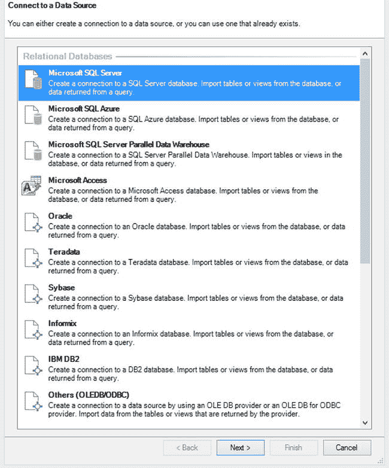
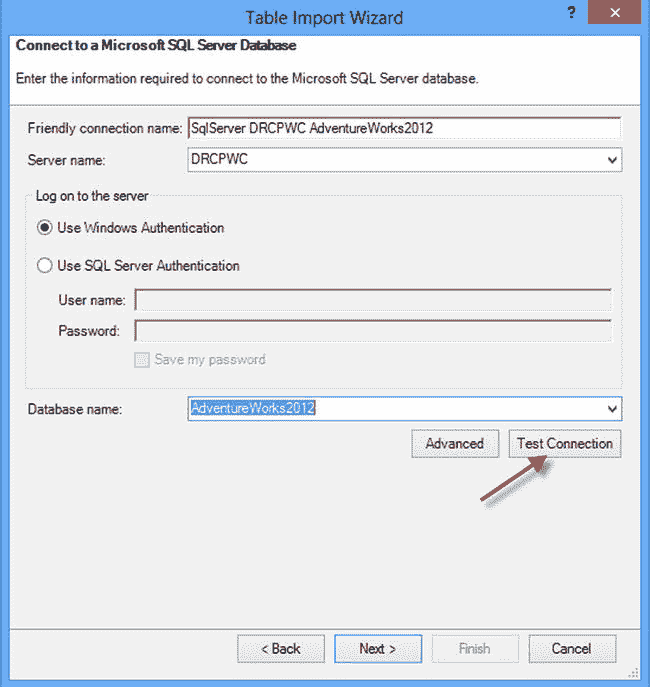
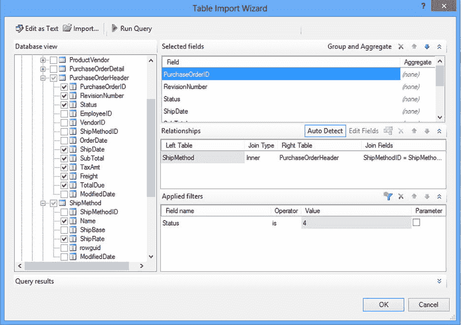
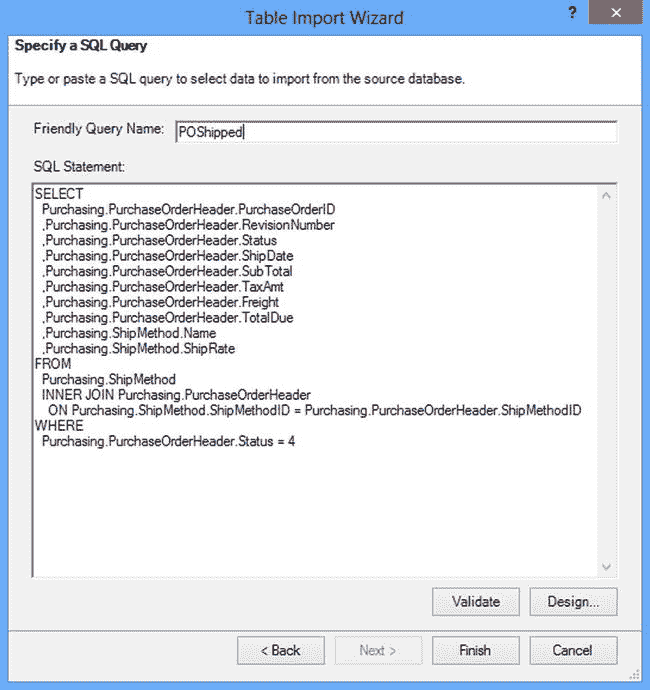
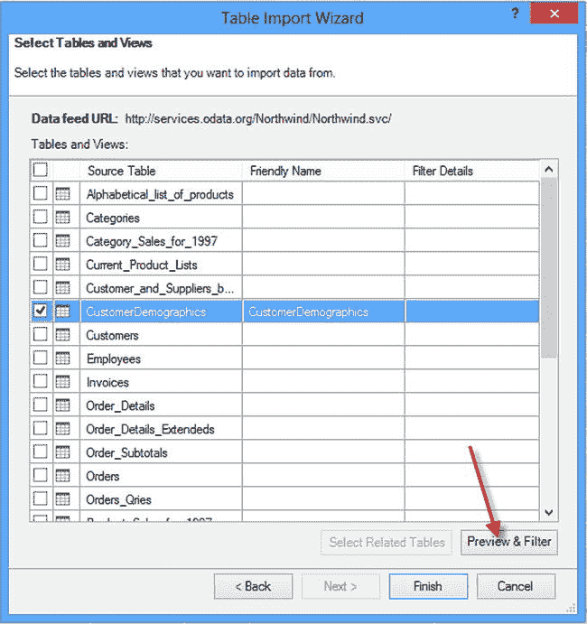
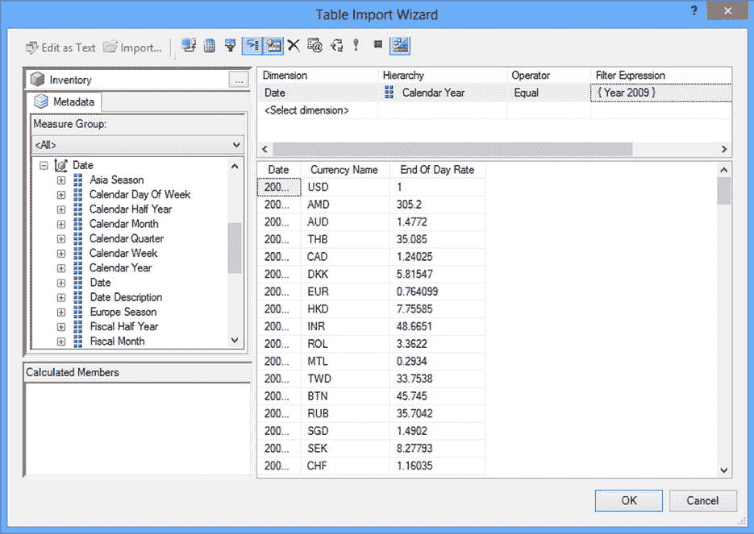
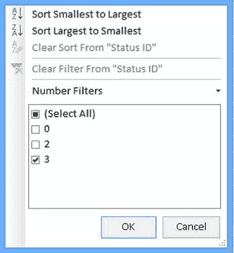
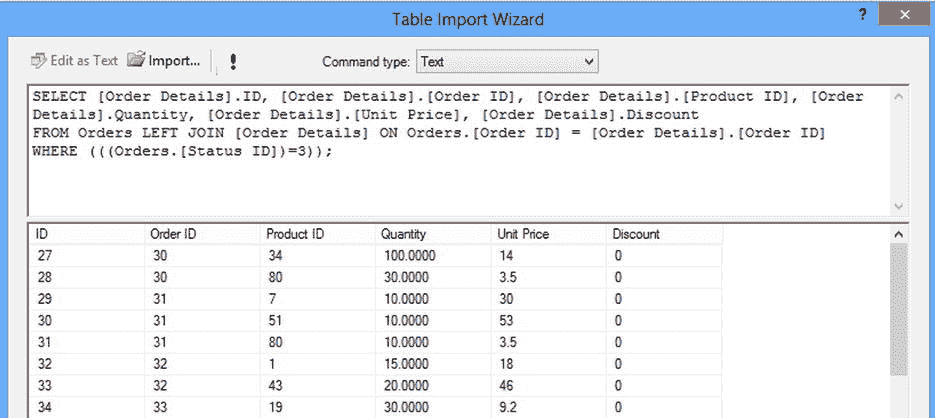

# 第 2 章

# 将数据导入 Power Pivot

创建 Power Pivot 模型的第一步是导入数据。传统上，在创建基于 OLAP 多维数据集的 BI 解决方案时，您需要先将数据导入数据仓库，然后再将其加载到多维数据集中。将数据整合到多维数据集中并可供使用可能需要相当长的时间。而这是 Power Pivot 模型最大的优势之一。您可以轻松快速地合并来自各种来源的数据到模型中。数据源可以是关系数据库、文本文件、Web 服务以及 OLAP 多维数据集等等。本章将向您展示如何将这些来源中的多种数据整合到 Power Pivot 模型中。

完成本章后，您将能够：
- 从关系数据库导入数据。
- 从文本文件导入数据。
- 从数据馈送导入数据。
- 从 OLAP 多维数据集导入数据。
- 重用现有连接来更新模型。

## 从关系数据库导入数据

您会遇到的最常见的数据源类型之一是关系数据库。关系数据库管理系统 (RDMS)，例如 `SQL Server`、`Oracle`、`DB2` 和 `Access`，由表以及基于键的表之间的关系组成。例如，图 2-1 显示了一个采购订单明细表和一个产品表。它们通过 `ProductID` 列相关联。这是一个一对多关系的示例。产品表中的每一行，在采购订单明细表中都有多行与之对应。表中的键被称为主键和外键。每个表都需要一个主键来唯一标识表中的一行。例如，`ProductID` 是产品表中的主键。`ProductID` 在采购订单明细表中被视为外键。外键指向相关表中的主键。请注意，主键可以由多个列组合而成；例如，采购订单明细表的主键是 `PurchaseOrderID` 和 `PurchaseOrderDetailID` 的组合。

图 2-1. 一对多关系

虽然一对多关系最为常见，但您还会遇到另一种相当普遍的关系类型——多对多关系。图 2-2 显示了一个多对多关系的示例。一个人可以有多个不同类型的电话号码。例如，他们可能有两个传真号码。您不能直接将这两个表关联起来。相反，您需要使用一个包含来自这两个表主键的联结表。联结表中的键组合必须是唯一的。

图 2-2. 多对多关系

请注意，联结表可以包含与关联相关的信息；例如，`PhoneNumber` 与客户和电话号码类型相关联。一个客户不能将同一个电话号码列为两种不同的类型。

从关系数据库获取数据的一个好处是，其模型与您将在 Power Pivot 中创建的模型非常相似。事实上，如果在数据库中定义了关系，Power Pivot 导入向导可以检测到这些关系并为您在模型中设置它们。

从关系数据库获取数据的第一步是创建连接。在模型设计器的“主页”选项卡上，有一个“获取外部数据”分组（参见图 2-3）。

图 2-3. 设置连接

“来自数据库”下拉菜单允许您连接到 `SQL Server`、`Access`、`Analysis Services` 或来自另一个 Power Pivot 模型。如果您单击“来自其他源”按钮，您可以看到所有可以连接的各种数据源（参见图 2-4）。如您所见，您可以连接到相当多的关系数据库。如果您需要连接的数据源未列出，您可能可以安装来自该数据库提供商的驱动程序来连接。您或许还可以使用通用的 `ODBC`（开放式数据库连接）驱动程序来连接它。

图 2-4. 选择数据源

选择数据源后，会显示一个窗口让您输入连接信息。连接信息取决于您要连接的数据源。对于大多数关系数据库来说，所需的信息非常相似。图 2-5 显示了连接到 `SQL Server` 的连接信息。请记得单击“测试连接”按钮以确保所有信息都输入正确。

图 2-5. 设置数据库连接

建立连接后，下一步是查询数据库以检索数据。此时您有两个选择：您可以选择从表和视图列表中导入数据，或者编写查询来导入数据（参见图 2-6）。即使您选择从表或视图中导入数据，在后台也会创建一个查询并将其发送到数据库以检索数据。

图 2-6. 选择如何检索数据

如果您选择从表和视图列表中获取数据，则会在下一个屏幕中显示该列表。从您的角度来看，视图和表看起来是一样的。实际上，视图是数据库中存储的查询，它向您隐藏了查询的复杂性。视图通常用于展示比实际物理模型更简单的概念模型。例如，您可能需要客户的地址。图 2-7 显示了获取此信息所需在查询中包含的表。您无需编写复杂的查询来检索信息，而是可以从一个视图（该视图为您将信息组合成一个虚拟的客户地址表）中进行选择。视图的另一个常见用途是保护底层表的列安全。通过使用视图，数据库管理员可以对不同用户隐藏某些列。

图 2-7. 获取客户地址所需的表

选择表格后，点击`预览和筛选`按钮（见图 2-8），即可预览表格中的数据并对所选数据进行筛选。

图 2-8 选择表和视图

在 图 2-9 中，你可以看到预览和筛选界面。

图 2-9 预览和筛选数据

筛选表格的一种方法是只选择你感兴趣的列。另一种方法是在列上设置筛选条件来限制行数。例如，你可能只想查看某一年之后的销售数据。点击列旁边的下拉菜单，即可输入筛选条件来限制行数。图 2-10 展示了按订单日期筛选 `SalesOrderHeader` 表的情况。

图 2-10 筛选行

在处理大型数据集时，出于性能考虑，最好只导入你感兴趣的数据。如果你只需要少数几列，却将整个表的所有列都导入进来，会带来大量开销。同样，如果你只关注过去三年的销售数据，就不要导入整整二十年的销售数据。如果后续发现需要更多数据，你随时可以返回并更新数据导入设置。

筛选完数据后，在`选择表和视图`界面（见图 2-8）点击`完成`。此时，数据会被导入模型，并出现一个显示进度的界面（见图 2-11）。如果没有错误，你可以关闭`表导入向导`。

图 2-11 将数据导入模型

向导关闭后，你将在`模型设计器`的数据视图中看到这些数据。

 **注意** 请记住，Power Pivot 仅在检索数据时才连接到数据源。数据检索完毕后，连接即被关闭，数据便成为模型的一部分。

如果你切换到`模型设计器`的图表视图，你将看到各个表；如果在数据库中定义了表关系，你还能看到表之间的关系。在 图 2-12 中，你可以看到产品表之间以及销售表之间定义的关系，但 `SalesOrderDetail` 表和 `Product` 表之间没有定义关系。即使数据源中没有定义关系，你也可以在模型中创建关系（后续将详细介绍）。

图 2-12 数据源中定义的表关系

虽然从表和视图中选择数据是将数据导入模型的一种简单方法，无需显式编写查询，但这并非总是可行。有时你可能需要编写自己的查询；例如，你可能希望合并来自多个不同表的数据，但并没有可用的视图。另一个因素取决于数据源的支持程度。某些数据源不允许使用视图，可能要求你提供查询来提取数据。在这种情况下，当你进入询问如何检索数据的界面时，请选择查询选项（图 2-6）。

一旦选择了查询选项，就会出现一个界面，你可以在其中编写查询（见图 2-13）。虽然你可能不是从头开始编写查询，但你可以在此处粘贴别人为你编写的查询，或者你在其他工具（如 `Microsoft Management Studio` 或 `TOAD`）中创建的查询。别忘了给查询命名。它将成为模型中的一个表，并以该查询的名称命名。

图 2-13 创建自定义查询

如果数据源支持，你可以通过点击查询输入窗口右下角的按钮，启动一个非常便捷的查询设计器（见图 2-13）。这个设计器（见图 2-14）允许你从各个表和视图中选择所需的列。如果在数据库中定义了表关系，它会自动为你添加表连接。你还可以应用筛选条件，并对数据进行分组和聚合。查询设计器的一个令人困惑的地方是参数复选框。

图 2-14 使用查询设计器

 **注意** Power Pivot 模型不支持参数，选中此复选框后，尝试关闭查询设计器时将出现错误消息。

完成查询设计后，你始终应该运行它以确保其按预期工作（见图 2-15）。

图 2-15 运行查询并查看结果

对查询结果满意后，点击`确定`按钮，返回上一界面，并已填入查询文本。你可以在该界面修改查询，并使用`验证`按钮确保其仍为有效查询（见图 2-16）。点击`完成`即可将数据和表导入模型。

图 2-16 查看并验证查询

现在你已经了解了如何从数据库导入数据，接下来让我们看看如何从文本文件向模型添加数据。

## 从文本文件导入数据

很多时候，你需要合并来自多个不同来源的数据。最常见的来源之一仍然是文本文件。这可能是从其他系统接收数据输出的结果；例如，你可能需要公司 `ERP`（企业资源规划）系统的信息，而这些信息是以文本文件形式提供的。你也可能通过第三方服务获取数据，这些数据以 `CSV`（逗号分隔值）格式提供。例如，你可能使用评级服务来对客户进行评级，结果可以通过 `CSV` 文件返回。

从文本文件导入数据到模型，与从关系数据库表中导入数据类似。首先，在**开始**菜单上选择从其他源获取外部数据的选项，这将弹出连接到数据源的选项。向下滚动到窗口底部，你可以选择从 Excel 文件或文本文件导入数据（见图 2-17）。

图 2-18 预览文本文件数据

### 预览数据

选择列标题旁的下拉菜单，即可基于筛选条件限制导入的行数（见图 2-19）。

图 2-19 筛选导入模型的行

从文本文件导入数据与从 Excel 文件导入数据的主要区别在于，Excel 文件可能包含多个表。默认情况下，每个工作表被视为一个表（见图 2-20）。选择表后，你可以像处理文本文件一样预览和筛选数据。

图 2-20 在 Excel 文件中选择表

除了从文本文件导入数据，你可能还需要通过从数据馈送导入数据来补充数据模型。这正成为一种与业务伙伴交换数据的常见方式，接下来你将了解如何操作。

### 从数据馈送导入数据

尽管文本文件是交换数据最常用的方式之一，但数据馈送正日益成为流行的数据交换方式。数据馈送通过 Web 服务提供数据，要连接到 Web 服务，需要输入 Web 服务的网址。在图 2-17 中，你可以看到可用的数据馈送连接。大多数情况下，你会知道合作伙伴或数据提供商提供的数据服务的地址。在这种情况下，选择“其他馈送”，系统将为你提供一个连接信息输入窗口，如图 2-21 所示。

图 2-21 连接到数据馈送

由于数据馈送不仅包含数据，还包含元数据（数据描述），因此一旦建立连接，`Power Pivot` 会提供预览和筛选数据的功能，如图 2-22 所示。

图 2-22 从数据馈送预览和筛选数据

一些值得关注的数据馈送来源包括来自 `Reporting Services` 报表和 `SharePoint` 列表的数据。这些应用程序可以轻松将其数据作为数据馈送公开，供你作为数据源使用。此外，许多数据库供应商（如 `SAP`）也支持将其数据作为数据馈送公开。

### 从 OLAP 多维数据集导入数据

许多公司投入了大量资金和精力来构建企业级报表解决方案，该方案由企业级 `OLAP` 存储库组成，为各种仪表板和记分卡提供数据。使用 `Power Pivot`，你可以轻松集成来自这些存储库的数据。在连接窗口（图 2-17）的连接选项中，选择“多维服务”下的`Microsoft SQL Server Analysis Services`连接。这将启动连接信息窗口，如图 2-23 所示。你可以连接到多维数据集或发布到 `SharePoint` 的 `Power Pivot` 模型。要连接到多维数据集，请输入服务器名称和数据库名称。要连接到 `Power Pivot` 模型，请输入 Excel 工作簿的 `URL`（位于 `SharePoint` 库中）和模型名称。

图 2-23 连接到 Analysis Services 多维数据集

连接到多维数据集后，你可以输入 `MDX` 查询来检索数据（见图 2-24）。记得验证查询以确保其能够运行。

图 2-24 输入 `MDX` 查询

如果你不熟悉 `MDX`，可以使用可视化设计器来创建它，如图 2-25 所示。设计器的一个出色功能是能够预览结果。

图 2-25 设计 `MDX` 查询

设计完查询后，它将被输入到 `MDX` 语句框中，如图 2-24 所示，你可以在那里完成数据导入。

### 重用现有连接以更新模型

在两种情况下，你需要重用与数据源的现有连接。你可能需要从数据源检索其他数据；例如，需要从其他表或视图中获取数据，或发出新查询。在这种情况下，你应选择“主页”选项卡上的“现有连接”按钮（见图 2-26）。

图 2-26 选择现有连接

在“现有连接”窗口中，选择连接并单击“打开”按钮（见图 2-27）。这将启动之前介绍过的屏幕（具体取决于连接类型），你可以按照流程选择要导入的数据。

图 2-27 打开现有连接

另一种情况是，当你想更改现有表的筛选条件或向其中添加列时。在这种情况下，你需要在设计器的数据视图模式下选择该表，然后在“设计”选项卡上选择“表属性”（见图 2-28）。

图 2-28 选择表属性

“编辑表属性”窗口允许你更新用于填充表数据的查询。你可以在“表预览”模式（图 2-29）或“查询”模式（图 2-30）下更新表。在“查询编辑器”模式下，你还可以启动查询设计器来更新查询。

图 2-29 在表预览模式下更新查询

图 2-30 在查询编辑器模式下更新查询

现在你已经了解了如何将数据从各种数据源导入 `Power Pivot` 数据模型，是时候动手实践数据导入了。

### 动手实验——将数据加载到 `Power Pivot`

在以下实验中，你将：
*   从`Access`数据库导入数据。
*   从文本文件导入数据。

1.  打开`Excel 2013`并创建一个名为`LabChapter2.xlsx`的新文件。
2.  在“`Power Pivot`”选项卡上，单击“管理数据模型”按钮（见图 2-31）。这将启动`Power Pivot`模型设计器窗口。

`图 2-31` 打开模型设计器窗口

3.  在“主页”选项卡的“获取外部数据”组中，单击“从数据库”下拉菜单（见图 2-32）。在下拉菜单中选择“从`Access`导入”。这将启动表导入向导。

`图 2-32` 启动表导入向导

4.  在“Lab Starters”文件夹中浏览找到`Northwind.acdb`数据库文件，并测试连接。使用友好的连接名称`Access Northwind`。此数据库不需要用户名和密码（请参见图 2-33）。点击`测试连接`以进入下一窗口。

`图 2-33` 连接到 `Access` 数据库

5.  您有两种导入数据的方式：可以从表和视图列表中选择，也可以选择编写查询来选择数据。请选择“从表和视图列表中选择”。
6.  在“选择表和视图”窗口中，选择`Customers`并点击该行以高亮显示。在窗口底部，选择`预览和筛选`按钮以预览和筛选数据（请参见图 2-34）。

`图 2-34` 选择要导入的表

7.  在`Customers`表中，选择以下字段：`ID`、`公司`、`姓氏`、`名字`、`城市`、`省/州`和`国家/地区`。取消勾选其余字段（请参见图 2-35）。勾选左上角的复选框将选择或取消选择所有列。

`图 2-35` 筛选表列

8.  从`Employees`表中，选择以下字段：`ID`、`姓氏`、`名字`和`职务`。
9.  从`Orders`表中，选择以下字段：`订单 ID`、`员工 ID`、`客户 ID`、`订单日期`、`发货日期`、`发货人 ID`、`付款类型`和`付款日期`。在`状态 ID`列上，点击下拉菜单以筛选数据。取消勾选`状态 0`和`状态 2`。`状态 3`表示已关闭状态（请参见图 2-36）。

`图 2-36` 筛选表行

10. 完成选择表后，点击`完成`按钮以导入数据。导入后，关闭向导。您应该会看到每个表都作为数据视图窗口中的一个选项卡显示（请参见图 2-37）。

`图 2-37` 数据视图窗口中的表

11. 现在，您将使用查询来选择订单详情。在`Power Pivot`模型设计器中，选择`主页`选项卡。在`主页`选项卡中，选择`现有连接`按钮。在连接窗口中，选择`Access Northwind`连接，然后点击`打开`。
12. 这次，请选择`编写将指定要导入数据的查询`。
13. 在“指定查询”窗口中，将查询命名为`OrderDetails`，然后选择`设计`按钮以启动查询设计器。（您也可以不使用设计器直接编写查询。）在查询设计器中，选择`导入`，然后在“Lab Starters”文件夹中选择`OrderDetailQuery.txt`文件。通过点击红色感叹号 (!) 来测试查询（请参见图 2-38）。测试查询后，点击`确定`按钮。

`图 2-38` 使用查询获取数据

14. 在“表导入向导”中，点击`完成`按钮以导入数据。导入后，关闭向导。您应该会看到已添加了一个`OrderDetail`表选项卡。
15. 您要导入的最后一个表包含在一个制表符分隔的文本文件中。在`主页`选项卡的`获取外部数据`部分，点击`从其他来源`按钮。在数据源列表中，选择`文本文件`，然后点击`下一步`。
16. 在连接信息中，将连接名称更改为`Product`。在`文件路径`中，浏览到“LabStarters”文件夹中的`ProductList.txt`文件。选择制表符作为列分隔符，并勾选`将第一行用作列标题`复选框。点击`完成`按钮以导入数据（请参见图 2-39）。

`图 2-39` 从文本文件导入数据

17. 导入后，关闭向导，您应该会看到已添加了一个`Product`表选项卡。
18. 完成后，保存文件并关闭 Excel。

#### 小结

创建`Power Pivot`模型的首要步骤之一就是导入数据。在本章中，您学习了如何从各种数据源导入数据。在`Power Pivot`中导入数据的一个优点在于，从不同数据源导入数据的体验是相似的。您需要创建连接、提供查询或选择表、预览和筛选数据，然后将其导入模型中。现在，您已将数据导入到模型中的各个表，接下来需要在这些表之间建立关系。在下一章中，您将了解建立关系的重要性，以及如何通过层次结构来增强模型以辅助数据分析。
