## 第 3 章


# 创建数据模型

既然您已经知道如何将数据导入 Power Pivot 模型，下一步就是理解什么构成了一个良好的模型。这在处理 Power Pivot 中的数据时非常重要。一个良好的模型将使 Power Pivot 运行得异常快速，并允许您以新颖有趣的方式分析数据。而一个糟糕的模型会导致 Power Pivot 运行缓慢，最坏的情况下，在进行数据分析时会产生误导性结果。传统的 Excel 数据透视表基于 Excel 工作表中的单个表。Power Pivot 数据透视表则基于数据模型中的多个表。本章将引导您完成创建稳固模型的过程，该模型将成为您数据分析的基础。此外，您还将了解如何向客户端工具呈现一个用户友好的模型。这包括重命名表和字段、提供合适的数据类型以及隐藏无关字段。

完成本章后，您将能够：
- 解释什么是数据模型
- 在模型的表之间创建关系
- 创建并使用星型架构
- 理解何时以及如何对数据进行反规范化
- 创建并使用链接表
- 创建并使用层次结构
- 创建一个用户友好的模型

## 什么是数据模型？

从根本上说，数据模型由表、列、数据类型和表关系组成。通常，数据表是为了存储业务实体的数据而构建的；例如，客户数据存储在客户表中，员工数据存储在员工表中。表由定义实体属性的列组成。例如，您可能希望存储客户信息，如姓名、地址、出生日期、家庭规模等。每个属性都有一个数据类型，取决于该属性所包含的信息——姓名应为字符串数据类型，家庭规模应为整数，出生日期应为日期类型。表中的每一行都应该是唯一的。以客户表为例，如果同一客户在多行中出现但属性不同（例如出生日期），您将无法知道哪个是正确的。

在上一示例中，你会知道其中一行数据是不正确的，因为同一个人不可能有两个不同的生日。不过，在很多情况下，你需要追踪某个实体属性值的变化。例如，产品的标价可能会随时间变化。为了追踪这种变化，你需要添加时间戳来使行唯一。这样一来，每一行就可以通过产品编号和时间戳来唯一标识，如图 Figure 3-1 所示。

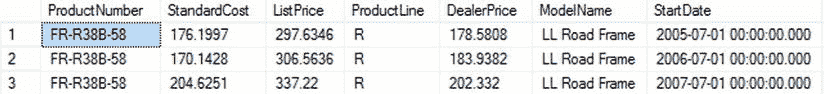

Figure 3-1. 使用时间戳追踪变化

一旦确定了模型中的表，关键是要识别这些表是否高效设置。这个过程被称为*规范化*模型。规范化是组织数据以使其更易于查询且效率更高的过程。例如，不应将不相关实体的属性混合在同一个表中——你绝对不希望将产品数据和员工数据放在同一个表中。另一个正确规范化的例子是，不要在一个列中存放多个属性。例如，与其使用一个客户地址列，不如将其拆分为街道、城市、州和邮政编码。这样你就可以轻松地按州或城市分析数据。Figure 3-2 所示的电子表格展示了一个典型的非规范化表。如果你发现提供给你的数据规范化不足，你可能需要要求数据提供方将数据拆分为多个表，然后你可以在模型中将这些表关联起来。

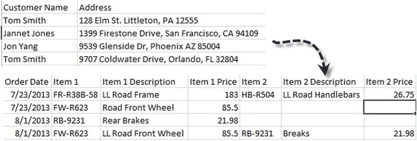

Figure 3-2. 一个非规范化的表

一旦你确定模型中的表已充分规范化，下一步就是确定这些表之间的关联方式。例如，你需要关联客户表、销售表和产品表，以便分析不同产品在不同年龄段的销售情况。关联不同表的方式是使用*键*。表中的每一行都需要一个列或列组合来唯一标识该行。这称为*主键*。这个键可能很容易识别，例如在数据录入时由业务分配的销售订单号或客户编号。有时，你需要对表进行一些分析才能找到主键，尤其是当你从外部来源获取数据时。例如，你可能获取了包含潜在客户的数据，字段包括姓名、城市、州、邮编、出生日期等。你不能仅使用姓名作为键，因为很可能存在多个同名的客户。如果使用姓名和城市的组合，出现多个客户由同一个键标识的可能性就会降低。当你使用更多列（如邮编和出生日期）时，这种可能性会变得更小。

在模型中关联表时，一个表的主键会成为相关表中的外键。例如，要将客户与其销售记录关联起来，客户键需要包含在销售表中，在那里它被视为外键。在提取数据时，使用键来获取相关数据。到目前为止，出于性能考虑，最好的键类型是单列整数。因此，许多数据库表在设计时都使用了代理键。这个键是在记录加载时分配给该记录的整数。代理键用于连接表，而不是使用自然键。Figure 3-3 展示了一个典型的数据库表，其中同时包含代理键（`CustomerKey`）和自然键（`CustomerAlternateKey`）。

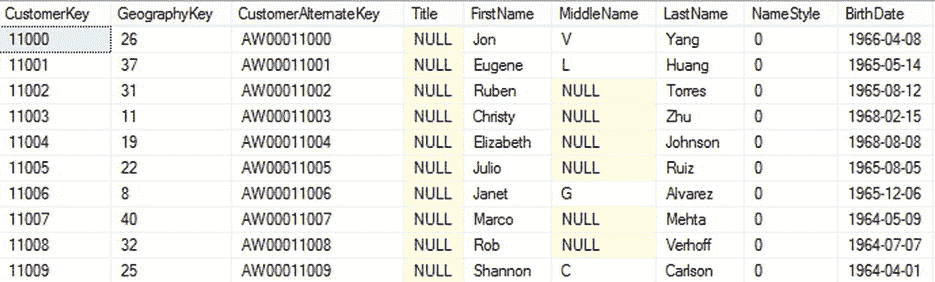

Figure 3-3. 一个同时包含代理键和自然键的表

了解数据源中使用的键非常重要。如果能够从源中检索到键，那会好得多。当从关系型数据库检索数据时，这通常不是问题，但如果你要整合来自不同系统的数据，请确保你拥有合适的键。

一旦确定了表之间的键，就可以准备在`Power Pivot`模型中创建关系了。

## 创建表关系

在`Power Pivot`模型中建立表关系时，需要记住一些规则。首先，不能在模型中使用复合键。如果你的表使用了复合键，你需要通过连接复合列来创建一个新列，并将此列用作键。其次，两个表之间只能有一个活动关系路径，但可以有多个非活动关系。第三，关系是一对多的；换句话说，在客户表（一侧）和销售表（多侧）之间创建关系是可以的。然而，直接在客户表和产品表之间创建关系是不允许的，因为一个客户可以购买多个产品，而同一个产品也可以被多个客户购买。在这种情况下，你需要创建一个连接表来连接这些表。

要在`Power Pivot`模型中创建两个表之间的关系，你可以打开`Data Model Manager`并切换到关系图视图。右键点击代表关系多侧的表，然后选择`Create Relationship`。这将启动`Create Relationship`窗口。选择相关的查找表（一侧）和键列。Figure 3-4 展示了在`Sales`表和`Store`表之间创建关系。默认情况下，表之间创建的第一个关系被标记为活动关系。

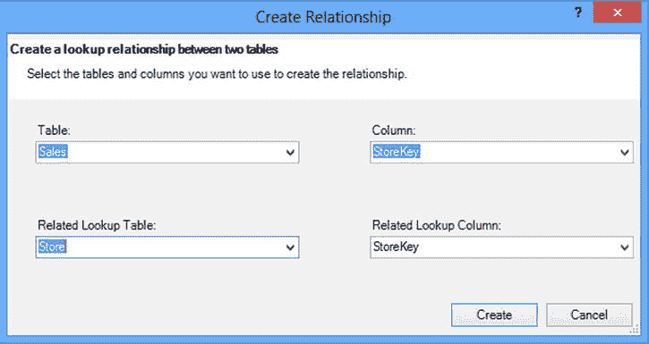

Figure 3-4. 创建表关系

Figure 3-5 展示了在关系图视图中最终形成的关系。如果你点击关系箭头，该关系的两个键列会高亮显示。

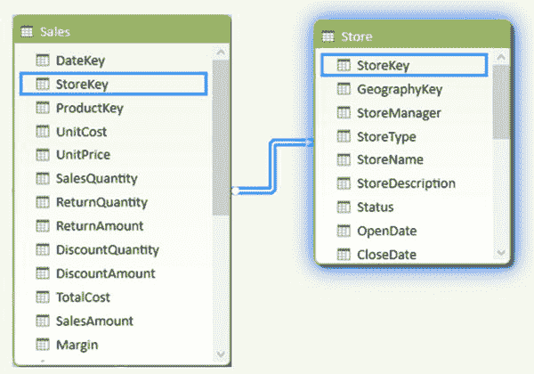

Figure 3-5. 在关系图视图中查看关系

你可以在两个表之间创建多个关系，但请记住，只能有一个是活动关系。如果你试图创建两个活动关系，会收到类似 Figure 3-6 所示的错误信息。

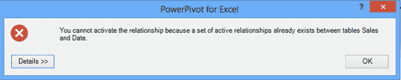

Figure 3-6. 尝试在两个表之间创建第二个活动关系

有时，活动关系并不那么明显。Figure 3-7 展示了`Sales`表和`Date`表之间的一个活动关系，以及`Sales`表和`Store`表之间的另一个活动关系。`Store`表和`Date`表之间还存在一个非活动关系。如果你试图将这个非活动关系设为活动，会收到与 Figure 3-6 中相同的错误信息。这是因为你可以从`Date`表追踪到`Sales`表，再到`Store`表，从而形成一条活动路径。

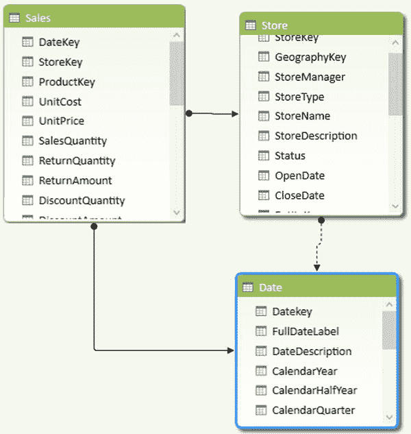

Figure 3-7. 间接活动关系

你可能会遇到的另一个常见错误是，尝试在两个表之间创建关系时，键在至少一个表中不是唯一的。Figure 3-8 展示了一个`Product`表和一个`Sales`表，两者都包含重复的`ProductNumber`。

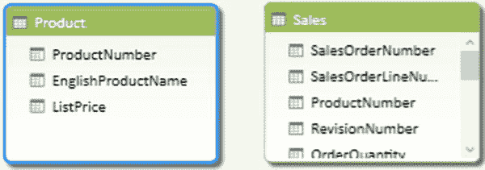

图 3-8 `Product` 表和 `Sales` 表

当你尝试在这些表之间创建关系时，会出现如图 3-9 所示的错误。

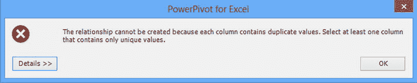

图 3-9 出现重复值错误

在本例中，`ProductNumber` 在 `Product` 表中应该是唯一的，但结果显示存在重复值。为了解决这个问题，你需要修改 `Product` 表数据的查询，以确保不会出现重复值。

现在你已经了解了如何在模型中创建表关系，接下来可以看看使用星型模式的好处。

## 创建星型模式

在创建数据模型时，理解模型的用途至关重要。数据库的两大主要用途是捕获数据和报告/分析数据。问题在于，当你为高效数据捕获创建模型时，会降低其分析数据的效率。为了解决这个问题，许多公司将数据捕获数据库与报告/分析数据库分开。幸运的是，在 Power Pivot 中创建数据模型时，我们只需要针对报告进行优化。

在分析大量数据集时，最佳模型之一是*星型模式*。星型模式由一个中心事实表和围绕它的维度表组成，如图 3-10 所示。

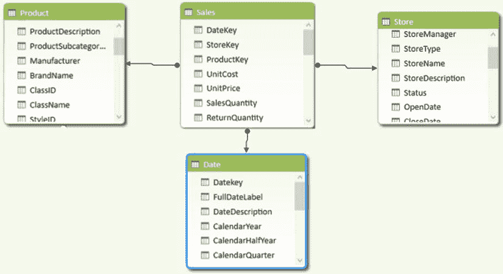

图 3-10 典型的星型模式

事实表包含与业务或流程相关的定量数据。例如，图 3-10 中的 `Sales` 表包含销售的可测量方面，例如总成本、销售金额和数量。事实表通常包含许多行，并有一个日期或时间组件，用于记录事件发生的时间点。维度表包含关于事件的属性。例如，`Date` 表可以告诉你销售发生的时间，并允许你将数据汇总到月、季度或年级别。`Product` 表包含有关所售产品的属性，你可以按产品线、颜色和品牌查看销售情况。`Store` 表包含有关参与销售的商店的属性。维度表通常不包含像事实表那样多的行，但可以包含相当多的列。当你问“哪些自行车在不同年龄段销售最好？”之类的问题时，度量值（销售额）来自事实表，而分类（年龄和自行车型号）则来自维度表。

星型模式的主要优点是提供快速的查询性能和聚合处理。缺点是它通常需要大量的预处理，才能将数据从高度规范化的交易系统移到非规范化的报告系统。好消息是，你的企业可能有一个报告系统为传统联机分析处理 (OLAP) 数据库（例如 Microsoft 的 Analysis Server 或 IBM 的 Cognos）提供数据。如果你能访问这些系统，它们可能是你核心业务数据的最佳来源。

为了从源数据系统创建星型模式，你可能需要执行一些数据非规范化操作，这将在下一节中介绍。

## 了解何时对数据进行非规范化

虽然事务型数据库系统高度规范化，但报告系统则非规范化为星型模式。如果你无法访问已为你完成非规范化的报告系统，则必须将数据非规范化为星型模式，以便加载你的 Power Pivot 模型。例如，图 3-11 显示了 `Adventureworks` 事务型销售数据库中包含客户数据的表。

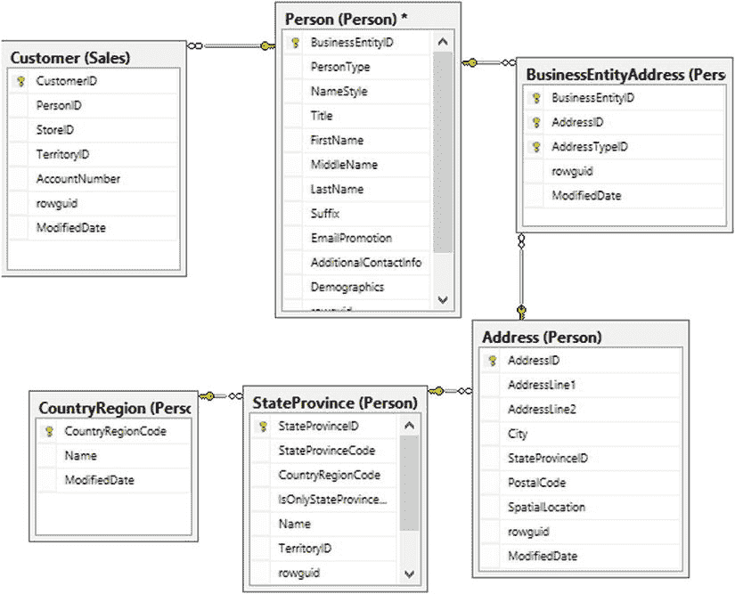

图 3-11 高度规范化的模式

为了将客户数据非规范化到模型中，你需要创建一个将数据合并到单个客户维度表中的查询。如果你不熟悉创建复杂查询，最简单的方法是让数据库开发人员创建一个视图，你可以从中提取数据，该视图为你合并了这些表。如果查询不太复杂，你可能可以在导入数据时自己创建。例如，图 3-12 显示了一个客户表和一个地理位置表。

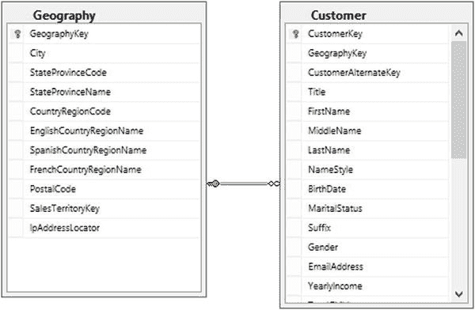

图 3-12 合并客户和客户位置数据

你可以使用以下查询将它们合并到一个客户维度表中。

```sql
SELECT  c.CustomerKey, c.BirthDate, c.MaritalStatus, c.Gender,
        c.YearlyIncome, c.NumberChildrenAtHome, c.EnglishOccupation,
        c.HouseOwnerFlag,  c.NumberCarsOwned, c.CommuteDistance,
        g.City, g.StateProvinceName, g.EnglishCountryRegionName, g.PostalCode
FROM    Customer AS c INNER JOIN
        Geography AS g ON c.GeographyKey = g.GeographyKey
```

虽然你不必成为查询专家才能将数据导入 Power Pivot 模型，但了解查询数据源的基础知识非常有益，即使这仅仅有助于在与数据库开发人员交流时提出正确的问题。

## 创建链接表

关于 Power Pivot 模型中包含的数据，需要记住一点：它是只读的。在大多数情况下，这是一件好事。你想确保数据仅在源系统中被更改。然而，有时作为数据分析的一部分，你可能希望即时进行调整，并查看它对结果的影响。一个经常发生的例子是*桶分析*。例如，假设你想查看一个连续度量值（如年龄）并将其分为离散的桶（范围），并且在分析过程中需要调整范围。这正是链接表的用武之地。

要创建链接表，首先需要在 Excel 工作表上设置该表。输入数据后，将其高亮显示，并单击快速分析菜单（参见 图 3-13）。在 `Tables` 选项卡下，单击 `Table` 按钮。

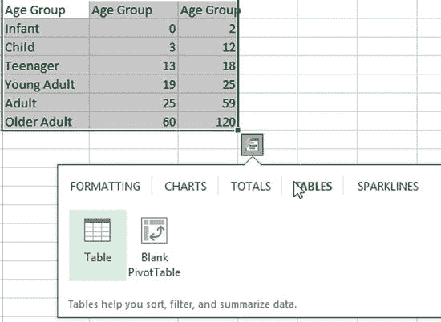

图 3-13 创建 Excel 表

创建表后，最好在将其导入 Power Pivot 数据模型之前为其命名。你可以通过选择该表，然后在 `Table Tools Design` 弹出窗口的 `Tables` 选项卡下输入表名称来实现（参见 图 3-14）。

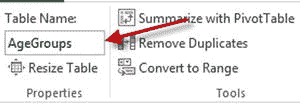

图 3-14 重命名 Excel 表

表命名后，选中它，然后在 `Power Pivot` 选项卡上，选择 `Add To Data Model`（参见 图 3-15）。

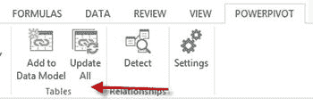

图 3-15 将表添加到模型

表导入模型后，如果你更改 Excel 工作表中的某些表值，并在 `PowerPivot` 选项卡上选择 `Update All`（参见 图 3-15），模型中的链接表将更新为新的值。

#### 创建层次结构

当分析数据时，使用层次结构来定义不同级别的聚合通常很有帮助。例如，基于年、季度和月份的日历层次结构很常见。像销售金额这样的聚合值会从月份汇总到季度，再到年份。另一个常见的层次结构可能是从部门到大楼，再到区域。然后，你可以将成本向上汇总到不同级别。在 Power Pivot 模型中创建层次结构非常简单。在模型设计器的关系图视图中，选择包含你想要放入层次结构的属性（列）的表。你将在表格右上角看到一个“创建层次结构”按钮（参见图 3-16）。点击该按钮添加层次结构并重命名。然后，你可以将字段拖放到层次结构中，以创建不同的级别。确保字段的排列顺序是从高层级到低层级。

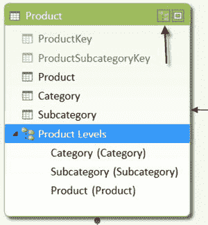

图 3-16。创建层次结构

创建层次结构是增加模型可用性，并帮助用户在数据分析中本能地获取更多价值的一种方法。在下一节中，你将看到一些其他可以应用于模型以增加其可用性的操作。

#### 打造用户友好的模型

在创建模型时，需要记住的一点是让模型易于使用且直观。模型可能会被其他用户用于分析。该模型还可能用于各种客户端报表和分析工具，例如 Power View、Power Map 和 Reporting Services。你可以使用一些属性和设置，让这些客户端工具从模型中获得更多功能。

最有效的调整之一是为表和列重命名。使用对业务用户有意义的名称，而不是只对数据库开发人员有意义的晦涩命名约定。另一个好的做法是确保列的数据类型和格式设置正确。来自文本文件的字段可能会被导入为字符串类型，而它实际上是数字数据。此外，你可以隐藏对用户无用的字段，例如用于链接表的代理键。

一个常见的要求是更改列的排序顺序，使其不同于自然排序。最常见的例子是月份。由于它们默认是文本，因此会按字母顺序排序。实际上，你希望它们按月份编号排序。要解决此问题，你可以按表中的任何其他列对一个列进行排序（参见图 3-17）。这是一个很好的功能，允许你创建自定义的业务相关排序。

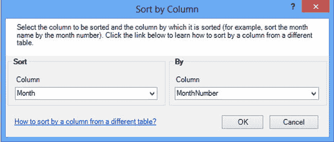

图 3-17。按另一列对一列进行排序

你可以使用其他一些设置来为各种客户端工具创建良好的模型。我们将在第 10 章（“优化 Power View 的表格模型”）中更详细地回顾这个主题。

以下动手实验将帮助你巩固本章涵盖的主题。

#### 动手实验——在 Power Pivot 中创建数据模型

在以下实验中，你将：
*   创建表关系。
*   反规范化数据。
*   创建链接表。
*   设置层次结构。
*   制作一个用户友好的模型。

1.  打开 Excel 2013 并创建一个名为 `LabChapter3.xlsx` 的新文件。
2.  使用 Power Pivot 数据模型中的表导入向导，连接到 `LabStarters` 文件夹中的 `Adventureworks.accdb` 文件。
3.  选择所列出的表和字段并导入数据。

| 源表名 | 友好名称 | 字段 |
| --- | --- | --- |
| `DimDate` | `Date` | `DateKey` `FullDateAlternateKey` `EnglishMonthName` `MonthNumberOfYear` `CalendarQuarter` `CalendarYear` |
| `DimCustomer` | `Customer` | `CustomerKey` `BirthDate` `MaritalStatus` `Gender` `YearlyIncome` `TotalChildren` `HouseOwnerFlag` `NumberCarsOwned` |
| `FactInternetSales` | `Internet Sales` | `ProductKey` `OrderDateKey` `ShipDateKey` `CustomerKey` `SalesTerritoryKey` `SalesOrderNumber` `SalesOrderLineNumber` `OrderQuantity` `UnitPrice` `TotalProductCost` `SalesAmount` |

4.  在 Power Pivot 模型设计器的数据视图模式下，按照表格指示重命名并隐藏列。要隐藏列，请右键单击它，然后从上下文菜单中选择“从客户端工具中隐藏”。

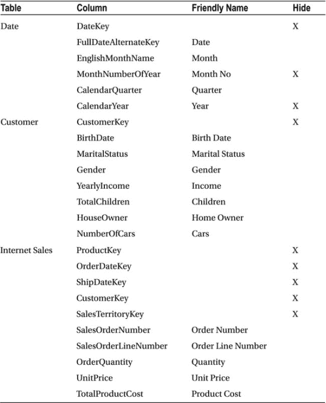

5.  将 Power Pivot 窗口切换到关系图视图。你应该能看到 `Date`、`Customer` 和 `Internet Sales` 表。`Customer` 表和 `Internet Sales` 表之间已定义了一个关系。这由表导入向导自动发现。
6.  将 `DateKey` 从 `Date` 表拖放到 `Internet Sales` 表中的 `OrderDateKey` 上。类似地，在 `DateKey` 和 `ShipDateKey` 之间创建一个关系。双击此关系以启动“编辑关系”窗口（参见图 3-18）。尝试将此关系设为活动关系。你会收到一个错误，因为模型中两个表之间只能有一个活动关系。

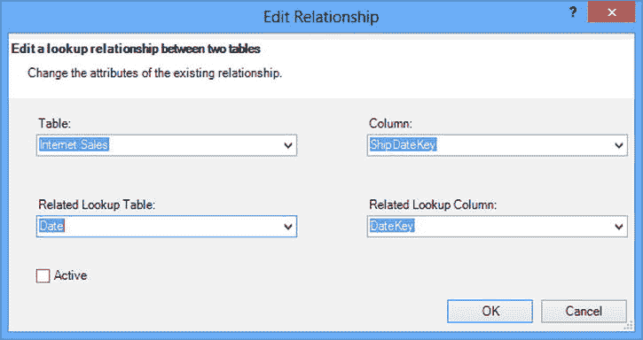

图 3-18。创建表关系

7.  在 Power Pivot 模型设计器窗口的“主页”选项卡上，单击“现有连接”按钮。你应该能看到之前创建的指向 `Adventureworks.accdb` 的连接。打开此连接并选择用于导入数据的查询选项。
8.  在“指定 SQL 查询”窗口中，将查询友好名称更改为 `Product`，然后单击“设计”按钮。
9.  在设计器中单击“导入”按钮。打开实验启动器文件夹中的 `ProductQuery.txt` 文件。单击红色的感叹号 (!) 以运行查询（参见图 3-19）。此查询合并了来自 `Product`、`ProductCategory` 和 `ProductSubcategory` 表的数据（即反规范化）。

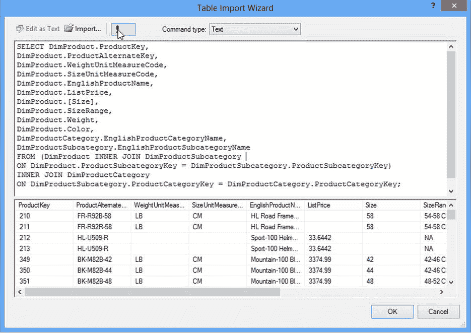

图 3-19。运行查询

10. 在确认获取到数据后，单击“确定”按钮，然后在下一个屏幕上单击“完成”按钮。
11. 导入数据后，隐藏 `ProductKey` 并按下表所示更新列名：

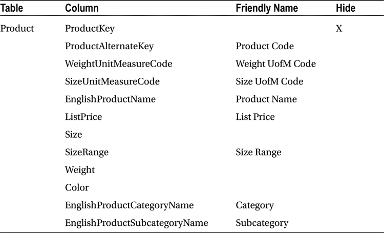

12. 使用 `ProductKey` 在 `Internet Sales` 表和 `Product` 表之间创建一个关系。最终的关系图应类似于图 3-20。

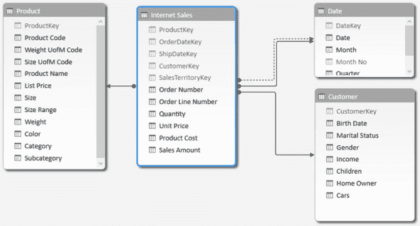

图 3-20。查看数据模型关系

13. 要创建链接表，请将图 3-21 中显示的数据输入到 Excel 中的一个空白电子表格选项卡中。

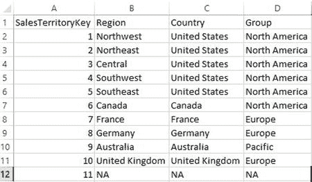

图 3-21。链接表数据

14. 选中这些单元格，右键单击，在“快速分析”上下文菜单中，选择“表”选项卡，然后单击“表”按钮（参见图 3-22）。在“表工具设计”选项卡中，将表重命名为 `SalesTerritory`。

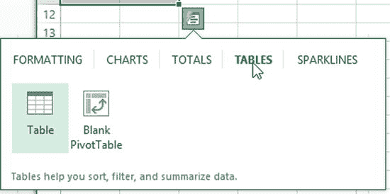

图 3-22。“快速分析”的“表”选项卡

15. 在 Power Pivot 选项卡上，单击 `Add To Data Model` 按钮。将表添加到模型后，将其名称更改为 `Sales Territory`，隐藏 `SalesTerritoryKey`，并创建与 `Internet Sales` 表的关系。
16. 要创建层次结构，请在 Power Pivot 窗口的图表视图中选择 `Sales Territory` 表，然后单击 `Create Hierarchy` 按钮。将 `Sales Territory Group`、`Country` 和 `Region` 拖放到层次结构中。将层次结构重命名为 `Sales Territory`（参见图 3-23）。

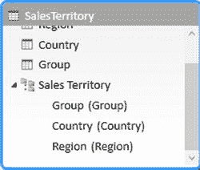

图 3-23. `Sales Territory` 层次结构

17. 在 `Date` 表中使用 `Year`、`Quarter` 和 `Month` 创建一个名为 `Calendar` 的日历层次结构。
18. 在设计器中切换到数据视图，然后选择 `Date Table` 选项卡。选择 `Month` 列，并将其 `Sort By Column` 设置为 `Month No.` 列。
19. 完成后，保存并关闭 Excel。

### 总结

使用 Power Pivot 时，理解什么构成了一个好模型至关重要。一个好的模型能让 Power Pivot 运行得异常快速，并允许你轻松分析大量数据。与传统的 Excel 数据透视表（基于 Excel 工作表中的单个表）不同，Power Pivot 数据透视表基于包含在数据模型中的多个表。本章指导你完成了创建坚实模型的过程，该模型将成为你数据分析的基础。此外，你还了解了如何向客户端工具呈现一个用户友好的模型。

现在，你已经为模型打下了坚实的基础，接下来就可以通过自定义计算来扩展模型了。下一章将介绍数据分析表达式 (DAX) 语言，并解释如何在数据模型中创建计算列。其中包含了大量示例，以帮助你创建模型中的常见计算。
