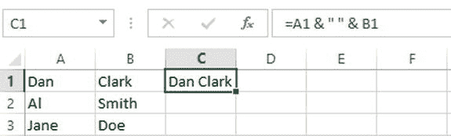
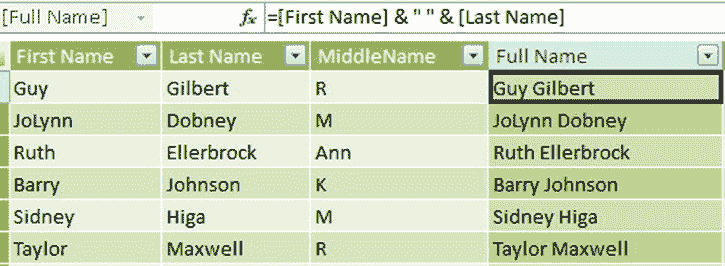
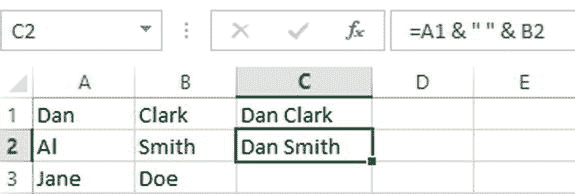
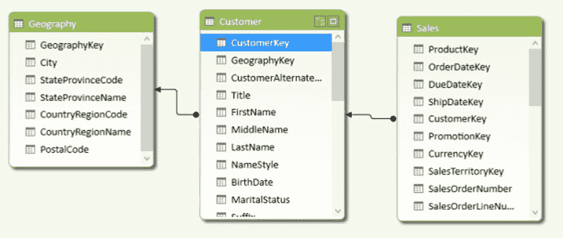
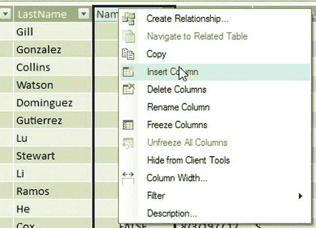
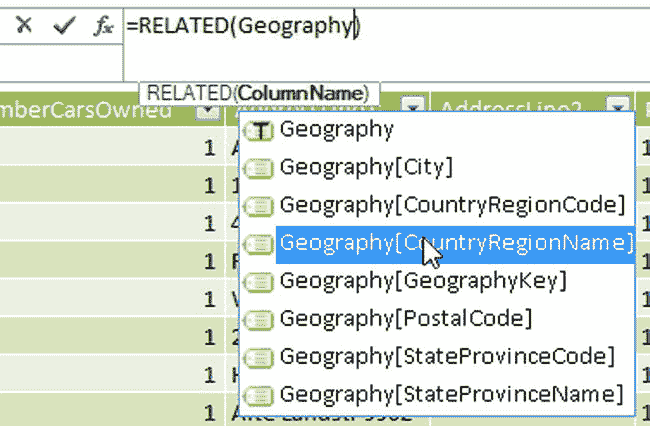
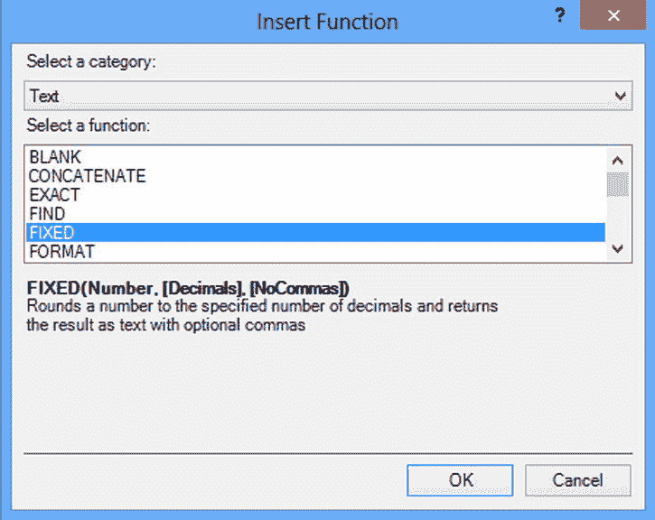
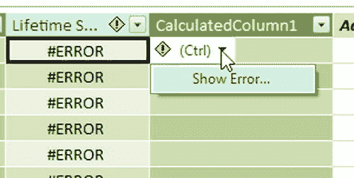
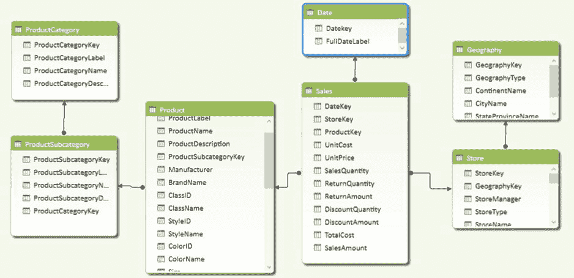

## 第 4 章


### 使用 DAX 创建计算

现在你已知道如何创建一个健壮的数据模型作为分析基础，下一步是向模型添加任何有助于探索数据所需的计算。例如，你可能需要将代码值转换为有意义的描述，或者解析字符串以获取关键信息。这就是数据分析表达式 (DAX) 发挥作用的地方。本章将向你介绍 DAX，并展示如何使用 DAX 创建计算列，以增强模型的功能。

完成本章后，你将能够：
*   使用 DAX 向表添加计算列
*   实现 DAX 运算符
*   在 DAX 中使用文本函数
*   使用 DAX 日期和时间函数
*   使用条件和逻辑函数
*   从相关表中获取数据
*   使用数学、三角和统计函数

#### 什么是 DAX？

DAX 是一种公式语言，用于在 Power Pivot 模型中创建计算列和度量值。它是专门为 Power Pivot 所基于的表格数据模型而开发的新语言。如果你熟悉 Excel 的公式语法，你会发现 DAX 语法非常相似。实际上，某些 DAX 公式的语法和功能与 Excel 中的对应公式完全相同。一个你需要理解的主要区别是，Excel 公式基于单元格，而 DAX 基于列。例如，如果要在 Excel 中连接两个值，你会使用类似下面的公式：

```
=A1 & " " & B1
```

其中 `A1` 是第一行第一列的单元格，`B1` 是第一行第二列的单元格（参见图 4-1）。



图 4-1. 在 Excel 中输入公式

这与 DAX 公式非常相似：

```
=[First Name] & " " & [Last Name]
```

其中 `First Name` 和 `Last Name` 是模型表中的列（参见图 4-2）。



图 4-2. 在 Power Pivot 中输入公式

区别在于，DAX 公式应用于表中的所有行，而 Excel 公式仅适用于特定单元格。在 Excel 中，你需要在每一行中重新创建公式。

这意味着，尽管你可以在 Excel 中执行类似以下操作：

```
=A1 & " " & B2
```

即从第一行获取一个单元格并与第二行的一个单元格连接（参见图 4-3），但这在 DAX 中是做不到的。



图 4-3. 使用不同行中的单元格

创建 DAX 公式时，考虑数据类型以及计算中可能发生的任何转换非常重要。如果不考虑这些因素，你可能会遇到公式错误或意外结果。模型中支持的数据类型有：整数、小数、货币、布尔值、文本和日期。DAX 还有一种表数据类型，它在许多函数中使用，这些函数将表作为输入值并返回一个表。

当你尝试将数值数据类型与文本数据类型相加时，会发生隐式转换。如果 DAX 可以将文本转换为数值，它会以数字形式相加；如果不能，你将收到错误。另一方面，如果你尝试将数值数据类型与文本数据类型连接，DAX 会将数值数据类型隐式转换为文本。虽然大多数时候隐式转换会给你想要的结果，但这会带来性能成本，应尽可能避免。例如，如果你从文本文件导入数据，并且列被设置为文本数据类型，但你知道它实际上是数值，你应该更改模型中的数据类型。

在 DAX 中创建计算时，你需要引用表和列。如果表名不包含空格，你可以直接按名称引用。如果表名包含空格，则需要将其括在单引号中。列和度量值则括在方括号中。如果你在公式中仅列出列名，则假定该列存在于同一表中。如果引用另一表中的列，则需要使用完全限定名称，即表名后跟列名。以下代码演示了语法：

```
=[SalesAmount] - [TotalCost]
=Sales[SalesAmount] - Sales[TotalCost]
='Internet Sales'[SalesAmount] - 'Internet Sales'[TotalCost]
```

以下是使用 DAX 时需要牢记的其他要点：
*   DAX 公式和表达式不能修改或插入表中的单个值。
*   你不能使用 DAX 创建计算行。你只能创建计算列和度量值。
*   在定义计算列时，你可以将函数嵌套到任意层级。

在创建计算时，首先要了解支持哪些运算符以及使用它们的语法。在下一节中，你将研究各种 DAX 运算符。

#### 实现 DAX 运算符

DAX 包含一套强大的运算符，包括算术、比较、逻辑和文本连接。大多数运算符你都应该很熟悉，并列举在表 4-1 中。

表 4-1. DAX 运算符

| 类别 | 符号 | 用途 |
| --- | --- | --- |
| 算术运算符 |
|   | `+` | 加法 |
|   | `-` | 减法 |
|   | `*` | 乘法 |
|   | `/` | 除法 |
|   | `^` | 乘方 |
| 比较运算符 |
|   | `=` | 等于 |
|   | `>` | 大于 |
|   | `<` | 小于 |
|   | `>=` | 大于或等于 |
|   | `<=` | 小于或等于 |
|   | `<>` | 不等于 |
| 文本连接运算符 |
|   | `&` | 连接 |
|   |   | 逻辑运算符 |
|   | `&&` | 与 |
|   | `&#124;&#124;` | 或 |

##### 算术运算符示例

以下代码用于将 `Margin` 列除以 `Total Cost` 列，从而创建一个新列 `Margin Percentage`。

```
=[Margin]/[TotalCost]
```

在同一计算中包含多个算术运算的情况非常常见。此时，您必须注意运算顺序。指数运算优先计算，其次是乘/除，最后是加/减。您可以通过使用括号对计算进行分组来控制运算顺序；例如，以下公式将在除法之前执行减法。

```
=([Sales Amount]-[Total Cost])/[Total Cost]
```

比较运算符主要用于 `IF` 语句。例如，以下计算检查商店的销售面积是否大于 1000。如果是，则归类为大型商店，否则归类为小型商店。

```
=IF([Selling Area Size]>1000,"Large","Small")
```

逻辑运算符用于创建多重比较逻辑。以下代码检查商店面积是否大于 1000 或员工人数是否超过 35，以将其归类为大型商店。

```
=IF([Selling Area Size]> 1000 || [Employee Count] > 35,"Large","Small")
```

当开始串联一系列逻辑条件时，建议使用括号来控制运算顺序。以下代码检查商店面积是否大于 1000 且员工人数是否超过 35，以将其归类为大型商店。此外，如果其年销售额超过 1,000,000 美元，无论其面积大小或员工数量如何，也会将其归类为大型商店。

```
=IF(([Selling Area Size]> 1000 && [Employee Count] > 35) || [Annual Sales] > 1000000,"Large","Small")
```

在使用 `DAX` 计算时，您可能需要将一个公式嵌套在另一个公式内部。例如，以下代码将一个 `IF` 语句嵌套在另一个 `IF` 语句的 `false` 部分中。如果员工数量不大于 35，则会跳转到下一个 `IF` 语句，检查是否大于 20。

```
=IF(Store[EmployeeCount]>35,"Large",IF(Store[EmployeeCount]>20,"Medium","Small"))
```

`DAX` 包含许多用于创建计算和度量的有用函数。这些函数包括文本函数、日期和时间函数、统计函数、数学函数和信息函数。在接下来的几节中，您将学习如何在计算中使用各种函数类型。

## 使用文本函数

许多计算都涉及某种文本处理。您可能需要截断、解析、搜索或格式化从源系统加载的文本值。`DAX`包含许多用于处理文本的有用函数。这些函数及其用途说明列在表 4-2 中。

**表 4-2.** `DAX`文本函数

| 函数 | 描述 |
| --- | --- |
| `BLANK` | 返回一个空白。 |
| `CONCATENATE` | 将两个文本字符串连接成一个文本字符串。 |
| `EXACT` | 比较两个文本字符串，如果完全相同则返回`TRUE`，否则返回`FALSE`。 |
| `FIND` | 返回一个文本字符串在另一个文本字符串中的起始位置。 |
| `FIXED` | 将数字四舍五入到指定的小数位数，并将结果作为文本返回。 |
| `FORMAT` | 根据指定的格式将值转换为文本。 |
| `LEFT` | 返回文本字符串开头指定数量的字符。 |
| `LEN` | 返回文本字符串中的字符数。 |
| `LOWER` | 将文本字符串中的所有字母转换为小写。 |
| `MID` | 从文本字符串中返回指定起始位置和长度的字符串。 |
| `REPLACE` | 用另一个文本字符串替换文本字符串的一部分。 |
| `REPT` | 将文本重复指定次数。使用`REPT`可以用文本字符串的多个实例填充单元格。 |
| `RIGHT` | 根据指定的字符数，返回文本字符串中最后一个或多个字符。 |
| `SEARCH` | 返回从左到右读取时，首次找到特定字符或文本字符串的字符位置编号。 |
| `SUBSTITUTE` | 用新文本替换文本字符串中的现有文本。 |
| `TRIM` | 删除文本中除单词间单个空格之外的所有空格。 |
| `UPPER` | 将文本字符串转换为全大写字母。 |
| `VALUE` | 将表示数字的文本字符串转换为数字。 |

作为在计算中使用文本函数的示例，假设产品表中有一个产品代码列，其前两个字符代表产品系列。要创建产品系列列，可以使用`Left`函数，如下所示：

```
=Left([Product Code],2)
```

您可以使用`FIND`函数在文本中搜索子文本。您可以使用问号（`?`）匹配任意单个字符，使用星号（`*`）匹配任意字符序列。您可以选择指定搜索的起始位置。`FIND`函数返回找到的子字符串的起始位置。如果未找到子字符串，它可以返回`0`、`-1`或空白值。以下代码在产品描述列中搜索单词“mountain”。

```
=FIND("mountain",[Description],1,-1)
```

`FORMAT`函数根据提供的格式将值转换为文本。例如，您可能需要将日期转换为特定格式。以下代码将日期数据类型转换为格式类似“Mon - Dec 02, 2013”的字符串。

```
=FORMAT([StartDate],"ddd - MMM dd, yyyy")
```

除了能够创建自己的格式之外，您还可以使用预定义的格式。以下代码演示了使用长日期格式“Monday, December 2, 2013”。

```
=FORMAT([StartDate],"Long Date")
```

现在您已经了解了如何使用一些文本函数，接下来要讨论的函数类型是内置的日期和时间函数。

## 使用 DAX 日期和时间函数

您很可能会发现数据分析中带有日期维度。您可能需要查看销售或能源消耗数据，并需要了解事件发生的是星期几。您可能需要计算年龄或到期日期。`DAX`提供了相当多的日期和时间函数来帮助创建此类计算。表 4-3 总结了各种可用的日期和时间函数。

**表 4-3.** `DAX`日期和时间函数

| 函数 | 描述 |
| --- | --- |
| `DATE` | 以日期时间格式返回指定的日期 |
| `DATEVALUE` | 将文本形式的日期转换为日期时间格式的日期 |
| `DAY` | 返回某个月份中的第几天 |
| `EDATE` | 返回起始日期之前或之后指定月数的日期 |
| `EOMONTH` | 以日期时间格式返回指定月数之前或之后月份最后一天的日期 |
| `HOUR` | 返回小时数，范围为 0（凌晨 12:00）到 23（晚上 11:00） |
| `MINUTE` | 返回分钟数，范围为 0 到 59 |
| `MONTH` | 返回月份数，范围为 1（一月）到 12（十二月） |
| `NOW` | 以日期时间格式返回当前日期和时间 |
| `SECOND` | 返回时间值中的秒数，范围为 0 到 59 |
| `TIME` | 将以数字形式给出的小时、分钟和秒转换为日期时间格式的时间 |
| `TIMEVALUE` | 将文本格式的时间转换为日期时间格式的时间 |
| `TODAY` | 返回当前日期 |
| `WEEKDAY` | 返回一个 1 到 7 的数字，用于标识某个日期的星期几 |
| `WEEKNUM` | 返回给定日期的周数 |
| `YEAR` | 以四位整数形式返回某个日期的年份 |
| `YEARFRAC` | 计算两个日期之间的整天天数在一年中所占的百分比 |

以日期函数的使用为例，你需要计算员工的在职年限。首先要做的是找出当前年份与他们入职年份的差值。以下代码从今天的日期中获取年份。

```
=YEAR(Today())
```

现在你可以减去他们入职日期的年份。注意，这里我们将一个函数嵌套在另一个函数中。函数嵌套是许多计算中的常见需求。

```
=YEAR(TODAY()) - YEAR([HireDate])
```

敏锐的读者会发现，只有当当前月份大于或等于入职月份时，这个计算结果才是正确的。你可以通过如下条件判断语句来修正这个问题：

```
= If (MONTH(TODAY())>=MONTH([HireDate]),YEAR(TODAY()) - YEAR([HireDate]),YEAR(TODAY()) - YEAR([HireDate])-1)
```

如你所见，计算很快就会变得相当复杂。挑战在于确保每个函数的左右括号正确对齐。一种组织代码的方法是利用多行和缩进。要在公式编辑栏中换行，你需要在按 `Enter` 键的同时按住 `Shift` 键。我发现下面这种写法更容易理解。

```
= If (MONTH(TODAY())>=MONTH([HireDate]),
        YEAR(TODAY()) - YEAR([HireDate]),
        YEAR(TODAY()) - YEAR([HireDate])-1
     )
```

不幸的是，在 Power Pivot 中你无法在代码中添加注释。

通常有多种方法可以创建计算。你可能会找到一种更简单或性能更好的计算方法。以下使用 `YEARFRAC` 函数和 `TRUNC` 函数（属于数学函数）来计算在职年限，并去除数字的小数部分。

```
=TRUNC(YEARFRAC([HireDate],TODAY()))
```

接下来你要研究的一组函数是信息函数和逻辑函数。当你需要确定某个条件是否存在，例如是否存在空白值，或因计算而是否发生错误时，这些函数非常重要。这些函数允许你捕捉条件并以恰当的方式做出响应。

## 使用信息函数和逻辑函数

当你开始构建更复杂的计算时，通常需要使用信息函数和逻辑函数来检查条件并对各种情况做出响应。一个常见的例子是检查空白值的需求。如果值为空白，`ISBLANK` 函数返回 `TRUE`；否则返回 `FALSE`。以下代码根据中间名是否为空白来使用不同的计算方法。

```
=IF(ISBLANK([MiddleName]),
[FirstName] & " " & [LastName],
[FirstName] & " " & [MiddleName] & " " & [LastName]
)
```

`ISERROR`函数用于检查某个计算或函数是否返回错误。以下计算检查除法运算中是否发生除零错误。

```
=IF(ISERROR([TotalProductCost]/[SalesAmount]),
     BLANK(),
     [TotalProductCost]/[SalesAmount]
   )
```

另一种创建该计算的方法是使用`IFERROR`函数，该函数在无错误时返回原值，在发生错误时返回替代值。

```
=IFERROR([TotalProductCost]/[SalesAmount],BLANK())
```

表 4-4 和 4-5 列出了 DAX 中可用的逻辑函数和信息函数。

**表 4-4.** `DAX`逻辑函数

| 函数 | 描述 |
| --- | --- |
| `AND` | 检查两个参数是否都为 `TRUE`。 |
| `FALSE` | 返回逻辑值 `FALSE`。 |
| `IF` | 检查第一个参数提供的条件是否满足。若条件为 `TRUE` 则返回一个值，若为 `FALSE` 则返回另一个值。 |
| `IFERROR` | 计算表达式，若表达式返回错误则返回指定值；否则返回表达式自身的值。 |
| `NOT` | 将 `FALSE` 变为 `TRUE`，或将 `TRUE` 变为 `FALSE`。 |
| `OR` | 检查任一参数是否为 `TRUE`，若为 `TRUE` 则返回 `TRUE`。 |
| `SWITCH` | 根据值列表计算表达式，并返回多个可能结果表达式中的一个。 |
| `TRUE` | 返回逻辑值 `TRUE`。 |

**表 4-5.** `DAX`信息函数

| 函数 | 描述 |
| --- | --- |
| `CONTAINS` | 如果所有指定列中存在或包含这些值，则返回 `true`。 |
| `ISBLANK` | 检查值是否为空。 |
| `ISERROR` | 检查值是否为错误。 |
| `ISLOGICAL` | 检查值是否为布尔值。 |
| `ISNONTEXT` | 检查值是否不是文本（空白单元格不算文本）。 |
| `ISNUMBER` | 检查值是否为数字。 |
| `ISTEXT` | 检查值是否为文本。 |
| `LOOKUPVALUE` | 返回满足搜索条件的所有指定行中指定列的值。 |

在分析数据时，您通常需要从相关表中查找对应数据。您可能需要从相关代码获取描述，或者汇总数据并将其导入表中，例如生命周期销售额。以下部分将介绍如何使用 DAX 查找相关数据。

## 从相关表中获取数据

有时您需要在其他表中查找值以完成计算。如果表之间已建立关系，您可以使用`RELATED`函数。这允许您对表进行反规范化，使用户更易于导航。例如，您可能有一个与地理表相关的客户表（参见图 4-4）。



图 4-4. 使用`RELATED`函数

如果您需要按客户所在国家/地区查看销售额，可以使用`RELATED`函数在客户表中创建一个“国家/地区”列。

```
=RELATED(Geography[CountryRegionName])
```

然后，您可以将地理表对客户端工具隐藏，以保持模型更简洁，减少对用户的困扰。

尽管`RELATED`函数返回单个值，但有时您需要查看一组相关数据，并在将其显示在列中之前进行聚合。例如，您可能希望在客户表中添加一列，列出其生命周期销售额。在这种情况下，您可以使用`RELATEDTABLE`函数获取相关销售额，然后为每个客户求和。

```
=SUMX(RELATEDTABLE(Sales),[SalesAmount])
```

 **注意** 上述代码使用了`SUMX`函数，而不是`SUM`函数，因为您正在应用筛选器。第 5 章将对此进行更详细的讨论。

我们最后要介绍的一组函数是数学、三角函数和统计函数。这些函数允许您执行常见分析，例如对数、标准差、舍入和截断。

## 使用数学、三角函数和统计函数

除了迄今讨论的函数外，DAX 还包含相当多的数学、三角函数和统计函数。数学函数（参见表 4-6）用于对数据进行舍入、截断和求和。它们还包含可用于科学、工程和财务计算的函数；例如，您可能需要根据半径计算球体体积（参见以下 DAX 计算）：

```
=4*PI()*POWER([Radius],3)/3
```

**表 4-6.** DAX 中可用的部分数学和三角函数

| 函数 | 描述 |
| --- | --- |
| `ABS` | 返回数字的绝对值。 |
| `CEILING` | 将数字向上舍入到最接近的整数或最接近的显著性倍数。 |
| `EXP` | 返回 e 的指定次幂。 |
| `FACT` | 返回数字的阶乘。 |
| `FLOOR` | 将数字向下舍入（朝向零）到最接近的显著性倍数。 |
| `LOG` | 返回指定底数的数字的对数。 |
| `PI` | 返回圆周率 pi 的值（3.14159265358979），精确到 15 位数字。 |
| `POWER` | 返回数字的指定次幂结果。 |
| `ROUND` | 将数字舍入到指定的小数位数。 |
| `SQRT` | 返回数字的平方根。 |
| `SUM` | 对一列中的所有数字求和。 |
| `TRUNC` | 通过移除数字的小数部分，将数字截断为整数。 |

另一个例子是，假设您想要计算一项投资的复利。以下 DAX 计算可确定投资的复利回报率。

```
=[Principal]*POWER(1+([IntRate]/[CompoundRate]),[CompoundRate]*[Years])
```

在分析数据时，您通常不仅要关注数据之间的关系，还要关注数据质量以及您对预测的信任程度。这就是数据统计分析发挥作用的地方。通过统计，您可以做诸如识别和处理数据中的异常值、检查数据波动性以及检测欺诈等事情。例如，您可以使用 DAX 通过标准差来确定和过滤数据中的异常值。以下 DAX 函数计算销售额的标准差。

```
=STDEVX.P(RELATEDTABLE(Sales),Sales[SalesAmount])
```

表 4-7 列出了 DAX 中可用的部分统计函数。

**表 4-7.** DAX 中可用的部分统计函数

| 函数 | 描述 |
| --- | --- |
| `AVERAGE` | 返回一列中所有数字的平均值。 |
| `COUNT` | 计算一列中包含数字的单元格个数。 |
| `COUNTA` | 计算一列中非空单元格的个数。 |
| `COUNTBLANK` | 计算一列中空白单元格的个数。 |
| `COUNTROWS` | 计算指定表中的行数。 |
| `DISTINCTCOUNT` | 计算一列数字中不同单元格的个数。 |
| `MAX` | 返回一列中的最大数值。 |
| `MIN` | 返回一列中的最小数值。 |
| `RANK.EQ` | 返回一个数字在数字列表中的排名。 |
| `RANKX` | 返回表参数中每一行在数字列表中的排名。 |
| `STDEV.S` | 返回样本标准差。 |
| `TOPN` | 返回指定表的前 N 行。 |
| `VAR.S` | 返回样本方差。 |

现在您已经了解了 Power Pivot 和 DAX 中可用的函数。我想回顾一些关于创建函数的一般技巧。

## 在 Power Pivot 中创建计算的技巧

好的，作为高级文档工程师和翻译员，我将严格遵循您的格式要求，将给定的英文文本翻译成中文。

在让你们开始动手实验之前，我想先给你们一些关于在 Power Pivot 中创建这些计算的提示。要为计算列输入公式时，请在模型生成器的数据视图窗口中，右键单击表中的某一列。在上下文菜单中，选择`插入列`（参见 图 4-5）。



图 4-5. 添加计算列

重命名该列，然后在公式编辑器栏中输入公式。公式以等号 (`=`) 开头，表名包含在单引号 (`‘’`) 中，如果表名不包含空格，则引号是可选的。表列包含在方括号 (`[]`) 中。公式编辑器栏提供了自动完成功能，你应该充分利用它（参见 图 4-6）。从下拉列表中选择函数、表或列，然后按 `Tab` 键将其插入公式中。如果你没有看到自动填充下拉列表，那么你的公式中很可能存在错误。



图 4-6. 创建计算时使用自动完成功能

公式编辑器栏旁边有三个按钮：`X` 用于取消你所做的更改；勾号用于提交更改；函数符号用于启动`插入函数`窗口（参见 图 4-7）。你可以浏览各种函数并获取有关函数所需参数的信息。



图 4-7. 使用函数助手

如果计算的创建不正确，你可能会看到一个错误指示器。你应该点击错误下拉菜单并选择`显示错误`（参见 图 4-8）。这将显示一条错误信息（参见 图 4-9），其中包含有助于你修复错误的有用信息。



图 4-8. 显示错误信息


图 4-9. 查看错误信息

现在你已了解如何使用 DAX 创建计算，并熟悉了可用的 DAX 函数，是时候获取一些实践经验了。

## 动手实验——在 Power Pivot 中创建计算列

在以下实验中，你将：

*   创建计算列。
*   使用 DAX 文本函数。
*   在 DAX 表达式中使用日期函数。
*   在表达式中使用相关表中的数据。
*   在表达式中实现条件逻辑。

1.  在 Lab Starters 文件夹中，打开 `LabChap4Starter.xlsx` 文件。此文件包含一个由销售数据、产品数据和商店数据组成的数据模型。
2.  使用关系图视图在 Power Pivot 窗口中查看模型（参见 图 4-10）。



图 4-10. 商店销售的数据模型

3.  在 Power Pivot 窗口中切换到数据视图，然后选择 `Sales` 表。
4.  在 `SalesAmount` 列之后，点击 `添加列`。在表上方的公式栏中，输入以下内容以计算利润：

```
=[SalesAmount] - [TotalCost]
```

5.  右键单击新列并将其重命名为 `Margin`。
6.  重复此过程以创建一个 `MarginPercent` 列，其公式如下：

```
=[Margin]/[SalesAmount]
```

7.  在数据视图窗口中，选择 `Date` 表。
8.  使用 Date 函数创建一个 `Year`、`Quarter`、`Month`、`Month Number` 和 `Weekday` 列。
9.  使用 `Year`、`Quarter` 和 `Month` 列，在 `Date` 表中创建一个 `Calendar` 层次结构。
10. 在数据视图窗口中，选择 `Product` 表。
11. 插入一个 `Weight Label` 列，其公式如下：

```
=if(ISBLANK([Weight]),BLANK(), [Weight] & " " & [WeightUnitMeasureID])
```

12. 在 `ProductSubcategoryKey` 旁边，使用相关函数创建一个 `ProductCategory` 列：

```
=RELATED('ProductCategory'[ProductCategoryName])
```

13. 使用相关函数，创建一个 `ProductSubcategory` 列。
14. 从客户端工具中隐藏 `ProductCategory` 和 `ProductSubcategory` 表。
15. 切换到 `Store` 表并创建一个 `Years Open` 列，其公式如下：

```
=TRUNC(YEARFRAC([OpenDate],
       If(ISBLANK([CloseDate]),TODAY(),[CloseDate]))
          ,0)
```

16. 使用以下公式创建一个 `LifetimeSales` 列：

```
=SUMX(RELATEDTABLE(Sales),Sales[SalesAmount])
```

17. 保存并关闭 Excel 文件。

### 总结

本章向你介绍了 DAX 语言以及可用于创建计算的内置函数。至此，你应该对创建计算列和使用 DAX 函数驾轻就熟了。我强烈建议你熟悉各种可用函数以及如何在分析中使用它们。在下一章中，你将继续使用 DAX 来创建度量值。度量值是在 Power Pivot 中构建模型最重要的部分之一；度量值正是你查看数据的初衷。你希望解答诸如销售情况如何或什么影响了能源消耗之类的问题。除了创建度量值，你还会看到筛选上下文如何影响度量值。为了充分利用 Power Pivot，筛选上下文是你需要掌握的最重要的概念之一。
