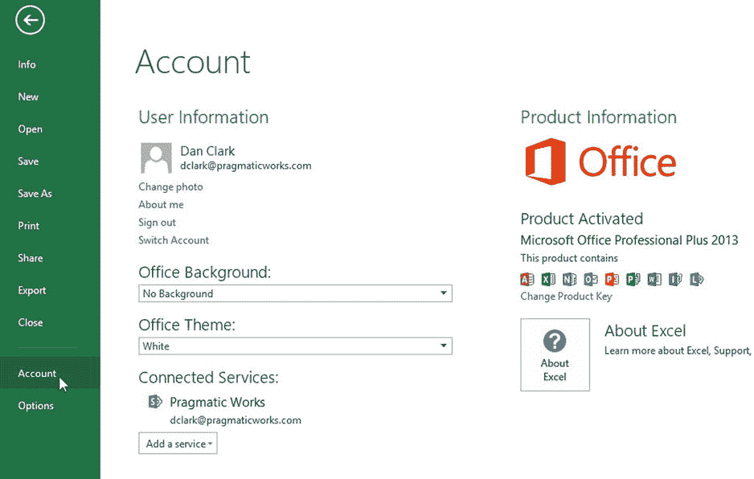
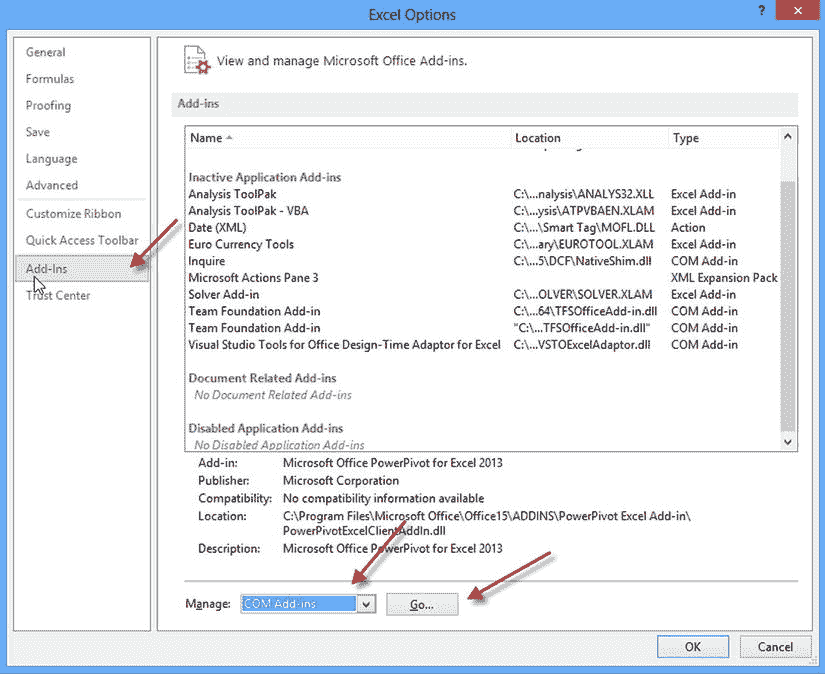
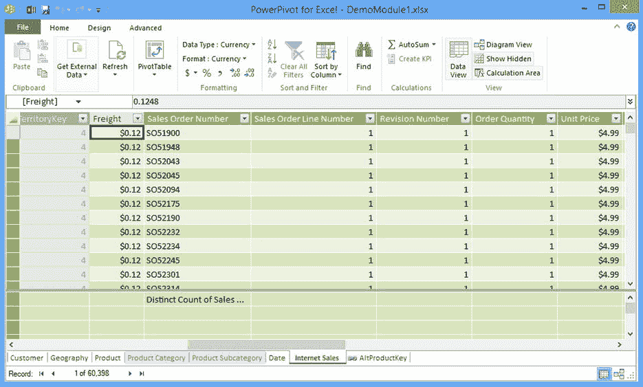
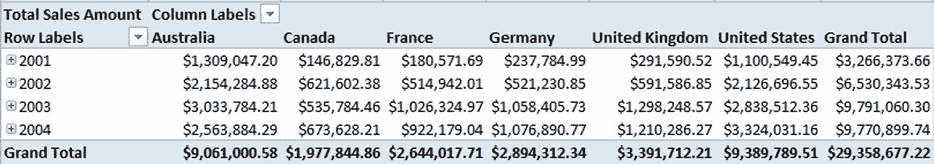
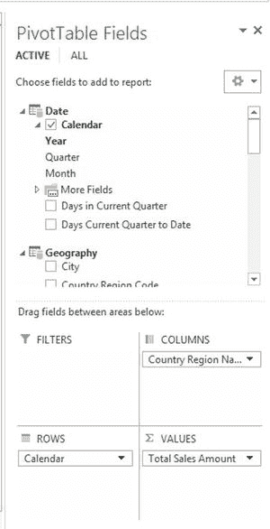

# 第一部分

## 在 Power Pivot 中构建模型

### 第 1 章

## Power Pivot 简介

微软自助式商业智能（BI）工具集的核心是 Power Pivot。其他工具，Power View、Power Query 和 Power Map，都构建在 Power Pivot 表格模型之上。就 Power View 而言，这一点显而易见，因为你需要显式地连接到该模型。就 Power Query 和 Power Map 而言，可能不那么明显，因为 Power Pivot 表格模型是在幕后为你创建的。无论它是如何创建的，为了充分利用这个工具集并深入了解数据，你都需要知道 Power Pivot 是如何工作的。

本章为你提供了一些背景信息，说明为什么 Power Pivot 是如此重要的工具，以及是什么让 Power Pivot 性能如此出色。它会指导你运行 Power Pivot 所需的条件以及如何启用它。本章还为你概述了 Power Pivot 界面，并让你获得一些使用界面不同区域的经验。

读完本章后，你将熟悉以下内容：

*   为什么使用 Power Pivot？
*   xVelocity 内存分析引擎
*   为 Excel 启用 Power Pivot
*   探索数据模型管理界面

#### 为什么使用 Power Pivot？

你可能参与过传统的 BI 项目，这些项目包含一个集中式数据仓库，组织的各种数据存储在其中被加载、清洗，然后移至 OLAP（联机分析处理）数据库用于报告和分析。这种方法的一些目标是：创建历史数据的数据存储库，创建单一版本的事实，减少数据孤岛，清理公司数据并确保其符合标准，以及通过仪表板深入了解数据趋势。尽管这些目标值得称赞，也是提供集中式数据仓库的绝佳理由，但这种方法也有一些缺点。最显著的是构建系统和实施变革的复杂性。问问任何一个试图向企业级数据仓库添加新字段或度量的人。这通常是一个漫长、旷日持久的过程，需要 IT 部门参与，以及数据管理员委员会审查、开发和测试周期。需要的是一种允许敏捷数据分析的解决方案，而无需过多依赖 IT 和正式流程。为了解决这些问题，许多业务分析师曾使用 Excel 创建数据透视表，并对从各种数据源收集的数据集进行临时分析。使用孤立的 Excel 工作簿进行分析的一些问题是：相互冲突的事实版本、数据孤岛以及数据安全性。

那么，你如何解决集中式数据仓库过于僵化而 Excel 解决方案又过于松散这一两难困境呢？这就是微软自助式 BI 工具集的用武之地。这些工具并非取代你的集中式数据仓库解决方案，而是对其进行补充，以促进敏捷数据分析。使用 Power Pivot，你可以从数据仓库中提取数据，用其他数据源（如文本文件或 Web 数据馈送）扩展数据，构建自定义度量，并使用数据透视表和数据透视图分析数据。你可以创建快速的概念验证原型，这些原型可以轻松地推广成为企业级解决方案的一部分。Power Pivot 还促进了单独的数据分析项目，而无需经历冗长的开发周期。当与 SharePoint 结合时，Power Pivot 工作簿可以由 IT 部门进行安全管理和控制，包括数据刷新调度和资源使用。这在很大程度上满足了 IT 部门对治理的需求，同时又不会妨碍业务用户对敏捷性的需求。

以下是 Power Pivot 的一些优势：

*   作为 Excel 的免费加载项运行
*   轻松整合来自各种来源的数据
*   处理多达数千万到数亿行的大量数据
*   使用熟悉的 Excel 数据透视表和数据透视图进行数据分析
*   包含强大的新数据分析表达式 (DAX) 语言
*   模型中的数据是只读的，从而提高了安全性和完整性

当 Power Pivot 托管在 SharePoint 中时，它还有以下额外优势：

*   支持 Power Pivot BI 解决方案的共享与协作
*   可以安排和自动化数据刷新
*   可以通过版本管理审计更改
*   可以确保用户具有只读和可更新的访问权限

既然你已经了解了 Power Pivot 的一些优势，那么让我们来看看它的运作机制。

#### xVelocity 内存分析引擎

#### Power Pivot xVelocity 引擎

Power Pivot 背后的独门秘籍是 `xVelocity` 内存分析引擎（没错，这就是它的名字！）。该引擎使得 Power Pivot 能够快速处理海量数据。其关键之一在于采用列式数据库来存储数据。传统的基于行的数据存储方式将所有数据按行存储在一起，在根据行键（例如，根据订单 ID 更新或检索订单）检索和更新数据时效率很高。这对于订单录入系统非常有利，但在需要对历史订单进行分析时（例如，要查看过去一年的趋势以确定产品的销售情况）就不那么理想了。

基于行的存储还会因每行重复存储值而占用更多空间；如果客户数量庞大，像 John 或 Smith 这样的常见名字会被重复多次。列式数据库仅存储每列的不同值，然后将行存储为一组指向列值的指针。这种内置的索引机制节省了大量空间，并且与 `xVelocity` 引擎内置的数据压缩技术相结合，能够实现显著的性能优化。这也意味着对列值进行的数据聚合（例如典型数据分析中使用的聚合操作）速度极快。

`xVelocity` 引擎提供的另一个优势是内存分析。查询数据时，大部分处理瓶颈都发生在从磁盘读取或写入数据的过程中。借助内存分析技术，数据被加载到计算机的 RAM 中，然后进行查询。这极大地缩短了处理时间，并减少了在磁盘上存储预聚合值的需求。当你从 32 位操作系统和应用程序迁移到如今已成为主流的 64 位系统时，这一优势尤为明显。

#### 表格模型优势

除了 `xVelocity` 引擎提供的优势之外，另一个值得一提的优势是 Power Pivot 模型的表格结构。该模型由表和表关系组成。这种表格模型对于大多数业务分析师和数据库开发者来说更为熟悉。传统的 OLAP 数据库（例如 `SSAS`，即 SQL Server Analysis Server）将数据模型呈现为三维立方体结构，处理起来更困难，并且需要使用复杂的查询语言 `MDX`（多维表达式）。我发现，在大多数（但并非所有）情况下，使用表格模型和 `DAX` 比使用 OLAP 多维数据集和 `MDX` 更容易。

#### 启用 Excel 的 Power Pivot

Power Pivot 是 Excel 的一个免费加载项，包含在 Office Professional Plus 和 Office 365 Professional Plus 版本中。如果您使用的是 Excel 2010，则需要从 Microsoft Office 网站下载并安装该加载项。如果您使用的是 Excel 2013（本书涵盖的版本），则加载项已安装，只需启用即可。要检查您安装的版本，请选择 Excel 中的“文件”菜单，然后选择“帐户”选项卡，如图 1-1 所示。

图 1-1. 检查 Excel 版本

在 Excel 的“帐户”选项卡上，单击“关于 Excel”按钮。屏幕上会显示版本详细信息，如图 1-2 所示。请注意版本和版本号。它应该是 Professional Plus 版本，最好是 64 位版本。对于较小的数据集，32 位版本可以很好地工作，但要获得 Power Pivot 的最佳性能和体验，您应该在配备约 8 GB RAM 的 64 位 Windows 系统上使用 64 位版本。

图 1-2. 检查 Excel 版本和版本号

确认您运行的是正确版本后，可以通过转到“文件”菜单并选择“选项”选项卡来启用 Power Pivot 加载项。在“Excel 选项”窗口中，选择“加载项”选项卡。在“管理”下拉菜单中，选择“COM 加载项”，然后单击“转到”按钮（参见图 1-3）。

图 1-3. 管理 COM 加载项

屏幕上将弹出“COM 加载项”窗口（参见图 1-4）。选中 `Microsoft Office PowerPivot for Excel 2013`，然后单击“确定”。

图 1-4. 选择 Power Pivot 加载项

现在您已为 Excel 启用 Power Pivot 加载项，接下来可以探索数据模型管理器了。

#### 探索数据模型管理器界面

启用 Power Pivot 后，您应该会在 Excel 中看到一个新的“Power Pivot”选项卡（参见图 1-5）。单击“管理”按钮将启动数据模型管理界面。

图 1-5. 启动数据模型管理器

数据模型管理器启动后，您将拥有两个独立但相互连接的界面。您可以在普通的 Excel 界面和数据模型管理界面之间来回切换。这可能会让 Power Pivot 新手感到困惑。请记住，数据模型管理器（图 1-6）是您定义模型的地方，包括表、表关系、度量值、计算列和层次结构。Excel 界面（图 1-7）是您使用数据透视表和数据透视图分析数据的地方。

图 1-6. 数据模型管理器界面

图 1-7. Excel 工作簿界面

#### 数据模型管理器中的视图

数据模型管理器中有两种数据模型视图：数据视图和关系图视图。首次启动时，它处于数据视图模式。在数据视图模式下，您可以看到模型中包含的数据。模型中的每个表在视图中都有其自己的选项卡。表可以包含从数据源检索的数据列，也可以包含使用 `DAX` 计算的列。计算列的颜色比其他列稍深。图 1-8 显示了 `Full Name` 列，该列是通过连接 `First Name` 和 `Last Name` 列得出的。

图 1-8. 数据模型管理器中的计算列

每个选项卡在列数据下方还有一个网格区域。该网格区域是您定义模型中度量值的地方。度量值通常包含某种聚合函数。例如，您可能希望按月或按产品查看汇总的销售额。图 1-9 显示了与 `Internet Sales` 表相关的一些度量值。

图 1-9. 数据模型管理器中的度量值网格区域

设计师顶部有四个菜单选项卡：`File`、`Home`、`Design`和`Advanced`。如果看不到`Advanced`选项卡，可以选择`File`菜单选项卡并选择`Switch To Advanced Mode`来显示它。随着本书的学习，你将逐步熟悉设计师中的菜单。目前，只需知道这些菜单可用于执行各种操作，例如连接到数据源并创建数据查询、格式化数据、设置默认属性以及创建 KPI（关键绩效指标）。图 1-10 显示了数据模型管理器中的`Home`菜单。

图 1-10. 数据模型管理器中的`Home`菜单选项卡

在`Home`菜单的右侧，您可以从数据视图模式切换到关系图视图模式。图 1-11 所示的关系图视图展示了各个表以及表之间的关系。通常您可以在此处建立表之间的关系并为钻取模型创建层次结构。数据视图和关系图视图中的菜单大致相同。但是，您会发现某些操作只能在数据视图中完成，而其他操作则只能在关系图视图中完成。

图 1-11. 在数据模型管理器中使用关系图视图

现在您已经熟悉了数据模型管理器的各个部分，该是动手实践并完成以下动手实验的时候了。此实验将帮助您熟悉在数据模型管理器中的操作。

**动手实验——探索 POWER PIVOT**

在以下实验中，您将：

*   启用 Power Pivot 加载项。
*   使用数据透视表分析数据。
*   探索数据模型管理器。

1.  打开 Excel 2013。
2.  在`File`菜单上选择`Account`（参见图 1-1）。
3.  点击`About Excel`，确保您使用的是专业增强版，并检查版本（32 位或 64 位）。
4.  在`File`菜单上选择`Options`，然后选择`Add-Ins`选项卡。在`Manage`下拉菜单中选择`Com Add-Ins`，然后点击`Go`按钮。
5.  在`Com Add-Ins`窗口中，勾选`Power Pivot add-in`（参见图 1-4）。
6.  安装完成后，打开位于`Lab Starters`文件夹中的`Chapter1Lab1.xlsx`文件。
7.  点击`Sheet1`工作表。您应该会看到一个基本的数据透视表，按年份和国家显示销售额，如图 1-12 所示。

图 1-12. 使用数据透视表

8.  点击数据透视表中的任意位置。您应该会在右侧看到字段列表，如图 1-13 所示。

图 1-13. 数据透视表字段列表

9.  字段列表下方是筛选、行、列和值的放置区域。您可以将字段拖放到这些区域来创建数据透视表。
10. 在`PivotTable Fields`窗口顶部点击`All`选项卡。展开字段列表中的`Product`表。找到`Product Category`字段并将其拖到`Report Filter`放置区域。
11. 数据透视表上方会出现一个筛选下拉菜单。点击筛选下拉图标。您应该会看到产品类别。
12. 将筛选条件更改为`Bikes`，并注意数据透视表中的值的变化。
13. 当您从筛选器中选择多个项目时，很难判断正在筛选的内容。选择`Bikes`和`Clothing`。注意当筛选下拉菜单关闭时，它只显示“(Multiple Items)”。
14. 切片器用作筛选器，但它们提供了视觉元素以便轻松确定所选内容。在`Insert`菜单上点击`Slicer`。在弹出的窗口中，选择`All`选项卡，然后在`Product`表下选择`Category`层次结构，如图 1-14 所示。

图 1-14. 选择切片器字段

15. 插入了一个`Product Category`和`Product Subcategory`切片器，用于筛选数据透视表。要按值进行筛选，请点击该值按钮。要选择多个按钮，请在点击时按住`Ctrl`键（参见图 1-15）。请注意，由于这些字段是作为层次结构设置的，因此选择一个产品类别会自动筛选`Product Subcategory`切片器中的相关子类别。

图 1-15. 使用切片器筛选数据透视表

16. 层次结构是按级别排列的列组，可以更轻松地浏览数据。例如，展开字段列表中的`Date`表，您可以查看`Calendar`层次结构，如图 1-16 所示。此层次结构由`Year`、`Quarter`和`Month`字段组成，代表了一种向下钻取数据的自然方式。

图 1-16. 在数据透视表中使用层次结构

17. 展开字段列表中的`Internet Sales`表，您将看到一个交通灯图标。此图标代表一个 KPI。KPI 用于衡量某个值的表现。它们通常通过视觉指示器表示，以便快速判断性能。
18. 在`Power Pivot`菜单下选择`Manage Data Model`按钮。
19. 在数据模型管理器中，选择底部的不同选项卡以在不同表之间切换。
20. 转到`Products`表中的`ProductAlternateKey`列。请注意，它已显示为灰色。这意味着它已对任何客户端工具隐藏。您可以通过切换回工作表 1 上的 Excel 数据透视表并验证在字段列表中看不到此字段来确认这一点。
21. 在`Internet Sales`表中，点击`Margin`列。请注意这是一个计算列。它也被格式化为货币。
22. 在`Internet Sales`表的`Sales Amount`列下方，注意有一个名为`Total Sales Amount`的度量值。点击该度量值，注意它使用了 DAX `SUM`函数来计算该度量值。
23. 将数据模型管理器切换到关系图视图。观察表之间的关系。
24. 如果将鼠标指针悬停在关系上，您可以看到关系中涉及的字段，如图 1-17 所示。

图 1-17. 探索关系

好的，作为高级文档工程师和翻译员，我将严格遵循您提供的注意事项和示例，将给定的英文文本翻译成中文。

