## 第二部分

使用`Power View`构建交互式报表和仪表板

## 第 8 章

优化`Power Pivot`模型以用于`Power View`

`Power View`是`Excel`中的一种工作表类型，允许用户开发交互式可视化效果，从而鼓励对数据进行临时探索。对于想要探索和洞察数据但并非`Excel`高级用户的用户来说，它是一个理想的工具。由于`Power View`可视化效果基于`Power Pivot`模型，您需要为用户提供一个可靠的模型作为这些可视化效果的基础。一个经过调整以适用于`Power View`的良好`Power Pivot`模型将带来卓越的用户体验，而非极其糟糕的用户体验。有多种方法可以优化`Power Pivot`模型，以使其在`Power View`中更好地创建报表。本章将回顾这些设置，并展示如何创建支持许多`Power View`功能的模型。

完成本章后，您将能够：

*   了解`Power View`中可用的可视化类型。
*   在`Power View`中创建基本可视化效果。
*   设置`Power Pivot`模型中的属性以改善`Power View`体验。

 **注** 如需彩色图片副本，请访问源代码/下载页面，网址为`http://www.apress.com/9781430264453`。

## 使用`Power View`可视化数据

# Power View 数据可视化

正如我们在第 7 章中看到的，你可以使用 Excel 数据透视表和图表创建强大的数据可视化并进行深入的数据分析。如果你是一名 Excel 高级用户，并且在工作职责中包含详细的数据分析，那么这些工具将是你的首选。另一方面，如果你需要一个工具来让用户从你的 `Power Pivot` 模型中快速创建直观的可视化，那么 `Power View` 是一个绝佳的选择。你可以使用 `Power View` 创建包含上下文关联的可视化内容的引人注目的仪表板，这些可视化内容可以轻松进行筛选、排序和钻取。`Power View` 报表可以作为 Excel 工作表或 SharePoint 库中的内容进行托管。一个额外的好处是，它们可以导出到 PowerPoint，以便在演示中使用，同时保留其交互性。图 8-1 展示了一个包含关联图表和图形的 `Power View` 报表示例。当点击图表上的一个条形时，图形会按该国家和年份进行筛选。

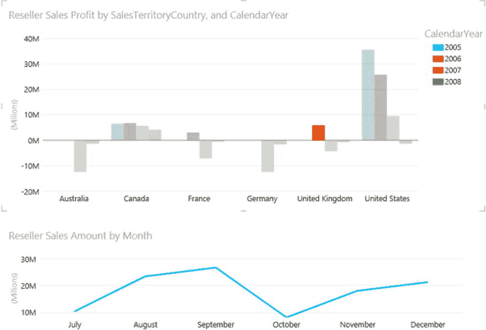

图 8-1. `Power View` 中的交互式图表和图形

使用 `Power View`，你可以创建常见的可视化内容，例如表格、矩阵、图表和图形。此外，你还可以创建包含时间轴的散点图，以揭示数据随时间的变化（参见图 8-2）。

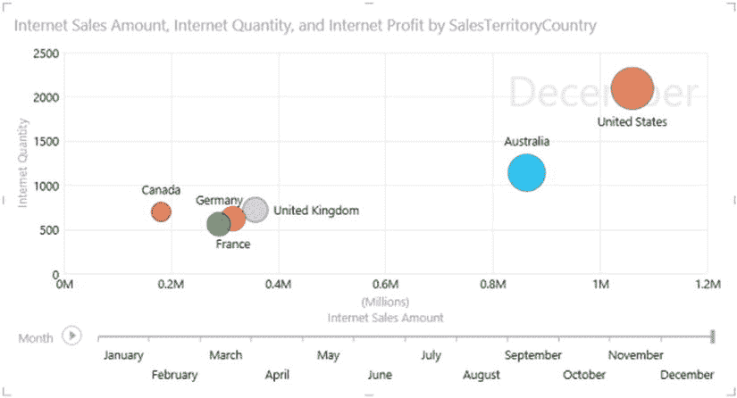

图 8-2. 为散点图添加播放轴

由于 `Power View` 使用 `Bing Maps` 图块，你可以将数据呈现在交互式地图上，并在探索数据时进行缩放和平移，直至街道地址级别。图 8-3 展示了按县划分的降雨量地图。

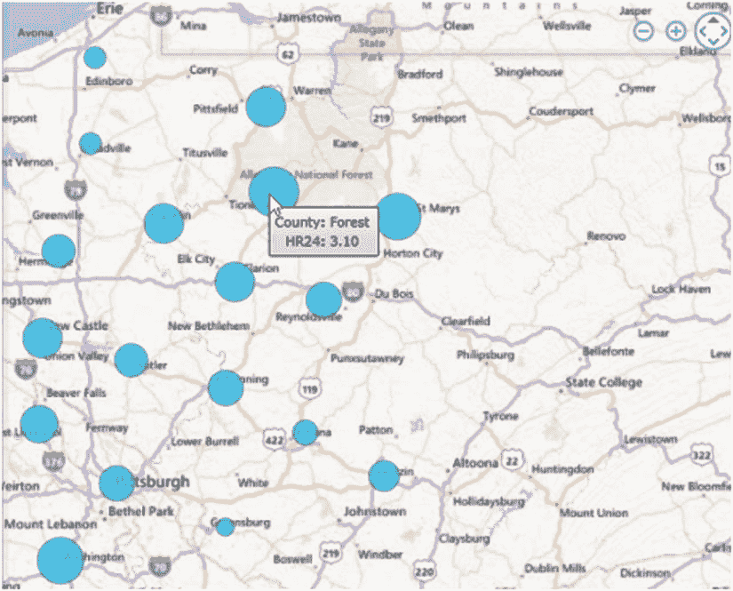

图 8-3. 按县划分的降雨量地图

`Power View` 中另外两种可用的数据可视化类型是卡片（`Cards`）和磁贴（`tiles`）。卡片以索引卡样式显示每一行的数据。例如，你可以查看员工的联系信息，如图 8-4 所示。

图 8-4. 卡片样式的员工信息

磁贴可视化允许你使用包含文本和图像的选项卡条对数据进行交互式筛选。例如，图 8-5 展示了如何使用磁贴，通过选项卡条中的区域地图图像来按区域筛选销售额。

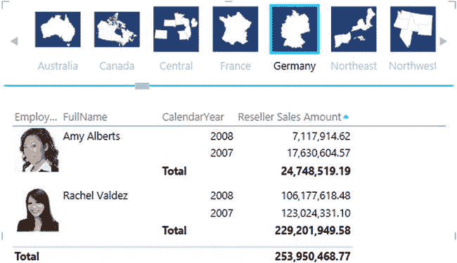

图 8-5. 在 `Power View` 中使用磁贴图像

现在你已经熟悉了 `Power View` 中可用的几种可视化类型，接下来让我们看看创建一些基本报表的过程。

## 创建基本报表

`Power View` 报表基于 Excel 中的 `Power Pivot` 模型。要创建报表，请打开包含模型的 Excel 工作簿，在“插入”选项卡上，单击“Power View”按钮（参见图 8-6）。

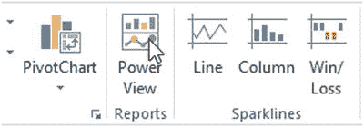

图 8-6. 插入 `Power View` 报表

这将在工作簿中插入一个新选项卡，并显示 `Power View` 设计界面。设计界面包含数据可视化区域、筛选区域和 `Power View` 字段窗口。`Power View` 字段窗口包含暴露给客户端工具的 `Power Pivot` 模型的表和字段（参见图 8-7）。

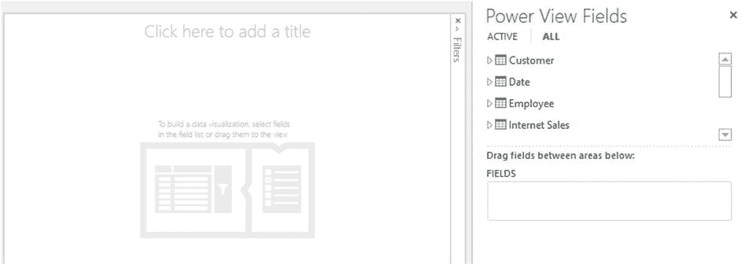

图 8-7. `Power View` 设计界面

在 `Power View` 中创建可视化的关键之一是从表格视图开始，一旦选定了字段，就可以将表格视图切换为其他数据可视化类型。如果你展开 `Power View` 字段列表中的表节点，将看到可用的字段。如果你想创建一个按销售区域显示销售额的条形图，首先将所需字段拖动到字段拖放区域。这将在设计界面上创建一个表格视图。选中该表格视图后，你可以在“设计”选项卡上选择不同的可视化类型（参见图 8-8）。

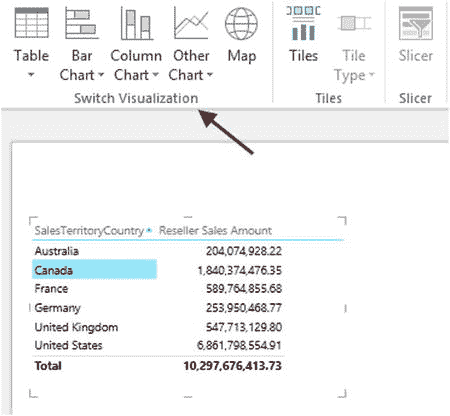

图 8-8. 更改可视化类型

切换可视化类型后，字段列表下的拖放区域将根据可视化类型而变化。图 8-9 显示了条形图的拖放区域。你可能需要重新排列字段，并且可以向拖放区域添加其他字段以获得所需的可视化效果。

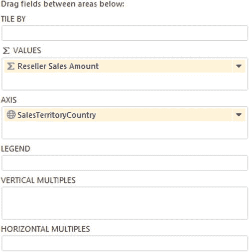

图 8-9. 条形图拖放区域

你可以轻松地将一种可视化类型切换为另一种。例如，如果你选中条形图并在“设计”选项卡中选择其他图表下拉列表，可以将其切换为饼图（参见图 8-10）。

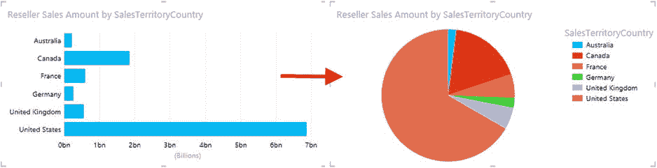

图 8-10. 切换可视化类型

现在你已经了解了如何创建基本可视化（将在第 9 章和第 10 章中学习创建更复杂的可视化），接下来让我们看看如何利用 `Power Pivot` 模型来改善 `Power View` 中的设计者和用户体验。

## 改善 `Power View` 体验

让 `Power Pivot` 模型的用户在 `Power View` 中构建和探索各种可视化内容时获得愉快的体验非常重要。例如，你应该只暴露对用户有意义的字段。隐藏用于关联模型中表的关键值总是一个好主意。要从 `Power View` 中可用字段列表中隐藏列，请右键单击该列并选择“从客户端工具中隐藏”（这将在模型设计器中将该列变为灰色）。图 8-11 展示了隐藏一个没有业务意义的`CustomerID`字段。

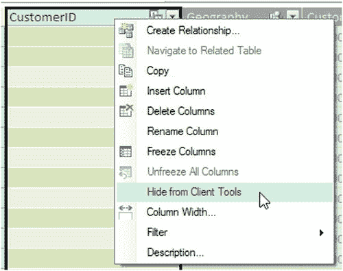

图 8-11. 从客户端工具中隐藏字段

如果你查看图 8-11 中弹出菜单的底部，你将看到可以为字段输入描述。当你在 `Power View` 中悬停在该字段上时，将显示此描述。此选项也适用于模型中创建的度量，并且对于需要了解度量如何定义的业务用户非常有用。图 8-12 显示了在 `Power View` 中显示的描述。

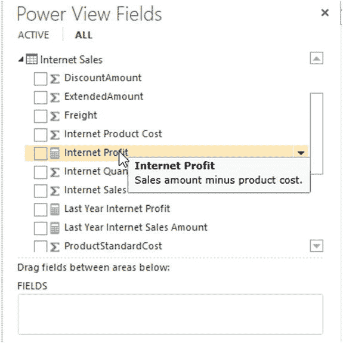

图 8-12. 添加字段描述可改善用户体验

查看 Figure 8-12 中的字段列表时，请注意字段前面的图标。计算器图标表示该度量值是在`Power Pivot`模型中创建的。求和符号（`Σ`）表示该字段是数值型的，拖放到字段放置区域时会进行聚合。默认的聚合方式是求和，但这可能并非所需的聚合方式。在某些情况下，您可能不希望聚合某个数值；例如，在日期表中，年份字段不应被聚合。您可以在`Power Pivot`模型的`Advanced`选项卡上，通过设置“`Summarize By`”下拉列表来控制此行为（参见 Figure 8-13）。

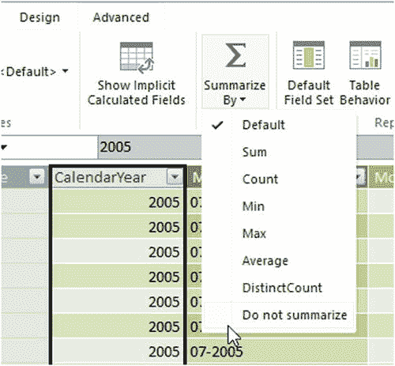

Figure 8-13. 设置字段的默认汇总方式

除了设置字段级属性外，您还可以在`Power Pivot`模型中设置一些表级属性，以便更轻松地在`Power View`中创建报表。如果您查看`Power Pivot`模型设计器中某个表的`Advanced`选项卡，您会看到一个“`Default Field Set`”按钮（参见 Figure 8-13）。选择此按钮将允许您指定该表的默认字段集（参见 Figure 8-14）。设置后，`Power View`用户只需单击`Power View`字段列表中的表节点，即可快速创建表格（参见 Figure 8-15）。

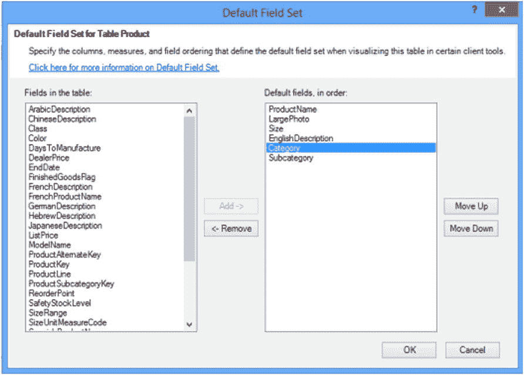

Figure 8-14. 为表设置默认字段

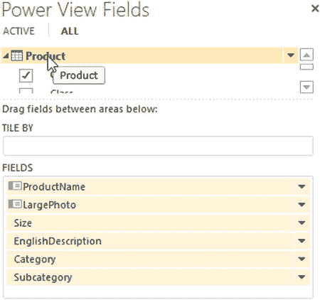

Figure 8-15. 在`Power View`中使用默认字段

在`Power View`中创建可视化时，它会根据所选字段和可视化类型自动对项目进行分组。您可以通过在`Power Pivot`模型中设置“`Table Behavior`”属性来控制分组的评估方式。您可以在模型设计器的`Advanced`选项卡上访问“`Table Behavior`”属性（参见 Figure 8-13）。单击“`Table Behavior`”按钮将显示“`Table Behavior`”设置窗口（参见 Figure 8-16）。

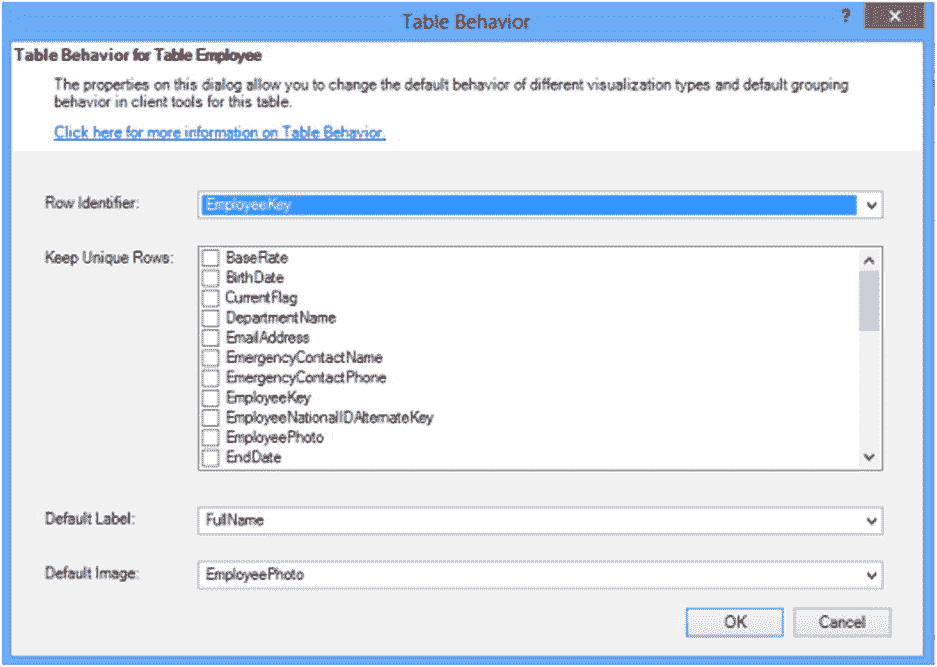

Figure 8-16. 设置表行为

您可以为一个表设置的“`Table Behavior`”属性包括行标识符、指示唯一性的列、默认标签和默认图像。行标识符用于指明唯一标识每一行的字段（通常称为主键）。此字段必须唯一且不能为空。设置行标识符后，您可以选择哪些列包含应保持唯一的值。例如，您可能有两个同名的员工，您不希望将一个员工的记录与另一个员工的记录分组在一起。默认标签和默认图像用于`Power View`的卡片和磁贴类型可视化，设置后可提供更美观的格式样式。Figure 8-17 展示了同一张卡片的两种不同格式。上方的卡片显示了设置默认标签和图像后的格式，下方的卡片显示了未设置时的格式。

Figure 8-17. 设置默认标签和图像的效果

`Power Pivot`模型设计器的`Advanced`选项卡上最后一个可用的设置是字段的“`Data Category`”设置（参见 Figure 8-18）。这对于位置类型（如城市、邮政编码和国家/地区）非常有用。当`Power View`知道某列是位置类型时，它可以使用该字段通过`Bing`地图图层实现可视化。其他有用的数据类别包括图像和`Web` URL。设置这些类别后，`Power View`将知道它们是超链接并相应地设置格式。

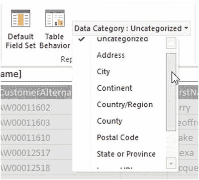

Figure 8-18. 为字段设置数据类别

至此，您应该已经很好地理解了`Power Pivot`模型中的设置如何影响`Power View`中的用户体验。在下面的动手实验中，您将获得处理这些属性的实践经验。

### 动手实验——为 Power View 优化 Power Pivot 模型

在下面的实验中，您将：

*   为 `Power View` 优化一个 `Power Pivot` 模型。
*   在 `Power View` 中创建一个表格和一个卡片可视化。
*   探索表视图筛选。

1.  在 `LabStarters` 文件夹中，打开 `LabChapter8.xlsx` 文件。此文件包含来自测试 `AdventureWorks` 数据库的销售数据。
2.  在 `Excel` 中选择 `Insert` 选项卡，然后单击 `Power View` 按钮。这将在工作簿中插入一个 `Power View` 报表工作表。在 `Power View` 字段窗口中，展开 `Customer` 节点并观察字段列表（参见 Figure 8-19）。

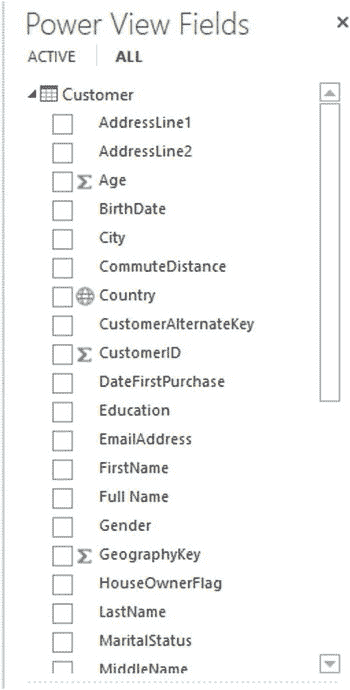

Figure 8-19. 向 `Power View` 公开的客户字段

3.  请注意，`CustomerID`、`CustomerAlternateKey` 和 `GeographyKey` 已暴露给用户。转到 `Power Pivot` 模型并隐藏这些键。
4.  如果查看 Figure 8-19 中的 `Age` 字段，您会看到该字段前面有一个求和符号（Σ）。这意味着如果您将此字段拖到放置区域，它将对年龄进行求和。要在 `Power Pivot` 模型中更改此设置，请选择 `Age` 列，然后在 `Advanced` 选项卡上的 “`Summarize By`” 下拉列表中，选择 “`Do Not Summarize`”。对 `NumberCarsOwned`、`NumberChildrenAtHome` 和 `TotalChildren` 列重复此操作。
5.  如果查看 Figure 8-19 中的 `Country` 字段，您会看到该字段前面有一个地球图标。这表明此字段是位置类型字段。要验证这一点，请在 `Power Pivot` 模型中选择 `Country` 字段，然后选择 `Advanced` 选项卡。请注意，`Data Category` 已设置为 “`Country/Region (Suggested)`”。模型使用列名来猜测此设置。
6.  将 `StateProvince` 和 `City` 列设置为适当的数据类别。返回 `Power View` 字段列表，注意这些字段现在有了地球图标。
7.  在 `Power View` 字段列表中展开 `Date` 表。请注意，存在许多您不希望使用的默认汇总，以及许多您不希望显示的字段。更新模型，使最终的字段列表看起来像 Figure 8-20。同时，设置 `MonthName` 列按 `MonthNumberOfYear` 排序，并向模型添加一个日历层级结构和一个财务层级结构。

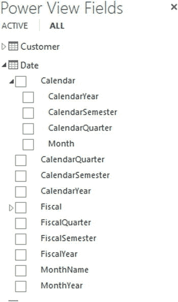

Figure 8-20. 更新后的日期字段

8.  在 `Power View` 字段列表中展开 `Employee` 表。`Power Pivot` 模型包含每位员工的照片，但 `Power View` 无法识别。要解决此问题，请转到 `Power Pivot` 模型，选择 `Employee` 表，然后在 `Advanced` 选项卡上，单击 “`Table Behavior`” 按钮。在 `Table Behavior` 设置窗口中，将 `Row Identifier` 设置为 `EmployeeKey`。将 “`Keep Unique Rows`” 设置为 `FullName`。将 `Default Label` 设置为 `FullName`，并将 `Default Image` 设置为 `EmployeePhoto`（参见 Figure 8-21）。

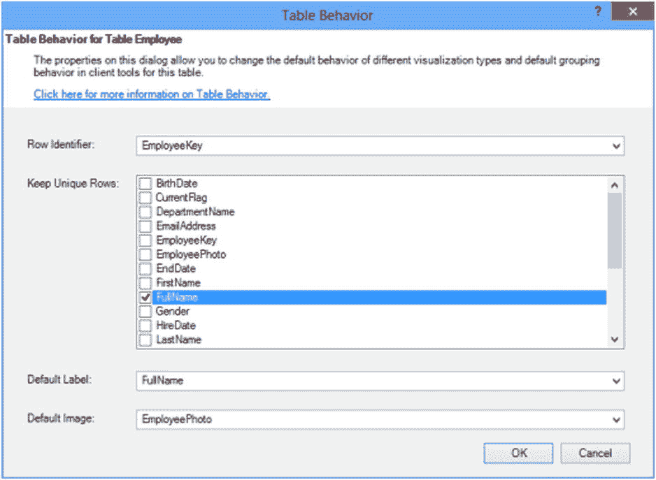

图 8-21. 设置表格行为属性

9.  返回“Power View 字段列表”，展开 `Employee` 表。请注意，现在可以看到 `EmployeePhoto` 字段。同时注意 `EmployeePhoto` 和 `FullName` 字段前新增了一个图标，表明它们是默认字段。
10. 将 `FullName`、`EmployeePhoto`、`Title` 和 `Phone` 拖放到字段列表下方的 `Fields` 放置区域。注意观察视图区域正在生成的表格。
11. 构建好基础表格后，可以将其转换为其他类型的可视化效果。在 `Design` 选项卡中，选择 `Table` 下拉菜单，将可视化效果更改为 `Card` 类型。最终应得到类似于图 8-22 的可视化效果。

图 8-22. 创建员工卡片

12. 在工作簿中插入一个新的 Power View 工作表。展开 `Product` 表格节点，注意其中字段数量众多。为方便用户，您可以设置默认字段集，以便他们通过点击表格节点来选择这些字段。
13. 在 Power Pivot 模型中，选择 `Product` 表，在 `Advanced` 选项卡上，点击 `Default Field Set` 按钮。在 `Default Field Set` 窗口中，选择 `ProductName`、`ProductLine`、`Category`、`Subcategory`、`StandardCost`、`DealerPrice` 和 `ListPrice`，如图 8-23 所示。

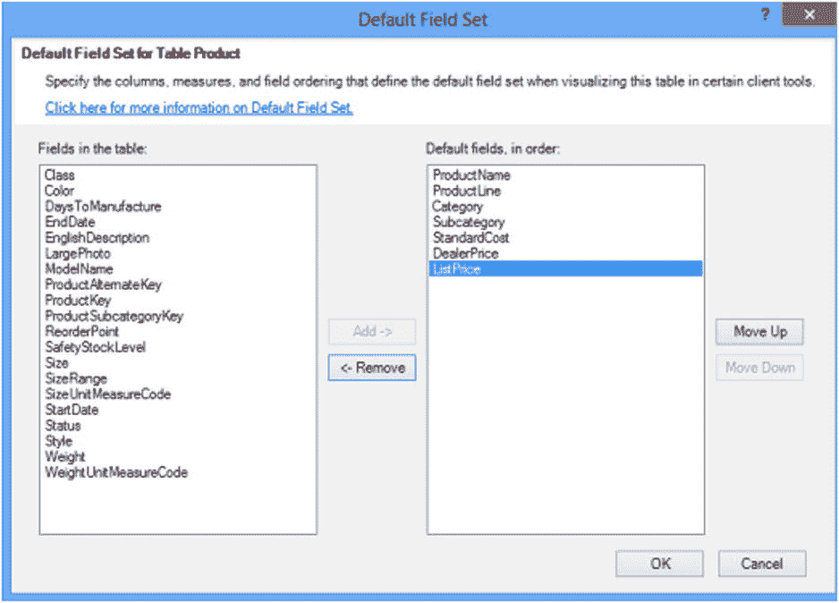

图 8-23. 选择默认字段

14. 返回 Power View 工作表，在“Power View 字段列表”中点击 `Product` 表。您应该会看到生成了一个由您在步骤 13 中选择的默认字段组成的新表格。
15. 选中表格后，点击 `Power View` 选项卡，注意您可以更改主题、字体和文本大小。请尝试更改这些设置。为 Power View 工作表添加一个标题“产品列表”。
16. 请注意，通过点击表格中的列标题，您可以按任意列进行升序或降序排序。表格右上角有一个筛选器图标。点击此图标以显示表格筛选器（参见图 8-24）。

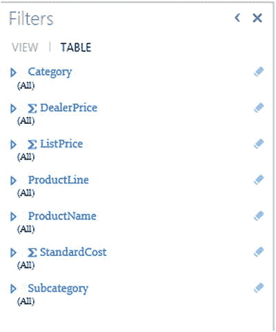

图 8-24. 查看表格筛选器

17. 点击 `Category` 字段以显示选择框。筛选表格，使其仅显示配件。点击 `DealerPrice` 字段；请注意，由于这是一个数字字段，您将看到一个滑块控件。在该字段右侧，您应该看到一个用于切换到高级筛选模式的图标。使用高级筛选模式，将产品列表限制为仅显示经销商价格大于或等于 25 美元的配件。
18. 尝试更改和清除筛选器。完成后，保存更改并退出 Excel。

#### 总结

一个为 Power View 使用而优化良好的 Power Pivot 模型，将是卓越用户体验与极差用户体验之间的分水岭。本章向您展示了如何优化 Power Pivot 模型，以便在 Power View 中更好地创建报表。您了解了如何设置表格行为属性和列属性，以及这些设置如何影响 Power View 体验。您还熟悉了在 Power View 中创建卡片和表格，以及如何对表格进行筛选和排序。下一章将深入探讨 Power View 报表设计器的功能，展示如何创建基本的可视化类型以及这些可视化内置的交互功能，并演示和讨论跨视图筛选、向下钻取功能和切片器。

## 第 9 章

# 使用 Power View 创建标准可视化

上一章您已经了解到，创建一个能与 Power View 良好协作的 Power Pivot 模型至关重要。在本章中，您将探究一些用于创建报表和仪表板的标准可视化效果。您将熟悉 Power View 设计器的常见功能。您将构建标准可视化效果，例如柱形图、条形图和饼图。此外，您还将学习如何使用散点图，以及如何将其转换为带有播放轴的气泡图。您将探究的最后一种可视化效果是如何使用地图进行地理数据分析。

完成本章后，您将能够：
*   创建表格和矩阵。
*   构建条形图、柱形图和饼图。
*   构建折线图和散点图。
*   创建基于地图的可视化效果。

 **注意**  如需彩色图片副本，请访问 `http://www.apress.com/9781430264453` 的源代码/下载部分。

## 创建表格和矩阵

正如您在上章所学，Power View 中的所有可视化效果最初都是从表格开始的，然后才转换为其他类型的可视化效果。虽然表格是最基本的数据可视化类型之一，但它仍然是查看数据最有用的方式之一，特别是当您需要查找详细信息时。图 9-1 显示了展示客户联系信息的表格。

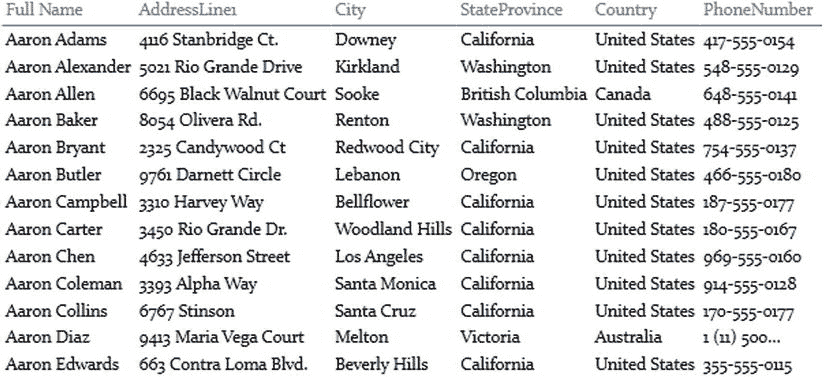

图 9-1. 客户联系信息

当您将表格与 Power View 自带的自动筛选功能结合使用时，这将成为根据客户人口统计数据查找客户的绝佳方式。在视图中选中表格后，点击“筛选器”区域中的 `Table` 选项卡（参见图 9-2）。表格中的字段将自动出现在表格筛选器列表中。若要将一个您希望用于筛选但不想显示在表格中的字段添加到筛选器列表，只需将该字段从“Power View 字段列表”拖放到“筛选器”区域。

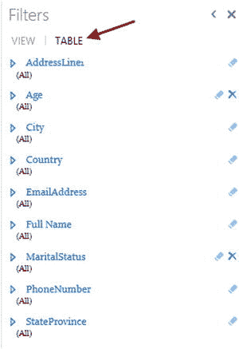

图 9-2. 筛选表格

实现表格筛选的另一种方法是使用切片器。要创建切片器，首先使用要按之切分的字段创建一个单列表格。选中视图区域中的表格，然后在 `Design` 选项卡中，点击 `Slicer` 按钮（参见图 9-3）。

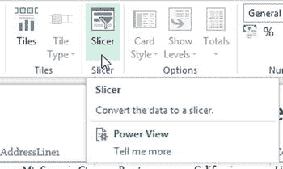

图 9-3. 创建切片器

切片器会筛选视图上的所有数据——甚至包括其他切片器。图 9-4 展示了在 `国家/地区` 切片器中的选择如何限制 `省/州` 切片器中显示的内容。

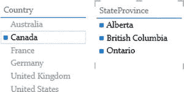

图 9-4. 使用切片器进行筛选

矩阵与表格类似，都包含行和列，但它不显示明细级别的记录，而是按行和列标题中显示的字段对数据进行聚合。在 Excel 中创建数据透视表时，它本质上就是一个矩阵。如果矩阵包含层次结构，您可以向上或向下钻取该层次结构。要创建矩阵，首先从一个表格开始，然后将其转换为矩阵。图 9-5 显示了一个表格，用于展示每个月不同经销商类型的销售利润。

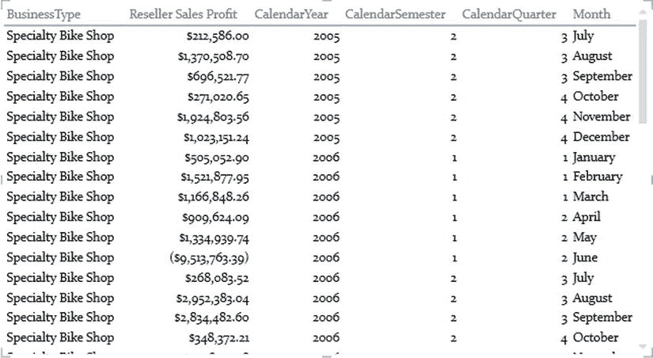

图 9-5. 按类型和月份显示经销商销售额的表格

由此可见，表格并不是展示这类信息的最佳方式。在矩阵中解读信息会容易得多，你可以在其中比较汇总值，并能按年度、季度和月份进行向下或向上钻取。要将此更改为矩阵，请选中该表格，然后在 `Design` 选项卡上，选择 `Table` 下拉菜单中的 `Matrix` 选项（参见图 9-6）。

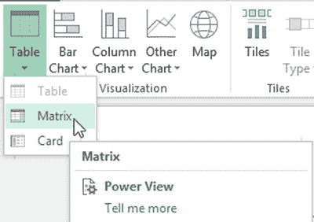

图 9-6. 将表格转换为矩阵

如图 9-7 所示，将表格转换为矩阵后，添加了总计和小计。

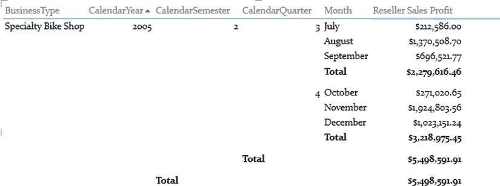

图 9-7. 包含总计和小计的矩阵

如果你查看 `Field List` 下的拖放区域，会看到用于值、行和列的区域。为了改善矩阵的外观，你可以将 `BusinessType` 字段拖到 `Columns` 拖放区域。现在你就可以轻松地并排比较经销商类型了（参见图 9-8）。

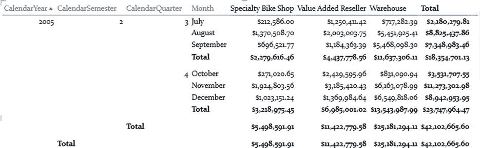

图 9-8. 按利润比较经销商类型

要在 `Design` 选项卡下控制矩阵的总计和钻取功能，请使用 `Show Levels` 和 `Totals` 下拉菜单（参见图 9-9）。

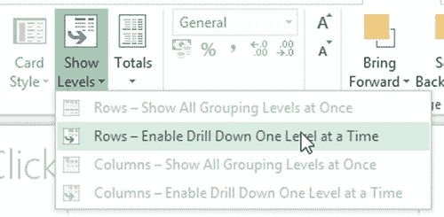

图 9-9. 为矩阵启用向下钻取

一旦启用了向下钻取，矩阵将折叠，仅显示年度级别。当你点击某一年份时，会看到一个箭头图标，允许你向下钻取到日历层次结构中的下一级别（参见图 9-10）。当你沿层次结构向下钻取时，还会看到另一个箭头，允许你向上钻取返回层次结构。

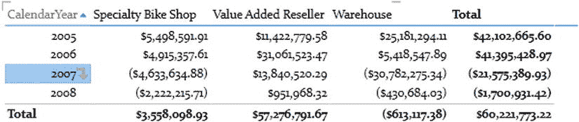

图 9-10. 沿层次结构向下钻取

除了希望在矩阵中查看聚合值之外，你通常还希望使用可视化表示（例如条形图、柱形图或饼图）来展示这些值。接下来你将学习如何创建这些图表。

## 构建条形图、柱形图和饼图

用于比较数据的一些最常见的数据可视化方式是条形图、柱形图和饼图。条形图和柱形图非常相似。条形图具有水平条形，其中 x 轴是度量值，而 y 轴包含你所比较的类别。例如，图 9-11 展示了一个按国家比较互联网销售额的条形图。

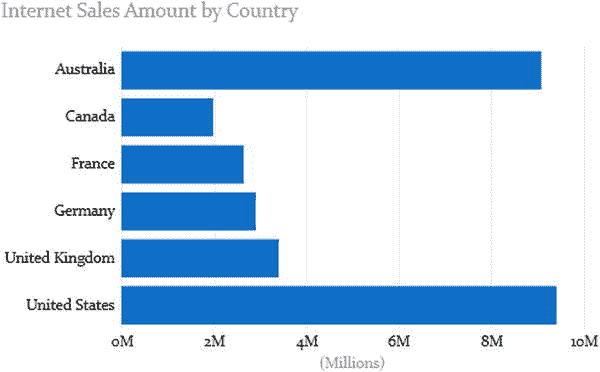

图 9-11. 按国家比较销售额的条形图

柱形图则交换了坐标轴，使得度量值位于 y 轴，而类别位于 x 轴。例如，图 9-11 中的条形图可以很容易地转换为如图 9-12 所示的柱形图。

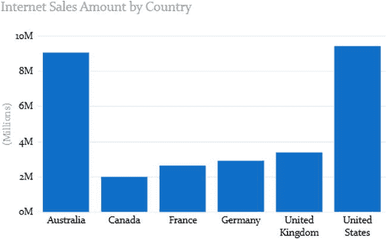

图 9-12. 按国家比较互联网销售额的柱形图

有三种类型的条形图或柱形图可供选择：堆叠图、100% 堆叠图和簇状图。图 9-12 是一个没有图例字段的堆叠柱形图。如果你将 `Year` 字段拖到 `Legend` 拖放区域，可视化效果将变为如图 9-13 所示。请注意，每年的值会彼此堆叠在一起。

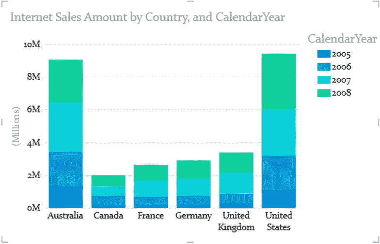

图 9-13. 创建堆叠柱形图

虽然堆积柱形图显示的是绝对值，但您可以将其改为 100% 堆积图，以百分比形式显示相对值。在图 9-14 中，`Country` 字段被移到了图例中，`Year` 字段则放置在坐标轴上。同时，该图还将数据标签设置为 `Visible`（可见），以便于比较。

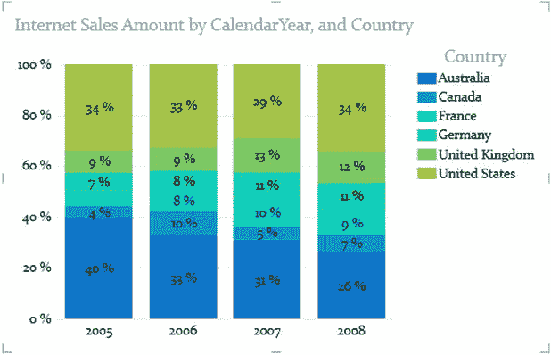

图 9-14. 创建一个 100% 堆积柱形图

簇状柱形图会将不同国家的柱形并排显示，而不是将它们堆叠在一起。图 9-15 与图 9-13 展示的是相同的信息，但以簇状柱形图的形式呈现。

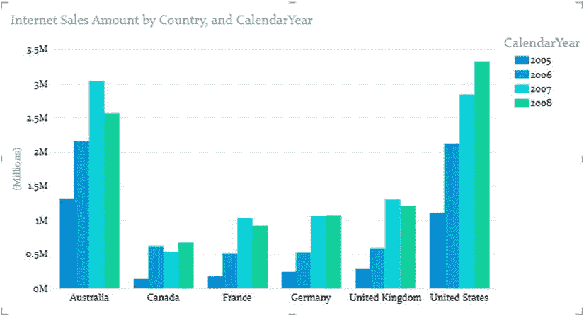

图 9-15. 创建一个簇状柱形图

虽然您无法对图表的布局进行太多控制，但可以在 `Design`（设计）选项卡上控制标题、图例和数据标签（请参阅图 9-16）。

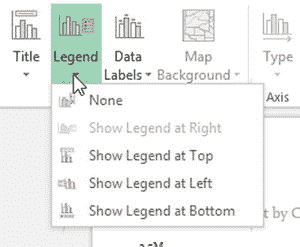

图 9-16. 控制图例布局

与大多数可视化图表一样，在 Power View 中您可以获得自动筛选和排序功能。例如，如果将鼠标悬停在图 9-15 中图表的左上角，您将看到排序选项，可以改为按 Internet 销售额排序，而不是按国家/地区名称排序（请参阅图 9-17）。

图 9-17. 更改柱形图的排序方式

饼图与堆积柱形图或堆积条形图类似，它们都允许您比较某个类别中各成员的度量值，以及该类别的总计值。图 9-18 展示了一个饼图，用于比较不同类型分销商的销售额。

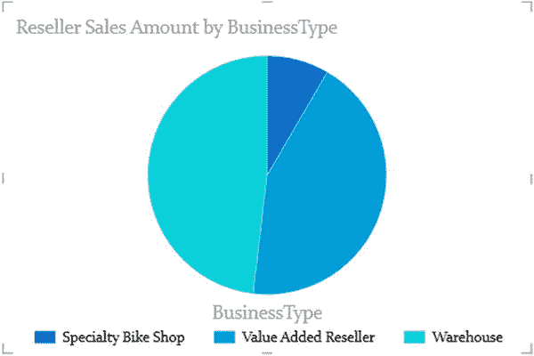

图 9-18. 使用饼图比较数据

与柱形图和条形图一样，您对饼图布局的控制也非常有限，仅限于标题和图例的位置。在撰写本文时，饼图甚至不支持数据标签，这确实令人遗憾。

虽然条形图、柱形图和饼图非常适合比较不同类别的聚合数据，但如果您想发现数据中的趋势，折线图和散点图是更好的选择。接下来您将探讨这些图表类型。

## 构建折线图和散点图

折线图用于观察相等时间段内的趋势。这些时间段通常是时间单位，例如小时、天、月等。时间周期绘制在 x 轴上，度量值绘制在 y 轴上。图 9-19 显示了一天中各小时的航班延误分钟数。每条线代表不同的航空公司。使用此图表，您可以轻松发现一天中的趋势，并比较航空公司的表现。

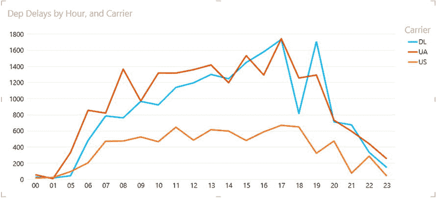

图 9-19. 使用折线图发现趋势

如果您需要同时比较两个度量值的趋势，可以使用散点图。散点图将一个度量值绘制在 y 轴上，另一个绘制在 x 轴上。要创建散点图，请先创建一个包含一个类别字段和两个数值字段的表格——例如，分销商名称（类别）、销售额（数值）和销售利润（数值）。创建表格后，将可视化效果切换到散点图，该图位于 `Design`（设计）选项卡下的 `Other Chart`（其他图表）下拉菜单中。图 9-20 显示了生成的散点图。

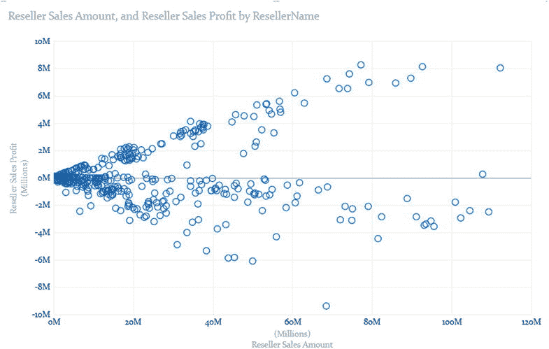

### 散点图中的数据比较

使用散点图可以轻松发现趋势以及不遵循趋势的离群值。

查看散点图的字段放置区域（参见图 9-21），您会看到“大小”和“颜色”两个放置区域。您可以将另一个度量添加到“大小”放置框中，并将另一个类别添加到“颜色”放置框中。

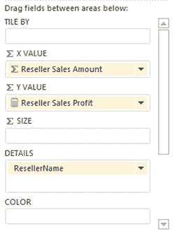

**图 9-21.** 为散点图添加大小和颜色

一旦为散点图添加了大小轴，它就会变成气泡图。图 9-22 显示了一个气泡图，其中气泡的大小代表经销商的员工数量，颜色代表经销商的业务类型。

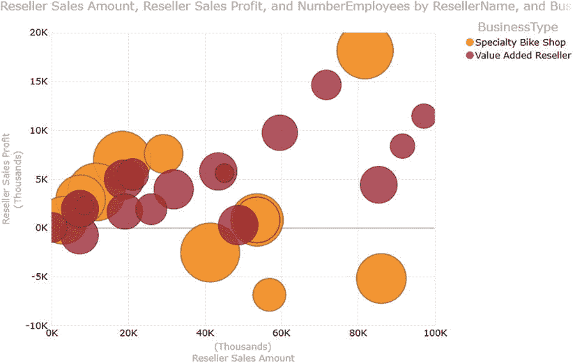

**图 9-22.** 气泡图中的数据比较

如果查看散点图的放置区域，您应该会看到另一个标记为“播放轴”的放置框。您可以将一个基于时间的字段拖入此框，这会导致在散点图下方出现一个播放轴。播放轴允许您查看度量值随时间的变化情况。它允许您在进行分析时播放、暂停和回溯这些变化。如果您单击图表中的一个气泡，可以看到随时间发生的变化轨迹。图 9-23 显示了一个可用于分析产品销售额随时间变化情况的散点图。

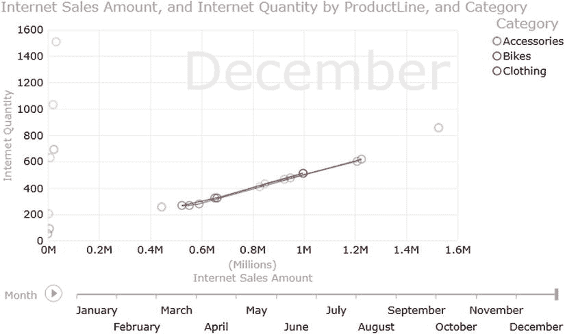

**图 9-23.** 为散点图添加播放轴

除了用于比较数据的标准可视化效果外，Power View 还允许您使用 Bing 地图从地理角度查看数据。您将在下一节中了解如何创建基于地图的可视化效果。

## 创建基于地图的可视化效果

Power View 的一个不错的功能是它可以使用 Bing 地图图块来创建可视化效果。如果您的数据包含地理字段（例如城市、州/省和国家/地区），则非常容易将数据整合到地图中。您可以通过字段列表中的地球图标来判断一个字段是否可以被地理位置定位（参见图 9-24）。

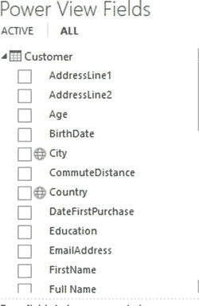

**图 9-24.** 地球图标表示可以映射的字段

要创建地图，首先创建一个包含地理空间字段和您想要在地图上查看的度量的表格。创建好表格后，您可以将其切换为地图。地图上的位置会显示为气泡，其大小表示度量值的大小。图 9-25 显示了按城市划分的销售额，地图已放大到加利福尼亚州旧金山地区。

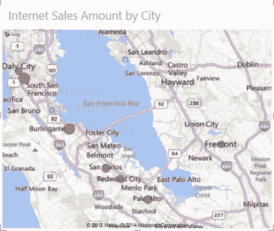

**图 9-25.** 在地图上查看数据

如果您查看地图的字段放置区域，应该会看到“经度”和“纬度”放置框；这允许您在地图上创建精确的位置点。还有一个“颜色”放置区域，您可以在其中放置一个类别字段。这会将地图上的气泡转换为显示每个类别的饼图（参见图 9-26）。

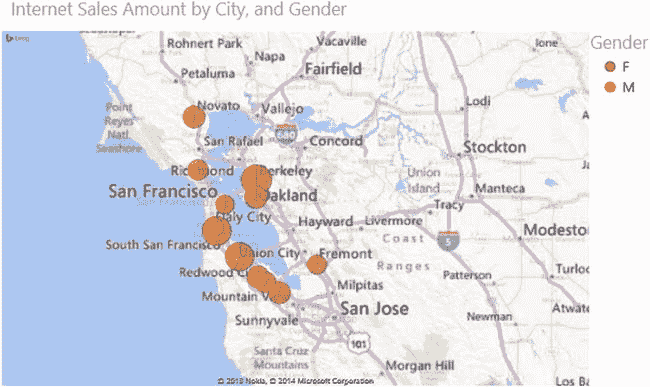

**图 9-26.** 为地图添加类别

现在您已经了解了如何创建 Power View 中可用的各种可视化效果，是时候通过动手练习来创建一些可视化效果了。

### 动手实验——在 Power View 中创建标准可视化效果

在以下实验中，您将：
*   创建条形图、柱形图和饼图。
*   创建折线图和散点图。
*   创建基于地图的可视化效果。

1.  在 `LabStarters` 文件夹中，打开 `LabChapter9.xlsx` 文件。该文件包含来自测试数据库 AdventureWorks 的销售数据。
2.  在 Excel 中选择“插入”选项卡，并单击“Power View”按钮。这将在工作簿中插入一个 Power View 报表工作表。
3.  创建一个表格，按区域或国家列出销售额以及经销商销售额。
4.  在 Power View 工作表上选中该表格，将可视化效果切换为簇状条形图。调整图表大小。图表应类似于图 9-27。

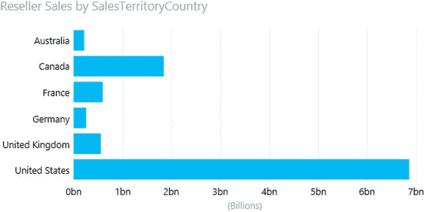

图 9-27 创建条形图

5.  选中条形图，将“经销商业务类型”拖拽至“图例”下拉框中。图表现在会按国家分组显示每种业务类型的条形。
6.  将图表切换为百分比堆积条形图。在“布局”选项卡下，更改设置以显示数据标签。图表应类似于图 9-28。

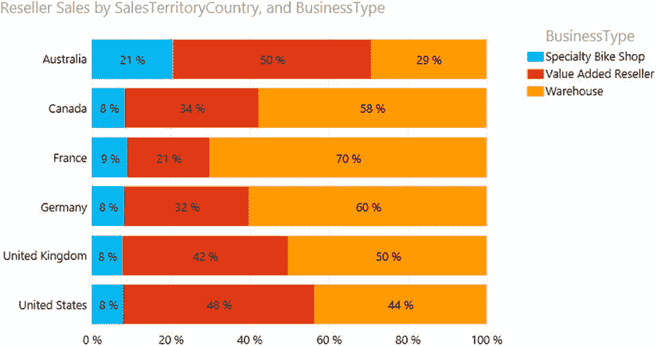

图 9-28 创建百分比堆积条形图

7.  在“Power View”选项卡上，单击“Power View”按钮以插入一个新的 Power View 工作表。创建一个堆积柱形图，按年份和类别显示经销商销售利润。您的图表应类似于图 9-29。

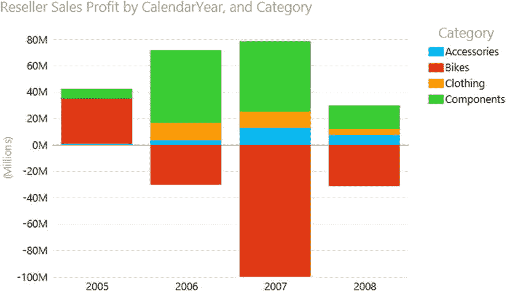

图 9-29 创建堆积柱形图

8.  添加一个新的 Power View 工作表。在此工作表上创建一个表格，显示部门名称和平均休假小时数。您需要在“字段”拖放区域将休假小时数从“求和”改为“平均值”。
9.  将可视化效果切换为饼图。在图表“筛选器”区域，将图表限制为仅显示“信息服务”、“市场”、“采购”和“销售”部门。图表应类似于图 9-30。

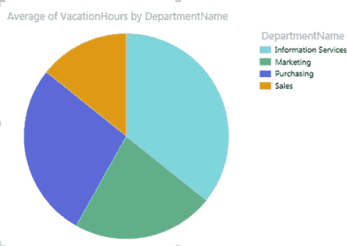

图 9-30 创建饼图

10. 要创建折线图，请添加一个新的 Power View 工作表，并创建一个包含月份名称和 Internet 销售额的表格。将可视化效果切换为折线图。将客户所在国家添加到“图例”拖放区域。最终的图表应类似于图 9-31。请注意，美国和澳大利亚有峰值，而其他地区则相当平稳。

图 9-31 在折线图中比较数据

11. 要创建散点图，请添加一个新的 Power View 工作表，并创建一个包含 `ResellerName`、`ResellerSalesProfit` 和 `ResellerSales` 的表格。将表格更改为散点图。将业务类型添加到“颜色”下拉框中。
12. 将 `SalesTerritoryCountry` 拖拽至图表“筛选器”区域，并将图表限制为仅显示德国。使用 `MonthYear` 创建一个播放轴。使用播放轴，确定最大利润损失发生在哪个经销商、何时以及损失多少。最终得到的可视化效果应类似于图 9-32。

图 9-32 使用带播放轴的散点图确定最大利润损失

13. 要创建基于地图的可视化效果，请在工作簿中插入一个新的 Power View 工作表。使用客户 `FullName` 和客户 `StateProvince` 创建一个表格。将表格切换为地图，将 `Full Name` 字段从“颜色”下拉框拖拽至“大小”下拉框，并将聚合方式更改为“非重复计数”。
14. 将 `HouseOwnerFlag` 拖拽至“颜色”下拉框。放大至美国西部地区；您的地图应类似于图 9-33。

# 第 9 章（图 9-33）

图 9-33. 映射客户数量

15. 尝试映射其他字段，并缩放至地图的不同区域。完成后，保存更改并退出 Excel。

### 本章小结

在本章中，你学习了如何在 Power View 中创建各种可视化效果。你创建了标准的柱形图、条形图和饼图。你还了解了折线图、散点图，以及如何创建气泡图并添加播放轴来查看随时间变化的趋势。此外，你还学习了如何将与地理空间字段相关的度量值显示在地图上。至此，你应该能够熟练地在 Power View 中创建各种可视化效果。

到目前为止，你创建的每个可视化效果都是独立的图表或图形。Power View 的优势之一在于能够将这些可视化效果关联起来，创建交互式仪表板。你将在下一章中对此进行探讨。

# 第 10 章

## 使用 Power View 创建交互式仪表板

在上一章中，你了解了一些用于创建报表和仪表板的标准可视化效果。在本章中，你将把这些可视化效果结合起来，使它们协同工作，形成交互式仪表板。交互式仪表板与传统仪表板的不同之处在于，它将用户体验从被动扩展为主动。你可以执行筛选、向上或向下钻取不同级别的详细信息，以及发现各种度量值之间的关联。你还将学习如何使用磁贴对数据进行分组，并为分组和视图整体创建筛选器。此外，你还将了解如何添加图片以增强仪表板的体验。

完成本章后，你将能够：

*   在 `Power View` 中链接可视化效果。
*   使用磁贴组织数据。
*   筛选分组和视图。
*   向使用者公开仪表板。

 **注意：** 如需彩色图副本，请访问 `http://www.apress.com/9781430264453` 上的源代码/下载部分。

### 在 Power View 中链接可视化效果

`Power View` 的优势之一在于，如果 `Power Pivot` 模型中包含用于创建各种可视化效果的数据之间的链接，则 `Power View` 将利用该关系实现交互式筛选。*交互式筛选*是指筛选一个可视化效果的过程会自动筛选出相关的可视化效果。例如，图 10-1 显示了一个条形图，该条形图展示了 `Adventure Works` 示例数据库中不同产品类别的销售额。

图 10-1. 按类别统计的经销商销售额

在此视图中，你可以添加一个显示不同国家/地区销售额的柱形图，如图 10-2 所示。

图 10-2. 向同一视图添加相关的可视化效果

由于 `Sales` 表与 `SalesTerritory` 表和 `Product` 表相关，因此如果你选择其中一个产品类别条形图，它将突出显示条形图以显示该类别对应的销售额（参见图 10-3）。

图 10-3. 对相关可视化效果进行交互式筛选

这种筛选是双向的，因此你可以单击下方图表中的某个柱形，它将筛选上方的图表，以显示该国家/地区的销售额。这种交互式筛选适用于 `Power View` 中大多数类型的可视化效果。图 10-4 展示了一个气泡图和一个表格。当你单击某个气泡时，表格将被筛选，以显示构成该气泡值的明细记录。

图 10-4. 筛选以显示构成气泡值的详细信息

现在你已经了解了可视化对象如何相互交互，接下来可以学习如何通过磁贴对可视化对象进行分组。

### 使用磁贴组织数据

在上一节中，你了解了放置在同一视图上的可视化对象如何相互交互。另一种对可视化对象进行分组的方法是使用磁贴。首先创建一个包含分组条件的表格。例如，你可能希望按销售区域组织销售数据。为此，首先使用销售区域图片创建一个表格，然后将其更改为磁贴类型的可视化对象。你将看到一个与图 10-5 类似的可视化对象。

图 10-5. 创建磁贴组

在图 10-5 中，请注意销售区域图片同时出现在 `Title` 字段和 `Details` 区域中。你可以从 `Details` 区域移除该字段，并从 `Power Pivot` 模型添加与销售区域相关的数据。例如，你可以添加分配给该区域的销售人员、他们的照片、销售额以及销售年份。这将在磁贴的 `Details` 部分创建一个表格（参见图 10-6）。

图 10-6. 在磁贴内创建表格

你可以将详细可视化对象更改为另一种类型，例如矩阵。当你点击不同的磁贴时，详细信息将按磁贴组进行筛选（参见图 10-7）。

图 10-7. 使用磁贴分组

如果你点击磁贴 `Detail` 部分的空白区域，可以构建另一个可视化对象。例如，图 10-8 显示了一个矩阵和一个柱形图，它们都根据所选的磁贴进行了筛选。

图 10-8. 使用磁贴控制多个可视化对象

分组可视化对象后，请确保你了解筛选如何影响磁贴中和视图上的分组可视化对象。接下来你将了解这部分内容。

### 筛选组和视图

当你将多个可视化对象放置在同一视图上时，你可以选择筛选整个视图（页面）或构成视图的各个可视化对象。图 10-9 显示了 `Filters` 区域，你可以在其中切换 `View` 选项卡和 `Chart` 选项卡。`View` 选项卡用于将筛选器应用于页面上的所有可视化对象，而 `Chart` 选项卡则将筛选器仅应用于单个可视化对象（在此示例中为图表）。

图 10-9. 筛选图表或视图

默认情况下，可视化对象筛选器包含构成该可视化对象的字段，并且这些字段不能被移除。但是，你可以从 `Field List` 向筛选器添加其他字段。当你首次点击 `Filters` 区域中的 `View` 选项卡时，没有列出任何字段。要筛选视图中的值，请从 `Field List` 添加与视图中可视化对象所包含字段相关的字段。

所有筛选器都有一个列表模式，其中值显示为复选框列表（参见图 10-10）。

图 10-10. 使用筛选器选择列表

你也可以通过选择字段名称右侧的箭头切换到高级筛选模式。`Power View` 中公开的高级筛选控件的类型取决于筛选器的数据类型。图 10-11 显示了对日期字段公开的高级筛选控件。

图 10-11. 按日期进行高级筛选

图 10-12 显示了将高级筛选用于基于文本的字段时得到的选项。

图 10-12. 使用基于文本的字段进行高级筛选

筛选视图的另一种方法是使用切片器。切片器对用户很友好，因为它们是视图的一部分。切片器的缺点在于它们仅限于选择列表，并且不公开前面提到的高级筛选功能。将磁贴分组与切片器相结合可以创建不同的筛选器集。图 10-13 显示了磁贴组内部和磁贴组外部的同一图表。两个图表都受到 `CalendarYear` 切片器的筛选，因为它们位于同一视图上。磁贴组中的图表还受到销售区域的进一步筛选，因为它是磁贴组的一部分。

图 10-13. 使用切片器和磁贴进行筛选

构建好仪表板后，就该将其展示给用户了。在下一节中，我们将简要回顾你的选择。

### 公开仪表板

构建交互式仪表板后，下一步是将其公开给其他人，例如希望探索数据的业务分析师和管理人员。由于构成仪表板的 `Power Pivot` 模型和 `Power View` 可视化对象是一个自包含单元，你可以直接与使用者共享 `Excel` 文件的副本。然而，这不是管理仪表板的理想方式，并且很快就会变得难以处理。更好的管理方式是将它们托管在 `SharePoint` 站点中。你可以将其托管在本地 `SharePoint Server 2013` 或基于云的 `Office 365 SharePoint Server` 中。

基于云的 `Office 365` 解决方案具有一些非常引人注目的特性，使其成为你的 `Power BI` 解决方案的绝佳托管站点。这些特性包括 `Power BI` 站点，用户可以在其中共享、查看 `Power View` 仪表板并与之交互。它还包含一个 `Power BI` 管理中心，你可以在其中保护、监控和自动刷新仪表板的数据。如果你需要实施一个解决方案来为大量用户创建和分发大量视图，我建议你了解一下 `Office 365` 的功能。图 10-14 显示了 `Office 365 Power BI` 站点中的 `Power View` 仪表板。

图 10-14. 在 Power BI 站点上公开 Power View 仪表板

需要记住的一点是，`Power View` 最初是为交互式数据探索而创建的。尽管它正在发展成一个相当不错的仪表板工具，但它并不是生成需要打印的静态报告的最佳选择。当你打印 `Power View` 页面时，本质上只是打印一个屏幕截图。

现在你已经了解了如何使用 `Power View` 创建交互式仪表板，是时候通过实践来亲手创建一个了。

### 动手实验——在 Power View 中创建仪表板

在以下实验中，你将：

*   使用 `Power View` 创建一个交互式仪表板。
*   使用磁贴对可视化对象进行分组。

1.  在`LabStarters`文件夹中，打开`LabChapter10.xlsx`文件。该文件包含来自测试`AdventureWorks`数据库的销售数据。
2.  在 Excel 中选择`插入`选项卡，然后单击`Power View`按钮。这将在工作簿中插入一个`Power View`工作表。你将在此工作表上构建仪表板。
3.  将仪表板的标题更改为`Reseller Sales Analysis`。
4.  创建一个列出`CalendarYears`的表格，并将其转换为切片器。在切片器中选择年份`2006`以限制数据。
5.  单击设计图面的空白区域以创建新的可视化对象。从`Date`表中选择`MonthName`，从`Reseller Sales`表中选择`Reseller Sales Profit`。将表格转换为折线图并调整图表大小。从`Product`表中将`Category`添加到折线图的`图例`拖放区域。
6.  使用`Reseller`表中的`BusinessType`以及`Reseller Sales`表中的`Last Year Reseller Sales Amount`和`Reseller Sales`创建一个簇状条形图。
7.  重新排列可视化对象，使仪表板看起来类似于 Figure 10-15。

Figure 10-15. 转售商销售分析仪表板

8.  通过更改切片器中的年份、在条形图中选择转售商类型以及在折线图中选择类别线来测试仪表板的交互性。注意这些操作如何影响仪表板中的图表。你可以通过单击图表的空白区域来清除图表上的筛选器（参见 Figure 10-16）。

Figure 10-16. 清除交互式筛选器

9.  添加一个新的`Power View`工作表。将此仪表板标题命名为`Sales Performance`。
10. 从`Employee`表中创建一个`EmployeePhotos`表格。通过在`设计`选项卡中选择`磁贴`，将表格更改为磁贴。
11. 将`Employee`表中的`DepartmentName`拖到`筛选器`区域。将视图筛选为仅显示销售部门员工。调整磁贴区域的大小，使其占据视图的大部分空间（参见 Figure 10-17）。

Figure 10-17. 创建磁贴分组

12. 删除位于磁贴下方的员工图像。
13. 选择`磁贴`框内的空白区域，然后在`字段选择`窗格中单击`Reseller Sales`表中的`Reseller Quantity`。从`字段选择`窗格中再次选择`Reseller Sales`表中的`Reseller Quantity`。接下来，从`Sales Territory`表中选择`SalesTerritoryImage`和`SalesTerritoryRegion`。最后，从`Product`表中选择`Category`。
14. 将表格转换为矩阵，并将`Date`表中的`CalendarYear`拖到矩阵的`列组`中。调整矩阵大小，使其占据磁贴区域大约一半的空间（参见 Figure 10-18）。你可以在`设计`选项卡中减小文本大小以使其适合。

Figure 10-18. 向磁贴区域添加矩阵

15. 要创建柱形图，请选择`磁贴`框内的空白区域并单击。选择`Product`表中的`Category`、`Reseller Sales`表中的`Reseller Sales`以及`Date`表中的`CalendarYear`。将创建的表格更改为`100%堆积柱形图`。调整图表大小，使其看起来类似于 Figure 10-19。

Figure 10-19. 向仪表板添加堆积柱形图

16. 选择不同的销售人员，注意数据将筛选为仅显示他们的销售额。同时单击柱形图的一个分区，注意它如何筛选矩阵数据。
17. 尝试与你创建的两个仪表板进行交互。
18. 你可能希望尝试更改主题并为仪表板添加背景图像。你也可以添加公司徽标和标准免责声明，这些是大多数公司仪表板的常见要求。完成操作后，保存并退出 Excel。

#### 总结

在本章中，你学习了如何组合`Power View`中的各种可视化对象来创建交互式仪表板。你还学习了如何使用磁贴来分组仪表板上的其他可视化对象。虽然你尚未探索将仪表板部署到`SharePoint`，但这将是合乎逻辑的下一步。无论是在云中使用`Office 365`，还是在本地使用`SharePoint 2013`，`SharePoint`都能实现协作和管理自助式`BI`的强大功能。在下一章中，你将了解另一个在自助式`BI`工具集中非常实用的 Excel 加载项。`Power Query`提供了一个易于使用的界面，用于发现和转换数据以在`Power Pivot`模型中使用。它还包含清理和塑形数据的工具，例如删除重复项、替换值和分组数据。

