# 第一部分


## 在 Power Pivot 中构建模型

### 第 1 章


#### 介绍 Power Pivot

微软自助式商业智能工具集的核心是 `Power Pivot`。其余的工具，`Power View`、`Power Query` 和 `Power Map`，都建立在 `Power Pivot` 表格模型之上。对于 `Power View` 来说，这一点显而易见，因为你需要显式地连接到该模型。对于 `Power Query` 和 `Power Map` 来说，这一点可能不那么明显，因为 `Power Pivot` 表格模型是在后台为你自动创建的。无论它是如何创建的，要充分利用这些工具集并深入了解数据，你需要知道 `Power Pivot` 是如何工作的。

本章为你提供了一些背景信息，说明为什么 `Power Pivot` 是一个如此重要的工具，以及是什么让 `Power Pivot` 性能如此出色。它指导你了解运行 `Power Pivot` 的要求以及如何启用它。本章还概述了 `Power Pivot` 的界面，并为你提供了一些使用界面不同区域的体验。

阅读本章后，你将熟悉以下内容：

*   为什么使用 `Power Pivot`？
*   `xVelocity` 内存分析引擎
*   启用适用于 Excel 的 `Power Pivot`
*   探索数据模型管理界面

#### 为什么要使用 Power Pivot？

你可能参与过传统的商业智能项目，这些项目由一个集中的数据仓库组成，组织中的各种数据存储被加载、清洗，然后移到一个 OLAP（在线分析处理）数据库以进行报告和分析。这种方法的一些目标是：为历史数据创建一个数据仓库，创建唯一的事实版本，减少数据孤岛，清理公司数据并确保其符合标准，以及通过仪表板洞察数据趋势。虽然这些目标值得称赞，并且是提供集中式数据仓库的绝佳理由，但这种方法也存在一些缺点。最显著的是构建系统和实施变更的复杂性。问问任何一个尝试过向企业级数据仓库添加新字段或度量值的人。这通常是一个漫长而复杂的过程，需要 IT 部门参与，并经过数据管理员委员会评审、开发和测试周期。需要的是一种能够进行敏捷数据分析的解决方案，而无需过多依赖 IT 部门和正式流程。为了解决这些问题，许多业务分析师使用 Excel 创建数据透视表，并对从各种数据源收集到的数据集进行临时分析。单独使用 Excel 工作簿进行分析的一些问题包括：相互冲突的事实版本、数据孤岛以及数据安全问题。

那么，如何解决集中式数据仓库过于僵化而 Excel 解决方案又过于松散的两难问题呢？这就是微软自助式商业智能工具集的用武之地。这些工具并非取代你的集中式数据仓库解决方案，而是对其进行补充，以促进敏捷数据分析。使用 `Power Pivot`，你可以从数据仓库中提取数据，用其他数据源（如文本文件或 Web 数据馈送）对其进行扩展，构建自定义度量值，并使用数据透视表和数据透视图分析数据。你可以快速创建概念验证，这些验证可以轻松升级为企业级解决方案的一部分。`Power Pivot` 还促进了临时性的数据分析项目，而无需承担冗长开发周期的开销。当与 SharePoint 结合使用时，`Power Pivot` 工作簿可以由 IT 部门进行安全保护和管理，包括数据刷新调度和资源使用。这在很大程度上满足了 IT 部门对治理的需求，同时又不会妨碍业务用户对敏捷性的需求。

以下是 `Power Pivot` 的一些优势：

*   作为 Excel 的免费加载项运行
*   轻松整合来自各种来源的数据
*   处理高达数千万到数亿行的大量数据
*   使用熟悉的 Excel 数据透视表和数据透视图进行数据分析
*   包含强大的新数据分析表达式语言
*   模型中的数据为只读，提高了安全性和完整性

当 `Power Pivot` 托管在 SharePoint 中时，以下是其一些额外优势：

*   支持 `Power Pivot` 商业智能解决方案的共享与协作
*   可以计划和自动化数据刷新
*   可以通过版本管理审计更改
*   可以确保用户权限仅为只读或可更新访问

现在你知道了一些 `Power Pivot` 的优势，让我们看看它是如何运作的。

#### `xVelocity` 内存分析引擎


#### Power Pivot 的核心技术

`Power Pivot`背后的特殊技术是`xVelocity`内存分析引擎（没错，这就是它的名字！）。这使得`Power Pivot`能够对大量数据提供快速性能。其关键之一在于它使用列式数据库来存储数据。传统的基于行的数据存储将一行中的所有数据存储在一起，并且能够高效地基于行键检索和更新数据，例如，基于订单 ID 更新或检索订单。这对于订单录入系统来说非常出色，但在对历史订单进行分析时（例如，你想查看过去一年的趋势以确定产品的销售情况）就不那么理想了。基于行的存储还会因为为每一行重复存储值而占用更多空间；如果你有大量客户，像 John 或 Smith 这样的常见名字会被重复存储多次。列式数据库仅为每一列存储不同的值，然后将行存储为一组指向列值的指针。这种内置的索引节省了大量空间，并且当与`xVelocity`引擎内置的数据压缩技术结合使用时，可以实现显著的优化。这也意味着对列值的数据聚合（例如典型数据分析中使用的那些）速度极快。

`xVelocity`引擎提供的另一个好处是内存分析。与查询数据相关的大多数处理瓶颈发生在从磁盘读取或写入数据时。借助内存分析，数据被加载到计算机的 RAM 中，然后进行查询。这导致处理时间大大加快，并限制了在磁盘上存储预聚合值的需求。当你从 32 位操作系统和应用程序迁移到如今已成为常态的 64 位操作系统和应用程序时，这一优势尤为明显。

除了`xVelocity`引擎提供的好处之外，另一个值得一提的好处是`Power Pivot`模型的表格结构。该模型由表和表关系组成。这种表格模型对大多数业务分析师和数据库开发者来说更为熟悉。传统的 OLAP 数据库（如`SSAS`（`SQL Server Analysis Server`））将数据模型呈现为三维立方体结构，这种结构更难处理，并且需要使用复杂的查询语言`MDX`（多维表达式）。我发现，在大多数情况下（并非所有情况），使用表格模型和`DAX`比使用 OLAP 立方体和`MDX`更容易。

#### 启用 Excel 的 Power Pivot

`Power Pivot`是 Excel 的一个免费插件，可在`Office Professional Plus`和`Office 365 Professional Plus`版本中使用。如果你使用的是 Excel 2010，则需要从 Microsoft Office 网站下载并安装该插件。如果你使用的是 Excel 2013（本书介绍的版本），该插件已安装，你只需启用它。要检查你所安装的版本，请选择 Excel 中的“文件”菜单，然后选择“账户”选项卡，如图 1-1 所示。

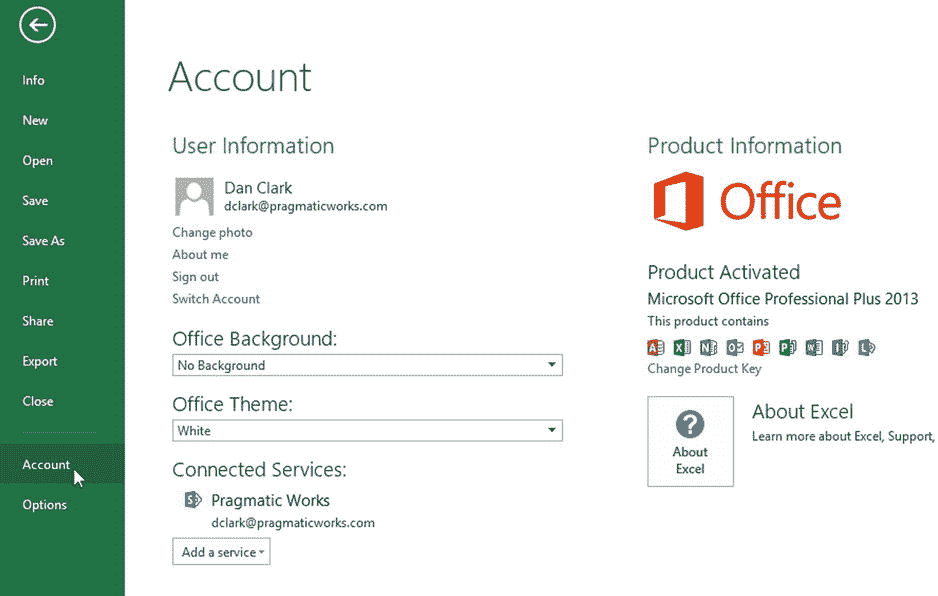

Figure 1-1. 检查 Excel 版本

在 Excel 的“账户”选项卡上，单击“关于 Excel”按钮。你将看到一个显示版本详细信息的屏幕，如图 1-2 所示。注意版本号和版本。它应该是专业增强版，并且最好是 64 位版本。32 位版本对于较小的数据集也能正常工作，但要获得`Power Pivot`的最佳性能和体验，你应该在配备约 8 GB RAM 的 64 位 Windows 系统上运行 64 位版本。

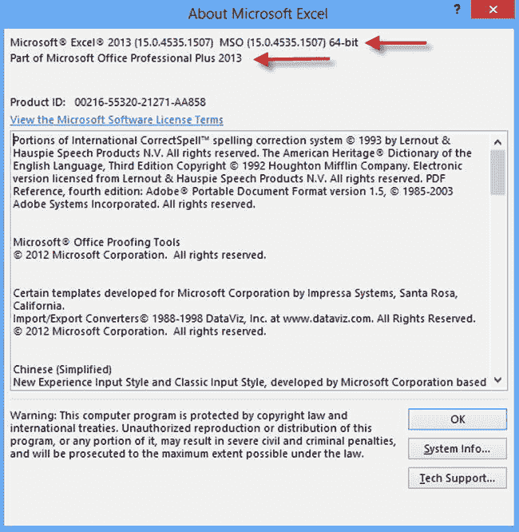

Figure 1-2. 检查 Excel 版本和版本号

一旦确定你使用的是正确的版本，你可以通过进入“文件”菜单并选择“选项”选项卡来启用`Power Pivot`插件。在“Excel 选项”窗口中，选择“加载项”选项卡。在“管理”下拉菜单中选择“COM 加载项”，然后单击“转到”按钮（见图 1-3）。

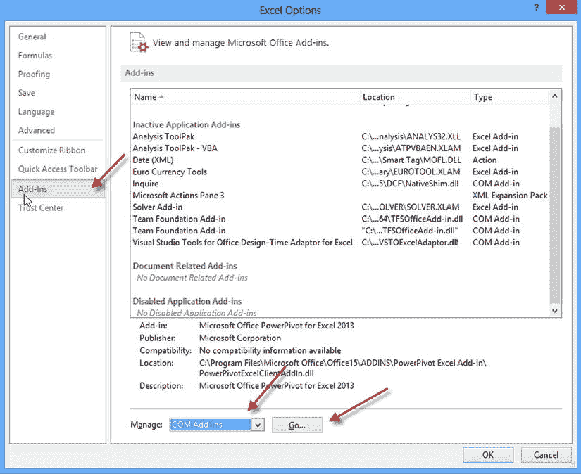

Figure 1-3. 管理 COM 加载项

你将看到“COM 加载项”窗口（见图 1-4）。选择 `Microsoft Office PowerPivot for Excel 2013`，然后单击“确定”。

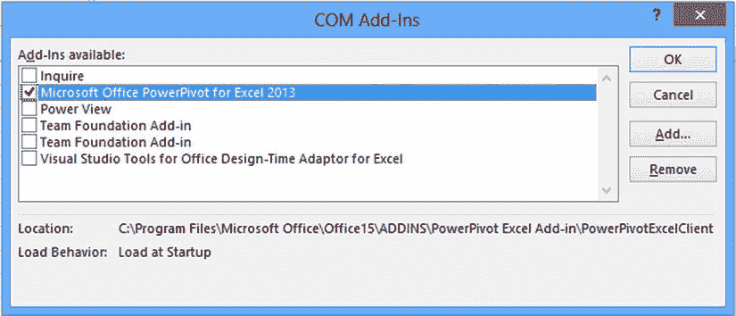

Figure 1-4. 选择 Power Pivot 插件

现在你已经为 Excel 启用了`Power Pivot`插件，是时候探索数据模型管理器了。

#### 探索数据模型管理器界面

一旦你启用了`Power Pivot`，你应该会在 Excel 中看到一个新的“Power Pivot”选项卡（见图 1-5）。如果你单击“管理”按钮，它将启动数据模型管理界面。

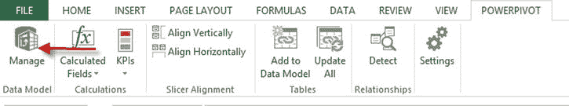

Figure 1-5. 启动数据模型管理器

当数据模型管理器启动时，你将拥有两个独立但相互连接的界面。你可以在正常的 Excel 界面和数据模型管理界面之间来回切换。这对于新的`Power Pivot`用户来说可能会感到困惑。请记住，数据模型管理器（图 1-6）是你定义模型的地方，包括表、表关系、度量值、计算列和层次结构。Excel 界面（图 1-7）是你使用数据透视表和数据透视图分析数据的地方。

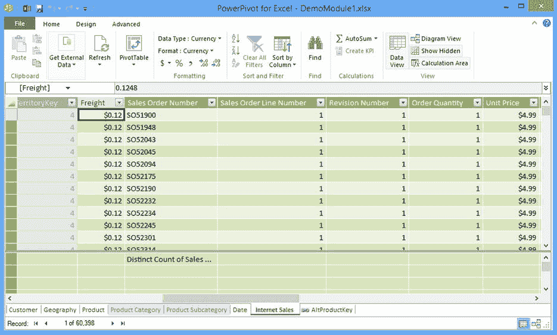

Figure 1-6. 数据模型管理器界面

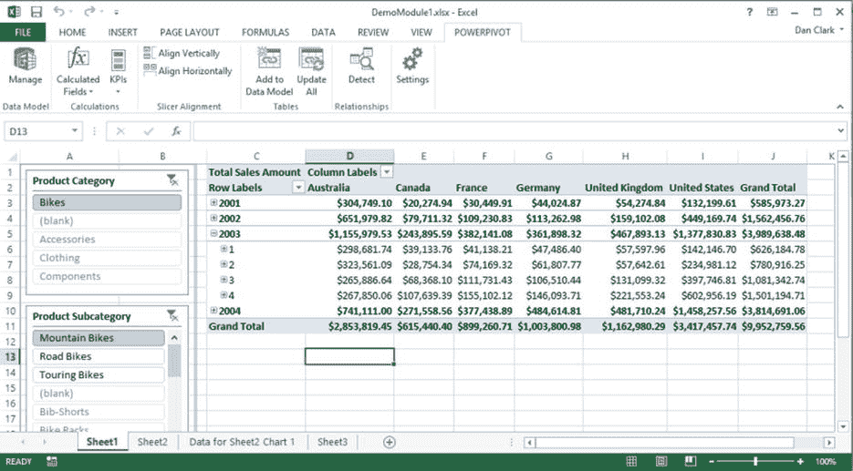

Figure 1-7. Excel 工作簿界面

在数据模型管理器中有两种数据模型视图：数据视图和关系图视图。首次打开时，它处于数据视图模式。在数据视图模式下，你可以看到模型中包含的数据。模型中的每个表在视图中都有自己的选项卡。表可以包含从数据源检索的数据列，也可以包含使用`DAX`计算的列。计算列看起来比其他列稍暗。 图 1-8 显示了“全名”列，该列是通过连接“名字”和“姓氏”列得到的。

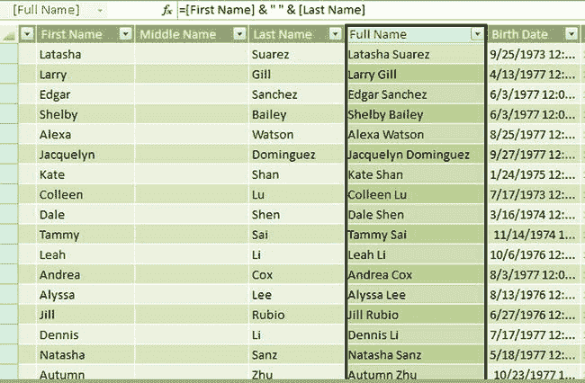

Figure 1-8. 数据模型管理器中的计算列

每个选项卡在列数据下方还包含一个网格区域。网格区域是你在模型中定义度量值的地方。度量值通常包含某种聚合函数。例如，你可能希望查看按月或按产品汇总的销售额。 图 1-9 显示了与“Internet 销售”表关联的一些度量值。

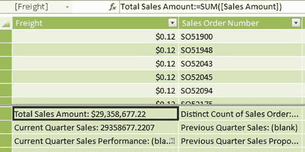

Figure 1-9. 数据模型管理器中的度量值网格区域


好的，作为一名高级文档工程师和翻译员，我将严格遵循您提供的注意事项和示例，将给定的英文文本翻译成中文。

译文如下：


在设计师的顶部有四个菜单选项卡：**File（文件）**、**Home（主页）**、**Design（设计）**和**Advanced（高级）**。如果你看不到 Advanced 选项卡，可以通过选择 File 菜单选项卡并选择**Switch To Advanced Mode（切换到高级模式）**来显示它。随着你学习本书的深入，你将逐渐熟悉设计师中的各个菜单。目前，只需知道这里是你执行各种操作的地方，例如连接数据源和创建数据查询、格式化数据、设置默认属性以及创建**KPI（关键绩效指标）**。图 1-10 展示了**Data Model Manager（数据模型管理器）**中的 Home 菜单。

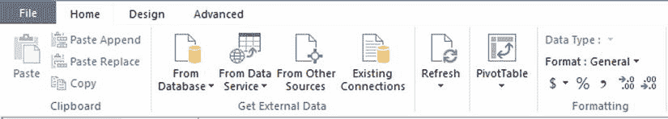

图 1-10。Data Model Manager 中的 Home 菜单选项卡

在 Home 菜单的右侧，你可以从数据视图模式切换到关系图视图模式。 图 1-11 所示的关系图视图展示了各个表以及表之间的关系。通常，你在这里建立表之间的关系并为钻取模型创建层次结构。数据视图和关系图视图中的菜单基本相同。但是，你会发现有些操作只能在数据视图中完成，而有些只能在关系图视图中完成。

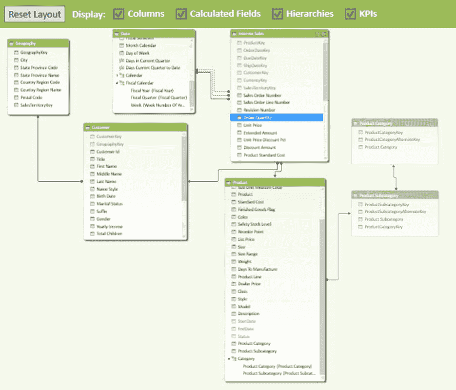

图 1-11。在 Data Model Manager 中使用关系图视图

现在你已经熟悉了 Data Model Manager 的各个部分，是时候亲自动手完成以下实践练习了。这个练习将帮助你熟悉在 Data Model Manager 中工作。

**动手实践——探索 POWER PIVOT**

在接下来的练习中，你将：

*   启用 Power Pivot 加载项。
*   使用数据透视表分析数据。
*   探索 Data Model Manager。

1.  打开 Excel 2013。
2.  在 File 菜单上选择**Account（账户）**（参见图 1-1）。
3.  点击**About Excel（关于 Excel）**，确保你使用的是 Professional Plus 版本，并检查版本（32 位或 64 位）。
4.  在 File 菜单上选择**Options（选项）**，然后选择**Add-Ins（加载项）**选项卡。在**Manage（管理）**下拉菜单中选择**Com Add-Ins（COM 加载项）**，然后点击**Go（转到）**按钮。
5.  在 Com Add-Ins 窗口中，勾选 Power Pivot 加载项（参见图 1-4）。
6.  安装完成后，打开位于`Lab Starters`文件夹中的`Chapter1Lab1.xlsx`文件。
7.  点击 Sheet1。你应该会看到一个基本的数据透视表，显示了按年份和国家划分的销售额，如图 1-12 所示。

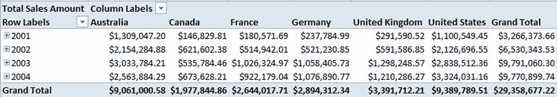

图 1-12。使用数据透视表

8.  点击数据透视表上的任意位置。你应该会在右侧看到字段列表，如图 1-13 所示。

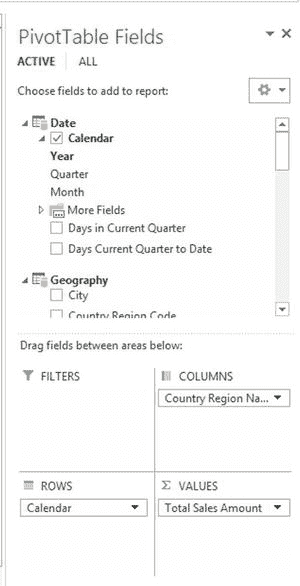

图 1-13。数据透视表字段列表

9.  字段列表下方是用于筛选器、行、列和值的放置区域。你可以将字段拖放到这些区域以创建数据透视表。
10. 点击**PivotTable Fields（数据透视表字段）**窗口顶部的**All（全部）**选项卡。展开字段列表中的**Product（产品）**表。找到**Product Category（产品类别）**字段并将其拖到**Report Filter（报表筛选）**放置区域。
11. 数据透视表上方会出现一个筛选下拉菜单。点击该下拉筛选图标。你应该会看到产品类别。
12. 将筛选器更改为**Bikes（自行车）**，并注意数据透视表中的值发生变化。
13. 当你从筛选器中选择多个项目时，很难看出筛选的是什么。筛选**Bikes**和**Clothing（服装）**。注意，当筛选下拉菜单关闭时，它只显示“**(Multiple Items)（多个项目）**”。
14. 切片器的作用类似于筛选器，但它们能提供直观的视觉效果，让你轻松确定选择了什么。在**Insert（插入）**菜单上点击**Slicer（切片器）**。在出现的弹出窗口中，选择**All**选项卡，然后在**Product**表下选择**Category（类别）**层次结构，如图 1-14 所示。

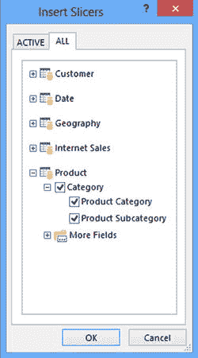

图 1-14。选择切片器字段

15. 插入一个**Product Category**和**Product Subcategory（产品子类别）**切片器，用于筛选数据透视表。要按某个值进行筛选，请点击该值按钮。要选择多个按钮，请在点击时按住 Ctrl 键（参见图 1-15）。请注意，由于这些字段是作为层次结构设置的，选择一个产品类别会自动将相关子类别筛选到 Product Subcategory 切片器中。

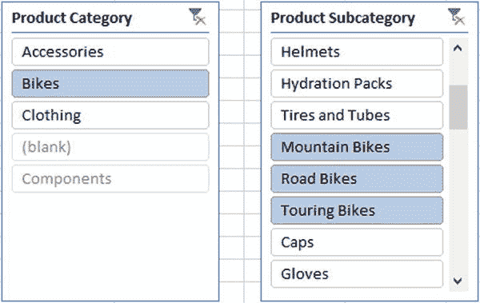

图 1-15。使用切片器筛选数据透视表

16. 层次结构是按级别排列的列组，使得导航数据更加容易。例如，如果你展开字段列表中的**Date（日期）**表，可以看到**Calendar（日历）**层次结构，如图 1-16 所示。该层次结构由**Year（年）**、**Quarter（季度）**和**Month（月）**字段组成，代表了一种钻取数据的自然方式。

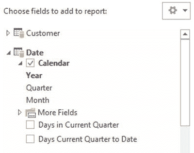

图 1-16。在数据透视表中使用层次结构

17. 如果你展开字段列表中的**Internet Sales（互联网销售）**表，会看到一个红绿灯图标。这个图标代表一个**KPI**。KPI 用于衡量某个值的表现。它们通常由一个视觉指示器来表示，以便快速判断表现。
18. 在**Power Pivot**菜单下，选择**Manage Data Model（管理数据模型）**按钮。
19. 在**Data Model Manager**中，选择底部的不同选项卡，在不同表之间切换。
20. 转到**Products**表中的**ProductAlternateKey**列。注意，它呈灰色。这意味着它对任何客户端工具都是隐藏的。你可以通过切换回 Sheet1 上的 Excel 数据透视表并验证字段列表中看不到该字段来确认这一点。
21. 在**Internet Sales**表中点击**Margin（利润）**列。注意，这是一个计算列。它也已格式化为货币格式。
22. 在**Internet Sales**表中的**Sales Amount（销售额）**列下方，注意有一个名为**Total Sales Amount（总销售额）**的度量值。点击该度量值，注意使用了 DAX `SUM`函数来计算该度量值。
23. 将**Data Model Manager**切换到关系图视图。观察表之间的关系。
24. 如果将鼠标指针悬停在关系线上，你可以看到该关系中涉及的字段，如图 1-17 所示。

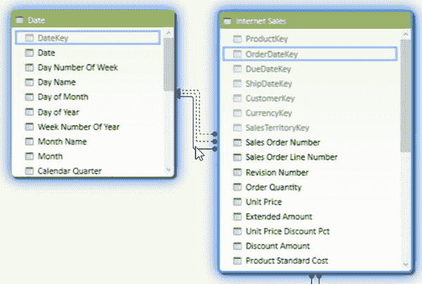

图 1-17。探索关系


25. 在关系图视图中单击 `Date` 表。请注意表格右上角的“创建层次结构”按钮（参见图 1-18）。这就是为表定义层次结构的方法。

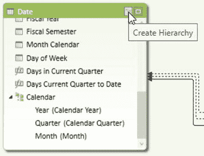

图 1-18. 创建层次结构

26. 花些时间探索模型和数据透视表。（尽管尝试，甚至可以破坏它！）完成后，关闭文件。

**本章小结**

本章介绍了 Excel 的 Power Pivot 加载项。你已初步了解为什么 Power Pivot 能够通过使用 xVelocity 引擎和列式数据存储来处理大量数据。你还接触并体验了 Power Pivot 数据模型管理器。目前不必担心如何开发模型各个部分的细节。随着你对本书的深入学习，这些内容将得到详细解释。下一章开始，你将学习如何从各种数据源将数据导入模型。

### 第 2 章


#### 将数据导入 Power Pivot

创建 Power Pivot 模型的首要步骤之一就是导入数据。传统上，在创建基于 OLAP 多维数据集的 BI 解决方案时，你需要先将数据导入数据仓库，再将其加载到多维数据集中。将数据整合到多维数据集并可供使用可能需要相当长的时间。而这是 Power Pivot 模型的最大优势之一。你可以轻松快速地将来自各种来源的数据合并到模型中。数据源可以来自关系数据库、文本文件、Web 服务和 OLAP 多维数据集，仅举几例。本章将向你展示如何将来自这些来源的数据整合到 Power Pivot 模型中。

完成本章学习后，你将能够：

-   从关系数据库导入数据。
-   从文本文件导入数据。
-   从数据馈送导入数据。
-   从 OLAP 多维数据集导入数据。
-   重用现有连接来更新模型。

#### 从关系数据库导入数据

你最常遇到的数据源类型之一是关系数据库。关系数据库管理系统（如 SQL Server、Oracle、DB2 和 Access）由表以及基于键的表之间的关系组成。例如，图 2-1 显示了一个采购订单明细表和一个产品表。它们通过 `ProductID` 列相关联。这是一种一对多关系的示例。在产品表中的每一行，采购订单明细表中都有多行与之对应。表中的键被称为主键和外键。每个表都需要一个主键，用于唯一标识表中的一行。例如，`ProductID` 是产品表中的主键。在采购订单明细表中，`ProductID` 被视为外键。外键指向相关表中的主键。请注意，主键可以由多个列组合而成；例如，采购订单明细表的主键是 `PurchaseOrderID` 和 `PurchaseOrderDetailID` 的组合。

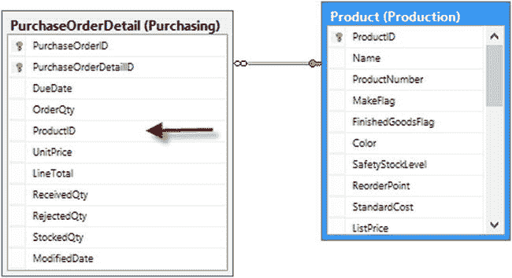

图 2-1. 一对多关系

尽管一对多关系最为常见，但你还会遇到另一种相当普遍的关系类型——多对多关系。图 2-2 显示了一个多对多关系的示例。一个人可能有多个不同类型的电话号码。例如，他们可能有两个传真号码。你不能直接关联这些表。相反，你需要使用一个包含这些表主键的联结表。联结表中键的组合必须是唯一的。

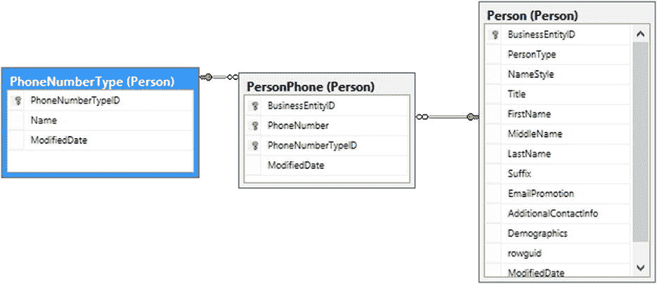

图 2-2. 多对多关系

请注意，联结表可以包含与关联相关的信息；例如，`PhoneNumber` 与客户和电话号码类型相关联。一个客户不能将同一个电话号码列为两种不同的类型。

从关系数据库获取数据的一个好处是，其模型与你在 Power Pivot 中创建的模型非常相似。事实上，如果在数据库中定义了关系，Power Pivot 导入向导可以检测到这些关系，并在模型中为你设置它们。

从关系数据库获取数据的第一步是创建连接。在模型设计器的**主页**选项卡上，有一个**获取外部数据**组（参见图 2-3）。


图 2-3. 设置连接

**从数据库**下拉列表允许你连接到 SQL Server、Access、Analysis Services 或另一个 Power Pivot 模型。如果你单击**从其他源**按钮，可以查看所有可连接的各种数据源（参见图 2-4）。如你所见，你可以连接到相当多的关系数据库。如果所需连接的数据源未列出，你可以从数据库提供商处安装驱动程序来连接它。很有可能，你也可以使用通用的 ODBC（开放数据库连接）驱动程序来连接它。

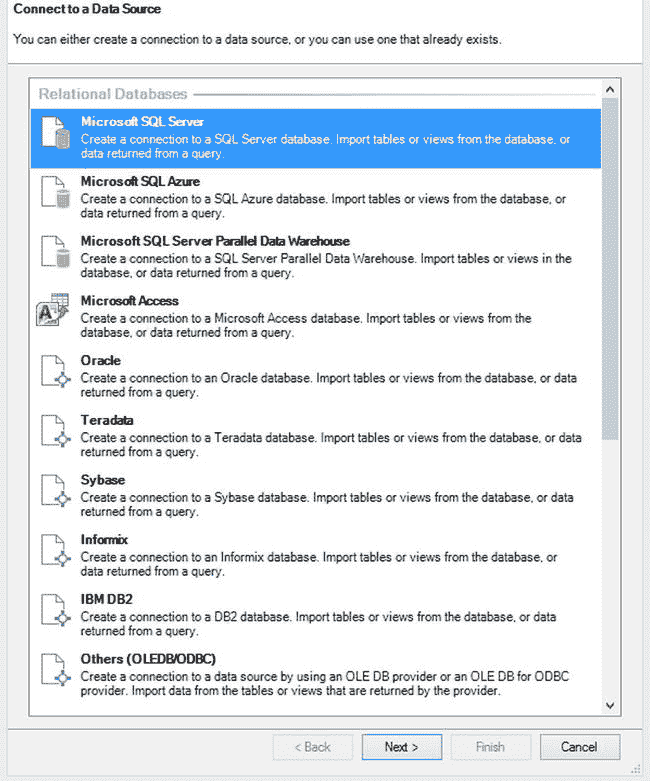

图 2-4. 选择数据源

选择数据源后，系统会弹出一个窗口，供你输入连接信息。连接信息取决于你要连接的数据源。对于大多数关系数据库，所需的信息非常相似。图 2-5 显示了连接到 SQL Server 的连接信息。记得单击**测试连接**按钮，以确保所有信息输入正确。

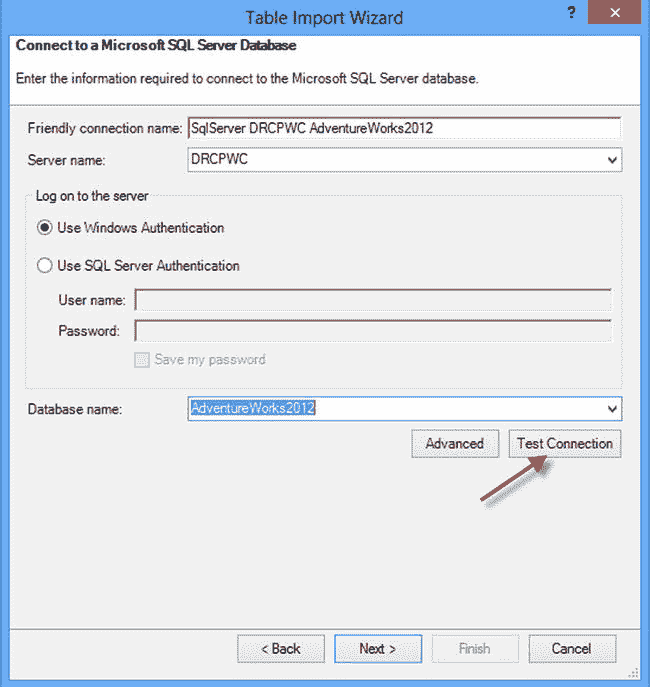

图 2-5. 设置数据库连接

设置好连接后，下一步是查询数据库以检索数据。此时你有两个选择：可以从表和视图列表中选择导入数据，也可以编写查询来导入数据（参见图 2-6）。即使你选择从表或视图导入数据，系统也会在后台创建查询并将其发送到数据库以检索数据。

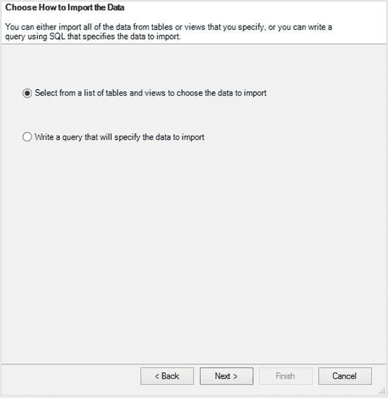

图 2-6. 选择检索数据的方式

如果你选择从表和视图列表中获取数据，则下一个屏幕会显示该列表。从你的角度来看，视图和表看起来是一样的。实际上，视图是数据库中存储的查询，它向你屏蔽了查询的复杂性。视图通常用于展示比实际物理模型更简单的数据库概念模型。例如，你可能需要客户的地址。图 2-7 显示了获取该信息所需包含在查询中的表。无需编写复杂的查询来检索信息，你可以从一个将信息组合成虚拟的 `Customer Address` 表的视图中进行选择。视图的另一个常见用途是保护基础表中的列。通过使用视图，数据库管理员可以向不同用户隐藏某些列。

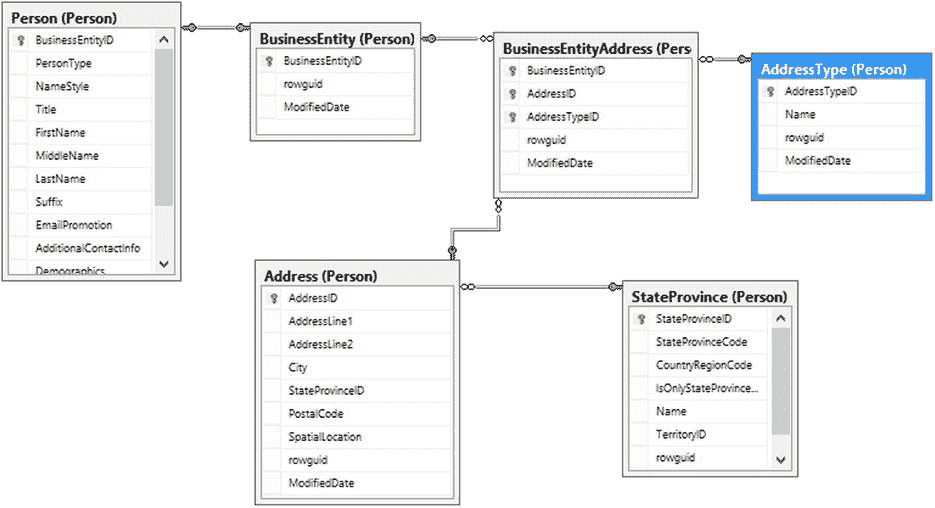

图 2-7. 获取客户地址所需的表

好的，作为一名高级文档工程师和翻译员，我将严格遵循您给出的注意事项和示例，对提供的英文文本进行翻译。


选择一个表并点击**预览并筛选**按钮（见图 2-8），您可以预览表中的数据并筛选选定的数据。

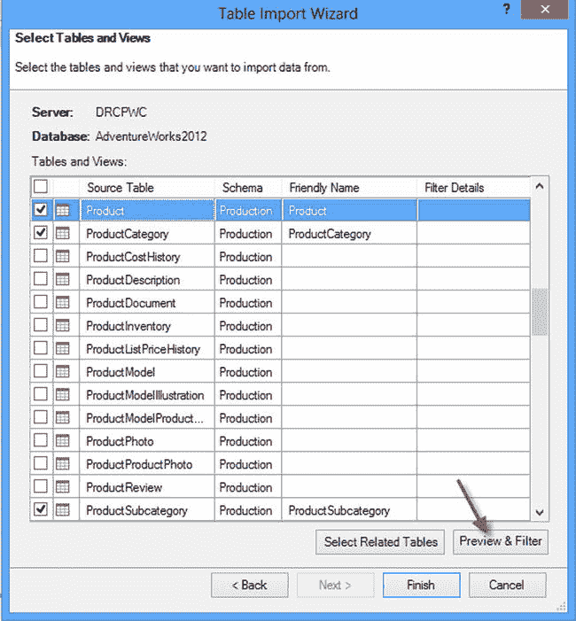

图 2-8. 选择表和视图

在图 2-9 中，您可以看到预览和筛选界面。

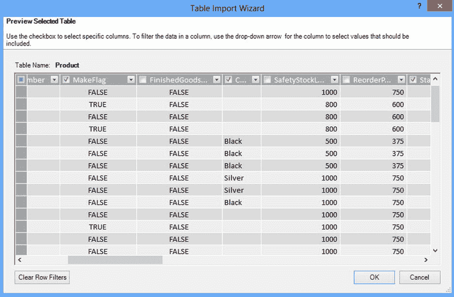

图 2-9. 预览和筛选数据

筛选表的一种方法是仅选择您感兴趣的列。另一种方法是通过在列上放置筛选条件来限制行数。例如，您可能只需要某一年之后的销售数据。单击列旁边的下拉菜单，您可以输入一个筛选条件来限制行。图 2-10 展示了按订单日期筛选 `SalesOrderHeader` 表的情景。

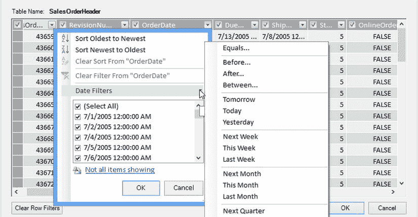

图 2-10. 筛选行

在处理大型数据集时，出于性能考虑，一个好的做法是只导入您感兴趣的数据。如果您只对少数几列感兴趣，那么导入表的所有列会产生大量开销。同样，如果您只关心过去三年的销售额，就不要导入整整 20 年的销售数据。如果后续发现需要更多数据，您随时可以返回并更新数据导入。

筛选完数据后，在**选择表和视图**屏幕上点击**完成**（见图 2-8）。此时，数据将被导入模型，您会看到一个显示进度的界面（见图 2-11）。如果没有错误，您可以关闭**表导入向导**。

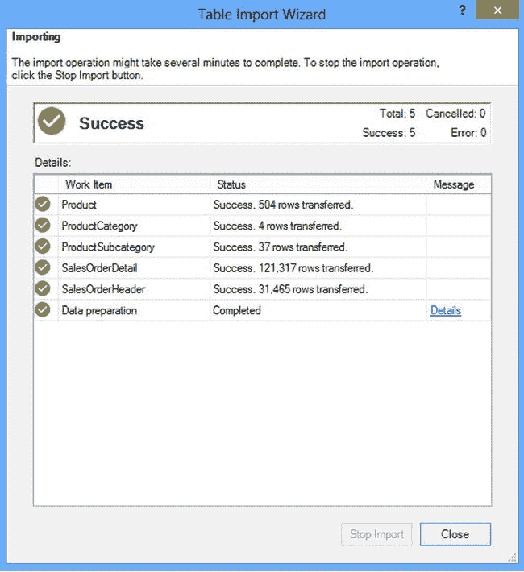

图 2-11. 将数据导入模型

当向导关闭后，您将在**模型设计器**的数据视图中看到这些数据。

 **注意**  请记住，Power Pivot 仅在检索数据时连接到数据源。检索完成后，连接即关闭，数据成为模型的一部分。

如果您切换到**模型设计器**的关系图视图，您将看到这些表；如果表关系已在数据库中定义，您还将看到表之间的关系。在图 2-12 中，您可以看到产品表之间定义了关系，销售表之间也定义了关系，但在 `SalesOrderDetail` 表和 `Product` 表之间没有定义关系。即使数据源中没有定义，您也可以在模型中创建关系（稍后会详细介绍）。

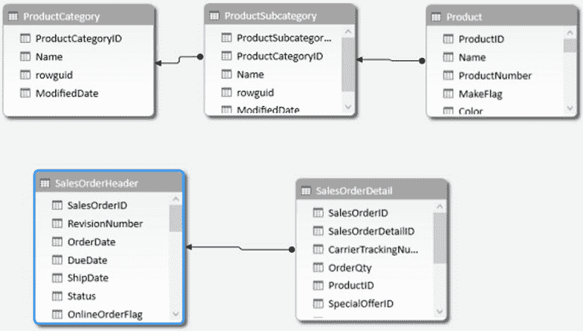

图 2-12. 数据源中定义的表关系

虽然从表和视图中选择数据是一种无需显式编写查询即可将数据导入模型的简便方法，但这并非总是可行。有时您可能需要编写自己的查询；例如，您可能想要合并来自多个不同表的数据，但又没有可用的视图。另一个影响因素是数据源支持什么。某些数据源不允许使用视图，可能需要您提供查询来提取数据。在这些情况下，当您进入询问如何检索数据的界面时，请选择查询选项（图 2-6）。

选择查询选项后，您将看到一个可以编写查询的界面（见图 2-13）。虽然您可能不会从头开始编写查询，但您可以在这里粘贴他人为您编写的查询，或者您在 Microsoft Management Studio 或 TOAD 等其他工具中创建的查询。别忘了为查询命名。它将作为模型中的一个表，并以该查询的名称命名。

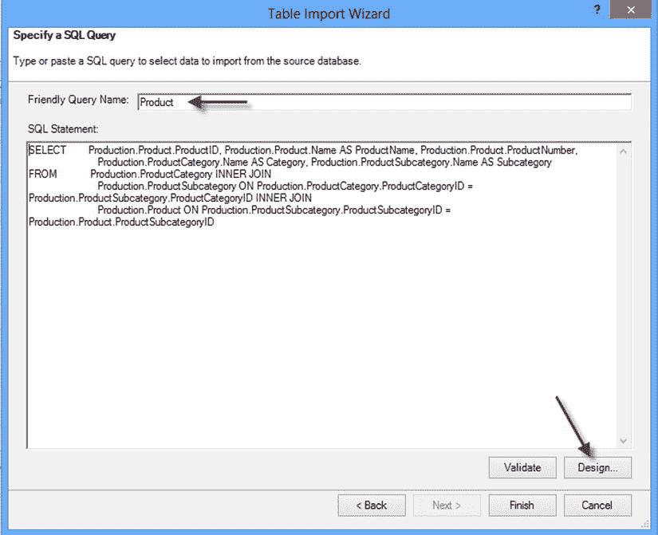

图 2-13. 创建您自己的查询

如果数据源支持，您可以点击查询输入窗口右下角，启动一个非常不错的查询设计器（见图 2-13）。此设计器（见图 2-14）允许您从各种表和视图中选择所需的列。如果数据库定义了表关系，它将自动添加表连接。您还可以应用筛选条件、对数据进行分组和聚合。查询设计器中一个令人困惑的方面是参数复选框。

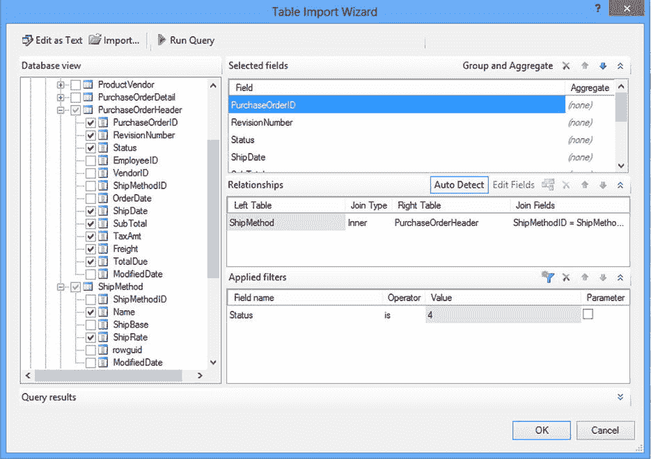

图 2-14. 使用查询设计器

 **注意**  Power Pivot 模型不支持参数，选中该复选框会导致您在尝试关闭查询设计器时收到错误消息。

完成查询设计后，您应该始终运行它以确保其按预期工作（见图 2-15）。

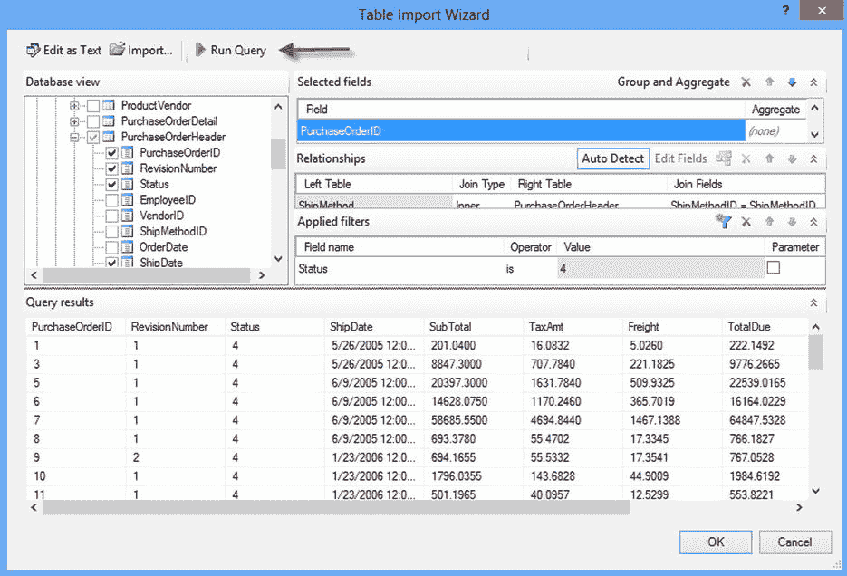

图 2-15. 运行查询并查看结果

对查询满意后，选择**确定**按钮将返回到之前的界面，其中已填入查询文本。您可以在此界面中修改查询，并使用**验证**按钮确保查询仍然有效（见图 2-16）。点击**完成**会将数据和表导入模型。

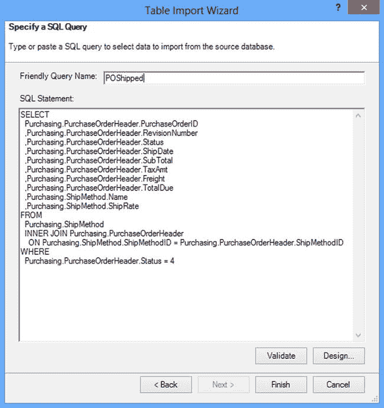

图 2-16. 查看和验证查询

现在您已经知道如何从数据库导入数据，接下来让我们看看如何从文本文件向模型添加数据。

#### 从文本文件导入数据

很多时候，您需要合并来自多个不同来源的数据。最常见的数据来源之一仍然是文本文件。这可能是从另一个系统接收数据作为输出的结果；例如，您可能需要来自公司 ERP（企业资源规划）系统的信息，这些信息以文本文件形式提供。您也可能通过第三方服务获取数据，这些数据以 CSV（逗号分隔值）格式提供。例如，您可能使用评级服务来对客户进行评级，结果可以以 CSV 文件形式返回。

从文本文件将数据导入模型与从关系数据库表导入数据类似。首先，在**主页**菜单上选择从其他源获取外部数据的选项，这将会调出连接到数据源的选项。向下滚动到窗口底部，您可以选择从 Excel 文件或文本文件导入数据（见图 2-17）。

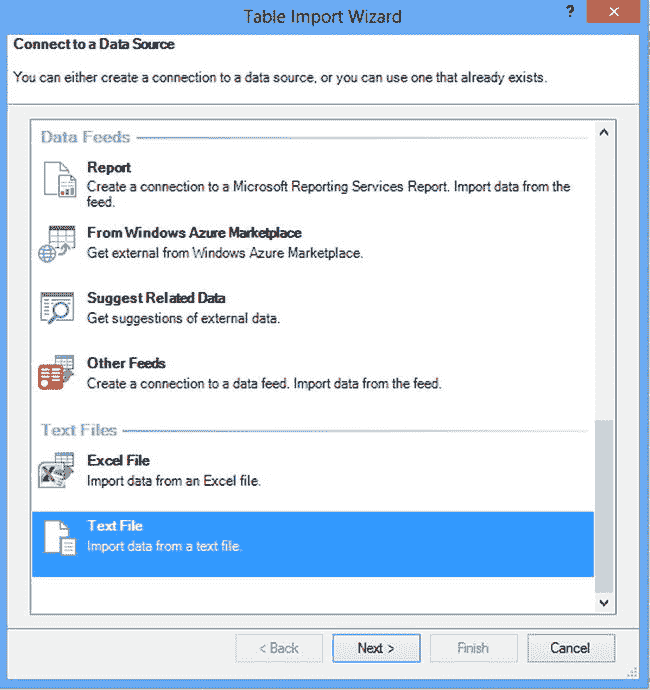

图 2-17. 连接到文本文件

选择文本文件将弹出一个界面，您可以在其中输入文件路径和文件分隔符。每个文本文件被视为一个表，友好的连接名称将是模型中该表的名称。提供连接信息后，数据将被加载以供预览和筛选（见图 2-18）。

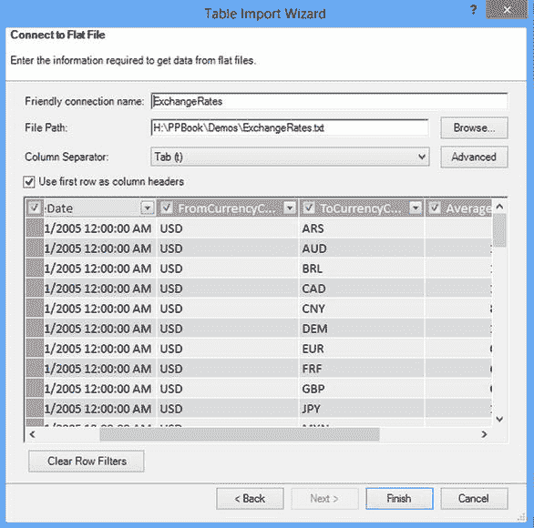


#### 预览和筛选数据

图 2-18 预览数据

选择列标题旁的下拉菜单，可以根据筛选条件限制导入的行数（参见图 2-19）。

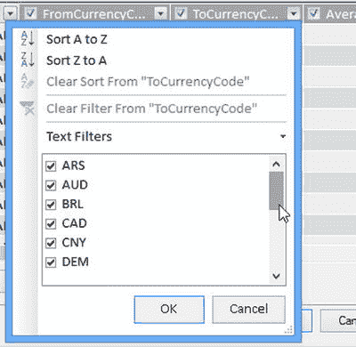

图 2-19 筛选导入模型的行

从文本文件导入数据与从 Excel 文件导入数据的主要区别在于，Excel 文件可能包含多个表格。默认情况下，每个工作表都会被视作一个表格（参见图 2-20）。选中表格后，您可以像处理文本文件一样预览和筛选数据。

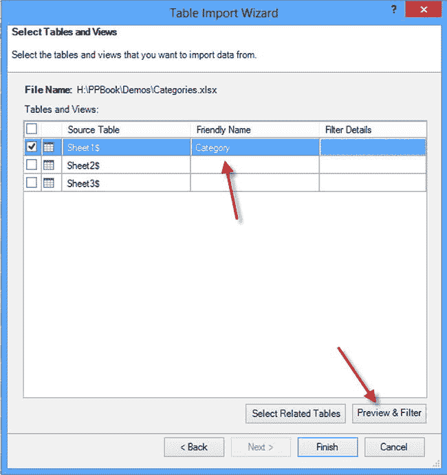

图 2-20 在 Excel 文件中选择表格

除了从文本文件导入数据，您可能还需要通过从数据源导入数据来补充数据模型。这正成为一种与业务伙伴交换数据的常见方式，接下来您将了解具体操作方法。

#### 从数据源导入数据

尽管文本文件是最流行的数据交换方式之一，但数据源正逐渐成为一种越来越普遍的数据交换方式。数据源通过 Web 服务提供数据，要连接到该 Web 服务，需要输入其网址。在图 2-17 中，您可以看到可供使用的数据源连接。通常情况下，您会知道合作伙伴或数据提供商提供的数据服务地址。在这种情况下，您可以选择“其他数据源”，系统会弹出一个连接信息输入窗口，如图 2-21 所示。

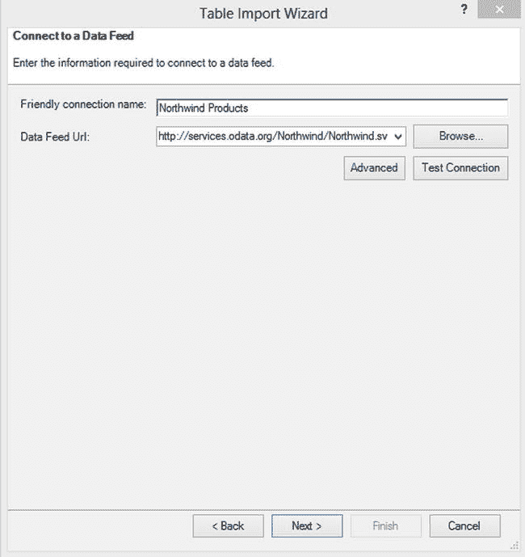

图 2-21 连接到数据源

由于数据源不仅包含数据，还包含元数据（数据的描述），因此一旦建立连接，Power Pivot 就会提供预览和筛选数据的功能，如图 2-22 所示。

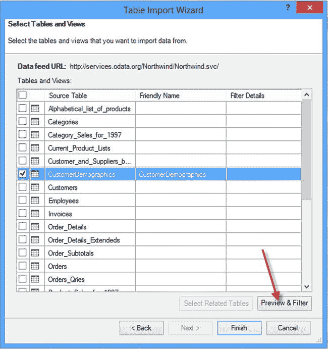

图 2-22 预览和筛选来自数据源的数据

您可以使用的几种有趣的数据源包括来自 Reporting Services 报表和 SharePoint 列表的数据。这些应用程序可以轻松地将其数据作为数据源供您使用。此外，许多数据库供应商（如 SAP）也支持将其数据作为数据源公开。

#### 从 OLAP 多维数据集导入数据

许多公司投入了大量资金和精力来构建企业级报表解决方案，其中包括一个企业级 OLAP 存储库，为各种仪表板和计分卡提供数据。使用 Power Pivot，您可以轻松集成来自这些存储库的数据。在连接窗口的连接选项（图 2-17）中，选择“多维服务”下的“Microsoft SQL Server Analysis Services”连接。这将启动连接信息窗口，如图 2-23 所示。您可以连接到多维数据集，也可以连接到发布到 SharePoint 的 Power Pivot 模型。要连接到多维数据集，请输入服务器名称和数据库名称。要连接到 Power Pivot 模型，请输入 Excel 工作簿（在 SharePoint 库中）的 URL 和模型名称。

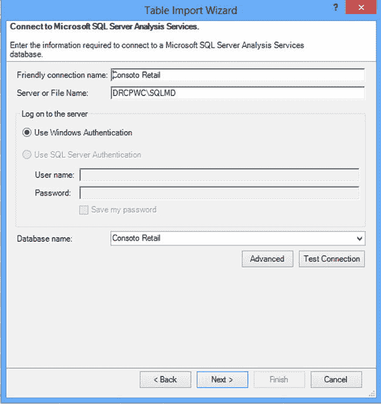

图 2-23 连接到 Analysis Services 多维数据集

连接到多维数据集后，您可以输入 MDX 查询来检索数据（参见图 2-24）。请记得验证查询以确保其能够成功运行。

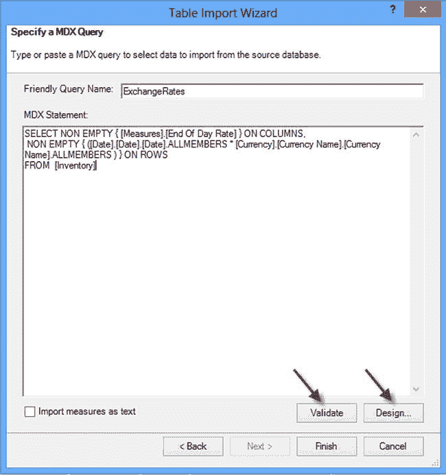

图 2-24 输入 MDX 查询

如果您不熟悉 MDX，可以使用可视化设计器来创建查询，如图 2-25 所示。设计器的一大特色是能够预览结果。

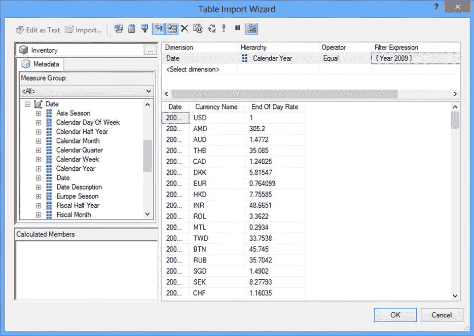

图 2-25 设计 MDX 查询

完成查询设计后，它会进入图 2-24 所示的 MDX 语句框，在那里您可以完成数据导入。

#### 重用现有连接以更新模型

在两种情况下您可能需要重用与数据源的现有连接。您可能需要从数据源检索更多数据；例如，您需要从其他表或视图中获取数据，或提交新的查询。此时，应选择“开始”选项卡上的“现有连接”按钮（参见图 2-26）。

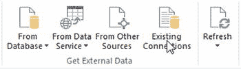

图 2-26 选择现有连接

在“现有连接”窗口中，选择连接并单击“打开”按钮（参见图 2-27）。这将启动之前介绍过的若干屏幕（具体取决于连接类型），在这些屏幕中您可以逐步选择要导入的数据。

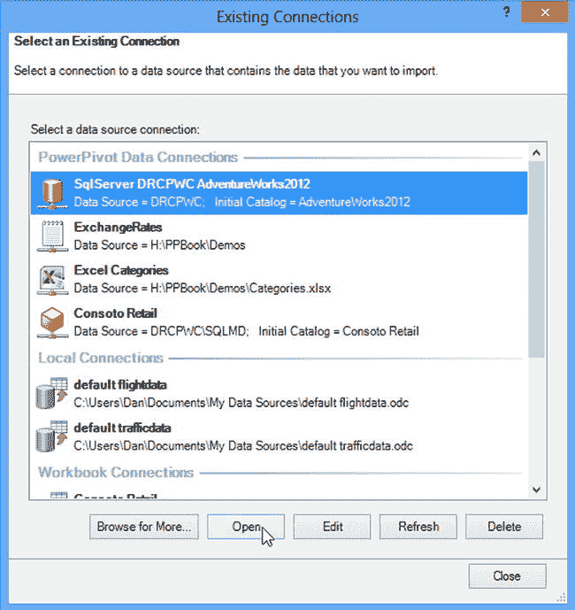

图 2-27 打开现有连接

另一种情况是，您想要更改模型中现有表的筛选条件或添加一些列。在这种情况下，您需要在设计器的“数据视图”模式下选择该表，然后在“设计”选项卡上选择“表属性”（参见图 2-28）。


图 2-28 选择表属性

“编辑表属性”窗口允许您更新用于填充该表数据的查询。您可以在“表预览”模式（图 2-29）或“查询”模式（图 2-30）下更新表。在“查询编辑器”模式下，您还可以启动查询设计器来更新查询。

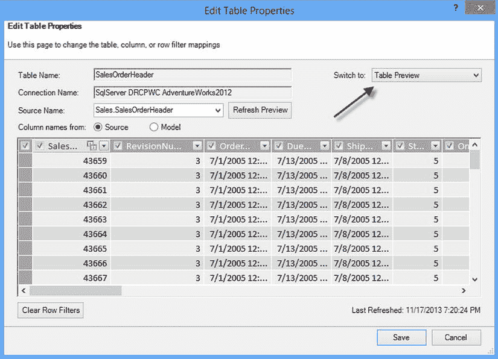

图 2-29 在“表预览”模式中更新查询

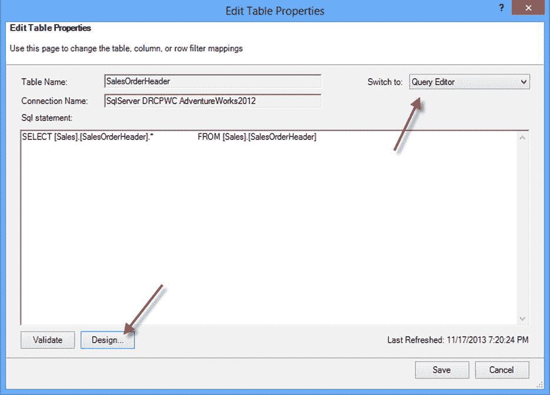

图 2-30 在“查询编辑器”模式中更新查询

现在您已经了解了如何将数据从各种数据源导入到 Power Pivot 数据模型，是时候动手实践一下数据导入了。

#### 动手实验——将数据加载到 Power Pivot

在以下实验中，您将：

*   从 Access 数据库导入数据。
*   从文本文件导入数据。

1.  打开 Excel 2013 并创建一个名为 `LabChapter2.xlsx` 的新文件。
2.  在 Power Pivot 选项卡上，单击“管理数据模型”按钮（参见图 2-31）。这将启动 Power Pivot 模型设计器窗口。

    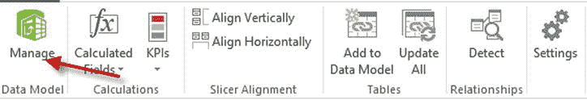

    图 2-31 打开模型设计器窗口

3.  在“开始”选项卡的“获取外部数据”组中，单击“从数据库”下拉菜单（参见图 2-32）。在下拉菜单中选择“从 Access 导入”。这将启动“表导入向导”。

    

    图 2-32 启动表导入向导


好的，作为高级文档工程师和翻译员，我将遵循注意事项和示例，将您提供的英文文本翻译成中文。

---


4.  浏览 Lab Starters 文件夹中的 `Northwind.acdb` 数据库文件并测试连接。使用友好的连接名称 `Access Northwind`。此数据库不需要用户名和密码（参见图 2-33）。单击“测试连接”进入下一个窗口。

   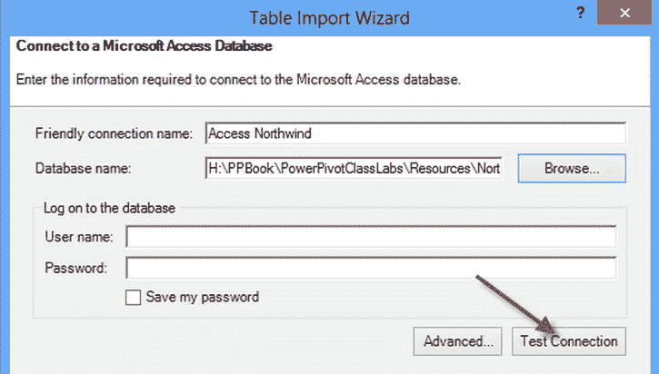

   图 2-33. 连接到 Access 数据库

5.  导入数据有两个选项：可以从表列表和视图中选择，也可以编写查询来选择数据。这里选择“从表列表和视图中选择”。
6.  在“选择表和视图”窗口中，选择 `Customers` 并单击该行以高亮显示。在窗口底部，选择“预览和筛选”按钮来预览和筛选数据（参见图 2-34）。

   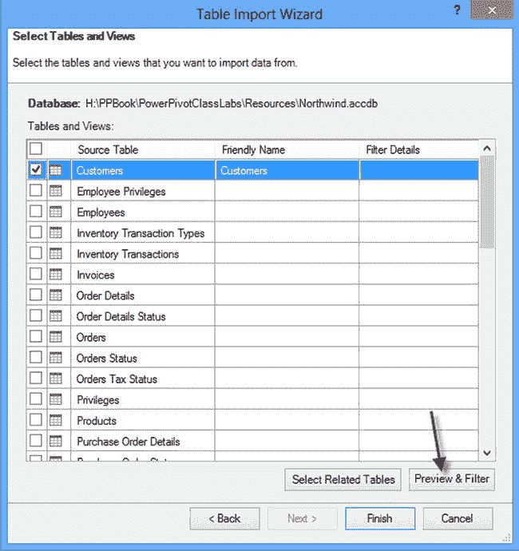

   图 2-34. 选择要导入的表

7.  在 `Customers` 表中，选择以下字段：`ID`、`Company`、`Last Name`、`First Name`、`City`、`State/Province` 和 `Country/Region`。取消选中其余字段（参见图 2-35）。选中左上角的复选框将选择或取消选择所有列。

   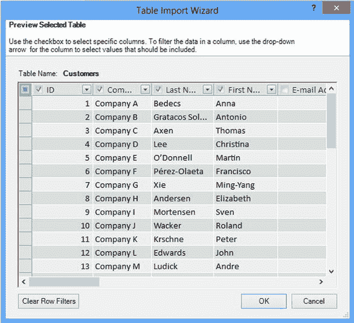

   图 2-35. 筛选表列

8.  从 `Employees` 表中选择以下字段：`ID`、`Last Name`、`First Name` 和 `Job Title`。
9.  从 `Orders` 表中选择以下字段：`Order ID`、`Employee ID`、`Customer ID`、`Order Date`、`Shipped Date`、`Shipper ID`、`Payment Type` 和 `Paid Date`。在 `Status ID` 列上，单击下拉菜单以筛选数据。取消勾选状态 `0` 和状态 `2`。状态 `3` 表示“已关闭”状态（参见图 2-36）。

   

   图 2-36. 筛选表行

10. 选择完表后，单击“完成”按钮导入数据。导入后，关闭向导。您应该会在“数据视图”窗口中看到每个表都作为一个选项卡显示（参见图 2-37）。

   

   图 2-37. 数据视图窗口中的表

11. 接下来，您将使用查询来选择订单详细信息。在 Power Pivot 模型设计器中，选择“开始”选项卡。在“开始”选项卡中，选择“现有连接”按钮。在连接窗口中，选择 `Access Northwind` 连接，然后单击“打开”。
12. 这次，选择“编写查询以指定要导入的数据”。
13. 在“指定查询”窗口中，将查询命名为 `OrderDetails`，然后选择“设计”按钮以启动查询设计器。（您也可以不使用设计器直接编写查询。）在查询设计器中，选择“导入”，然后选择 Lab Starters 文件夹中的 `OrderDetailQuery.txt`。通过单击红色感叹号（`!`）标记来测试查询（参见图 2-38）。测试查询后，单击“确定”按钮。

   

   图 2-38. 使用查询获取数据

14. 在“表导入向导”中，单击“完成”按钮导入数据。导入后，关闭向导。您应该会看到已添加了一个 `OrderDetail` 表选项卡。
15. 最后一个要导入的表包含在一个制表符分隔的文本文件中。在“开始”选项卡的“获取外部数据”部分，单击“其他来源”按钮。在数据源列表中，选择“文本文件”，然后单击“下一步”。
16. 在连接信息中，将连接名称更改为 `Product`。在“文件路径”中，浏览到 Lab Starters 文件夹中的 `ProductList.txt` 文件。选择制表位列分隔符，并勾选“将第一行用作列标题”复选框。单击“完成”按钮导入数据（参见图 2-39）。

   

   图 2-39. 从文本文件导入数据

17. 导入后，关闭向导，您应该会看到已添加了一个 `Product` 表选项卡。
18. 完成后，保存文件并关闭 Excel。

#### 总结

创建 Power Pivot 模型的第一步是导入数据。在本章中，您学习了如何从各种数据源导入数据。Power Pivot 中导入数据的一个优点是，从不同数据源导入数据的体验是相似的。您需要创建连接、提供查询或选择表、预览和筛选数据，然后将其导入模型。现在您已将数据导入模型中的各个表，接下来需要在这些表之间建立关系。在下一章中，您将学习建立关系的重要性，以及如何使用层次结构来增强模型以辅助数据分析。

### 第 3 章


#### 创建数据模型

既然您已经知道如何将数据导入 Power Pivot 模型，下一步就是理解什么是一个好的模型。这在处理 Power Pivot 中的数据时非常重要。一个好的模型将使 Power Pivot 运行得异常快速，并允许您以新颖且有趣的方式分析数据。而一个糟糕的模型会导致 Power Pivot 运行非常缓慢，最糟糕的是，在执行数据分析时可能会给出误导性的结果。传统的 Excel 数据透视表基于 Excel 工作表中的单个表。而 Power Pivot 数据透视表则基于数据模型中的多个表。本章将指导您创建稳健模型的过程，该模型将成为数据分析的基础。此外，您还将了解如何向客户端工具呈现一个用户友好的模型。这包括重命名表和字段、呈现适当的数据类型以及隐藏无关的字段。

完成本章后，您将能够：

*   解释什么是数据模型
*   在模型中的表之间创建关系
*   创建并使用星型架构
*   理解何时以及如何对数据进行反规范化
*   创建并使用链接表
*   创建并使用层次结构
*   创建用户友好的模型

#### 什么是数据模型？

从根本上说，数据模型由表、列、数据类型和表关系组成。通常，数据表被构造为保存某个业务实体的数据；例如，客户数据包含在客户表中，员工数据包含在员工表中。表由定义实体属性的列组成。例如，您可能希望保存有关客户的信息，例如姓名、地址、出生日期、家庭规模等。每个属性都有一个数据类型，具体取决于该属性保存的信息类型——姓名是字符串数据类型，家庭规模是整数，出生日期是日期。表中的每一行都应该是唯一的。以客户表为例，如果同一个客户出现在多个行中并具有不同的属性（例如出生日期），您将无法判断哪个是正确的。


#### 示例 1：使用时间戳跟踪变化

在前面的示例中，您会知道其中一行是错误的，因为同一个人不可能有两个不同的生日。然而，很多时候您希望跟踪实体属性值的变化。例如，产品的标价可能会随时间变化。为了跟踪这种变化，您需要添加一个时间戳使该行唯一。这样，每行都可以通过产品编号和时间戳来标识，如图 3-1 所示。


图 3-1. 使用时间戳跟踪变化

一旦确定了模型中的表，重要的是您要认识到这些表是否设置得当以高效执行。这个过程称为*规范化*模型。规范化是组织数据以使数据查询更简单、更高效的过程。例如，您不应将不相关实体的属性混合在同一张表中——您不会希望将产品数据和员工数据放在同一张表中。正确的规范化的另一个例子是不要在一个列中保存多个属性。例如，与其使用一个客户地址列，不如将其拆分为街道、城市、州和邮政编码。这样，您就可以轻松地按州或城市分析数据。如图 3-2 所示的电子表格是一个典型的未规范化的表。如果您发现提供给您的数据规范化不足，您可能需要要求数据提供方将数据拆分为多个表，然后在您的模型中关联起来。


图 3-2. 一个未规范化的表

当您对模型中表的规范化程度满意后，下一步是确定表之间的关系。例如，您需要关联客户表、销售表和产品表，以便按年龄段分析各产品的销售情况。您通过使用*键*来关联不同的表。表中的每一行需要一个列或列的组合来唯一标识该行。这称为*主键*。该键可能很容易识别，例如在数据录入时由业务分配的销售订单号或客户号。有时您需要对表进行一些分析以找到主键，尤其是当您从外部来源获取数据时。例如，您可能获得包含潜在客户的数据。字段包括姓名、城市、州、邮政编码、出生日期等。您不能仅仅使用姓名作为键，因为很可能有多个同名的客户。如果您使用姓名和城市的组合，那么使用相同键标识多个客户的可能性就会降低。随着您使用更多列，例如邮政编码和出生日期，出现重复的概率会更低。

当您在模型中关联表时，一个表的主键会成为关联表中的外键。例如，要将客户与其销售记录关联起来，客户键需要包含在销售表中，在那里它被视为外键。在提取数据时，使用键来获取相关数据。出于性能考虑，到目前为止最好的键类型是单列整数。因此，许多数据库表都设计有代理键。这个键是在加载记录时分配给该记录的整数。它不是使用自然键，而是使用代理键来连接表。图 3-3 显示了一个典型的数据库表，其中同时包含代理键（`CustomerKey`）和自然键（`CustomerAlternateKey`）。


图 3-3. 包含代理键和自然键的表

重要的是您要了解数据源中使用的键。如果您能从源中检索出键，那会好得多。当您从关系型数据库中检索数据时，这通常不是问题，但如果您要合并来自不同系统的数据，请确保您有适当的键。

一旦确定了表之间的键，您就可以在 Power Pivot 模型中创建关系了。

#### 创建表关系

在 Power Pivot 模型中建立表关系时，需要记住一些规则。首先，您不能在模型中使用复合键。如果您的表使用复合键，您需要将复合列拼接在一起创建一个新列，并将该列用作键。其次，两个表之间只能有一个活动关系路径，但可以有多个非活动关系。第三，关系是一对多的；换句话说，在客户表（一端）和销售表（多端）之间创建关系是可以的。然而，不允许直接在客户表和产品表之间创建关系，因为一个客户可以购买多种产品，而同一产品可以被多个客户购买。在这些情况下，您需要创建一个连接表来连接这些表。

要在 Power Pivot 模型中创建两个表之间的关系，请打开数据模型管理器并切换到关系图视图。右键单击代表关系多端的表，然后选择**创建关系**。这将启动**创建关系**窗口。选择相关的查找表（一端）和键列。图 3-4 展示了在销售表和商店表之间创建关系的过程。默认情况下，在表之间创建的第一个关系被标记为活动关系。


图 3-4. 创建表关系

图 3-5 展示了关系图视图中生成的关系。如果单击关系箭头，关系的两个键列会被高亮显示。


图 3-5. 在关系图视图中查看关系

您可以在两个表之间创建多个关系，但请记住，只有一个可以是活动关系。如果您尝试创建两个活动关系，将会收到类似图 3-6 所示的错误。


图 3-6. 试图在两个表之间创建第二个活动关系

有时活动关系并不那么明显。图 3-7 展示了销售表和日期表之间的一个活动关系，以及销售表和商店表之间的另一个活动关系。商店表和日期表之间还有一条非活动关系。如果您尝试将此关系设置为活动，您将收到与图 3-6 相同的错误消息。这是因为您可以从日期表追踪到销售表，再到商店表的一条活动路径。


图 3-7. 一个间接的活动关系

您可能遇到的另一个常见错误是，当您尝试在两个表之间创建关系时，键在至少一个表中不是唯一的。图 3-8 展示了一个产品表和一个销售表，两者都包含重复的`ProductNumber`。


图 3-8. `Product` 和 `Sales` 表

当你尝试在这两个表之间创建关系时，会出现图 3-9 所示的错误。


图 3-9. 出现重复值错误

在这个示例中，`ProductNumber` 在 `Product` 表中本应是唯一的，但结果却存在重复值。为了解决这个问题，你需要修改 `Product` 表数据的查询，以确保不会获取到重复数据。

现在你已经了解了如何在模型中创建表关系，接下来可以看看使用星型架构的好处了。

#### 创建星型架构

在创建数据模型时，理解模型的用途非常重要。数据库的两大主要用途是捕获数据和报告/分析数据。问题在于，当你为高效的数据捕获创建模型时，会降低其分析数据的效率。为了解决这个问题，许多公司将其数据捕获数据库与报告/分析数据库分离开来。幸运的是，在 `Power Pivot` 中创建数据模型时，我们只需针对报告进行优化即可。

分析大量数据集时最佳模型之一是*星型架构*。星型架构由一个中心事实表和环绕其周围的维度表组成，如图 3-10 所示。


图 3-10. 典型的星型架构

事实表包含与业务或流程相关的量化数据。例如，图 3-10 中的 `Sales` 表包含了销售的可度量方面，例如总成本、销售额和数量。事实表通常包含许多行，并具有日期或时间组件，用于记录事件发生的时间点。维度表包含事件的属性。例如，`Date` 表可以告诉你销售发生的时间，并允许你将数据汇总到月、季度或年级别。`Product` 表包含所售产品的属性，你可以按产品线、颜色和品牌查看销售情况。`Store` 表包含与销售相关的商店属性。维度表通常没有事实表那么多行，但可能包含相当多的列。当你提出类似“哪些自行车在不同年龄段中销量最好？”这样的问题时，度量值（销售额）来自事实表，而分类（年龄和自行车型号）则来自维度表。

星型架构的主要优势在于提供快速的查询性能和聚合处理能力。其缺点是通常需要大量的预处理，将数据从高度规范化的交易系统迁移到较不规范化的报告系统。好消息是，你的企业可能已经拥有一个为传统联机分析处理 (OLAP) 数据库（例如 Microsoft 的 `Analysis Server` 或 IBM 的 `Cognos`）提供数据的报告系统。如果你能访问这些系统，它们很可能是你核心业务数据的最佳来源。

为了从源数据系统创建星型架构，你可能需要执行一些数据反规范化操作，下一节将对此进行介绍。

#### 理解何时对数据进行反规范化

虽然交易数据库系统通常是高度规范化的，但报告系统则被反规范化为星型架构。如果你无法访问一个已经为你完成反规范化处理的报告系统，那么你将不得不自己将数据反规范化为星型架构，以加载到你的 `Power Pivot` 模型中。例如，图 3-11 展示了 `Adventureworks` 交易销售数据库中包含客户数据的表。


图 3-11. 高度规范化的架构

为了将客户数据反规范化到你的模型中，你需要创建一个将数据组合成单个客户维度表的查询。如果你不熟悉创建复杂查询，最简单的方法是让数据库开发人员创建一个视图，你可以从中提取，该视图会为你组合这些表。如果查询不是太复杂，你很可能可以在导入数据时自己创建。例如，图 3-12 展示了一个客户表和一个地理表。


图 3-12. 组合客户和客户位置数据

你可以使用以下查询将它们组合成一个客户维度表。

```
SELECT  c.CustomerKey, c.BirthDate, c.MaritalStatus, c.Gender,
        c.YearlyIncome, c.NumberChildrenAtHome, c.EnglishOccupation,
        c.HouseOwnerFlag,  c.NumberCarsOwned, c.CommuteDistance,
        g.City, g.StateProvinceName, g.EnglishCountryRegionName, g.PostalCode
FROM    Customer AS c INNER JOIN
        Geography AS g ON c.GeographyKey = g.GeographyKey
```

虽然你不必成为查询专家也能将数据导入 `Power Pivot` 模型，但了解查询数据源的基础知识非常有益，即使这仅仅有助于你在与数据库开发人员沟通时提出正确的问题。

#### 创建链接表

关于 `Power Pivot` 模型中所包含数据，需要记住的一点是它是只读的。这大多数情况下是件好事。你希望确保数据只在源系统中被更改。然而，有时作为数据分析的一部分，你可能想要即时进行调整，并查看其对结果的影响。一个相当常见的例子是*桶分析*。例如，假设你想通过离散桶（区间）来查看像年龄这样的连续度量值，并且在分析过程中需要调整区间范围。这正是链接表的用武之地。

要创建链接表，首先在 Excel 工作表中设置该表。输入数据后，将其选中并单击快速分析菜单（参见图 3-13）。在 `表格` 选项卡下，单击 `表` 按钮。


图 3-13. 创建 Excel 表格

创建表格后，最好在将其导入 `Power Pivot` 数据模型之前为其命名。你可以通过选择表格，然后在 `表工具 设计` 弹出窗口的 `表格` 选项卡下输入表格名称来实现（参见图 3-14）。


图 3-14. 重命名 Excel 表格

命名表格后，将其选中，然后在 `Power Pivot` 选项卡上选择 `添加到数据模型`（参见图 3-15）。


图 3-15. 将表格添加到模型

将表格导入模型后，如果你在 Excel 工作表中更改了一些表格值，并在 `PowerPivot` 选项卡上选择 `全部更新`（参见图 3-15），模型中的链接表格将使用新值进行更新。

#### 创建层次结构


在分析数据时，利用层次结构来定义不同级别的聚合通常非常有用。例如，基于年、季度和月级别的日历层次结构就很常见。像销售额这样的聚合值会从月度汇总到季度，再到年度。另一种常见的层次结构可能是从部门到大楼再到区域。然后，您可以通过不同级别向上汇总成本。在 Power Pivot 模型中创建层次结构非常简单。在模型设计器的图表视图中，选择包含您希望在层次结构中使用的属性（列）的表。您将在该表的右上角看到一个`Create Hierarchy`按钮（参见图 3-16）。点击该按钮即可添加层次结构并对其重命名。然后，您可以将字段拖放到层次结构中以创建不同的级别。请确保这些字段的排列顺序是从较高级别到较低级别。


图 3-16。创建层次结构

创建层次结构是提高模型可用性的一种方法，有助于用户在数据分析中更本能地获取更多价值。在下一节中，您将了解其他一些可以应用于模型以提高其可用性的方法。

#### 打造用户友好型模型

在创建模型时，需要记住的一点是使模型易于使用且直观。模型很可能会被其他人用于分析。该模型也可能用于各种客户端报告和分析工具，例如 Power View、Power Map 和 Reporting Services。您可以使用的某些属性和设置允许这些客户端工具从模型中获得更多功能。

您可以进行的最有效的调整之一是重命名表和列。使用对业务用户有意义的名称，而不是只有数据库开发人员才能理解的晦涩命名约定。另一个好的做法是确保列的数据类型和格式设置正确。来自文本文件的字段在导入时可能会被类型化为字符串，而实际上它可能是数值数据。此外，您可以隐藏对用户无用的字段，例如用于链接表的代理键。

一个常见需求是更改列的排序顺序，使其不同于自然排序。最常见的例子是月份。由于月份默认是文本，它们会按字母顺序排序。实际上，您希望它们按月编号排序。要解决此问题，您可以按表中的任何其他列对某一列进行排序（参见图 3-17）。这是一个很好的功能，允许您创建与业务相关的自定义排序。


图 3-17。按另一列对某一列进行排序

您可以使用其他一些设置为各种客户端工具创建良好的模型。您将在第 10 章“为 Power View 优化表格模型”中更详细地重新讨论此主题。

以下动手实验将帮助您巩固本章涉及的主题。

#### 动手实验——在 Power Pivot 中创建数据模型

在以下实验中，您将执行以下操作：

* 创建表关系。
* 反规范化数据。
* 创建链接表。
* 设置层次结构。
* 打造用户友好型模型。

1. 打开 Excel 2013，创建一个名为 `LabChapter3.xlsx` 的新文件。
2. 使用 Power Pivot 数据模型中的表导入向导，连接到 `LabStarters` 文件夹中的 `Adventureworks.accdb` 文件。
3. 选择列出的表和字段并导入数据。

| 源表名称 | 友好名称 | 字段 |
| --- | --- | --- |
| `DimDate` | 日期 | `DateKeyFullDateAlternateKeyEnglishMonthNameMonthNumberOfYearCalendarQuarterCalendarYear` |
| `DimCustomer` | 客户 | `CustomerKeyBirthDateMaritalStatusGenderYearlyIncomeTotalChildrenHouseOwnerNumberOfCars` |
| `FactInternetSales` | 互联网销售 | `ProductKeyOrderDateKeyShipDateKeyCustomerKeySalesTerritoryKeySalesOrderNumberSalesOrderLineNumberOrderQuantityUnitPriceTotalProductCostSalesAmount` |

4. 在 Power Pivot 模型设计器的数据视图模式下，重命名并隐藏表中指示的列。要隐藏列，请右键单击它，然后在上下文菜单中选择 `Hide From Client Tools`。


5. 将 Power Pivot 窗口切换到图表视图。您应该会看到 `Date`、`Customer` 和 `Internet Sales` 表。`Customer` 表和 `Internet Sales` 表之间已定义了关系。这是由表导入向导发现的。
6. 将 `DateKey` 从 `Date` 表拖放到 `Internet Sales` 表中的 `OrderDateKey` 上。类似地，在 `DateKey` 和 `ShipDateKey` 之间创建关系。双击此关系以启动 `Edit Relationship` 窗口（参见图 3-18）。尝试将其设为活动关系。您应该会收到一个错误，因为在一个模型中，两个表之间只能有一个活动关系。


图 3-18。创建表关系

7. 在 Power Pivot 模型设计器窗口的 `Home` 选项卡上，单击 `Existing Connections` 按钮。您应该会看到之前创建的到 `Adventureworks.acdb` 的连接。打开此连接，并选择用于导入数据的查询选项。
8. 在 `Specify A SQL Query` 窗口中，将查询友好名称更改为 `Product`，然后单击 `Design` 按钮。
9. 在设计器中单击 `Import` 按钮。打开实验启动器文件夹中的 `ProductQuery.txt` 文件。单击红色感叹号 (`!`) 运行查询（参见图 3-19）。此查询合并了来自 `Product`、`ProductCategory` 和 `ProductSubcategory` 表的数据（即反规范化）。


图 3-19。运行查询

10. 确认收到数据后，单击 `OK` 按钮，然后在下一个屏幕上单击 `Finish` 按钮。
11. 导入数据后，隐藏 `ProductKey` 并按如下方式更新列名：


12. 使用 `ProductKey` 在 `Internet Sales` 表和 `Product` 表之间创建关系。最终的图表应类似于图 3-20。


图 3-20。查看数据模型关系

13. 要创建链接表，请将图 3-21 中显示的数据输入到 Excel 的一个空工作表标签中。


图 3-21。链接表数据

14. 选择这些单元格，右键单击，然后在快速分析上下文菜单中，选择 `Table` 选项卡并单击 `Table` 按钮（参见图 3-22）。在表工具设计选项卡中，将表重命名为 `SalesTerritory`。


图 3-22。快速分析表选项卡


15.  在 Power Pivot 选项卡上，单击 `Add To Data Model` 按钮。表加入数据模型后，将其名称改为 `Sales Territory`，隐藏 `SalesTerritoryKey`，并创建一个与 `Internet Sales` 表的关系。
16.  要创建层次结构，请在 Power Pivot 窗口的图表视图中选择 `Sales Territory` 表，然后单击 `Create Hierarchy` 按钮。将 `Sales Territory Group`、`Country` 和 `Region` 拖放到该层次结构中。将此层次结构重命名为 `Sales Territory`（见图 3-23）。


图 3-23. Sales Territory 层次结构

17.  在 `Date` 表中使用 `Year`、`Quarter` 和 `Month` 创建一个名为 `Calendar` 的 `Calendar` 层次结构。
18.  切换到设计器的数据视图并选择 `Date Table` 选项卡。选择 `Month` 列，并将其 `Sort By Column` 设置为 `Month No.` 列。
19.  完成后保存并关闭 Excel。

#### 总结

在 Power Pivot 中工作时，理解什么构成了一个好模型至关重要。一个好的模型将使 Power Pivot 运行得异常快速，并允许您轻松分析大量数据。与基于 Excel 工作表中单个表的传统 Excel 数据透视表不同，Power Pivot 数据透视表基于数据模型中的多个表。本章指导您完成创建坚实模型的过程，该模型将成为您数据分析的基础。此外，您还了解了如何向客户端工具呈现一个用户友好的模型。

既然您已经为模型打下了坚实的基础，就可以通过自定义计算来扩展模型了。下一章将介绍数据分析表达式 (DAX) 语言，并解释如何在数据模型中创建计算列。它包含大量示例，以帮助您创建模型中常见的计算。

### 第 4 章


#### 使用 DAX 创建计算

既然您已知道如何创建一个健壮的数据模型作为分析基础，下一步就是在模型中添加任何有助于您探索数据所需的计算。例如，您可能需要将代码值转换为有意义的描述，或者解析一个字符串以获取关键信息。这正是数据分析表达式 (DAX) 发挥作用的地方。本章向您介绍 DAX，并向您展示如何使用 DAX 创建计算列以增加模型的功能。

完成本章后，您将能够：

*   使用 DAX 向表中添加计算列。
*   实现 DAX 运算符。
*   使用 DAX 中的文本函数。
*   使用 DAX 日期和时间函数。
*   使用条件和逻辑函数。
*   从相关表中获取数据。
*   使用数学、三角和统计函数。

#### 什么是 DAX？

DAX 是一种公式语言，用于在 Power Pivot 模型中创建计算列和度量值。它是一种专为 Power Pivot 所基于的表格数据模型而开发的新语言。如果您熟悉 Excel 的公式语法，您会发现 DAX 语法非常相似。事实上，一些 DAX 公式与其对应的 Excel 公式具有相同的语法和功能。主要的区别在于，Excel 公式基于单元格，而 DAX 基于列，这一点您需要理解。例如，如果您想在 Excel 中连接两个值，您会使用如下公式：

```
=A1 & " " & B1
```

其中 `A1` 是第一行第一列的单元格，`B1` 是第一行第二列的单元格（见图 4-1）。


图 4-1. 在 Excel 中输入公式

这与 DAX 公式非常相似：

```
=[First Name] & " " & [Last Name]
```

其中 `First Name` 和 `Last Name` 是模型中表的列（见图 4-2）。


图 4-2. 在 Power Pivot 中输入公式

不同之处在于，DAX 公式应用于表中的所有行，而 Excel 公式仅作用于特定单元格。在 Excel 中，您需要在每一行中重新创建公式。

这意味着，尽管您可以在 Excel 中执行如下操作：

```
=A1 & " " & B2
```

即，从第一行取一个单元格并与第二行的单元格连接（见图 4-3），但这在 DAX 中无法实现。


图 4-3. 在不同行中使用单元格

在创建 DAX 公式时，考虑数据类型以及计算中可能发生的任何转换非常重要。如果您不考虑这些，公式可能会出现错误或产生意外的结果。模型中支持的数据类型是整数、小数、货币、布尔值、文本和日期。DAX 还有一种表数据类型，它用于许多以表作为输入值并返回表的函数中。

当您尝试将数值数据类型与文本数据类型相加时，会发生隐式转换。如果 DAX 可以将文本转换为数值，则会将它们作为数字相加；如果不能，您将收到错误。另一方面，如果您尝试将数值数据类型与文本数据类型连接，DAX 会将数值数据类型隐式转换为文本。尽管大多数时候隐式转换会给出您期望的结果，但这是以性能损失为代价的，应尽可能避免。例如，如果您从文本文件导入数据，并且该列设置为文本数据类型，但您知道它实际上是数值，那么您应该更改模型中的数据类型。

在 DAX 中创建计算时，需要引用表和列。如果表名不包含空格，则可以直接通过名称引用。如果表名包含空格，则需要用单引号将其括起来。列和度量值用方括号括起来。如果您在公式中仅列出列名，则假定该列存在于同一个表中。如果您要引用另一个表中的列，则需要使用完全限定名称，即表名后跟列名。以下代码演示了语法：

```
=[SalesAmount] - [TotalCost]
=Sales[SalesAmount] - Sales[TotalCost]
='Internet Sales'[SalesAmount] - 'Internet Sales'[TotalCost]
```

以下是使用 DAX 时需要牢记的其他要点：

*   DAX 公式和表达式不能修改或插入表中的单个值。
*   您不能使用 DAX 创建计算行。只能创建计算列和度量值。
*   在定义计算列时，您可以嵌套任意层级的函数。

创建计算时首先要理解的是支持哪些运算符以及使用它们的语法是什么。在下一节中，您将研究各种 DAX 运算符。

#### 实现 DAX 运算符

DAX 包含一套强大的运算符，包括算术、比较、逻辑和文本连接。其中大多数对您来说应该很熟悉，并列在表 4-1 中。

表 4-1. DAX 运算符

| 类别 | 符号 | 用途 |
| --- | --- | --- |
| 算术运算符 |
|   | `+` | 加法 |
|   | `-` | 减法 |
|   | `*` | 乘法 |
|   | `/` | 除法 |
|   | `^` | 乘幂 |
| 比较运算符 |
|   | `=` | 等于 |
|   | `>` | 大于 |
|   | `<` | 小于 |
|   | `>=` | 大于或等于 |
|   | `<=` | 小于或等于 |
|   | `<>` | 不等于 |
| 文本连接运算符 |
|   | `&` | 连接 |
|   |   | 逻辑运算符 |
|   | `&&` | 与 |
|   | `&#124;&#124;` | 或 |


##### 算术运算符
以算术运算符为例，以下代码将`Margin`列除以`Total Cost`列，创建一个名为`Margin Percentage`的新列。
```
=[Margin]/[TotalCost]
```

在同一计算中包含多个算术运算的情况非常常见。此时需要注意运算顺序：指数运算优先计算，其次是乘法和除法，最后是加法和减法。您可以通过使用括号对计算进行分组来控制运算顺序；例如，以下公式将在除法之前执行减法。
```
=([Sales Amount]-[Total Cost])/[Total Cost]
```

##### 比较运算符
比较运算符主要用于`IF`语句。例如，以下计算会检查门店的销售面积是否大于 1000。如果是，则归类为大型门店；否则归类为小型门店。
```
=IF([Selling Area Size]>1000,"Large","Small")
```

##### 逻辑运算符
逻辑运算符用于创建多重比较逻辑。以下代码检查门店面积是否大于 1000 或员工人数是否超过 35，以将其归类为大型门店。
```
=IF([Selling Area Size]> 1000 || [Employee Count] > 35,"Large","Small")
```

当串联一系列逻辑条件时，最好使用括号来控制运算顺序。以下代码检查门店面积是否大于 1000 且员工人数是否超过 35，以将其归类为大型门店。如果其年销售额超过 1,000,000 美元，无论面积或员工人数如何，也会将其归类为大型门店。
```
=IF(([Selling Area Size]> 1000 && [Employee Count] > 35) || [Annual Sales] > 1000000,"Large","Small")
```

##### 嵌套函数
在使用 DAX 计算时，可能需要将一个公式嵌套在另一个公式内部。例如，以下代码将一个`IF`语句嵌套在另一个`IF`语句的假值部分。如果员工人数不大于 35，则跳转到下一个`IF`语句，检查是否大于 20。
```
=IF(Store[EmployeeCount]>35,"Large",IF(Store[EmployeeCount]>20,"Medium","Small"))
```

##### DAX 函数概述
DAX 包含许多用于创建计算和度量的有用函数。这些函数包括文本函数、日期和时间函数、统计函数、数学函数以及信息函数。接下来几节将介绍如何在计算中使用各种函数类型。

#### 使用文本函数
许多计算都涉及某种形式的文本处理。可能需要截断、解析、搜索或格式化从源系统加载的文本值。DAX 包含许多用于处理文本的有用函数。这些函数列于表 4-2 中，并附有各自的用途说明。

表 4-2. DAX 文本函数

| 函数 | 描述 |
| --- | --- |
| `BLANK` | 返回一个空值。 |
| `CONCATENATE` | 将两个文本字符串连接成一个文本字符串。 |
| `EXACT` | 比较两个文本字符串，如果完全相同则返回 TRUE，否则返回 FALSE。 |
| `FIND` | 返回一个文本字符串在另一个文本字符串中的起始位置。 |
| `FIXED` | 将数字舍入到指定小数位数，并将结果作为文本返回。 |
| `FORMAT` | 根据指定格式将值转换为文本。 |
| `LEFT` | 从文本字符串开头返回指定数量的字符。 |
| `LEN` | 返回文本字符串中的字符数。 |
| `LOWER` | 将文本字符串中的所有字母转换为小写。 |
| `MID` | 根据给定的起始位置和长度，从文本字符串中返回一串字符。 |
| `REPLACE` | 用不同的文本字符串替换文本字符串的一部分。 |
| `REPT` | 将文本重复指定次数。使用`REPT`可以用文本字符串的多个实例填充单元格。 |
| `RIGHT` | 基于指定的字符数，返回文本字符串中最后一个或几个字符。 |
| `SEARCH` | 返回特定字符或文本字符串首次出现的位置编号（从左向右读取）。 |
| `SUBSTITUTE` | 在文本字符串中用新文本替换现有文本。 |
| `TRIM` | 删除文本中除单词间单个空格之外的所有空格。 |
| `UPPER` | 将文本字符串转换为全部大写字母。 |
| `VALUE` | 将表示数字的文本字符串转换为数字。 |

##### 文本函数使用示例
假设在`products`表中有一个`Product Code`列，其中前两个字符代表产品系列。要创建产品系列列，可以使用`Left`函数，如下所示：
```
=Left([Product Code],2)
```

可以使用`FIND`函数在文本中搜索子文本。可以使用问号（`?`）匹配任意单个字符，使用星号（`*`）匹配任意字符序列。还可以指定搜索的起始位置。`FIND`函数返回找到的子字符串的起始位置。如果未找到子字符串，它可以返回 0、-1 或空值。以下代码在产品描述列中搜索单词“mountain”。
```
=FIND("mountain",[Description],1,-1)
```

`FORMAT`函数根据提供的格式将值转换为文本。例如，可能需要将日期转换为特定格式。以下代码将日期数据类型转换为格式类似“Mon - Dec 02, 2013”的字符串。
```
=FORMAT([StartDate],"ddd - MMM dd, yyyy")
```

除了可以创建自己的格式之外，还可以使用预定义的格式。以下代码演示了使用“Long Date”格式“Monday, December 2, 2013”。
```
=FORMAT([StartDate],"Long Date")
```

#### 使用 DAX 日期和时间函数
在进行数据分析时，很可能涉及日期组件。可能需要查看销售额或能源消耗，并需要知道事件发生的星期几。可能还需要计算年龄或到期日期。DAX 提供了许多日期和时间函数来帮助创建此类计算。表 4-3 总结了可用的各种日期和时间函数。

表 4-3. DAX 日期和时间函数


| 函数 | 说明 |
| --- | --- |
| `DATE` | 返回指定日期的日期时间格式 |
| `DATEVALUE` | 将文本形式的日期转换为日期时间格式的日期 |
| `DAY` | 返回一个月中的第几天 |
| `EDATE` | 返回起始日期之前或之后指定月份数的日期 |
| `EOMONTH` | 返回指定月份数之前或之后月份最后一天的日期时间格式 |
| `HOUR` | 返回小时数，范围从 0（上午 12:00）到 23（下午 11:00） |
| `MINUTE` | 返回分钟数，范围从 0 到 59 |
| `MONTH` | 返回月份数，范围从 1（一月）到 12（十二月） |
| `NOW` | 返回当前日期和时间的日期时间格式 |
| `SECOND` | 返回时间值的秒数，范围从 0 到 59 |
| `TIME` | 将以数字形式给出的小时、分钟和秒转换为日期时间格式的时间 |
| `TIMEVALUE` | 将文本格式的时间转换为日期时间格式的时间 |
| `TODAY` | 返回当前日期 |
| `WEEKDAY` | 返回一个从 1 到 7 的数字，用于标识某个日期的星期几 |
| `WEEKNUM` | 返回给定日期的周数 |
| `YEAR` | 返回日期的年份，以四位整数表示 |
| `YEARFRAC` | 计算两个日期之间整日数所代表的年份分数 |

以日期函数的使用为例，你需要计算员工的在职年限。首先要做的是找出当前年份与员工入职年份之间的差值。以下代码从今天日期中获取年份。

```
=YEAR(Today())
```

现在你可以减去他们入职日期的年份。请注意，我们正在将一个函数嵌套到另一个函数中。嵌套函数是许多计算中的常见需求。

```
=YEAR(TODAY()) - YEAR([HireDate])
```

细心的读者会发现，只有当当前月份大于或等于入职月份时，这个计算结果才是正确的。你可以使用一个条件性的 `if` 语句来调整，如下所示：

```
= If (MONTH(TODAY())>=MONTH([HireDate]),YEAR(TODAY()) - YEAR([HireDate]),YEAR(TODAY()) - YEAR([HireDate])-1)
```

如你所见，计算很快就会变得相当复杂。挑战在于确保每个函数的前后括号正确对齐。一种组织代码的方法是使用多行和缩进。要在公式编辑栏中换行，你需要在按 Enter 的同时按住 Shift 键。我发现以下写法更容易理解。

```
= If (MONTH(TODAY())>=MONTH([HireDate]),
        YEAR(TODAY()) - YEAR([HireDate]),
        YEAR(TODAY()) - YEAR([HireDate])-1
     )
```

不幸的是，在 Power Pivot 中你无法为代码添加注释。

通常有多种方法可以创建计算。你可能会找到更简单的计算方法或性能更优的方法。以下示例使用 `YEARFRAC` 函数和 `TRUNC` 函数（一种数学函数）来计算在职年限，并去掉数字的小数部分。

```
=TRUNC(YEARFRAC([HireDate],TODAY()))
```

接下来你要研究的一组函数是信息函数和逻辑函数。当你想判断某个条件是否存在时，例如空白值或由于计算产生的错误，这些函数非常重要。这些函数允许你捕获条件并以适当方式响应。

#### 使用信息函数和逻辑函数

当你开始构建更复杂的计算时，通常需要使用信息函数和逻辑函数来检查条件并响应各种情况。一个常见的例子是检查空白值。`ISBLANK` 函数在值为空白时返回 `TRUE`，不为空白时返回 `FALSE`。以下代码根据中间名是否为空白来使用不同的计算方式。

```
=IF(ISBLANK([MiddleName]),
[FirstName] & " " & [LastName],
[FirstName] & " " & [MiddleName] & " " & [LastName]
)
```


`ISERROR` 函数用于检查某个计算或函数是否返回错误。以下计算检查除法运算中是否会发生除零错误。

```
=IF(ISERROR([TotalProductCost]/[SalesAmount]),
     BLANK(),
     [TotalProductCost]/[SalesAmount]
   )
```

创建此计算的另一种方法是使用 `IFERROR` 函数，如果未发生错误则返回原值，否则返回备用值。

```
=IFERROR([TotalProductCost]/[SalesAmount],BLANK())
```

表 4-4 和 表 4-5 列出了 DAX 中可用的逻辑函数和信息函数。

表 4-4。DAX 逻辑函数

| 函数 | 描述 |
| --- | --- |
| `AND` | 检查两个参数是否均为 TRUE。 |
| `FALSE` | 返回逻辑值 FALSE。 |
| `IF` | 检查第一个参数提供的条件是否满足。如果条件为 TRUE 则返回一个值，如果条件为 FALSE 则返回另一个值。 |
| `IFERROR` | 计算表达式，如果表达式返回错误则返回指定值；否则返回表达式本身的值。 |
| `NOT` | 将 FALSE 变为 TRUE，或将 TRUE 变为 FALSE。 |
| `OR` | 检查任一参数是否为 TRUE，并返回 TRUE。 |
| `SWITCH` | 根据值列表计算表达式，并返回多个可能结果表达式之一。 |
| `TRUE` | 返回逻辑值 TRUE。 |

表 4-5。DAX 信息函数

| 函数 | 描述 |
| --- | --- |
| `CONTAINS` | 如果所有指定列的值都存在或包含于这些列中，则返回 true。 |
| `ISBLANK` | 检查某个值是否为空。 |
| `ISERROR` | 检查某个值是否为错误。 |
| `ISLOGICAL` | 检查某个值是否为布尔值。 |
| `ISNONTEXT` | 检查某个值是否为非文本（空单元格不属于文本）。 |
| `ISNUMBER` | 检查某个值是否为数字。 |
| `ISTEXT` | 检查某个值是否为文本。 |
| `LOOKUPVALUE` | 返回满足搜索条件的所有行中指定列的值。 |

在分析数据时，您通常需要从相关表中查找对应的数据。您可能需要从相关代码中获取描述，或者汇总数据并将其导入到表中，例如生命周期销售额。以下部分将介绍如何使用 DAX 查找相关数据。

##### 从相关表中获取数据

有时需要查找其他表中的值以完成计算。如果表之间建立了关系，您可以使用 `RELATED` 函数。这可以使表非规范化，并便于用户导航。例如，您可能有一个与地理表相关的客户表（参见 图 4-4）。


图 4-4。使用 `RELATED` 函数

如果您需要按客户所在国家/地区查看销售额，可以使用 `RELATED` 函数在客户表中创建一个“国家/地区”列。

```
=RELATED(Geography[CountryRegionName])
```

然后，您可以从客户端工具中隐藏地理表，以保持模型更简洁，避免用户混淆。

虽然 `RELATED` 函数返回单个值，但有时您希望查看一组相关数据，并在显示到列中之前对其进行聚合。例如，您可能想在客户表中添加一列，列出其生命周期销售额。在这种情况下，您需要使用 `RELATEDTABLE` 函数获取相关销售额，然后对每个客户进行求和。

```
=SUMX(RELATEDTABLE(Sales),[SalesAmount])
```

  **注意**：上述代码使用了 `SUMX` 函数，该函数替代了 `SUM` 函数，因为您正在应用筛选器。第 5 章 将对此进行更详细的讨论。

我们最后要介绍的函数集是数学、三角和统计函数。这些函数允许您执行常见分析，如对数、标准差、四舍五入和截断。

##### 使用数学、三角和统计函数

除了到目前为止讨论的函数，DAX 还包含许多数学、三角和统计函数。数学函数（参见 表 4-6）用于对数据进行舍入、截断和求和。它们还包含可用于科学、工程和金融计算的函数；例如，您可能需要根据半径计算球体体积（参见以下 DAX 计算）：

```
=4*PI()*POWER([Radius],3)/3
```

表 4-6。DAX 中可用的部分数学和三角函数

| 函数 | 描述 |
| --- | --- |
| `ABS` | 返回数字的绝对值。 |
| `CEILING` | 将数字向上舍入到最接近的整数或最接近的指定基数的倍数。 |
| `EXP` | 返回 e 的指定次幂。 |
| `FACT` | 返回数字的阶乘。 |
| `FLOOR` | 将数字向下舍入（朝向零），到最接近的指定基数的倍数。 |
| `LOG` | 返回指定底数的数字的对数。 |
| `PI` | 返回圆周率 π 的值，精确到 15 位数字：3.14159265358979。 |
| `POWER` | 返回数字乘幂的结果。 |
| `ROUND` | 将数字四舍五入到指定的小数位数。 |
| `SQRT` | 返回数字的平方根。 |
| `SUM` | 对一列中的所有数字求和。 |
| `TRUNC` | 通过删除数字的小数部分将数字截断为整数。 |

再举一个例子，假设您想计算投资的复利。以下 DAX 计算可以确定投资的复利回报率。

```
=[Principal]*POWER(1+([IntRate]/[CompoundRate]),[CompoundRate]*[Years])
```

在分析数据时，您通常不仅需要查看数据之间的关系，还需要评估数据质量以及预测的可信度。这就是数据的统计分析发挥作用的地方。通过统计，您可以执行诸如识别和处理数据中的异常值、检查数据的波动性以及检测欺诈等操作。例如，您可以使用 DAX 通过标准差来确定并过滤掉数据中的异常值。以下 DAX 函数计算销售额的标准差。

```
=STDEVX.P(RELATEDTABLE(Sales),Sales[SalesAmount])
```

表 4-7 列出了 DAX 中可用的一些统计函数。

表 4-7。DAX 中可用的部分统计函数

| 函数 | 描述 |
| --- | --- |
| `AVERAGE` | 返回列中所有数字的平均值。 |
| `COUNT` | 计算列中包含数字的单元格个数。 |
| `COUNTA` | 计算列中非空单元格的个数。 |
| `COUNTBLANK` | 计算列中空单元格的个数。 |
| `COUNTROWS` | 计算指定表中的行数。 |
| `DISTINCTCOUNT` | 计算数字列中不同单元格的个数。 |
| `MAX` | 返回列中的最大数值。 |
| `MIN` | 返回列中的最小数值。 |
| `RANK.EQ` | 返回数字在数字列表中的排名。 |
| `RANKX` | 为表参数中的每一行返回数字在数字列表中的排名。 |
| `STDEV.S` | 返回样本总体的标准差。 |
| `TOPN` | 返回指定表中的前 N 行。 |
| `VAR.S` | 返回样本总体的方差。 |

现在您已经了解了 Power Pivot 和 DAX 中可用的函数。接下来，我将回顾一些创建函数时的一般技巧。

##### 在 Power Pivot 中创建计算的技巧


好的，作为一名高级文档工程师和翻译员，我将严格遵循您的注意事项和示例格式，将英文文本翻译成中文。


在进行动手实验之前，我想先给你一些在 Power Pivot 中创建这些计算的小提示。为计算列输入公式时，请右键点击模型生成器数据视图窗口表格中的某一列。在上下文菜单中，选择 `Insert Column`（插入列）（参见图 4-5）。


图 4-5。添加计算列

重命名该列，然后在公式编辑栏中输入公式。公式以等号（`=`）开头，表名包含在单引号（`''`）中，如果表名不包含空格，则单引号是可选的。表列包含在方括号（`[]`）中。公式编辑栏提供了自动完成功能，你应该善加利用（参见图 4-6）。从下拉列表中选择函数、表或列，然后按 Tab 键将其插入到公式中。如果你没有看到自动填充下拉列表，则说明你的公式可能存在错误。


图 4-6。创建计算时使用自动完成功能

公式编辑栏旁有三个按钮：`X` 用于取消所做的更改；复选标记用于提交更改；函数符号用于启动 `Insert Function`（插入函数）窗口（参见图 4-7）。你可以浏览各种函数，并获取有关函数所需参数的信息。


图 4-7。使用函数助手

当你错误地创建计算时，可能会收到一个错误指示器。你应该点击错误下拉菜单并选择 `Show Error`（显示错误）（参见图 4-8）。这将显示一条错误消息（参见图 4-9），其中会提供有用的信息，可以帮助你修复错误。


图 4-8。显示错误信息


图 4-9。查看错误消息

现在你已经了解了如何使用 DAX 创建计算，并熟悉了可用的 DAX 函数，是时候获取一些动手经验了。

#### 动手实验——在 Power Pivot 中创建计算列

在以下实验中，你将：

-   创建计算列。
-   使用 DAX 文本函数。
-   在 DAX 表达式中使用日期函数。
-   在表达式中使用来自相关表的数据。
-   在表达式中实现条件逻辑。

1.  在 `Lab Starters` 文件夹中，打开 `LabChap4Starter.xlsx` 文件。该文件包含一个由销售数据、产品数据和商店数据组成的数据模型。
2.  使用关系图视图在 Power Pivot 窗口中查看模型（参见图 4-10）。


图 4-10。商店销售数据模型

3.  切换到 Power Pivot 窗口中的数据视图，并选择 `Sales` 表。
4.  在 `SalesAmount` 列之后，点击 `Add Column`（添加列）。在表格上方的公式栏中，输入以下公式以计算利润：

    ```
    =[SalesAmount] - [TotalCost]
    ```

5.  右键点击新列并将其重命名为 `Margin`。
6.  重复此过程以创建 `MarginPercent` 列，并使用以下公式：

    ```
    =[Margin]/[SalesAmount]
    ```

7.  在数据视图窗口中，选择 `Date` 表。
8.  使用日期函数创建一个 `Year`（年）、`Quarter`（季度）、`Month`（月份）、`Month Number`（月份编号）和 `Weekday`（星期）列。
9.  使用 `Year`、`Quarter` 和 `Month` 列，在 `Date` 表中创建一个 `Calendar`（日历）层次结构。
10. 在数据视图窗口中，选择 `Product` 表。
11. 插入一个 `Weight Label`（重量标签）列，并使用以下公式：

    ```
    =if(ISBLANK([Weight]),BLANK(), [Weight] & " " & [WeightUnitMeasureID])
    ```

12. 在 `ProductSubcategoryKey` 旁边，使用相关函数创建一个 `ProductCategory`（产品类别）列：

    ```
    =RELATED('ProductCategory'[ProductCategoryName])
    ```

13. 使用相关函数，创建一个 `ProductSubcategory`（产品子类别）列。
14. 从客户端工具中隐藏 `ProductCategory` 和 `ProductSubcategory` 表。
15. 切换到 `Store` 表并创建一个 `Years Open`（开店年数）列，使用以下公式：

    ```
    =TRUNC(YEARFRAC([OpenDate],
           If(ISBLANK([CloseDate]),TODAY(),[CloseDate]))
              ,0)
    ```

16. 使用以下公式创建一个 `LifetimeSales`（总销售额）列：

    ```
    =SUMX(RELATEDTABLE(Sales),Sales[SalesAmount])
    ```

17. 保存并关闭 Excel 文件。

#### 总结

本章向你介绍了 DAX 语言以及可用于创建计算的内置函数。至此，你应该能够熟练地创建计算列并使用 DAX 函数。我强烈建议你熟悉各种可用的函数以及如何在分析中使用它们。在下一章中，你将继续使用 DAX 来创建度量值。度量值是在 Power Pivot 中构建模型最重要的部分之一；度量值是你查看数据的根本原因。你想要回答诸如销售情况如何或什么因素影响能源消耗等问题。除了创建度量值，你还将看到筛选上下文如何影响度量值。为了充分利用 Power Pivot，筛选上下文是你需要掌握的最重要的概念之一。

### 第 5 章


#### 使用 DAX 创建度量值

使用 DAX 创建度量值是构建可靠数据模型所必需的最重要的技能。本章涵盖了在数据模型中创建度量值时使用的常见函数。它还涵盖了数据上下文这一重要主题，以及如何在创建度量值时更改或覆盖上下文。

完成本章后，你将能够：

-   理解度量值与属性之间的区别。
-   理解上下文如何影响度量。
-   创建常见的聚合。
-   知道如何以及何时更改筛选上下文。
-   创建 KPI。

#### 度量值与属性

如果你查看数据仓库的典型星型模型，你会看到一个事实表被若干个维度表包围。例如，图 5-1 显示了一个被若干个维度表包围的财务事实表。


图 5-1。典型的星型模式

请记住，事实表包含你需要聚合的数字；例如，在财务表中，你有金额，这是一个需要被聚合的货币值。在销售事实表中，你可能有销售金额和商品数量。在人力资源系统中，你可能会有工作小时数。维度表包含你用来分类和汇总度量值的属性。例如，财务度量值被分类为利润、亏损和预测。你希望将这些值汇总到部门和组织级别，并且希望在月份和年份之间比较这些值。


当你在数据透视表中开始对数据进行切片和切块时，属性会变成行和列的标题，而度量值则是单元格中的数值。属性也常被用作筛选器，无论是在筛选下拉菜单中还是在切片器中。图 5-2 展示了一个数据透视表，其中包含了 2006 财年各月的实际和预算研发支出。


图 5-2. 在数据透视表中分析数据

如果你查看每个单元格的筛选条件，就会意识到它们的筛选方式略有不同。绿色箭头指示的两个度量值按月不同，而红色箭头指示的度量值则按实际金额与预算金额有所不同。当你更改财年、部门或组织时，这些度量值的值必须重新计算，因为查询上下文已经发生了变化。

在下一节中，你将看到如何在 Power Pivot 模型中创建一些常见的聚合度量值。

#### 创建常见聚合

在 Power Pivot 中创建诸如求和、计数或平均值之类的常见聚合非常容易。首先，你需要确定要将度量值关联到哪个表。如果你遵循星型架构模型，这很可能是一个事实表，但也不一定非要如此。在 Power Pivot 模型设计器的数据视图模式下，选择与度量值关联的表的选项卡。数据网格下方的区域是放置度量值公式的地方（参见图 5-3）。如果看不到度量值网格，你可能需要通过在“主页”选项卡上选择“计算区域”按钮来取消隐藏它（参见图 5-4）。


图 5-3. “财务”表的度量值网格


图 5-4. 显示或隐藏度量值网格

创建聚合最简单的方法是选择要聚合的列，然后选择“自动求和”下拉菜单并选择你需要的聚合（参见图 5-5）。


图 5-5. 使用自动求和来创建常见聚合

该聚合会被放置在列下方的度量值网格中（参见图 5-6）。如果你选择该单元格，就会在公式栏中看到公式（参见图 5-7）。度量值的名称放在公式前面，后跟冒号和等号（`:=`）。添加度量值后，你可以通过在公式编辑器中编辑来重命名它。


图 5-6. 列下方生成的度量值


图 5-7. 编辑度量值公式

创建聚合度量值的另一种方法是选择度量值网格中的任意单元格，然后在公式栏中输入公式。尽管你可以在度量值网格的任何单元格中定义度量值，但最好以某种方式组织它们。我通常尝试将度量值沿网格左侧排列，这样它们就不会分散在整个网格中（参见图 5-8）。你可以使用剪切和粘贴轻松地将一个定义从一个单元格移动到另一个单元格。


图 5-8. 组织你的度量值

你可能已经注意到，聚合函数如 `SUM`、`AVE`、`MIN` 和 `MAX` 有对应的 `SUMX`、`AVEX`、`MINX` 和 `MAXX` 函数。X 函数用于计算表中每一行的表达式，而不仅仅是单列。例如，`SUMX` 函数的定义如下：

```
SUMX(<table>, <expression>)
```

其中，table 是包含待计算行的表，expression 是每一行将要计算的表达式。

举个例子，假设你有一个销售表，包含成本（Cost）和总额（Gross）列。要计算净销售总额，你可以用总额减去成本，然后对每一行的结果求和，如下列公式所示：

```
SumNet:=SUMX(Sales,[Gross]-[Cost])
```

获得相同结果的另一种方法是先创建一个净额计算列，然后对净额列使用 `SUM` 函数。区别在于，计算列是预先计算并存储在模型中的。而度量值是在数据透视表中对其应用筛选时计算的，并且每次数据上下文发生变化时都必须重新计算。因此，计算列越多，Power Pivot 文件的大小就越大。度量值越多，复杂度越高，在处理文件时所需的内存就越多。

理解数据上下文如何改变度量值，在创建度量值时非常重要，下一节将对此进行探讨。

#### 掌握数据上下文

在 Power Pivot 模型中创建度量值时，上下文起着重要作用。与静态报表不同，Power Pivot 模型是为客户端进行动态分析而设计的。当用户更改筛选条件、向下钻取以及在数据透视表中更改列和行标题时，上下文会发生变化，值也会重新计算。了解上下文如何变化以及它如何影响结果，对于能够构建和排查公式问题至关重要。

你需要考虑三种类型的上下文：行上下文、查询上下文和筛选上下文。当创建计算列时，行上下文就会发挥作用。它包含当前行所有其他列的值，以及与该行相关的任何表的值。如果你创建一个计算列，比如利润（margin）：

```
=[Gross] - [Cost]
```

DAX 使用行上下文从同一行查找值以完成计算。如果你创建一个计算列，比如生命周期销售额（lifetime sales）：

```
=SUMX(RELATEDTABLE(Sales),[SalesAmount])
```

DAX 会自动使用当前行的行上下文查找相关值。行上下文在模型加载后即被设定，并且在加载新数据之前不会改变。这就是为什么计算列是预先计算的，并且仅在数据刷新时才需要重新计算。

查询上下文是应用于数据透视表中某个单元格的筛选条件。当你将一个度量值放入数据透视表时，DAX 查询引擎会检查行和列标题以及应用的任何筛选条件。每个单元格都有不同的查询上下文应用于它（参见图 5-9），并返回与该上下文关联的值。由于你可以通过更改行/列标题和筛选值来动态更改查询上下文，因此单元格值是动态计算的，并且这些值不会保存在 Power Pivot 模型中。


图 5-9. 度量值的查询上下文

筛选上下文是使用筛选约束作为公式的一部分添加到度量值中的。筛选上下文是在行上下文和查询上下文之外额外应用的。你可以通过使用筛选表达式来添加、替换或选择性地更改上下文。例如，如果你使用以下公式计算销售额：

```
AllStoreSales:=CALCULATE(SUM(Sales[SalesAmount]),ALL(Store[StoreType]))
```

筛选上下文将清除查询上下文所实现的任何 `StoreType` 筛选。


好的，作为一名高级文档工程师和翻译员，我将根据您提供的注意事项和示例，将给定的英文文本翻译成中文。


在下一节中，您将了解到为什么知道何时以及如何更改查询上下文是创建度量值的一个重要方面。

#### 更改查询上下文

在创建计算时，您通常需要更改应用于度量值的筛选上下文，例如，如果您想计算某个产品类别的销售额与所有产品的销售额之比（请参见图 5-10）。


图 5-10. 查看产品销售比率

要计算销售比率，您需要将由查询上下文（在本例中为类别）筛选得出的销售额，除以所有产品的销售额（不考虑产品查询上下文）。要计算销售额，您只需使用 `SUM` 函数。要计算所有产品销售额的总和，您需要重写应用于该单元格的任何产品筛选。为此，您需要使用 `CALCULATE` 函数，该函数在由指定筛选器修改的上下文中计算表达式，其语法如下：

```
CALCULATE(<expression>,<filter1>,<filter2>...)
```

其中，`expression` 本质上是要计算的度量值，`filters` 是定义筛选器的布尔表达式或表表达式。

因此，要重写任何产品筛选器，您可以使用以下代码：

```
AllProductSales:=CALCULATE(SUM([SalesAmount]), ALL(Product))
```

这里使用了 `ALL` 函数，该函数返回表中的所有行或列中的所有值，忽略可能已应用的任何筛选器。因此，在本例中，它清除了应用于 `Product` 表的所有筛选器。图 5-11 显示了数据透视表中的这些度量值。


图 5-11. 验证 `AllProductSales` 度量值

请注意，`ProductSales` 度量值受产品筛选器（类别）的影响，而 `AllProductSales` 则不受影响。计算 `ProductSalesRatio` 度量值的最后一步是将 `ProductSales` 除以 `AllProductSales`。只要没有循环引用，您就可以在一个度量值内部使用另一个度量值。因此，`ProductSalesRatio` 的计算公式如下：

```
ProductSalesRatio:=[ProductSales]/[AllProductSales]
```

您可以从客户端工具中隐藏 `AllProductSales` 度量值，因为在本例中，它被用作中间度量值，本身并无用处。

在本节中，您了解了如何使用 `CALCULATE` 函数和筛选函数来更改应用于度量值的筛选器。DAX 中有许多可用的筛选函数，了解何时使用它们非常重要。在下一节中，您将了解几个更重要的可用的筛选函数。

#### 使用筛选函数

DAX 中的筛选函数允许您创建复杂的计算，这些计算需要您查询和操作数据透视表中行或单元格的数据上下文。表 5-1 列出并描述了 DAX 中可用的一些筛选函数。

表 5-1. 一些 DAX 筛选函数

| 函数 | 说明 |
| --- | --- |
| `ALL` | 返回表中的所有行，或列中的所有值，忽略可能已应用的任何筛选器。 |
| `ALLEXCEPT` | 移除表中的所有上下文筛选器，但已应用于指定列的筛选器除外。 |
| `ALLNONBLANKROW` | 返回所有行（空白行除外），并忽略可能存在的任何上下文筛选器。 |
| `ALLSELECTED` | 移除列和行中的上下文筛选器，同时保留所有其他上下文筛选器或显式筛选器。 |
| `CALCULATE` | 在由指定筛选器修改的上下文中计算一个表达式。 |
| `CALCULATETABLE` | 在由给定筛选器修改的上下文中计算一个表表达式。 |
| `DISTINCT` | 返回一个包含指定列中非重复值的单列表。 |
| `FILTER` | 返回表示另一个表或表达式的子集的表。 |
| `FILTERS` | 返回直接作为筛选器应用的值。 |
| `HASONEVALUE` | 当上下文已被筛选为仅剩一个非重复值时返回 TRUE。 |
| `ISFILTERED` | 当正在应用直接筛选器时返回 TRUE。 |
| `ISCROSSFILTERED` | 当正在对列或同一表或相关表中的另一列进行筛选时返回 TRUE。 |
| `KEEPFILTERS` | 修改在计算 `CALCULATE` 或 `CALCULATETABLE` 函数时应用筛选器的方式。保留已应用的筛选器并添加额外的筛选器。 |
| `RELATED` | 从另一个表中返回一个相关值。 |
| `USERELATIONSHIP` | 指定要在特定计算中使用的关系统计。 |
| `VALUES` | 返回一个包含指定列中非重复值的单列表。 |

您已经了解了如何结合使用 `CALCULATE` 函数和 `ALL` 函数来计算总产品销售额，忽略任何已应用的产品筛选。让我们再看几个示例。

图 5-12 显示了一个用于经销商销售的 Power Pivot 模型。在该模型中，`Employee` 表和 `SalesTerritory` 表之间存在一个非活动关系。您可以使用此关系来计算每个国家的销售人员数量。


图 5-12. Power Pivot 模型中的非活动关系

您可以使用以下代码来计算每个国家的销售代表数量：

```
Sales Rep Cnt:=CALCULATE(DISTINCTCOUNT(Employee[EmployeeNationalIDAlternateKey]),
USERELATIONSHIP(Employee[SalesTerritoryKey],SalesTerritory[SalesTerritoryKey]))
```

在这种情况下，您需要使用 `CALCULATE` 函数，以便应用 `USERELATIONSHIP` 筛选函数来告知 DAX 查询引擎使用哪个关系统计。图 5-13 显示了生成的数据透视表。它还显示了如果您只使用 `DISTINCTCOUNT` 函数而不使用 `USERELATIONSHIP` 筛选器时会得到的结果。


图 5-13. 每个国家的销售代表计数

在下一个示例中，您将看到 `ALL` 和 `ALLSELECTED` 筛选函数之间的区别。您可以按如下方式创建三个销售额度量值：

```
Reseller Sales:=SUM([SalesAmount])
Reseller Grand Total:=calculate(sum([SalesAmount]), ALL('ResellerSales'))
Reseller Visual Total:=calculate(sum([SalesAmount]), ALLSELECTED())
```

`Reseller Sales` 保留应用于度量值的所有数据上下文。`Reseller Grand Total` 移除与 `ResellerSales` 表及其任何相关表关联的所有上下文。`Reseller Visual Total` 移除度量值的列和行上下文。图 5-14 显示了数据透视表中的结果度量值。


图 5-14. 使用不同筛选器的结果


现在来看一个更复杂的例子。在这个示例中，你需要确定特定时间段内单笔订单金额最高的客户。最终的数据透视表如图 5-15 所示。


图 5-15. 查找单笔订单金额最高的客户

第一步是找出在该时间段内消费总额较高的客户。为了计算客户销售额，你可以使用以下度量值：

```
SumSales:=SUM([SalesAmount])
```

接下来，你只想关注高消费客户，因此可以过滤掉较小数值：

```
LargeSales:=IF([SumSales]>=30000,[SumSales],Blank())
```

下一步是找出该客户的各订单金额，并取最大值：

```
Top Sale:=MAXX(VALUES(Date[DateKey]),[SumSales])
```

由于你只想列出顶级客户的顶级销售额，可以添加一个`IF`语句来确保该客户属于高消费群体：

```
Top Sale:=
IF(ISBLANK([LargeSales]),Blank(),MAXX(VALUES(Date[DateKey]),[SumSales]))
```

作为最后一个例子，假设你正在与人力资源部门合作，希望创建一个数据透视表，使其能够列出特定日期各部门的员工人数。有一个`EmployeeDepartmentHistory`表记录了员工、部门、开始日期和结束日期。还有一个`Dates`表，该表中的每一行对应了部门历史记录中的每一个日期。图 5-16 显示了包含每个部门员工人数的数据透视表。


图 5-16. 截至选定日期的员工人数

`As of Date`（截止日期）被用作筛选器，`Emp Cnt`（员工计数）是度量值。当更改`As of Date`时，`Emp Cnt`会重新计算以显示该日期下的员工人数。图 5-17 显示了更改日期后的新计数。


图 5-17. 更改截止日期

创建`Emp Cnt`的第一步是使用`COUNT`函数，因为你要对表中的`EmployeeID`进行计数：

```
Emp Cnt:=COUNT(EmpDepHist[BusinessEntityID])
```

由于你需要将表格筛选为仅包含在选定日期仍在职的员工，因此需要将其改为`COUNTX`函数：

```
Emp Cnt:=COUNTX(EmpDepHist, EmpDepHist[BusinessEntityID])
```

要筛选`EmpDepHist`表，可以使用`FILTER`函数：

```
FILTER(<table>,<filter>)
```

`FILTER`函数是一个计算结果为 TRUE 的布尔表达式。在这种情况下，你需要确保员工在部门的开始日期小于或等于`As of Date`（截止日期）：

```
EmpDepHist[StartDate]<=Dates[As of Date]
```

现在，由于数据透视表用户可以选择多个日期，而你希望确保只与单个日期进行比较，因此可以使用`MAX`函数：

```
EmpDepHist[StartDate]<=MAX(Dates[As of Date])
```

你还需要确保员工离开部门的日期大于`As of Date`（截止日期）：

```
EmpDepHist[EndDate] > Max(Dates[As of Date])
```

如果员工当前仍在部门中，则`EndDate`将为空：

```
ISBLANK(EmpDepHist[EndDate])
```

当组合这些筛选条件时，会得到以下筛选条件：

```
EmpDepHist[StartDate]<=MAX(Dates[As of Date])
&& (ISBLANK(EmpDepHist[EndDate]) || EmpDepHist[EndDate] > Max(Dates[As of Date]))
```

最终的`FILTER`函数变为：

```
FILTER(EmpDepHist,
EmpDepHist[StartDate]<=MAX(Dates[As of Date])
&& (ISBLANK(EmpDepHist[EndDate]) || EmpDepHist[EndDate] > Max(Dates[As of Date])))
```

而最终的员工计数度量值变为：

```
Emp Cnt:=COUNTX(FILTER(EmpDepHist,
EmpDepHist[StartDate]<=MAX(Dates[As of Date])
&& (ISBLANK(EmpDepHist[EndDate]) || EmpDepHist[EndDate] > Max(Dates[As of Date]))),
EmpDepHist[BusinessEntityID])
```

正如你所见，创建度量值可能相当复杂，但如果你将其分解为多个步骤，就会变得非常易于管理。请放心；你使用 DAX 和创建度量值的经验越多，它就会变得越直观、越容易。

在绩效仪表板中常用的一种度量值是*关键绩效指标（KPI）*。KPI 用于以可视化格式显示绩效和趋势。在下一节中，你将研究如何在 Power Pivot 模型中创建 KPI。

#### 创建 KPI

KPI 是许多仪表板的基本组成部分，并提供了一种快速查看趋势和发现需要进一步分析领域的绝佳方式。KPI 的基础值基于某个度量值；例如，你可以为当前销售额创建一个 KPI。然后，将基础值与目标值进行比较。目标值可以是另一个度量值，例如去年的销售额，或者一个绝对值，比如目标销售费用比率。状态阈值界定了哪些范围被视为良好、一般和较差。这些阈值随后用于确定 KPI 的视觉组件（例如，绿色、黄色、红色）。图 5-18 显示了当前销售额与前期销售额进行比较的 KPI。


图 5-18. 比较当前销售额与前期销售额的销售 KPI

要创建一个 KPI，首先创建它所基于的基础度量值。例如，生产部门会跟踪报废部件数量，因此你可以基于报废部件数量的总和来创建一个 KPI：

```
SumScrappedQty:=SUM([ScrappedQty])
```

你可以将其与已处理的部件数量进行比较：

```
SumOrderQuantity:=SUM([OrderQty])
```

创建这些度量值后，在 Power Pivot 模型设计器中右键单击基础度量值。在上下文菜单中，选择“创建 KPI”，这将启动 KPI 设计窗口（参见图 5-19）。


图 5-19. KPI 设计窗口

然后，你将目标设置为`SumOrderQuantity`度量值，并定义状态阈值。样式图标用于显示 KPI 的状态。创建完 KPI 后，你可以在 Excel 的数据透视表中使用它（参见图 5-20）。


图 5-20. 在数据透视表中查看 KPI

现在你已经了解了如何使用 DAX 创建度量值和更改数据上下文，是时候亲自动手，在下面的练习中创建一些度量值了。

#### 动手实验——在 Power Pivot 中创建度量值

在以下实验中，你将

*   创建聚合度量值。
*   在度量值中更改数据上下文。
*   在度量值中使用非活动关系。
*   创建一个复杂度量值。
*   创建一个 KPI。

1.  在`Lab Starters`（练习入门）文件夹中，打开`LabChapter5.xlsx`文件。该文件包含一个由销售数据、产品数据和商店数据组成的数据模型。
2.  使用关系图视图在 Power Pivot 窗口中查看模型（图 5-21）。


图 5-21. Power Pivot 模型

3.  切换到 Power Pivot 窗口中的数据视图，并选择`Sales`（销售）表。
4.  选择`SalesAmount`（销售金额）列。在`AutoSum`（自动求和）下拉菜单中选择“求和”（参见图 5-22）。你应该会看到在该列下方添加了一个度量值。将该度量值重命名为`Sum Sales`（总销售额）。


图 5-22. 选择自动求和下拉菜单


5.  使用与步骤 4 相同的技巧，创建`Max Sales Quantity`、`Min Sales Quantity`和`Ave Sales Quantity`度量值。
6.  要测试度量值在筛选上下文变化时如何重新计算，请单击`Home`选项卡中的数据透视表，并将其插入到`Sheet1`的`B2`单元格中（请参见图 5-23）。


图 5-23。创建数据透视表

7.  如果看不到字段列表，请单击数据透视表以显示它。
8.  在`Sales`节点下勾选`Sales`和`Max Sales Quantity`。这会将度量值添加到`值`下拉区域。在`Product`节点下勾选`ProductCategory`属性。这会将属性添加到`行标签`下拉区域。
9.  在`Insert`选项卡上单击`切片器`按钮。在`插入切片器`窗口中，选择`全部`选项卡，并在`Geography`节点下选择`ContinentName`（请参见图 5-24）。


图 5-24。创建切片器

10. 数据透视表应类似于图 5-25 所示。单击不同的大洲来测试度量值。这会更改查询上下文。请注意度量值在查询上下文变化时如何重新计算。


图 5-25。测试查询上下文

11. 现在，假设我们需要一个销售比率，用于比较当前销售额与所有产品的总销售额。在数据视图模式下打开 Power Pivot 窗口。选择`Sales`表。向`Sales`表添加以下度量值：

```
All Product Sales:=CALCULATE([Sum Sales],ALL('Product'))
```

12. `All Product Sales`度量值使用`CALCULATE`函数来覆盖应用到查询上下文中的任何产品筛选器。将度量值格式设置为货币。
13. 切换回数据透视表。用`Sum Sales`和`All Product Sales`度量值替换`Max Sales Quantity`度量值。
14. 单击不同的大洲测试数据透视表，并注意`All Product Sales`度量值等于每个大洲的总产品销售额（请参见图 5-26）。


图 5-26。测试度量值

15. 切换回 Power Pivot 窗口，并向`Sales`表添加以下度量值。将度量值格式设置为百分比。

```
Product Sales Ratio:=[Sum Sales]/[All Product Sales]
```

16. 在关系图视图模式下打开 Power Pivot 窗口。要创建`Date`表和`Store`表之间的关系，请将`Store`表中的`OpenDate`字段拖放到`Date`表中的`DateKey`上（请参见图 5-27）。请注意，这不是`Store`和`Date`表之间的活动关系，如虚线所示。这是因为活动关系从`Store`表经过`Sales`表，再到`Date`表。


图 5-27。创建非活动关系

17. 切换到数据视图模式，并向`Store`表添加以下度量值。由于使用的是非活动关系，因此需要使用`USERELATIONSHIP`函数。

```
Store Count:=CALCULATE(DISTINCTCOUNT([StoreKey]),
USERELATIONSHIP(Store[OpenDate],'Date'[Datekey]))
```

18. 要测试店铺计数度量值，请在`Sheet2`上创建一个数据透视表。使用`ContinentName`作为列标签，使用`CalendarMonth`作为行标签。使用`CalendarYear`插入一个切片器。数据透视表应类似于图 5-28。


图 5-28。测试店铺计数度量值


19.  数据透视表表示一个月内开业的商店数量。点击不同年份并观察数据的变化。

20.  要找出某个产品类别的最佳销售日，请创建一个`Sale Quantity`度量。

```
Sale Quantity:=SUM([SalesQuantity])
```

21.  使用`Sale Quantity`度量创建一个`Top Sale Day Quantity`度量。`MAXX`函数用于打破任何平局，并返回最近的`DateKey`。

```
Top Sale Day Quantity:=MAXX(values('Date'[Datekey]),[Sale Quantity])
```

22.  要找出最佳销售日的日期，首先创建一个筛选函数，该函数返回`Sale Quantity`等于该期间内`Top Sale Day Quantity`的日期。

```
Filter(VALUES('Date'[Datekey]),
[Sale Quantity]=CALCULATE([Top Sale Day Quantity],
VALUES('Date'[Datekey])))
```

23.  然后将此筛选器插入到`CALCULATE`函数中，该函数返回最近的日期。

```
Top Sale Day:=CALCULATE(MAX('Date'[Datekey]),
Filter(VALUES('Date'[Datekey]),[Sale Quantity]=
CALCULATE([Top Sale Day Quantity],VALUES('Date'[Datekey]))))
```

24.  创建一个类似于 5-29 的数据透视表来测试你的度量。


图 5-29. 测试`Top Sale Day`度量

25.  在`Sales`表中创建以下度量，并将其格式设置为货币格式：

```
Ave Sales:=AVERAGE([SalesAmount])
Total Ave Sales:=If(ISBLANK([Ave Sales]),BLANK(),
                                CALCULATE([Ave Sales],ALLSELECTED()))
```

26.  在度量网格中选择`Ave Sales`度量。右键单击它，然后在上下文菜单中选择`Create KPI`。在 KPI 对话框中，注意基础度量是`Ave Sales`。将目标值设置为`Total Ave Sales`。将低阈值设置为 90%，高阈值设置为 110%（参见图 5-30）。


图 5-30. 创建平均销售额 KPI

27.  关闭对话框，注意`Ave Sales`度量有一个图标，表示它关联了一个 KPI。

28.  创建一个类似于 5-31 的数据透视表来测试 KPI。你可以将某个商店的平均销售额与显示的所有商店的总平均销售额进行比较。


图 5-31. 查看 KPI

#### 总结

这是一个内容冗长且详尽的章节。你现在应该已经掌握了如何在 Power Pivot 模型中创建度量。你还应该理解数据上下文以及它如何影响度量。当你开始开发更复杂的度量时，这可能会是一个非常令人困惑的概念。别担心；你用得越多，它就会变得越清晰。

下一章将扩展本章的概念。最常见的数据分析类型之一是随时间比较值。第 6 章将向你展示如何在 Power Pivot 中正确实现基于时间的分析。它包括设置日期表，以及使用各种内置函数来分析（截至到）当前日期的值、比较不同时期的值以及执行半加法聚合。

### 第 6 章


#### 融入时间智能

最常见的数据分析类型之一是随时间比较值。本章将向读者展示如何在 Power Pivot 中正确实现基于时间的分析。它包括设置日期表，以及使用各种内置函数来分析（截至到）当前日期的值、比较不同时期的值以及执行半加法聚合。

完成本章后，你将能够：

*   创建一个日期表。
*   使用 DAX 进行基于时间段的评估。
*   使用筛选函数切换日期上下文。
*   创建半加法度量。

#### 基于日期的分析

很大一部分数据分析都涉及某种基于日期时间的聚合和比较。例如，你可能需要查看本月至今（MTD）或本年至今（YTD）的使用量或销售额，如图 6-1 所示。


图 6-1. 计算年初至今和月初至今的销售额

另一个常见示例是比较一个时间段与下一个时间段的绩效。例如，你可能想将上个月的销售额与当前销售额进行比较（参见图 6-2），或者将当前月份的销售额与一年前同月份的销售额进行比较。


图 6-2. 计算销售增长

除了这些常见的数据分析之外，有时你还需要基于非加和性度量进行聚合，例如账户余额或库存。在这些情况下，你需要确定最后输入的值，并使用该值跨不同时间段进行聚合（参见图 6-3）。


图 6-3. 聚合库存数量

DAX 包含许多函数，可以帮助你创建可能需要的各种基于日期时间的分析。在下一节中，你将看到如何创建一个日期表，这是使用许多基于日期时间的函数所必需的。

#### 创建日期表

为了使用 DAX 中内置的时间智能函数，你需要在模型中有一个日期表供这些函数引用。该表的唯一要求是，它需要为你感兴趣查看的日期范围内的每一天都有一个独特的行。这些行中的每一行都需要包含该日的完整日期。日期表可以（而且通常确实）包含更多列，但并非必须如此。

有几种方法可以创建日期表。如果你正在从数据仓库检索数据，则可以将日期维度导入模型并使用它。如果你无法访问日期表，可以在 Excel 工作表中创建一个并将其导入模型。如果你有权访问数据库，还可以编写 SQL 查询来创建一个临时表，并使用该临时表将日期加载到模型中。以下代码显示了你可以在 Microsoft SQL Server 数据库上使用的 SQL 查询。它使用一个公用表表达式来填充日期表。

```
DECLARE
  @BeginDate DATE,
  @EndDate DATE

SET @BeginDate = '01/01/2010'
SET @EndDate = '12/31/2014'
;

WITH cteDate AS (
  SELECT @BeginDate AS CalendarDate
  UNION ALL
  SELECT DATEADD(DAY,1,CalendarDate)
    FROM cteDate
    WHERE CalendarDate < @EndDate)

SELECT
  (DATEPART(YEAR,CalendarDate) * 10000) + (DATEPART(MONTH,CalendarDate) * 100)  +
    DATEPART(DAY,CalendarDate) AS DateKey,
  CalendarDate,
  DATEPART(YEAR,CalendarDate) AS Year,
  DATEPART(MONTH,CalendarDate) AS MonthNumber,
  DATENAME(MONTH,CalendarDate) AS Month
  FROM cteDate
  OPTION (MAXRECURSION 0)
```

将表放入模型后，你需要将其标记为官方日期表（参见图 6-4），并指明哪一列是唯一键（参见图 6-5）。这告诉 DAX 查询引擎使用此表作为参考来构造计算所需的一组日期。例如，如果你想查看年初至今的销售额，查询引擎会使用此表来获取它需要的日期集。


图 6-4. 标识日期表


图 6-5. 设置日期键


`DAX` 中目前有 35 个内置的时间智能函数。其中一些函数，如 `FIRSTNONBLANK`，会返回单个日期。另一些函数，如 `PREVIOUSMONTH`，会返回一组日期。此外，还有其他函数，如 `TOTALQTD`，会计算一段时间内的表达式值。目前，`DAX` 内置的时间智能函数支持以 12 月 31 日结束的传统日历。它们还支持具有不同年末日期且包含四个季度、每季度三个月的会计日历。如果你需要使用自定义财务日历，则需要自行创建自定义计算。

现在，你已了解如何在模型中创建和指定日期表，接下来可以看看如何实现一些常用的时间智能函数来分析数据。

#### 基于时间段的计算

数据分析中常用的一种分析方法是查看截止到当前日期的值。例如，你可能希望查看年初至今的销售额，或月初至今的能耗。`DAX` 提供了 `TOTALMTD`、`TOTALQTD` 和 `TOTALYTD` 函数，这使得此类计算非常容易。例如，年初至今总额的定义如下：

```
TOTALYTD(<expression>,<dates>[,<filter>][,<year_end_date>])
```

其中，`表达式`是一个返回标量值的表达式。`日期`是日期表的关键列。`筛选器`是可选筛选表达式，`年末日期`也是可选的——你可以用它来指示会计年度的年末。以下表达式用于计算销售总额和年初至今销售额。

```
Sum of Sales:=SUM(Sales[SalesAmount])
YTD Sales:=TOTALYTD([Sum of Sales],'Date'[Datekey])
```

如果你想计算所有产品的年初至今销售额，请使用以下表达式：

```
YTD Sales ALL Products:=TOTALYTD([Sum of Sales],'Date'[Datekey],ALL('Product'))
```

图 6-6 在数据透视表中展示了这些度量值。你可以使用这些基础度量值来计算进一步的度量值，例如年初至今销售额占比以及所有产品销售额的百分比。


图 6-6。计算年初至今值

你也可以使用另一组函数——`DATESMTD`、`DATESQTD` 和 `DATESYTD`——来创建相同的度量值。与之前的截止到当前日期度量值一样，你需要将日期表中的日期键传递给这些函数。以下表达式使用 `CALCULATE` 函数和 `DATESYTD` 筛选器来获取年初至今销售额度量值。

```
YTD Sales 2:=CALCULATE([Sum of Sales],DATESYTD('Date'[Datekey]))
```

使用 `CALCULATE` 函数和 `DATES` 函数比使用总截止日期函数更通用，因为你可以将它们用于任何类型的聚合，而不仅仅是求和。以下表达式用于计算平均年初至今销售额。结果如图 6-7 所示。

```
Ave Sales:=AVERAGE([SalesAmount])
YTD Ave Sales:=CALCULATE([Ave Sales],DATESYTD('Date'[Datekey]))
```


图 6-7。计算平均年初至今值

既然你已了解如何创建基于时间段的计算，就可以用它来比较过去的绩效与当前的绩效。但首先，你需要知道如何移动日期上下文来计算过去的绩效。

#### 移动日期上下文

如果你想将一个时期的绩效与过去同一时期的绩效进行比较，比如将当月的销售额与一年前同月的销售额进行比较，你就需要移动日期上下文。`DAX` 包含多个执行此操作的函数。其中，移动日期上下文最通用的函数之一是 `PARALLELPERIOD`。与其他时间智能函数一样，你需要将日期表的关键列传递给该函数。你还需要指定间隔数量和间隔类型（年、季度或月）。

```
PARALLELPERIOD(<dates>,<number_of_intervals>,<interval>)
```

需要记住的一点是，`PARALLELPERIOD` 函数返回一组与间隔类型相对应的日期。如果你使用年份，它会返回一年的日期；使用月份间隔，则返回一个月的日期。以下表达式计算上一年同月的销售总额。图 6-8 显示了计算结果。

```
Month Sales Last Year:=Calculate([Sum of Sales],
PARALLELPERIOD('Date'[Datekey],-12,Month))
```


图 6-8。计算并行时期的销售额

请注意，如果你向下钻取到日期级别（请参阅图 6-9），你仍然会看到一年前该日期所在月份的总和。如前所述，这是因为在这种情况下，`PARALLELPERIOD` 始终返回与当前行日期对应月份的上一年同月的一组日期。


图 6-9。钻取到日级别仍显示月级别聚合

既然你可以计算上一年同月的销售额，就可以将其与当前销售额结合起来，计算逐月同比增长。图 6-10 显示了结果。

```
YOY Monthly Growth:=([Sum of Sales]-[Month Sales Last Year])/[Month Sales Last Year] 
```


图 6-10。计算同比月增长

请注意，如果没有上一年同月的销售额，数据透视表中会出现错误。你可以通过检查上个月销售额是否为空，并插入一个空值来控制此问题。

```
YOY Monthly Growth:=IF(
ISBLANK([Month Sales Last Year]),
BLANK(),
([Sum of Sales]-[Month Sales Last Year])/[Month Sales Last Year])
```

另一个常用于改变日期上下文的函数是 `DATEADD`。`DATEADD` 函数用于向当前日期上下文添加一个日期间隔。你可以添加年、季度、月或日间隔。

```
DATEADD(<dates>,<number_of_intervals>,<interval>)
```

以下计算使用 `DATEADD` 函数作为筛选器，查找前一天的销售总额。

```
Prev Day Sales:=Calculate([Sum of Sales],DATEADD('Date'[Datekey],-1,day))
```

现在你已了解如何移动日期上下文，接下来看看可用于筛选器并返回单个日期的函数。

#### 使用单日期函数

`DAX` 包含一组返回单个日期的函数。这些函数通常用于筛选日期上下文。例如，`FIRSTDATE` 函数返回传递给它的日期列中的第一个日期。举例来说，你可以将其与 `DATESBETWEEN` 函数结合使用，以获取从当前日期上下文日期集的第一个日期到第 15 天的日期范围。

```
DATESBETWEEN('Date'[FullDateAlternateKey]
 ,FIRSTDATE('Date'[FullDateAlternateKey])
,DATEADD(FIRSTDATE('Date'[FullDateAlternateKey]), 14, DAY))
```

然后，这可以在 `CALCULATE` 函数中用作筛选器，以获取该时期前 15 天的销售额。生成的数据透视表如图 6-11 所示。


图 6-11。计算月前 15 天的销售额

如果你只看月度期间，你可以使用函数 `STARTOFMONTH` 和 `ENDOFMONTH`（也有针对年和季度的此类函数）。以下表达式用于计算月最后 15 天的销售总额。


好的，作为高级文档工程师和翻译员，我将遵循您的注意事项和示例，将给定的英文文本翻译成中文。


`Last 15 Day Sales` := `CALCULATE(SUM(InternetSales[SalesAmount]), DATESBETWEEN('Date'[FullDateAlternateKey], DATEADD(ENDOFMONTH('Date'[FullDateAlternateKey]), -14, DAY), ENDOFMONTH('Date'[FullDateAlternateKey])))`

尽管你需要的大多数度量都是从较低级别聚合到较高级别（例如，从天数到月份）的基本聚合的简单扩展，但有时你也需要使用特殊聚合来上卷度量。这类度量被视为半加法度量，将在下一节中介绍。

#### 创建半加法度量

在分析数据时，你经常会遇到半加法度量。一些常见的例子是库存和账户余额。例如，要确定当前时间点的库存总量，你需将所有商店的库存相加。然而，要查找一家商店在月底的总库存量，你无需将每天的库存量相加。

为了处理这些情况，DAX 包含了 `FIRSTNONBLANK` 和 `LASTNONBLANK` 函数。这些函数返回非空条件下的第一个或最后一个日期。例如，以下表达式确定产品库存条目的最后一个非空日期。

```
LASTNONBLANK ('Date'[DateKey],CALCULATE (SUM(Inventory[UnitsInStock]))
```

然后，它与 `CALCULATE` 函数结合使用，以确定总库存单位。

```
Product Units In Stock:=CALCULATE(SUM(Inventory[UnitsInStock]),
  LASTNONBLANK('Date'[DateKey],
   CALCULATE(SUM(Inventory[UnitsInStock]))))
```

现在，如果你想跨产品累加库存单位，可以使用以下表达式。

```
Total Units In Stock:=SUMX(VALUES('Inventory'[ProductKey]),[Product Units In Stock])
```

图 6-12 显示了结果数据透视表。请注意，`Total Units In Stock` 度量在产品之间是可加的，但在日期之间是不可加的。


图 6-12. 计算库存单位

DAX 的优势之一是，一旦你学会了一种模式，就可以将其扩展到其他场景。例如，在现金流量分析中计算度量时，你可以采用本库存计算中使用的相同技术。以下计算用于计算期末余额。

```
Balance:=CALCULATE ( SUM ( Finance[Amount]),
  LASTNONBLANK ('Date'[DateKey],
   CALCULATE(SUM ( Finance[Amount]))))
```

在前面的示例中，只有当库存或余额发生变化时，库存和余额才作为一行输入到表中。通常，余额或库存是每天输入的，并且相同的值会重复，直到发生变化。在这些情况下，你可以使用 DAX 函数 `CLOSINGBALANCEMONTH`、`CLOSINGBALANCEQUARTER` 和 `CLOSINGBALANCYEAR`。这些函数查看时间段的最后日期，并将其用作该时间段的值。换句话说，`CLOSINGBALANCEMONTH` 函数返回的是该月最后一天的值。

至此，你应该对各种时间函数的工作原理有了很好的理解。在下面的实验中，你将获得实现其中一些函数的经验。

#### 实践实验——在 Power Pivot 中实现时间智能

在下面的实验中，你将

*   创建日期表。
*   使用时间智能函数分析数据。
*   创建月度环比增长数据透视表。
*   创建库存水平报告。

1.  在 `LabStarters` 文件夹中，打开 `LabChapter6.xlsx` 文件。此文件包含来自测试 Consoto 数据库的库存和销售数据。
2.  以关系图视图模式打开 Power Pivot 窗口（参见图 6-13）。请注意，这里没有 `Date` 表。我们可以从数据源加载一个，或者在 Excel 中创建一个。


图 6-13. 当前的 Consoto 数据模型

3.  要在 Excel 中创建 `Date` 表，请切换到工作表 3。选择第一个单元格并输入列名称 **DateKey**。在该列的第二个单元格中输入值 **1/1/2007**。使用 Excel 的自动填充功能添加值直至 12/31/2009。
4.  要根据这些值创建表，请选择 A 列中的值。在“开始”选项卡下，选择“套用表格格式”下拉菜单，然后选择一种格式。在“表格工具设计”选项卡下，将表名称更改为 `Date`（参见图 6-14）。


图 6-14. 创建日期表

5.  要将表添加到模型，请选择该表，然后在 PowerPivot 选项卡下单击“添加到数据模型”按钮（参见图 6-15）。


图 6-15. 将 Excel 表添加到数据模型

6.  你应该会在 Power Pivot 设计窗口的数据视图窗口中看到该表。单击“设计”选项卡，然后选择“标记为日期表”。使用 `DateKey` 作为唯一标识符。
7.  使用 `Date` 函数创建一个“年份”、“月份编号”和“月份”列（你必须使用 `FORMAT` 函数来创建“月份”列）。按“月份编号”列对“月份”列进行排序。
8.  切换到模型的“关系图”视图。使用“年份”和“月份”，在 `Date` 表中创建一个“日历”层次结构。
9.  在 `Sales` 表和 `Date` 表之间创建关系（参见图 6-16）。


图 6-16. 创建 Sales 表和 Date 表之间的关系

10.  在“数据视图”窗口中选择 `Sales` 表。添加以下度量，并将其格式设置为货币：

```
    Sum of Sales:=SUM(Sales[SalesAmount])
    YTD Sales:=TOTALYTD([Sum of Sales],'Date'[Datekey])
    MTD Sales:=TOTALMTD([Sum of Sales],'Date'[Datekey])
```

11.  要测试这些度量，请转到 Excel 中的 Sheet1，并单击单元格 B2。在“插入”选项卡上，选择“数据透视表”。在“创建数据透视表”窗口中，选择“使用外部数据源”，然后单击“选择连接”按钮（参见图 6-17）。


图 6-17. 选择外部数据源

12.  在“现有连接”窗口中，选择“表”选项卡。在“表”选项卡中，选择“工作簿数据模型中的表”，然后单击“打开”（参见图 6-18）。选择连接后，在“创建数据透视表”窗口中单击“确定”。


图 6-18. 选择数据模型连接

13.  将度量 `Sum Of Sales`、`MTD Sales` 和 `YTD Sales` 添加到“值”区域，并将 `Calendar` 层次结构添加到“行”区域。在“插入”选项卡中，选择“切片器”，然后选择 `ChannelName`。研究数据并验证是否符合预期（参见图 6-19）。


图 6-19. 验证年度至今销售额度量

14.  切换到数据模型中的 `Sales` 表。使用以下表达式创建一个滚动 3 个月销售额度量。将该度量格式化为货币。

```
Rolling 3 Month Sales:=CALCULATE([Sum of Sales],
  DATESINPERIOD('Date'[Datekey],LASTDATE('Date'[Datekey]),-3,MONTH))
```

15.  将该度量添加到 Sheet1 上的数据透视表中，并验证其是否按预期工作。
16.  接下来，你想比较一个月的销售额与下一个月的增长。首先，创建一个上月的销售额度量。

```
Prev Month Sales:=CALCULATE([Sum of Sales],
  PARALLELPERIOD('Date'[DateKey],-1,MONTH))
```


17.  接下来使用上期销售额和本期销售额创建一个销售额增长率度量值。将该度量值格式化为百分比。注意，需要检查上期销售额是否存在。如果不存在，需要返回空值。

```
Monthly Sales Growth:=if(NOT(ISBLANK([Prev Month Sales])), 
([Sum of Sales] - [Prev Month Sales])/[Prev Month Sales],BLANK())
```

18.  在 Excel 的 Sheet2 中创建一个类似图 6-20 所示的数据透视表来测试结果。


图 6-20. 测试月销售额增长率度量值

19.  为了研究半累加度量值，你需要创建一个显示库存数量的数据透视表。首先，在 Inventory 表和 Date 表之间创建关系。
20.  将以下库存计数度量值添加到 Inventory 表中：

```
Inventory Count:=SUM([OnHandQuantity])
```

21.  为了计算一段时间内的库存量，你需要找到该时间段内最后一个非空条目。下面的公式将给出该值。日期范围的初始值为空（在第一个日期之前），最终日期为最大日期。你将把这个公式用作步骤 22 中公式的一部分。

```
LNB Date:=LASTNONBLANK(
DATESBETWEEN('Date'[Datekey],BLANK(),MAX('Date'[Datekey]))
,[Inventory Count])
```

22.  使用最后一个非空筛选器和 `CALCULATE` 函数，可以计算某个产品的最后一个非空数量。将以下度量值添加到 Inventory 表中。

```
LNB Quantity:=CALCULATE([Inventory Count],
LASTNONBLANK(DATESBETWEEN('Date'[Datekey],
BLANK(),MAX('Date'[Datekey])),[Inventory Count]))
```

23.  现在你可以将所选产品的数量相加。将以下度量值添加到 Inventory 表中。

```
Product Quantity:=SUMX(
VALUES(Product[ProductKey]),[LNB Quantity])
```

24.  最后一步是使用以下度量值将所有选定门店的库存相加。

```
Inventory Level:=SUMX(Values(Store[StoreKey]),[Product Quantity])
```

25.  要测试该度量值，请在 Excel 中添加一个新工作表，并创建一个类似图 6-21 所示的数据透视表。


图 6-21. 测试库存度量值

总结

本章为您提供了使用 Power Pivot 和 DAX 成功进行基于日期时间分析所需的基础知识。现在您应该了解如何移位日期上下文以比较基于并行期间的度量值。您还应该能够自如地使用期至今 DAX 公式来聚合度量值。将您在第 5 章和本章中学到的概念结合起来；当您这样做时，您应该开始识别分析中的模式。基于这些模式，您可以确定所需的 DAX 模板来解决问题。由于并非所有人都熟悉在 Excel 中创建数据透视表和数据透视图，下一章将向您展示如何基于您的模型在 Excel 中创建仪表盘的基础知识。如果您熟悉这些概念，可以跳过第 7 章。

第 7 章


使用数据透视表和透视图进行数据分析

一旦您在 Power Pivot 中创建了数据模型，就需要创建一个界面，供用户与数据模型交互并使用该模型执行数据分析。根据进行的分析类型，您可以使用多种程序与模型交互；这些程序包括 Power View、Power Map、Performance Point 和 Reporting Services。尽管所有这些工具都是可行的客户端，但最佳客户端工具之一是 Excel 本身。Excel 是一个功能丰富的环境，可用于使用数据透视表和透视图创建仪表盘。此外，与同事共享 Excel 文件或在 SharePoint 上托管 Excel 工作簿以实现更高的性能和安全性也非常容易。本章介绍构建用于分析 Excel 中数据透视表和透视图的 Power Pivot 模型中所包含的数据的界面的基础知识。

完成本章后，您将能够：

*   使用数据透视表探索数据。
*   使用切片器筛选数据。
*   向数据透视表添加可视化效果。
*   使用透视图探索趋势。
*   使用多个相互关联的图表和表格。
*   使用多维数据集函数查询数据模型

 **注意** 本章包含对彩色图片的引用。如果您正在阅读本书的印刷版或黑白电子书版本，可以在 `http://www.apress.com/9781430264453` 的源代码/下载包中找到彩色图片的副本。

数据透视表基础

分析数据最广泛使用的工具之一是数据透视表。数据透视表使您能够轻松地从数据中发现模式和关系。例如，您可以确定哪些产品在一年中的特定时期销量更好。或者，您可以了解营销活动如何影响各种产品的销售。图 7-1 展示了数据透视表的各个区域。

行字段和列字段包含您感兴趣用于汇总数据的属性。例如，图 7-1 中的数据透视表按产品类别和年份聚合值。筛选器用于按某些属性筛选数据透视表中的值。图 7-1 中的筛选器将结果限制在每年的第一季度。在这种情况下，切片器的作用与筛选器相同，将值限制为大型经销商。切片器具有可同时筛选多个数据透视表和透视图的额外优势。


图 7-1. 数据透视表的组成部分

要构建数据透视表，请将字段从字段列表拖放到字段列表下方的放置区域，如图 7-2 所示。如果只是单击复选框来选择字段，则会将文本字段放置在行区域，并将任何数值放置在值区域。这可能会变得非常烦人，因为它会将诸如 Years 之类的字段放置在值区域中，并将其视为一组要求和的数值。（在第 8 章中，我将向您展示如何避免这种情况。）


图 7-2. 向数据透视表添加字段

为了添加切片器以筛选数据透视表，您需要转到 Excel 中的“插入”选项卡，然后选择“切片器”按钮。在下一节中，您将学习如何添加切片器以及如何使用同一个切片器控制多个数据透视表。

切片数据

要向数据透视表添加切片器进行筛选，请单击数据透视表，然后在“插入”选项卡上，选择“切片器”按钮。您应该会看到一个选取列表，其中包含 Power Pivot 数据模型中的字段（参见图 7-3）。


图 7-3. 选择切片器字段


由于插入切片器时已选中数据透视表，因此切片器会自动与数据透视表关联。你可以点击切片器并选择 `切片器工具 选项` 选项卡来验证这一点（参见图 7-4）。使用此选项卡可以设置切片器格式，并选择切片器的报表连接。


图 7-4. 设置切片器连接

图 7-5 显示了切片器的 `报表连接` 选择列表。请注意，数据透视表不必与切片器位于同一工作表中。数据透视表的名称是 Excel 在创建时为其分配的通用名称。随着添加更多数据透视表，最好为其赋予更有意义的名称。如果点击数据透视表并转到 `数据透视表工具 分析` 选项卡，你将看到一个文本框，可以在其中更改数据透视表的名称。


图 7-5. 为切片器选择连接

如果在 `切片器工具 选项` 选项卡下选择 `切片器设置` 按钮，将打开 `切片器设置` 窗口（参见图 7-6），你可以在其中更改切片器的名称、标题和排序顺序。还可以选择如何显示无数据的项。


图 7-6. 更改切片器设置

有时你需要*级联筛选*——即一个筛选器限制下一个筛选器中可供选择的内容。对于基于模型中相关字段的切片器来说，这很容易实现。当你选择相关字段时，切片器会自动为你链接。例如，图 7-7 显示了一个产品类别和产品子类别筛选器。如果选择了一个产品类别，相应的产品子类别就会被突出显示。


图 7-7. 使用切片器创建级联筛选

#### 向数据透视表添加可视化效果

为了帮助识别趋势、异常值并提供对数据的洞察，你可以向数据透视表添加多种类型的可视化效果。这些包括条件格式、数据条和趋势线。图 7-8 展示了一个带有数据条和条件格式的数据透视表。


图 7-8. 使用条件格式和数据条

要创建可视化格式，请在数据透视表中选择要设置格式的数据，然后在 `开始` 选项卡中，点击 `条件格式` 下拉菜单（参见图 7-9）。如你所见，有很多选项可用于创建条件格式。在图 7-8 中，有一个 `突出显示单元格规则`，可以将负数显示为红色。


图 7-9. 设置条件格式

一旦建立规则，你可以通过选择 `管理规则` 选项并选择要编辑的规则来修改它。图 7-10 显示了可以为 `数据条` 格式规则设置的各种选项。


图 7-10. 编辑数据条规则

你可以使用格式规则产生一些有趣的效果。例如，图 7-11 中的数据透视表展示了一个热力图，用于快速判断哪些月份销售情况良好，哪些月份不佳。


图 7-11. 使用条件格式创建热力图

另一个与数据透视表相关的流行功能是迷你图。*迷你图*是显示一系列数据趋势的微型图表。图 7-12 展示了显示全年四个季度销售趋势的迷你图。


图 7-12. 使用迷你图显示趋势

要创建迷你图，请突出显示数据透视表中包含数据的值，然后在 `插入` 选项卡上选择 `迷你图` 按钮。接着选择迷你图的位置（参见图 7-13）。您必须从折线图、柱形图或盈亏图中选择一种。


图 7-13. 设置迷你图

虽然向数据透视表添加可视化效果可以增强你分析数据的能力，但很多时候，发现趋势以及比较和对比数据的最佳方式是通过使用图表和图形。在下一节中，你将看到图表和图形如何成为有用的数据分析工具，以及如何将它们添加到分析仪表板中。

#### 使用数据透视图

除了数据透视表，Excel 还提供了一套强大的图表和图形供你分析数据。添加数据透视图与添加数据透视表非常相似。在 Excel 的 `插入` 选项卡上，选择 `数据透视图` 下拉菜单。你可以选择单独的一个 `数据透视图`，或者选择相互关联的 `数据透视图` 和 `数据透视表`（参见图 7-14）。


图 7-14. 添加数据透视图

选择数据透视图后，会弹出一个窗口，用于选择数据源以及放置数据透视图的位置（参见图 7-15）。


图 7-15. 选择数据源

要选择 `Power Pivot` 模型作为数据源，请选择使用外部连接，然后单击 `选择连接` 按钮。在 `现有连接` 窗口中，选择 `表` 选项卡，然后选择 `工作簿数据模型中的表`（参见图 7-16）。


图 7-16. 选择工作簿数据模型

选择数据源后，将显示一个空白图表和字段选择框，你可以在其中拖放字段以定义图表的数值和坐标轴（参见图 7-17）。


图 7-17. 创建图表

默认情况下，图表是柱形图，但你有很多不同类型的图表可供选择。如果点击图表并选择 `数据透视图工具 设计` 选项卡，则可以选择 `更改图表类型` 按钮，并从多种类型中进行选择（参见图 7-18）。


图 7-18. 选择图表类型

除了更改图表类型，`数据透视图工具` 选项卡还提供了大量设计和格式设置选项，你可以使用它们自定义图表和图形的外观。绝对值得花时间尝试这些工具并创建各种图形，以便更好地了解可用的各种选项。

#### 使用多个图表和表格


好的，作为高级文档工程师和翻译员，我将遵循给定的注意事项和示例，将以下英文文本翻译成中文。


在创建数据透视表和图表以显示和理解数据时，您通常希望创建一个能够轻松评估绩效的仪表板。您可能对销售绩效、网络性能或装配线效率感兴趣。仪表板将可视化表示，例如关键绩效指标（KPI）、图形和图表，整合到对该流程的整体视图中。尽管从技术上讲，它们不被视为仪表板工具，但您可以使用 Excel 和 Power Pivot 数据透视表及图表创建一些非常引人注目的数据展示，然后可以在 SharePoint 中显示和共享这些内容。

当向仪表板添加多个图表和表格时，您可能希望将它们链接在一起，以便它们以不同的方式表示相同的数据。您也可能希望使用相同的切片器来控制它们，使它们保持同步。最简单的方法是使用`插入`选项卡并选择`数据透视图和数据透视表`来添加它们（参见图 7-19）。


图 7-19. 添加数据透视图和关联的数据透视表

以这种方式添加数据透视图和数据透视表会在它们之间建立链接，因此当您向其中一个添加字段时，它会向另一个添加相同的字段。此外，当您向页面添加切片器时，它会自动将切片器连接到数据透视表和数据透视图。图 7-20 展示了一个由链接的数据透视表、数据透视图和切片器组成的简单仪表板。


图 7-20. 在 Excel 中创建简单的仪表板

如果需要连接多个图表，请打开模型设计器，然后在`主页`选项卡上选择`数据透视表`下拉菜单（参见图 7-21）。这还允许您插入扁平化的数据透视表，这对于打印非常有用。


图 7-21. 连接多个数据透视图

#### 使用多维数据集函数

在 Excel 中使用内置的`数据透视图`和`数据透视表`布局，您可以创建引人注目的仪表板，并为浏览数据提供出色的界面。然而，有时您可能会对这些结构固有的某些限制感到沮丧。例如，您无法在数据透视表内插入自己的列来创建自定义计算。您可能还希望以非表格格式显示数据以生成自定义报表。这时，Excel 的多维数据集函数就非常有用了。

Excel 的多维数据集函数允许您直接连接到 Power Pivot 数据模型，而无需使用数据透视表。多维数据集函数是 Excel 函数（与 DAX 函数相对），可以在 Excel 的`公式`选项卡下的`其他函数`下拉菜单中找到（参见图 7-22）。


图 7-22. 使用多维数据集函数连接到模型

了解如何使用这些函数的最简单方法是创建一个数据透视表，然后在`数据透视表工具 分析`选项卡上，选择`OLAP 工具`下拉菜单，然后选择`转换为公式`选项（参见图 7-23）。


图 7-23. 从数据透视表转换为多维数据集函数

图 7-24 显示了转换为多维数据集函数后的表格。它使用`CUBEMEMBER`函数从多维数据集中返回一个成员或元组（有序列表），使用`CUBEVALUE`函数从多维数据集中返回一个聚合值。


图 7-24. 使用多维数据集函数检索值

以下公式用于返回单元格 C3 的列标签：

```
=CUBEMEMBER("ThisWorkbookDataModel","[Geography].[CountryRegionCode].&[AU]")
```

第一个参数是数据模型连接的名称，第二个参数是成员表达式。

单元格 C4 中的值通过以下公式返回：

```
=CUBEVALUE("ThisWorkbookDataModel",$B$2,$B4,C$3)
```

此公式使用了单元格引用，但您可以将这些引用替换为这些单元格中包含的多维数据集函数：

```
=CUBEVALUE
(
    "ThisWorkbookDataModel",
    CUBEMEMBER("ThisWorkbookDataModel","[Measures].[Sum of SalesAmount]"),
    CUBEMEMBER("ThisWorkbookDataModel",
        "[Product].[ProductCategory].[Category].&[Accessories]"),
    CUBEMEMBER("ThisWorkbookDataModel",
        "[Geography].[CountryRegionCode].&[AU]")
)
```

请注意，其中一个参数是返回您所需值的聚合的`CUBEMEMBER`函数；其他参数使用`CUBEMEMBER`来定义用于聚合的多维数据集部分。


图 7-25. 重新排列数据

现在，您可以重新排列值和标签，以获得所需的布局和格式（参见图 7-25）。

#### 动手实验——在 Excel 中创建 BI 界面

在以下实验中，您将：

-   向数据透视表添加条件格式。
-   创建图表以帮助分析数据。
-   链接数据透视表和数据透视图。
-   使用多维数据集函数显示模型数据。

1.  在`LabStarters`文件夹中，打开`LabChapter7.xlsx`文件。该文件包含测试 AdventureWorksDW 数据库中的库存和销售数据。
2.  在 Excel 的 Sheet1 中，使用`插入`选项卡上的`数据透视表`按钮插入一个 Power Pivot 表。选择`使用外部数据源`，然后单击`选择连接`按钮。在`现有连接`窗口的`表`选项卡上，选择`工作簿数据模型中的表`（参见图 7-26）。


图 7-26. 选择连接

3.  将`ResellerSales`表中的`TotalQuantity`、`TotalSales`和`TotalMargin`添加到`字段列表`窗口的`值`拖放区域。将`Calendar`层次结构添加到`行标签`拖放区域。
4.  请注意，某些边距值为负。为了引起对负值的注意，您将把它们格式化为红色。
5.  在数据透视表中选择一个`TotalMargin`单元格。在`主页`选项卡上，单击`条件格式`下拉菜单。选择`突出显示单元格规则`  `小于`选项。将小于 0 的单元格格式化为红色文本（参见图 7-27）。


图 7-27. 设置条件格式

6.  完成后，您应该在选定单元格旁边看到一个图标。单击它并选择`显示 TotalMargin 值的所有单元格`选项。
7.  选择一个`TotalSales`单元格。这次，在`条件格式`下拉菜单下选择`数据条`。选择一种渐变样式。选择`数据条`后，您应该在值旁边看到一个小图标。单击它并选择`显示 TotalSales 值的所有单元格`。
8.  您的数据透视表应类似于图 7-28。展开年份，注意格式化会显示在季度、月份和年份上。


图 7-28. 向数据透视表添加数据条


9.  打开`sheet2`，在`Insert`选项卡中，选择`PivotChart`下拉菜单。从下拉菜单中选择`pivot chart`。使用`Tables In Workbook Data Model`连接，将图表插入到当前工作表中。
10. 在`Field List`窗口中，将`ResellerSales`表中的`TotalSales`添加到`Values`拖放区域，并将`Geography`表中的`CountryRegionName`添加到`Axis Fields`拖放区域。您应该会看到一个按国家显示销售额的柱形图（参见图 7-29）。


图 7-29. 添加柱形图
选中该柱形图。您应该会看到`PivotChart Tools`选项卡。在`Design`选项卡中，您可以更改图表颜色、布局和图表类型。

11. 在`Layout`选项卡中，您可以修改标题、图例、标签和网格线。`Format`选项卡允许您设置图表中的形状和文本格式。`Analyze`选项卡允许您显示/隐藏字段按钮。
12. 将图表标题重命名为`Sales By Country`。隐藏字段按钮和图例。删除网格线。
13. 右键单击垂直轴并选择`Format Axis`。在`Axis Options`下，将`Display Units`更改为`Millions`。在`Number`节点下，将`Category`更改为`Currency`，小数位数设置为零。您的图表应类似于图 7-30。


图 7-30. 格式化柱形图

14. 有时您希望同时查看数据图表和数据表。为此，请转到`Power Pivot Model Designer`，在`Home`选项卡中，选择`PivotTable`下拉菜单。从下拉菜单中选择`Chart And Table (Horizontal)`。将图表和表格插入到新工作表中。
15. 将图表类型更改为饼图。在图表对应的`Field List`窗口中，将`TotalSales`字段添加到`Values`拖放区域，将`CountryRegionCode`添加到`Axis Fields`拖放区域。
16. 将图表标题更改为`Sales By Country`并移除字段按钮。
17. 在`Design`选项卡上更改`Chart Layout`，使值显示为不带小数位的货币格式（参见图 7-31）。


图 7-31. 创建销售饼图

18. 单击数据透视表以调出其`Field List`窗口。将`ResellerSales`表的`TotalSales`添加到`Values`拖放区域。将`Product Subcategory`添加到`Row Labels`拖放区域。
19. 选中饼图，为产品类别和年份各插入一个切片器（参见图 7-32）。验证切片器是否仅筛选饼图，而不影响数据透视表。


图 7-32. 插入切片器

20. 选中`Year`切片器，在`Slicer Tools Options`选项卡中，单击`Report Connections`按钮。添加与饼图位于同一工作表的数据透视表。对类别切片器重复此操作。
21. 验证切片器是否会同时筛选图表和数据透视表。您的仪表板应类似于图 7-33。


图 7-33. 创建仪表板

22. 向工作簿中添加一个新工作表。您将使用多维数据集函数计算总销售额最高的产品和经销商。最终结果应类似于图 7-34。


图 7-34.

23. 在单元格`B1`中添加以下代码以选择`TotalSales`度量值。

```
=CUBEMEMBER("ThisWorkbookDataModel","[Measures].[TotalSales]")
```

24. 在`B2`中，使用以下函数获取按`TotalSales`降序排列的经销商集合。您将使用此集合来选择排名靠前的经销商。

```
=CUBESET("ThisWorkbookDataModel",
    "[Reseller].[ResellerName].children","Top Reseller",2,B1)
```

25. 在`B3`中，使用此函数获取按`TotalSales`降序排列的产品集合。

```
=CUBESET("ThisWorkbookDataModel",
     "[Product].[Product].children","Top Products",2,B1)
```

26. 在`C2`中，使用`CUBERANKEDMEMBER`函数从`B2`中的函数返回的集合中获取排名靠前的经销商。

```
=CUBERANKEDMEMBER("ThisWorkbookDataModel",B2,1)
```

27. 在`C3`中，使用`CUBERANKEDMEMBER`函数从`B3`中的函数返回的集合中获取排名靠前的产品。

```
=CUBERANKEDMEMBER("ThisWorkbookDataModel",B3,1)
```

28. 在`D2`中，使用`CUBEVALUE`函数获取在`C2`中找到的排名靠前经销商的总销售额。请注意，您必须将在`C2`中找到的经销商名称连接到 Power Pivot 模型中的`[Reseller].[ResellerName]`属性。

```
=CUBEVALUE("ThisWorkbookDataModel",
    "[Reseller].[ResellerName].&["& C2 &"]","[Measures].[TotalSales]")
```

29. 使用类似的`CUBEVALUE`函数，您可以获取排名靠前产品的总销售额值。

```
=CUBEVALUE("ThisWorkbookDataModel",
      "[Product].[Product].&[" &C3&"]","[Measures].[TotalSales]")
```

总结

正如您在本章中所见，Excel 是一个功能丰富的环境，可用于使用数据透视表和数据透视图创建仪表板。至此，您应该能够自如地使用工作簿模型作为数据源来创建数据透视表和数据透视图。您还使用了 Excel 多维数据集函数直接查询模型，而无需使用数据透视表。尽管本章涵盖了入门基础知识，但关于 Excel 以及它如何帮助您分析数据，您还有更多需要学习。我鼓励您深入研究这些功能。下一章是接下来三章中的第一章，您将了解 Power Pivot 模型的另一个有用界面。Power View 为用户探索数据提供了丰富的交互式界面。您将首先学习如何优化模型以在 Power View 中进行分析，接着使用 Power View 创建标准报表，然后学习如何在 Power View 中创建引人注目的交互式报表。

