# 使用 DAX 创建度量值

使用 DAX 创建度量值是构建可靠数据模型所需的最重要技能。本章涵盖了用于在数据模型中创建度量值的常见函数。它还涵盖了数据上下文这一重要主题，以及在创建度量值时如何更改或覆盖上下文。

完成本章后，你将能够：

*   理解度量值和属性之间的区别。
*   理解上下文如何影响度量值。
*   创建常见的聚合。
*   知道如何以及何时更改筛选上下文。
*   创建 KPI。

#### 度量值与属性

如果你观察数据仓库的典型星型模型，你会看到一个事实表被维度表包围。例如，图 5-1 显示了一个被多个维度表包围的财务事实表。


图 5-1. 典型的星型模式

请记住，事实表包含你需要聚合的数字；例如，在财务表中，你有金额，这是一个需要聚合的货币值。在销售事实表中，你可能拥有销售金额和商品数量。在人力资源系统中，你可能拥有工作小时数。维度表包含你用于分类和汇总度量值的属性。例如，财务度量值被分类为利润、亏损和预测。你希望将值汇总到部门和组织级别，并且希望比较不同月份和年份之间的值。


当你开始在数据透视表中对数据进行切片和切块时，属性会成为行和列标题，而度量值则是单元格中的值。属性也常被用作筛选器，无论是通过筛选下拉菜单还是切片器。图 5-2 展示了一个包含 2006 财年各月研发支出（实际值与预算值）的数据透视表。


图 5-2. 在数据透视表中分析数据

如果你查看每个单元格的筛选条件，就会发现它们的筛选方式略有不同。绿色箭头所指的两个度量值因月份而异，而红色箭头所指的度量值则因实际值与预算值而异。当你更改财年、部门或组织时，度量值必须重新计算，因为查询上下文已经改变。

在下一节中，你将看到如何在 Power Pivot 模型中创建一些常见的聚合度量值。

#### 创建常见聚合

在 Power Pivot 中创建诸如求和、计数或平均值等常见聚合非常容易。首先，你需要确定要将度量值与哪个表关联。如果你遵循星型架构模型，这很可能是事实表，但也不一定非得如此。在 Power Pivot 模型设计器的数据视图模式下，选择与度量值关联的表的选项卡。数据网格下方的区域是放置度量值公式的地方（参见图 5-3）。如果你没有看到度量值网格，可能需要通过选择 `主页` 选项卡上的 `计算区域` 按钮来取消隐藏它（参见图 5-4）。

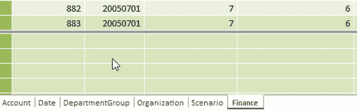

图 5-3. Finance 表的度量值网格


图 5-4. 显示或隐藏度量值网格

创建聚合最简单的方法是选择要聚合的列，然后选择 `自动求和` 下拉菜单，并选择所需的聚合函数（参见图 5-5）。


图 5-5. 使用自动求和进行常见聚合

聚合结果会放置在该列下方的度量值网格中（参见图 5-6）。如果你选中该单元格，你将在公式栏中看到公式（参见图 5-7）。度量值的名称放在公式之前，后跟冒号和等号（`:=`）。添加度量值后，你可以通过在公式编辑器中编辑来重命名它。


图 5-6. 列下方生成的度量值


图 5-7. 编辑度量值公式

另一种创建聚合度量值的方法是选择度量值网格中的任意单元格，然后在公式栏中输入公式。虽然你可以在度量值网格的任何单元格中定义度量值，但以某种方式组织度量值是个好主意。我通常会尝试将度量值沿网格左侧排列，这样它们就不会分散在整个网格中（参见图 5-8）。你可以使用剪切和粘贴轻松地将一个定义从一个单元格移动到另一个单元格。


图 5-8. 组织你的度量值

你可能已经注意到，聚合函数如 `SUM`、`AVE`、`MIN` 和 `MAX` 都有对应的 `SUMX`、`AVEX`、`MINX` 和 `MAXX` 函数。X 函数用于评估表中每一行的表达式，而不仅仅是单个列。例如，`SUMX` 函数的定义如下：

```
SUMX(<table>, <expression>)
```

其中，table 是包含要评估的行的表，expression 是每行要评估的内容。

例如，假设你有一个包含 `Cost` 和 `Gross` 列的销售表。要计算总净销售额，你可以用毛收入减去成本，然后对每一行的结果求和，如下面的公式所示：

```
SumNet:=SUMX(Sales,[Gross]-[Cost])
```

获得相同结果的另一种方法是先创建一个净计算列，然后对净列使用 `SUM` 函数。区别在于，计算列是预先计算并存储在模型中的。而度量值是在数据透视表中应用筛选器时计算的，并且每次数据上下文更改时都必须重新计算。因此，计算列越多，你的 Power Pivot 文件就越大。度量值越多、复杂性越高，在处理文件时所需的内存就越多。

理解数据上下文如何改变度量值是创建度量值时非常重要的一点，这将在下一节中探讨。

#### 掌握数据上下文

在 Power Pivot 模型中创建度量值时，上下文起着重要作用。与静态报表不同，Power Pivot 模型是为客户端进行动态分析而设计的。当用户更改筛选器、向下钻取以及更改数据透视表中的列和行标题时，上下文会发生变化，值也会重新计算。了解上下文如何变化以及它如何影响结果，对于能够构建和调试公式至关重要。

你需要考虑三种类型的上下文：行上下文、查询上下文和筛选上下文。当你在创建计算列时，行上下文就会发挥作用。它包括当前行所有其他列的值，以及与该行相关的任何表的数值。如果你创建一个计算列，例如 margin，

```
=[Gross] - [Cost]
```

DAX 使用行上下文从同一行中查找值以完成计算。如果你创建一个计算列，例如 lifetime sales，

```
=SUMX(RELATEDTABLE(Sales),[SalesAmount])
```

DAX 会自动使用当前行的行上下文查找相关值。行上下文在模型加载时设置一次，并且在加载新数据之前不会更改。这就是计算列被预先计算，并且仅在数据刷新时才需要重新计算的原因。

查询上下文是应用于数据透视表中单元格的筛选条件。当你将一个度量值放入数据透视表时，DAX 查询引擎会检查行和列标题以及任何应用的筛选器。每个单元格都应用了不同的查询上下文（参见图 5-9），并返回与该上下文关联的值。由于你可以通过更改行或列标题以及筛选值来动态更改查询上下文，因此单元格的值是动态计算的，并且这些值不会保存在 Power Pivot 模型中。


图 5-9. 度量值的查询上下文

筛选上下文是使用公式中的筛选约束添加到度量值中的。筛选上下文是在行上下文和查询上下文之外额外应用的。你可以通过添加、替换或使用筛选表达式有选择地更改上下文来改变它。例如，如果你使用以下公式计算销售额，

```
AllStoreSales:=CALCULATE(SUM(Sales[SalesAmount]),ALL(Store[StoreType]))
```

筛选上下文将清除查询上下文实施的任何 `StoreType` 筛选器。


在下一节中，您将了解为何知道何时以及如何更改查询上下文是创建度量值的重要方面。

#### 更改查询上下文

创建计算时，通常需要更改应用于度量值的筛选上下文。例如，如果您想要计算某个产品类别的销售额与所有产品销售额的比较（请参见图 5-10）。

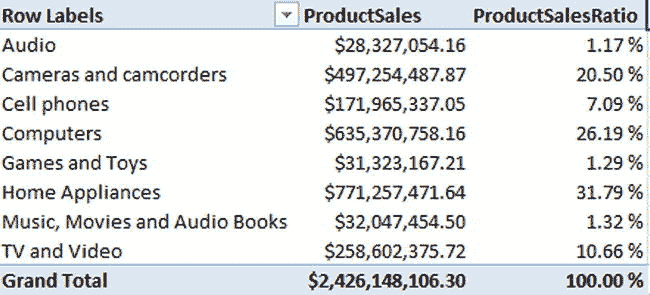

图 5-10 查看产品销售比率

要计算销售比率，您需要用查询上下文筛选后的销售额（本例中为类别）除以所有产品的销售额（无论产品查询上下文如何）。要计算销售额，只需使用 `SUM` 函数即可。要计算所有产品销售额的总和，您需要覆盖应用于单元格的任何产品筛选。为此，请使用 `CALCULATE` 函数，该函数在由指定筛选器修改的上下文中计算表达式，其语法如下：

```
CALCULATE(<表达式>,<筛选器 1>,<筛选器 2>...)
```

其中，表达式本质上是要计算的度量值，而筛选器是定义筛选器的布尔表达式或表表达式。

因此，要覆盖任何产品筛选器，请使用以下代码：

```
AllProductSales:=CALCULATE(SUM([SalesAmount]), ALL(Product))
```

这使用了 `ALL` 函数，该函数返回表中的所有行或列中的所有值，忽略可能已应用的任何筛选器。因此，在本例中，它会清除应用于 Product 表的所有筛选器。图 5-11 展示了数据透视表中的度量值。

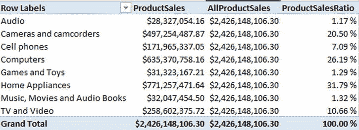

图 5-11 验证 AllProductSales 度量值

请注意，ProductSales 度量值受产品筛选器（类别）的影响，而 AllProductSales 则不受影响。计算 ProductSalesRatio 度量值的最后一步是将 ProductSales 除以 AllProductSales。只要没有循环引用，您就可以在一个度量值内部使用另一个度量值。因此，ProductSalesRatio 的计算方式如下：

```
ProductSalesRatio:=[ProductSales]/[AllProductSales]
```

您可以将 AllProductSales 度量值对客户端工具隐藏，因为在本例中，它用作中间度量值，本身并无用处。

在本节中，您了解了如何使用 `CALCULATE` 函数和筛选器函数来更改应用于度量值的筛选器。DAX 中有许多筛选器函数，理解何时使用它们非常重要。在下一节中，您将了解几个更重要的可用的筛选器函数。

#### 使用筛选器函数

DAX 中的筛选器函数允许您创建复杂的计算，这些计算需要您查询和操作数据透视表中行或单元格的数据上下文。表 5-1 列出并描述了 DAX 中可用的一些筛选器函数。

表 5-1 部分 DAX 筛选器函数

| 函数 | 描述 |
| --- | --- |
| `ALL` | 返回表中的所有行，或列中的所有值，忽略可能已应用的任何筛选器。 |
| `ALLEXCEPT` | 移除表中的所有上下文筛选器，但已应用于指定列的筛选器除外。 |
| `ALLNONBLANKROW` | 返回除空行外的所有行，并忽略可能存在的任何上下文筛选器。 |
| `ALLSELECTED` | 从列和行中移除上下文筛选器，同时保留所有其他上下文筛选器或显式筛选器。 |
| `CALCULATE` | 在由指定筛选器修改的上下文中计算表达式。 |
| `CALCULATETABLE` | 在由给定筛选器修改的上下文中计算表表达式。 |
| `DISTINCT` | 返回一个单列的表，其中包含指定列中的非重复值。 |
| `FILTER` | 返回一个表，该表表示另一个表或表达式的子集。 |
| `FILTERS` | 返回直接作为筛选器应用的值。 |
| `HASONEVALUE` | 当上下文被筛选为仅剩一个非重复值时返回 TRUE。 |
| `ISFILTERED` | 当应用了直接筛选器时返回 TRUE。 |
| `ISCROSSFILTERED` | 当列或同一表或相关表中的另一列被筛选时返回 TRUE。 |
| `KEEPFILTERS` | 在计算 `CALCULATE` 或 `CALCULATETABLE` 函数时修改筛选器的应用方式。保留已应用的筛选器并添加额外的筛选器。 |
| `RELATED` | 从另一个表返回相关值。 |
| `USERELATIONSHIP` | 指定要在特定计算中使用的关系。 |
| `VALUES` | 返回一个单列的表，其中包含指定列中的非重复值。 |

您已经了解了如何结合使用 `CALCULATE` 函数和 `ALL` 函数来计算所有产品销售额，忽略任何已应用的产品筛选。让我们再看几个示例。

图 5-12 展示了一个用于经销商销售的 Power Pivot 模型。在该模型中，Employee 表和 SalesTerritory 表之间存在非活动关系。您可以使用此关系来计算每个国家/地区的销售人员数量。


图 5-12 Power Pivot 模型中的非活动关系

您可以使用以下代码来计算每个国家/地区的销售代表人数：

```
Sales Rep Cnt:=CALCULATE(DISTINCTCOUNT(Employee[EmployeeNationalIDAlternateKey]),
USERELATIONSHIP(Employee[SalesTerritoryKey],SalesTerritory[SalesTerritoryKey]))
```

在这种情况下，您需要使用 `CALCULATE` 函数，以便应用筛选器函数 `USERELATIONSHIP` 来告知 DAX 查询引擎使用哪个关系。图 5-13 显示了生成的数据透视表。它还显示了如果仅使用 `DISTINCTCOUNT` 函数而不使用 `USERELATIONSHIP` 筛选器时得到的结果。

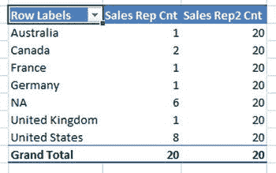

图 5-13 每个国家/地区的销售代表人数

在下一个示例中，您将了解 `ALL` 和 `ALLSELECTED` 筛选器函数之间的区别。您可以如下创建三个销售金额度量值：

```
Reseller Sales:=SUM([SalesAmount])
Reseller Grand Total:=calculate(sum([SalesAmount]), ALL('ResellerSales'))
Reseller Visual Total:=calculate(sum([SalesAmount]), ALLSELECTED())
```

`Reseller Sales` 保留应用于度量值的所有数据上下文。`Reseller Grand Total` 移除与 `ResellerSales` 表及任何相关表关联的所有上下文。`Reseller Visual Total` 从度量值中移除列和行的上下文。图 5-14 显示了数据透视表中的生成度量值。

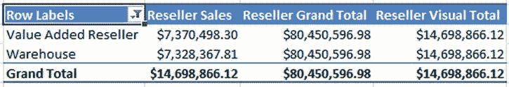

图 5-14 使用不同筛选器的结果


现在让我们看一个更复杂的示例。在本示例中，您希望确定特定时间段内最佳单笔订单客户。最终的数据透视表如图 5-15 所示。

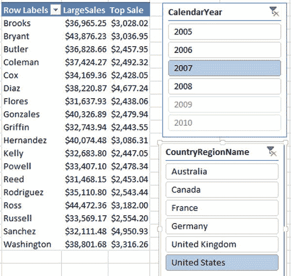

图 5-15 查找最佳单笔订单客户

第一步是查找在该时间段内消费金额较高的客户。要计算客户销售额，请使用以下度量值：

```
SumSales:=SUM([SalesAmount])
```

接下来，您只想关注大额消费者，因此过滤掉较小的值：

```
LargeSales:=IF([SumSales]>=30000,[SumSales],Blank())
```

下一步是查找客户的订单金额并取最大值：

```
Top Sale:=MAXX(VALUES(Date[DateKey]),[SumSales])
```

由于您只想列出顶级客户的最大销售额，可以添加一个`IF`语句来确保该客户有大额销售：

```
Top Sale:=
IF(ISBLANK([LargeSales]),Blank(),MAXX(VALUES(Date[DateKey]),[SumSales]))
```

作为最后一个示例，假设您正在与人力资源部门合作，希望创建一个数据透视表，使他们能够列出特定日期各部门的员工数量。有一个`EmployeeDepartmentHistory`表，其中列出了员工、部门、开始日期和结束日期。还有一个`Dates`表，其每一行对应部门历史记录中的每个日期。图 5-16 显示了包含每个部门员工数量的数据透视表。


图 5-16 截至选定日期的员工数量

`As of Date`用作筛选器，`Emp Cnt`是度量值。当`As of Date`更改时，`Emp Cnt`会重新计算以显示该日期下的员工数量。图 5-17 显示了日期更改后的新数量。

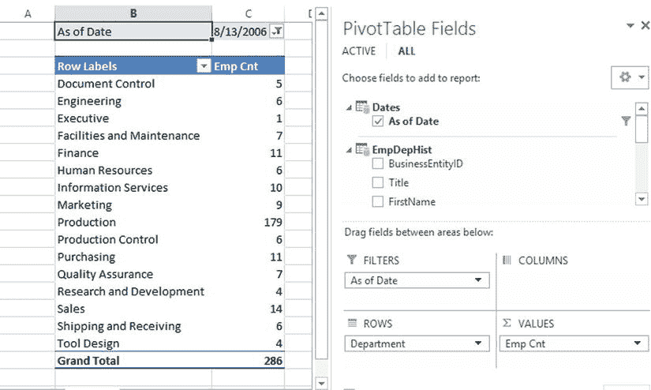

图 5-17 更改`As of Date`

创建`Emp Cnt`的第一步是使用`COUNT`函数，因为您需要对表中的`EmployeeID`进行计数：

```
Emp Cnt:=COUNT(EmpDepHist[BusinessEntityID])
```

由于需要将表筛选为仅包含选定日期时的在职员工，因此需要将其改为`COUNTX`函数：

```
Emp Cnt:=COUNTX(EmpDepHist, EmpDepHist[BusinessEntityID])
```

若要筛选`EmpDepHist`表，请使用`FILTER`函数：

```
FILTER(<table>,<filter>)
```

`FILTER`函数是一个计算结果为`TRUE`的布尔表达式。在这种情况下，需要使员工在部门中的开始日期小于或等于`As of Date`：

```
EmpDepHist[StartDate]<=Dates[As of Date]
```

现在，由于数据透视表用户可以选择多个日期，并且您希望确保只与单个日期进行比较，因此可以使用`MAX`函数：

```
EmpDepHist[StartDate]<=MAX(Dates[As of Date])
```

您还需要确保员工离开部门的日期大于`As of Date`：

```
EmpDepHist[EndDate] > Max(Dates[As of Date]
```

如果员工当前仍在部门中，则`EndDate`将为空：

```
ISBLANK(EmpDepHist[EndDate])
```

将这些筛选条件组合起来，得到以下筛选条件：

```
EmpDepHist[StartDate]<=MAX(Dates[As of Date])
&& (ISBLANK(EmpDepHist[EndDate]) || EmpDepHist[EndDate] > Max(Dates[As of Date]))
```

最终的`FILTER`函数变为：

```
FILTER(EmpDepHist,
EmpDepHist[StartDate]<=MAX(Dates[As of Date])
&& (ISBLANK(EmpDepHist[EndDate]) || EmpDepHist[EndDate] > Max(Dates[As of Date])))
```

最终的员工计数度量值变为：

```
Emp Cnt:=COUNTX(FILTER(EmpDepHist,
EmpDepHist[StartDate]<=MAX(Dates[As of Date])
&& (ISBLANK(EmpDepHist[EndDate]) || EmpDepHist[EndDate] > Max(Dates[As of Date]))),
EmpDepHist[BusinessEntityID])
```

如您所见，创建度量值可能相当复杂，但如果将其分解为多个步骤，就会变得非常易于管理。请放心，您使用 DAX 创建度量值的次数越多，它就会变得越直观、越容易。

在性能仪表板中常用的一种度量值是*关键绩效指标（KPI）*。KPI 用于以可视化格式显示绩效和趋势。在下一节中，您将研究在 Power Pivot 模型中创建 KPI。

#### 创建 KPI

KPI 是许多仪表板的主要组成部分，提供了一种快速查看趋势和发现需要进一步分析领域的绝佳方式。KPI 的基础值基于度量值，例如，您可以为当前销售额创建一个 KPI。然后将基础值与目标值进行比较。目标值可以是另一个度量值，例如去年的销售额，也可以是绝对数值，例如目标销售费用率。状态阈值定义了哪些范围被视为良好、一般和差。这些阈值随后用于确定 KPI 的可视化组件（即绿色、黄色、红色）。图 5-18 显示了与前期销售额相比较的当期销售额 KPI。


图 5-18 比较当期与前期销售额的销售 KPI

要创建 KPI，请首先创建其依赖的基础度量值。例如，生产部门跟踪报废部件，因此您可以将 KPI 基于报废部件数量的总和：

```
SumScrappedQty:=SUM([ScrappedQty])
```

您可以将其与已处理的部件数量进行比较：

```
SumOrderQuantity:=SUM([OrderQty])
```

创建度量值后，在 Power Pivot 模型设计器中右键单击基础度量值。在上下文菜单中选择“创建 KPI”，这将启动 KPI 设计窗口（参见图 5-19）。


图 5-19 KPI 设计窗口

然后将目标设置为`SumOrderQuantity`度量值，并定义状态阈值。样式图标用于显示 KPI 的状态。完成 KPI 创建后，您可以在 Excel 的数据透视表中使用它（参见图 5-20）。

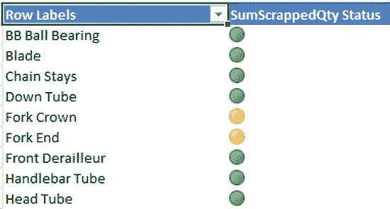

图 5-20 在数据透视表中查看 KPI

现在您已经了解了如何使用 DAX 创建度量值和更改数据上下文，是时候在以下实验中动手创建一些度量值了。

#### 动手实验——在 Power Pivot 中创建度量值

在以下实验中，您将：

*   创建聚合度量值。
*   更改度量值中的数据上下文。
*   在度量值中使用非活动关系。
*   创建复杂的度量值。
*   创建 KPI。

1.  在“实验启动器”文件夹中，打开`LabChapter5.xlsx`文件。该文件包含一个由销售数据、产品数据和商店数据组成的数据模型。
2.  使用关系图视图在 Power Pivot 窗口中查看模型（图 5-21）。


图 5-21 Power Pivot 模型

3.  在 Power Pivot 窗口中切换到数据视图，并选择`Sales`表。
4.  选择`SalesAmount`列。在“自动求和”下拉菜单中选择“求和”（参见图 5-22）。您应该会看到在该列下方添加了一个度量值。将该度量值重命名为`Sum Sales`。

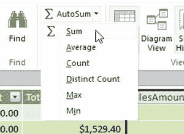

图 5-22 选择“自动求和”下拉菜单


5.  使用与第 4 步相同的技术，创建`Max Sales Quantity`、`Min Sales Quantity`和`Ave Sales Quantity`度量值。
6.  要测试度量值如何随筛选上下文的变化而重新计算，在“开始”选项卡中单击数据透视表，然后在`Sheet1`的`B2`单元格中插入数据透视表（参见图 5-23）。


图 5-23. 创建数据透视表

7.  如果看不到字段列表，请单击数据透视表以显示它。
8.  在“销售”节点下，勾选`Sales`和`Max Sales Quantity`。这会将度量值添加到“值”下拉区域。在“产品”节点下，勾选`ProductCategory`属性。这会将属性添加到“行标签”下拉区域。
9.  在“插入”选项卡上，单击“切片器”按钮。在“插入切片器”窗口中，选择“全部”选项卡，然后在“地域”节点下选择`ContinentName`（参见图 5-24）。


图 5-24. 创建切片器

10.  数据透视表应如下图所示图 5-25。通过单击不同的大洲来测试度量值。这会更改查询上下文。请注意度量值如何随查询上下文的变化而重新计算。


图 5-25. 测试查询上下文

11.  现在假设我们需要一个销售比率，用于比较销售额与所有产品的总销售额。在数据视图模式下打开 Power Pivot 窗口。选择`Sales`表。向`Sales`表中添加以下度量值：

```
All Product Sales:=CALCULATE([Sum Sales],ALL('Product'))
```

12.  `All Product Sales`度量值使用`CALCULATE`函数来覆盖应用于查询上下文的任何产品筛选器。将该度量值的格式设置为货币。
13.  切换到数据透视表。将`Max Sales Quantity`度量值替换为`Sum Sales`和`All Product Sales`度量值。
14.  通过单击不同大洲来测试数据透视表，并注意`All Product Sales`度量值等于每个大洲的总产品销售（参见图 5-26）。


图 5-26. 测试度量值

15.  切换回 Power Pivot 窗口，并向`Sales`表中添加以下度量值。将该度量值的格式设置为百分比。

```
Product Sales Ratio:=[Sum Sales]/[All Product Sales]
```

16.  在关系图视图模式下打开 Power Pivot 窗口。要创建`Date`表和`Store`表之间的关系，请将`Store`表中的`OpenDate`字段拖放到`Date`表中的`DateKey`上（参见图 5-27）。请注意，这不是`Store`表和`Date`表之间的活动关系，如虚线所示。这是因为活动关系从`Store`表经过`Sales`表，然后到达`Date`表。

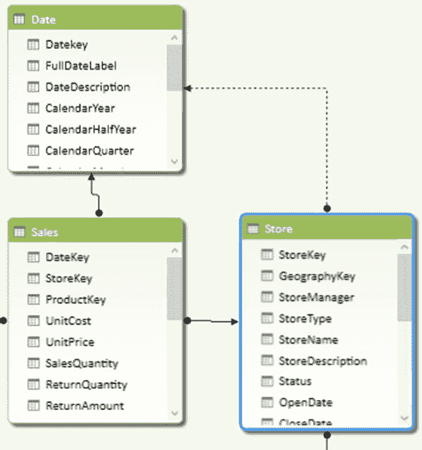

图 5-27. 创建非活动关系

17.  切换到数据视图模式，并向`Store`表中添加以下度量值。由于使用的是非活动关系，因此需要使用`USERELATIONSHIP`函数。

```
Store Count:=CALCULATE(DISTINCTCOUNT([StoreKey]),
USERELATIONSHIP(Store[OpenDate],'Date'[Datekey]))
```

18.  要测试`Store Count`度量值，请在`Sheet2`上创建数据透视表。使用`ContinentName`作为列标签，使用`CalendarMonth`作为行标签。使用`CalendarYear`插入切片器。数据透视表应如下图所示图 5-28。

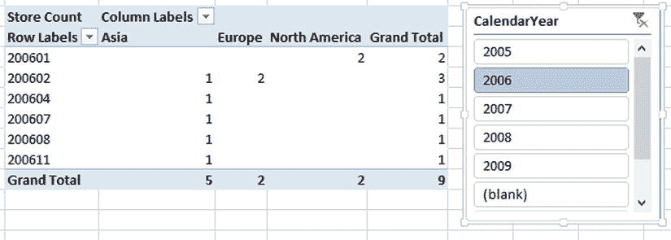

图 5-28. 测试`Store Count`度量值


19.  数据透视表显示了每个月开设的店铺数量。点击不同年份，观察数据的变化。
20.  若要找出某个产品类别的最佳销售日，请创建一个`Sale Quantity`度量值。

```
Sale Quantity:=SUM([SalesQuantity])
```

21.  使用`Sale Quantity`度量值创建一个`Top Sale Day Quantity`度量值。`MAXX`函数用于打破平局，并返回最近的`DateKey`。

```
Top Sale Day Quantity:=MAXX(values('Date'[Datekey]),[Sale Quantity])
```

22.  要找出最佳销售日的日期，首先需要创建一个筛选器函数，该函数返回在指定期间内`Sale Quantity`等于`Top Sale Day Quantity`的日期。

```
Filter(VALUES('Date'[Datekey]),
[Sale Quantity]=CALCULATE([Top Sale Day Quantity],
VALUES('Date'[Datekey])))
```

23.  然后将此筛选器插入到`CALCULATE`函数中，该函数将返回最近的日期。

```
Top Sale Day:=CALCULATE(MAX('Date'[Datekey]),
Filter(VALUES('Date'[Datekey]),[Sale Quantity]=
CALCULATE([Top Sale Day Quantity],VALUES('Date'[Datekey]))))
```

24.  创建一个如图 5-29 所示的数据透视表来测试你的度量值。

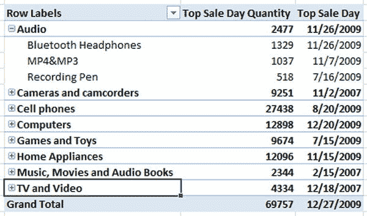

图 5-29. 测试最佳销售日度量值

25.  在 Sales 表中创建以下度量值，并将其格式设置为货币：

```
Ave Sales:=AVERAGE([SalesAmount])
Total Ave Sales:=If(ISBLANK([Ave Sales]),BLANK(),
                            CALCULATE([Ave Sales],ALLSELECTED()))
```

26.  在度量值网格中选择`Ave Sales`度量值。右键单击它，然后在上下文菜单中选择“创建 KPI”。在 KPI 对话框中，注意基础度量值是`Ave Sales`。将目标值设置为`Total Ave Sales`。将低阈值设置为 90%，高阈值设置为 110%（参见图 5-30）。


图 5-30. 创建平均销售额 KPI

27.  关闭对话框，注意`Ave Sales`度量值现在有一个图标，表示它关联了一个 KPI。
28.  创建一个如图 5-31 所示的数据透视表来测试该 KPI。你可以将某个店铺的平均销售额与显示的所有店铺的总平均销售额进行比较。


图 5-31. 查看 KPI

#### 总结

这一章内容详实而丰富。现在你已经牢固掌握了如何在 Power Pivot 模型中创建度量值。你还应该理解数据上下文及其如何影响度量结果。在开始开发更复杂的度量值时，这可能会是一个非常令人困惑的概念。不过不用担心；用得越多，理解就会越清晰。

下一章将进一步延伸本章的概念。一种最常见的数据分析类型是比较随时间变化的值。第 6 章将展示如何在 Power Pivot 中正确实现基于时间的分析。内容包括设置日期表、使用各种内置函数分析截至当前日期的值、比较不同时间段的值，以及执行半加法聚合。

