# 第 2 部分

使用 Power View 构建交互式报表和仪表板

### 第 8 章

为 Power View 优化 Power Pivot 模型

Power View 是 Excel 中的一种工作表类型，允许用户开发交互式可视化效果，鼓励对数据进行临时探索。对于希望探索数据并从数据中获取洞察的非 Excel 高级用户来说，它是一个理想工具。由于 Power View 可视化基于 Power Pivot 模型，您需要为用户提供一个扎实的模型作为这些可视化效果的基础。一个经过优化、适合 Power View 使用的良好 Power Pivot 模型，将决定用户体验是极佳还是极其糟糕。有多种方法可以优化 Power Pivot 模型，使其更便于在 Power View 中创建报表。本章将回顾这些设置，并展示如何创建支持多种 Power View 功能的模型。

完成本章后，您将能够：

*   了解 Power View 中可用的可视化类型。
*   在 Power View 中创建基本可视化效果。
*   设置 Power Pivot 模型中的属性以改善 Power View 体验。

 **注意** 如需彩色图片副本，请访问 `http://www.apress.com/9781430264453` 的“源代码/下载”部分。

#### 使用 Power View 可视化数据

正如我们在第 7 章所见，你可以使用 Excel 数据透视表和图表创建强大的数据可视化效果，并执行深入的数据分析。如果你是一名 Excel 高级用户，且工作职责包括详细数据分析，这些工具很可能是你的首选。另一方面，如果你需要一款工具，能让用户基于 Power Pivot 模型快速轻松地创建可视化效果，那么 Power View 将是一个绝佳选择。你可以使用 Power View 创建引人注目的仪表板，其中包含上下关联的可视化元素，这些元素可以轻松筛选、排序和向下钻取。Power View 报表可以作为 Excel 工作表托管，也可以存放在 SharePoint 库中。它还有一个额外的好处：可以导出到 PowerPoint，在演示中使用，同时仍保留其交互性。图 8-1 展示了一个包含联动图表和图形的 Power View 报表示例。当点击图表中的某个条形时，图形会根据所点击的国家和年份进行筛选。

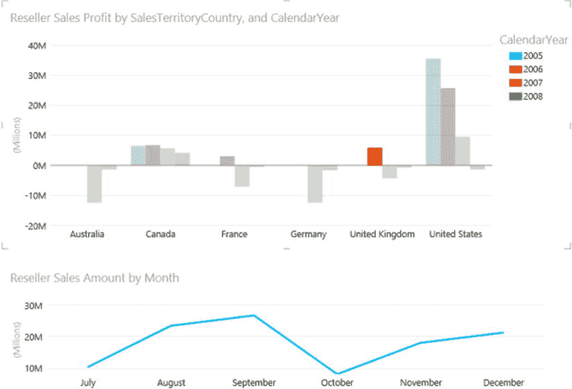

图 8-1。Power View 中的交互式图表和图形

使用 Power View，你可以创建常见的可视化效果，例如表、矩阵、图表和图形。此外，你还可以创建包含时间轴的散点图，以揭示数据随时间的变化情况（参见图 8-2）。

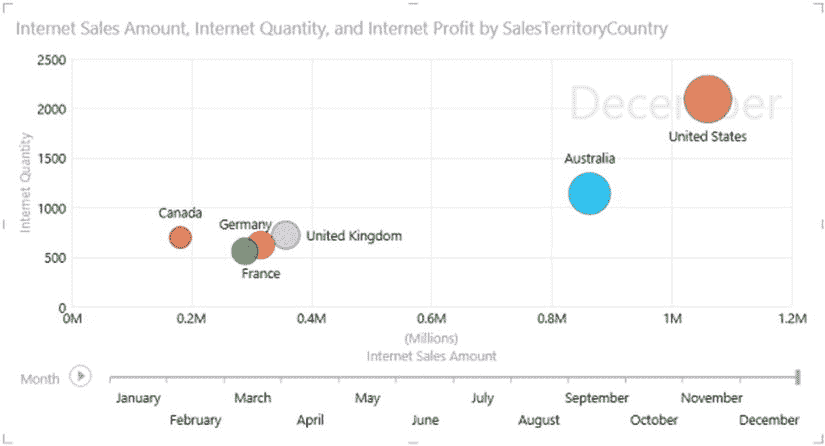

图 8-2。为散点图添加播放轴

由于 Power View 使用必应地图图块，你可以将数据呈现在交互式地图上。在浏览数据时，你可以放大地图并平移至街道地址级别。图 8-3 展示了按县级划分的降雨量地图。

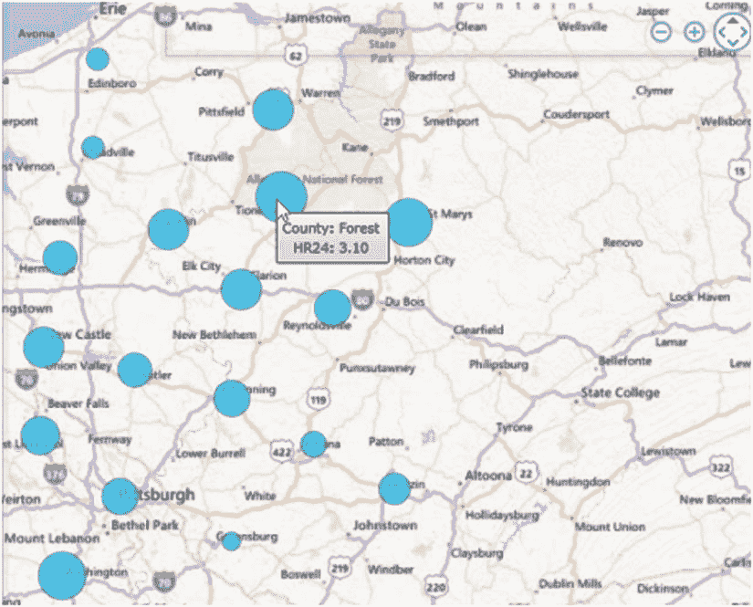

图 8-3。按县级划分的降雨量地图

Power View 中另外两种可用的数据可视化类型是卡片和磁贴。`Cards`（卡片）以索引卡样式显示每一行的数据。例如，你可以查看员工的联系信息，如图 8-4 所示。

图 8-4。卡片样式的员工信息

`tile`（磁贴）可视化效果允许你使用一个可包含文本和图像的标签条，以交互方式筛选数据。例如，图 8-5 展示了如何使用磁贴，通过标签条中地区的图像来按区域筛选销售额。

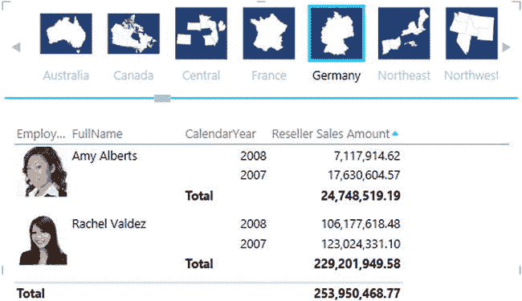

图 8-5。在 Power View 中使用磁贴图像

现在你已经熟悉了 Power View 中可用的一些可视化类型，接下来我们来看看创建一些基本报表的过程。

#### 创建基本报表

Power View 报表基于 Excel 中的 Power Pivot 模型。要创建报表，请打开包含该模型的 Excel 工作簿，然后在“插入”选项卡上，单击“Power View”按钮（参见图 8-6）。

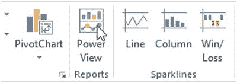

图 8-6。插入 Power View 报表

这将在工作簿中插入一个新选项卡，并为你提供 Power View 设计界面。该设计包含一个数据可视化区域、一个筛选器区域和一个 Power View 字段窗口。Power View 字段窗口包含暴露给客户端工具的 Power Pivot 模型的表和字段（参见图 8-7）。

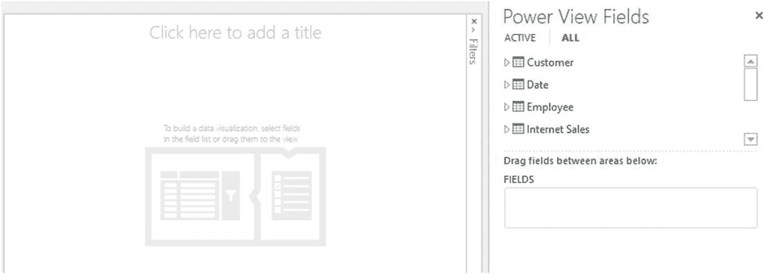

图 8-7。Power View 设计界面

在 Power View 中创建可视化效果的关键之一是从表视图开始，待选定字段后，再将表视图切换为其他数据可视化类型。展开 Power View 字段列表中的表节点，你将看到可用字段。如果你想创建一个显示按销售区域划分销售额的条形图，首先将所需字段拖到“字段”放置区域。这将在设计界面上创建一个表视图。选中该表视图后，你可以在“设计”选项卡上选择不同的可视化类型（参见图 8-8）。

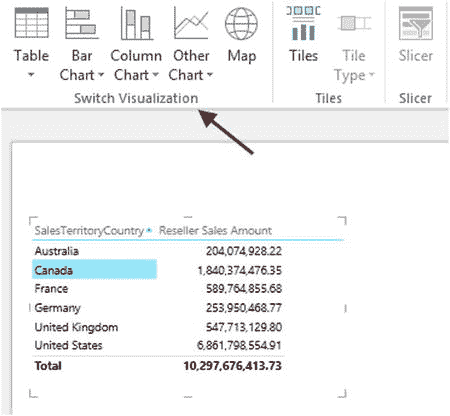

图 8-8。更改可视化类型

切换可视化类型后，字段列表下的放置区域将根据可视化类型而改变。图 8-9 展示了条形图的放置区域。你可能需要重新排列字段，并向放置区域添加额外字段，以获得所需的可视化效果。

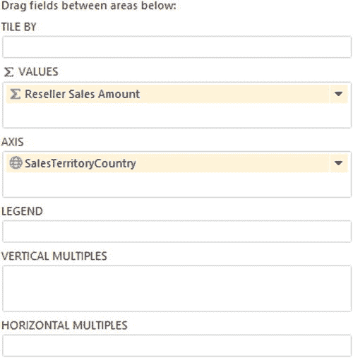

图 8-9。条形图放置区域

你可以轻松地将可视化效果从一种类型更改为另一种。例如，如果你选中条形图，然后在“设计”选项卡中选择其他图表下拉菜单，就可以将其切换为饼图（参见图 8-10）。

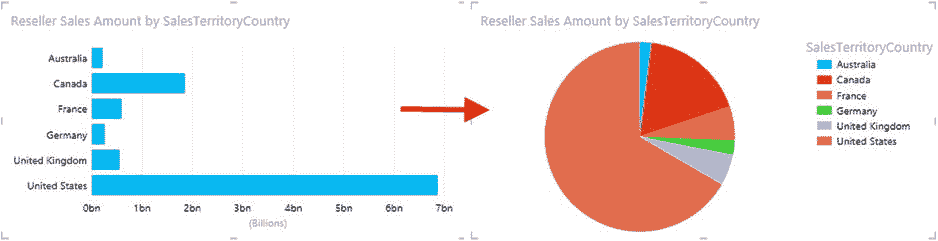

图 8-10。切换可视化类型

现在你已经了解了如何创建基本可视化效果（你将在第 9 章和第 10 章中学习创建更复杂的可视化效果），接下来我们看看如何利用 Power Pivot 模型来改善 Power View 中的设计者和用户体验。

#### 改善 Power View 体验

让 Power Pivot 模型的用户在 Power View 中构建和探索各种可视化效果时拥有愉快的体验非常重要。例如，你应只暴露对用户有意义的字段。通常，隐藏用于关联模型中表的关键值是个好主意。要从 Power View 的可用字段列表中隐藏某个列，请右键单击该列并选择“从客户端工具隐藏”（这将在模型设计器中将该列变为灰色）。图 8-11 展示了隐藏一个没有业务意义的 `CustomerID` 字段。

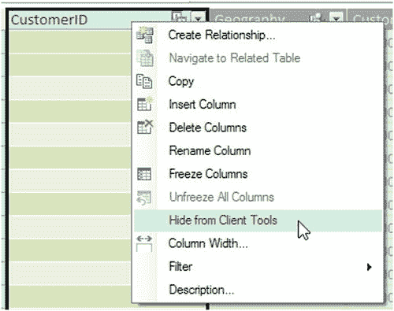

图 8-11。从客户端工具隐藏字段

如果你查看图 8-11 弹出菜单的底部，你会发现可以为该字段输入描述。当你在 Power View 中悬停在该字段上时，此描述将会显示。此选项也适用于模型中创建的度量值，并且对于那些需要了解度量值定义方式的业务用户来说非常有用。图 8-12 展示了在 Power View 中显示的描述。

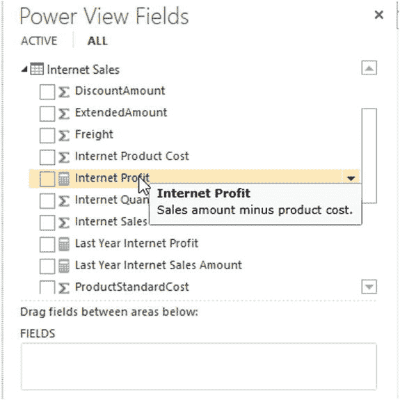

图 8-12。添加字段描述可改善用户体验

当你查看图 8-12 中的字段列表时，请注意字段前面的图标。计算器图标表示该度量是在 Power Pivot 模型中创建的。求和符号表示该字段是数字型，并且拖拽到字段放置区域时会进行聚合。默认的聚合是求和，但这可能并非所需的聚合方式。在某些情况下，你并不希望对数字进行聚合；例如，在日期表中，年份字段本就不应被聚合。你可以通过在 Power Pivot 模型的“高级”选项卡中设置`Summarize By`下拉菜单来控制此行为（参见图 8-13）。

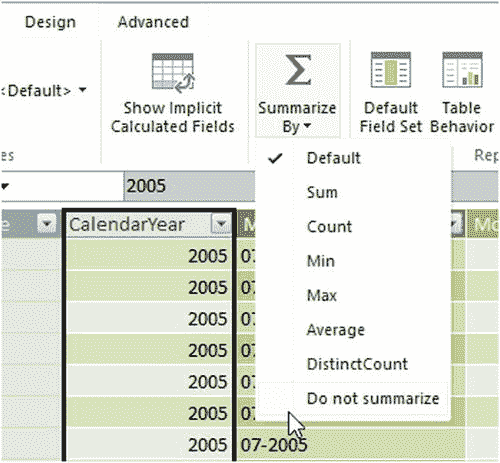

图 8-13 设置字段的默认聚合方式

除了设置字段级别的属性，你还可以在 Power Pivot 模型中设置一些表级别的属性，从而更轻松地在 Power View 中创建报表。在 Power Pivot 模型设计器中查看某个表的“高级”选项卡时，你会看到一个`Default Field Set`按钮（参见图 8-13）。选择此按钮可以指定该表的默认字段集（参见图 8-14）。设置后，Power View 用户只需在 Power View 字段列表中点击该表节点，即可快速创建表格（参见图 8-15）。

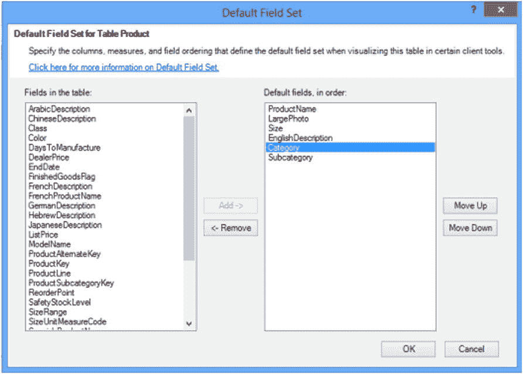

图 8-14 设置表的默认字段

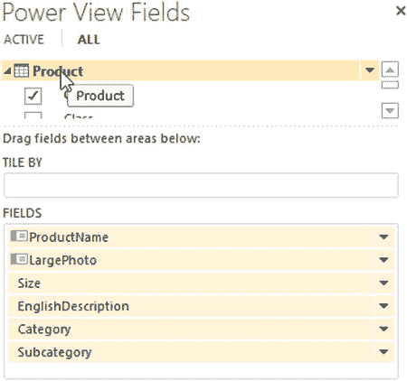

图 8-15 在 Power View 中使用默认字段

在 Power View 中创建可视化对象时，它会根据所选字段和可视化类型自动对项目进行分组。你可以通过设置 Power Pivot 模型中的`Table Behavior`属性来控制分组的评估方式。在模型设计器的“高级”选项卡中，可以访问`Table Behavior`属性（参见图 8-13）。点击后，`Table Behavior`按钮会显示“表行为”设置窗口（参见图 8-16）。

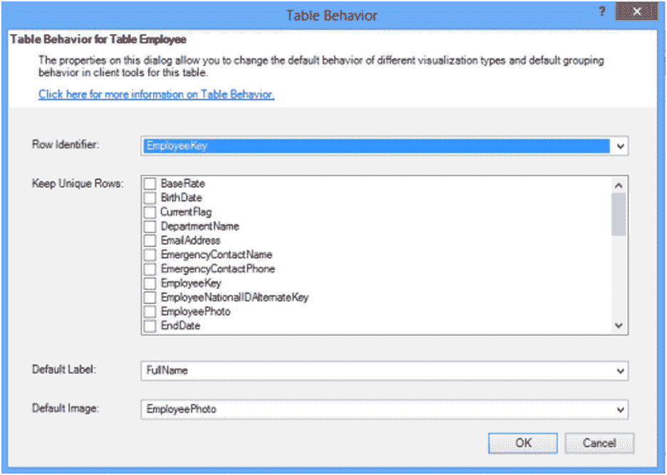

图 8-16 设置表行为

你可以为表设置的`Table Behavior`属性包括：行标识符、任何指示唯一性的列、默认标签和默认图像。行标识符用于指示能唯一标识每一行的字段（通常称为主键）。该字段必须唯一且不能为空。一旦设置了行标识符，你就可以选择哪些列包含的值应保持唯一。例如，你可能有两个同名员工，并且不希望将一个员工的记录与另一个员工的记录分组在一起。默认标签和默认图像用于 Power View 的卡片和磁贴类型可视化对象，设置后可提供更美观的格式样式。图 8-17 显示了同一张卡片采用两种不同格式的效果。上方卡片显示了设置默认标签和图像后的格式，下方卡片则显示了未设置时的格式。

图 8-17 设置默认标签和图像的效果

Power Pivot 模型设计器“高级”选项卡上的最后一个可用设置是字段的`Data Category`设置（参见图 8-18）。这对于城市、邮政编码和国家/地区等位置类型尤其重要。当 Power View 知道某列是位置类型时，它可以使用该字段，借助必应地图图层实现可视化。其他有用的数据类别包括图像和 Web URL。设置这些类别后，Power View 将识别它们为超链接并相应地设置其格式。

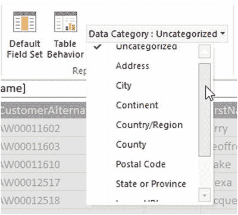

图 8-18 设置字段的数据类别

至此，你应该已经很好地理解了 Power Pivot 模型中的设置如何影响 Power View 中的用户体验。在下面的实验室练习中，你将获得处理这些属性的实践经验。

#### 动手实验——为 Power View 优化 Power Pivot 模型

在接下来的实验中，你将：

*   为 Power View 优化一个 Power Pivot 模型。
*   在 Power View 中创建表格和卡片可视化对象。
*   探索表格视图筛选。

1.  在`LabStarters`文件夹中，打开`LabChapter8.xlsx`文件。该文件包含来自 AdventureWorks 测试数据库的销售数据。
2.  在 Excel 中选择“插入”选项卡，然后点击“Power View”按钮。这将在工作簿中插入一个 Power View 报表工作表。在 Power View 字段窗口中，展开“Customer”节点并观察字段列表（参见图 8-19）。

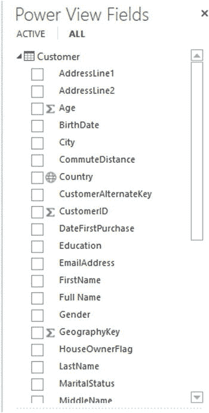

图 8-19 向 Power View 公开的客户字段

3.  请注意，`CustomerID`、`CustomerAlternateKey`和`GeographyKey`已向用户公开。请转到 Power Pivot 模型并隐藏这些键。
4.  如果你查看图 8-19 中的`Age`字段，会看到该字段前有一个求和符号。这意味着如果你将此字段拖拽到放置区域，它将对年龄进行求和。要更改此设置，请在 Power Pivot 模型中选择`Age`列，然后在“高级”选项卡的`Summarize By`下拉菜单中，选择`Do Not Summarize`。对`NumberCarsOwned`、`NumberChildrenAtHome`和`TotalChildren`列重复此操作。
5.  如果你查看图 8-19 中的`Country`字段，会看到该字段前有一个地球图标。这表明该字段是位置类型字段。要验证这一点，请在 Power Pivot 模型中选择`Country`字段，然后选择“高级”选项卡。注意`Data Category`已设置为`Country/Region`（建议）。模型使用了列的名称来猜测此设置。
6.  将`StateProvince`和`City`列设置为适当的数据类别。返回 Power View 字段列表，注意这些字段现在带有地球图标。
7.  在 Power View 字段列表中展开“Date”表。请注意，存在许多你不想要的默认聚合，并且还有一些你不想显示的字段。更新模型，使最终的字段列表如图 8-20 所示。同时，将`MonthName`列设置为按`MonthNumberOfYear`排序，并向模型添加一个日历层次结构和一个会计层次结构。

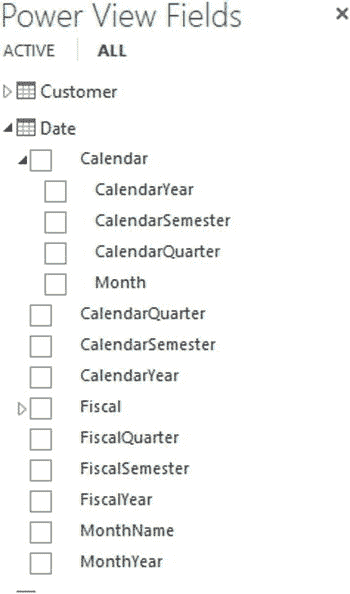

图 8-20 更新后的日期字段

8.  在 Power View 字段列表中展开“Employee”表。Power Pivot 模型包含每位员工的照片，但 Power View 未能识别。为解决此问题，请转到 Power Pivot 模型，选择`Employee`表，然后在“高级”选项卡上，点击`Table Behavior`按钮。在“表行为”设置窗口中，将`Row Identifier`设置为`EmployeeKey`。将`Keep Unique Rows`设置为`FullName`。将`Default Label`设置为`FullName`，并将`Default Image`设置为`EmployeePhoto`（参见图 8-21）。

