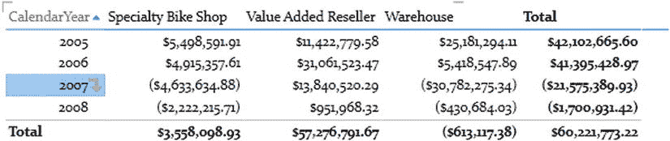
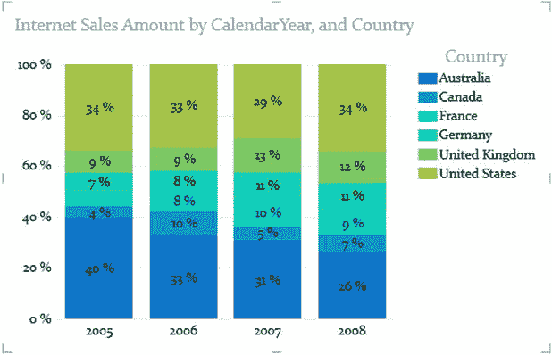
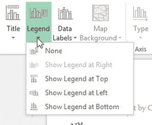
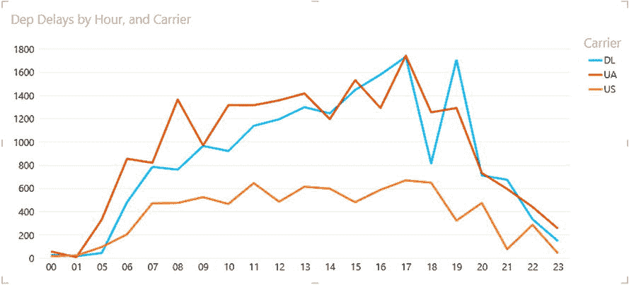
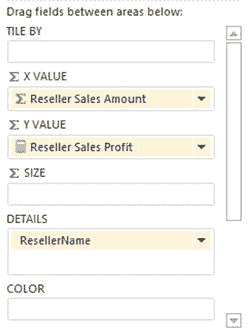
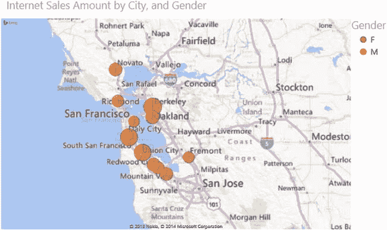
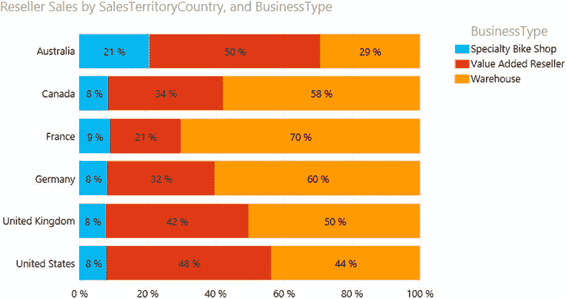
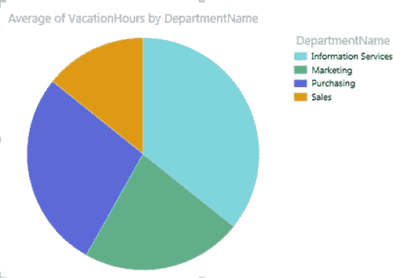
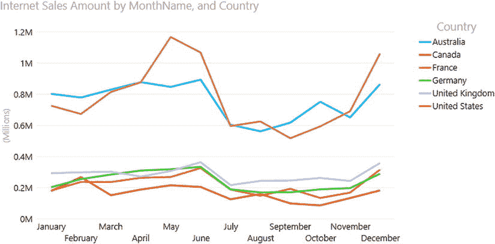
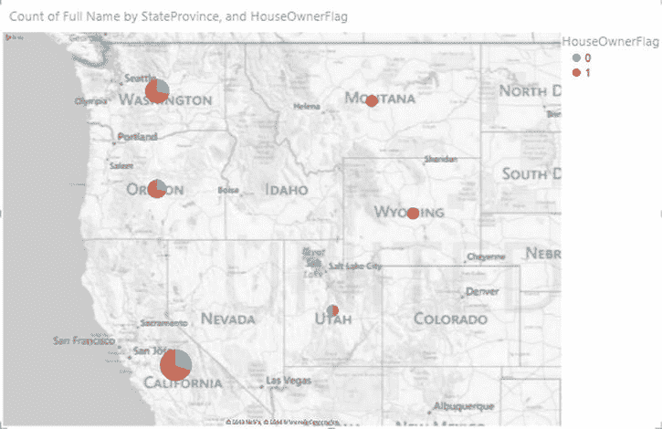

## 第 9 章

# 使用 Power View 创建标准可视化

上一章您已经了解到，创建一个能与 Power View 良好协作的 Power Pivot 模型至关重要。在本章中，您将探究一些用于创建报表和仪表板的标准可视化效果。您将熟悉 Power View 设计器的常见功能。您将构建标准可视化效果，例如柱形图、条形图和饼图。此外，您还将学习如何使用散点图，以及如何将其转换为带有播放轴的气泡图。您将探究的最后一种可视化效果是如何使用地图进行地理数据分析。

完成本章后，您将能够：
*   创建表格和矩阵。
*   构建条形图、柱形图和饼图。
*   构建折线图和散点图。
*   创建基于地图的可视化效果。

 **注意**  如需彩色图片副本，请访问 `http://www.apress.com/9781430264453` 的源代码/下载部分。

## 创建表格和矩阵

正如您在上章所学，Power View 中的所有可视化效果最初都是从表格开始的，然后才转换为其他类型的可视化效果。虽然表格是最基本的数据可视化类型之一，但它仍然是查看数据最有用的方式之一，特别是当您需要查找详细信息时。图 9-1 显示了展示客户联系信息的表格。

图 9-1. 客户联系信息

当您将表格与 Power View 自带的自动筛选功能结合使用时，这将成为根据客户人口统计数据查找客户的绝佳方式。在视图中选中表格后，点击“筛选器”区域中的 `Table` 选项卡（参见图 9-2）。表格中的字段将自动出现在表格筛选器列表中。若要将一个您希望用于筛选但不想显示在表格中的字段添加到筛选器列表，只需将该字段从“Power View 字段列表”拖放到“筛选器”区域。

图 9-2. 筛选表格

实现表格筛选的另一种方法是使用切片器。要创建切片器，首先使用要按之切分的字段创建一个单列表格。选中视图区域中的表格，然后在 `Design` 选项卡中，点击 `Slicer` 按钮（参见图 9-3）。

图 9-3. 创建切片器

切片器会筛选视图上的所有数据——甚至包括其他切片器。图 9-4 展示了在 `国家/地区` 切片器中的选择如何限制 `省/州` 切片器中显示的内容。

图 9-4. 使用切片器进行筛选

矩阵与表格类似，都包含行和列，但它不显示明细级别的记录，而是按行和列标题中显示的字段对数据进行聚合。在 Excel 中创建数据透视表时，它本质上就是一个矩阵。如果矩阵包含层次结构，您可以向上或向下钻取该层次结构。要创建矩阵，首先从一个表格开始，然后将其转换为矩阵。图 9-5 显示了一个表格，用于展示每个月不同经销商类型的销售利润。

图 9-5. 按类型和月份显示经销商销售额的表格

由此可见，表格并不是展示这类信息的最佳方式。在矩阵中解读信息会容易得多，你可以在其中比较汇总值，并能按年度、季度和月份进行向下或向上钻取。要将此更改为矩阵，请选中该表格，然后在 `Design` 选项卡上，选择 `Table` 下拉菜单中的 `Matrix` 选项（参见图 9-6）。

图 9-6. 将表格转换为矩阵

如图 9-7 所示，将表格转换为矩阵后，添加了总计和小计。

图 9-7. 包含总计和小计的矩阵

如果你查看 `Field List` 下的拖放区域，会看到用于值、行和列的区域。为了改善矩阵的外观，你可以将 `BusinessType` 字段拖到 `Columns` 拖放区域。现在你就可以轻松地并排比较经销商类型了（参见图 9-8）。

图 9-8. 按利润比较经销商类型

要在 `Design` 选项卡下控制矩阵的总计和钻取功能，请使用 `Show Levels` 和 `Totals` 下拉菜单（参见图 9-9）。

图 9-9. 为矩阵启用向下钻取

一旦启用了向下钻取，矩阵将折叠，仅显示年度级别。当你点击某一年份时，会看到一个箭头图标，允许你向下钻取到日历层次结构中的下一级别（参见图 9-10）。当你沿层次结构向下钻取时，还会看到另一个箭头，允许你向上钻取返回层次结构。

图 9-10. 沿层次结构向下钻取

除了希望在矩阵中查看聚合值之外，你通常还希望使用可视化表示（例如条形图、柱形图或饼图）来展示这些值。接下来你将学习如何创建这些图表。

## 构建条形图、柱形图和饼图

用于比较数据的一些最常见的数据可视化方式是条形图、柱形图和饼图。条形图和柱形图非常相似。条形图具有水平条形，其中 x 轴是度量值，而 y 轴包含你所比较的类别。例如，图 9-11 展示了一个按国家比较互联网销售额的条形图。

图 9-11. 按国家比较销售额的条形图

柱形图则交换了坐标轴，使得度量值位于 y 轴，而类别位于 x 轴。例如，图 9-11 中的条形图可以很容易地转换为如图 9-12 所示的柱形图。

图 9-12. 按国家比较互联网销售额的柱形图

有三种类型的条形图或柱形图可供选择：堆叠图、100% 堆叠图和簇状图。图 9-12 是一个没有图例字段的堆叠柱形图。如果你将 `Year` 字段拖到 `Legend` 拖放区域，可视化效果将变为如图 9-13 所示。请注意，每年的值会彼此堆叠在一起。

图 9-13. 创建堆叠柱形图

虽然堆积柱形图显示的是绝对值，但您可以将其改为 100% 堆积图，以百分比形式显示相对值。在图 9-14 中，`Country` 字段被移到了图例中，`Year` 字段则放置在坐标轴上。同时，该图还将数据标签设置为 `Visible`（可见），以便于比较。

图 9-14. 创建一个 100% 堆积柱形图

簇状柱形图会将不同国家的柱形并排显示，而不是将它们堆叠在一起。图 9-15 与图 9-13 展示的是相同的信息，但以簇状柱形图的形式呈现。

图 9-15. 创建一个簇状柱形图

虽然您无法对图表的布局进行太多控制，但可以在 `Design`（设计）选项卡上控制标题、图例和数据标签（请参阅图 9-16）。

图 9-16. 控制图例布局

与大多数可视化图表一样，在 Power View 中您可以获得自动筛选和排序功能。例如，如果将鼠标悬停在图 9-15 中图表的左上角，您将看到排序选项，可以改为按 Internet 销售额排序，而不是按国家/地区名称排序（请参阅图 9-17）。

图 9-17. 更改柱形图的排序方式

饼图与堆积柱形图或堆积条形图类似，它们都允许您比较某个类别中各成员的度量值，以及该类别的总计值。图 9-18 展示了一个饼图，用于比较不同类型分销商的销售额。

图 9-18. 使用饼图比较数据

与柱形图和条形图一样，您对饼图布局的控制也非常有限，仅限于标题和图例的位置。在撰写本文时，饼图甚至不支持数据标签，这确实令人遗憾。

虽然条形图、柱形图和饼图非常适合比较不同类别的聚合数据，但如果您想发现数据中的趋势，折线图和散点图是更好的选择。接下来您将探讨这些图表类型。

## 构建折线图和散点图

折线图用于观察相等时间段内的趋势。这些时间段通常是时间单位，例如小时、天、月等。时间周期绘制在 x 轴上，度量值绘制在 y 轴上。图 9-19 显示了一天中各小时的航班延误分钟数。每条线代表不同的航空公司。使用此图表，您可以轻松发现一天中的趋势，并比较航空公司的表现。

图 9-19. 使用折线图发现趋势

如果您需要同时比较两个度量值的趋势，可以使用散点图。散点图将一个度量值绘制在 y 轴上，另一个绘制在 x 轴上。要创建散点图，请先创建一个包含一个类别字段和两个数值字段的表格——例如，分销商名称（类别）、销售额（数值）和销售利润（数值）。创建表格后，将可视化效果切换到散点图，该图位于 `Design`（设计）选项卡下的 `Other Chart`（其他图表）下拉菜单中。图 9-20 显示了生成的散点图。

### 散点图中的数据比较

使用散点图可以轻松发现趋势以及不遵循趋势的离群值。

查看散点图的字段放置区域（参见图 9-21），您会看到“大小”和“颜色”两个放置区域。您可以将另一个度量添加到“大小”放置框中，并将另一个类别添加到“颜色”放置框中。

**图 9-21.** 为散点图添加大小和颜色

一旦为散点图添加了大小轴，它就会变成气泡图。图 9-22 显示了一个气泡图，其中气泡的大小代表经销商的员工数量，颜色代表经销商的业务类型。

**图 9-22.** 气泡图中的数据比较

如果查看散点图的放置区域，您应该会看到另一个标记为“播放轴”的放置框。您可以将一个基于时间的字段拖入此框，这会导致在散点图下方出现一个播放轴。播放轴允许您查看度量值随时间的变化情况。它允许您在进行分析时播放、暂停和回溯这些变化。如果您单击图表中的一个气泡，可以看到随时间发生的变化轨迹。图 9-23 显示了一个可用于分析产品销售额随时间变化情况的散点图。

**图 9-23.** 为散点图添加播放轴

除了用于比较数据的标准可视化效果外，Power View 还允许您使用 Bing 地图从地理角度查看数据。您将在下一节中了解如何创建基于地图的可视化效果。

## 创建基于地图的可视化效果

Power View 的一个不错的功能是它可以使用 Bing 地图图块来创建可视化效果。如果您的数据包含地理字段（例如城市、州/省和国家/地区），则非常容易将数据整合到地图中。您可以通过字段列表中的地球图标来判断一个字段是否可以被地理位置定位（参见图 9-24）。

**图 9-24.** 地球图标表示可以映射的字段

要创建地图，首先创建一个包含地理空间字段和您想要在地图上查看的度量的表格。创建好表格后，您可以将其切换为地图。地图上的位置会显示为气泡，其大小表示度量值的大小。图 9-25 显示了按城市划分的销售额，地图已放大到加利福尼亚州旧金山地区。

**图 9-25.** 在地图上查看数据

如果您查看地图的字段放置区域，应该会看到“经度”和“纬度”放置框；这允许您在地图上创建精确的位置点。还有一个“颜色”放置区域，您可以在其中放置一个类别字段。这会将地图上的气泡转换为显示每个类别的饼图（参见图 9-26）。

**图 9-26.** 为地图添加类别

现在您已经了解了如何创建 Power View 中可用的各种可视化效果，是时候通过动手练习来创建一些可视化效果了。

### 动手实验——在 Power View 中创建标准可视化效果

在以下实验中，您将：
*   创建条形图、柱形图和饼图。
*   创建折线图和散点图。
*   创建基于地图的可视化效果。

1.  在 `LabStarters` 文件夹中，打开 `LabChapter9.xlsx` 文件。该文件包含来自测试数据库 AdventureWorks 的销售数据。
2.  在 Excel 中选择“插入”选项卡，并单击“Power View”按钮。这将在工作簿中插入一个 Power View 报表工作表。
3.  创建一个表格，按区域或国家列出销售额以及经销商销售额。
4.  在 Power View 工作表上选中该表格，将可视化效果切换为簇状条形图。调整图表大小。图表应类似于图 9-27。

图 9-27 创建条形图

5.  选中条形图，将“经销商业务类型”拖拽至“图例”下拉框中。图表现在会按国家分组显示每种业务类型的条形。
6.  将图表切换为百分比堆积条形图。在“布局”选项卡下，更改设置以显示数据标签。图表应类似于图 9-28。

图 9-28 创建百分比堆积条形图

7.  在“Power View”选项卡上，单击“Power View”按钮以插入一个新的 Power View 工作表。创建一个堆积柱形图，按年份和类别显示经销商销售利润。您的图表应类似于图 9-29。

图 9-29 创建堆积柱形图

8.  添加一个新的 Power View 工作表。在此工作表上创建一个表格，显示部门名称和平均休假小时数。您需要在“字段”拖放区域将休假小时数从“求和”改为“平均值”。
9.  将可视化效果切换为饼图。在图表“筛选器”区域，将图表限制为仅显示“信息服务”、“市场”、“采购”和“销售”部门。图表应类似于图 9-30。

图 9-30 创建饼图

10. 要创建折线图，请添加一个新的 Power View 工作表，并创建一个包含月份名称和 Internet 销售额的表格。将可视化效果切换为折线图。将客户所在国家添加到“图例”拖放区域。最终的图表应类似于图 9-31。请注意，美国和澳大利亚有峰值，而其他地区则相当平稳。

图 9-31 在折线图中比较数据

11. 要创建散点图，请添加一个新的 Power View 工作表，并创建一个包含 `ResellerName`、`ResellerSalesProfit` 和 `ResellerSales` 的表格。将表格更改为散点图。将业务类型添加到“颜色”下拉框中。
12. 将 `SalesTerritoryCountry` 拖拽至图表“筛选器”区域，并将图表限制为仅显示德国。使用 `MonthYear` 创建一个播放轴。使用播放轴，确定最大利润损失发生在哪个经销商、何时以及损失多少。最终得到的可视化效果应类似于图 9-32。

图 9-32 使用带播放轴的散点图确定最大利润损失

13. 要创建基于地图的可视化效果，请在工作簿中插入一个新的 Power View 工作表。使用客户 `FullName` 和客户 `StateProvince` 创建一个表格。将表格切换为地图，将 `Full Name` 字段从“颜色”下拉框拖拽至“大小”下拉框，并将聚合方式更改为“非重复计数”。
14. 将 `HouseOwnerFlag` 拖拽至“颜色”下拉框。放大至美国西部地区；您的地图应类似于图 9-33。

# 第 9 章（图 9-33）

图 9-33. 映射客户数量

15. 尝试映射其他字段，并缩放至地图的不同区域。完成后，保存更改并退出 Excel。

### 本章小结

在本章中，你学习了如何在 Power View 中创建各种可视化效果。你创建了标准的柱形图、条形图和饼图。你还了解了折线图、散点图，以及如何创建气泡图并添加播放轴来查看随时间变化的趋势。此外，你还学习了如何将与地理空间字段相关的度量值显示在地图上。至此，你应该能够熟练地在 Power View 中创建各种可视化效果。

到目前为止，你创建的每个可视化效果都是独立的图表或图形。Power View 的优势之一在于能够将这些可视化效果关联起来，创建交互式仪表板。你将在下一章中对此进行探讨。
