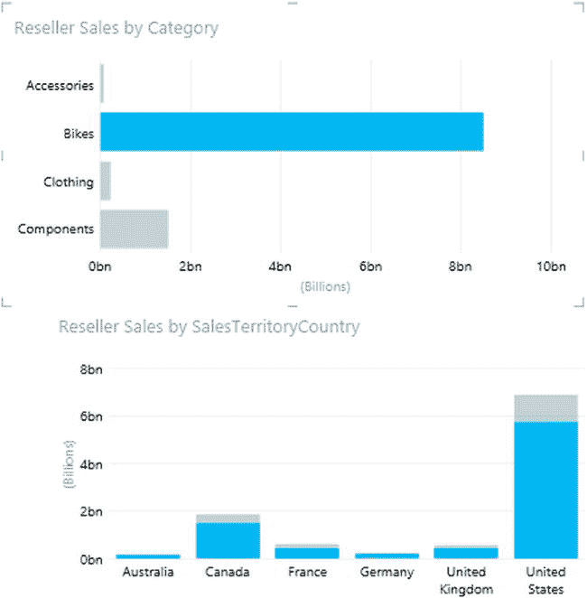
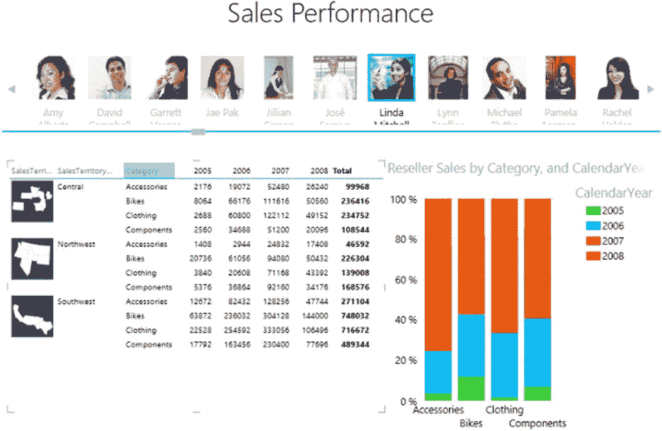

# 第 10 章

## 使用 Power View 创建交互式仪表板

在上一章中，你了解了一些用于创建报表和仪表板的标准可视化效果。在本章中，你将把这些可视化效果结合起来，使它们协同工作，形成交互式仪表板。交互式仪表板与传统仪表板的不同之处在于，它将用户体验从被动扩展为主动。你可以执行筛选、向上或向下钻取不同级别的详细信息，以及发现各种度量值之间的关联。你还将学习如何使用磁贴对数据进行分组，并为分组和视图整体创建筛选器。此外，你还将了解如何添加图片以增强仪表板的体验。

完成本章后，你将能够：

*   在 `Power View` 中链接可视化效果。
*   使用磁贴组织数据。
*   筛选分组和视图。
*   向使用者公开仪表板。

 **注意：** 如需彩色图副本，请访问 `http://www.apress.com/9781430264453` 上的源代码/下载部分。

### 在 Power View 中链接可视化效果

`Power View` 的优势之一在于，如果 `Power Pivot` 模型中包含用于创建各种可视化效果的数据之间的链接，则 `Power View` 将利用该关系实现交互式筛选。*交互式筛选*是指筛选一个可视化效果的过程会自动筛选出相关的可视化效果。例如，图 10-1 显示了一个条形图，该条形图展示了 `Adventure Works` 示例数据库中不同产品类别的销售额。

图 10-1. 按类别统计的经销商销售额

在此视图中，你可以添加一个显示不同国家/地区销售额的柱形图，如图 10-2 所示。

图 10-2. 向同一视图添加相关的可视化效果

由于 `Sales` 表与 `SalesTerritory` 表和 `Product` 表相关，因此如果你选择其中一个产品类别条形图，它将突出显示条形图以显示该类别对应的销售额（参见图 10-3）。

图 10-3. 对相关可视化效果进行交互式筛选

这种筛选是双向的，因此你可以单击下方图表中的某个柱形，它将筛选上方的图表，以显示该国家/地区的销售额。这种交互式筛选适用于 `Power View` 中大多数类型的可视化效果。图 10-4 展示了一个气泡图和一个表格。当你单击某个气泡时，表格将被筛选，以显示构成该气泡值的明细记录。

图 10-4. 筛选以显示构成气泡值的详细信息

现在你已经了解了可视化对象如何相互交互，接下来可以学习如何通过磁贴对可视化对象进行分组。

### 使用磁贴组织数据

在上一节中，你了解了放置在同一视图上的可视化对象如何相互交互。另一种对可视化对象进行分组的方法是使用磁贴。首先创建一个包含分组条件的表格。例如，你可能希望按销售区域组织销售数据。为此，首先使用销售区域图片创建一个表格，然后将其更改为磁贴类型的可视化对象。你将看到一个与图 10-5 类似的可视化对象。

图 10-5. 创建磁贴组

在图 10-5 中，请注意销售区域图片同时出现在 `Title` 字段和 `Details` 区域中。你可以从 `Details` 区域移除该字段，并从 `Power Pivot` 模型添加与销售区域相关的数据。例如，你可以添加分配给该区域的销售人员、他们的照片、销售额以及销售年份。这将在磁贴的 `Details` 部分创建一个表格（参见图 10-6）。

图 10-6. 在磁贴内创建表格

你可以将详细可视化对象更改为另一种类型，例如矩阵。当你点击不同的磁贴时，详细信息将按磁贴组进行筛选（参见图 10-7）。

图 10-7. 使用磁贴分组

如果你点击磁贴 `Detail` 部分的空白区域，可以构建另一个可视化对象。例如，图 10-8 显示了一个矩阵和一个柱形图，它们都根据所选的磁贴进行了筛选。

图 10-8. 使用磁贴控制多个可视化对象

分组可视化对象后，请确保你了解筛选如何影响磁贴中和视图上的分组可视化对象。接下来你将了解这部分内容。

### 筛选组和视图

当你将多个可视化对象放置在同一视图上时，你可以选择筛选整个视图（页面）或构成视图的各个可视化对象。图 10-9 显示了 `Filters` 区域，你可以在其中切换 `View` 选项卡和 `Chart` 选项卡。`View` 选项卡用于将筛选器应用于页面上的所有可视化对象，而 `Chart` 选项卡则将筛选器仅应用于单个可视化对象（在此示例中为图表）。

图 10-9. 筛选图表或视图

默认情况下，可视化对象筛选器包含构成该可视化对象的字段，并且这些字段不能被移除。但是，你可以从 `Field List` 向筛选器添加其他字段。当你首次点击 `Filters` 区域中的 `View` 选项卡时，没有列出任何字段。要筛选视图中的值，请从 `Field List` 添加与视图中可视化对象所包含字段相关的字段。

所有筛选器都有一个列表模式，其中值显示为复选框列表（参见图 10-10）。

图 10-10. 使用筛选器选择列表

你也可以通过选择字段名称右侧的箭头切换到高级筛选模式。`Power View` 中公开的高级筛选控件的类型取决于筛选器的数据类型。图 10-11 显示了对日期字段公开的高级筛选控件。

图 10-11. 按日期进行高级筛选

图 10-12 显示了将高级筛选用于基于文本的字段时得到的选项。

图 10-12. 使用基于文本的字段进行高级筛选

筛选视图的另一种方法是使用切片器。切片器对用户很友好，因为它们是视图的一部分。切片器的缺点在于它们仅限于选择列表，并且不公开前面提到的高级筛选功能。将磁贴分组与切片器相结合可以创建不同的筛选器集。图 10-13 显示了磁贴组内部和磁贴组外部的同一图表。两个图表都受到 `CalendarYear` 切片器的筛选，因为它们位于同一视图上。磁贴组中的图表还受到销售区域的进一步筛选，因为它是磁贴组的一部分。

图 10-13. 使用切片器和磁贴进行筛选

构建好仪表板后，就该将其展示给用户了。在下一节中，我们将简要回顾你的选择。

### 公开仪表板

构建交互式仪表板后，下一步是将其公开给其他人，例如希望探索数据的业务分析师和管理人员。由于构成仪表板的 `Power Pivot` 模型和 `Power View` 可视化对象是一个自包含单元，你可以直接与使用者共享 `Excel` 文件的副本。然而，这不是管理仪表板的理想方式，并且很快就会变得难以处理。更好的管理方式是将它们托管在 `SharePoint` 站点中。你可以将其托管在本地 `SharePoint Server 2013` 或基于云的 `Office 365 SharePoint Server` 中。

基于云的 `Office 365` 解决方案具有一些非常引人注目的特性，使其成为你的 `Power BI` 解决方案的绝佳托管站点。这些特性包括 `Power BI` 站点，用户可以在其中共享、查看 `Power View` 仪表板并与之交互。它还包含一个 `Power BI` 管理中心，你可以在其中保护、监控和自动刷新仪表板的数据。如果你需要实施一个解决方案来为大量用户创建和分发大量视图，我建议你了解一下 `Office 365` 的功能。图 10-14 显示了 `Office 365 Power BI` 站点中的 `Power View` 仪表板。

图 10-14. 在 Power BI 站点上公开 Power View 仪表板

需要记住的一点是，`Power View` 最初是为交互式数据探索而创建的。尽管它正在发展成一个相当不错的仪表板工具，但它并不是生成需要打印的静态报告的最佳选择。当你打印 `Power View` 页面时，本质上只是打印一个屏幕截图。

现在你已经了解了如何使用 `Power View` 创建交互式仪表板，是时候通过实践来亲手创建一个了。

### 动手实验——在 Power View 中创建仪表板

在以下实验中，你将：

*   使用 `Power View` 创建一个交互式仪表板。
*   使用磁贴对可视化对象进行分组。

1.  在`LabStarters`文件夹中，打开`LabChapter10.xlsx`文件。该文件包含来自测试`AdventureWorks`数据库的销售数据。
2.  在 Excel 中选择`插入`选项卡，然后单击`Power View`按钮。这将在工作簿中插入一个`Power View`工作表。你将在此工作表上构建仪表板。
3.  将仪表板的标题更改为`Reseller Sales Analysis`。
4.  创建一个列出`CalendarYears`的表格，并将其转换为切片器。在切片器中选择年份`2006`以限制数据。
5.  单击设计图面的空白区域以创建新的可视化对象。从`Date`表中选择`MonthName`，从`Reseller Sales`表中选择`Reseller Sales Profit`。将表格转换为折线图并调整图表大小。从`Product`表中将`Category`添加到折线图的`图例`拖放区域。
6.  使用`Reseller`表中的`BusinessType`以及`Reseller Sales`表中的`Last Year Reseller Sales Amount`和`Reseller Sales`创建一个簇状条形图。
7.  重新排列可视化对象，使仪表板看起来类似于 Figure 10-15。

Figure 10-15. 转售商销售分析仪表板

8.  通过更改切片器中的年份、在条形图中选择转售商类型以及在折线图中选择类别线来测试仪表板的交互性。注意这些操作如何影响仪表板中的图表。你可以通过单击图表的空白区域来清除图表上的筛选器（参见 Figure 10-16）。

Figure 10-16. 清除交互式筛选器

9.  添加一个新的`Power View`工作表。将此仪表板标题命名为`Sales Performance`。
10. 从`Employee`表中创建一个`EmployeePhotos`表格。通过在`设计`选项卡中选择`磁贴`，将表格更改为磁贴。
11. 将`Employee`表中的`DepartmentName`拖到`筛选器`区域。将视图筛选为仅显示销售部门员工。调整磁贴区域的大小，使其占据视图的大部分空间（参见 Figure 10-17）。

Figure 10-17. 创建磁贴分组

12. 删除位于磁贴下方的员工图像。
13. 选择`磁贴`框内的空白区域，然后在`字段选择`窗格中单击`Reseller Sales`表中的`Reseller Quantity`。从`字段选择`窗格中再次选择`Reseller Sales`表中的`Reseller Quantity`。接下来，从`Sales Territory`表中选择`SalesTerritoryImage`和`SalesTerritoryRegion`。最后，从`Product`表中选择`Category`。
14. 将表格转换为矩阵，并将`Date`表中的`CalendarYear`拖到矩阵的`列组`中。调整矩阵大小，使其占据磁贴区域大约一半的空间（参见 Figure 10-18）。你可以在`设计`选项卡中减小文本大小以使其适合。

Figure 10-18. 向磁贴区域添加矩阵

15. 要创建柱形图，请选择`磁贴`框内的空白区域并单击。选择`Product`表中的`Category`、`Reseller Sales`表中的`Reseller Sales`以及`Date`表中的`CalendarYear`。将创建的表格更改为`100%堆积柱形图`。调整图表大小，使其看起来类似于 Figure 10-19。

Figure 10-19. 向仪表板添加堆积柱形图

16. 选择不同的销售人员，注意数据将筛选为仅显示他们的销售额。同时单击柱形图的一个分区，注意它如何筛选矩阵数据。
17. 尝试与你创建的两个仪表板进行交互。
18. 你可能希望尝试更改主题并为仪表板添加背景图像。你也可以添加公司徽标和标准免责声明，这些是大多数公司仪表板的常见要求。完成操作后，保存并退出 Excel。

#### 总结

在本章中，你学习了如何组合`Power View`中的各种可视化对象来创建交互式仪表板。你还学习了如何使用磁贴来分组仪表板上的其他可视化对象。虽然你尚未探索将仪表板部署到`SharePoint`，但这将是合乎逻辑的下一步。无论是在云中使用`Office 365`，还是在本地使用`SharePoint 2013`，`SharePoint`都能实现协作和管理自助式`BI`的强大功能。在下一章中，你将了解另一个在自助式`BI`工具集中非常实用的 Excel 加载项。`Power Query`提供了一个易于使用的界面，用于发现和转换数据以在`Power Pivot`模型中使用。它还包含清理和塑形数据的工具，例如删除重复项、替换值和分组数据。

