# 优化排版后的文本

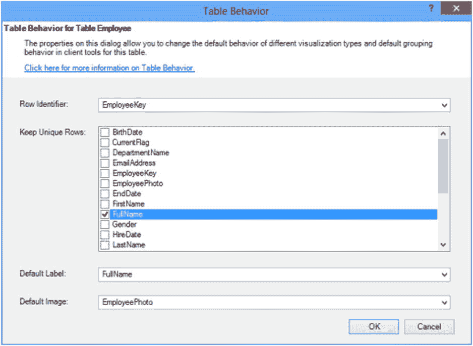

图 8-21. 设置表格行为属性

9.  返回“Power View 字段列表”，展开 `Employee` 表。请注意，现在可以看到 `EmployeePhoto` 字段。同时注意，`EmployeePhoto` 和 `FullName` 字段前出现了一个新图标，表示它们是默认字段。
10. 将 `FullName`、`EmployeePhoto`、`Title` 和 `Phone` 拖放到字段列表下方的“字段”拖放区域。注意视图表面上正在构建的表格。
11. 构建基本表格后，可以将其转换为其他类型的可视化。在“设计”选项卡中，选择“表格”下拉菜单，将可视化类型更改为“卡片”类型。最终应得到类似于图 8-22 的可视化效果。

图 8-22. 创建员工卡片

12. 在工作簿中插入一个新的 Power View 工作表。展开 `Product` 表节点，注意其中包含大量字段。为方便用户，可以设置默认字段集，用户只需单击表节点即可选择这些字段。
13. 在 Power Pivot 模型中，选择 `Product` 表，然后在“高级”选项卡中单击“默认字段集”按钮。在“默认字段集”窗口中，选择 `ProductName`、`ProductLine`、`Category`、`Subcategory`、`StandardCost`、`DealerPrice` 和 `ListPrice`，如图 图 8-23 所示。

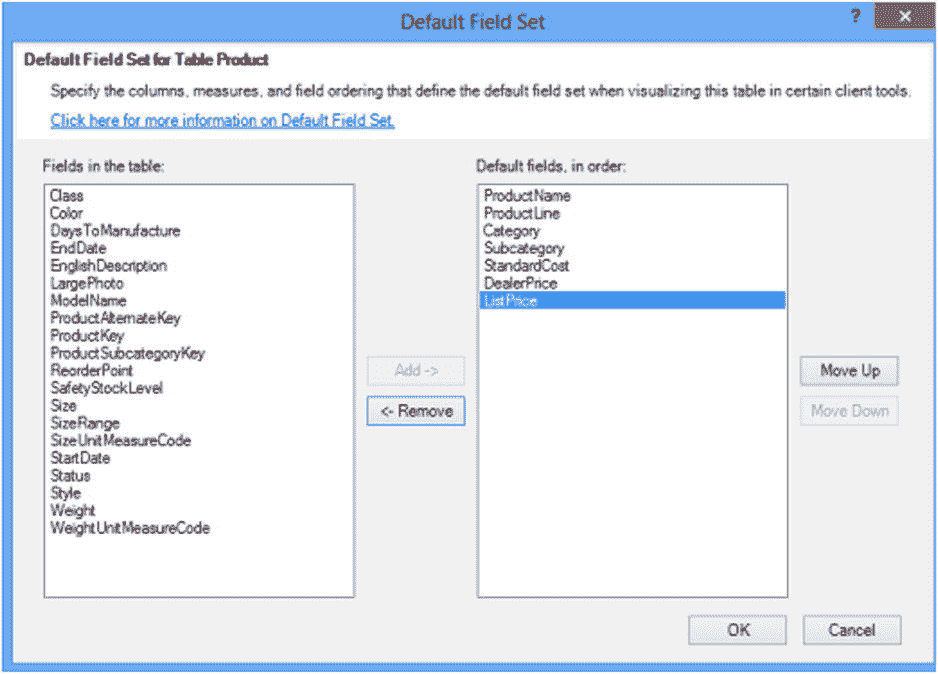

图 8-23. 选择默认字段

14. 返回 Power View 工作表，单击“Power View 字段列表”中的 `Product` 表。应该会看到创建了一个新表格，其中包含你在步骤 13 中选择的默认字段。
15. 选中表格后，单击“Power View”选项卡，注意你可以更改主题、字体和文本大小。尝试更改这些设置。为 Power View 工作表添加标题 `产品列表`。
16. 注意，通过单击表格中的列标题，可以按任意列进行升序或降序排序。表格右上角有一个筛选图标。单击此图标可显示表格筛选器（参见图 8-24）。

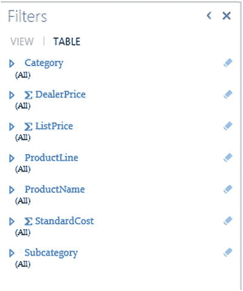

图 8-24. 查看表格筛选器

17. 单击 `Category` 字段以显示选择框。将表格筛选为仅显示配件。单击 `DealerPrice` 字段；注意，由于这是一个数字字段，你会看到一个滑块控件。在该字段右侧，你会看到一个用于切换到高级筛选模式的图标。使用高级筛选模式，将产品列表限制为仅显示经销商价格大于或等于 25 美元的配件。
18. 尝试更改和清除筛选器。完成后，保存更改并退出 Excel。

#### 本章小结

一个经过良好优化、可供 Power View 使用的 Power Pivot 模型，是区分卓越用户体验与令人极度沮丧体验的关键。本章展示了如何优化 Power Pivot 模型，以便在 Power View 中更轻松地创建报表。你了解了如何设置表格行为属性和列属性，以及这些设置如何影响 Power View 的体验。你还熟悉了如何在 Power View 中创建卡片和表格，以及如何筛选和排序表格。下一章将深入探讨 Power View 报表设计器的功能，展示如何创建基本的可视化类型以及这些可视化中内置的交互功能。届时将讨论并演示交叉视图筛选、向下钻取功能和切片器。

### 第 9 章

#### 使用 Power View 创建标准可视化

在上一章中，你了解到创建一个与 Power View 良好协作的 Power Pivot 模型至关重要。在本章中，你将研究一些用于创建报表和仪表板的标准可视化。你将熟悉 Power View 设计器的常见功能。你将构建标准可视化，例如柱形图、条形图和饼图。此外，你还将学习使用散点图，以及如何通过添加播放轴将其转换为气泡图。最后要研究的可视化是如何使用地图进行地理数据分析。

完成本章后，你将能够：

*   创建表格和矩阵。
*   构建条形图、柱形图和饼图。
*   构建折线图和散点图。
*   创建基于地图的可视化。

 **注意** 如需彩色图片副本，请访问 `http://www.apress.com/9781430264453` 的源代码/下载部分。

#### 创建表格和矩阵

正如你在上一章所学，Power View 中的所有可视化都是从表格开始，然后再转换为其他类型的可视化。虽然表格是最基本的数据可视化类型之一，但它仍然是查看数据最有用的方式之一，尤其是在需要查找详细信息时。图 9-1 显示了一个展示客户联系信息的表格。

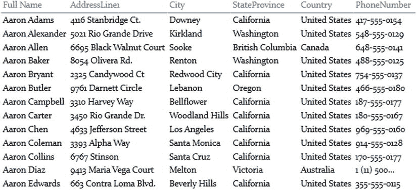

图 9-1. 客户联系信息

当你将表格与 Power View 提供的自动筛选功能结合使用时，这将成为根据客户人口统计数据查找客户的好方法。在视图中选中表格后，单击“筛选器”区域中的“表格”选项卡（参见图 9-2）。表格中的字段将自动显示在表格筛选器列表中。若要向筛选器列表添加一个你想要筛选但又不想显示在表格中的字段，只需将该字段从“Power View 字段列表”拖放到“筛选器”区域即可。

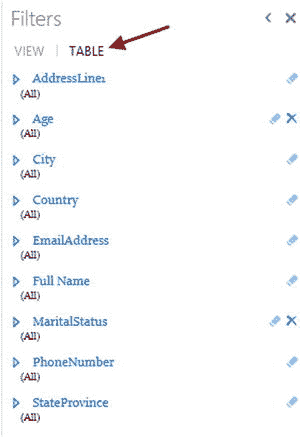

图 9-2. 筛选表格

为表格实现筛选的另一种方法是使用切片器。要创建切片器，首先使用你要进行切片操作的字段创建一个单列表格。选中视图表面上的表格，然后在“设计”选项卡中，单击“切片器”按钮（参见图 9-3）。

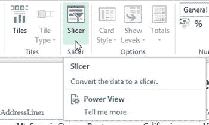

图 9-3. 创建切片器

切片器将筛选视图上的所有数据——甚至其他切片器。图 9-4 展示了在“国家/地区”切片器中的选择如何限制 `StateProvince` 切片器中显示的内容。

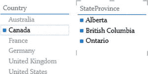

图 9-4. 使用切片器进行筛选

矩阵与表格类似，都包含行和列，但矩阵不会显示明细级别记录，而是按行和列标题中显示的字段对数据进行聚合。在 Excel 中创建数据透视表时，其本质上就是一个矩阵。如果矩阵包含层次结构，你可以在层次结构中上下钻取。要创建矩阵，先从一个表格开始，然后将其转换为矩阵。图 9-5 显示了一个表格，用于展示每个月不同类型经销商的销售利润。

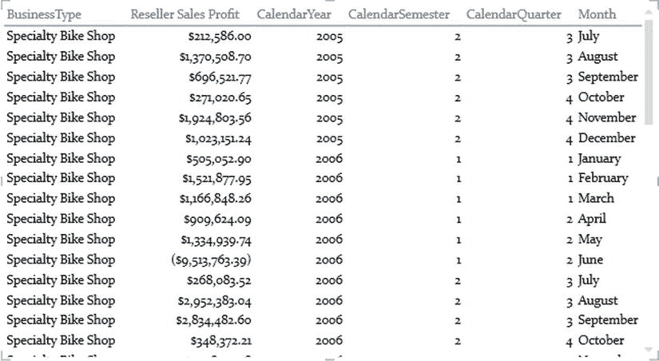

图 9-5. 按类型和月份显示的经销商销售利润表格

如您所见，表格并非展示此类信息的最佳方式。在矩阵中解读信息会容易得多，您可以比较总计值，并可按年、季度和月份进行向下或向上钻取。要将其更改为矩阵，请选中该表格，然后在`设计`选项卡上，选择`表格`下拉菜单，再选择`矩阵`（参见图 9-6）。

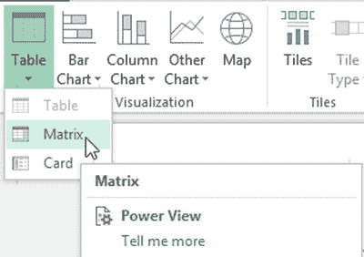

图 9-6. 将表格转换为矩阵

如图 9-7 所示，将表格转换为矩阵后，添加了总计和小计。

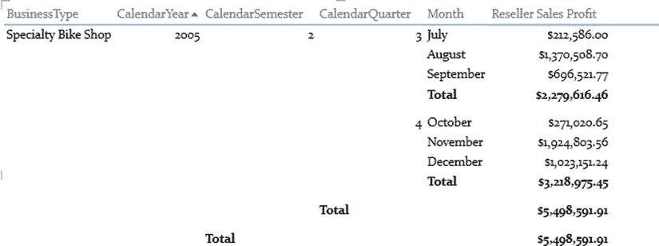

图 9-7. 包含总计和小计的矩阵

如果您查看字段列表下方的放置区域，应该会看到值、行和列的放置区域。为了改善矩阵的外观，您可以将`BusinessType`字段拖到`列`放置区域。现在，您可以轻松地并排比较经销商类型（参见图 9-8）。

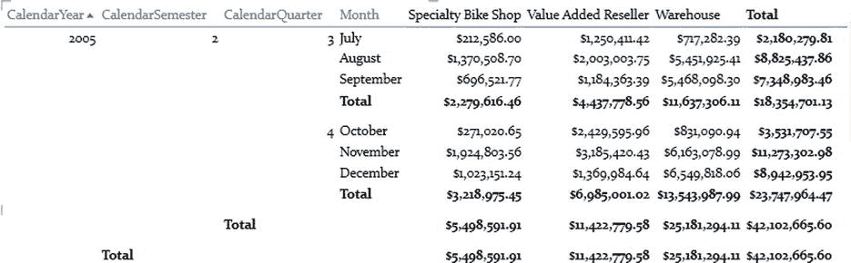

图 9-8. 按利润比较经销商类型

要控制`设计`选项卡下矩阵的总计和钻取，请使用`显示级别`和`总计`下拉菜单（参见图 9-9）。

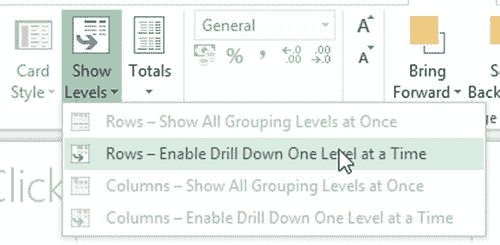

图 9-9. 为矩阵启用向下钻取

启用向下钻取后，矩阵将折叠，仅显示年份级别。当您单击某个年份时，会看到一个箭头图标，允许您向下钻取到日历层次结构中的下一级（参见图 9-10）。当您在层次结构中向下钻取时，会看到另一个箭头，允许您向上钻取层次结构。

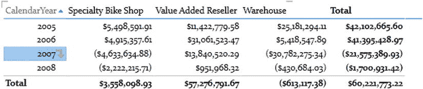

图 9-10. 在层次结构中向下钻取

除了希望在矩阵中查看聚合值之外，您通常还希望使用可视化表示形式（例如条形图、柱形图或饼图）来展示这些值。接下来您将了解如何创建这些图表。

#### 构建条形图、柱形图和饼图

用于比较数据的一些最常见的数据可视化方式是条形图、柱形图和饼图。条形图和柱形图非常相似。条形图具有水平条形，其中 X 轴是度量值，而 Y 轴包含您要比较的类别。例如，图 9-11 显示了一个按国家/地区比较 Internet 销售额的条形图。

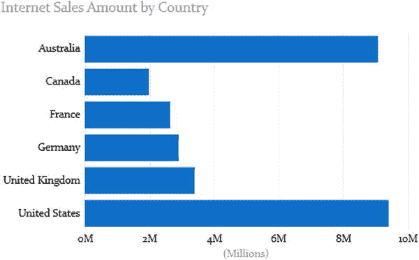

图 9-11. 按国家/地区比较销售额的条形图

柱形图交换了两个轴，使得度量值在 Y 轴上，类别在 X 轴上。例如，图 9-11 中的条形图同样可以轻松显示为柱形图，如图 9-12 所示。

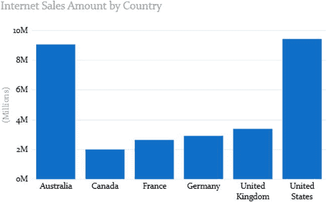

图 9-12. 按国家/地区比较 Internet 销售额的柱形图

有三种类型的条形图或柱形图可供选择：堆积图、百分比堆积图和簇状图。图 9-12 是一个堆积柱形图，没有图例字段。如果您将`Year`字段拖到`图例`放置区域，它会将可视化更改为图 9-13 中所示的效果。请注意，每年的值都相互堆叠在一起。

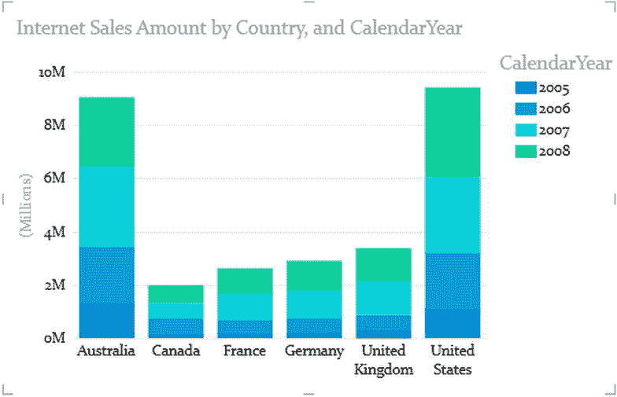

图 9-13. 创建堆积柱形图

虽然堆积柱形图显示的是绝对值，但您可以将其更改为 100% 堆积图，以百分比形式显示相对值。在图 9-14 中，`Country` 字段已移至图例，`Year` 字段放置在坐标轴上。同时，为了便于比较，数据标签已设置为 `Visible`。

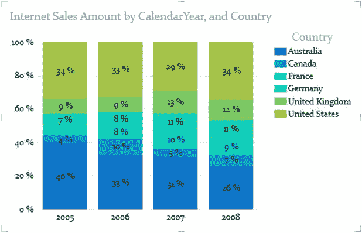

图 9-14. 创建 100% 堆积柱形图

簇状柱形图将不同国家的柱形并排显示，而不是堆叠在一起。图 9-15 展示了与图 9-13 相同的信息，但采用了簇状柱形图的形式。

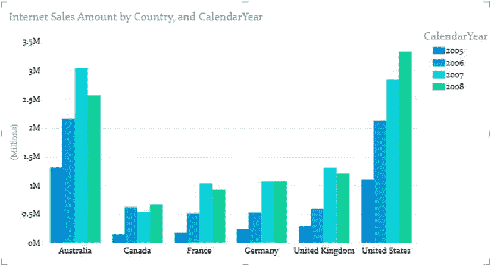

图 9-15. 创建簇状柱形图

虽然您无法过多控制图表的布局，但可以在 `Design` 选项卡上控制标题、图例和数据标签（参见图 9-16）。

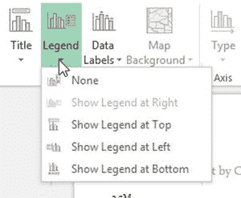

图 9-16. 控制图例布局

与大多数可视化对象一样，在 Power View 中，您拥有自动筛选和排序功能。例如，如果鼠标悬停在图 9-15 中图表的左上角，您会看到将排序依据从 `country name` 更改为 `Internet sales amount` 的选项（参见图 9-17）。

图 9-17. 更改柱形图的排序方式

饼图与堆积柱形图或堆积条形图类似，都允许您比较某个类别中各成员的度量值以及该类别的总计。图 9-18 展示了一个饼图，用于比较不同类型分销商的销售额。

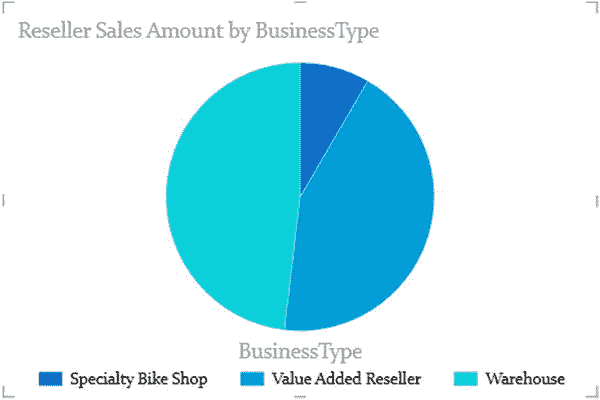

图 9-18. 使用饼图比较数据

与柱形图和条形图一样，您对饼图布局的控制非常有限，只能设置标题和图例位置。在撰写本文时，饼图甚至不支持数据标签，这实在令人遗憾。

虽然条形图、柱形图和饼图非常适合比较不同类别的聚合数据，但如果您想发现数据中的趋势，折线图和散点图是更好的选择。接下来您将研究这些类型的图表。

#### 构建折线图和散点图

折线图用于查看同等时间段内的趋势。这些时间段通常是时间单位，包含小时、天、月等。时间段绘制在 x 轴上，度量值绘制在 y 轴上。图 9-19 展示了一天中各小时的航班延误分钟数。每条线代表不同的航空公司。使用此图表，您可以轻松发现一天中的趋势，并比较各航空公司的表现。

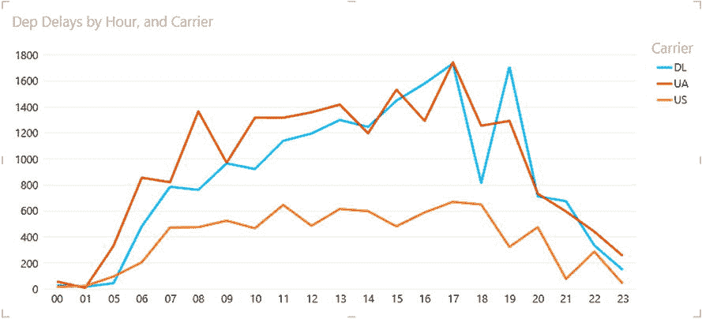

图 9-19. 使用折线图发现趋势

如果您需要同时比较两个度量值的趋势，可以使用散点图。散点图将一个度量值绘制在 y 轴上，另一个绘制在 x 轴上。要创建散点图，首先创建一个包含一个类别字段和两个数字字段的表——例如，`reseller name`（类别）、`sales amount`（数字）和 `sales profit`（数字）。创建表之后，将可视化对象切换为散点图，该图位于 `Design` 选项卡上的 `Other Chart` 下拉菜单中。图 9-20 显示了生成的散点图。

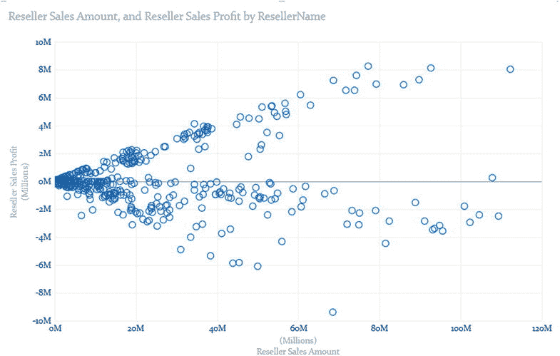

图 9-20 在散点图中比较数据

使用散点图，您可以轻松发现数据趋势以及不符合趋势的异常值。

如果查看散点图的`字段`放置区域（见图 9-21），您会看到`大小`和`颜色`两个放置区域。您可以将另一个度量值添加到`大小`放置框中，将另一个类别添加到`颜色`放置框中。

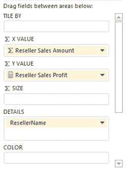

图 9-21 为散点图添加大小和颜色

一旦为散点图添加了大小轴，它就变成了气泡图。图 9-22 展示了一张气泡图，其中气泡的大小代表经销商员工数量，颜色代表经销商的业务类型。

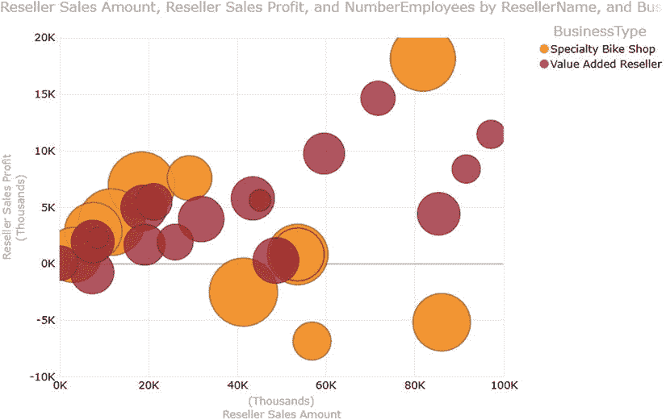

图 9-22 在气泡图中比较数据

如果查看散点图的放置区域，您应该会看到另一个标记为`播放轴`的放置框。您可以在此框中放入一个基于时间段的字段，这将在散点图下方生成一个播放轴。`播放轴`允许您查看度量值随时间的变化情况。在分析过程中，您可以播放、暂停和回放这些变化。如果您点击图表中的某个气泡，可以查看该时间段内发生的变化轨迹。图 9-23 显示了一个可用于分析产品销售额随时间比较情况的散点图。

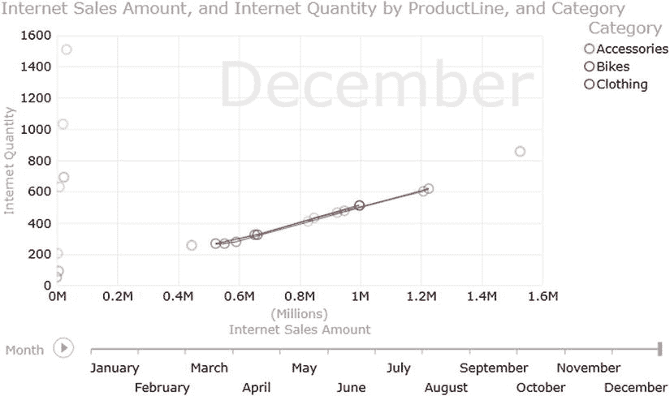

图 9-23 为散点图添加播放轴

除了用于比较数据的标准可视化效果之外，Power View 还允许您使用必应地图在地理位置上查看数据。您将在下一节了解如何创建基于地图的可视化效果。

#### 创建基于地图的可视化效果

Power View 的一个出色功能是它可以使用必应地图的磁贴来创建可视化效果。如果您的数据包含城市、州/省和国家/地区等地理字段，那么将数据整合到地图中会非常容易。您可以通过`字段列表`中的地球图标来判断某个字段是否可以进行地理定位（见图 9-24）。

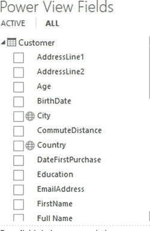

图 9-24 地球图标表示可映射的字段

要创建地图，首先创建一个包含地理空间字段和您希望在地图上查看的度量值的表格。表格创建完毕后，您可以将其切换为地图。这些位置会以气泡的形式显示在地图上，气泡的大小表示度量值的大小。图 9-25 显示了按城市划分的销售额，其中地图已放大到加利福尼亚州旧金山地区。

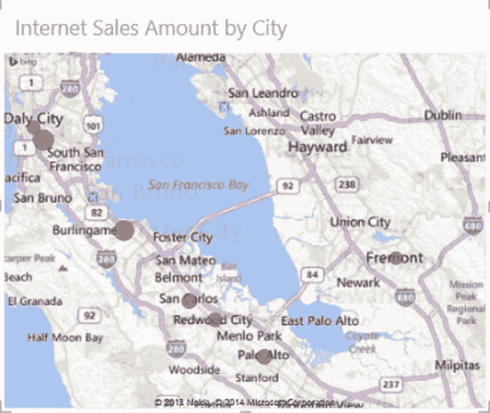

图 9-25 在地图上查看数据

如果查看地图的字段放置区域，您应该会看到`经度`和`纬度`放置框；这允许您在地图上创建精确的位置点。此外，还有一个颜色放置区域，您可以在其中放入一个类别字段。这会将地图上的气泡转换为显示每个类别的饼图（见图 9-26）。

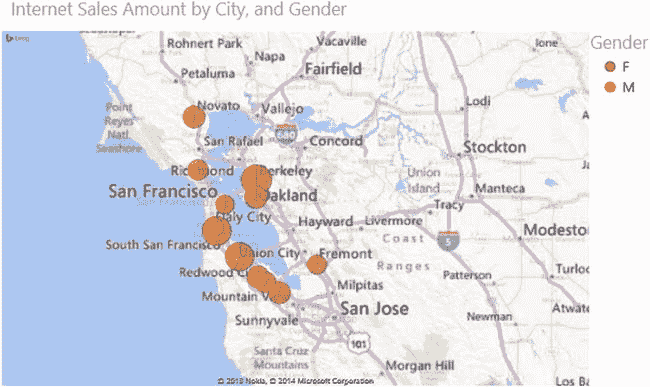

图 9-26 为地图添加类别

现在您已经了解了如何创建 Power View 中提供的各种可视化效果，是时候通过动手实践来创建一些效果了。

#### 动手实验——在 Power View 中创建标准可视化效果

在以下实验中，您将：

*   创建条形图、柱形图和饼图。
*   创建折线图和散点图。
*   创建一个基于地图的可视化效果。

1.  在`LabStarters`文件夹中，打开`LabChapter9.xlsx`文件。该文件包含来自测试`AdventureWorks`数据库的销售数据。
2.  在 Excel 中选择`插入`选项卡，然后单击`Power View`按钮。这将在工作簿中插入一个`Power View`报告表。
3.  创建一个按区域或国家/地区列出销售额以及经销商销售额的表。
4.  选中`Power View`表上的表格，将可视化切换为簇状柱形图。调整图表大小。它应该类似于图 9-27。

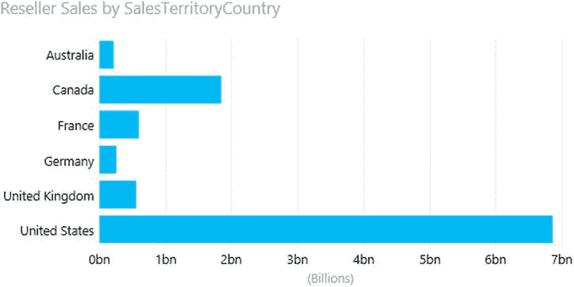

图 9-27. 创建柱形图

5.  选中柱形图，将`Reseller Business Type`拖放到`图例`下拉框中。现在图表按国家/地区分组，为每个业务类型显示一个条形。
6.  将图表切换为`100% 堆积柱形图`。在`布局`选项卡下，更改设置以显示数据标签。图表应类似于图 9-28。

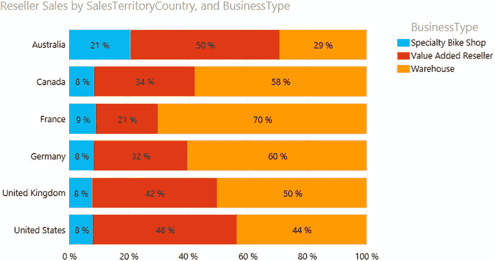

图 9-28. 创建 100% 堆积柱形图

7.  在`Power View`选项卡上，单击`Power View`按钮以插入一个新的`Power View`表。创建一个堆积柱形图，按年份和类别显示经销商销售利润。图表应类似于图 9-29。

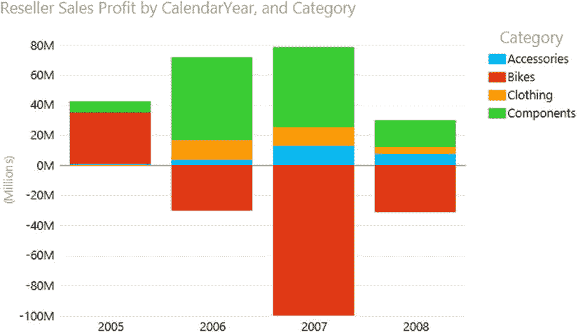

图 9-29. 创建堆积柱形图

8.  添加一个新的`Power View`表。在此表上，创建一个显示部门名称和平均休假小时数的表。您需要在`字段`拖放区将休假小时数从`求和`更改为`平均值`。
9.  将可视化切换为饼图。在图表的`筛选器`区域下，将图表限制为`信息服务`、`市场营销`、`采购`和`销售`部门。图表应类似于图 9-30。

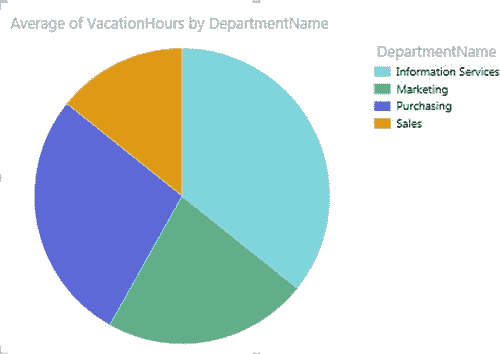

图 9-30. 创建饼图

10. 要创建折线图，请添加一个新的`Power View`表并创建一个包含月份名称和互联网销售金额的表。将可视化切换为折线图。将客户的`国家/地区`添加到`图例`拖放区域。最终图表应类似于图 9-31。注意美国和澳大利亚有峰值，而其他国家/地区则相当平稳。

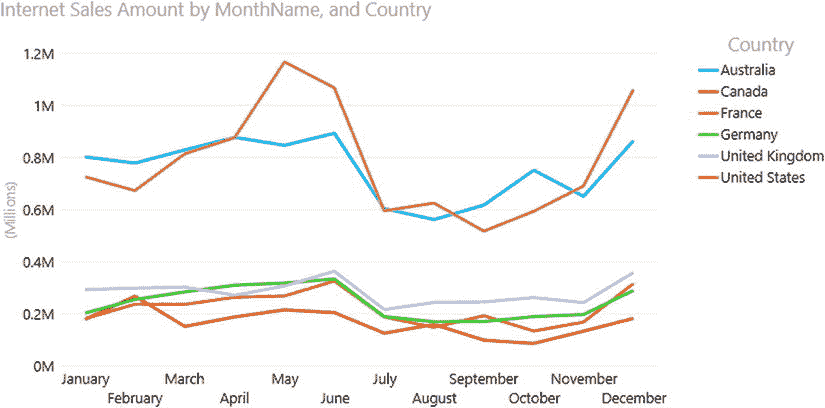

图 9-31. 在折线图中比较数据

11. 要创建散点图，请添加一个新的`Power View`表并创建一个包含`ResellerName`、`ResellerSalesProfit`和`ResellerSales`的表。将表格更改为散点图。将业务类型添加到`颜色`下拉框中。
12. 将`SalesTerritoryCountry`拖放到`图表筛选器`区域，并限制图表只显示`德国`。使用`MonthYear`创建一个播放轴。利用播放轴，找出利润损失最大的情况、时间及金额。最终得到的可视化效果应类似于图 9-32。

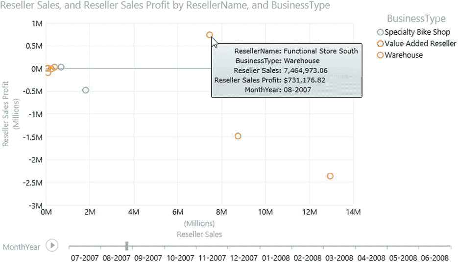

图 9-32. 使用带播放轴的散点图确定最大利润损失

13. 要创建基于地图的可视化，请在工作簿中插入一个新的`Power View`表。使用客户的`FullName`和客户`StateProvince`创建一个表。将表格切换为地图，将`Full Name`字段从`颜色`下拉框拖放到`大小`下拉框，并将聚合更改为`非重复计数`。
14. 将`HouseOwnerFlag`拖放到`颜色`下拉框。放大到美国西部地区；地图应类似于图 9-33。

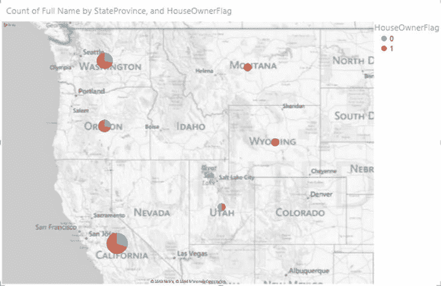

图 9-33 映射客户数量

15. 尝试映射其他字段并缩放到地图的不同区域。完成后，保存更改并退出 Excel。

#### 本章小结

在本章中，您已经了解了如何在 Power View 中创建各种可视化对象。您创建了标准柱形图、条形图和饼图。您还了解了折线图和散点图，以及如何创建气泡图并添加播放轴以查看随时间变化的趋势。此外，您还学习了如何将度量值与地理空间字段关联并呈现在地图上。至此，您应该能够熟练地在 Power View 中创建各种可视化对象了。到目前为止，您创建的每个可视化对象都是独立的图表或图形。Power View 的优势之一在于它能够将这些可视化对象关联起来，从而创建交互式仪表板。您将在下一章中探讨这一点。

### 第 10 章

#### 使用 Power View 创建交互式仪表板

在上一章中，您研究了用于创建报表和仪表板的一些标准可视化对象。在本章中，您将把这些可视化对象结合起来，使它们协同工作以形成交互式仪表板。交互式仪表板与传统仪表板的不同之处在于，它将用户体验从被动扩展为主动。您可以执行筛选、在不同细节级别上下钻，并发现各个指标之间的关联。您还将了解如何使用磁贴对数据进行分组，以及如何为组和整体视图创建筛选器。此外，您还将了解如何包含图像以增强仪表板体验。

完成本章后，您将能够：

- 在 Power View 中链接可视化对象。
- 使用磁贴组织数据。
- 筛选组和视图。
- 将仪表板公开给使用者。

 **注意** 如需彩色图形副本，请访问 Source Code/Downloads（源代码/下载），网址为 `http://www.apress.com/9781430264453`。

##### 在 Power View 中链接可视化对象

Power View 的优势之一在于，如果 Power Pivot 模型中包含用于创建各个可视化对象的数据之间的链接，Power View 将利用该关系实现交互式筛选。*交互式筛选*是指对一个可视化对象进行筛选的过程会自动筛选相关可视化对象。例如，图 10-1 显示了一个条形图，该图展示了 Adventure Works 示例数据库中不同产品类别的销售额。

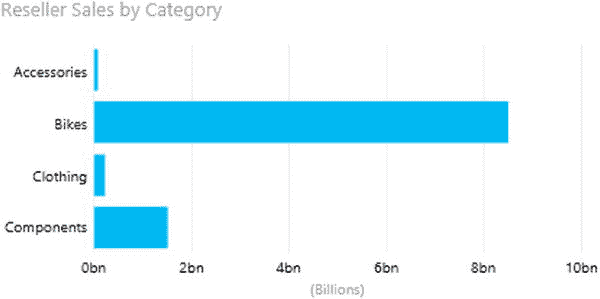

图 10-1 按类别划分的分销商销售额

在此视图的基础上，您可以添加一个显示不同国家销售额的柱形图，如图 10-2 所示。

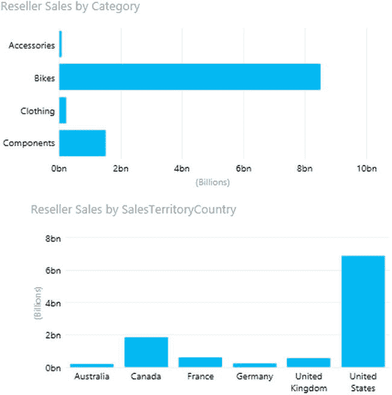

图 10-2 向同一视图添加相关可视化对象

由于 `Sales` 表与 `SalesTerritory` 表和 `Product` 表相关联，因此如果您选择其中一个产品类别条，则会高亮显示条形图中该类别对应的销售额（参见图 10-3）。

图 10-3 相关可视化对象的交互式筛选

这种筛选是双向的，因此您可以单击下方图表中的某一列，它将筛选顶部图表以显示该国家的销售额。这种交互式筛选适用于 Power View 中大多数类型的可视化对象。图 10-4 显示了一个气泡图和一个表格。当您单击一个气泡时，表格会被筛选，以显示构成该气泡值的详细记录。

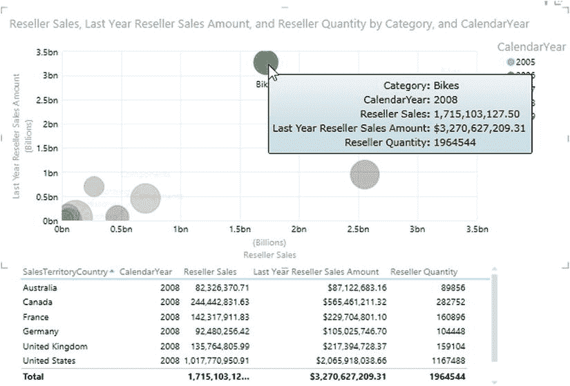

图 10-4 筛选以显示构成气泡值的详细信息

现在您已经了解了可视化对象之间如何交互，接下来可以学习如何使用磁贴对可视化对象进行分组。

##### 使用磁贴组织数据

在上一节中，您了解了放置在同一视图上的可视化对象如何相互交互。另一种将可视化对象组合在一起的方法是使用磁贴。首先创建一个包含分组条件的表格。例如，您可能希望按销售区域组织销售数据。为此，首先使用销售区域图像创建一个表格，然后将其更改为磁贴类型的可视化对象。您将看到一个类似于图 10-5 的可视化对象。

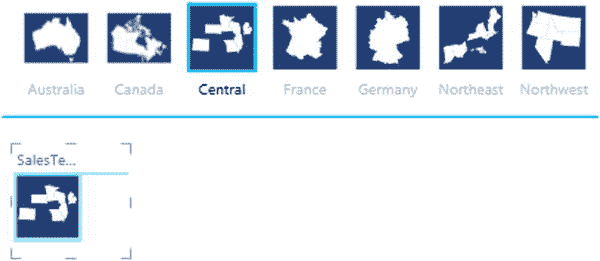

图 10-5. 创建磁贴组

在图 10-5 中，请注意销售区域图像同时出现在"标题"字段和"详细信息"区域中。您可以从"详细信息"区域中移除该字段，并从 Power Pivot 模型中添加与销售区域相关的数据。例如，您可以添加分配给该区域的销售人员、他们的照片、销售额以及销售年份。这将在磁贴的"详细信息"部分创建一个表格（参见图 10-6）。

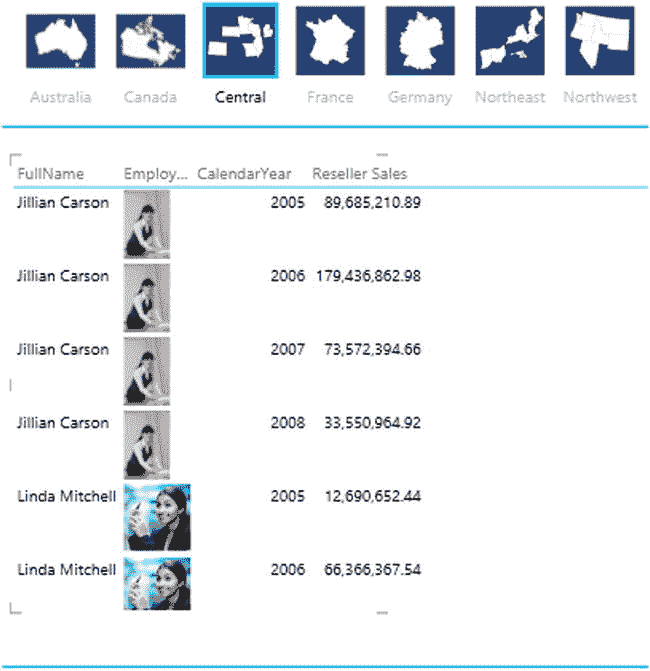

图 10-6. 在磁贴内创建表格

您可以将详细信息的可视化对象更改为其他类型，例如，矩阵。当您单击不同的磁贴时，详细信息会根据磁贴组进行筛选（参见图 10-7）。

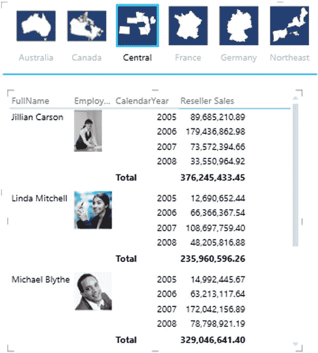

图 10-7. 使用磁贴进行分组

如果您单击磁贴"详细信息"区域的空白区域，则可以构建另一个可视化对象。例如，图 10-8 显示了一个矩阵和一个柱形图，它们都根据所选磁贴进行了筛选。

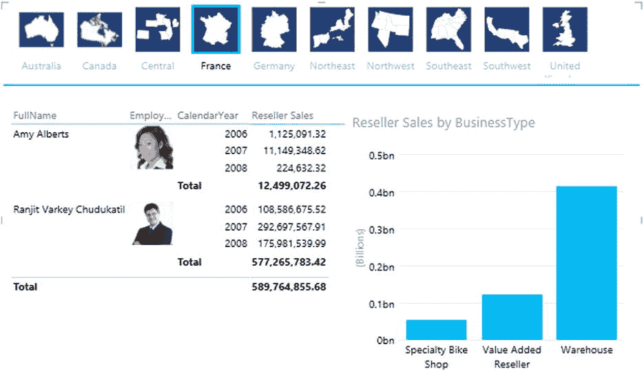

图 10-8. 使用磁贴控制多个可视化对象

对可视化对象进行分组后，请确保您了解筛选是如何影响分组在磁贴中和视图上的可视化对象的。接下来您将了解这一点。

##### 筛选组和视图

当您将多个可视化对象放置在同一视图上时，您可以选择筛选整个视图（页面）或构成该视图的单个可视化对象。图 10-9 显示了"筛选器"区域，您可以在其中切换"视图"选项卡和"图表"选项卡。"视图"选项卡用于将筛选器应用于页面上的所有可视化对象，而"图表"选项卡则将筛选器仅应用于单个可视化对象（此处为一个图表）。

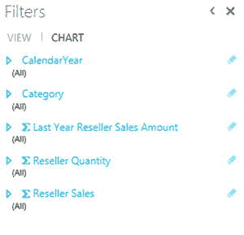

图 10-9. 筛选图表或视图

默认情况下，可视化对象筛选器包含构成该可视化对象的字段，且这些字段无法移除。但是，您可以从"字段列表"向筛选器中添加其他字段。当您首次单击"筛选器"区域中的"视图"选项卡时，其中没有列出任何字段。要筛选视图中的值，请从"字段列表"中添加与视图上可视化对象中包含的字段相关的字段。

所有筛选器都有一个列表模式，在该模式下，值显示为复选框列表（参见图 10-10）。

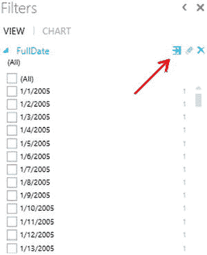

图 10-10. 使用筛选器选取列表

您还可以通过选择字段名称右侧的箭头切换到高级筛选模式。Power View 中公开的高级筛选控件类型取决于筛选器的数据类型。图 10-11 显示了针对日期字段公开的高级筛选控件。

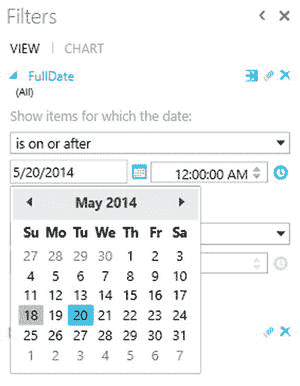

图 10-11. 按日期进行高级筛选

图 10-12 显示了当高级筛选与基于文本的字段一起使用时可用的选项。

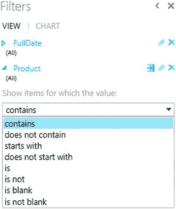

图 10-12. 使用基于文本的字段进行高级筛选

筛选视图的另一种方法是使用切片器。切片器对用户来说很友好，因为它们属于视图的一部分。切片器的缺点在于它们仅限于选取列表，并且不提供前面提到的高级筛选功能。将磁贴分组与切片器结合使用可以创建不同的筛选器集。图 10-13 显示了磁贴组内和磁贴组外的相同图表。两个图表都受到 CalendarYear 切片器的筛选，因为它们位于同一视图上。磁贴组内的图表还受到销售区域的进一步筛选，因为它是磁贴组的一部分。

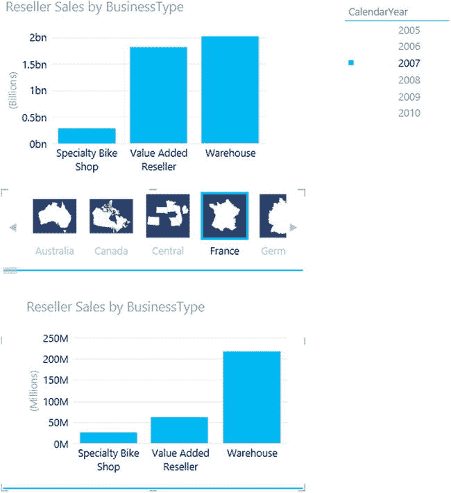

图 10-13. 使用切片器和磁贴进行筛选

构建好仪表板后，就需要将其开放给用户。在下一节中，我们将简要回顾您的选项。

##### 公开仪表板

构建交互式仪表板后，下一步是将其公开给其他人（例如业务分析师和经理），以便他们能够探索数据。由于构成仪表板的 Power Pivot 模型和 Power View 可视化对象是一个独立的单元，您只需与使用者共享 Excel 文件的副本即可。然而，这并不是管理仪表板的理想方式，并且很快就会变得难以控制。管理仪表板的更好方法是将它们托管在 SharePoint 站点中。您可以将其托管在本地 SharePoint Server 2013 或基于云的 Office 365 SharePoint Server 中。

基于云的 Office 365 解决方案具有一些非常引人注目的功能，使其成为托管 Power BI 解决方案的绝佳场所。这些功能包括 Power BI 站点，用户可以在其中共享、查看 Power View 仪表板并与之交互。它还包括一个 Power BI 管理中心，您可以在其中保护、监控和自动化仪表板的数据刷新。如果您需要实施一个解决方案来为大量用户创建和分发大量视图，我建议您了解一下 Office 365 的功能。图 10-14 显示了 Office 365 Power BI 站点上的 Power View 仪表板。

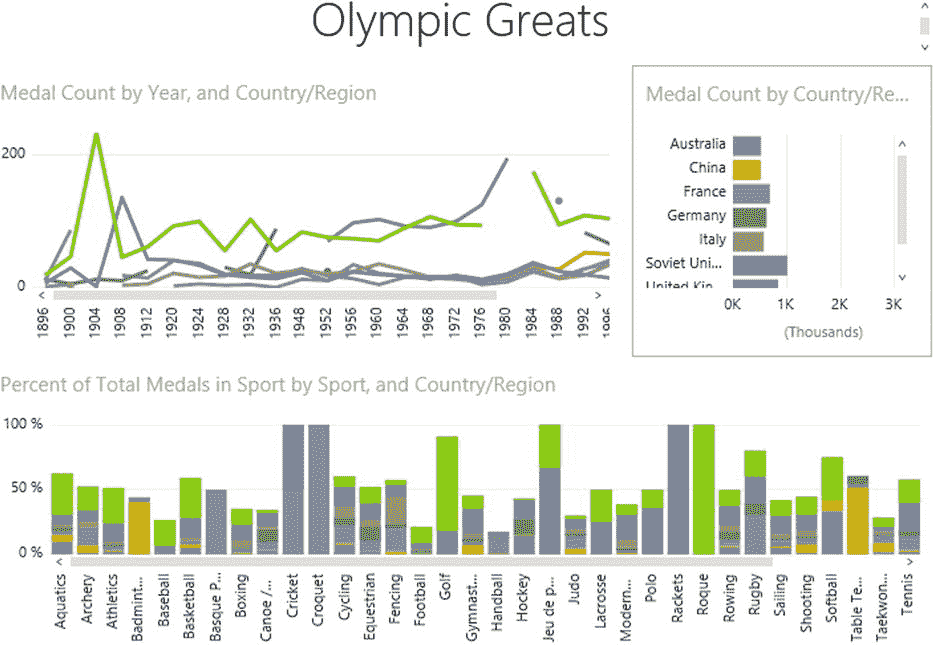

图 10-14. 在 Power BI 站点上公开 Power View 仪表板

需要记住的一点是，Power View 最初是为交互式数据探索而创建的。尽管它正在演变成一个相当不错的仪表板工具，但它并不是生成需要打印的静态报告的最佳选择。当您打印 Power View 页面时，实质上只是打印了一个屏幕截图。

现在您已经了解了如何使用 Power View 创建交互式仪表板，是时候亲自动手实践创建一个了。

##### 动手实验——在 Power View 中创建仪表板

在以下实验中，您将

*   使用 Power View 创建交互式仪表板。
*   使用磁贴对可视化对象进行分组。

1. 在`LabStarters`文件夹中，打开`LabChapter10.xlsx`文件。此文件包含来自测试数据库`AdventureWorks`的销售数据。
2. 在 Excel 中选择`插入`选项卡，然后点击`Power View`按钮。这将在工作簿中插入一个`Power View`工作表。你将在此工作表上构建仪表板。
3. 将仪表板的标题更改为**经销商销售分析**。
4. 创建一个包含`CalendarYears`的表格，并将其转换为切片器。在切片器中选择年份`2006`以限制数据。
5. 点击设计图面的空白区域以创建新的可视化效果。从`Date`表中选择`MonthName`，从`Reseller Sales`表中选择`Reseller Sales Profit`。将表格转换为折线图并调整图表大小。从`Product`表中将`Category`添加到折线图的`图例`放置区域。
6. 使用`Reseller`表中的`BusinessType`以及`Reseller Sales`表中的`Last Year Reseller Sales Amount`和`Reseller Sales`创建一个簇状条形图。
7. 重新排列可视化效果，使仪表板看起来类似于图 10-15。

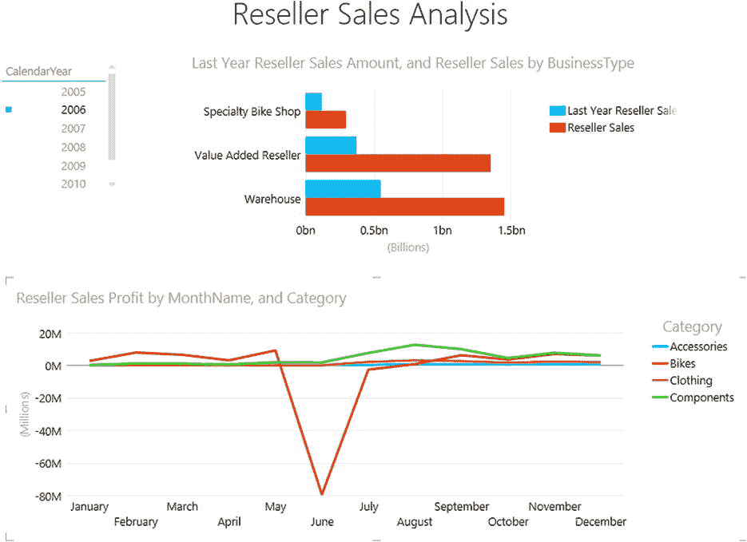

图 10-15. 经销商销售分析仪表板

8. 通过更改切片器中的年份、在条形图中选择经销商类型以及在折线图中选择类别线来测试仪表板的交互性。注意这如何影响仪表板中的图表。你可以通过点击图表的空白区域来清除图表上的筛选器（参见图 10-16）。

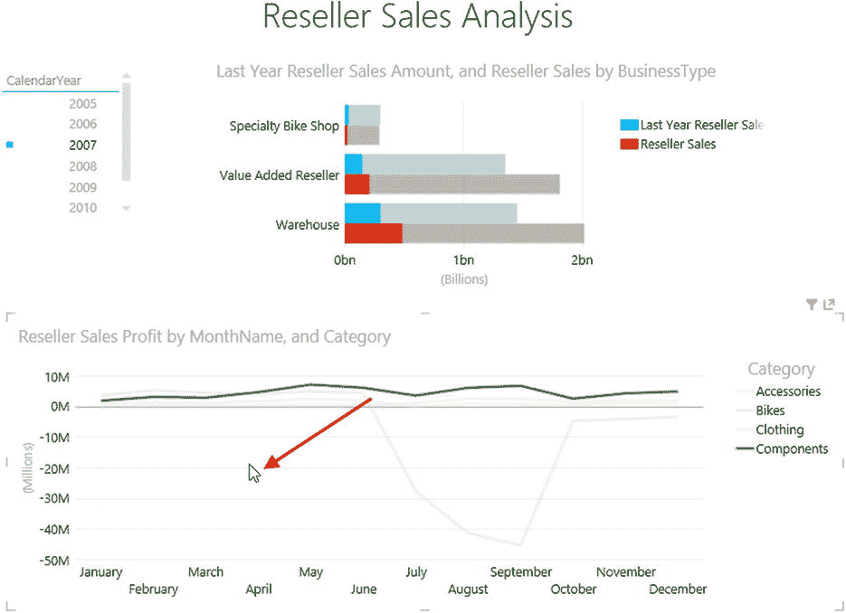

图 10-16. 清除交互式筛选器

9. 添加一个新的`Power View`工作表。将此仪表板的标题命名为**销售业绩**。
10. 从`Employee`表创建一个`EmployeePhotos`的表格。通过在`设计`选项卡中选择`平铺`，将表格更改为平铺。
11. 将`Employee`表中的`DepartmentName`拖到`筛选器`区域。将视图筛选为仅显示销售部门的员工。调整平铺区域的大小以占据视图的大部分空间（参见图 10-17）。

图 10-17. 创建平铺分组

12. 删除平铺下方显示的员工图像。
13. 在`平铺`框内选择一个空白区域，然后点击`字段选择`窗格中的`Reseller Sales`表里的`Reseller Quantity`。从`Sales Territory`表中选择`SalesTerritoryImage`和`SalesTerritoryRegion`。最后，从`Product`表中选择`Category`。
14. 将表格转换为矩阵，并将`Date`表中的`CalendarYear`拖到矩阵的`列组`中。调整矩阵大小，使其占据平铺区域的大约一半（参见图 10-18）。你可以在`设计`选项卡中减小文本大小使其适应。

图 10-18. 向平铺区域添加矩阵

15. 要创建柱形图，在`平铺`框内选择一个空白区域并点击。选择`Product`表中的`Category`、`Reseller Sales`表中的`Reseller Sales`以及`Date`表中的`CalendarYear`。将创建的表格更改为`100% 堆积柱形图`。调整图表大小，使其看起来类似于图 10-19。

图 10-19. 向仪表板添加堆积柱形图

16. 选择不同的销售人员，并注意数据已筛选为仅显示他们的销售数据。同时点击柱形图的一个分区，注意它如何筛选矩阵数据。
17. 探索与你创建的两个仪表板进行交互。
18. 你可能想要探索更改主题和为仪表板添加背景图像。你还可以添加公司徽标和标准免责声明，这是大多数公司仪表板的常见要求。完成后，保存并退出 Excel。

**总结**

在本章中，你已了解了如何结合`Power View`中的各种可视化效果来创建交互式仪表板。你还了解了如何使用平铺来分组仪表板上的其他可视化效果。尽管你没有探讨将仪表板部署到`SharePoint`，但这将是合乎逻辑的下一步。`SharePoint`，无论是在云端与`Office 365`结合，还是在本地与`SharePoint 2013`结合，都为协作和管理自助式`BI`提供了强大的功能。在下一章中，你将了解另一个有用的 Excel 加载项，它将是你自助式`BI`工具库的一部分。`Power Query`提供了一个易于使用的界面，用于发现和转换数据，以便在你的`Power Pivot`模型中使用。它还包含清理和塑造数据的工具，例如删除重复项、替换值和分组数据。

