# 第 6 章


## 融入时间智能

一种最常见的数据分析类型是比较随时间变化的值。本章将向读者展示如何在 Power Pivot 中正确实现基于时间的分析。内容包括设置日期表、使用各种内置函数分析截至当前日期的值、比较不同时间段的值，以及执行半加法聚合。

完成本章后，你将能够：

*   创建一个日期表。
*   使用 DAX 进行基于时间段的评估。
*   使用筛选器函数移动日期上下文。
*   创建半加法度量值。

### 基于日期的分析

很大一部分数据分析都涉及某种基于日期时间的聚合和比较。例如，你可能需要查看截至当前月份（MTD）或截至当前年份（YTD）的使用情况或销售额，如图 6-1 所示。

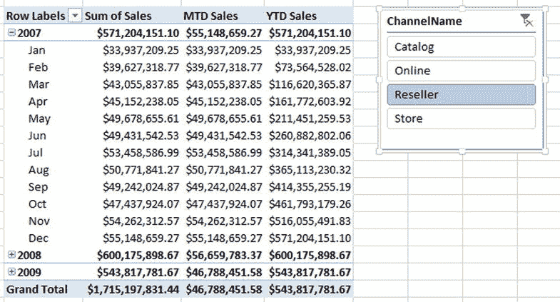

图 6-1. 计算年初至今和月初至今的销售额

另一个常见的例子是比较从一个时间段到下一个时间段的业绩表现。例如，你可能想要比较上个月的销售额与当前月份的销售额（参见图 6-2），或者将当前月份的销售额与去年同期的销售额进行比较。

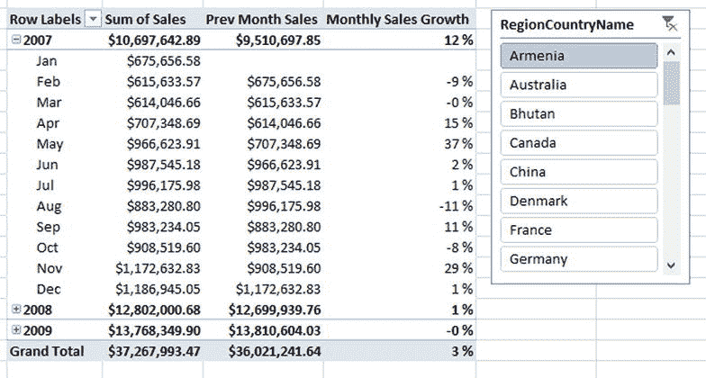

图 6-2. 计算销售额增长

除了这些常见的数据分析之外，有时你还需要基于非加和性度量值（例如账户余额或库存）进行聚合。在这些情况下，你需要确定输入的最后一个值，并使用该值来聚合不同时间段的数据（参见图 6-3）。

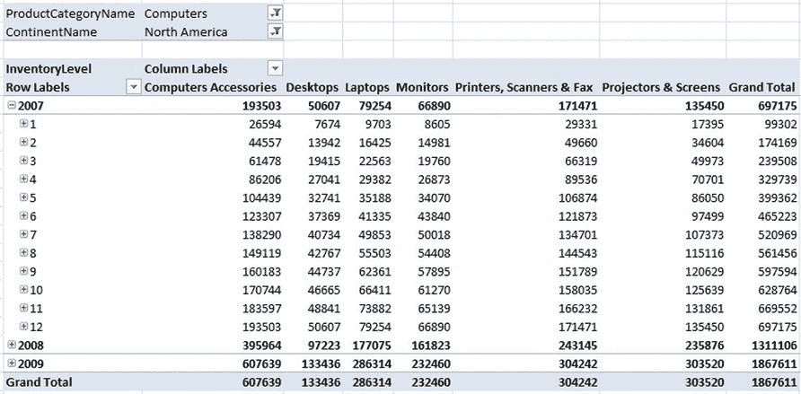

图 6-3. 聚合库存量

DAX 包含许多函数，可以帮助你创建可能需要的各种基于日期时间的分析。在下一节中，你将看到如何创建日期表，这是使用许多基于日期时间的函数所必需的。

### 创建日期表

为了使用 DAX 中内置的时间智能函数，你需要在模型中有一个日期表供这些函数引用。该表的唯一要求是，在你想查看的日期范围内，每天对应一个不同的行。每一行都需要包含该日期的完整日期。日期表可以（并且通常）包含更多列，但这并非必须。

有多种方法可以创建日期表。如果你从数据仓库中检索数据，可以将日期维度导入模型并使用它。如果你无法使用日期表，可以在 Excel 工作表中创建它，然后将其导入模型。如果你有权访问数据库，还可以编写 SQL 查询来创建一个临时表，并使用该临时表将日期加载到模型中。以下代码显示了可以针对 Microsoft SQL Server 数据库使用的 SQL 查询。它使用公用表表达式来填充日期表。

```
DECLARE
  @BeginDate DATE,
  @EndDate DATE

SET @BeginDate = '01/01/2010'
SET @EndDate = '12/31/2014'
;

WITH cteDate AS (
  SELECT @BeginDate AS CalendarDate
  UNION ALL
  SELECT DATEADD(DAY,1,CalendarDate)
    FROM cteDate
    WHERE CalendarDate < @EndDate)

SELECT
  (DATEPART(YEAR,CalendarDate) * 10000) + (DATEPART(MONTH,CalendarDate) * 100)  +
    DATEPART(DAY,CalendarDate) AS DateKey,
  CalendarDate,
  DATEPART(YEAR,CalendarDate) AS Year,
  DATEPART(MONTH,CalendarDate) AS MonthNumber,
  DATENAME(MONTH,CalendarDate) AS Month
  FROM cteDate
  OPTION (MAXRECURSION 0)
```

将表放入模型后，你需要将其标记为官方日期表（参见图 6-4），并指明哪一列是唯一键（参见图 6-5）。这会通知 DAX 查询引擎使用此表作为参考，来构造计算所需的一组日期。例如，如果你想要查看年初至今的销售额，查询引擎将使用此表来获取所需的日期集。

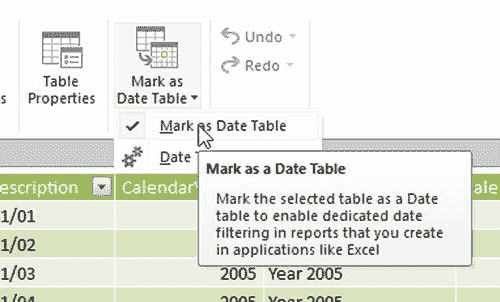

图 6-4. 标识日期表

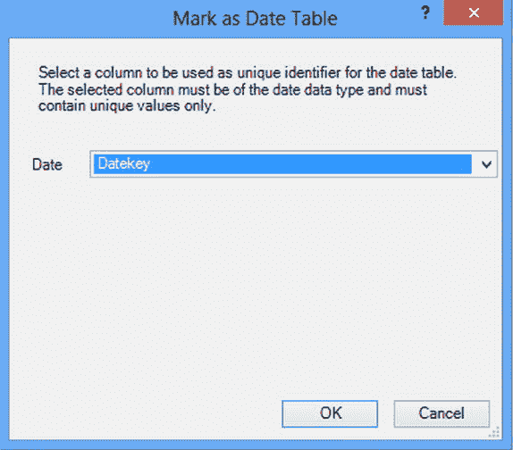

图 6-5. 设置日期键

目前在 DAX 中有 35 个内置的时间智能函数。其中一些函数（如 `FIRSTNONBLANK`）返回单个日期。另一些函数（如 `PREVIOUSMONTH`）则返回一组日期。还有一些函数（如 `TOTALQTD`）会在时间范围内计算表达式。目前，DAX 内置的时间智能函数支持以 12 月 31 日为结束日的传统日历。它们也支持具有不同年终日期且包含四个季度（每个季度三个月）的财务日历。如果你需要使用自定义财务日历，则需要自行创建自定义计算。

现在你已经了解了如何在模型中创建和指定日期表，接下来我们来了解如何实现一些常用的时间智能函数来分析数据。

### 基于时间段的评估

数据分析中常见的一种分析是查看截止到某日期的值。例如，你可能希望查看年初至今的销售额或月初至今的能源消耗量。DAX 提供了 `TOTALMTD`、`TOTALQTD` 和 `TOTALYTD` 函数，使得这项工作变得非常简单。例如，年初至今的总额定义如下：

```
TOTALYTD(<表达式>,<日期>[,<筛选器>][,<年终日期>])
```

其中，`表达式` 是一个返回标量值的表达式。`日期` 是日期表的关键列。`筛选器` 是一个可选的筛选表达式，`年终日期` 也是可选的——你可以用它来指示财务日历的年末日期。以下表达式用于计算销售额总和以及年初至今的销售额值。

```
销售额总和:=SUM(Sales[SalesAmount])
年初至今销售额:=TOTALYTD([销售额总和],'Date'[Datekey])
```

如果要计算所有产品的年初至今销售额，请使用以下表达式：

```
所有产品年初至今销售额:=TOTALYTD([销售额总和],'Date'[Datekey],ALL('Product'))
```

图 6-6 显示了数据透视表中的度量值。你可以使用这些基础度量值来计算进一步的度量值，例如年初至今销售额占比和所有产品销售额占比。

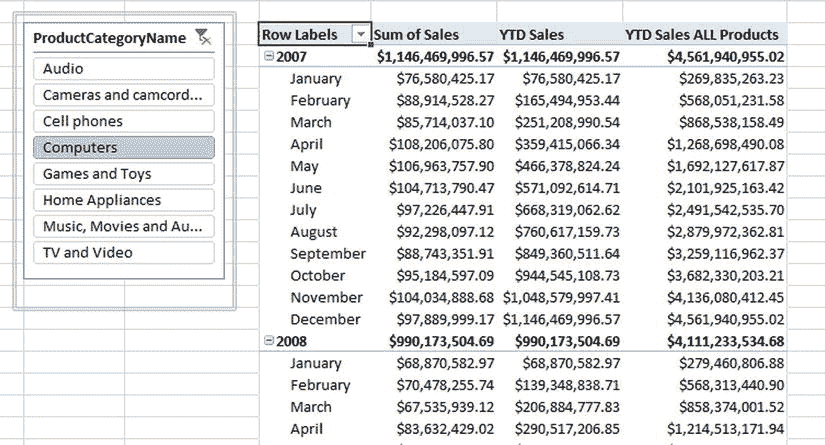

图 6-6. 计算年初至今的值

你也可以使用另一组函数——`DATESMTD`、`DATESQTD` 和 `DATESYTD`——来创建相同的度量值。与之前的截止到某日期度量值一样，你需要将日期表中的日期键传递给这些函数。以下表达式使用 `CALCULATE` 函数配合 `DATESYTD` 筛选器来获取年初至今的销售额度量值。

```
年初至今销售额 2:=CALCULATE([销售额总和],DATESYTD('Date'[Datekey]))
```

使用 `CALCULATE` 函数和 `DATES` 函数比使用截止到某日期的函数更加灵活，因为你可以将它们用于任何类型的聚合，而不仅仅是求和。以下表达式用于计算年初至今的平均销售额。结果显示在图 6-7 中。

```
平均销售额:=AVERAGE([SalesAmount])
年初至今平均销售额:=CALCULATE([平均销售额],DATESYTD('Date'[Datekey]))
```

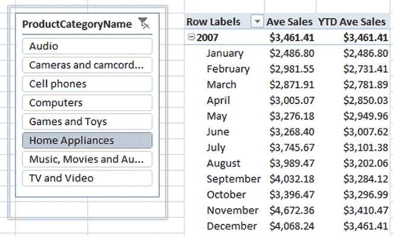

图 6-7. 计算年初至今的平均值

现在你已经知道如何创建基于时间段的计算，可以使用它来比较过去业绩和当前业绩。但首先你需要知道如何移动日期上下文来计算过去业绩。

### 移动日期上下文

如果你想将某一时期的业绩与过去同一时期的业绩进行比较，比如将当前月份的销售额与一年前同月的销售额进行比较，你需要移动日期上下文。DAX 包含几个执行此操作的函数。其中用于移动日期上下文的最通用的函数之一是 `PARALLELPERIOD` 函数。与其他时间智能函数一样，你需要将日期表的关键列传递给该函数。你还需要指定间隔数量和间隔类型（年、季度或月）。

```
PARALLELPERIOD(<日期>,<间隔数量>,<间隔>)
```

需要记住的一点是，`PARALLELPERIOD` 函数返回一组与间隔类型相对应的日期。如果你使用“年”，它将返回一年的日期；使用“月”间隔则返回一个月的日期。以下表达式计算去年同月的销售总额。图 6-8 显示了计算结果。

```
去年同月销售额:=Calculate([销售额总和],
PARALLELPERIOD('Date'[Datekey],-12,Month))
```

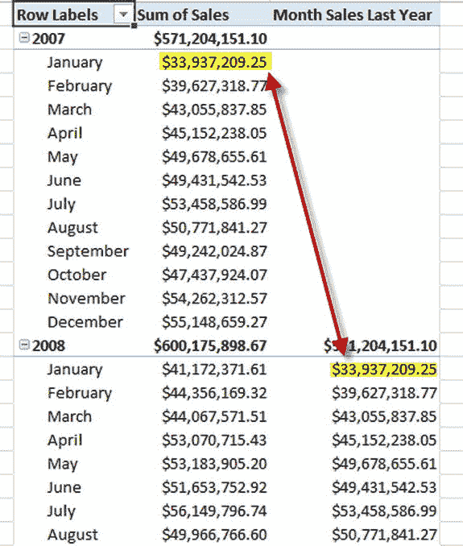

图 6-8. 计算平行时期的销售额

请注意，如果你下钻到日期级别（参见图 6-9），你仍然会看到一年前该日期所在月份的月度总额。如前所述，这是因为在这种情况下，`PARALLELPERIOD` 始终返回与当前行日期所在月份相同且为去年同月的日期集。

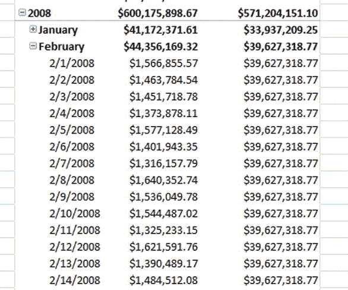

图 6-9. 下钻到日级别仍显示月级别聚合

现在你可以计算去年同月的销售额，并将其与当前销售额结合，以计算逐年月度销售额增长率。图 6-10 显示了结果。

```
同比月度增长率:=([销售额总和]-[去年同月销售额])/[去年同月销售额] 
```

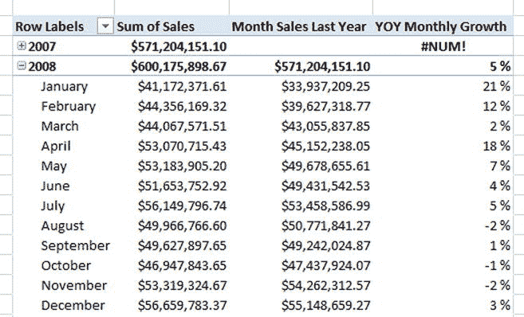

图 6-10. 计算逐年月度增长率

请注意，如果没有上一年度的销售额，数据透视表中会出现错误。你可以通过检查去年同月销售额是否为空并插入空值来控制这种情况。

```
同比月度增长率:=IF(
ISBLANK([去年同月销售额]),
BLANK(),
([销售额总和]-[去年同月销售额])/[去年同月销售额])
```

另一个常用于更改日期上下文的函数是 `DATEADD` 函数。`DATEADD` 函数用于在当前日期上下文上添加一个日期间隔。你可以添加年、季度、月或日的间隔。

```
DATEADD(<日期>,<间隔数量>,<间隔>)
```

以下计算使用 `DATEADD` 函数作为筛选器，求得上一天销售额的总和。

```
上一天销售额:=Calculate([销售额总和],DATEADD('Date'[Datekey],-1,day))
```

现在你已经知道如何移动日期上下文，接下来我们将了解一些可以在筛选器中使用的、返回单个日期的函数。

### 使用单个日期函数

DAX 包含一组返回单个日期的函数。这些函数通常用于筛选日期上下文。例如，`FIRSTDATE` 函数返回传递给它的日期列中的第一个日期。作为示例，你可以将其与 `DATESBETWEEN` 函数结合使用，以获取从当前日期上下文日期集中的第一天到第 15 天的日期范围。

```
DATESBETWEEN('Date'[FullDateAlternateKey]
 ,FIRSTDATE('Date'[FullDateAlternateKey])
,DATEADD(FIRSTDATE('Date'[FullDateAlternateKey]), 14, DAY))
```

然后，这可以在 `CALCULATE` 函数中用作筛选器，以获取该时期前 15 天的销售额。生成的数据透视表如图 6-11 所示。

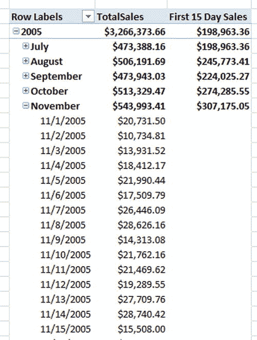

图 6-11. 计算月初前 15 天的销售额

如果你只查看月度期间，你可以使用 `STARTOFMONTH` 和 `ENDOFMONTH` 函数（也有用于年和季度的对应函数）。以下表达式用于计算该月最后 15 天的销售额总和。

```
Last 15 Day Sales:=CALCULATE(SUM(InternetSales[SalesAmount]),
 DATESBETWEEN('Date'[FullDateAlternateKey]
 , DATEADD(ENDOFMONTH('Date'[FullDateAlternateKey]), -14, DAY)
,ENDOFMONTH('Date'[FullDateAlternateKey])))
```

尽管大多数度量值只需对基础聚合稍加扩展就能实现从低层级向高层级的聚合（例如，从天到月），但有时你需要使用特殊的聚合方式来汇总度量值。这种度量值被称为**半累加性**度量值，将在下一节中介绍。

### 创建半累加性度量值

在分析数据时，你经常会遇到半累加性度量值。一些常见的例子包括库存和账户余额。例如，要确定当前时间点的库存总量，你需要将所有店铺的库存相加。但是，要找出店铺在月末的库存总量，你并不需要将每天的库存都加起来。

为了处理这些情况，DAX 提供了 `FIRSTNONBLANK` 和 `LASTNONBLANK` 函数。这些函数返回非空条件下的第一个或最后一个日期。例如，以下表达式确定了产品库存条目的最后一个非空日期。

```
LASTNONBLANK ('Date'[DateKey],CALCULATE (SUM(Inventory[UnitsInStock]))
```

然后，将其与 `CALCULATE` 函数结合使用，以确定库存总量。

```
Product Units In Stock:=CALCULATE(SUM(Inventory[UnitsInStock]),
  LASTNONBLANK('Date'[DateKey],
   CALCULATE(SUM(Inventory[UnitsInStock]))))
```

现在，如果你想要汇总所有产品的库存数量，可以使用以下表达式。

```
Total Units In Stock:=SUMX(VALUES('Inventory'[ProductKey]),[Product Units In Stock])
```

图 6-12 显示了生成的数据透视表。请注意，`Total Units In Stock` 度量值在产品维度上是累加的，但在日期维度上是非累加的。

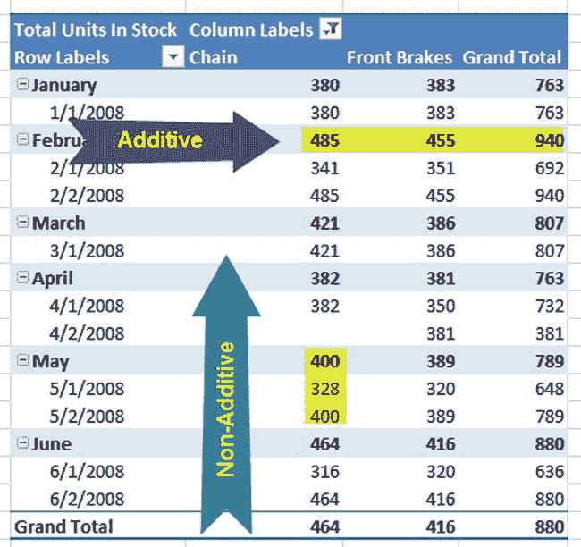

图 6-12. 计算库存数量

DAX 的优势之一在于，一旦你掌握了一种模式，就可以将其扩展到其他场景。例如，在现金流量分析中计算度量值时，你可以采用与计算库存时相同的技术。以下计算用于计算期末余额。

```
Balance:=CALCULATE ( SUM ( Finance[Amount]),
  LASTNONBLANK ('Date'[DateKey],
   CALCULATE(SUM ( Finance[Amount]))))
```

在前面的例子中，只有当库存或余额发生变化时，才会在表中添加一行记录。通常情况下，余额或库存每天都会被记录，并且相同的值会一直重复，直到发生变化。在这些情况下，你可以使用 DAX 函数 `CLOSINGBALANCEMONTH`、`CLOSINGBALANCEQUARTER` 和 `CLOSINGBALANCYEAR`。这些函数会查找时间段的最后一个日期，并将其用作该时间段的值。换句话说，`CLOSINGBALANCEMONTH` 函数返回的是该月最后一天的值。

至此，你应该对各种时间函数的运作方式有了较好的理解。在接下来的实践中，你将练习实现其中的一些函数。

# 动手实验——在 Power Pivot 中实现时间智能

在以下实验中，你将

*   创建日期表。
*   使用时间智能函数分析数据。
*   创建环比增长数据透视表。
*   创建库存水平报表。

1.  在 `LabStarters` 文件夹中，打开 `LabChapter6.xlsx` 文件。该文件包含来自 Consoto 测试数据库的库存和销售数据。
2.  以关系图视图模式打开 Power Pivot 窗口（参见图 6-13）。请注意，没有 `Date` 表。我们可以从数据源加载一个，或者在 Excel 中创建一个。

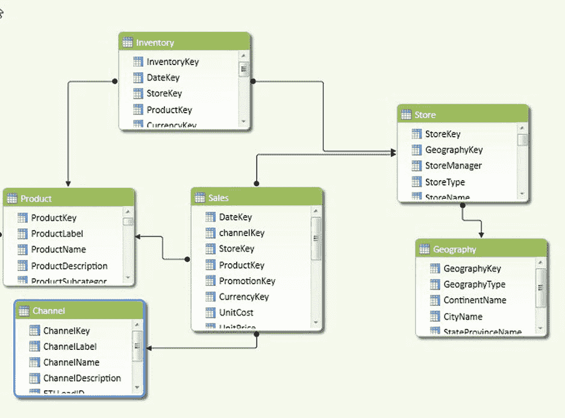

图 6-13. 当前的 Consoto 数据模型

3.  要在 Excel 中创建 `Date` 表，请切换到工作表 Sheet3。选中第一个单元格，输入列名 `DateKey`。在该列的第二个单元格中输入值 `1/1/2007`。使用 Excel 的自动填充功能添加 2009 年 12 月 31 日之前的值。
4.  要根据这些值创建表，请选中 A 列中的值。在“开始”选项卡下，选择“套用表格格式”下拉菜单，并选择一种格式。在“表工具设计”选项卡下，将表名称更改为 `Date`（参见图 6-14）。

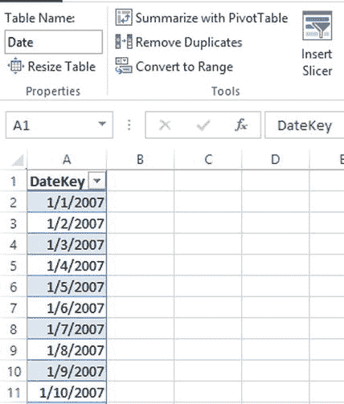

图 6-14. 创建日期表

5.  要将该表添加到模型中，请选择该表，然后在 PowerPivot 选项卡下单击“添加到数据模型”按钮（参见图 6-15）。

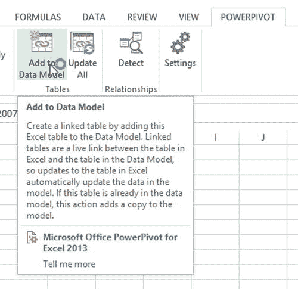

图 6-15. 将 Excel 表添加到数据模型

6.  你应该会在 Power Pivot 设计窗口的数据视图窗口中看到该表。单击“设计”选项卡，然后选择“标记为日期表”。使用 `DateKey` 作为唯一标识符。
7.  使用日期函数创建“年份”、“月份编号”和“月份”列（你必须使用 `FORMAT` 函数来创建“月份”列）。按“月份编号”列对“月份”列进行排序。
8.  切换到模型的关系图视图。使用“年份”和“月份”在 `Date` 表中创建一个“日历”层次结构。
9.  在 `Sales` 表和 `Date` 表之间创建关系（参见图 6-16）。

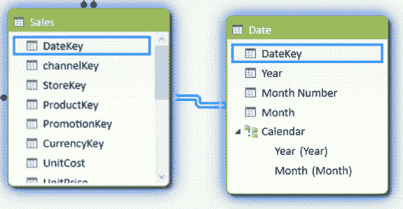

图 6-16. 创建 Sales 表和 Date 表之间的关系

10. 在数据视图窗口中选中 `Sales` 表。添加以下度量值并将其格式化为货币：

```dax
Sum of Sales:=SUM(Sales[SalesAmount])
YTD Sales:=TOTALYTD([Sum of Sales],'Date'[Datekey])
MTD Sales:=TOTALMTD([Sum of Sales],'Date'[Datekey])
```

11. 要测试度量值，请转到 Excel 中的 Sheet1 工作表，并单击单元格 B2。在“插入”选项卡上，选择“数据透视表”。在“创建数据透视表”窗口中，选择“使用外部数据源”，然后单击“选择连接”按钮（参见图 6-17）。

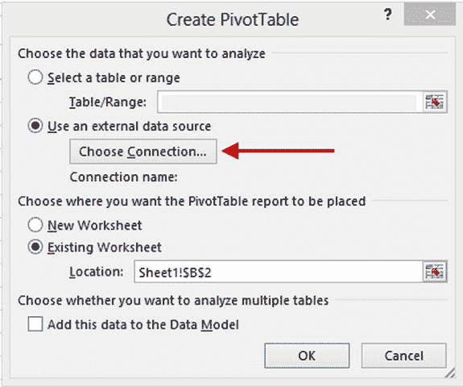

图 6-17. 选择外部数据源

12. 在“现有连接”窗口中，选择“表”选项卡。在“表”选项卡中，选择“工作簿数据模型中的表”，然后单击“打开”（参见图 6-18）。选择连接后，在“创建数据透视表”窗口中单击“确定”。

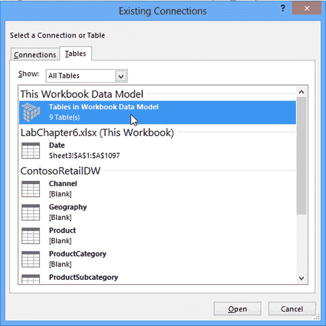

图 6-18. 选择数据模型连接

13. 将度量值 `Sum Of Sales`、`MTD Sales` 和 `YTD Sales` 添加到“值”区域，并将“日历”层次结构添加到“行”区域。在“插入”选项卡中，选择“切片器”，然后选择 `ChannelName`。研究数据并验证其是否符合你的预期（参见图 6-19）。

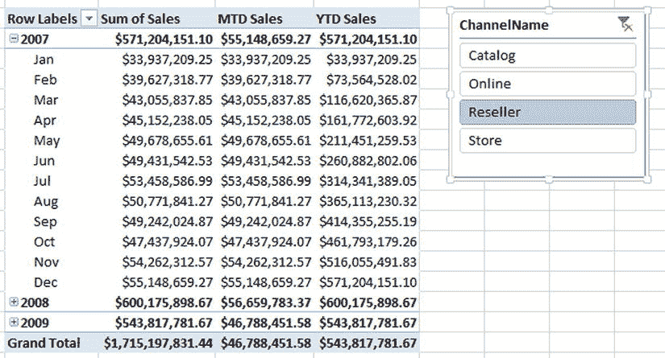

图 6-19. 验证年初至今的销售额度量值

14. 切换到数据模型中的 `Sales` 表。使用以下表达式创建一个滚动 3 个月的销售额度量值。将度量值格式化为货币。

```dax
Rolling 3 Month Sales:=CALCULATE([Sum of Sales],
DATESINPERIOD('Date'[Datekey],LASTDATE('Date'[Datekey]),-3,MONTH))
```

15. 将该度量值添加到 Sheet1 工作表中的数据透视表，并验证其是否按预期工作。
16. 接下来，你想要比较一个月到下一个月之间的销售额增长情况。首先创建一个上个月的销售额度量值。

```dax
Prev Month Sales:=CALCULATE([Sum of Sales],
PARALLELPERIOD('Date'[DateKey],-1,MONTH))
```

17. Next, create a sales growth rate measure using the previous month's sales and the current month's sales. Format the measure as a percentage. Note that you need to check to ensure there are sales for the previous month. If not, return a blank value.

```dax
Monthly Sales Growth:=if(NOT(ISBLANK([Prev Month Sales])),
([Sum of Sales] - [Prev Month Sales])/[Prev Month Sales],BLANK())
```

18. Create a PivotTable on Sheet2 in Excel, as shown in Figure 6-20, to test your results.

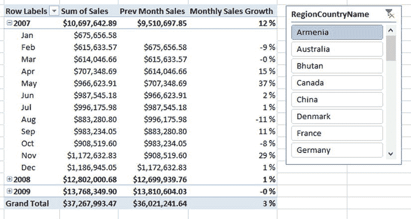

Figure 6-20. Testing the monthly sales growth rate measure

19. To study semi-additive measures, you need to create a PivotTable that displays inventory quantities. First, create a relationship between the `Inventory` table and the `Date` table.
20. Add the following inventory quantity measure to the `Inventory` table:

```dax
Inventory Count:=SUM([OnHandQuantity])
```

21. To calculate inventory over a period of time, you need to find the last non-empty entry within that time period. The following formula will provide that value. The date range starts as blank (earlier than the first date), and the final date is the maximum date. You will use this as part of a formula in step 22.

```dax
LNB Date:=LASTNONBLANK(
DATESBETWEEN('Date'[Datekey],BLANK(),MAX('Date'[Datekey]))
,[Inventory Count])
```

22. Using the last non-blank filter and the `CALCULATE` function, you can calculate the last non-blank quantity for a product. Add the following measure to the `Inventory` table.

```dax
LNB Quantity:=CALCULATE([Inventory Count],
LASTNONBLANK(DATESBETWEEN('Date'[Datekey],
BLANK(),MAX('Date'[Datekey])),[Inventory Count]))
```

23. Now, you can sum the quantity for the selected products. Add the following measure to the `Inventory` table.

```dax
Product Quantity:=SUMX(
VALUES(Product[ProductKey]),[LNB Quantity])
```

24. The final step is to sum the inventory across all selected stores using the following measure.

```dax
Inventory Level:=SUMX(Values(Store[StoreKey]),[Product Quantity])
```

25. To test the measure, add a new worksheet in Excel and create a PivotTable as shown in Figure 6-21.

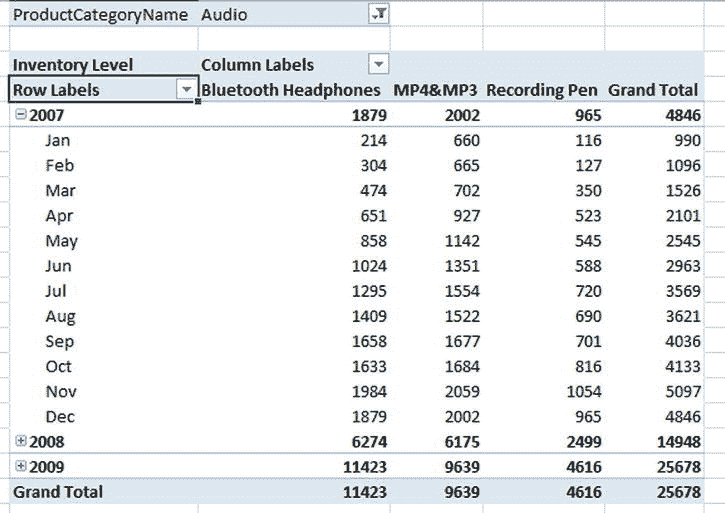

Figure 6-21. Testing the inventory measure

## Summary

This chapter provided you with the foundational knowledge needed to successfully work with date and time-based analysis using Power Pivot and DAX. You should now understand how to shift date contexts to compare measures based on parallel periods. You should also be comfortable using Period-to-Date DAX formulas to aggregate measures. Combine the concepts you learned in Chapter 5 and this chapter; when you do, you should begin to recognize patterns in your analysis. Based on these patterns, you can identify the DAX templates needed to solve your problem. Because not everyone is familiar with creating PivotTables and PivotCharts in Excel, the next chapter will show you the basics of creating dashboards in Excel based on your model. If you are familiar with these concepts, you can skip Chapter 7.