# 第 3 部分


使用`Power Query`和`Power Map`探索与呈现数据

### 第 11 章


使用`Power Query`进行数据发现

尽管`Power Pivot`提供了多种可用于查询数据的连接类型，但有时需要在将数据加载到模型之前对其进行操作。此过程通常被称为`ETL`（提取、转换和加载）过程中的转换部分。这正是`Power Query`的强项，也是你`BI`工具库中非常有用的部分。`Power Query`提供了一个易于使用的界面，用于发现和转换数据。它包含清理和塑造数据的工具，例如删除重复项、替换值和分组数据。此外，它支持大量结构化和非结构化的数据源，例如关系数据库、网页和`Hadoop`等。一旦提取并转换了数据，你就可以轻松地将其加载到`Power Pivot`模型中。

完成本章后，你将能够：

*   从各种源发现和导入数据。
*   清理数据。
*   合并、塑形和筛选数据。
*   分组和聚合数据。
*   插入计算列。

#### 发现和导入数据

传统上，如果你需要合并和转换来自各种不同数据源的数据，你会依赖 IT 部门使用诸如`SQL Server Integration Services (SSIS)`之类的工具为你暂存数据。这通常是一个漫长而费力的过程，涉及数据发现、清理以及将数据符合关系结构。虽然需要这种正式的工作来加载和整理数据以用于企业运营数据存储，但很多时候你只想以快速、直观和敏捷的方式，将来自各种来源的数据添加到`Power Pivot`模型中。为了支持这一工作，你可以使用`Power Query`（Excel 的一个免费加载项）作为你的自助式`BI ETL`工具。一旦你下载并安装了`Power Query`的最新版本，你将在 Excel 中看到一个名为`Power Query`的新选项卡（参见图 11-1）。

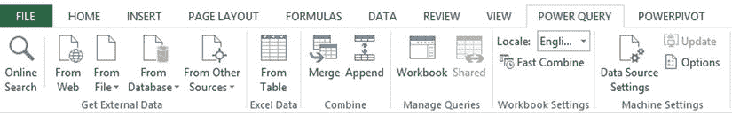

图 11-1. 新的 Power Query 选项卡

如果你查看该选项卡的`获取外部数据`区域，你可以看到可供你使用的各种数据源。你可以从 Web、文件、数据库以及其他各种来源获取数据（参见图 11-2）。

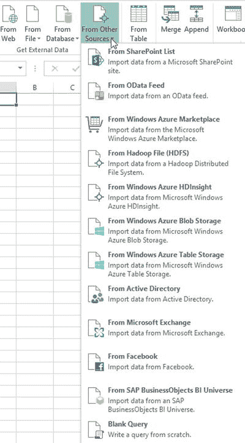

图 11-2. Power Query 中可用的众多数据源中的一部分


连接的类别将决定你需要提供哪些信息才能访问数据源。例如，Web 源需要 URL，而 CSV 文件则需要文件路径。连接到数据源后，“查询编辑器”窗口将启动并显示数据样本。例如，图 11-3 显示了 CSV 文件中的航班延误数据。

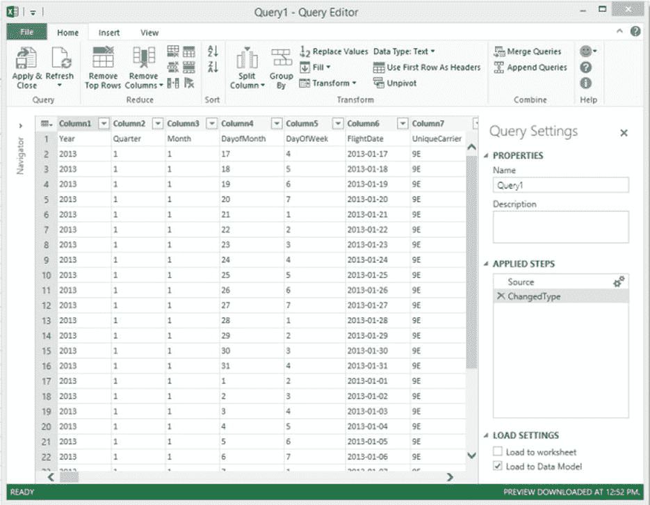

图 11-3：“查询编辑器”窗口

如果你选择具有多个表的数据源，将会看到 Excel 中显示“导航器”窗格。图 11-4 显示了连接到 Access 源时显示的“导航器”窗格。选择表后，“查询编辑器”将显示样本数据。

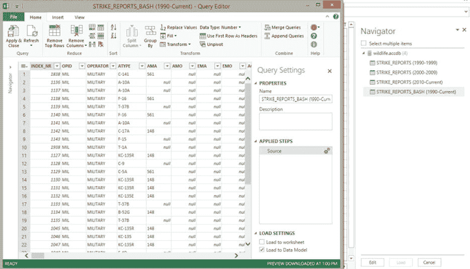

图 11-4：使用“导航器”窗格选择表

如果你查看“查询编辑器”窗口的“查询设置”窗格，可以看到你可以命名查询并添加描述。如果需要重用和共享你创建的查询，这一点很重要（这些功能仅在 Office 365 中可用）。此窗格还会显示创建查询所使用的步骤以及数据加载的位置。你可以选择将数据加载到工作表或 Power Pivot 数据模型中。

连接到数据源后，下一步是在将数据导入数据模型之前，对其进行转换、清理和筛选。

#### 转换、清理和筛选数据

连接到数据源后，即可开始转换和清理数据。这是一个重要的步骤，将在很大程度上决定数据对分析工作的支持程度。你将执行的一些常见转换操作包括删除重复项、替换值、删除错误值和更改数据类型。例如，在图 11-5 中，源 CSV 文件中的“FlightDate”列是文本数据类型，但你希望它在模型中成为日期列。

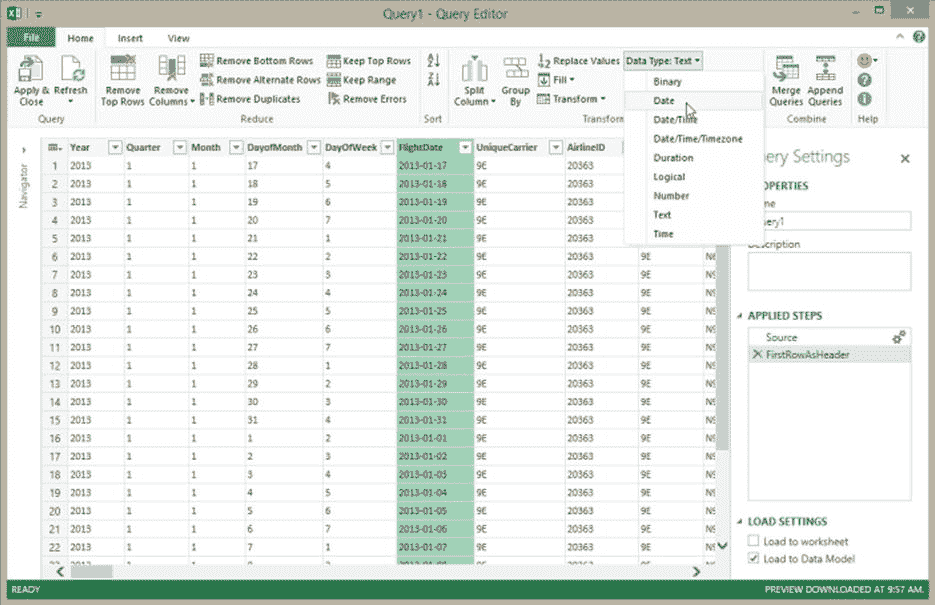

图 11-5：更改列的数据类型

你经常需要替换源系统中的值，以便它们在模型中同步。例如，CSV 文件中列为 VX 的承运商在现有数据中的值为 VG。你可以通过选择列，然后在菜单中选择“替换值”转换，在导入数据时轻松替换这些值。这将启动一个窗口，你可以在其中输入要查找的值以及要替换成的值（参见图 11-6）。

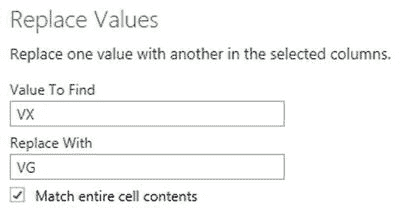

图 11-6：替换列中的值

从源加载数据时，另一个常见需求是筛选掉不必要的列和行。要删除列，只需选择列，然后在“开始”选项卡上选择“删除列”按钮。如果只需要几列，你也可以选择要保留的列，然后选择“删除其他列”选项。你可以通过单击列名旁边的下拉菜单并输入筛选条件来筛选行（参见图 11-7）。

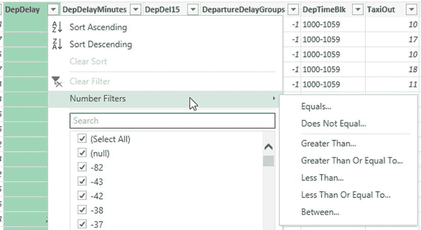

图 11-7：筛选行

在应用数据转换和筛选时，“查询编辑器”会列出已应用的步骤。这使你能够组织和跟踪对数据所做的更改。你可以通过右键单击列表中的步骤来重命名、重新排列和删除步骤（参见图 11-8）。

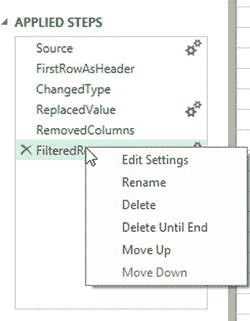

图 11-8：管理查询步骤

清理和转换数据后，你可能需要将来自多个源的数据合并到数据模型的一个表中，或者展开列中包含的数据。

#### 合并和重塑数据

有时，你可能需要在将数据加载到模型之前，合并来自多个表和/或源的数据——例如，如果一个表中的代码关联到另一个包含字段完整值的查找表。处理此问题的一种方法是将两个表都导入模型，并在 Power Pivot 模型中创建表之间的链接。另一种选择是在导入数据之前合并这些表。例如，在前面看到的航班数据中，有一个包含承运商代码的`UniqueCarrier`列。你可以将这些代码与另一个包含承运商代码和承运商名称的 CSV 文件合并。首先，使用“查询编辑器”为每组数据创建并保存一个查询。对于查找表，你可以取消选中“加载到工作表”和“加载到数据模型”复选框，因为数据将在合并后加载，所以这些暂时不需要。接下来，打开主查询，并在“开始”选项卡上选择“合并”按钮。这将启动“合并”窗口（参见图 11-9），你可以在其中选择查找查询以及链接数据的列。

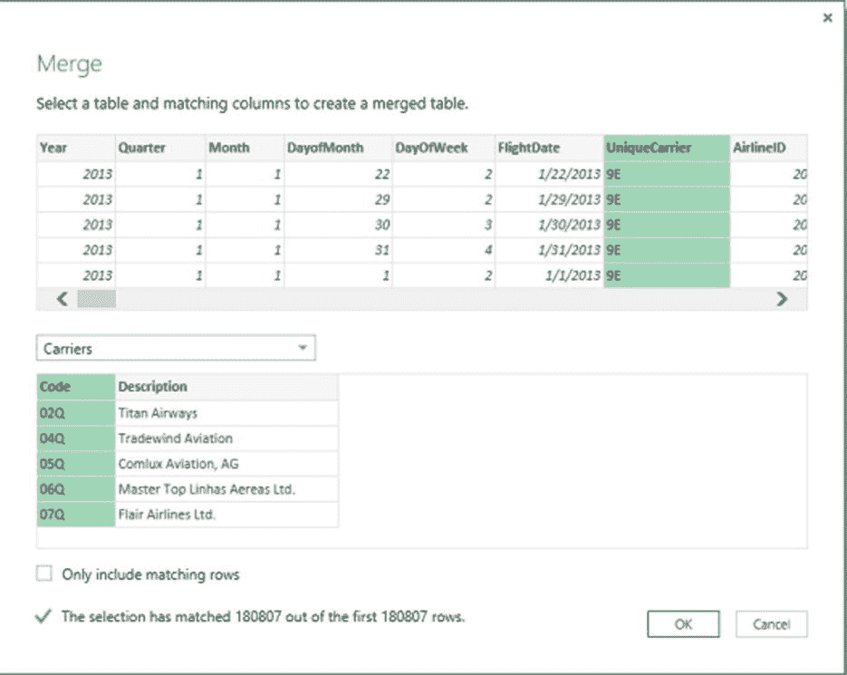

图 11-9：合并两个查询的数据

合并查询后，你可以选择要合并的列（参见图 11-10）。合并列后，你可能需要重命名主查询中的列。

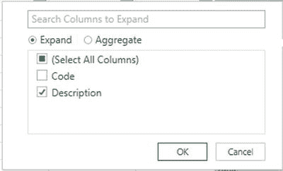

图 11-10：选择要合并的列

除了合并来自查找表的数据外，你可能还需要追加来自两个不同源的数据。例如，假设你每年有分别存储在不同源文件或表中的航班数据，并希望将多年的数据合并到同一张表中。在这种情况下，你将创建两个相似的查询，每个查询使用不同的源。首先，在“查询编辑器”中打开其中一个查询，然后在“开始”选项卡上选择“追加查询”按钮。然后，你可以选择另一个查询作为要追加的表（参见图 11-11）。

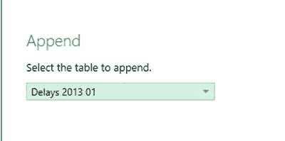

图 11-11：追加两个查询

有时，源可能会为你提供一列数据，而你需要将其拆分为多列。例如，你可能需要拆分城市和州，或者名字和姓氏。为此，请在“查询编辑器”中选择该列，然后在“开始”选项卡上选择“拆分列”。你可以按分隔符或按字符数拆分列（参见图 11-12）。

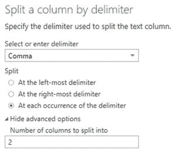

图 11-12：使用分隔符拆分列

你可能会遇到的另一种情况是，数据源包含的数据不是表格形式，而是矩阵形式，如图 11-13 所示。

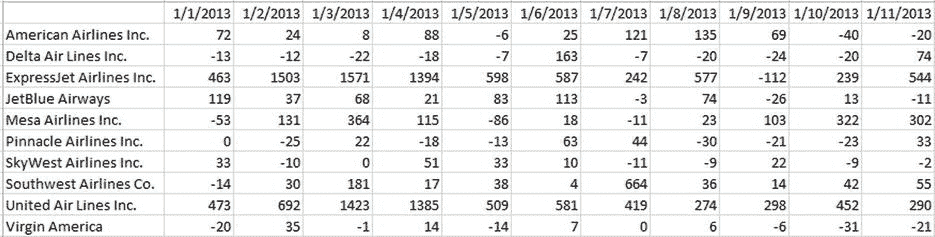

图 11-13：使用矩阵作为数据源

为了将此数据导入数据模型，你需要取消透视数据，使其成为表格形式。在“查询编辑器”中，选择需要取消透视的列（参见图 11-14）。

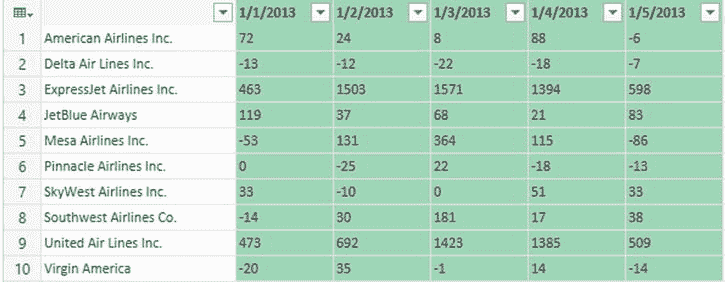

图 11-14：选择要取消透视的列


在“主页”选项卡中，选择“逆透视”转换。数据逆透视后，你会得到一个来自原始列标题的“属性”列和一个“值”列（参见图 11-15）。在导入数据之前，应重命名这些列。

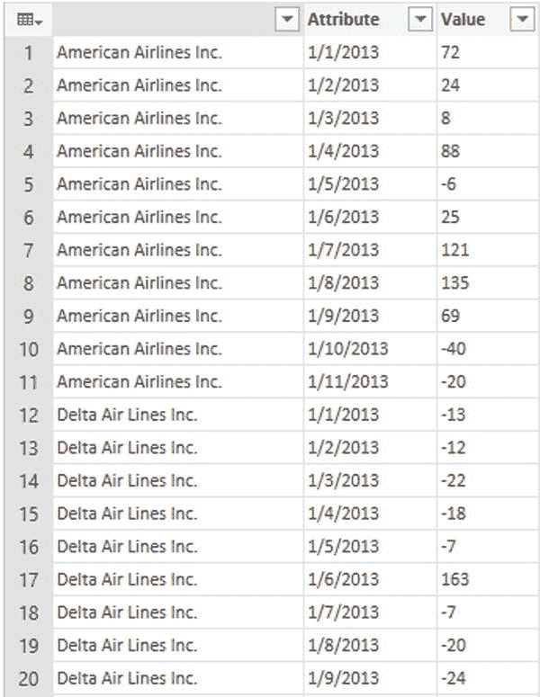

图 11-15 逆透视转换后生成的行

当你将数据导入模型时，通常不需要明细级别的数据，而是需要更高层次的聚合值——例如，产品级别的销售额或月度销售额。使用 Power Query，可以在导入前轻松地对数据进行分组和聚合。

##### 分组和聚合数据

在导入原始数据时，分组和聚合数据是一个常见的需求。例如，你可能需要根据分析需求按月或按销售区域汇总数据。要在查询编辑器中对数据进行聚合和分组，请选择要分组的列，然后在“主页”选项卡中选择“分组依据”转换。此时会弹出“分组依据”窗口（参见图 11-16）。

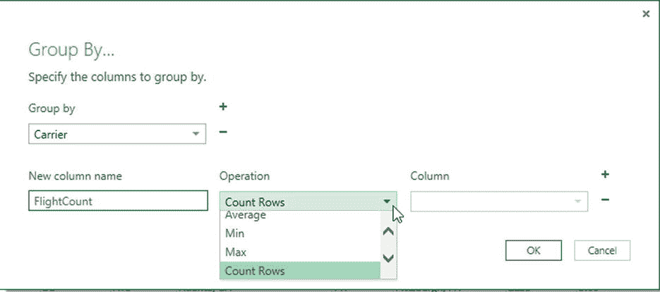

图 11-16 在 Power Query 中对数据进行分组

你可以使用标准聚合函数按多列进行分组和聚合多列。图 11-17 显示了按起飞机场和航空公司分类，并聚合平均和最大出发延误时间的一些结果。

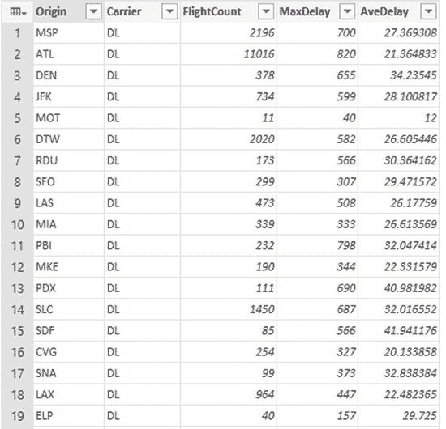

图 11-17 分组和聚合航班数据

在使用 Power Query 导入数据时，你可能遇到的最后一个需求是插入计算列。这稍微高级一些，因为你需要编写代码，如下一节所述。

##### 插入计算列

到目前为止，你都可以使用 Power Query 提供的可视化界面来构建和执行查询。然而，在后台，Power Query 编辑器会创建一个用于执行查询的文件。这个文件是用一种名为`M`的新语言编写的。如你所见，即使不了解`M`或它的工作原理，你也可以从 Power Query 中获得大量功能。尽管如此，你至少应该知道`M`的存在，并且知道运行查询时实际执行的就是它。如果你导航到查询编辑器的“视图”选项卡，你会看到一个打开“高级编辑器”的选项，它将显示用于构建查询的`M`代码（参见图 11-18）。

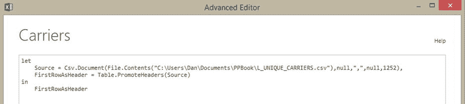

图 11-18 使用`M`构建查询

你可以使用高级编辑器直接用`M`编写查询，从而利用可视化界面工具中未公开的一些高级数据处理功能。

如果要在查询中插入计算列，则需要使用`M`函数。在查询编辑器的“插入”选项卡中，你可以复制列、插入索引列、合并列以及插入自定义列。当你选择“插入自定义列”选项时，会弹出一个“插入自定义列”编辑器，你可以在其中插入用于创建列的`M`函数（参见图 11-19）。

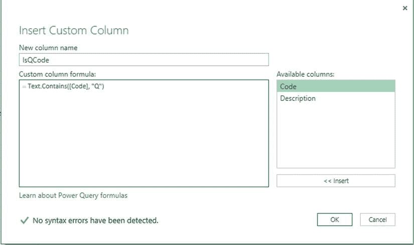

图 11-19 使用`M`公式创建列

图 11-20 显示了添加自定义列后的查询结果。

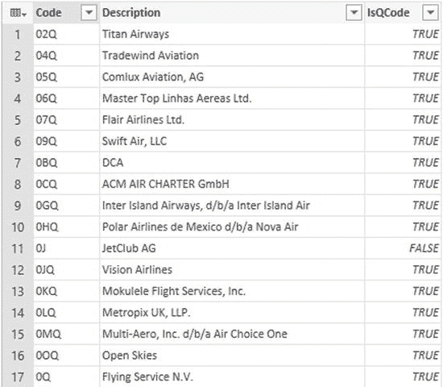

图 11-20 显示查询结果

因此，如果你需要在将数据插入 Power Pivot 模型之前使用 Power Query 创建列，则应使用`M`公式。如果在将数据导入 Power Pivot 模型后创建列，则应使用`DAX`公式。

现在你已经了解了 Power Query 的工作原理，是时候动手实践一下，用它来导入数据了。要完成此实验，假定你已安装了最新的 Power Query 加载项。

#### 动手实验——使用 Power Query 导入和整理数据

在以下实验中，你将：

*   创建查询以导入数据。
*   筛选和转换数据。
*   追加和整理数据。
*   分组和聚合数据。

1.  在`LabStarters`文件夹中，打开`LabChapter11.xlsx`文件。此文件包含一个基本的 Power Pivot 模型，你将使用 Power Query 向其添加数据。
2.  在 Excel 中选择“Power Query”选项卡。在“获取外部数据”下，选择“来自文件”，然后选择“来自 CSV”选项。导航到`LabStarters`文件夹中的`FlightPerformance_2012_10.csv`文件。你应该会看到查询编辑器窗口显示航班延误数据，如图 11-21 所示。

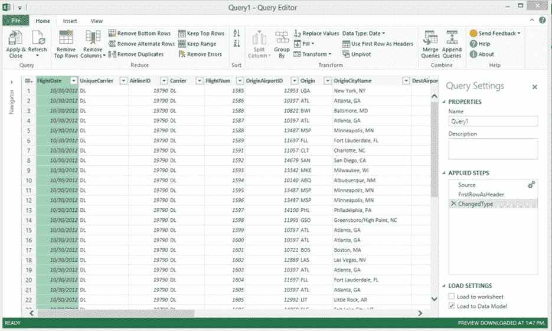

图 11-21 显示延误数据的查询编辑器窗口

3.  在“查询设置”窗格中，将查询重命名为`FlightDelays`，并取消选中“加载到数据模型”。
4.  在“应用的步骤”列表中，如果查询编辑器未自动添加将第一行设为标题的转换，请手动添加。
5.  检查各列的类型，查看查询编辑器是否已将`FlightDate`更新为日期数据类型，并将数字类型的列更新为数字数据类型。如果没有，请立即更改。
6.  删除`UniqueCarrier`、`FlightNum`、`AirTime`、`Flights`和`Distance`列。
7.  筛选数据，使其仅提取航班起飞延误时间大于 15 分钟的行。
8.  选择“应用并关闭”以保存查询。
9.  对`FlightPerformance_2012_11.csv`文件重复步骤 2 至 8，但这次将查询命名为`FlightDelays2`。
10. 你现在应该有两个工作簿查询，如图 11-22 所示。

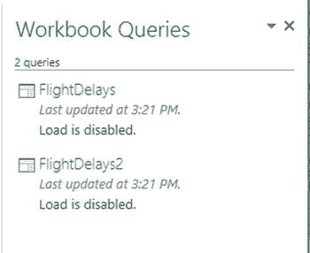

图 11-22 当前工作簿查询

11. 双击`FlightDelays`查询，在查询编辑器中将其重新打开。
12. 在“主页”选项卡的“合并”部分选择“追加查询”选项。将`FlightDelays2`查询追加到`FlightDelays`查询中。
13. 选择`OriginCityName`列，使用逗号将其拆分为名为`OriginCity`和`OriginState`的两列。对`DestCityName`列执行相同操作。
14. 将“城市”列中的“West Palm Beach/Palm Beach”替换为“Palm Beach”。
15. 检查“加载到数据模型”设置，然后点击“应用并关闭”按钮。
16. 打开 Power Pivot 模型，验证表是否已加载。
17. 在 Excel 中选择“Power Query”选项卡。在“获取外部数据”下，选择“来自文件”，然后选择“来自 CSV”选项。导航到`LabStarters`文件夹中的`FlightPerformance_2012_12.csv`文件。
18. 在“查询设置”窗格中，将查询重命名为`DelaySummary`，并取消选中“加载到数据模型”。
19. 保留`Carrier`、`Origin`和`DepDelay`列，删除其余列。
20. 筛选出延误时间小于 15 分钟的数据。
21. 按起飞机场和航空公司分组，计算平均延误时间和最大延误时间（参见图 11-23）。

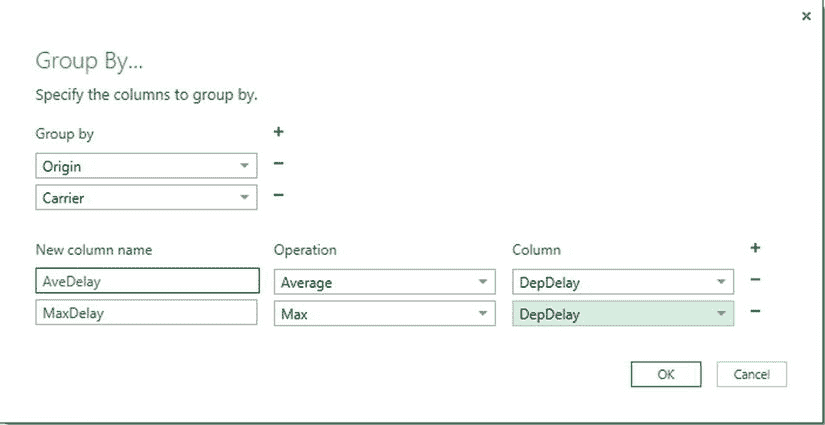

图 11-23 按起飞机场和航空公司分组


22.  点击 `Apply & Close` 按钮保存查询。
23.  添加一个名为 `Carriers` 的查询，该查询从 `Carriers.csv` 文件中获取代码和描述。
24.  打开 `DelaySummary` 查询，在 `Home` 选项卡上选择 `Merge Queries` 选项。使用 `Carriers` 查询，将 `DelaySummary` 查询中的 `Carrier` 列与 `Carriers` 查询中的 `Code` 列进行匹配，合并 `Description` 列（参见图 11-24）。

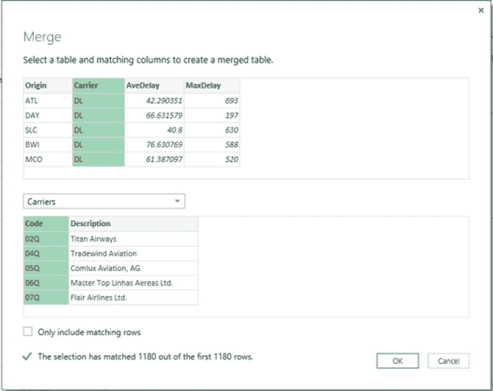

图 11-24. 合并两个查询中的数据

25.  将 `Carrier` 列重命名为 `CarrierCode`，将 `Description` 列重命名为 `Carrier`。
26.  完成后，在 `Load Settings` 下，勾选 `Load To Data Model` 复选框，然后点击 `Home` 选项卡上的 `Apply & Close` 按钮。
27.  完成后，打开 `Power Pivot` 模型，验证该表是否已添加到模型中。

#### 总结

Power Query 是一个非常实用的工具，可用于从多种不同类型的源中获取数据。在本章中，您学习了如何使用 Power Query 通过直观的界面来塑造、清理和转换数据，而无需编写代码。Power Query 会为您构建代码，但不会对您隐藏代码。如果您需要修改或增强代码，可以使用 `Advanced Editor` 视图。虽然本章仅触及了 M 查询语言，但随着您使用 Power Query 的经验增加，您可能需要更深入地研究 M 编码语言。

在下一章第 12 章中，您将了解另一个可用于自助式 BI 工具库的 Excel 插件。Power Map 极大地增强了可用的地图可视化功能。它可以在 Bing 地图上以柱状图、热力图和气泡图的形式绘制多达一百万个数据点，从而生成 3D 可视化效果。如果数据带有时间戳，还可以生成交互式视图，展示数据如何在空间和时间上发生变化。

### 第 12 章


#### 使用 Power Map 进行地理空间分析

Power Map 是一个 Excel 插件，为您提供了一套强大的工具，帮助您可视化并深入了解包含地理编码组件的大型数据集。它可以在 Bing 地图上以柱状图、热力图和气泡图的形式绘制多达一百万个数据点，从而生成 3D 可视化效果。如果数据带有时间戳，它还可以生成交互式视图，展示数据如何在空间和时间上发生变化。在本章中，您将学习如何使用 Power Map 创建引人注目且独特的数据可视化展示。

完成本章学习后，您将能够：

-   准备用于地图绘制的数据。
-   创建基于地图的图表。
-   创建热力图和区域图。
-   为地图添加多个图层。
-   分析随时间的变化。
-   创建漫游导览。

 **注意** 如需彩色图表副本，请访问 `http://www.apress.com/9781430264453` 的源代码/下载部分。

#### 准备用于地图绘制的数据

与任何成功的数据分析工作一样，恰当地准备数据以支持分析工作至关重要。Power Map 可以使用两种数据源之一来绘制地图：Excel 表或包含在 Power Pivot 数据模型中的表。对表的主要要求是它包含唯一的行。此外，它还必须包含位置数据，这些数据可以是 `Latitude/Longitude`（纬度/经度）对的形式，但这并非必要条件。您可以使用地址字段代替，例如 `Street`（街道）、`City`（城市）、`Country/Region`（国家/地区）、`Zip Code/Postal Code`（邮政编码）和 `State/Province`（省/州），这些字段可以由 Bing 进行地理定位。您可能需要使用列的组合才能获得准确的地图位置。例如，许多同名的城市位于不同的州和国家。

除了地理定位列之外，表的行还需要包含您想要在地图上绘制的度量值。度量值必须是数值数据类型之一，例如用于计数的整型和用于销售额的 `money/decimal`（货币/小数）类型。如果您想比较数据随时间的变化，最后的要求是每行必须包含一个日期或时间字段。图 12-1 显示了一个 Power Pivot 数据模型中的表，其中包含关于飞机鸟击事件的信息。由于该表包含机场位置信息以及鸟击信息，因此您可以将其用作 Power Map 的数据源。请记住，尽管这些数据可以精确到经纬度级别进行绘制，但您可以使用任何位置字段来绘制数据。例如，如果您没有 `Longitude` 和 `Latitude` 字段，您仍然可以使用 `City`（城市）或 `State`（州）字段来绘制数据。

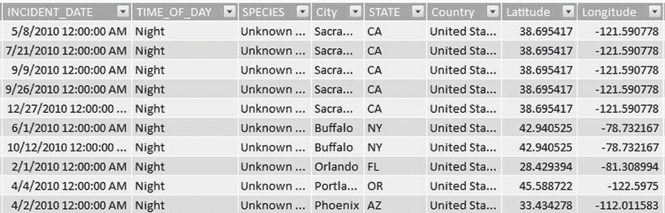

图 12-1. 包含用于 Power Map 的位置信息的鸟击数据

如果您需要从外部源获取地图数据并将其塑形以便在 Power Map 中使用，请回想上一章，Power Query 正是完成此任务的绝佳工具。一旦数据准备妥当，您就可以开始创建地图了。

#### 创建基于地图的图表

要启动 Power Map，请转到 Excel 中的 `Insert` 选项卡，点击 `Map` 下拉菜单，然后选择 `Launch Power Map`。如果这是您在该 Excel 工作簿中创建的第一个地图，这将启动用于设计和查看地图的 Power Map 界面（参见图 12-2）。

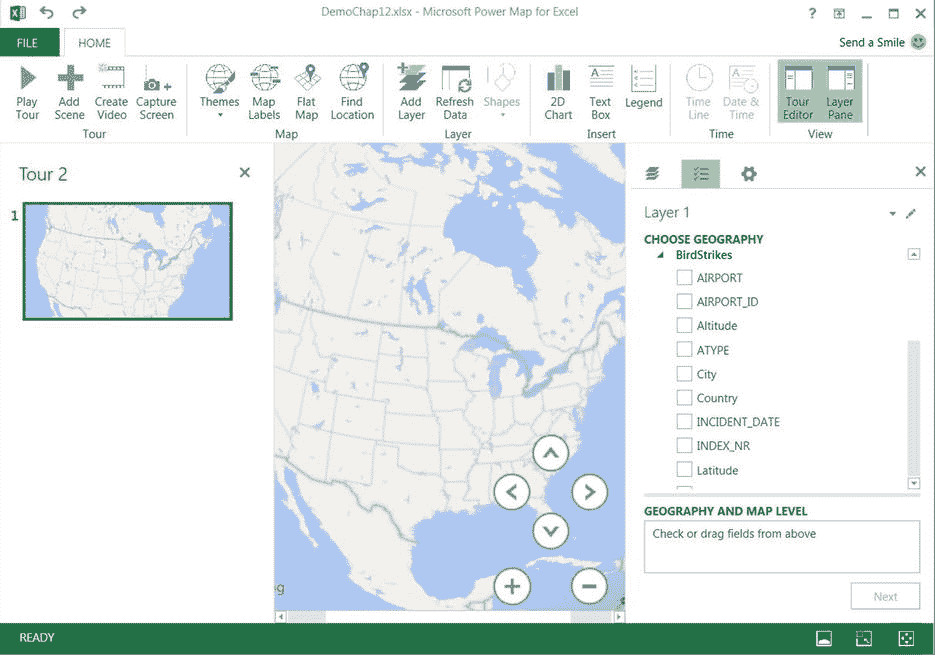

图 12-2. Power Map 界面

Power Map 界面中有三个窗格。左侧是 `Tour Editor`（漫游编辑器）。您可以在此处将地图的不同视图作为场景添加，然后使用它们创建数据的视频漫游导览。中央窗格是绘制数据的地图。您可以通过平移和缩放与地图交互，从不同角度查看数据。右侧窗格是 `Layer Pane`（图层窗格），您可以在此处创建将绘制在地图上的数据图层。每个图层代表您希望在地图上添加或移除的一组数据。您可以通过切换 `Home` 选项卡中 `View` 部分的按钮来显示或隐藏 `Tour Editor` 和 `Layer Pane`（参见图 12-3）。

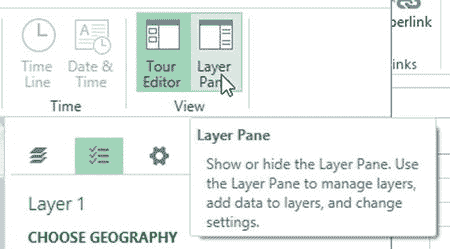

图 12-3. 显示/隐藏窗格

要开始创建地图，您需要使用 `Layer Pane` 创建一个图层。一个图层代表一个特定的数据集。您可以创建多个图层并将它们相互叠加。例如，您可以创建一个显示河流水位的图层和另一个显示降雨量的图层，然后将 `Rainfall` 图层放置在 `Stream Level` 图层之上。

一旦您为图层选择了数据，就可以将其整合到地图中了。在 `Layer Pane` 的 `Choose Geography` 区域中，选择您要在地图上绘制的地理字段。这些字段可以是诸如 `City`（城市）、`State`（州）或 `Latitude/Longitude`（纬度/经度）之类的字段。选择地理字段后，您将看到这些位置被绘制在地图上（参见图 12-4）。

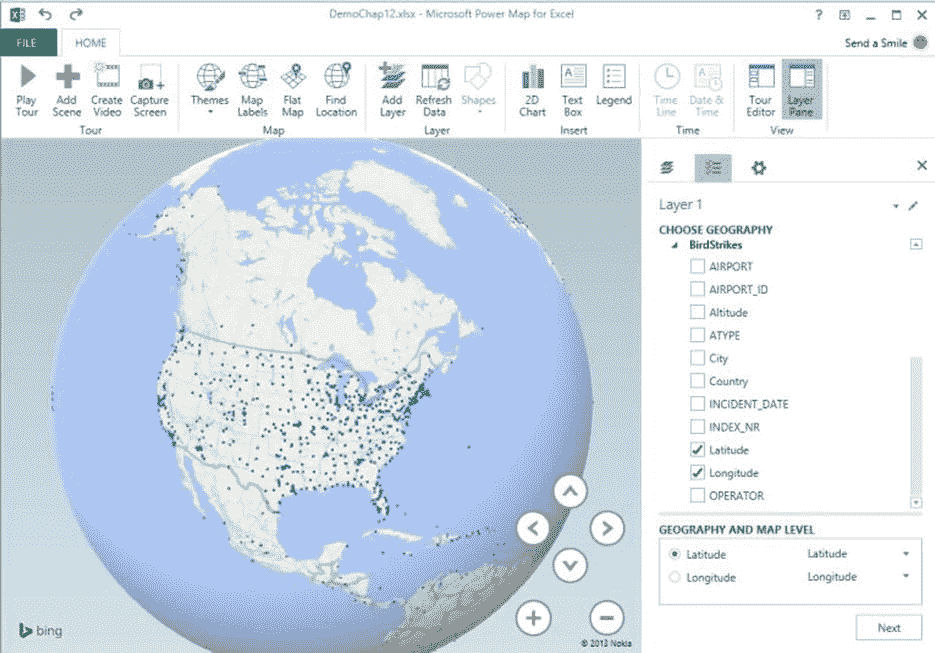

图 12-4. 选择地理字段


下一步是选择要在图层中创建的图表类型。您可以选择堆积柱形图、簇状柱形图或气泡图。此外，您还可以创建热力图或区域图。首次创建地图时，默认选择的是堆积柱形图。选择图表类型后，即可将字段添加到各个部分。例如，堆积柱形图需要为“类别”区域添加一个字段。您也可以为“高度”和“时间”区域添加字段。如果不为“高度”添加字段，则将使用每个类别值的行计数。图 12-5 显示了选择飞行阶段作为类别后生成的堆积柱形图，该图展示了不同机场各个阶段的鸟击数量。

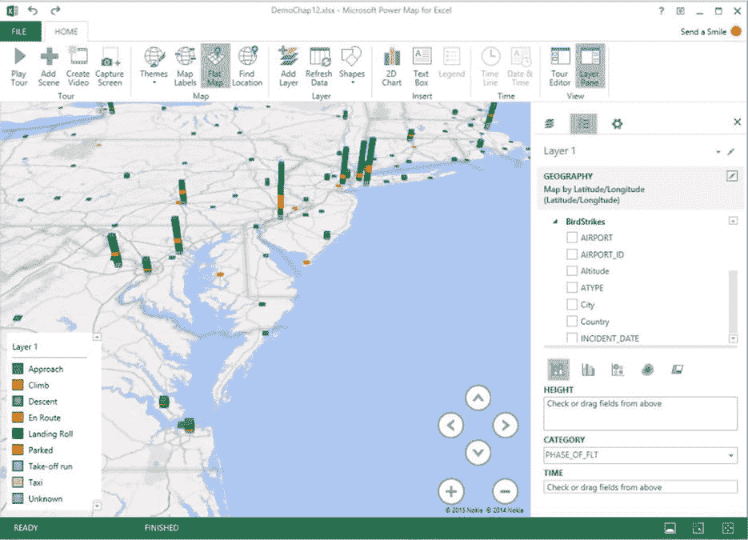

图 12-5. 创建堆积柱形图

根据哪种图表能更好地展示数据，您可以轻松地从堆积柱形图切换为簇状柱形图。

气泡图与柱形图类似，区别在于它使用气泡和饼扇区来展示数据。例如，图 12-6 中的气泡图显示了按一天中不同时间划分的鸟击数量。

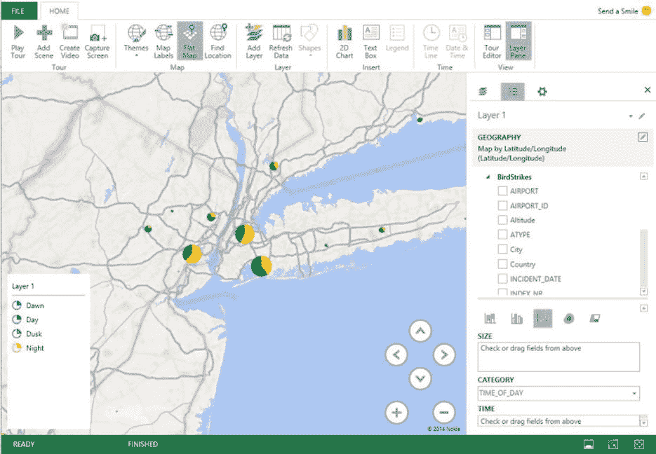

图 12-6. 创建气泡图

正如您所见，创建堆积柱形图、簇状柱形图和气泡图的过程非常相似。另外两种彼此相似的图表类型是热力图和区域图。接下来您将了解它们。

#### 创建热力图和区域图

Power Map 中提供的一种有趣的图表类型是热力图。热力图将数据转换为颜色渐变。较高的值用较深的色调表示，而较低的值用较浅的色调表示。虽然并非所有数据都适合用热力图表示，但对于某些类型的数据，这种图表非常有效。任何时候您想要分析某个值的相对强度，热力图都是一个不错的选择。例如，温度和降雨量等天气数据通常使用热力图来呈现（参见图 12-7）。

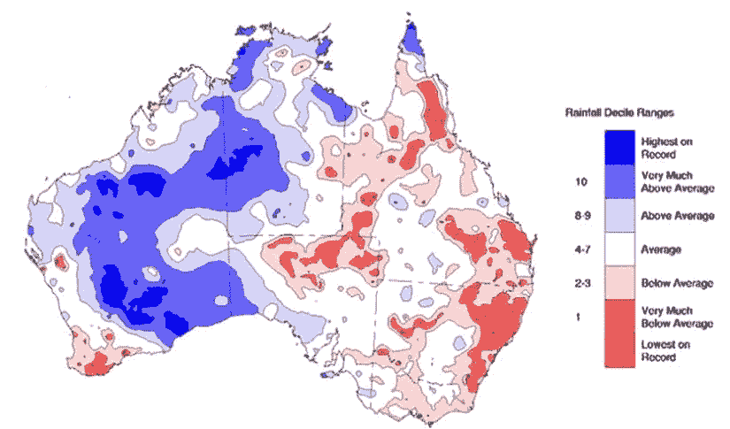

图 12-7. 降雨亏缺热力图（来源：国家农业监测系统 [NAMS]）

在 Power Map 中创建热力图与创建堆积柱形图差别不大。首先，选择一个包含地理定位数据和您想要比较的值的表格。选择地理字段后，您可以将可视化效果更改为热力图，并选择要绘制的值字段。如果您不选择值字段，它将绘制行计数。图 12-8 展示了一幅描绘某城市社区毒品相关犯罪的热力图。深红色表示犯罪率较高的区域。

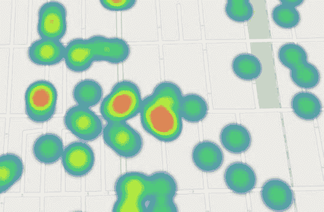

图 12-8. 描绘犯罪率的热力图

另一种与热力图类似的图表类型是区域图。区域图显示已定义的地理区域，例如国家、州、县和邮政编码。然后，它对区域进行颜色编码以比较值字段。一种常见的区域图是选举结果图。图 12-9 显示了一个按县划分的选举结果示例。红色表示共和党占多数，蓝色表示民主党占多数。色调越深，优势越大。


图 12-9. 区域图上的选举结果

要创建区域图，请选择源表中的区域字段作为地理字段，然后将可视化效果切换为区域。然后，选择包含您想要在地图上显示的值的字段（参见图 12-10）。

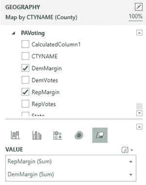

图 12-10. 为区域图选择值

每个区域将显示值较大字段的颜色。通过在“设置”选项卡下选择图层选项，您可以更改地图上显示的值字段的颜色、不透明度和颜色刻度（参见图 12-11）。

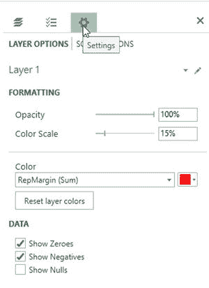

图 12-11. 调整区域图的颜色设置

在这种情况下，您可以调整颜色，使民主党的优势显示为蓝色，共和党的优势显示为红色（参见图 12-12）。


图 12-12. 区域图上显示的投票优势

既然您已经了解了如何创建各种类型的地图，您可能还想为一个地图添加多个图层。接下来您将了解如何实现。

#### 为 Power Map 添加多个图层

Power Map 的众多强大功能之一是，您可以使用它创建多个图层，每个图层都有自己的可视化效果。然后，您可以添加和移除各个图层，以创建丰富的演示文稿。

要向地图添加另一个图层，请单击 Power Map 设计器中“主页”选项卡上的“添加图层”按钮。之后，过程与您之前添加第一个图层时相同。图 12-13 显示了之前的投票结果图层以及一个新增的图层，该图层显示了一个气泡图，展示了各县的种族（白种人和其他）细分情况。

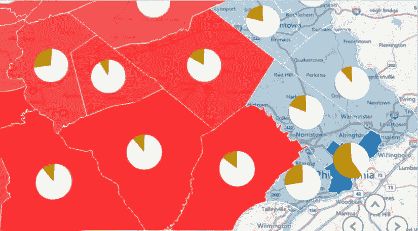

图 12-13. 在 Power Map 中叠加多个图层

要控制哪些图层在地图上显示或隐藏，请选择“图层窗格”中的“图层管理器”选项卡。在“图层”列表中，您可以通过单击眼睛图标来隐藏或显示该图层（参见图 12-14）。

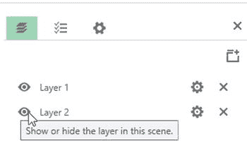

图 12-14. 隐藏和显示图层

正如您所见，为地图添加多个图层非常简单。

所有地图可视化效果共有的另一个 Power Map 功能是能够显示随时间推移发生的变化。接下来您将了解如何将此功能添加到地图中。

#### 分析随时间推移的变化

Power Map 的另一个强大功能是，您可以使用它来查看数据如何随时间变化。例如，假设您有兴趣追踪飓风的位置和风速。由于数据包含日期时间字段，您只需将其拖放到“图层窗格”中“字段列表”选项卡上的“时间”下拉区域即可（参见图 12-15）。

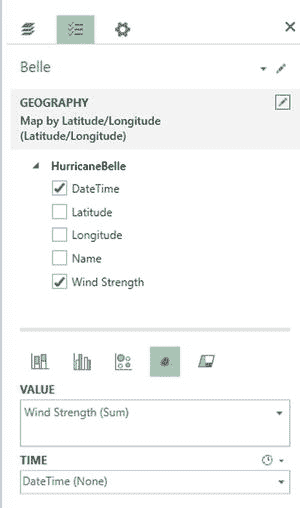

图 12-15. 添加时间字段

一旦添加了时间字段，时间线播放器便会自动添加到地图图层中。图 12-16 展示了一幅热力图，描绘了飓风沿海岸移动时的风速。使用播放轴，您可以查看其随时间推移移动的位置。

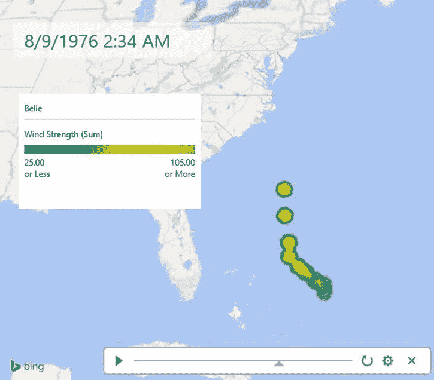

图 12-16. 使用播放轴追踪飓风的路径和风速

Power Map 最后一个独特功能是能够录制一个可以在场景中平移和缩放的导览。然后您可以播放此导览，并将其导出为 MP4 视频。接下来您将了解如何创建导览。

#### 创建导览


通过 Power Map，你可以利用导览（tours）用数据讲述一个故事。`导览`是 Power Map 层级结构中的顶层对象。导览由一个或多个场景（scenes）构成；`场景`就像数据的快照，以独特的方式展示数据。例如，图 12-17 和 图 12-18 展示了从不同视角查看的同一张地图。你可以使用这两个视角创建场景，并将它们添加到导览中，从而从整个美国的地图视图缩放至仅东北部的几个州。

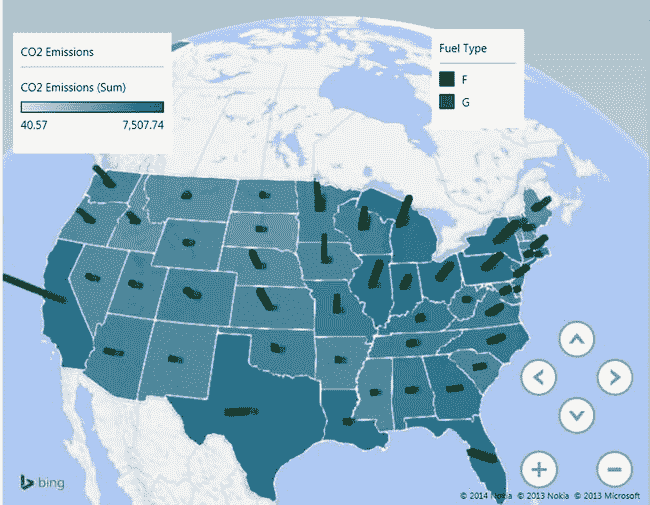

图 12-17。显示整个美国的场景

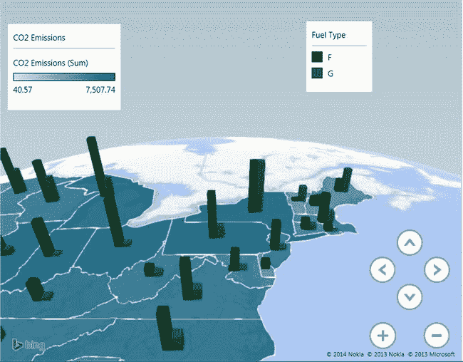

图 12-18。仅显示东北部各州的场景

要捕捉一个场景，请将地图调整到该场景所需的视角，然后单击工具栏上的 `添加场景` 按钮。当你将场景添加到导览时，它们会出现在 `导览编辑器` 中（参见图 12-19）。

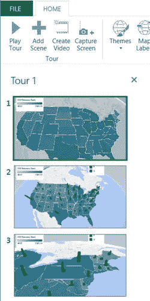

图 12-19。已添加场景的导览编辑器

一旦将场景添加到导览，你就可以通过拖放 `导览编辑器` 中的场景来重新排列顺序。你也可以更改某个场景，而不影响导览中的其他场景。你可以添加或删除地图图层、更改主题，以及改变场景的视觉视角。每个场景还包含场景选项，允许你更改场景时长和过渡效果（参见图 12-20）。

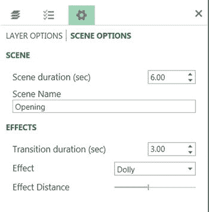

图 12-20。设置场景选项

创建好场景并设置其过渡效果后，你可以单击 `主页` 选项卡上的 `播放导览` 按钮来播放导览（参见图 12-19）。导览创建完成后，你可以将其导出为 MP4 视频与他人分享，甚至可以为导览添加音轨（参见图 12-21）。

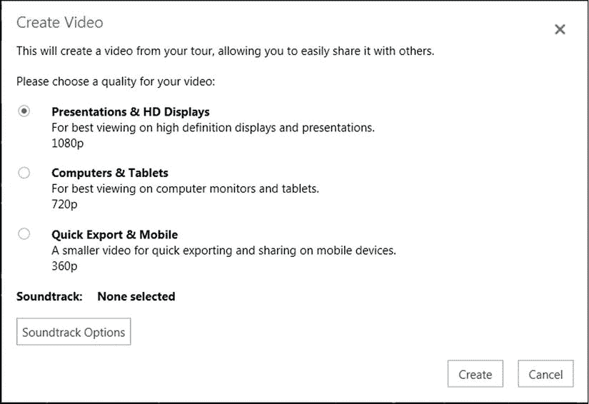

图 12-21。将导览导出为 MP4 视频文件

现在你已经了解了 Power Map 的各种功能，是时候亲自动手体验一下，用它来绘制一些数据了。要完成本实验，你需要安装最新的 Power Map 加载项。

#### 动手实验——在 Power Map 中创建地图可视化

在下面的实验中，你将：

*   创建柱形图地图。
*   创建区域图地图。
*   创建多层地图。
*   创建带有时间轴的热力图。

1.  在 `LabStarters` 文件夹中，打开 `LabChapter12.xlsx` 文件。该文件包含发电厂和排放数据，你将在 Power Map 中使用这些数据创建可视化效果。
2.  在 Excel 的 `插入` 选项卡上，选择 `地图` 下拉菜单，然后启动 Power Map。你应该会看到 Power Map 设计器和 `图层面板` 中的表格（参见图 12-22）。

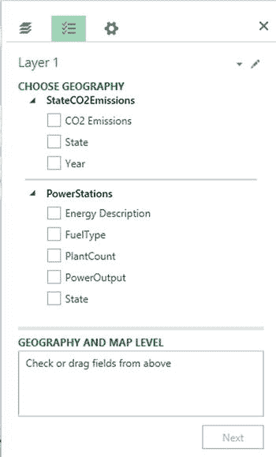

图 12-22。图层面板中列出的表格

3.  将图层重命名为 `燃料类型`，并选择 `PowerStations` 表中的 `州` 字段作为地理位置。单击 `下一步` 按钮。
4.  将 `PlantCount` 字段添加到 `高度` 下拉框，将 `燃料类型` 字段添加到 `类别` 下拉框。将地图切换为簇状柱形图，并放大至美国东北部区域。你应该会看到每个州上有两根柱形：一根代表化石燃料发电厂，另一根代表绿色能源来源。
5.  在 `图层面板` 的 `设置` 选项卡上，将化石燃料柱形的颜色更改为黑色，将绿色能源柱形的颜色更改为绿色。你还可以调整柱形的高度和粗细。最终的地图应类似于图 12-23。

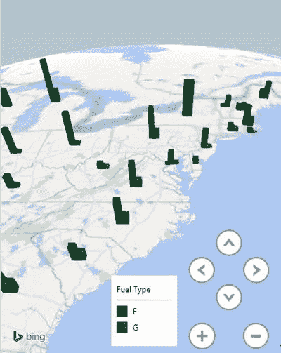

图 12-23。显示每个州发电厂数量的簇状柱形图

6.  在 `图层面板` 的 `图层管理器` 选项卡上，添加另一个名为 `二氧化碳排放量` 的图层。使用 `StateCO2Emissions` 表中的 `州` 字段作为地理位置字段。
7.  将地图类型更改为 `区域`，并选择 `二氧化碳排放量` 作为值字段。
8.  在 `图层面板` 的 `设置` 选项卡上，将区域的颜色更改为蓝色。将颜色刻度调整为零，以便你能看到各州数值之间的微小差异。
9.  现在，你应该在同一张地图上拥有两个图层，如图 12-24 所示。你可以使用 `图层面板` 中的 `图层管理器` 选项卡来显示或隐藏地图上的各个图层。

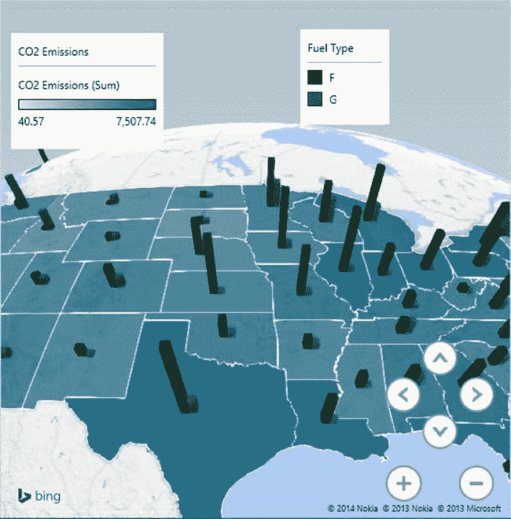

图 12-24。多层地图

10.  保存并关闭 Excel 工作簿。
11.  在 `LabStarters` 文件夹中，打开 `LabChapter12_2.xlsx` 文件。该文件包含飓风数据，你将在 Power Map 中使用这些数据创建热力图和时间线。
12.  启动 Power Map，创建一个名为 `桑迪` 的图层。使用 `HurricaneSandy` 数据，将 `纬度` 和 `经度` 字段添加到 `地理位置` 下拉框。
13.  将地图更改为热力图，并选择 `风力强度` 作为值字段，选择 `DateTime` 作为时间字段。
14.  你应该会看到像图 12-25 一样的热力图。注意风速在登陆时达到最大。使用播放轴，按下 `播放` 按钮，观看飓风随时间推移的路径轨迹。

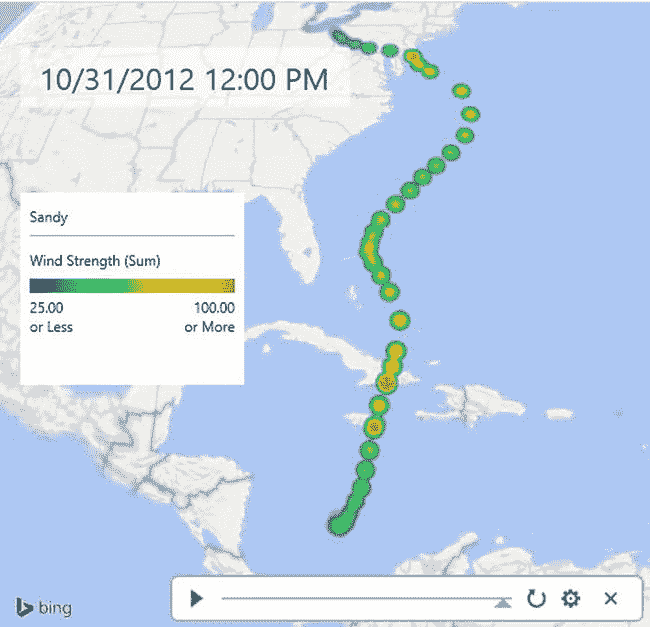

图 12-25。描绘风力强度的热力图

15.  完成后，保存并关闭 Excel。

#### 总结

正如你在本章中所见，Power Map 是一个强大的 Excel 加载项，它提供了一套工具，帮助你可视化并深入了解具有地理成分的数据。你可以通过将数据以柱形图的形式绘制在必应地图上，生成出色的 3D 可视化效果。此外，如果数据包含日期或时间成分，你可以使用 Power Map 可视化数据随时间的变化。你还学习了如何创建热力图和区域图，对于某些类型的数据集而言，它们是可视化和发现数据洞察的绝佳方式。Power Map 的另一个强大功能是能够在同一张地图上叠加多个数据图层，这使你能够比较通过位置成分相互关联的数据。

请记住，目前 Power Map 仍在开发中，新功能会定期添加。请确保你使用的是最新版本，以便利用这些功能。


在下一章中，你将了解 BI 分析中最令人感兴趣的方面之一：预测分析。预测分析允许你从历史数据中提取信息，并使用它来预测未来的行为和趋势。Excel 提供了一套数据挖掘工具，使预测分析易于实现。使用这些工具，你可以执行高级数据分析，例如预测、聚类和关联。第 13 章将向你介绍这些工具，并展示如何实现一些常见的数据挖掘模型，以便深入了解你的数据。

第 13 章


#### 使用 Excel 挖掘数据

商业智能中最被低估的领域之一是数据挖掘，或者通常所说的*预测分析*。这是因为传统数据挖掘使用一组复杂的算法，并且这些工具通常要求你成为这些算法的专家才能实现它们。虽然它不是微软官方自助式 BI 工具集的一部分，但微软为 Excel 提供的一组表分析工具允许你使用数据挖掘算法，同时隐藏了实现这些算法的大部分复杂性。使用这些 Excel 表分析工具，你可以执行高级数据分析，例如预测、聚类和关联。本章将向你展示如何使用这些工具来实现一些常见的数据挖掘模型，并深入了解你的数据。不过，我需要说明的是，要实现这些表分析工具，你需要能够连接到 SQL Server Analysis Server（`SSAS`）的实例，该实例提供运行算法的引擎。

完成本章后，你将能够：

-   识别 Excel 中可用的表分析工具。
-   分析关键影响因素。
-   识别数据组。
-   预测未来趋势。
-   使用购物篮分析。

#### Excel 中的表分析工具

*数据挖掘*是利用历史数据发现模式并为未来趋势做出预测的过程。数据挖掘的一些常见示例包括购物篮分析、营销效果评估和预测。*购物篮分析*查看历史数据，并确定哪些产品在购买过程中经常相互关联。利用这些信息，你可以就哪些产品应该一起营销提出建议。*营销效果评估*分析历史营销活动，并可用于定位未来活动的目标客户。*预测*允许你根据数据中的历史趋势预测未来。例如，你可以根据过去五年的销售趋势进行销售预测。这可以帮助你为即将到来的季节规划库存水平。

要安装 Excel 表分析工具，请转到下载页面（`www.microsoft.com/en-us/download/details.aspx?id=35578`）。确保为你的 Office 安装选择正确的版本（`x86` 或 `x64`）。下载包后，双击 `SQL_AS_DMAddin.msi` 文件启动安装程序。在“功能选择”窗口中，保留默认选择的“Excel 表分析工具”和“服务器配置实用工具”（参见图 13-1）。

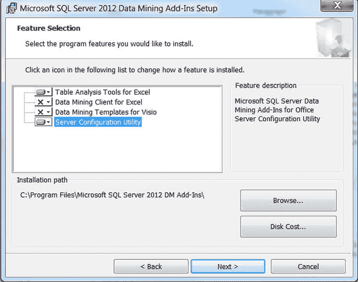

图 13-1. 安装表分析工具

安装 Excel 数据挖掘工具后，当你选择一个 Excel 表格时，你将看到一个“表工具”选项卡。该“表工具分析”选项卡包含一组工具，可帮助你挖掘表格中包含的数据（参见图 13-2）。

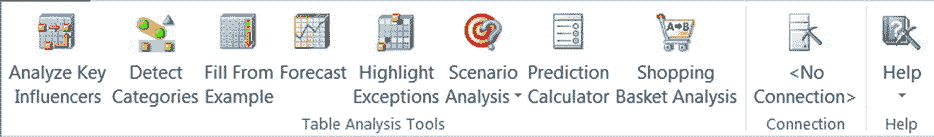

图 13-2. “表工具分析”选项卡上的表分析工具

你首先应该注意到的没有列出任何连接。要使这些工具工作，你需要连接到 `SSAS` 实例。要创建连接，请单击“连接”按钮。在“Analysis Services 连接”窗口中，单击“新建”按钮。在“连接到 Analysis Services”窗口（参见图 13-3）中，输入连接到 `SSAS` 实例的值。你的值将由你的 `SSAS` 实例决定。

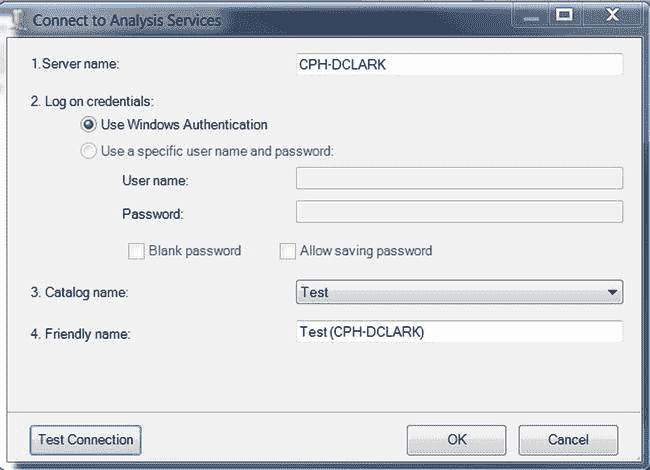

图 13-3. 连接到 `SSAS` 实例

连接添加后，你应该会在表分析工具的连接区域中看到它（参见图 13-4）。


图 13-4. 具有活动 `SSAS` 连接的表分析工具

每个工具都使用一个熟知的数据挖掘算法，并分析数据的分布和数据类型。使用这些工具可以让你免受实现算法复杂性的困扰。表 13-1 总结了每个可用工具的使用时机以及所使用的算法类型。

表 13-1. 可用表分析工具总结

| 工具 | 用途 | 算法 |
| --- | --- | --- |
| 分析关键影响因素 | 识别对目标数据列影响最大的因素。 | 朴素贝叶斯 |
| 检测类别 | 查找数据的分组。 | 聚类 |
| 从示例填充 | 根据数据中的模式建议新值。 | 逻辑回归 |
| 预测 | 分析随时间变化的数据并预测未来值。 | 时间序列 |
| 突出显示异常 | 分析数据表中的模式并找出不符合模式的值。 | 聚类 |
| 目标搜寻方案 | 识别为达到目标需要改变的根本因素。 | 逻辑回归 |
| 假设方案 | 预测某个变化是否足以达到预期结果。 | 逻辑回归 |
| 预测计算器 | 分析导致目标结果的因素，并为新输入预测结果。 | 逻辑回归 |
| 购物篮分析 | 识别可用于交叉销售或向上销售的模式。 | 关联 |

现在你已经了解了可用工具的广度，是时候更详细地研究其中一些工具了。

#### 分析关键影响因素

使用“分析关键影响因素”工具，你可以确定哪些因素对结果影响最大。例如，你有一个包含客户属性的数据表，以及一个指示他们是否购买了自行车的列（参见图 13-5）。


图 13-5. 客户属性

要确定影响客户是否购买自行车的关键因素，请选择该表，然后在“表工具分析”选项卡中，选择“分析关键影响因素”。你将看到一个列选择对话框。首先选择包含你想要分析结果的列（参见图 13-6）。


图 13-6. 选择结果字段

接下来，单击链接以选择要用于分析的列（参见图 13-7）。


图 13-7. 选择影响因素字段

选择要分析的字段后，选择“确定”关闭“高级列选择”窗口。在“分析关键影响因素”窗口中，选择“运行”以开始分析（参见图 13-6）。


好的，作为一名高级文档工程师和翻译员，我将遵循您提供的注意事项，将给定的英文文本翻译成中文。


当“分析关键影响因素”工具分析数据时，它首先会存储数据分布的关键信息。接着，它会使用 Microsoft 朴素贝叶斯算法和 SSAS 创建一个模型。然后，它会创建预测，将每一列数据与指定的结果相关联。最后，它会使用每次预测的置信分数来识别对产生目标结果影响最大的因素。

完成分析后，“分析关键影响因素”工具会在一个新工作表中创建一个报告，该报告按置信分数降序列出关键影响因素（请参阅图 13-8）。


图 13-8. 关键影响因素分析结果

从报告中可以看出，汽车的数量的确对购买自行车有影响。

除了确定影响自行车购买者的因素外，您可能还想了解您吸引的是哪种类型的客户。主要群体是哪些？他们年轻吗？他们拥有房产吗？在下一节中，您将学习使用 `Detect Categories` 工具和聚类方法来解答这些问题。

#### 识别数据组

检测数据所属的不同类别是对数据执行的一项重要分析。这在许多不同的场景中都很有用；例如，您需要了解您的客户属于哪些群体，以便能够针对不同群体进行市场营销。仔细研究类别的另一个原因是，您可以确定不属于任何群体的异常值。这样，如果需要，您可以从数据集中过滤掉这些异常值，以免它们扭曲您的结果。发现异常值也是检测潜在欺诈的常用模式。

为了识别购买自行车的客户的不同细分市场，首先选择一个包含客户人口统计信息的表，以及一个指示他们是否购买了自行车的列。在“`表工具`”的“分析”选项卡中，选择“`检测类别`”工具。这将打开一个窗口，您可以在其中选择要使用的字段以及要创建的类别数量（请参阅图 13-9）。不要选择具有不同值的列，例如 `ID` 字段，因为它们不适合进行分组分析。


图 13-9. 选择分组属性字段

运行 `Detect Categories` 工具后，数据将使用聚类分析算法进行分析。您可以让该工具向数据表追加一个 `Category` 字段。工具运行完成后，您将看到一个显示结果的新工作表。在工作表上有一个图表，显示了所选字段的每个类别的数量（请参阅图 13-10）。由于您对购买自行车的客户类别感兴趣，因此应将图表的列设置为此字段。


图 13-10. 查看数量分布图

如您所见，与类别 4、5 和 6 相关的客户群体最有可能成为自行车购买者。

在同一张工作表上，还有一个表格，您可以使用它来研究组成不同群体的行的属性。图 13-11 展示了构成类别 6 的特征。如您所见，该群体中的大多数人没有孩子，拥有学士学位，并且年龄在 37-46 岁之间。


图 13-11. 查看群体特征

除了 `Detect Categories` 工具之外，`Highlight Exceptions` 工具也对数据执行聚类算法。在这种情况下，它是在寻找与其他数据不符的数据。当您需要在执行其他数据分析之前清理数据集时，这些信息会派上用场。请记住，任何时候您对一组数据执行数据分析，都需要确保任何异常值都不会扭曲您的结果。

当您运行 `Highlight Exceptions` 工具时，会弹出一个窗口，您可以在其中选择要分析的列（请参阅图 13-12）。


图 13-12. 选择要分析的列

运行该工具后，您将看到一个结果表，其中显示了发现的异常值数量。您还可以调整阈值以捕获更多或更少的异常值（请参阅图 13-13）。


图 13-13. 异常值分析结果

查看原始数据表；现在异常值已被高亮显示，因此您可以轻松识别它们（请参阅图 13-14）。


图 13-14. 高亮显示找到的异常值行

在努力实现高效运营和降低间接成本时，数据挖掘中一个变得越来越重要的领域是预测。您接下来将探讨这个内容。

#### 预测未来趋势

`Forecast` 工具允许您通过查看过去趋势来预测未来趋势。它使用时间序列算法来预测未来值。运行该工具会打开一个窗口，您可以在其中选择要预测的列、时间序列列以及要预测的时间段数（请参阅图 13-15）。


图 13-15. 选择预测参数

工具运行完成后，预测值将放在历史数据的末尾，并高亮显示以供查看（请参阅图 13-16）。


图 13-16. 查看预测分析结果

此外，还会插入一个新工作表，其中显示历史趋势和未来预测的折线图。历史值使用实线绘制，未来预测则使用虚线绘制（请参阅图 13-17）。


图 13-17. 未来趋势的图形化表示

除了预测之外，另一种流行的数据挖掘类型是购物篮分析。您接下来将探讨这个内容。

#### 使用购物篮分析

`Shopping Basket Analysis` 工具使用 `Association` 算法来发现数据之间的关联。传统上，这被用于分析客户的购买模式，并且在向上销售其他商品推荐时非常有用。当您使用 `Shopping Basket Analysis` 工具分析数据时，请确保数据具有一个将其组织成组的键——例如，订单号（请参阅图 13-18）。


图 13-18. 订单号用于对交易进行分组

当您选择 `Shopping Basket Analysis` 工具时，会出现一个“列选择”窗口，您可以在其中选择 `Transaction ID`、`Item` 和 `Item Value` 列（请参阅图 13-19）。


图 13-19 选择要分析的列

选择 `Advanced` 链接会打开一个窗口，允许您调整算法的敏感度（请参阅图 13-20）。增加 `Minimum Support` 和 `Minimum Rule Probability` 参数会减少结果中的项目数量，但会提高结果的重要性。


图 13-20 指定最小参数值

运行分析后，会插入两个新的工作表。第一个工作表 `Shopping Basket Bundled Item`（购物篮捆绑商品）显示了捆绑在一起的商品，以及捆绑包的大小、销售数量、销售平均值和捆绑包的总价值（请参阅图 13-21）。


图 13-21 显示已售捆绑商品的分析结果

第二个工作表 `Shopping Basket Recommendations`（购物篮推荐）列出了被推荐一同购买且概率很高的产品。例如，如果客户购买了公路自行车水壶架，您应该推荐他们也购买一个水壶（请参阅图 13-22）。此工作表还包含统计数据，例如关联销售百分比和推荐平均值。


图 13-22 交叉销售商品推荐

现在您已经了解了各种表格分析工具的工作原理，是时候亲自动手实践其中的一些工具了。

#### 动手实验——使用 Excel 中的表格分析工具

在以下实验中，您将

*   确定成为房主的关键影响因素。
*   检测不同的客户群体。
*   对已购买的产品进行购物篮分析。
*   预测污染排放量。

1.  在 `LabStarters` 文件夹中，打开 `LabChapter13.xlsx` 文件。此文件包含示例客户数据。您将使用表格分析工具对这些数据进行数据挖掘。
2.  在 `Influencers`（影响因素）工作表上，单击数据表内的任意位置以显示 `Table Tools Analyze`（表格工具 分析）选项卡。在此选项卡上，选择 `Analyze Key Influencers`（分析关键影响因素）按钮。在 `Column Selection`（列选择）窗口中，选择 `Home Owner`（房主）列进行分析，以找出关键因素。
3.  选择以下要用于分析的列：`Marital Status`（婚姻状况）、`Gender`（性别）、`Income`（收入）、`Children`（子女数）、`Education`（教育程度）、`Occupation`（职业）、`Cars`（汽车数）、`Commute Distance`（通勤距离）和 `Age`（年龄）。运行分析，当出现 `Discrimination Reporting`（区分报告）窗口（请参阅图 13-23）时，您可以将其关闭，因为只有两个值需要比较，并且它们已被添加到报告中。


图 13-23 选择要比较的值

4.  在 `Key Influencers`（关键影响因素）报告中，请注意，在分析的列中，婚姻状况是关键影响因素。然而，子女数和通勤距离也是影响因素。同样有趣的是，教育程度和年龄并非关键影响因素。这可能是一个您想要进一步研究的领域，特别是因为这可能是样本量不够大导致的结果。
5.  要检测不同的客户群体，请选择 `Categories`（类别）工作表。单击表格中的任意位置，然后在 `Table Tools Analyze`（表格工具 分析）选项卡上选择 `Detect Categories`（检测类别）工具。
6.  在 `Detect Categories`（检测类别）工具中，勾选 `Marital Status`（婚姻状况）、`Gender`（性别）、`Income`（收入）、`Children`（子女数）、`Education`（教育程度）、`Occupation`（职业）和 `Age`（年龄）复选框，然后单击 `Run`（运行）按钮。
7.  在 `Categories`（类别）工作表上，请注意有六个类别。使用 `Category Characteristics`（类别特征）表来确定对每个群体最重要的特征（请参阅图 13-24）。您可以重命名这些类别；例如，`Category 1`（类别 1）主要由低收入群体组成，您可以将其重命名以反映这一点。


图 13-24 确定类别群体的重要特征

8.  表格下方是类别概要图表，您可以使用它来分析各个类别在不同属性上的值分布。花些时间更改图表上显示的类别和列来分析数据。
9.  要对购买的产品进行购物篮分析，请选择 `Shopping Basket`（购物篮）工作表。此工作表包含在杂货店购买的商品。单击数据表中的任意位置，然后在 `Table Tools Analyze`（表格工具 分析）选项卡上选择 `Shopping Basket Analysis`（购物篮分析）工具。
10. 在 `Shopping Basket Analysis`（购物篮分析）窗口中，选择 `Order ID`（订单 ID）列作为 `Transaction ID`（交易 ID）。对于 `Item`（商品），选择 `Item`（商品）列，并将 `Item Value`（商品价值）保持设置为 `No Value Column`（无价值列）。
11. 选择 `Advanced`（高级）链接，并在 `Advanced Parameters Setting`（高级参数设置）窗口中，将 `Minimum Support`（最小支持度）更改为 20 个商品，将 `Minimum Rule Probability`（最小规则概率）更改为 50%。
12. 运行分析，在 `Shopping Basket Recommendations`（购物篮推荐）表中，请注意，客户在购买麦片时，有 60% 的情况会同时购买牛奶（请参阅图 13-25）。


图 13-25 查看交叉销售推荐

13. 要执行预测，请选择 `Forecast`（预测）选项卡，其中包含 2000 年至 2010 年几个州的污染物排放数据。单击数据表中的任意位置，然后在 `Table Tools Analyze`（表格工具 分析）选项卡上选择 `Forecast`（预测）工具。
14. 在 `Forecast`（预测）窗口中，选择 `State`（州）列进行预测。将 `Time Stamp`（时间戳）设置为 `Year`（年份），并将 `Periodicity Of Data`（数据周期）设置为 `Yearly`（每年）（请参阅图 13-26）。


图 13-26 选择预测属性

15. 运行预测。您现在将看到一个预测图，该图以虚线形式显示实际值的预测延伸（请参阅图 13-27）。


图 13-27 生成的预测图

16. 当您完成表格分析工具的试验后，保存并关闭 Excel 工作簿。

#### 总结


尽管数据挖掘是商业智能中应用最不充分的领域之一，但在 Excel 的表格分析工具的帮助下，情况并非必须如此。虽然数据挖掘使用了一套复杂的算法，而且传统工具通常要求你成为此类算法的专家才能实施它们，但当你使用表格分析工具时，Excel 为你隐藏了大部分复杂性。本章向你展示了如何使用这些工具来执行诸如预测、聚类和关联等高级数据分析。现在你能够利用这些工具来更深入地洞察你的数据。请记住要超越具体的示例，并学会在各种情境中应用这些模式。

在撰写本书时，微软正将其数据挖掘工作重心转移到 Microsoft Azure ML（机器学习）上，并且没有对 Excel 的数据挖掘工具进行任何升级。这有些遗憾，因为 Azure ML 是一个纯云端系统，对于典型的业务分析师来说略显高级。好的一面是，一些第三方供应商（例如 XLMiner 和 Predixion）正在加强投入，提供他们自己适用于 Excel 的数据挖掘插件工具。这些工具在观感上与本章介绍的表格分析工具非常相似，我相信你会发现使用这些工具能轻松过渡。

在第 14 章中，你将学习两个实际案例研究，以巩固前面章节的概念。通过完成这些案例研究，你将能够评估自己掌握了哪些领域，以及哪些领域需要进一步学习。此外，你还将了解一些与数据分析相关的常见模式，以及如何使用本书介绍的工具来实现这些模式。

### 第 14 章


#### 构建完整解决方案

在前面的章节中，你已经获得了使用微软自助式 BI 工具集的各个组件的经验。你使用了 Power Pivot、Power View、Power Query、Power Map 以及 Excel 表格分析工具。本章为你提供了几个用例，以巩固前面章节的概念。通过完成这些用例，你将评估自己掌握了哪些领域，以及哪些领域需要花更多时间学习。由于这有点像你的期末考试，我有意没有提供像之前练习那样的一步步详细说明。相反，我给出了大致的方向，这些方向应该足以让你开始。如果你遇到困难，请回顾前面的章节，提醒自己如何完成任务。

本章包含以下用例：

*   分销商销售分析
*   销售配额分析
*   传感器分析

#### 用例 1：分销商销售分析

在此场景中，你为一家自行车设备公司工作，并被要求分析销售数据。你需要构建一个仪表板，用于比较每个月的同店销售增长。此外还有一个限制条件：在进行比较时，你只想比较那些开业至少一年的分销商。

##### 加载数据

创建一个名为 `StoreSalesAnalysis.xlsx` 的新 Excel 工作簿。在 `Chapter14Labs` 文件夹中，找到 `UseCase1` 文件夹，其中包含一个 `StoreSales.accdb` Access 数据库。该数据库存储了你需要分析的销售数据。以此作为数据源，导入表 14-1 中列出的数据表和列。

表 14-1 需要导入的商店销售表和列

| 源表 | 友好名称 | 列 |
| --- | --- | --- |
| `dbo_DimDate` | 日期 | `DateKey`, `FullDateAlternateKey`, `EnglishMonthName`, `MonthNumberOfYear`, `CalendarQuarter`, `CalendarYear` |
| `dbo_DimGeography` | 位置 | `GeographyKey`, `City`, `StateProvinceCode`, `StateProvinceName`, `CountryRegionCode`, `EnglishCountryRegionName`, `PostalCode` |
| `dbo_DimProduct` | 产品 | `ProductKey`, `ProductSubcategoryKey`, `EnglishProductName`, `StandardCost`, `ListPrice`, `DealerPrice`, `LargePhoto` |
| `dbo_DimProductCategory` | 类别 | `ProductCategoryKey`, `EnglishProductCategoryName` |
| `dbo_DimProductSubcategory` | 子类别 | `ProductSubcategoryKey`, `EnglishProductSubcategoryName`, `ProductCategoryKey` |
| `dbo_DimReseller` | 分销商 | `ResellerKey`, `GeographyKey`, `BusinessType`, `ResellerName`, `YearOpened` |
| `dbo_FactResellerSales` | 分销商销售 | `ProductKey`, `ResellerKey`, `OrderDateKey`, `SalesOrderNumber`, `SalesOrderLineNumber`, `OrderQuantity`, `UnitPrice`, `ExtendedAmount`, `TotalProductCost`, `SalesAmount` |

##### 创建模型

导入表格后，使用适当的键创建表关系。你的模型现在应该类似于图 14-1。


图 14-1 商店销售模型

根据表 14-2 中列出的信息，重命名表列，并从客户端工具中显示或隐藏列。

表 14-2 表和列属性


在 `Date` 表中，创建一个年 - 季度 - 月的日历层次结构。将该表标记为 `Date` 表，并使用 `Full Date` 列作为键。按 `Month Number` 列对 `Month` 列进行排序。格式化 `Full Date` 列，使其仅显示日期而不显示时间。

##### 创建计算列

使用 DAX `RELATED` 函数，在 `Product` 表中为 `Product Subcategory` 和 `Product Category` 创建计算列。

```
[Category]
=IF(ISBLANK([ProductSubcategoryKey]),"Misc",
    RELATED(Category[EnglishProductCategoryName]))

[Subcategory]
=IF(ISBLANK([ProductSubcategoryKey]),"Misc",
RELATED(Subcategory[EnglishProductSubcategoryName]))
```

从任何客户端工具中隐藏 `Category` 和 `Subcategory` 表。如果 `ProductSubcategoryKey` 为空，则在 `Category` 和 `Subcategory` 列中填入 `"Misc"`。最后，使用 `Product Category` 和 `Product Subcategory` 列创建一个名为 **Prd Cat** 的层次结构。

##### 创建度量值

将以下度量值添加到 `ResellerSales` 表中：

```
Month Sales:=TOTALMTD(SUM([Sales Amount]),'Date'[Full Date])

Prev Month Sales:=CALCULATE(Sum([Sales Amount]),PREVIOUSMONTH('Date'[Full Date]))

Monthly Sales Growth:=[Month Sales] - [Prev Month Sales]

Monthly Sales Growth %:=DIVIDE([Monthly Sales Growth],[Prev Month Sales],0)
```

通过创建一个如图 14-2 所示的数据透视表来测试你的度量值。


图 14-2 在数据透视表中查看度量值

现在，你需要创建一个度量值，用于判断在计算销售额的月份，商店是否已开业至少一年。在 `Reseller` 表中，添加以下度量值：

```
Years Open:=Year(FIRSTDATE('Date'[Full Date])) - Min([Year Opened])

Was Open Prev Year:=If([Years Open]>0,1,0)
```

创建一个数据透视表来测试你的度量值，如图 14-3 所示。请记住，这些度量值只有在按年份筛选时才有意义。


图 14-3 测试度量值

现在，你可以组合这些度量值，使得在计算时只包含那些在销售发生时已开业至少一年的分销商。创建以下度量值：

```
Month Sales Filtered:=Calculate([Month Sales],FILTER(Reseller,[Was Open Prev Year]=1))
```


```dax
Prev Month Sales Filtered:=CALCULATE([Prev Month Sales],
    Filter(Reseller,[Was Open Prev Year]=1))

Monthly Sales Growth Filtered:=[Month Sales Filtered]-[Prev Month Sales Filtered]

Monthly Sales Growth Filtered %:=DIVIDE([Monthly Sales Growth Filtered],
    [Prev Month Sales Filtered],0)
```

通过创建如图 14-4 所示的 Power Pivot 表来测试你的新度量值。应该能看到经过筛选和未经筛选的度量值之间的差异。


图 14-4 测试筛选后的度量值

#### 创建仪表板

在 Power View 中创建仪表板之前，需要更新一些表设置以优化 Power View 模型。表 14-3 列出了需要进行的表和设置。

表 14-3 为 Power View 优化的设置


此外，将表 14-4 中列出的列标记为相应的数据类别。

表 14-4 设置数据类别

| 表 | 列 | 数据类别 |
| --- | --- | --- |
| Location | City | City |
| | State Province | State or Province |
| | Country | Country |
| | Postal Code | Postal Code |
| Product | Product Photo | Image |

在`Date`表中设置字段，使其不执行汇总。

要创建仪表板，请插入一个 Power View 报表。将报表命名为**Reseller Sales**，并添加一个柱形图，使用筛选后的月度销售额按月份和经销商类型显示销售额。向报表添加一个切片器，用于控制图表显示的日历年份。由于 2011 年之前没有销售额，将视图筛选为仅显示 2011 年至 2014 年。报表应类似于图 14-5。


图 14-5 经销商销售额报表

现在需要进行另一项经销商分析，以找出月份、季度和年度的最佳月度销售额。为此，需要向模型添加一个新度量值。该度量值使用`VALUES`和`MAXX`函数来查找最高的经销商月度销售额。

```dax
Max Reseller Sales:=MAXX(VALUES(Reseller[ResellerKey]),[Month Sales])
```

将新度量值添加到模型后，在 Power View 报表中添加另一个柱形图，显示每个月的最高经销商销售额。注意图表是交互式的：如果在一个图表中单击某个柱形，它将相应地筛选另一个图表（请参见图 14-6）。


图 14-6 添加最大经销商销售额图表

更进一步，假设需要获取该期间内具有最高月度销售额的经销商名称。为此，需要组合一系列表达式来检索月度销售额最高的经销商名称。首先，需要确定哪些经销商的月度销售额等于最高月度销售额。如果满足条件，则将其标记为`1`；否则标记为`BLANK`。

```dax
IF([Month Sales]=CALCULATE([Max Reseller Sales],
    Values(Reseller[Reseller Name])),1,BLANK())
```

下一步是使用`FIRSTNONBLANK`函数查找值为`1`的经销商。

```dax
FIRSTNONBLANK(Reseller[Reseller Name],
    IF([Month Sales]=CALCULATE([Max Reseller Sales],
    Values(Reseller[Reseller Name])),1,BLANK()))
```

最后，需要确保所检查的期间内确实存在月度销售额。将上述公式组合成`Top Monthly Reseller`度量值，如下所示：

```dax
Top Monthly Reseller:=If(ISBLANK([Month Sales]),
    BLANK(),FIRSTNONBLANK(Reseller[Reseller Name],IF([Month Sales]=
    CALCULATE([Max Reseller Sales],Values(Reseller[Reseller Name])),1,BLANK())))
```


本次，在 Excel 工作表中构建仪表板。添加一个图表，显示您感兴趣月份的年销售增长百分比，并添加一个数据透视表，显示每个月的最大经销商销售额和经销商名称。同时，为年份、经销商类型和国家各添加一个切片器。您的仪表板应类似于图 14-7。


图 14-7：Excel 工作表中的最终仪表板

完成并试验仪表板后，保存并关闭 Excel。

**用例 2：销售配额分析**

在此场景中，您将使用与用例 1 中同一家自行车公司销售团队的销售数据。这次，您需要使用 `Power View` 创建一个仪表板，以使销售经理能够跟踪销售团队的绩效。您将把实际销售额与销售团队的销售配额进行比较。虽然此比较所需的度量并不复杂，但销售额和配额的数据粒度处于不同级别，这带来了挑战。

**加载数据**

创建一个名为 `SalesRepAnalysis.xlsx` 的新 Excel 工作簿。在 `Chapter14Labs` 文件夹内有一个名为 `UseCase2` 的文件夹；该文件夹包含一个 `SalesRepAnalysis.accdb` Access 数据库。以此作为数据源，导入表 14-5 中列出的数据表和列。

表 14-5：要导入的表和列


**创建模型**

导入表后，根据表 14-6 中列出的信息重命名表列，并显示或隐藏客户端工具中的列。

表 14-6：表和列属性设置


为了在表之间创建适当的关系，您需要创建一个包含日历年与季度的 `Sales Period` 表。要获取此表，请使用与 `SalesRepAnalysis.accdb` Access 数据库的现有连接。这次，请使用以下查询获取数据（确保友好查询名称为 `Sales Period`）：

```
Select distinct CalendarYear & CalendarQuarter as PeriodKey,
CalendarYear as [Period Year], CalendarQuarter  as [Period Quarter] from dbo_DimDate
```

使用 DAX `CONCATENATE` 函数，在 `Quota` 表中创建一个 `PeriodKey` 列。

```
[PeriodKey]
=CONCATENATE([CalendarYear],[CalendarQuarter])
```

`Sales` 表处理起来稍微棘手一些。首先，在 `Sales` 表和 `Date` 表之间创建关系。接下来，使用 `RELATED` 函数在 `Sales` 表中创建 `Period Year` 和 `Period Quarter`。然后，使用 `CONCATENATE` 函数在 `Sales` 表中创建 `PeriodKey` 列。

```
[Period Year]
=Related('Date'[Calendar Year])
[Period Quarter]
=RELATED('Date'[Calendar Quarter])
```

从客户端工具中隐藏表中的 `PeriodKey`。同时隐藏 `Quota` 表和 `Sales` 表中的 `Period Year` 和 `Period Quarter` 列。

现在您可以完成模型中表关系的创建。图 14-8 显示了最终模型应呈现的样子。


图 14-8：定义了关系的销售代表分析模型

接下来，在 `Sales Territory` 表中使用 `Group`、`Country` 和 `Region` 字段创建一个名为 `Territory` 的层次结构。在 `Sales Period` 表中使用 `Period Year` 和 `Period Quarter` 字段创建另一个名为 `Period` 的层次结构。通过连接 `Last Name` 和 `First Name` 列（用逗号分隔），向 `Sales Rep` 表添加一个名为 `Sales Rep Name` 的计算列。

**创建度量**

将以下度量添加到 `Sales` 表：

```
Total Sales:=SUM([Sales Amount])
```

将以下度量添加到 `Quota` 表：

```
Total Quota:=Sum([Sales Quota])

Variance:=[Total Sales]-[Total Quota]
```


#### 方差

`方差 %:= [方差]/[总销售额]`

为销售代表创建一个关键绩效指标（KPI），当销售额超过其配额的 5% 时表示良好，低于 5% 时表示不佳。该 KPI 应基于`总销售额`度量，并与`配额`总度量进行比较。

通过创建数据透视表来测试你的度量，如图 图 14-9 所示。


图 14-9。在数据透视表中测试销售 KPI

#### 创建仪表板

在 Power View 中创建仪表板之前，请更新一些表设置以优化 Power View 的模型。表 14-7 列出了你需要进行的表和设置操作。

表 14-7。为 Power View 优化的设置


此外，将表 14-8 中列出的列标记为相应的数据类别。

表 14-8。设置数据类别

| 表 | 列 | 数据类别 |
| --- | --- | --- |
| 销售代表 | 雇佣日期 | 日期 |
| 员工 | 照片 | 图像 |
| 销售区域 | 地区 | 国家/地区 |
| 销售区域 | 国家 | 国家/地区 |
| 销售区域 | 区域图像 | 图像 |

在`期间`和`日期`表中，设置字段使其不进行汇总。

插入一个 Power View 报表，并将其命名为**销售代表绩效**。使用磁贴功能，在标题区域显示不同的销售原因，并在详细信息区域以卡片形式显示销售代表信息（参见图 14-10）。


图 14-10。使用磁贴和卡片显示销售代表信息

在磁贴详细信息区域内添加一个矩阵，按期间和销售代表显示总销售 KPI。关闭矩阵的汇总值。在磁贴区域外部，添加一个期间年份切片器和一个显示每个销售区域总销售额的表格。你还可以添加视图筛选器，以筛选掉没有销售额的年份和 NA 区域。最终的仪表板应类似于图 14-11。


图 14-11。最终的销售代表绩效仪表板

完成并测试仪表板后，保存并关闭 Excel。

#### 用例 3：传感器分析

在此场景中，你为一家使用传感器监控设备的电力公司工作。传感器监控各种电力读数，包括电力中断和电压尖峰。当传感器检测到问题时，会触发一个被记录下来的警报信号。你需要创建一个地图，使分析师能够查看并比较一段时间内的电力中断和电压尖峰情况。

##### 加载数据

所需数据分布在几个文本文件中。在将数据加载到 Power Pivot 模型之前，你需要清理和处理数据。因此，Power Query 是你将用来加载数据的工具。

在`Chapter14Labs`文件夹中找到名为`UseCase3`的文件夹。该文件夹包含四个文件，其中包含传感器数据以及完成分析所需的相关数据。创建一个名为`PowerAnalysis.xlsx`的新 Excel 工作簿。使用 Power Query，连接到`UseCase3`文件夹中的`Alarms.csv`文件。你应该拥有以下列：`PREMISE_NUMBER`、`METER_NUMBER`、`OP_CENTER`、`Type`和`DateKey`。将查询重命名为**Alarms**，取消选中加载设置，然后保存查询。添加第二个查询**AlarmTypes**，从`AlarmType.txt`文件中获取警报类型数据。你现在可以删除`SHORT_CODE`列并保存查询。

重新打开`Alarms`查询，并使用适当的键将其与`AlarmTypes`查询合并（参见图 14-12）。


图 14-12。将`AlarmType`查询与`Alarms`查询合并


你可以在移除“报警类型”键后，将`ALARM_DESCRIPTION`重命名为“报警类型”。

重复之前的步骤，将`DateKey`列替换为`Date.csv`文件中的日期。使用`Locations.txt`文件，基于`OP_CENTER`向“报警”查询添加经度和纬度值。你可以重命名列，使其遵循相同的命名约定。你的报警查询应类似于图 14-13。


图 14-13. 添加了纬度和经度数据的报警查询

接下来，过滤数据以将其限制为“电源故障”和“高交流电压”这两种报警类型。完成此操作后，你可能会注意到“计量仪”列中出现一些错误值；请继续删除这些错误。现在，你可以按“日期”、“运营中心”、“报警类型”、“经度”和“纬度”对报警计数进行聚合分组（参见图 14-14）。


图 14-14. 聚合和分组报警数据

聚合数据后，在“加载设置”下勾选“将数据加载到数据模型”，然后应用并关闭查询。

现在你已经准备好了用于映射的数据，请启动 Power Map 设计器，并创建一个显示随时间变化的平均计数的柱形图，如图 14-15 所示。


图 14-15. 显示随时间变化的报警计数的 Power Map

在 Power Map 中创建并探索报警数据后，保存并关闭 Excel。

#### 总结

本章提供了一些用例，帮助你评估对本书其余主题的掌握程度。本书的目标是让你了解微软自助式 BI 堆栈中的各种工具。虽然本书使用了桌面版 Excel 和 BI 加载项，你也可以使用 Office 365 版本的工具。希望你对自己使用这些工具已获得了足够的信心和经验，可以开始利用它们来分析和洞察自己的数据。

现在你已经牢固掌握了这些工具的使用方法，可以轻松地处理更复杂的主题。有许多优秀的资源涵盖了可以用于分析数据的各种技术和模式。微软的 Power BI 网站（`www.microsoft.com/en-us/powerbi/default.aspx`）、Bill Jelen 的网站（`www.mrexcel.com`）以及 Rob Collie 的 Power Pivot Pro 网站（`www.powerpivotpro.com`）都是极好的资源。至于更高级的主题，可以查看 Chris Webb 的 BI 博客（`http://cwebbbi.wordpress.com`）以及 Marco Russo 和 Alberto Ferrari 的 SQLBI 网站（`www.sqlbi.com/`）。

