# Chapter 7


## 使用数据透视表和图表进行数据分析

在 Power Pivot 中创建数据模型后，您需要为用户提供一个界面，使其能够与数据模型交互并使用该模型执行数据分析。根据所执行分析的类型，您可以使用多种程序与模型交互；这些程序包括 Power View、Power Map、Performance Point 和 Reporting Services。虽然这些都是可行的客户端工具，但最好的客户端工具之一就是 Excel 本身。Excel 是一个功能丰富的环境，非常适合使用数据透视表和数据透视图创建仪表板。此外，在 SharePoint 上共享 Excel 文件或托管 Excel 工作簿以提高性能和安全性也非常容易。本章涵盖了在 Excel 中使用数据透视表和数据透视图为 Power Pivot 模型构建数据分析界面的基础知识。

完成本章后，您将能够：

*   使用数据透视表探索数据。
*   使用切片器筛选数据。
*   为数据透视表添加可视化效果。
*   使用数据透视图探索趋势。
*   将多个链接的图表和表格结合使用。
*   使用 Cube 函数查询数据模型

 **注意** 本章包含彩色图像的引用。如果您正在阅读本书的印刷版或黑白电子版，可以在本书的源代码/下载包中找到彩色图像的副本，地址为 `http://www.apress.com/9781430264453`。

## 数据透视表基础知识

数据分析中使用最广泛的工具之一是数据透视表。数据透视表允许您轻松地从数据中发现模式和关系。例如，您可以确定哪些产品在一年中的特定时间销售得更好。或者，您可以查看营销活动如何影响各种产品的销售。图 7-1 显示了数据透视表的各个区域。

行字段和列字段包含您感兴趣的用于聚合数据的属性。例如，图 7-1 中的数据透视表按产品类别和年份聚合值。筛选器用于根据属性筛选数据透视表中的值。在本例中，图 7-1 中的筛选器将结果限制为每年的第一季度。切片器在这里执行与筛选器相同的角色，将值限制为仅限大型经销商。切片器的额外优势在于它们可以同时筛选多个数据透视表和数据透视图。

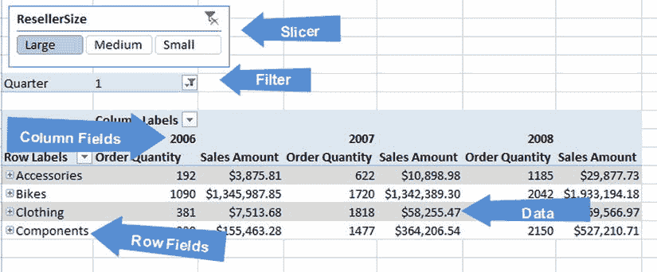

图 7-1。数据透视表的组成部分

要构建数据透视表，请将字段从“字段列表”拖到“字段列表”下方的放置区域，如图 7-2 所示。如果您只是通过勾选复选框来选择字段，它会将文本字段放在“行”区域，所有数字字段放在“值”区域。这可能会变得相当烦人，因为它会将像 `Years` 这样的字段放入“值”区域，并将其视为需要求和的一组值。（在第 8 章中，我将向您展示如何避免这种情况。）

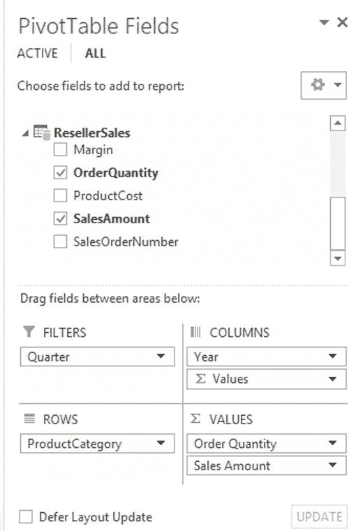

图 7-2。向数据透视表添加字段

要添加切片器来筛选数据透视表，您需要转到 Excel 中的`插入`选项卡，然后选择`切片器`按钮。在下一节中，您将学习如何添加切片器以及如何使同一个切片器控制多个数据透视表。

## 对数据进行切片

要添加切片器来筛选数据透视表，请单击数据透视表，然后选择`插入`选项卡上的`切片器`按钮。您应该会看到一个包含 Power Pivot 数据模型字段的选取列表（见图 7-3）。

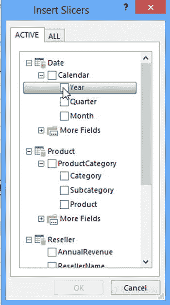

图 7-3。选择切片器字段

由于您在插入切片器时已选中了数据透视表，因此切片器会自动连接到该数据透视表。您可以通过点击切片器并选择`切片器工具 选项`选项卡来验证这一点（见图 7-4）。您可以使用此选项卡来设置切片器的格式，并选择切片器的报表连接。

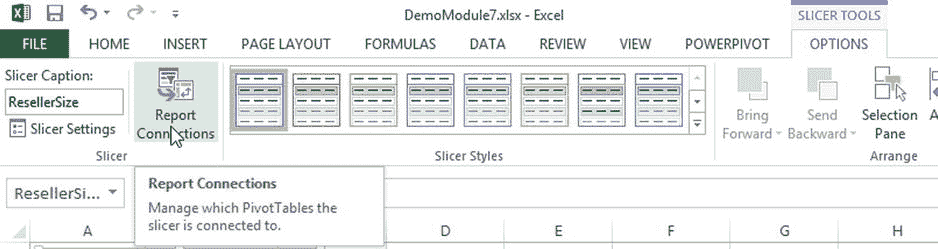

图 7-4。设置切片器连接

图 7-5 显示了切片器的`报表连接`选择列表。请注意，数据透视表不必与切片器位于同一工作表上。数据透视表的名称是创建时 Excel 赋予它们的通用名称。随着您添加更多数据透视表，最好为它们指定更有意义的名称。如果您单击数据透视表并转到`数据透视表工具 分析`选项卡，您将看到一个文本框，您可以在其中更改数据透视表的名称。

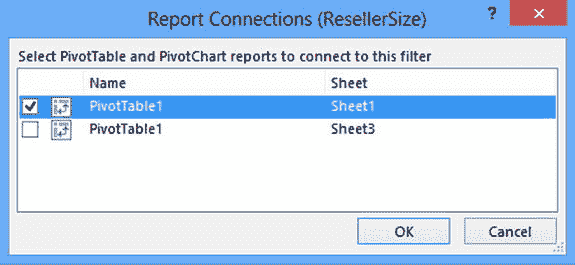

图 7-5。为切片器选择连接

如果您选择`切片器工具 选项`选项卡下的`切片器设置`按钮，将打开`切片器设置`窗口（见图 7-6），您可以在其中更改切片器的名称、标题和排序顺序。您还可以选择如何显示无数据的项目。

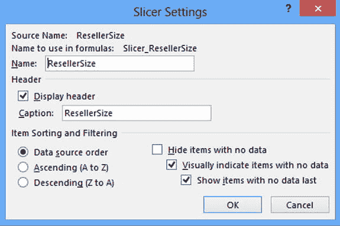

图 7-6。更改切片器设置

有时您需要*级联筛选器*——即一个筛选器限制下一个筛选器中可选择的内容。对于基于模型中相关字段的切片器来说，这很容易实现。当您选择相关字段时，切片器会自动为您链接起来。例如，图 7-7 显示了一个产品类别和产品子类别筛选器。如果您选择了一个产品类别，相应的产品子类别将会高亮显示。

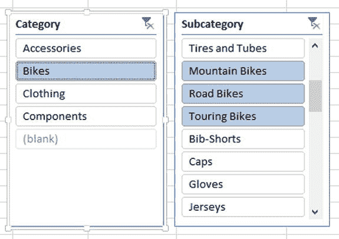

图 7-7。使用切片器创建级联筛选器

### 向数据透视表添加可视化效果

为了帮助识别趋势、异常值并深入了解数据，您可以向数据透视表添加多种类型的可视化效果。这些包括条件格式、数据条和趋势线。图 7-8 显示了带有数据条和条件格式的数据透视表。

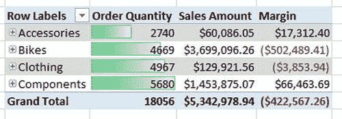

图 7-8。使用条件格式和数据条

要创建视觉格式，请在数据透视表中选择要设置格式的数据，然后在`开始`选项卡中，单击`条件格式`下拉菜单（见图 7-9）。如您所见，您有很多创建条件格式的选项。在图 7-8 中，有一个`突出显示单元格规则`，用于将负数显示为红色。

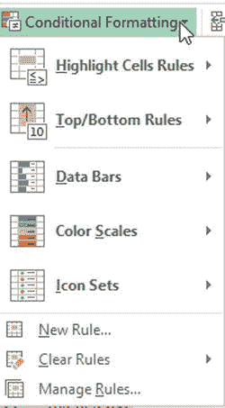

图 7-9。设置条件格式

建立规则后，您可以通过选择`管理规则`选项并选择要编辑的规则来对其进行编辑。图 7-10 显示了可以为`数据条`格式规则设置的各种选项。

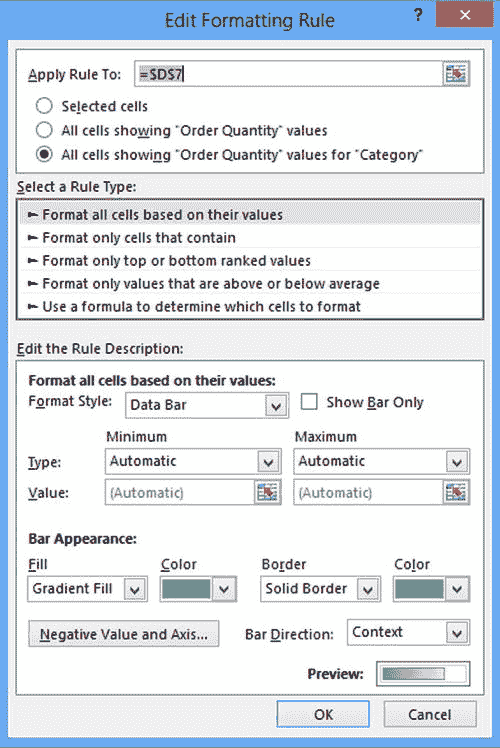

图 7-10。编辑数据条规则

您可以使用格式规则产生一些有趣的效果。例如，图 7-11 中的数据透视表显示了一个热力图，用于快速确定哪些月份的销售情况好，哪些月份销售情况差。

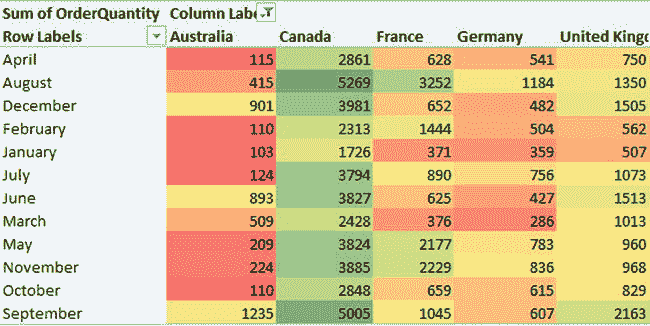

图 7-11。使用条件格式创建热力图

与数据透视表相关的另一个流行功能是迷你图。*迷你图*是显示一系列数据趋势的微型图表。图 7-12 显示了展示一年四个季度销售趋势的迷你图。

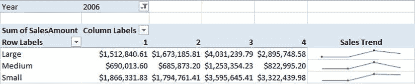

图 7-12。使用迷你图显示趋势

要创建迷你图，请突出显示数据透视表中包含数据的值，然后在`插入`选项卡上选择`迷你图`按钮。然后您需要选择迷你图的位置（见图 7-13）。您必须从折线图、柱形图或盈亏图中选择一种迷你图类型。

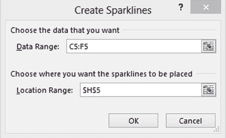

图 7-13。设置迷你图

虽然向数据透视表添加可视化效果可以增强您分析数据的能力，但很多时候，发现趋势以及比较和对比数据的最佳方法是使用图表和图形。在下一节中，您将了解图表和图形作为有用的数据分析工具，以及如何将它们添加到您的分析仪表板中。

### 使用数据透视图

除了数据透视表，Excel 还提供了一组强大的图表和图形供您分析数据。添加数据透视图与添加数据透视表非常相似。在 Excel 的`插入`选项卡上，选择`数据透视图`下拉菜单。您可以选择添加单个`数据透视图`，或者添加彼此关联的`数据透视图`和`数据透视表`（见图 7-14）。

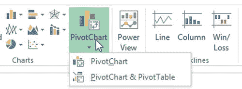

图 7-14。添加数据透视图

选择数据透视图后，将出现一个窗口，供您选择数据源以及放置数据透视图的位置（见图 7-15）。

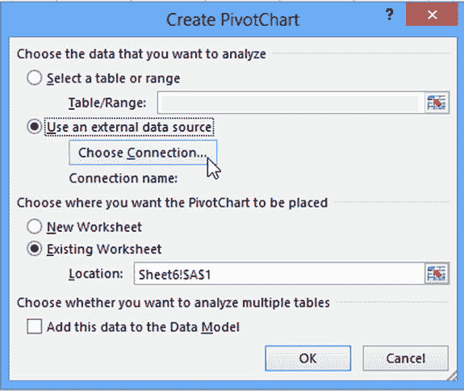

图 7-15。选择数据源

要选择`Power Pivot`模型作为数据源，请选择使用外部连接，然后单击`选择连接`按钮。在`现有连接`窗口中，选择`表`选项卡，然后选择`工作簿数据模型中的表`（见图 7-16）。

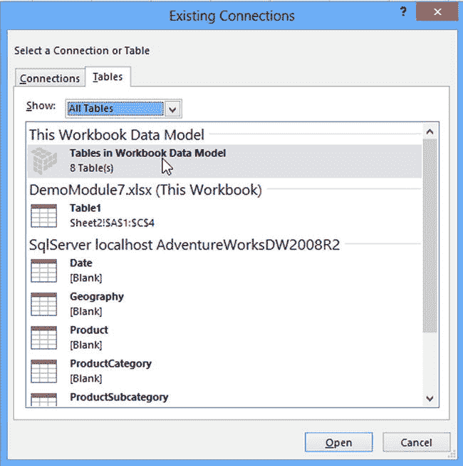

图 7-16。选择工作簿数据模型

选择数据源后，您将看到一个空白图表和一个字段选择框，您可以在其中拖放字段以用于图表值和轴（见图 7-17）。

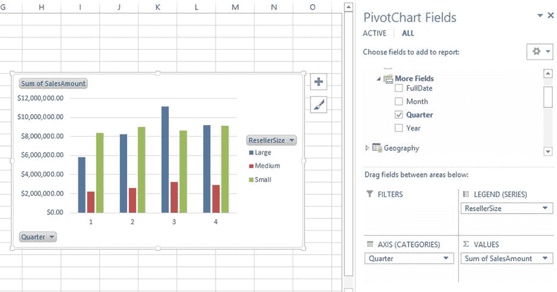

图 7-17。创建图表

默认情况下，图表是一个柱形图，但您有许多不同类型的图表可供选择。如果您单击图表并选择`数据透视图工具 设计`选项卡，您可以选择`更改图表类型`按钮，并从多种类型中进行选择（见图 7-18）。

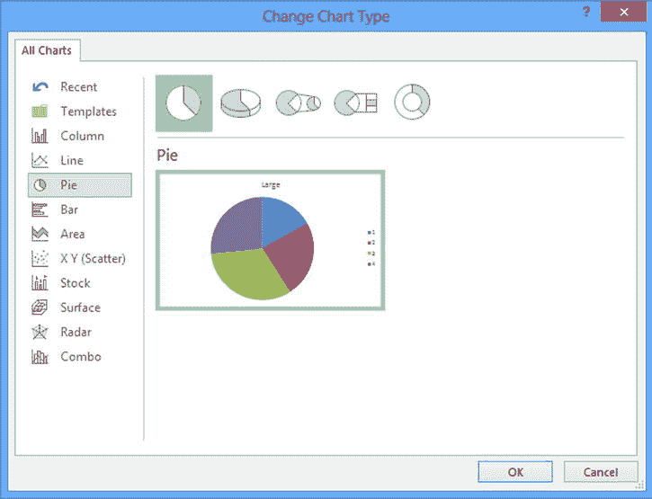

图 7-18。选择图表类型

除了更改图表类型之外，`数据透视图工具`选项卡还允许您使用大量设计和格式选项来自定义图表和图形的外观和感觉。花时间尝试这些工具并创建各种图表，以更好地了解可用的各种选项，这绝对是值得的。

### 使用多个图表和表格

在创建数据透视表和图表以展示和理解数据时，您通常希望构建一个能轻松确定绩效的仪表板。您可能关注销售绩效、网络性能或流水线表现。仪表板将关键绩效指标（KPI）、图形和图表等可视化表现形式整合为流程的整体视图。虽然从技术上讲它们并非仪表板工具，但您可以使用 Excel 结合 Power Pivot 数据透视表和图表创建非常引人注目的数据展示，然后可在 SharePoint 中展示和共享这些数据。

向仪表板添加多个图表和表格时，您可能希望将它们链接起来，以便用不同方式呈现相同的数据。您还很可能希望通过相同的切片器来控制它们，使其保持同步。最简单的方法是使用`插入`选项卡并选择`数据透视图和数据透视表`进行添加（参见图 7-19）。

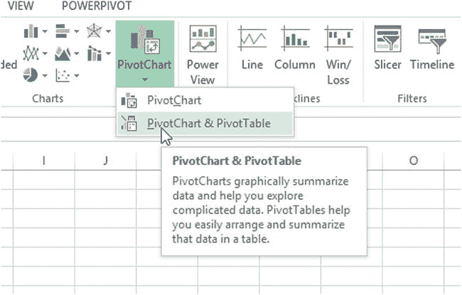

图 7-19。添加数据透视图和相关数据透视表

通过这种方式添加数据透视图和数据透视表，会在它们之间建立链接，以便当您向其中一个添加字段时，也会向另一个添加相同的字段。此外，当您向页面添加切片器时，它会自动将切片器同时连接到数据透视表和数据透视图。图 7-20 展示了一个简单的仪表板，其中包含一个链接的数据透视表、数据透视图和切片器。

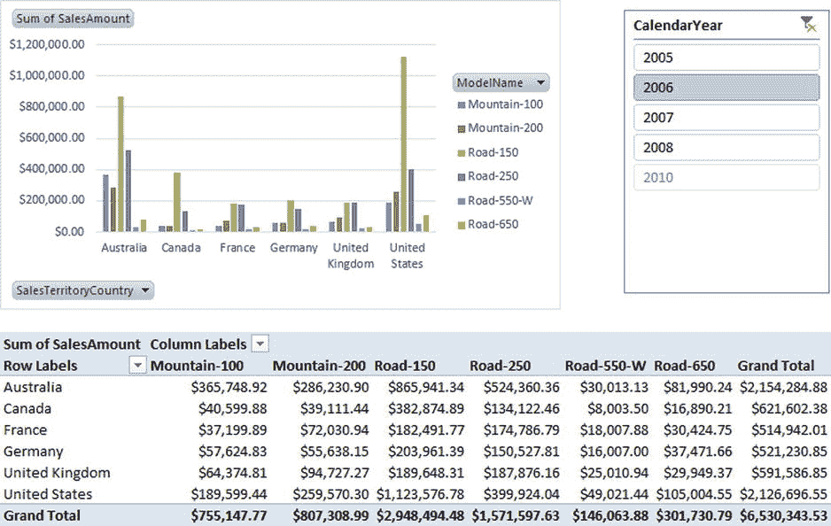

图 7-20。在 Excel 中创建简单仪表板

如果需要连接多个图表，请打开模型设计器，然后在`开始`选项卡上选择`数据透视表`下拉菜单（参见图 7-21）。这还允许您插入平面数据透视表，这对于打印非常有用。

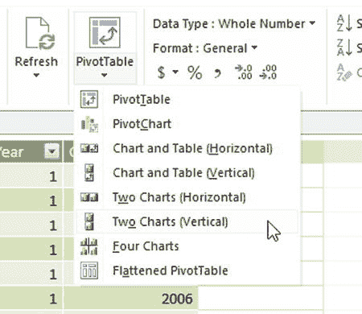

图 7-21。连接多个数据透视图

### 使用多维数据集函数

使用 Excel 内置的`数据透视图`和`数据透视表`布局，您可以创建引人注目的仪表板，并为数据浏览提供出色的界面。然而，有时您可能会对这些结构固有的某些局限性感到沮丧。例如，您无法在数据透视表内部插入自己的列来创建自定义计算。您也可能希望以非表格格式显示数据以生成自定义报告。这正是 Excel 多维数据集函数大显身手的地方。

Excel 多维数据集函数允许您直接连接到 Power Pivot 数据模型，而无需使用数据透视表。这些多维数据集函数是 Excel 函数（与 DAX 函数相对），可以在`Excel 公式`选项卡的`其他函数`下拉菜单中找到（参见图 7-22）。

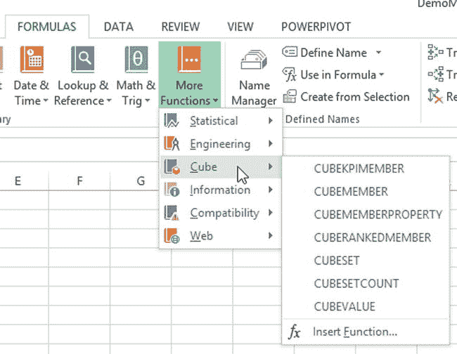
图 7-22。使用多维数据集函数连接到模型

了解这些函数用法的最简单方法是创建一个数据透视表，然后在`数据透视表工具 分析`选项卡上，选择`OLAP 工具`下拉菜单，再选择`转换为公式`选项（参见图 7-23）。

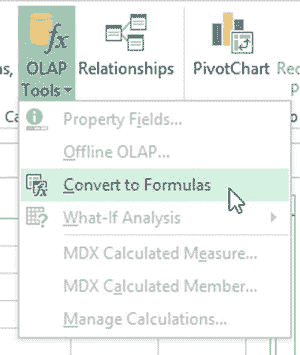
图 7-23。将数据透视表转换为多维数据集函数

图 7-24 显示了转换为多维数据集函数后的表格。它使用`CUBEMEMBER`函数从多维数据集返回一个成员或元组（有序列表），并使用`CUBEVALUE`函数从多维数据集返回一个聚合值。

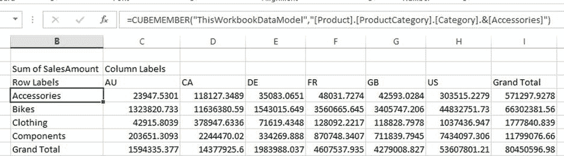
图 7-24。使用多维数据集函数检索值

以下公式用于返回单元格 C3 的列标签：

```excel
=CUBEMEMBER("ThisWorkbookDataModel","[Geography].[CountryRegionCode].&[AU]")
```

第一个参数是数据模型连接的名称，第二个参数是成员表达式。

单元格 C4 中的值通过以下公式返回：

```excel
=CUBEVALUE("ThisWorkbookDataModel",$B$2,$B4,C$3)
```

此公式使用了单元格引用，但您可以将这些引用替换为这些单元格中包含的多维数据集函数：

```excel
=CUBEVALUE
(
    "ThisWorkbookDataModel",
    CUBEMEMBER("ThisWorkbookDataModel","[Measures].[Sum of SalesAmount]"),
    CUBEMEMBER("ThisWorkbookDataModel",
        "[Product].[ProductCategory].[Category].&[Accessories]"),
    CUBEMEMBER("ThisWorkbookDataModel",
        "[Geography].[CountryRegionCode].&[AU]")
)
```

请注意，其中一个参数是返回您所需值的聚合值的`CUBEMEMBER`函数；其他参数使用`CUBEMEMBER`来定义用于聚合的多维数据集部分。

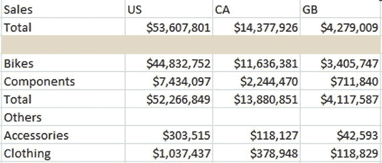
图 7-25。重新排列数据

现在，您可以重新排列值和标签，以获得所需的布局和格式（参见图 7-25）。

### 动手实验——在 Excel 中创建 BI 界面

在以下实验中，您将：

*   向数据透视表添加条件格式。
*   创建图表以帮助分析数据。
*   链接数据透视表和数据透视图。
*   使用多维数据集函数显示模型数据。

1.  在`LabStarters`文件夹中，打开`LabChapter7.xlsx`文件。该文件包含来自测试 AdventureWorksDW 数据库的库存和销售数据。
2.  在 Excel 的 Sheet1 中，使用`插入`选项卡上的`数据透视表`按钮插入一个 Power Pivot 表格。选择`使用外部数据源`，然后单击`选择连接`按钮。在`现有连接`窗口的`表格`选项卡上，选择`工作簿数据模型中的表格`（参见图 7-26）。

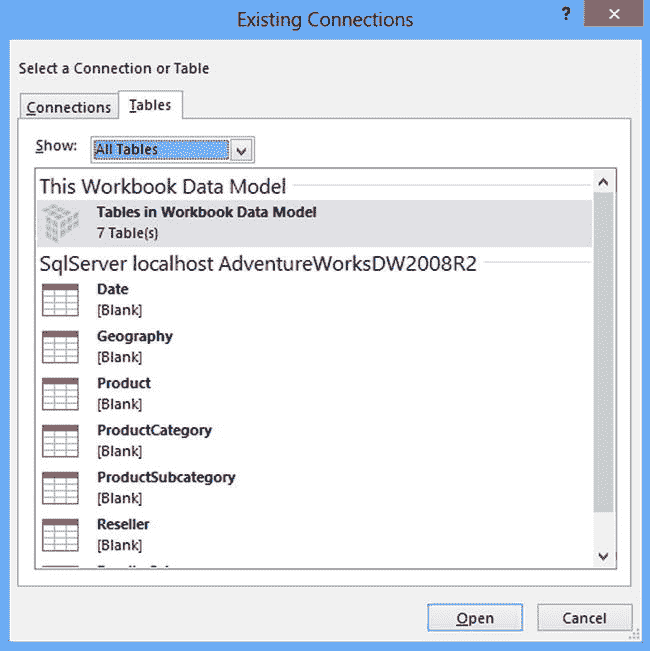
图 7-26。选择连接

3.  将`ResellerSales`表中的`TotalQuantity`、`TotalSales`和`TotalMargin`添加到`字段列表`窗口的`值`拖放区域。将`Calendar`层次结构添加到`行标签`拖放区域。
4.  请注意，有些利润是负值。为了突出显示负值，您将把它们格式化为红色。
5.  选择数据透视表中的一个`TotalMargin`单元格。在`开始`选项卡上，单击`条件格式`下拉菜单。选择`突出显示单元格``小于`选项。将小于 0 的单元格格式化为红色文本（参见图 7-27）。

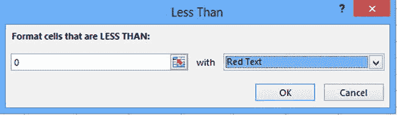
图 7-27。设置条件格式

6.  完成后，您应会在所选单元格旁边看到一个图标。单击它并选择`显示 TotalMargin 值的所有单元格`选项。
7.  选择一个`TotalSales`单元格。这次，在`条件格式`下拉菜单下选择`数据条`。选择一种渐变样式。选择`数据条`后，您应会在值旁边看到一个小图标。单击它并选择`显示 TotalSales 值的所有单元格`。
8.  您的数据透视表应类似于图 7-28。展开年份，注意格式化会显示在季度、月份和年份上。

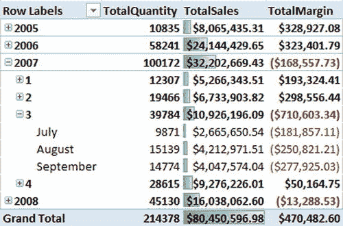
图 7-28。向数据透视表添加数据条

9.  打开`sheet2`，在“插入”选项卡中，选择`PivotChart`下拉菜单。从下拉菜单中选择数据透视图。使用“工作簿中的数据模型”表连接，将图表插入到当前工作表中。
10. 在“字段列表”窗口中，将`ResellerSales`表中的`TotalSales`添加到“值”区域，并将`Geography`表中的`CountryRegionName`添加到“轴字段”区域。您应该会看到一个按国家/地区显示销售额的柱形图（参见图 7-29）。

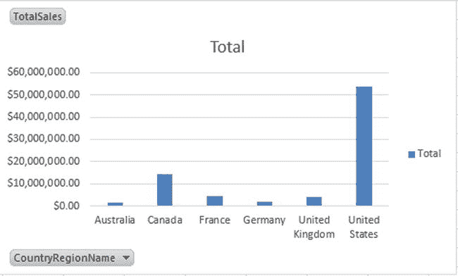
图 7-29. 添加柱形图

选择柱形图。您应该会看到“数据透视图工具”选项卡。在“设计”选项卡中，您可以更改图表颜色、布局和图表类型。

11. 在“布局”选项卡中，您可以更改标题、图例、标签和网格线。“格式”选项卡允许您格式化图表中的形状和文本。“分析”选项卡允许您显示/隐藏字段按钮。
12. 将图表的标题重命名为`Sales By Country`。隐藏字段按钮和图例。移除网格线。
13. 右键单击垂直轴并选择“设置坐标轴格式”。在“坐标轴选项”下，将“显示单位”更改为“百万”。在“数字”节点下，将“类别”更改为“货币”，小数位数设为`0`。您的图表应类似于图 7-30。

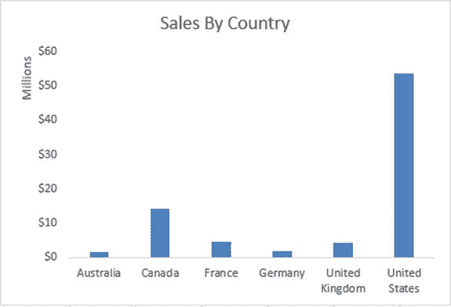
图 7-30. 格式化柱形图

14. 有时您希望同时查看数据图表和数据表。为此，请转到“Power Pivot 模型设计器”，在“开始”选项卡中选择`PivotTable`下拉菜单。从下拉菜单中选择“图表和表格（水平）”。在新工作表中插入图表和表格。
15. 将图表类型更改为饼图。在图表的“字段列表”窗口中，将`TotalSales`字段添加到“值”区域，并将`CountryRegionCode`添加到“轴字段”区域。
16. 将图表标题更改为`Sales By Country`并移除字段按钮。
17. 在“设计”选项卡上，将“图表布局”更改为以货币形式（无小数）显示数值（参见图 7-31）。

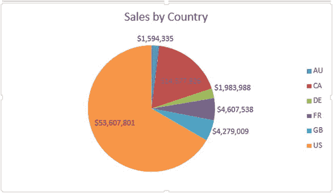
图 7-31. 创建销售饼图

18. 单击数据透视表以调出其“字段列表”窗口。将`ResellerSales`表中的`TotalSales`添加到“值”区域。将`Product Subcategory`添加到“行标签”区域。
19. 选中饼图，为产品类别和年份各插入一个切片器（参见图 7-32）。验证切片器是否仅过滤饼图而不影响数据透视表。

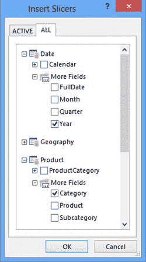
图 7-32. 插入切片器

20. 选择“年份”切片器，在“切片器工具选项”选项卡中，单击“报表连接”按钮。添加与饼图位于同一工作表上的数据透视表。对类别切片器重复此步骤。
21. 验证切片器是否同时过滤图表和数据透视表。您的仪表板应类似于图 7-33。

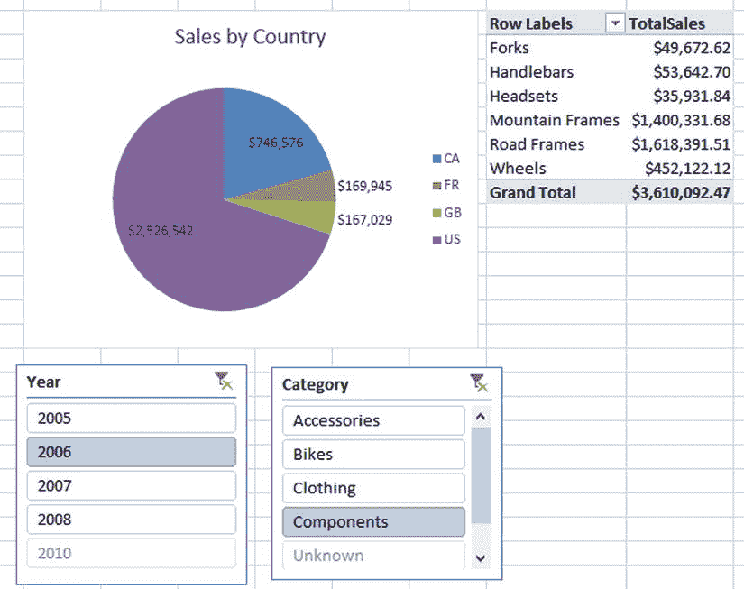
图 7-33. 创建仪表板

22. 在工作簿中添加一个新工作表。您将使用多维数据集函数来计算总销售额最高的产品和最高的经销商。最终结果应类似于图 7-34。

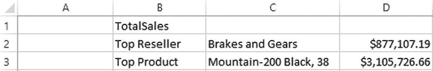
图 7-34.

23. 在`B1`单元格中添加以下代码以选择`TotalSales`度量值。

```excel
=CUBEMEMBER("ThisWorkbookDataModel","[Measures].[TotalSales]")
```

24. 在`B2`单元格中，使用以下函数获取按`TotalSales`降序排列的经销商集。您将使用此集来选择排名最高的经销商。

```excel
=CUBESET("ThisWorkbookDataModel",
    "[Reseller].[ResellerName].children","Top Reseller",2,B1)
```

25. 在`B3`单元格中，使用此函数获取按`TotalSales`降序排列的产品集。

```excel
=CUBESET("ThisWorkbookDataModel",
     "[Product].[Product].children","Top Products",2,B1)
```

26. 在`C2`单元格中，使用`CUBERANKEDMEMBER`函数从`B2`单元格中函数返回的集中获取排名最高的经销商。

```excel
=CUBERANKEDMEMBER("ThisWorkbookDataModel",B2,1)
```

27. 在`C3`单元格中，使用`CUBERANKEDMEMBER`函数从`B3`单元格中函数返回的集中获取排名最高的产品。

```excel
=CUBERANKEDMEMBER("ThisWorkbookDataModel",B3,1)
```

28. 在`D2`单元格中，使用`CUBEVALUE`函数获取`C2`单元格中找到的顶级经销商的总销售额。请注意，您必须将`C2`中找到的经销商名称与`Power Pivot`模型中的`[Reseller].[ResellerName]`属性连接起来。

```excel
=CUBEVALUE("ThisWorkbookDataModel",
    "[Reseller].[ResellerName].&["& C2 &"]","[Measures].[TotalSales]")
```

29. 使用类似的`CUBEVALUE`函数，您可以获取顶级产品的总销售额值。

```excel
=CUBEVALUE("ThisWorkbookDataModel",
      "[Product].[Product].&[" &C3&"]","[Measures].[TotalSales]")
```

#### 总结

正如您在本文中所见，`Excel`是一个功能丰富的环境，可使用数据透视表和数据透视图创建仪表板。至此，您应该能够熟练地使用工作簿模型作为数据源来创建数据透视表和数据透视图。您还使用了`Excel`多维数据集函数直接查询模型，而无需使用数据透视表。本章涵盖了入门的基础知识，但您还需要学习更多关于`Excel`及其如何帮助您分析数据的知识。我鼓励您深入探索这些功能。下一章是三个章节中的第一个，您将在其中了解`Power Pivot`模型的另一个有用界面。`Power View`为用户提供了一个丰富的交互式界面来探索数据。您将首先了解如何优化模型以用于`Power View`分析，然后使用`Power View`创建标准报表，之后，您将学习如何使用`Power View`创建引人注目的交互式报表。

## 第 2 部分


使用`Power View`构建交互式报表和仪表板

## 第 8 章


优化`Power Pivot`模型以用于`Power View`

`Power View`是`Excel`中的一种工作表类型，允许用户开发交互式可视化效果，从而鼓励对数据进行临时探索。对于想要探索和洞察数据但并非`Excel`高级用户的用户来说，它是一个理想的工具。由于`Power View`可视化效果基于`Power Pivot`模型，您需要为用户提供一个可靠的模型作为这些可视化效果的基础。一个经过调整以适用于`Power View`的良好`Power Pivot`模型将带来卓越的用户体验，而非极其糟糕的用户体验。有多种方法可以优化`Power Pivot`模型，以使其在`Power View`中更好地创建报表。本章将回顾这些设置，并展示如何创建支持许多`Power View`功能的模型。

完成本章后，您将能够：

*   了解`Power View`中可用的可视化类型。
*   在`Power View`中创建基本可视化效果。
*   设置`Power Pivot`模型中的属性以改善`Power View`体验。

 **注** 如需彩色图片副本，请访问源代码/下载页面，网址为`http://www.apress.com/9781430264453`。

## 使用`Power View`可视化数据